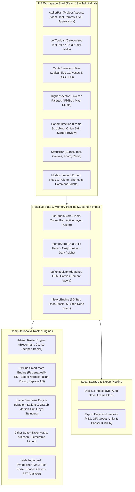
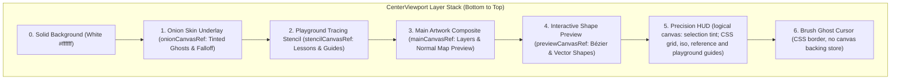
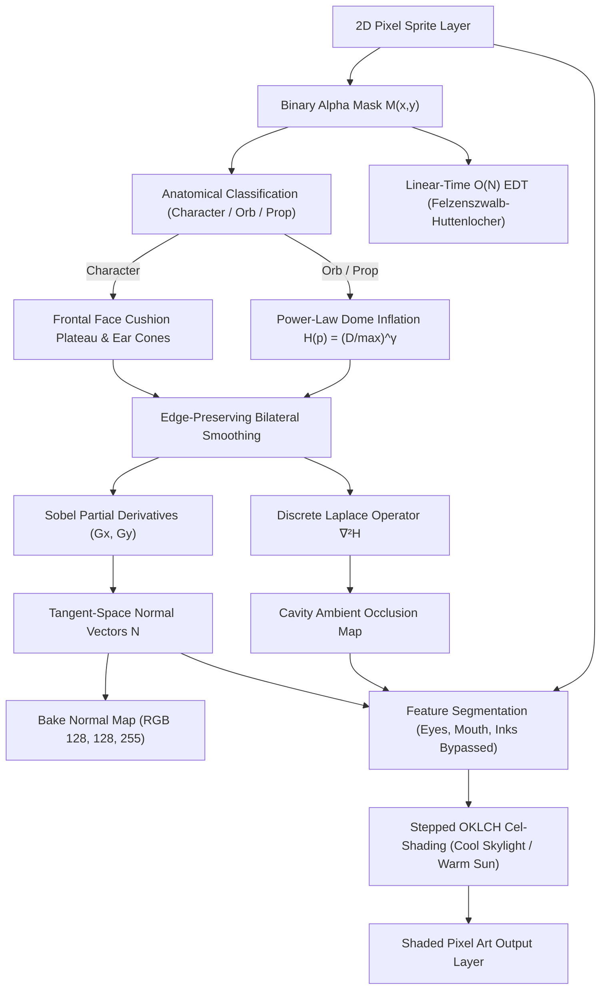
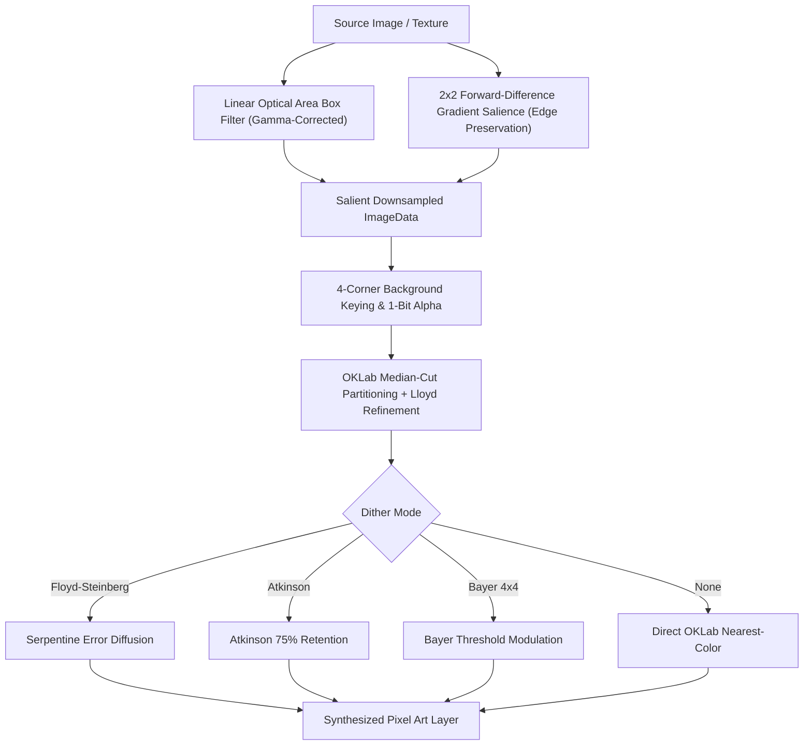
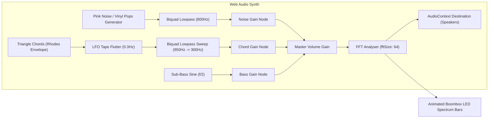
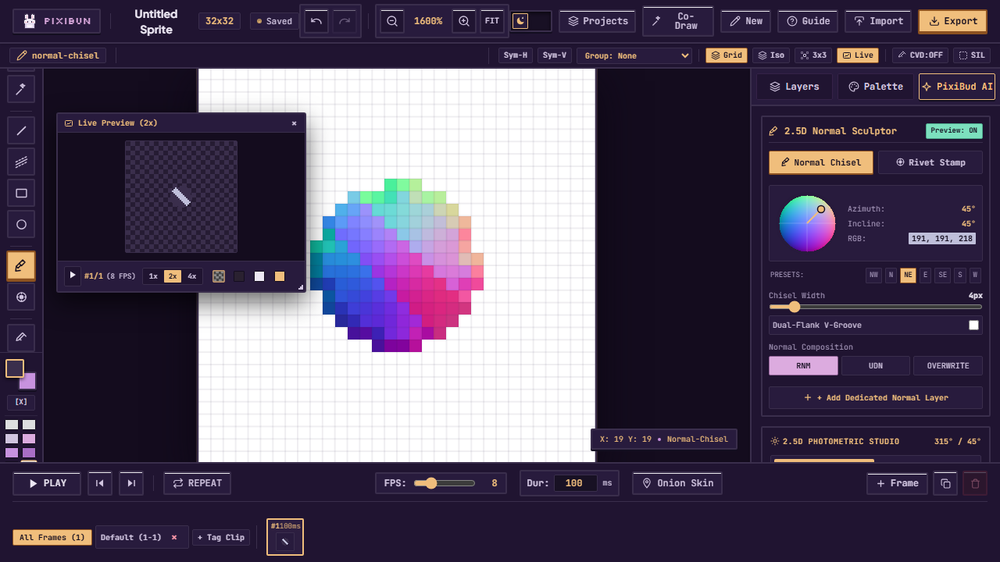
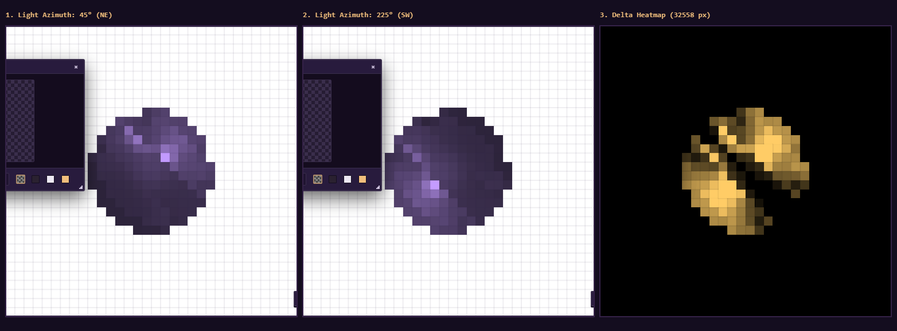
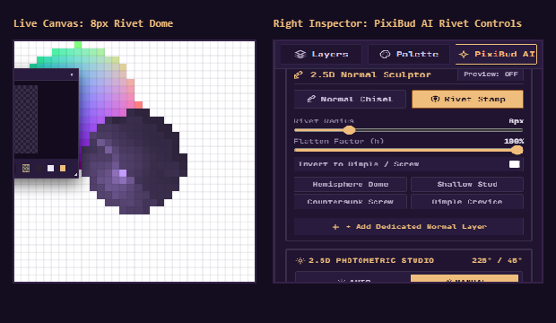
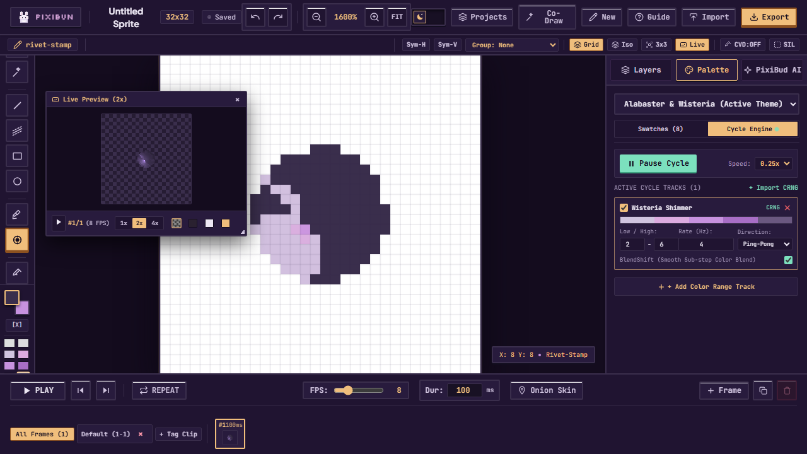
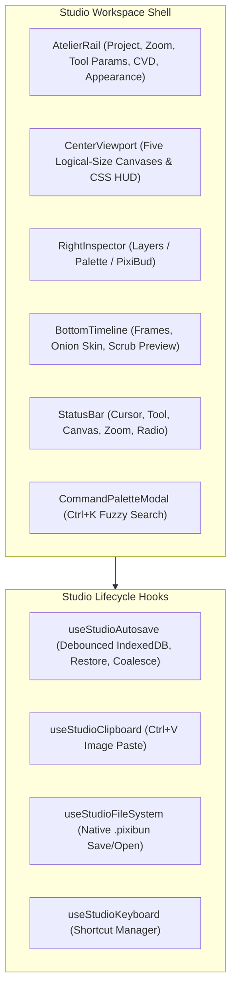

# Architecture & System Design — PixiBun Atelier

```text
  /\_/\   *  .  *  .  *  *  .  *  *  .  *  *
 ( o.o )   A R C H I T E C T U R E
  > ^ <    Technical Blueprint & Engineering Reference
```

> **A high-performance, offline-first raster graphics workstation designed for sub-16ms interactive drawing latency and mathematically sound 2.5D computer graphics.**

---

## Table of Contents

- [1. System Topology Overview](#1-system-topology-overview)
- [2. Canvas & Rendering Pipeline](#2-canvas--rendering-pipeline)
- [3. PixiBud Smart Math & Computer Graphics Engine (`src/lib/ai/math/`)](#3-pixibud-smart-math--computer-graphics-engine-srclibaimath)
- [4. State Management, Layer Security & Undo Architecture](#4-state-management-layer-security--undo-architecture)
- [5. Local-First Storage & Multi-Project Lifecycle (`src/lib/storage/db.ts`, `src/lib/project/schema.ts`)](#5-local-first-storage--multi-project-lifecycle-srclibstoragedbts-srclibprojectschemats)
- [6. Multi-Engine Export & Web Worker Pipeline (`src/lib/export/`)](#6-multi-engine-export--web-worker-pipeline-srclibexport)
- [7. 3D Minecraft Skin Recognition & Domain Shading Engine (`src/lib/ai/math/minecraftSkin.ts`)](#7-3d-minecraft-skin-recognition--domain-shading-engine-srclibaimathminecraftskints)
- [8. Signed Distance Field (SDF) In-Between Animation Morphing (`src/lib/ai/pixelAiEngine.ts`)](#8-signed-distance-field-sdf-in-between-animation-morphing-srclibaipixilaienginets)
- [9. Intelligent Image-to-Pixel-Art Synthesis Pipeline (`src/lib/ai/pixelizeEngine.ts`)](#9-intelligent-image-to-pixel-art-synthesis-pipeline-srclibaipixelizeenginets)
- [10. Procedural Web Audio Ambient Radio (`src/lib/audio/lofiRadio.ts`)](#10-procedural-web-audio-ambient-radio-srclibaudiolofiradiots)
- [11. Zero-Lag Theme Architecture (`src/stores/themeStore.ts`)](#11-zero-lag-theme-architecture-srcstoresthemestorets)
- [12. Zero-GC Memory Management & Buffer Pooling (`src/lib/engine/bufferPool.ts`)](#12-zero-gc-memory-management--buffer-pooling-srclibenginebufferpoolts)
- [13. Multithreaded Worker & Deterministic CG Math Architecture](#13-multithreaded-worker--deterministic-cg-math-architecture)
- [14. Strongly-Typed Studio Event Bus (`src/lib/events/studioEvents.ts`)](#14-strongly-typed-studio-event-bus-srclibeventsstudioeventsts)
- [15. Vercel & CI/CD Deployment Pipeline](#15-vercel--cicd-deployment-pipeline)
- [16. P2P Co-Draw Sync Bridge (`src/lib/sync/coDrawBridge.ts`)](#16-p2p-co-draw-sync-bridge-srclibsynccodrawbridgets)
- [17. Diagnostics Relay Hardening (`src/app/api/diagnostics/relay/route.ts`)](#17-diagnostics-relay-hardening-srcappapidiagnosticsrelayroutets)
- [18. Algorithmic Scope Boundaries & Target System Envelope](#18-algorithmic-scope-boundaries--target-system-envelope)
- [19. 2.5D Normal Chisel & Bas-Relief Sculptor (`src/lib/art/normalSculptor.ts`)](#19-25d-normal-chisel--bas-relief-sculptor-srclibartnormalsculptorts)
- [20. Mark Ferrari 8-Bit Dynamic Palette Cycling Engine (`src/lib/color/paletteCycling.ts`)](#20-mark-ferrari-8-bit-dynamic-palette-cycling-engine-srclibcolorpalettecyclingts)
- [21. Database & Canvas Teardown Lifecycle Invariants (`src/lib/storage/db.ts`, `tests/e2e/chiselAndPaletteLiveProof.spec.ts`)](#21-database--canvas-teardown-lifecycle-invariants-srclibstoragedbts-testse2echiselandpaletteliveproofspects)
- [22. Bitwise Normalization, Hot-Path Viewport Decoupling & Export Pipeline Hardening](#22-bitwise-normalization-hot-path-viewport-decoupling--export-pipeline-hardening)
- [23. Selection Free-Transform Gizmo, Sprite Sheet Slicer & Web Worker Offloading Engine](#23-selection-free-transform-gizmo-sprite-sheet-slicer--web-worker-offloading-engine)
- [24. Workstation Architectural Upgrades (`p2pHostAuthority`, `structuralHistory`, `desktopFS`, `47-blob`, `isobmffMuxer`)](#24-workstation-architectural-upgrades-p2p-host-authority-structural-history-desktop-fs-47-blob-autotile--pure-isobmff-muxer)
- [25. Comprehensive Defensive Hardening & Invariant Architecture](#25-comprehensive-defensive-hardening--invariant-architecture)
- [26. Autonomous Local CI/CD Quality Gate & Git Pre-Push Protection](#26-autonomous-local-cicd-quality-gate--git-pre-push-protection)
- [27. Studio Workstation Ergonomics, Focus Trapping & Unsaved Invariants](#27-studio-workstation-ergonomics-focus-trapping--unsaved-invariants)
- [28. Photometric Studio Resolution-Aware Bevel Scaling & Dark Palette Protection](#28-photometric-studio-resolution-aware-bevel-scaling--dark-palette-protection)
- [29. Studio UI Architecture & Design System Primitives](#29-studio-ui-architecture--design-system-primitives)
- [30. Teaching Animation Board & Playground Education System](#30-teaching-animation-board--playground-education-system)
- [31. Neutral 2.5D Relighting & Smart-Effect Recipe Provenance (Phase 63)](#31-neutral-25d-relighting--smart-effect-recipe-provenance-phase-63)
- [32. Restricted Recovery Mode, Envelope Guards & Streaming Archive Architecture (Phase 1A & Phase 1B)](#32-restricted-recovery-mode-envelope-guards--streaming-archive-architecture-phase-1a--phase-1b)

---

## 1. System Topology Overview

PixiBun is structured as a client-side single-page application built on **Next.js 16 (App Router)** with zero mandatory server dependencies for drawing, animation, synthesis, or exporting.



---

## 2. Canvas & Rendering Pipeline

### Multi-Canvas Layered Viewport Stack
To avoid browser layout recalculations and keep editor guides out of color picking, viewport rendering uses five logical-size canvas layers, CSS screen-pixel guides, and a CSS brush cursor. Zoom changes the stage's display size without multiplying any canvas backing store; the interactive SVG selection gizmo supplies the screen-space marquee.

The stage and main composite canvas use no layout-affecting border. A CSS outline marks the stage edge, leaving the artwork raster and grid overlay with the same CSS origin and dimensions (`canvasWidth × zoom / 100` by `canvasHeight × zoom / 100`). Pointer coordinates are mapped through the main canvas bounds, so this equality also protects tool hit positions at high zoom.



### Pure Compositor & Eyedropper Isolation (`src/lib/render/compositor.ts`)
The `compositeFrame()` module serves as the single visual source of truth for pure pixel compositing:
- **Zero Editor Chrome**: Bottom-up compositing honoring layer visibility, opacity, and blend modes without including onion skin ghosts, grid lines, or selection marquees.
- **Eyedropper & Exporters**: The eyedropper samples directly from `compositeFrame()`, making color picking completely immune to normal-map preview modes, HUD guides, and ghost underlays.
- **Living Timeline Thumbnails**: Timeline frame cards render `<FrameThumbnail>` elements backed by `compositeFrame()`, with live re-compositing restricted to the active frame on `bufferVersion` updates to maintain $O(1)$ stroke performance.

### Pure Onion Skinning Engine (`src/lib/render/onionSkin.ts`)
- Pure, DOM-free `getOnionSkinSpecs()` computes clamped previous/next ghost specifications with distance falloff `base * (1 - 0.25 * (dist - 1))` and `prevColor`/`nextColor` tint mapping.
- Tinting is executed offscreen via `source-atop` before blitting to the underlay canvas.

### Direct Buffer Memory Management (`src/lib/engine/bufferRegistry.ts`)
Layers are maintained as detached `HTMLCanvasElement` objects indexed by layer UUID in memory. When the user resizes the canvas:
1. `resizeAllBuffers(newWidth, newHeight, anchor, resample)` shifts and re-allocates existing canvas buffers with 9-point anchor alignment and optional nearest-neighbor resampling.
2. Memory leaks are eliminated by explicitly clearing and discarding dereferenced buffers via `deleteBuffers(layerId)`.

### Pure History Engine (`src/lib/engine/historyEngine.ts`)
The undo/redo pipeline is fully decoupled from the React rendering tree into a pure, DOM-free `HistoryEngine` module:
- Undo and redo stacks are independently depth-bounded (up to 50 entries each), while their combined retained HistoryStep payload is constrained by the configured 64 MiB history byte envelope. Oldest undo steps are evicted when capacity or byte limits are reached, folding evicted steps into the Process Replay baseline checkpoint across both push and redo operations. Oldest redo entries are evicted under combined byte pressure without mutating the baseline.
- Invalidates the redo tail upon any new drawing action or canvas mutation.
- Captures pre-stroke and post-stroke layer `ImageData` snapshots for deterministic $O(1)$ state restoration via `ctx.putImageData`.
- Provides reactive boolean getters (`canUndo`, `canRedo`) synchronized with `useStudioStore`.

---

## 3. PixiBud Smart Math & Computer Graphics Engine (`src/lib/ai/math/`)

The graphics intelligence engine is decomposed into modular, deterministic mathematical modules under `src/lib/ai/math/` and `src/lib/ai/`:
- `edtNormalMap.ts`: Felzenszwalb-Huttenlocher $O(N)$ EDT, non-linear dome inflation ($\gamma = 0.5$), bilateral smoothing, content-aware heightmaps, anatomical part segmentation, frontal face cushion plateau (level camera-facing plateau), independent ear cone ridges, and Sobel tangent normal vector fields.
- `photometricLighting.ts`: Parametric 2.5D Blinn-Phong lighting, feature preservation (eyes/mouth/outlines), stepped OKLCH cel-shading with perceptual hue shifts, and in-place tagged relighting (`Photometric <material>`).
- `photometricAuto.ts`: Canvas art morphology analysis, anatomical classification (`character`, `orb`, `prop`), connected-component feature clustering (eyes, mouth, whiskers), convex lobe ear/horn scanning, and automated lighting parameter inference.
- `shadowAuto.ts`: Canvas sprite geometry analysis, contact baseline detection, and directional shadow parameter inference.
- `shadowRayMarcher.ts`: 2.5D bounded sprite cast shadows with 1-to-1 sheared silhouette projection, classic ground contact drop shadow ellipses (`shadowStyle: 'drop'`), and uniform flat opacity (`ditherMode: 'none'`).
- `colorSpace.ts`: sRGB $\leftrightarrow$ linear $\leftrightarrow$ OKLab $\leftrightarrow$ OKLCH conversions and perceptual hue shifting (`shiftHue`).
- `spriteCleanup.ts`: Multi-stage scan and non-destructive pixel cleanup, faint alpha stripping, small detached speck removal, neutral-gray shade reduction, and optional line thinning with before/after previews.



### Key Mathematical Formulations:
1. **$O(N)$ Euclidean Distance Transform:**
   Uses separable 1D lower parabolic envelope scans:
   $$D(p) = \min_{q \notin \Omega} \sqrt{(p_x - q_x)^2 + (p_y - q_y)^2}$$
2. **Analytical Tangent Normals & Light Vector (Compass Convention):**
   $$\mathbf{N} = \frac{1}{\sqrt{s_x^2 G_x^2 + s_y^2 G_y^2 + 1}} \begin{pmatrix} -s_x G_x \\ -s_y G_y \\ 1 \end{pmatrix}, \quad \mathbf{L}(\theta, \phi) = \begin{pmatrix} \sin\theta \cos\phi \\ -\cos\theta \cos\phi \\ \sin\phi \end{pmatrix}$$
   *Standard navigation/Photoshop azimuth convention: $0^\circ = \text{North (Top)}, 45^\circ = \text{North-East}, 135^\circ = \text{South-East}, 225^\circ = \text{South-West}, 315^\circ = \text{North-West (Top-Left)}$.*
3. **Frontal Face Cushion Plateau & Feature Normal Stabilization:**
   For character forms, to avoid "bowling-ball" inflation where half the face is plunged into darkness ($N \cdot L < 0$), height within the outer silhouette bevel of radius $R_{\text{char}} = 2.8 \times \text{scaleFactor}$ (where $\text{scaleFactor} = \max(1.0, \min(W, H) / 32)$) bevels smoothly while the interior reaches a flat plateau:
   $$\text{rimRatio} = \min\left(1.0, \frac{D_{\text{macro}}(p)}{R_{\text{char}}}\right), \quad H_{\text{macro}}(p) = \max(D_{\text{macro}}) \cdot \sqrt{\text{rimRatio}}$$
   Normals across the face interior level off to a camera-facing plateau, confining form shadows to the unlit silhouette edge. Features (eyes, mouth, whiskers) receive camera-facing normals $\mathbf{N} = (0, 0, 1)^T$.
4. **Feature Segmentation & 4-Tone Discrete OKLCH Cel-Shading:**
    Pixels tagged `isFeature = 1` or `isInkLine = 1` bypass lighting multipliers entirely, preserving exact original RGB values. Unshaded base colors receive discrete stepped tone quantization in OKLCH via `buildCelRamp()` (4 tones):
    * **Base Tone:** Original artist color preserved (55%–60% of lit surface)
    * **Directional Mid-Shadow:** $L_{\text{shadow}} = \max(0.04, \min(L_{\text{base}} \times 0.86, L_{\text{base}} - 0.025))$, with authored hue and chroma strictly preserved (preserving original artwork color identity without blue-violet shifts).
    * **Deep Crevice:** $L_{\text{deep}} = \max(0.02, \min(L_{\text{base}} \times 0.72, L_{\text{base}} - 0.05))$ with authored hue and chroma preserved (concave seams where $AO < \text{creviceAOThresh}$, dynamically bounded to $[0.12, 0.30]$ scaling with cavity strength).
    * **Highlight:** $L_{\text{hi}} = \min(0.98, L_{\text{base}} + (0.98 - L_{\text{base}}) \times 0.22)$ with authored hue and chroma preserved (shiny materials only: $k_s > 0.1$ and not matte/fabric; penumbra uses $L_{\text{soft}} = \max(0.05, \min(L_{\text{base}} \times 0.93, L_{\text{base}} - 0.015))$).
    * **Exposure-Compensated Directional Terminator (Phase 63):** Cel shadow placement is evaluated purely over the directional diffuse signal $\text{diffSignal} = \text{wrapNdotL} \times \text{effectiveFalloff}$. To prevent high lamp brightness from flattening unlit geometry, the terminator threshold is exposure-compensated without shifting the geometric boundary via a piecewise linear mapping around baseline 1.15 ($\text{shadowThresh} = 0.52 + t \times 0.30$ for $\text{brightness} \le 1.15$, or $0.52 - t \times 0.32$ for $\text{brightness} > 1.15$). Optional Bayer matrix dither modulation perturbs the threshold for organic pixel art stippling.
    * **Neutral Macro-Form & Material-Scale Synthesis (Phase 63):** Superseded fixed head/neck/torso height priors with neutral macro-form and multi-scale material detail ($H_{\text{composite}} = 0.70 H_{\text{macro}} + 0.30 H_{\text{micro}}$ for characters), ensuring the 2.5D normal field $\mathbf{N}$ remains independent of light direction and allowing tones to dynamically track the light bulb across $360^\circ$ azimuth. Interior ink detection requires opposing two-sided luminance dips ($(\text{neighbor}_{\text{opposing}} - \text{lum}) \ge 0.12$), preventing painted shadow boundaries from being carved as permanent ink crevices. Connected-component flood fill clusters authored ramps by hue and chroma proximity ($\Delta\text{hue} \le 35^\circ, \Delta\text{chroma} \le 0.25$).
5. **Blinn-Phong Specular Half-Vector:**
   $$\mathbf{H} = \frac{\mathbf{L} + \mathbf{V}}{\|\mathbf{L} + \mathbf{V}\|}, \quad I_s = k_s (\max(0, \mathbf{N} \cdot \mathbf{H}))^\alpha$$
   In discrete pixel-art ramps, sparse specular highlights are isolated when $I_s > 0.35$.
6. **Discrete Laplace Cavity Occlusion:**
   $$\nabla^2 H \approx H * \begin{bmatrix} 0 & 1 & 0 \\ 1 & -4 & 1 \\ 0 & 1 & 0 \end{bmatrix}, \quad AO(p) = \text{clamp}(1.0 - k_{\text{ao}} \max(0, -\nabla^2 H), 0, 1)$$
7. **2D Subsurface Scattering (Beer-Lambert + Henyey-Greenstein Forward Phase):**
   $$T(\mathbf{x}) = 2\sqrt{\max\left(0, R^2 - D(\mathbf{x})^2\right)}, \quad I_{SSS}(\mathbf{x}) = C_{scatter} \exp\left(-\boldsymbol{\sigma}_t \frac{T(\mathbf{x})}{d_{trans}}\right) \cdot P_{2D}(\mathbf{L}', \mathbf{V}, g)$$
   $$P_{2D}(\theta, g) = \frac{1 - g^2}{2\pi (1 + g^2 - 2g \cos\theta)^{3/2}}$$
   *(Note: Evaluates the 3D Henyey-Greenstein kernel in 2D with a $2\pi$ circumference prefactor as an empirical forward-scattering highlight curve, clamped to $[0, 1.0]$ in the relighting pipeline).*
8. **Dielectric Fresnel Reflectance with Cauchy Chromatic Dispersion:**
   $$F(\theta) = F_0 + (\max(1 - \alpha, F_0) - F_0) \cdot (1 - \cos\theta)^{p_{fresnel}}, \quad \eta_R = \eta_0 - \Delta\eta, \; \eta_B = \eta_0 + \Delta\eta$$
9. **Kajiya-Kay Anisotropic Cylindrical Specular:**
   $$\sin(\mathbf{T}, \mathbf{H}) = \sqrt{\max\left(0, 1 - (\mathbf{T}\cdot\mathbf{H})^2\right)}, \quad I_{aniso} = k_{s1} \sin^{p_1}(\mathbf{T}_1, \mathbf{H}) + k_{s2} \sin^{p_2}(\mathbf{T}_2, \mathbf{H})$$
10. **Bounded 2.5D Sprite Cast Shadows & Ground Drop Shadows (`shadowRayMarcher.ts`):**
    * **1-to-1 Sheared Silhouette Ground Projection:**
      $$h = y_{\text{base}} - y_s \ge 0$$
      $$\text{projX} = \text{round}(x_s + h \cdot \text{shear}_x), \quad \text{projY} = \text{round}(y_{\text{ground}} + h \cdot \text{shear}_y)$$
      Sub-step traversal strictly along the shear vector preserves hollow leg arches and waist indentations without bounding-box bloat.
    * **Ground Contact Drop Shadow Style (`shadowStyle: 'drop'`):**
      Renders a crisp Bresenham pixel ellipse under the character contact baseline ($y_{\text{base}}$):
      $$\frac{(x - x_{\text{center}})^2}{r_x^2} + \frac{(y - y_{\text{base}})^2}{r_y^2} \le 1.0$$
    * **Uniform Flat Pixel Art Opacity (`ditherMode: 'none'`):**
      Shadow pixels receive uniform flat opacity $\text{round}(\text{shadowOpacity} \times 255)$, completely eliminating continuous 256-level float gradients.
    * **Non-Destructive Tagged Output:** Writes directly to `Layer.tag = 'cast-shadow'`.
11. **Interactive On-Canvas Pixel Light Bulb Gizmo & Reticle Mathematics (`PixelLightBulbGizmo.tsx`):**
    * Dynamic azimuth calculation from pointer coordinates orbiting around a stationary subject center reticle:
      $$\theta = \left(\text{atan2}(x_{\text{ptr}} - x_{\text{center}}, -(y_{\text{ptr}} - y_{\text{center}})) \times \frac{180}{\pi} + 360\right) \pmod{360}$$
    * Decoupled focal point reticle handle ($x_{\text{center}}, y_{\text{center}}$) allowing artists to reposition the lighting anchor without altering the light direction angle.
    * 60fps `requestAnimationFrame` throttled preview updates.
12. **Spherical Convex Dome Inflation & Slope AO Decoupling:**
    * Heightmap blends spherical dome inflation ($0.75$) with a gamma curve ($0.25$, default $\gamma = 0.5$):
      $$H(p) = \max(D) \cdot \left(0.75 \sqrt{\max\left(0, 1 - \left(1 - \frac{D(p)}{\max(D)}\right)^2\right)} + 0.25 \left(\frac{D(p)}{\max(D)}\right)^\gamma\right)$$
    * Eliminates conical pinch creases on convex primitives while providing true vertical silhouette tangents.
    * Decouples direct key light from cavity ambient occlusion on convex slopes to eliminate center-locked apex highlight glitches.

---

## 4. State Management, Layer Security & Undo Architecture

The application state is managed by Zustand with Immer middleware:
* **`useStudioStore`:** Single source of truth for tool settings, primary/secondary colors, frame lists, layer hierarchies, zoom/pan parameters, and UI visibility.
* **50-Step Undo History:** Undo and redo stacks are independently depth-bounded (up to 50 entries each, `createHistoryEngine(50)` matching `src/hooks/viewport/useViewportDrawing.ts:36`), while their combined retained HistoryStep payload is constrained by the configured 64 MiB history byte envelope. Undo/Redo restores saved pixels with `putImageData`; work scales with the affected pixel region and does not re-run unrelated effect calculations.
* **History Layer Lifecycle (`createdLayerId`):** When AI operations (`Photometric`, `Specular`, `Cast Shadow`) create a new layer, the history snapshot tracks `createdLayerId`. Undoing the action removes the layer entirely from the frame stack and purges its buffer memory, while redoing cleanly restores it.
* **Locked Layer Drawing Protection:** `handlePointerDown` checks `currentLayer.locked` prior to dispatching raster strokes. When locked, execution returns immediately and triggers an animated HUD warning toast (`Active layer is locked! Unlock it in the Layers panel to draw.`) with `<PixelIcon name="lock" />`.
* **`bufferVersion` Signal & Stroke Decoupling:** Atomic counter throttled via `requestAnimationFrame` strictly for external observers (`BottomTimeline`, `FloatingPreviewWindow`). Decoupled completely from `CenterViewport` to eliminate React reconciliation cascades during pen/eraser strokes (0 re-renders during pointer moves).
* **Layer Merge Down (`mergeLayerDown`):** Blends active layer onto underlying layer respecting opacity and blend modes, deletes upper buffer memory in $O(1)$, and selects lower layer cleanly.

---

## 5. Local-First Storage & Multi-Project Lifecycle (`src/lib/storage/db.ts`, `src/lib/project/schema.ts`)

* **Database Engine:** Dexie.js wrapping browser IndexedDB (`PixiBunDB`, Schema v5).
* **Tables:**
  * `projects`: Indexed by `id, name, updatedAt, createdAt`. Stores serialized `.pixibun` payload (`dataJson`), canvas bounds (`width, height`), `fps`, `createdAt`, `updatedAt`, and a downscaled composite preview (`thumbnailDataUrl`) for instant gallery card rendering.
  * `layerBlobs`: Indexed by `++id, [projectId+layerId+frameIndex], projectId, layerId, [projectId+id]`. Stores raw binary PNG image `Blob` instances directly, eliminating JSON base64 stringification CPU overhead and reducing autosave storage footprints by ~33%.
  * `diagnostics`: Indexed by `id, kind, timestamp`. Stores local telemetry and crash events in an on-device ring buffer (200 entries max).
  * `recoveryRecords`: Indexed by `projectId, classificationState, lastConfirmedAt`. Stores disaster recovery lifecycle ledger records, tracking quarantine states and repair history keyed by projectId.
* **Multi-Project Workspace Management (`ProjectsGalleryModal.tsx`):**
  * Artists can maintain an unlimited on-device portfolio of sprites and animations.
  * Supports full lifecycle management: instant switching, project duplication (`duplicateProject`), inline renaming (`renameProject`), and safe deletion (`deleteProject`).
* **P0 History Stack Invalidation (`pixibun:history-clear`):**
  * When switching projects, loading an artwork, or creating a new blank project, `hydrateProject` and `resetToNewProject` dispatch `pixibun:history-clear`.
  * `CenterViewport` clears the 50-step `HistoryEngine` and resets `canUndo`/`canRedo` flags, eliminating cross-project undo state corruption.
* **Persistent Storage Failure & Auto-Recovery Banner:** Continuous autosave invokes `autoSaveWorkspaceDetailed(...)`, returning a `Promise<AutoSaveOutcome>` (a discriminated union: `{ ok: true, status: 'saved' }` or failure `{ ok: false, reason: 'invariant-invalid' | 'aborted' | 'quota-exceeded' | 'error' }`). If 2 consecutive saves fail (e.g. disk quota exceeded, incognito clearance), a sticky warning banner appears with a 1-click `"Export Drawing"` button. When storage clears and autosave succeeds (`outcome.ok === true`), the banner auto-dismisses and resets error counts.
* **Document Revision Autosave Trigger (`state.editRevision`):** In addition to pixel history commits, `useStudioAutosave` subscribes directly to store revision increments (`state.editRevision`). Structural changes (layer renames, reordering, locks, deletions, canvas resizing) and effect recipe parameter updates trigger debounced IndexedDB autosaves automatically, persisting metadata state within the debounce window.
* **Full-Fidelity v1 $\to$ v2 $\to$ v3 Migration Engine (`migrateProjectPayload`):**
  * Auto-detects legacy v1 (`version: undefined`) and v2 files.
  * Backfills default `customRamps: []`, `clips: []`, `onionSkin`, per-layer `blendMode: 'source-over'`, `opacity: 1.0`, `visible: true`, `locked: false`, and validates optional `LayerEffectRecipe` payloads.
  * Upgrades `version` to `PROJECT_FORMAT_VERSION = 3`.
* **Forward Compatibility Guard:** Rejects files saved with a newer format (`input.version > PROJECT_FORMAT_VERSION`) with an explicit update prompt: `"This project was saved in format v${input.version}, but this version of PixiBun only supports up to v${PROJECT_FORMAT_VERSION}. Please update PixiBun to open this file."`. Non-integer, negative, or zero versions are rejected as invalid.

---

## 6. Multi-Engine Export & Web Worker Pipeline (`src/lib/export/`)

* **Tag Clip Export Scoping (`ExportModal.tsx`):** Allows artists to select specific named clips (`Walk [1-4]`, `Attack [5-8]`). Frames are sliced to the clip range, output files are dynamically renamed (`hero_Walk-4x.gif`), and SpriteSheet atlas metadata is cleanly $0$-indexed for Godot/Unity/Phaser.
* **Multi-Threaded Web Worker GIF Encoding (`gifEncoder.worker.ts`):** Offloads CPU-intensive Median-Cut color quantization and variable-length LZW compression to a background Web Worker.
* **Variable Frame Duration Centisecond Timing:** Passes frame-specific delay arrays ($D_i = \max(2, \text{round}(\text{durationMs}_i / 10))$) directly to GIF Graphic Control Extensions, honoring variable hold and transition speeds authored in `BottomTimeline`.
* **Zero-Copy Transferable Objects:** Frame pixel buffers are transferred as `ArrayBuffer` transferables (`postMessage(msg, [buffer])`), eliminating memory copying overhead on $128\times128+$ 50-frame animations.
* **Live Worker Progress Bar:** Dispatches `{ type: 'progress', current, total }` messages, driving real-time progress percentages in the `ExportModal`.
* **Transparent Main-Thread Fallback:** Automatically falls back to synchronous execution in environments without Web Worker support or under strict CSP policies.
* **Sprite-Sheet Geometry Preflight & Dimension Ceilings (`spriteSheetPacker.ts`, `ExportModal.tsx`):** Preflights sheet geometry (`calculateSpriteSheetGeometry`, `validateExportGeometry`) before initiating frame compositing loops, preventing multi-frame bitmap allocation when output bounds exceed `MAX_SAFE_CANVAS_DIMENSION` (4096 px) or `MAX_SAFE_CANVAS_PIXELS` (16,777,216 px). The underlying packer (`packSpriteSheet`) independently enforces these bounds as a defense-in-depth safety ceiling, throwing `RangeError` before canvas allocation.
* **Animated Export Geometry Preflight & Ceilings (`exportGeometryValidation.ts`, `ExportModal.tsx`, `AnimatedExportTab.tsx`):** Preflights output geometry across all animated formats (GIF, APNG, MP4, WebM) and cycle loops via `validateExportGeometry` before invoking frame compositing loops, rejecting exports when scaled bounds exceed PixiBun's configured safety boundaries `MAX_SAFE_CANVAS_DIMENSION` (4096 px) or `MAX_SAFE_CANVAS_PIXELS` (16,777,216 px). For formats with upfront uncompressed frame retention (GIF and APNG), preflight additionally enforces an aggregate source pixel ceiling (`MAX_EXPORT_AGGREGATE_PIXELS` = 67,108,864 aggregate pixels = 64 MP = 256 MiB of raw RGBA at 4 bytes/pixel), bounding raw-frame export workloads to reduce OOM risk. The encoders (`scaleCanvas.ts`, `gifEncoder.ts`, `apngEncoder.ts`, `mp4Encoder.ts`, `webmEncoder.ts`) independently enforce these ceilings as a defense-in-depth barrier, throwing `RangeError` before allocating buffers, workers, or media encoders.


## 7. 3D Minecraft Skin Recognition & Domain Shading Engine (`src/lib/ai/math/minecraftSkin.ts`)

When an imported or active sprite canvas has dimensions $64\times64$ or $64\times32$, the photometric lighting system distinguishes between authentic Minecraft 3D player skin texture atlases and single-character / object illustrations before routing normal generation:


### Topological Invariant Discriminator:
1. **Texture Atlas vs. Contiguous 2.5D Silhouette:**
   * **Minecraft Skin Texture Atlas:** Disconnected planar unwrap of geometric cuboid islands separated by empty void channels. Bilateral limbs occupy the extreme lateral flanks ($x \in [0, 16)$ for Right Leg, $x \in [40, 56)$ for Right Arm). Both extremities must be populated for valid skin detection.
   * **Centered 2D Character / Object Sprite:** Single contiguous silhouette centered horizontally with empty lateral flanks ($x < 10$ and $x > 48$). The dominant connected component contains $\ge 68\%$ of all opaque pixels, and lacks bilateral limb islands. Even if an ear or accessory touches the head coordinate quadrant, it is classified as a 2.5D character sprite and shaded with true continuous tangent normals, eliminating flat $(0, 0, 1.0)$ fallback vectors.
2. **Canonical Void Zone Preservation:**
   * PixiBun's topology heuristic checks rectangular corner regions at $(0, 0, 8, 8)$, $(24, 0, 8, 8)$, $(32, 0, 8, 8)$, $(56, 0, 8, 8)$, and joint regions at $y = 16$. Void pollution $\ge 25\%$ rejects the skin classification; these regions are detector choices, not a stated Mojang validity rule.
3. **User Sovereignty (`PhotometricLightingSection.tsx`):**
   * On $64\times64$ and $64\times32$ canvases, the inspector provides a tactile `Skin 3D Shading: [ Auto | On | Off ]` toggle (`setMinecraftSkinMode`), giving creators manual override over the auto-discriminator.

### Mathematical Formulations:
1. **Half-Lambertian Wrapped Diffuse:**
   $$\text{wrap}(\mathbf{N} \cdot \mathbf{L}) = \left(\frac{\mathbf{N} \cdot \mathbf{L} + 0.4}{1.4}\right)^{1.2}$$
2. **Raytraced Anatomical Contact Ambient Occlusion:**
   $$AO(x, y) = \min(AO_{\text{neck}}, AO_{\text{armpit}}, AO_{\text{thigh}}, AO_{\text{ground}}, AO_{\text{layer}})$$
3. **Perceptual OKLCH Hue-Shifting:**
   * **Highlight:** $H_{\text{new}} = \text{shiftHueToward}(H_{\text{orig}}, 65^\circ, \Delta_{\text{sun}})$ (Sunlight amber)
   * **Shadow:** $H_{\text{new}} = \text{shiftHueToward}(H_{\text{orig}}, 260^\circ, \Delta_{\text{sky}})$ (Cool ambient indigo, never flat gray)

---

## 8. Signed Distance Field (SDF) In-Between Animation Morphing (`src/lib/ai/pixelAiEngine.ts`)

The frame morphing engine generates smooth intermediate tween frames between keyframes via **Separable Euclidean Distance Transform (EDT) Signed Distance Fields (SDF)** combined with multi-source nearest-color sampling:

1. **Signed Distance Field Generation:**
   Continuous distance fields $D_{\text{opaque}}$ and $D_{\text{transparent}}$ are evaluated using 1D separable parabolic envelope scans ($O(W \times H)$ complexity):
   $$\text{SDF}(p) = D_{\text{opaque}}(p) - D_{\text{transparent}}(p)$$
   where $\text{SDF}(p) \le 0$ represents pixels within the active shape boundary and $\text{SDF}(p) > 0$ denotes transparent background.
2. **Intermediate Boundary Tweening at Fraction $t \in [0, 1]$:**
   $$\text{SDF}_t(p) = (1 - t) \cdot \text{SDF}_A(p) + t \cdot \text{SDF}_B(p)$$
   Pixels satisfying $\text{SDF}_t(p) \le 0$ form the morphed silhouette at fractional time $t$.
3. **Multi-Source BFS Nearest-Color Sampling & Cross-Fade:**
   An 8-connected multi-source Breadth-First Search precomputes nearest opaque color seeds for all pixels in $O(W \times H)$ time once per frame. Lit pixels sample nearest seed colors $\mathbf{C}_A$ and $\mathbf{C}_B$ and blend via linear sRGB cross-fading:
   $$\mathbf{C}_t(p) = \operatorname{round}\left( (1 - t) \cdot \mathbf{C}_A(p) + t \cdot \mathbf{C}_B(p) \right)$$

---

## 9. Intelligent Image-to-Pixel-Art Synthesis Pipeline (`src/lib/ai/pixelizeEngine.ts`)



1. **Linear Optical Gamma Correction:**
   $$C_{\text{linear}} = \begin{cases} C_{\text{sRGB}} / 12.92 & C_{\text{sRGB}} \le 0.04045 \\ \left(\frac{C_{\text{sRGB}} + 0.055}{1.055}\right)^{2.4} & C_{\text{sRGB}} > 0.04045 \end{cases}$$
2. **2x2 Forward-Difference Gradient Salience Weighting:**
   High-frequency edges are extracted using a forward-difference gradient on luminance $Y = 0.2126R + 0.7152G + 0.0722B$:
   $$G_x(x, y) = Y(x + 1, y) - Y(x, y), \quad G_y(x, y) = Y(x, y + 1) - Y(x, y), \quad \|\nabla I(x, y)\| = \sqrt{G_x^2 + G_y^2}$$
   During area box downsampling, edge pixels receive boosted accumulation weights:
   $$W_{\text{salience}}(x, y) = W_{\text{box}}(x, y) \cdot \left(1.0 + \min(2.5, 3.0 \cdot \|\nabla I(x, y)\|)\right)$$
   This prevents delicate 1-pixel line art, silhouettes, and character facial features from blurring away during downscaling.
3. **OKLab Median-Cut & Lloyd K-Means Refinement:**
   Clusters color bounding boxes along the axis of maximal perceptual variance in OKLab space ($L, a, b$), followed by iterative centroid convergence:
   $$\mu_k^{(t+1)} = \frac{1}{|S_k|} \sum_{p \in S_k} p$$

---

## 10. Procedural Web Audio Ambient Radio (`src/lib/audio/lofiRadio.ts`)



* **Zero-Bandwidth Procedural Synth (`src/lib/audio/tracks.ts`):** Synthesizes warm rain ambiance, subtle vinyl crackles, acoustic felt piano, 25%/50% pulse flutes with delayed vibrato, NES triangle bass, and warm pad chords completely in code without loading external `.mp3` or `.wav` assets. Features 3 complete in-memory procedural arrangements: *"Field of Hopes"*, *"My Castle Town"*, and *"Empty Town"*.
* **Real-Time Spectrum Visualizer:** 4-band FFT frequency analyzer samples frequency buckets ($b_0, b_1, b_2, b_3$) on every animation frame for animated LED spectrum feedback.

---

## 11. Zero-Lag Theme Architecture (`src/stores/themeStore.ts`)

The studio theme engine is architected around two orthogonal axes managed by `useThemeStore`:
* **Studio Theme (`studioTheme`):** `'atelier'` (modern midnight default) or `'cozy-classic'` (original plum/wisteria historical identity).
* **Color Scheme (`colorScheme`):** `'dark'` or `'light'`.

To prevent simultaneous layout recalculations and repaint stutter across thousands of DOM elements during theme and scheme switching:
1. **Transition Suppression:** Injects a high-priority stylesheet (`pixibun-theme-transition-killer`) with `transition: none !important` before mutating DOM attributes.
2. **Synchronous Reflow & Attribute Mutation:** Sets `data-studio-theme` and `data-color-scheme` (with `data-theme` for backward compatibility) on `document.documentElement`, updates `.dark` / `.light` class states, and reads `getComputedStyle(css).opacity` to force instantaneous layout evaluation while transitions are suppressed.
3. **Clean Teardown:** Removes the temporary override stylesheet on the subsequent `requestAnimationFrame` tick, restoring silky micro-interactions without visual flash or delay.
4. **Appearance Popover:** Flyout modal (`src/components/ui/AppearancePopover.tsx`) in the top rail exposes direct tactile switching between themes with real-time swatch previews and focus trapping.

---

## 12. Zero-GC Memory Management & Buffer Pooling (`src/lib/engine/bufferPool.ts`)

High-frequency mathematical operations (Euclidean Distance Transforms, Bilateral Filters, Laplace Normal Map baking, downsampling) require substantial TypedArray scratch space. To eliminate garbage collection pauses during live canvas interactions:
- **Pool Sizing & Lifecycle:** Pre-allocates and bounds reusable `Float32Array` and `Int32Array` buffers.
- **Resource Borrows:** Callers acquire buffers with `acquireFloat32Buffer(minLen)` and release them in `finally` blocks with `releaseFloat32Buffer(buf)`.
- **Zero-Fill Guarantees:** Buffers are sanitized/cleared on release, preventing cross-frame data corruption.
- **Compositor Canvas Pooling:** `compositeFrame()` leverages a persistent offscreen canvas singleton and accepts an optional `targetCanvas` destination to avoid allocating DOM canvas elements on every render tick.

---

## 13. Multithreaded Worker & Deterministic CG Math Architecture

Compute-bound tasks are balanced between background Web Workers and on-device TypedArray math:
- **Web Worker GIF Encoding (`src/lib/export/gifEncoder.worker.ts`):** LZW compression and median-cut color quantization run off-thread with zero-copy transferable `ArrayBuffer` lists (`postMessage(payload, [buffer])`).
- **Deterministic On-Device Graphics Math (`src/lib/ai/math/`, `src/lib/ai/shadowRayMarcher.ts`):** 2.5D photometric lighting, $O(N)$ EDT, and bounded sprite cast shadows run synchronously on the main thread using pre-allocated `bufferPool.ts` scratch buffers. For audit finding H1 (resolved), `computeContentAwareHeightmap` records component membership in a linear pass, then visits each component's members and propagates distances through them using one shared canvas-sized `cDist` buffer. The component stage avoids repeated full-canvas scans and per-component distance-buffer allocations. For audit finding H6 (resolved), the affected photometric render path reuses one content-aware analysis instead of recomputing the same full analysis twice, while retaining the separate specular silhouette cushion: `renderParametric2p5DLighting` hoists geometric analysis via `computePhotometricAnalysis` and feeds `precomputedAnalysis` directly into `executePhotometricPipeline`.

---

## 14. Strongly-Typed Studio Event Bus (`src/lib/events/studioEvents.ts`)

Cross-component triggers (normal map baking, palette quantization, volumetric lighting triggers, 2.5D cast shadows) are managed through a strongly-typed subscriber facade bridging DOM CustomEvents:
- **Discriminated Event Map:** All 32 studio actions are strictly typed in `StudioEventMap` with validated payload schemas.
- **Subscriber Ergonomics:** `CenterViewport` and studio panels subscribe via `studioEvents.on(event, handler)` with automatic unsubscription cleanup and type-safe payload extraction, receiving events dispatched across studio panels via `window.dispatchEvent` or `studioEvents.emit`.

---

## 15. Vercel & CI/CD Deployment Pipeline

* **Framework Engine:** Next.js 16 App Router on Vercel Edge Network.
* **Continuous Deployment:** Every push to `main` triggers automated typechecking (`tsc --noEmit`), linting (`eslint`), unit testing (`vitest`), and static optimization before deploying to production.

---

## 16. P2P Co-Draw Sync Bridge (`src/lib/sync/coDrawBridge.ts`)

The current bridge holds one `P2PSyncSession`, so a session supports one host and one guest. General multi-peer convergence is outside the verified v1 scope.

The CRDT engine (`src/lib/collab/crdtPixelBuffer.ts`) and WebRTC transport (`src/lib/sync/p2pSync.ts`) are pure, DOM-free modules; the bridge is the single integration point that connects them to the live studio. It is a module-scoped singleton so sessions survive modal unmount and drawing code can reach it without prop drilling.

* **Structure Join:** On connection, the host broadcasts a `STRUCTURE_SYNC` message (`src/lib/sync/p2pSync.ts`, validated by `validateStructurePayload`) so both peers adopt one layer-ID namespace — the prerequisite for routing per-layer CRDT ops. The host owns the layer/frame tree for the session; guest structural edits stay local (documented MVP constraint that keeps identity deterministic).
* **Full-State Antientropy Join:** Following Shapiro et al. (SSS 2011, §4), the host seeds one `CrdtPixelBuffer` per layer from the live canvas pixels and transmits complete per-layer snapshots. A bounded retry loop handles the window where `RTCPeerConnection` reports `connected` before the RFC 8831 data channels are open.
* **Delta Propagation:** On every stroke commit, the pre-stroke history snapshot is diffed against the live buffer (`src/lib/sync/strokeDiff.ts`) and each changed pixel becomes an LWW op broadcast per layer. Receivers apply ops through the HLC clock (bounded drift, deterministic peerId tie-break) and repaint layer buffers in one `getImageData`/`putImageData` pass.
* **Rendering & Persistence Integration:** Applied remote ops dispatch `pixibun:request-composite` (consumed by `CenterViewport.tsx`) and `pixibun:remote-change` (consumed by `StudioLayout.tsx` to schedule the same debounced autosave as local edits).
* **Presence:** Cursor moves broadcast at ~30fps over the unreliable PR-SCTP channel and render through `src/components/studio/RemoteCursorsOverlay.tsx` with staleness pruning.
* **P2P Admission Envelopes & Backpressure (`src/lib/sync/p2pSync.ts`):** Enforces canonical workspace envelope boundaries (`WORKSPACE_ENVELOPE.MAX_CANVAS_DIMENSION = 2048px`, `MAX_CANVAS_FRAMES = 500`, `MAX_CANVAS_LAYERS = 100`, and pixel operation coordinate boundaries $0 \le x, y < 2048$), aligning untrusted WebRTC payloads with `.pixibun` schema guarantees. Enforces a 256KB maximum payload size per message (`MAX_P2P_PAYLOAD_SIZE`) and backpressure thresholds (1MB data channel ceiling / 64KB presence ceiling), using token-bucket traffic shaping on the presence channel and RTCDataChannel.bufferedAmount thresholding on the reliable channel.

---

## 17. Diagnostics Relay Hardening (`src/app/api/diagnostics/relay/route.ts`)

* **Rate Limiting:** Token bucket (12 requests/minute, burst 12) keyed by client IP, implemented as a pure module in `src/lib/server/tokenBucket.ts`. State is per-process memory — correct for a single Node instance, a per-instance limit on multi-instance deployments.
* **Input Ceilings:** 64KB request-body ceiling enforced before JSON parsing, and a 100-event cap on forwarded batches, with explicit 413/429 responses.
* **SSRF Guard (unchanged):** Upstream is strictly the operator-configured HTTPS `DIAGNOSTICS_RELAY_URL`; client payloads are forwarded only as a bounded `{ app, version, timestamp, events }` envelope.

---

## 18. Algorithmic Scope Boundaries & Target System Envelope

To maintain sub-16ms interactive drawing latency and prevent runaway complexity, PixiBun's algorithms operate within explicit, mathematically defined envelopes:

* **Target Canvas & Project Envelope:** Purpose-engineered for $16\times16$, $32\times32$, $64\times64$, and $128\times128$ pixel art characters, props, tilesets, and animation loops. PixiBun targets browser-based crafting with IndexedDB binary blob persistence (`layerBlobs`), transferable buffers for worker export, and 2.5D photometric cel-shading.
* **WaveFunctionCollapse (`src/lib/procedural/waveFunctionCollapse.ts`):** Implements an overlapping pattern synthesis model with periodic boundary conditions optimized specifically for small pixel art tiles and terrain textures ($16\times16$ to $64\times64$ output dimensions, $N=2$ or $N=3$ neighborhood kernels). Adjacency constraint graphs are bounded to input sample entropy, with deterministic pseudorandom seed stepping. For audit finding H5 (resolved), WFC resource demand is modeled before dominant solver allocations ($25 \cdot C \cdot P + 24 \cdot C + 16 \cdot P^2 + (4n^2 + 64) \cdot P$ bytes, with exact typed-array solver allocations and a conservative dense $16 P^2$ upper allowance for typed CSR neighbor capacity) and admitted against PixiBun's configured WFC subsystem admission-policy ceiling `MAX_WFC_WORKING_SET_BYTES` (64 MiB), rejecting unsafe configurations before candidate extraction (via a lower-bound structural policy gate) or before propagator construction and solver-state allocation (via final-P admission).
* **Vector Depixelization (`src/lib/export/depixelizeVector.ts`):** Domain-designed planar similarity graph ambiguity solver inspired by Kopf-Lischinski (SIGGRAPH 2011) principles, resolving diagonal crossing ambiguities via local 1-hop parity connectivity heuristics, shifting contour corners by $\pm 0.05$, and smoothing cell boundaries via cubic Bézier paths for scalable SVG export.
* **Zero-Egress LAN Default & Network Boundaries:** Core creative features (raster engine, layers, animation timeline, photometric studio, color science, export encoders, and IndexedDB persistence) operate 100% on-device without network access. P2P co-draw defaults to `LAN_ICE_SERVERS = []` for true zero-egress local network collaboration. Public Internet WebRTC STUN NAT traversal and the optional diagnostics relay are the only subsystems that require network access, both requiring explicit user activation.

---

## 19. 2.5D Normal Chisel & Bas-Relief Sculptor (`src/lib/art/normalSculptor.ts`)

* **Tangent-Space Normal Vector Encoding:** Standard OpenGL convention where $+Y$ points Up (green channel increases towards the top of the sprite) and flat perpendicular surfaces encode to $(128, 128, 255)$. Decoded vectors are strictly normalized to unit length $\|(N_x, N_y, N_z)\| = 1$.
* **Analytical Bevel & Chamfer Geometry:** Given compass azimuth $\alpha \in [0, 360^\circ)$ ($0^\circ=\text{North}$, $90^\circ=\text{East}$) and slope incline $\phi \in (0, 90^\circ]$, directional normal vectors are evaluated analytically:
  $$N_x = \sin\phi \sin\alpha, \quad N_{y,\text{OpenGL}} = \sin\phi \cos\alpha, \quad N_z = \cos\phi$$
  Dual-flank V-groove carving calculates bilateral ridge facets perpendicular to brush stroke drag vectors.
* **Flattened Spherical Rivet / Stud Stamp:** For circular stamps of radius $R$, surface normal vectors follow shallow ellipsoid dome geometry parameterized by flattening factor $h \in (0, 1]$:
  $$\mathbf{N} = \text{normalize}\left(h \frac{dx}{R}, h \frac{dy}{R}, \sqrt{1 - \frac{dx^2 + dy^2}{R^2}}\right)$$
  An inversion flag reverses $(N_x, N_y)$ components to carve countersunk screwhole dimples without altering base surface normal depth.
* **Reoriented Normal Mapping (RNM):** Implements Colin Barré-Brisebois & Stephen Hill (2012) quaternion-based normal blending:
  $$\mathbf{t} = (B_x, B_y, B_z + 1), \quad \mathbf{u} = (-D_x, -D_y, D_z), \quad \mathbf{r} = \mathbf{t}(\mathbf{t} \cdot \mathbf{u}) - \mathbf{u} \, t_z, \quad \mathbf{N}_{\text{blended}} = \frac{\mathbf{r}}{\|\mathbf{r}\|}$$
  This rotates the stamped micro-relief into the tangent frame of underlying base normal maps (e.g. generated via Euclidean Distance Transform) without flattening slope angles.
* **Intra-Stroke Envelope Buffer (`ChiselStrokeSession`):** Continuous stroke stamping writes normal vectors and coverage alpha into an intra-stroke envelope session, tracking dirty indices in a Set. The composite pass blends the envelope onto the underlying layer snapshot via RNM in a single pass, eliminating intra-stroke angular accumulation artifacts.
* **Layer Tag Convention (`normal` vs `normal-map`):** Dedicated normal sculptor layers carry the canonical machine identifier `tag = 'normal'` (with `'normal-map'` fully supported as a transparent alias across viewport compositing, photometric shaders, and export pipelines).
* **Pure Tag-Based Compositing & Diffuse Albedo Exclusion:** `compositeSourceSnapshot` explicitly excludes `tag === 'normal'` and `tag === 'normal-map'` (alongside `tag === 'specular'` and `tag === 'photometric'`). Normal maps store $(N_x, N_y, N_z)$ surface normal vectors mapped to RGB colors (e.g. flat perpendicular baseline at `#8080FF`); including them in the diffuse composite would treat vector data as albedo colors and severely corrupt the base sprite texture. Normal maps are composited independently via `compositeNormalMapSnapshot()` and passed into `photometricLighting.ts` as `normalMapData`. All legacy display-name sniffing (`layer.name.toLowerCase().startsWith(...)`) has been completely purged across `useViewportStudioEvents.ts` in favor of strict machine-tag matching (`l.tag === tag`).

| Live Normal Preview (RNM Blended) | 45° vs 225° Relit Difference (32,558 Modified Px) | Rivet Dome Stamping Controls |
|:---:|:---:|:---:|
|  |  |  |

---

## 20. Mark Ferrari 8-Bit Dynamic Palette Cycling Engine (`src/lib/color/paletteCycling.ts`)

* **Amiga IFF ILBM `CRNG` & Commodore Graphicraft `CCRT` Codecs:** Full binary parsing and serialization for legacy 8-byte `CRNG` and 14-byte `CCRT` chunks, including big-endian 16-bit rates ($16384 = 60\text{Hz}$), direction flags, and microsecond intervals.
* **Allocation-Free Per-Pixel LUT Blit (`updateLivePaletteLUT32`):** Direct update of a preallocated `Uint32Array` LUT packed in little-endian `0xAABBGGRR` format. Per-pixel blitting operates without memory allocation on `ImageData` 32-bit views, while per-frame LUT recomputations incur small, bounded scratch allocations.
* **Ping-Pong Fencepost Safety:** Correct triangle-wave folding period $M = 2(S - 1)$ where $S = \text{high} - \text{low} + 1$:
  $$p = \lfloor\text{phase}\rfloor \pmod M; \quad \text{offset} = \begin{cases} p & \text{if } p < S \\ M - p & \text{otherwise} \end{cases}$$
  Guarantees registers visit endpoints once per period without double-dwell glitches.
* **Sub-Step BlendShift:** Linear interpolation of RGB color components at fractional phase offsets:
  $$\mathbf{C}(t) = (1 - \text{frac}) \cdot \mathbf{C}_{\lfloor p \rfloor} + \text{frac} \cdot \mathbf{C}_{\lfloor p \rfloor + 1}$$
* **Harmonic Rational Retuning (`retuneTracksForSeamlessLoop`):** Solves coprime LCM period explosion when exporting loopable APNG or GIF animations. Given target duration $T$, each track's rate is harmonically snapped to the nearest integer cycle count $k = \operatorname{round}(T \cdot \text{rate} / M)$, producing perfectly loop cycles with zero boundary seam pop.
* **Hardware Shader Generation (`src/lib/export/shaderExporter.ts`):** Produces standalone Godot 4 CanvasItem shaders (`.gdshader`) and Unity URP 2D HLSL shaders with nearest-neighbor point filtering and half-texel LUT sampling.

<p align="center">
  
</p>

---

## 21. Database & Canvas Teardown Lifecycle Invariants (`src/lib/storage/db.ts`, `tests/e2e/chiselAndPaletteLiveProof.spec.ts`)

To ensure sequential test isolation, prevent cross-run state accumulation, and protect multi-tab sessions:
* **Explicit Connection Teardown (`db.close()`):** Before initiating database deletion or project resets, active Dexie database instances are explicitly closed via `window.__pixibunDb.close()`. This ensures no hanging locks or open transactions block schema drops.
* **Fail-Fast Deletion with `onblocked` Rejection:** Deletion requests via `indexedDB.deleteDatabase('PixiBunDB')` are wrapped in an explicit Promise that immediately rejects upon receiving `req.onblocked = () => reject(new Error('Deletion blocked by open connection'))`. This converts silent asynchronous deadlocks into loud, immediate errors.
* **Post-Reload Store State Assertions:** After browser reload, clean canvas invariants are verified directly against Zustand store state before test execution:
  - `frameCount === 1`
  - `layerCount === 1`
  - `baseLayerName === 'Base Layer'`
  - `hasNormalLayer === false`
  - `showNormalPreview === false`
* **Zero State Leakage:** Prevents concentric-circle stamp accumulation or dirty layer retention across consecutive automated test runs, guaranteeing deterministic ground-truth verification from turn one.

---

## 22. Bitwise Normalization, Hot-Path Viewport Decoupling & Export Pipeline Hardening

* **Signed vs. Unsigned 32-Bit Bitwise Invariant (`src/lib/canvas/floodFill.ts`):** JavaScript bitwise operators coerce values to 32-bit signed integers. When packing RGBA color words via `(a << 24 | b << 16 | g << 8 | r)`, any fully opaque pixel ($a = 255$) sets the sign bit (bit 31), yielding a negative number (e.g. `-16777216`). Direct comparison against values from a `Uint32Array` view (which yields unsigned integers, e.g. `4278190335`) evaluated to `false`, terminating flood fill after a single pixel on opaque regions. All 32-bit color word conversions strictly enforce unsigned casting via the zero-fill right shift operator `>>> 0`. In addition, `Uint32Array` buffer views are constructed with explicit byte offset and aligned byte length parameters `new Uint32Array(data.buffer, data.byteOffset, data.byteLength >> 2)`.
* **Imported-Color Bucket Semantics:** The bucket passes its own 0–255 RGBA-distance tolerance to `performFloodFill` (default 24); Color Replace retains a separate exact-match default. Connected fill compares to the clicked source color, stops at nonmatching boundaries, and can optionally absorb visible, fully enclosed islands of at most eight pixels. Transparent holes, larger details, and islands open to the region boundary remain untouched. The optional island pass uses bounded typed buffers and avoids per-pixel neighbor-array allocation.
* **Sampled Color Erasure Engine (`src/lib/canvas/eraseMatchingColor.ts`):** Erases exact or nearby shades to transparent alpha on the active layer or across animation frames. Features default color-family cleanup that removes faint background specks and repairs dark color spill embedded within outlines, respecting selection masks and locked layers with single undoable steps.
* **Viewport Hot-Path Decoupling (`src/components/layout/CursorStatusBadge.tsx`):** Moving high-frequency cursor coordinates (`cursorCoords`) out of parent `CenterViewport.tsx` state into a standalone `CursorStatusBadge` subscriber prevents React re-render cascades on every pointer move event during active brush strokes, preserving sub-16ms interactive latency.
* **Deferred Object URL Revocation (`src/components/modals/ExportModal.tsx`):** Synchronously invoking `URL.revokeObjectURL(url)` immediately following `link.click()` creates race conditions in browser download managers (such as Firefox and Safari) where the memory blob is released before the file stream is opened. Revocations are deferred by 1000ms via `setTimeout(() => URL.revokeObjectURL(url), 1000)` across all export codecs.
* **Video Encoding Dimension Alignment (`src/lib/export/mp4Encoder.ts`):** H.264 macroblock encoders and YUV 4:2:0 chroma subsampling require even-numbered dimensions ($2 \times 2$ pixel blocks). Video export canvases pad odd widths and heights to the nearest even integer `(w + 1) & ~1` and `(h + 1) & ~1`.
* **Cross-Platform Canvas Safety Ceilings & Scale Isolation (`ExportModal.tsx`, `PngExportTab.tsx`):** Unchecked upscaling of large canvases (e.g. $512\times512$ @ $32\times = 16,384\times16,384\text{ px}$) allocates $>1\text{ GB}$ of raw 32-bit RGBA pixel memory, causing out-of-memory browser tab crashes on mobile WebKit and iOS Safari. PixiBun establishes strict hard bounds (`MAX_SAFE_CANVAS_DIMENSION = 4096`, `MAX_SAFE_CANVAS_PIXELS = 16_777_216`). Export tabs dynamically disable scaling factors exceeding these ceilings with explanatory tooltips, while per-tab export scale states are fully isolated (preventing GIF/Spritesheet scales from contaminating PNG/SVG export settings).
* **Dynamic WebRTC Layer Antientropy (`src/lib/sync/coDrawBridge.ts`):** Layer tracking (`syncedLayerIds`) detects newly added layers and dimension changes post-connection, dynamically pushing initial state snapshots to peers and pruning obsolete CRDT replicas.

---

## 23. Selection Free-Transform Gizmo, Sprite Sheet Slicer & Web Worker Offloading Engine

* **RotSprite-Inspired Rotation (`src/lib/canvas/rotSprite.ts`):** Uses ideas from Xenowhirl's 2007 pixel-art rotation algorithm, with a PixiBun-specific voting downscaler. It does not implement the canonical rotation-offset search or single-pixel detail-restoration pass. The implementation has four stages:
  1. **Scale8x Cascade:** Three sequential passes of the Scale2x (EPX / AdvMAME2x) corner-connectivity operator expand the original sprite by $8\times$ ($2\times \to 4\times \to 8\times$). Scale2x interpolates diagonal slopes using 4-neighborhood comparison without introducing new intermediate color values:
     Neighbor similarity is decided by a Manhattan RGBA distance threshold rather than exact color equality.
  2. **Subpixel Inverse Affine Rotation:** The $8\times$ supersampled buffer is rotated onto a destination grid via backward mapping around the chosen pivot crosshair $(p_x, p_y)$, utilizing nearest-neighbor sampling on the dense grid.
  3. **Parabolic Center-Weighted Majority Voting Filter:** The rotated $8\times$ grid is downscaled back to $1\times$ by analyzing each $8 \times 8$ superpixel block. Rather than arithmetic averaging (which corrupts palette integrity by introducing blended colors), a radially symmetric parabolic center-weighted kernel $w(u, v) = 1.0 + 0.01 \cdot (25 - (u^2 + v^2))$ for $(u, v) \in \{-3.5, -2.5, -1.5, -0.5, 0.5, 1.5, 2.5, 3.5\}^2$ weights votes for each distinct 32-bit color present in the block. The candidate color with the highest aggregated weight is assigned to the output pixel. Feature conservation thresholds preserve 1px thin lines when the center core touches solid pixels, otherwise requiring a solid majority (38%) to prevent outline dilation while preserving palette purity without interpolating artificial intermediate colors.
  4. **Contour Color Restoration:** Source colors confined to the sprite boundary or interior are classified before rotation. If voting places one on the opposite side of the output silhouette, the nearest source pixel from the correct region supplies its RGB color; output alpha stays unchanged. This closes outline leaks without changing the source palette or the selected silhouette. Classification stops above 4096 distinct source colors to bound auxiliary memory for photo-like inputs.
* **Selection Free-Transform Gizmo & Marching Ants (`src/lib/canvas/selectionUtils.ts`, `src/hooks/viewport/useViewportSelectionTransform.ts`, `src/components/studio/SelectionTransformGizmo.tsx`):**
  - **Orthogonal Boundary Extraction (`extractSelectionBoundarySegments`):** Traverses arbitrary 1-bit binary selection masks and extracts pixel boundary segments along cell edges $(x, y) \to (x+1, y)$ and $(x, y) \to (x, y+1)$ where selection state transitions $0 \leftrightarrow 1$. Converts contiguous edge segments into SVG path strings (`boundarySegmentsToSvgPath`) rendered with dual-pass contrasting strokes (white on black) and animated CSS dashoffset marching ants.
  - **Screen-Space Hitbox Invariance:** 8 transformation handles (4 corners, 4 midpoints) maintain a constant 18x18px screen-space hit area regardless of canvas zoom factor ($100\% - 6400\%$).
  - **Center Pivot Crosshair Reticle ($\oplus$):** Draggable pivot point initialized to selection center $((x_1+x_2)/2, (y_1+y_2)/2)$. Serves as the origin for both interactive scaling and RotSprite affine rotation.
  - **Outer Corner Rotation Zone & HUD:** Corner hit zones extend $24\text{px}$ outside the boundary handles to detect rotational drag. Holding `Shift` snaps rotation to $15^\circ$ increments. A floating degree readout badge displays active angle, and a quick-action HUD bar exposes Flip Horizontal, Flip Vertical, Rotate 90° CW/CCW, Commit, and Cancel actions. Lasso preview strokes require an active pointer drag; lifted irregular selections keep excluded bounding-box pixels transparent during scaling and rotation, and the source mask tint disappears while the selection floats.
* **Sprite Sheet Slicer Engine (`src/lib/canvas/spritesheetSlicer.ts`, `src/lib/canvas/spriteSheetAnalysis.ts`, `src/components/modals/ImportModal.tsx`):**
  - High-performance grid computation (`computeGridDimensions`) partitioning arbitrary atlas sheets into uniform cells (presets: 16x16, 24x24, 32x32, 48x48, 64x64, custom).
  - `analyzeSpriteSheetGrid` examines source pixels for transparent or dominant-background cut lines, repeating occupied bands, margins, and gutters. A dimension-only `suggestSpriteSheetGrid` result remains a labeled guess when pixel evidence is insufficient; both suggestions are editable before import. Analysis is bounded to images of at most 4,194,304 pixels.
  - 32-bit alpha scanning (`isCellEmpty`) to optionally filter blank cells.
  - Live interactive cutline preview canvas rendering neon boundary lines and numbered frame badges (`#1`, `#2`, ...).
  - Direct integration into `StudioLayout.tsx` supporting batch frame ingestion for timeline append and timeline replacement workflows. Blank cells remain timing frames unless the artist explicitly skips them; cells larger than the target canvas require a resize before import.
* **Heavy Compute Web Worker Offloading (`src/workers/heavyCompute.worker.ts`, `src/lib/engine/workerDispatcher.ts`):**
  - Dedicated background Web Worker executing CPU-intensive algorithms: RotSprite $8\times$ transformations, WaveFunctionCollapse (WFC) constraint synthesis, and In-Between frame SDF morphing.
  - Copies live input pixel buffers before transferring those copies to the worker, so the caller's buffers stay usable. Transferable `ArrayBuffer` messages avoid an additional structured-clone copy during dispatch.
  - Fault-tolerant graceful degradation: `workerDispatcher` checks Web Worker availability; when workers are unavailable (e.g. Node.js/Vitest or restricted browser sandboxes), tasks fall back to synchronous execution on the main thread.

---

## 24. Workstation Architectural Upgrades (P2P Host Authority, Structural History, Desktop FS, 47-Blob Autotile & Pure ISOBMFF Muxer)

* **P2P Co-Draw Guest UI Mutation Locking (`src/hooks/useCoDrawStatus.ts`, `src/components/layout/inspector/LayersPanel.tsx`, `src/components/layout/BottomTimeline.tsx`):**
  - Establishes host-authoritative structural protection across WebRTC peer connections.
  - When connected as a guest (`peerRole === 'guest'`), layer creation, duplication, merge-down, deletion, frame creation, deletion, and timeline drag-and-drop reordering are disabled (`opacity-40 cursor-not-allowed`) with informative tooltips.
  - Guarantees predictable UX by preventing guest structural edits from being silently overwritten on the next host `STRUCTURE_SYNC` push.
* **Undo / Redo Structural Command Pattern (`src/types/canvas.ts`, `src/lib/engine/historyEngine.ts`, `src/lib/engine/structuralHistory.ts`):**
  - Upgrades `HistoryEngine` to a hybrid Command Pattern (`HistoryStep = PixelHistoryStep | StructuralHistoryStep`).
  - Destructive structural operations (layer additions, deletions, reorderings, merge-downs, frame insertions, frame deletions) record a `StructuralHistoryStep` using a hybrid capture architecture: an authoritative full frame/layer metadata tree snapshot cloned via `structuredClone(state.frames)`, paired with targeted raster pixel buffer backups (`captureLayerBuffers`) strictly limited to affected layer IDs (rather than capturing the entire project's raster buffers).
  - Restores both layer/frame structures and targeted layer canvas pixel buffers into the live `bufferRegistry` upon undo and redo.
* **Worker EDT Distance Transform & Normal Map Offloading (`src/workers/heavyCompute.worker.ts`, `src/lib/engine/workerDispatcher.ts`, `src/lib/ai/math/edtNormalMap.ts`):**
  - Offloads CPU-intensive 2D Euclidean Distance Transform, bilateral Gaussian smoothing, and Sobel normal field baking to `heavyCompute.worker.ts`.
  - Copies the outgoing main-thread pixel buffer with `.slice(0)` to prevent live canvas detachment, then transfers the copy to the worker without another structured-clone copy.
  - Retains synchronous fallback in `runEdtNormalMapInWorker` for headless environments.
* **Native Desktop File System Access API (`src/lib/storage/desktopFileSystem.ts`, `src/components/layout/StudioLayout.tsx`):**
  - Integrates W3C File System Access API (`window.showSaveFilePicker`, `window.showOpenFilePicker`, `FileSystemFileHandle`).
  - Binds `Ctrl+S` to instantaneous in-place disk overwriting without file picker prompts once a file handle is active, and `Ctrl+Shift+S` to explicit Save As dialogs.
  - Provides fallback to browser anchor downloads (`<a download>`) and file inputs in unsupported browsers.
* **47-Blob Autotile Interactive Engine (`src/lib/ai/math/autotileEngine.ts`):**
  - Implements canonical 8-neighbor Moore bitmasking with cardinal-corner dominance, collapsing $2^8 = 256$ neighborhood configurations into 47 Wang/Blob equivalence classes.
  - Utilizes a precomputed $O(1)$ 256-element bitmask lookup table (`BITMASK_TO_47_INDEX: Uint8Array`) and a reactive $3\times3$ Chebyshev dirty neighborhood updater (`updateAutotileAt`) that recalculates only affected adjacent tiles.
  - Includes a zero-dependency procedural 47-tile pixel renderer for instant terrain, wall, and platform synthesis.
* **Pure-TypeScript ISOBMFF Fast-Start MP4 Container Muxer (`src/lib/export/isobmffWriter.ts`, `src/lib/export/mp4Encoder.ts`):**
  - Pure-TS ISO Base Media File Format container writer (`ftyp`, `moov`, `mdat`) eliminating reliance on non-standard browser `MediaRecorder` H.264 implementations.
  - Formats boxes for progressive download Fast-Start playback (`moov` preceding `mdat`) and dynamically back-patches chunk offsets in `stco`.
  - Integrates hardware-accelerated WebCodecs `VideoEncoder` (`avc1.42001f`) with instant off-screen encoding, retaining graceful `MediaRecorder` fallback.

---

## 25. Comprehensive Defensive Hardening & Invariant Architecture

To immunize the client-side graphics workstation against browser anomalies, memory exhaustion, floating-point singularity, and malicious payloads, PixiBun introduces a dedicated, zero-dependency safety substrate (`src/lib/safety/`):

* **Mathematical Viewport Invariants & Line Clipping (`src/lib/safety/mathInvariants.ts`):**
  - **IEEE 754 Floating-Point Invariants:** Grounded in Goldberg (1991) and Knuth (1997), `clampZoom(zoom, fallback)` sanitizes zoom values against `NaN`, `Infinity`, $\le 0$, and bounds to $[0.05, 64.0]$. `safeDivide(n, d, fallback)` prevents zero-division singularities.
  - **Cohen-Sutherland 2D Line Clipping (`clipLineToCanvas`):** Formulates 4-bit outcodes (`INSIDE=0`, `LEFT=1`, `RIGHT=2`, `BOTTOM=4`, `TOP=8`) based on Foley et al. (1990) to clip raster line segments to canvas boundaries $[0, w-1] \times [0, h-1]$ prior to pixel traversal.
* **Safe Canvas Hardware Boundary Clamping (`src/lib/safety/safeCanvas.ts`):**
  - Defensively wraps `createImageData` and `getImageData`. Enforces positive integer dimensions, clamps selection bounds against hardware GPU limits (8192px probe default / 16384x16384px area ceiling), and returns safe empty/padded `ImageData` buffers rather than throwing browser-crashing `IndexSizeError` exceptions on zero-area selections.
* **CWE-409 Decompression Bomb & Pixel Bomb Mitigation (`src/lib/safety/imageHeaderProbe.ts`):**
  - Pre-flight parses raw binary file headers (streaming window paging up to 256KB+) for PNG (`IHDR`), JPEG (`SOF0`/`SOF2`), GIF, and BMP formats. Rejects dimensions $>8192\text{px}$ or pixel areas $>67\text{ MP}$ before memory buffer allocation or `createImageBitmap` invocation.
* **CWE-1321 Prototype Pollution Defense & Safe JSON Parsing (`src/lib/safety/safeJson.ts`, `src/lib/project/schema.ts`):**
  - Recursive JSON sanitizer stripping `__proto__`, `constructor`, and `prototype` keys based on Arteau (2018), enforcing a maximum nesting recursion depth of 32. Hardened project schema asserts explicit ceilings (256 char names, 50 palettes, 100 clips, 500 frames, 100 layers).
* **Storage Resilience & Quota Exhaustion Recovery (`src/lib/safety/storageResilience.ts`, `src/lib/storage/db.ts`):**
  - Standardized cross-engine detection of WHATWG `QuotaExceededError`. Automatically prunes volatile diagnostic telemetry logs during disk pressure, safeguarding active user project data.
* **WebRTC Backpressure & Traffic Shaping (`src/lib/sync/p2pSync.ts`):**
  - Implements token-bucket rate limiting on the presence channel and `bufferedAmount` backpressure on the reliable data channel, shielding client threads against packet floods and CPU starvation.

---

## 26. Autonomous Local CI/CD Quality Gate & Git Pre-Push Protection

To decouple development from cloud CI billing constraints while maintaining uncompromising release standards:

* **Zero-Dependency Local Quality Gate Runner (`scripts/runQualityGate.mjs`):**
  - Executes a four-stage sequential validation pipeline via `npm run gate` (runtime depends on hardware and suite size):
    1. **Stage 1 (Documentation & Sync Audit):** `npm run verify:docs` asserts phase uniqueness in `TASKS.md`, monotonic sections in `ARCHITECTURE.md`, 100% on-disk existence for `CHANGELOG.md` filepaths, truthful `README.md` test counters, and `package.json` version synchronization.
    2. **Stage 2 (Static Type Safety):** `npm run typecheck` (`tsc --noEmit`) enforces 0 TypeScript compilation errors without type-stripping.
    3. **Stage 3 (Lint):** `npm run lint` checks source and tests, including accessibility rules.
    4. **Stage 4 (Defensive Invariant Test Suite):** `npm test` runs the current Vitest unit suite.
    5. **Stage 5 (Optional Production Compilation):** `npm run gate:full` runs `next build` verifying clean Turbopack bundling and route trees.
* **Automated Git Pre-Push Gatekeeper (`scripts/installGitHooks.mjs`, `.git/hooks/pre-push`):**
  - Automatically installed via npm `prepare` lifecycle hook (`npm run prepare`).
  - Intercepts `git push` on developer workstations, blocking any push that fails any Quality Gate stage before bytes ever reach a remote repository.
* **Open Source Governance & Canonical GitHub Actions CI:**
  - Standardized guidelines in `CONTRIBUTING.md` and `SECURITY.md`.
  - Drop-in `.github/workflows/ci.yml` pipeline configuration enforcing automated quality gates.

---
## 27. Studio Workstation Ergonomics, Focus Trapping & Unsaved Invariants

To elevate PixiBun to sovereign desktop-class ergonomics while adhering to WCAG 2.2 accessibility:

* **Unsaved Dirty Invariants & Native Exit Guards (`src/components/layout/StudioLayout.tsx`, `src/stores/slices/createHistorySlice.ts`):**
  - Synchronizes active document title with unsaved dirty status (`● Project — PixiBun`), automatically clearing upon save.
  - Implements `beforeunload` browser event trapping whenever `isDirty === true`, preventing accidental tab closure and loss of in-flight artwork.
* **Affirmative Save Toast Notification (`src/components/layout/StudioLayout.tsx`):**
  - Triggers transient, non-modal confirmation toasts (`* Saved "project" to browser storage`) on `Ctrl+S` desktop saves and toolbar clicks.
* **Modal Accessibility & Focus Restoration (`src/components/ui/ModalWrapper.tsx`, `tests/components/ModalWrapper.test.tsx`):**
  - Conforms to WCAG 2.4.3 (Focus Order) and WCAG 2.4.11 (Focus Not Obscured).
  - Enforces programmatic initial focus on modal title or first focusable interactable.
  - Implements circular Tab / Shift+Tab keyboard focus containment, preventing focus leakage to obscured background layers.
  - Restores focus to the triggering opener button upon modal dismissal.
* **Shortcut Collision Prevention & Quantized Zoom Stepping (`src/components/layout/StudioLayout.tsx`):**
  - Shields viewport keyboard shortcuts (e.g. `s` silhouette squint mode) from firing when focused in text inputs or executing `Ctrl+S`.
  - Enforces monotonic quantized zoom progression across discrete power-of-two magnification levels.

---

## 28. Photometric Studio Resolution-Aware Bevel Scaling & Dark Palette Protection

To ensure that the 2.5D Photometric Studio delivers mathematically sound volumetric lighting across all canvas sizes ($16\times16$ through $128\times128$) and dark color palettes:

* **Resolution-Aware Bevel Scaling (`src/lib/ai/math/edtNormalMap.ts`):**
  - Introduces a dimensionless scale factor $\text{scaleFactor} = \max\left(1.0, \frac{\min(W, H)}{32}\right)$.
  - Dynamically scales the anatomical character bevel radius $R_{\text{char}} = 2.8 \times \text{scaleFactor}$, dynamic bevel radius $R_{\text{bevel}} \in [2.5, 6.0 \times \text{scaleFactor}]$, and appendage width ceilings.
  - Prevents interior normal fields on $64\times64$ and $128\times128$ canvases from prematurely flattening to $N = [0, 0, 1]$, while maintaining 100% byte-exact parity with legacy $32\times32$ baseline sprites.
* **Boundary-Aware Ink Line & Crevice Classification (`src/lib/ai/math/edtNormalMap.ts`):**
  - Replaces naive global luminance thresholds ($L < 0.22$) with contextual spatial heuristics:
    1. Dark boundary pixels touching transparent void ($L < 0.14$).
    2. High-contrast interior crevices ($\max_{q \in \mathcal{N}_4} L(q) - L(p) \ge 0.16$).
    3. Near-black true ink lines ($L < 0.035$).
  - Prevents dark body colors (crimson $L=0.18$, navy $L=0.06$) from being falsely classified as unshaded line art.
* **Monotonic Cel-Shading Ramp Clamping (`src/lib/ai/math/photometricLighting.ts`):**
  - Ensures shadow luminance $L_{\text{shadow}} = \max(0.04, \min(0.78 L_{\text{base}}, L_{\text{base}} - 0.03))$ and deep crevice luminance $L_{\text{deep}} = \max(0.02, \min(0.60 L_{\text{base}}, L_{\text{base}} - 0.06))$ remain strictly darker than the base tone across the entire OKLCH luminance domain.
* **Dynamic Appendage Normal Stabilization & Drag Decoupling (`src/lib/ai/math/edtNormalMap.ts`, `src/lib/ai/math/photometricLighting.ts`):**
  - Decouples static pixel geometry (EDT, part segmentation, composite heightmap, bilateral filter, Laplace AO) from light-direction-coupled appendage normal stabilization.
  - `applyAppendageStabilization` dynamically updates normals on narrow appendages (ears, horns, whiskers) in <0.01ms using `baseNormalField` and candidate pixel metadata.
  - Guarantees 60 FPS live light dragging while achieving 100.000% byte-for-byte identity with fresh single-shot recomputation at any azimuth.

---

### Audit clarifications (2026-09-19; updated Phase 74)

Undo and redo stacks are independently depth-bounded to 50 entries each and share one 64 MiB combined retained HistoryStep byte envelope, and are not serialized. Export scale selection is automatically reduced when canvas dimensions make a previous choice unsafe. Squint preview takes precedence over a selected CVD lens. CRDT merge uses per-pixel clock comparison and deterministic peer-ID tie-breaking; mixed legacy timestamp/HLC inputs follow the normalization in `crdtPixelBuffer.ts`. This is not a certification of convergence for every full-app workflow. Reliable co-draw messages now remain in a bounded queue until acknowledged and are retried after congestion; explicit disconnect discards that session queue, and a new session starts from the host snapshot. Both peers must run the acknowledgment-capable protocol.

---

## 29. Studio UI Architecture & Design System Primitives

### Workspace Shell Decomposition
Phase 62 restructures the studio workspace from a monolithic `StudioLayout.tsx` into a modular shell architecture:



* **AtelierRail (`src/components/layout/AtelierRail.tsx`):** Unified top header rail merging the former `TopHeader` and `ContextOptionsBar`. Houses project title editing, save/export/import/gallery/co-draw actions, undo/redo, zoom control group with fit calculation, tool-specific contextual parameter toggles, CVD colorblindness lenses, squint mode, symmetry axes, and the `AppearancePopover` theme trigger.
* **StatusBar (`src/components/layout/StatusBar.tsx`):** Fixed 24px bottom chrome bar displaying live canvas cursor coordinates via `CursorStatusBadge` subscription, active tool name, canvas dimensions, zoom factor, active layer/frame info, and the embedded procedural lo-fi radio widget.
* **CommandPaletteModal (`src/components/modals/CommandPaletteModal.tsx`):** Accessible keyboard-driven fuzzy-search modal (`Ctrl+K`) with categorized commands (Tools, View & Guides, Animation, Project & Studio), keyboard arrow navigation, and shortcut hint badges.

### Design System Component Library
All inspector panels and studio controls are standardized on a tactile, accessible component library:

| Component | Path | Purpose |
|---|---|---|
| `StudioSlider` | `src/components/ui/StudioSlider.tsx` | Range slider with real-time fill gradient, numeric badge, and golden accent |
| `StudioSelect` | `src/components/ui/StudioSelect.tsx` | Styled native `<select>` with studio surface tokens and focus-visible highlights |
| `StudioToggle` | `src/components/ui/StudioToggle.tsx` | Sliding pill toggle switch with hidden checkbox and gold indicator thumb |
| `StudioNumberInput` | `src/components/ui/StudioNumberInput.tsx` | Numeric input with min/max bounds, step increments, and unit suffix |
| `StudioTooltip` | `src/components/ui/StudioTooltip.tsx` | Delay-activated tooltip with keyboard focus support and shortcut badges |
| `IconButton` | `src/components/ui/IconButton.tsx` | 24–32px tactile icon button with ghost/surface/danger variants |
| `PanelSection` | `src/components/ui/PanelSection.tsx` | Collapsible accordion section with persistent localStorage state and action header slot |

### Viewport Pointer & Studio Event Handler Decomposition
The monolithic pointer event architecture has been decomposed into dedicated per-tool handlers and modular studio event hooks while retaining unified coordination for canvas coordinate mapping, panning, history snapshots, and cursor HUD broadcasting:

| Handler / Event Hook | Purpose & Tools | Path |
|---|---|---|
| `useBrushPointerHandler` | Pen, Eraser, Dither stroke rasterization | `src/hooks/viewport/useBrushPointerHandler.ts` |
| `useChiselPointerHandler` | Normal Chisel sculpting sessions | `src/hooks/viewport/useChiselPointerHandler.ts` |
| `useSelectionPointerHandler` | Marquee box, lasso, wand, floating buffer drag | `src/hooks/viewport/useSelectionPointerHandler.ts` |
| `useShapePointerHandler` | Line, 2:1 iso line, quadratic Bézier, rect, ellipse | `src/hooks/viewport/useShapePointerHandler.ts` |
| `usePhotometricEvents` | On-canvas light gizmo drag, preview sessions, cancel tokens | `src/hooks/viewport/events/usePhotometricEvents.ts` |
| `useArtisanEvents` | Freehand drawing event dispatch and Bresenham raster loops | `src/hooks/viewport/events/useArtisanEvents.ts` |
| `useGeometricEvents` | Interactive vector shape preview and anchor point commits | `src/hooks/viewport/events/useGeometricEvents.ts` |
| `useViewportStudioEvents` | Central event coordinator orchestrating pointer capture and tools | `src/hooks/viewport/useViewportStudioEvents.ts` |
| `useViewportDrawing` | Hardware-accelerated canvas redraw loop and dirty rect blits | `src/hooks/viewport/useViewportDrawing.ts` |


### Dual-Axis Theme Architecture
The theme system (`src/stores/themeStore.ts`) supports two orthogonal axes:
1. **Studio Theme** (`studioTheme`): `'atelier'` (modern midnight default) or `'cozy-classic'` (original plum/wisteria identity)
2. **Color Scheme** (`colorScheme`): `'dark'` or `'light'`

Theme mutations apply synchronously via `applyThemeToDOM()`, which injects a temporary `transition: none !important` stylesheet to suppress reflow/repaint flicker, sets `data-studio-theme` and `data-color-scheme` attributes on `<html>`, and removes the suppression after one animation frame.

The `AppearancePopover` (`src/components/ui/AppearancePopover.tsx`) provides a flyout UI for switching both axes with live preview swatches, focus trapping, and `Escape` dismiss handling.

---

## 30. Teaching Animation Board & Playground Education System

The Playground (`/playground`) includes an interactive teaching animation board for beginner-to-advanced pixel art animation education.

* **TeachingAnimationBoard (`src/components/playground/TeachingAnimationBoard.tsx`):** Interactive visual drafting board with 2 character curricula (Bun and Slime), 10-frame jump cycles demonstrating squash & stretch and anticipation, frame duration pacing, onion-skin ghosting, step-by-step 7-stage sprite construction, and a direct inject-to-timeline action.
* **TeachingBoardModal (`src/components/playground/TeachingBoardModal.tsx`):** Accessible modal container with backdrop blur, focus trapping, and `Escape` dismiss.
* **teachingBoardData (`src/lib/art/teachingBoardData.ts`):** Comprehensive 16×16 pixel grid datasets for characters, 7 progressive construction stages, 10-frame physics-based jump curves with hold timings, and 8 semantic alt colorways.
* **Studio Event:** Triggered via the `pixibun:open-teaching-board` studio event.

---

## 31. Neutral 2.5D Relighting & Smart-Effect Recipe Provenance (Phase 63)

Phase 63 eliminates directional bias from base 2.5D heightmaps, normalizes pre-authored shading, and establishes a unified non-destructive recipe model for all generated graphics features.

### 1. Neutral 2.5D Silhouette & Macro-Detail Reconstruction
To ensure that relighting an artwork allows shadows and highlights to follow virtual light azimuth across $360^\circ$ without distortion:
* **Decoupled Geometric Normals:** The fixed anatomical height prior (head/neck/torso height steps) from Phase 61 has been replaced by neutral macro-form and multi-scale material detail:
  $$H_{\text{composite}}(p) = 0.70 \cdot H_{\text{macro}}(p) + 0.30 \cdot \left(\frac{H_{\text{micro}}(p)}{R_{\text{bevel}}}\right) \cdot \max(D)$$
  The normal vector field $\mathbf{N}$ is derived purely from the silhouette contour, crevice boundaries, and surface curvature, remaining 100% independent of the virtual light source $\mathbf{L}$.
* **Two-Sided Interior Ink Crevice Detection:** Single-sided luminance steps commonly represent authored cast shadows rather than anatomical crevices. The ink detector requires opposing luminance dips:
  $$\min(L_{\text{left}} - L_{\text{pixel}}, L_{\text{right}} - L_{\text{pixel}}) \ge 0.12 \quad \lor \quad \min(L_{\text{up}} - L_{\text{pixel}}, L_{\text{down}} - L_{\text{pixel}}) \ge 0.12$$
  This prevents painted shadow borders from being carved as permanent crevice valleys.
* **Authored Ramp Hue/Chroma Clustering:** Connected-component flood fill clusters pixels along the same authored color ramp ($\Delta\text{hue} \le 35^\circ, \Delta\text{chroma} \le 0.25$), ensuring shaded zones form unified geometric surfaces rather than fracturing.

### 2. Source Shading Normalization
When artists import or relight pre-shaded pixel art, the engine provides a controllable `sourceShadingRemoval` parameter ($0\% - 100\%$):
* Evaluates luminance and chroma ratios relative to inferred light direction.
* Conservatively normalizes directional value bands back toward the base palette tone prior to evaluating Blinn-Phong diffuse, specular, and OKLCH tone quantization.
* Preserves hand-drawn pixel palette families with zero hue contamination.

### 3. Non-Destructive Smart-Effect Recipe Architecture
Every procedural or AI-assisted feature generates a structured `LayerEffectRecipe` attached to the output layer:

```typescript
export interface LayerEffectRecipe {
  id: string;
  kind: SmartEffectKind; // 'photometric' | 'auto-shade' | 'cast-shadow' | 'ground-shadow' | ...
  version: 1;
  sourceMode: 'composite-excluding-self' | 'active-layer' | 'selection';
  params: Record<string, SmartEffectParameter>;
  analysis?: {
    formType?: 'character' | 'orb' | 'prop';
    sourceLightAzimuth?: number;
    sourceLightElevation?: number;
    cueStrength?: number;
    rationale?: string;
  };
  updatedAt: number;
}
```

* **Zero-Latency Raster Caching:** The layer's raster bitmap is stored in `bufferRegistry` and IndexedDB `layerBlobs` for instant 60fps compositing without runtime recomputation.
* **Atomic History Integration:** `PixelHistoryStep` records `layerEffect?: LayerEffectRecipe`, ensuring undo/redo restores both pixel buffers and recipe metadata.
* **Layers Panel Reopening (`Edit FX`):** Photometric layers display an `Edit FX` button in `LayersPanel.tsx`, reopening the interactive `PixelLightBulbGizmo` populated with the exact saved azimuth, elevation, brightness, and material parameters.
* **P2P Collaboration Parity:** Collaborative structure payloads (`StructureLayer`) include `effect?: LayerEffectRecipe`, verified by `validateLayerEffect` during network ingestion.

### 4. Discrete OKLCH Cel-Shading Ramps & Continuous 3D Specular Highlight Pill
* **Discrete Shading Tones (1 Single / 2 Dual / 3 Trio):**
  To maintain pixel art palette purity across all subjects (orbs, characters, props), the photometric engine evaluates non-linear diffuse signal thresholds partitioned by `shadingBands`:
  - **Single (`1`):** 1 shadow tone ($S < T \rightarrow \text{ramp.shadow}, S \ge T \rightarrow \text{ramp.base}$).
  - **Dual (`2`):** 2 shadow tones ($S < 0.48 \cdot T \rightarrow \text{ramp.deep}, S < T \rightarrow \text{ramp.shadow}, S \ge T \rightarrow \text{ramp.base}$).
  - **Trio (`3`):** 3 shadow tones ($S < 0.32 \cdot T \rightarrow \text{ramp.deep}, S < 0.65 \cdot T \rightarrow \text{ramp.shadow}, S < T \rightarrow \text{ramp.soft}, S \ge T \rightarrow \text{ramp.base}$).
  The soft penumbra tone (`ramp.soft`) is computed in perceptual OKLCH color space ($L_{\text{soft}} \approx 0.93 \cdot L_{\text{base}}$), ensuring natural luminance stepping without hue corruption.
* **3D Specular Highlight Pill:**
  - **Macro-Silhouette Normal Field:** Specular reflections are derived from the smooth inflated EDT dome (`specularNormalField`) with bilateral filtering ($r=1.5, \sigma=2.0$), preventing interior facial feature cliffs from producing reflective razor scars.
  - **Physical Line-of-Sight Visibility Gate:** Enforces $\hat{N}_{3D} \cdot \hat{L}_{3D} > 0$, guaranteeing specular glints never appear on unlit shadow surfaces.
  - **Threshold-Gated Alpha:** Glints appear only where $I_{\text{spec}} > 0.35$; those pixels use $\alpha = \min(255, \text{round}(I_{\text{spec}} \cdot 255))$. The threshold creates a hard entry edge.
  - **Feature and Outline Shielding:** Facial features (`charFeatureMask`), ink lines (`charInkMask`), and dark outlines are strictly excluded from specular paint.

### 5. Live Photometric Preview Session & Atomic Cancellation
* **Session Encapsulation (`src/hooks/viewport/events/usePhotometricEvents.ts`):** When interacting with the on-canvas `PixelLightBulbGizmo`, an active session captures an immutable snapshot of the active layer's pre-rendered `ImageData` and existing `LayerEffectRecipe` metadata.
* **Non-Blocking Asynchronous Preview:** Continuous pointer dragging triggers throttled photometric recalculations, blitting real-time lighting previews onto an ephemeral preview layer without freezing the main UI thread.
* **Atomic Cancellation & Reversion:** Pressing `Escape` or clicking cancel invokes `cancelSession()`, instantly restoring pristine original pixel data and recipe metadata from the session snapshot. Committing (`Enter` or click outside) writes the finalized raster and recipe to the layer and pushes a unified undo/redo entry to `historyEngine`.

---

## 32. Restricted Recovery Mode, Envelope Guards & Streaming Archive Architecture (Phase 1A & Phase 1B)

Phase 1A and Phase 1B establish defensive boundaries against runaway workspace complexity, prototype pollution, malformed stored records, and storage corruption, providing non-destructive forensic diagnosis and a low-level streaming archive-writer foundation.

> **Implementation Boundary Note:** Restricted Recovery Mode is implemented and accepted through Phase 1B.8 (including envelope guards, policy validator, metadata classifier, recovery ledger, stored-project blob assessment, low-level ZIP32 writer, untouched archive assembly, safe export adapters, deterministic recovery plan builder, trusted recovery orchestrator with atomic recovered-copy persistence, startup recovery routing / admission hydration, interactive recovery modal, repair wizard, and bounded safe-mode lifecycle integration). Phase 2+ capabilities remain deferred and not started.

### 1. Workspace Envelope Guard & Decoupled Import Execution (Phase 1A)
* **Workspace Envelope Enforcement (`src/lib/project/workspaceEnvelopeGuard.ts`):** Guards runtime mutations against breaching configured complexity limits (`MAX_PROJECT_AGGREGATE_PIXELS = 67,108,864`, `MAX_PROJECT_TOTAL_LAYERS = 2,000`). Pre-evaluates canvas resize dimensions, layer insertions, and frame duplications prior to buffer allocation, preventing browser tab crashes from unbounded resource consumption.
* **Bounded Image Import Pipeline (`src/lib/project/imageImportExecution.ts`):** Isolates external raster decodes from core domain logic. Enforces dimension ceilings and pre-allocation checks before creating canvas surfaces.

### 2. Policy-Driven Schema Validation & Typed SafeJson Defense (Phase 1B.1)
* **Unified Validation Core (`src/lib/project/schema.ts`):** Shared structural validation engine providing public entry points `validateProjectWithPolicy`, `validateProjectJsonWithPolicy`, and `validateProjectFile`, parameterized by envelope modes `'strict'` and `'collect-recoverable'`. Replaces duplicated validators while preserving full backward compatibility for normal strict callers.
* **SafeJson Defense (`src/lib/safety/safeJson.ts`):** `SafeJson.parse` strips prototype-pollution keys (`__proto__`, `constructor`, `prototype`), enforces a maximum total payload size of 50 MB (`50 * 1024 * 1024` bytes), and limits recursion depth to 32. Emits typed error classes: `SafeJsonPayloadLimitError`, `SafeJsonNestingDepthError`, `SafeJsonTraversalLimitError`, `SafeJsonOptionError`, and `SafeJsonSyntaxError`. The recovery classifier supplies a specific metadata traversal ceiling `RECOVERY_INSPECTION_CEILINGS.MAX_METADATA_NODES` (50,000 nodes) to `validateProjectJsonWithPolicy` (configured specifically per-operation rather than as an unconditional global ceiling).
* **Typed Metadata Classification (`src/lib/recovery/recoveryClassifier.ts`):** Inspects untrusted project metadata JSON without raster decoding, classifying documents into five discrete states:
  - `valid`
  - `recoverable-envelope-exceeded`
  - `malformed`
  - `unsupported-version`
  - `unsafe-content`

### 3. Recovery Ledger & Bounded Stored-Blob Diagnosis (Phase 1B.2)
* **IndexedDB Recovery Ledger (`src/lib/storage/db.ts`, `src/lib/recovery/recoveryLedger.ts`):** Dexie schema v5 adds the `recoveryRecords` table (`projectId, classificationState, lastConfirmedAt`) with `projectId` as primary key. `RecoveryRecord` stores `projectId`, `classificationState`, `firstDetectedAt`, `lastConfirmedAt`, and `reasonCodes`. Supports single-transaction multi-table rollbacks across `projects`, `layerBlobs`, and `recoveryRecords` in `deleteProject`. The compound index `[projectId+id]` is maintained on `layerBlobs` for keyset resumption.
* **Non-Destructive Stored-Blob Assessment (`src/lib/recovery/recoveryDiagnosis.ts`):** `assessStoredProject` evaluates stored project health without mutating user state or allocating full raster buffers. Scans the complete `layerBlobs` compound-index key space `[projectId+id]` via keyset batch pagination (batches of 25). Probes a bounded 24-byte Blob slice (`record.blob.slice(0, 24)`) using `ImageHeaderProbe` to validate PNG format and dimensions without decoding the image. Ordinary zero-blob layers are intentionally valid transparent layers under hydration semantics. Diagnoses corrupted PNG headers, dimension mismatches, duplicate blob mappings, orphan blob records, embedded raster fields, and storage-record corruption. Stored-project assessment distinguishes: `valid`, `recoverable-envelope-exceeded`, `recoverable-blob-invalid`, `malformed`, `unsupported-version`, `unsafe-content`, `not-found`, `cancelled`, and `transient-load-failure`.

### 4. Streaming Store-Only ZIP32 Archive Writer Core (Phase 1B.3)
* **Pure TypeScript Archive Writer Core (`src/lib/recovery/zipWriter.ts`):** Dependency-free streaming PKZIP 2.0 / ZIP32 implementation (`writeStoreOnlyZip`) serving as a low-level archive-writer foundation (not yet wired to IndexedDB or UI).
* **Store-Only (Method 0) Streaming:** Eliminates CPU compression overhead, streaming uncompressed chunks directly to a consumer sink (`RecoveryZipSink`).
* **Memory & Write Bounds:** Bounded to $O(1)$ payload-processing memory relative to payload size, payload sink writes capped at 64 KiB per write, and archive bookkeeping bounded at $O(\text{entry count})$ capped at 65,535 entries.
* **Bit 3 + Bit 11 Data Descriptor Framing (`0x0808`):** Emits standard 16-byte signed Data Descriptors (`0x08074b50`) after each stream payload, enabling single-pass streaming CRC-32 calculation and size verification without modifying previously emitted local headers.
* **Preflight Immutable Snapshot & Array Stabilization:** Captures `entries.length` once, shallow-copies entry references into `entrySources` before evaluating any getters, binds `sink.write` exactly once at entry, and validates all paths, declared sizes, and 32-bit offsets into an immutable plan before writing byte 0.
* **Security & Path Sanitization:** Rejects path traversal (`..`), leading slashes, drive letters, backslashes, NUL characters, and lone UTF-16 surrogates.
* **Responsive Cancellation:** Uses `AbortSignal` with `DOMException('AbortError')` priority to promptly cancel pending stream readers and release reader locks across all terminal paths.

### 5. Untouched Recovery Archive Assembly & Safe Export Adapters (Phase 1B.4)
* **Single Read-Only IndexedDB Snapshot (`src/lib/recovery/recoveryBackup.ts`):** `prepareUntouchedRecoveryArchive` reads the project record, stored `layerBlobs`, and optional ledger record in a single read-only transaction. Guarantees zero database mutations and requires zero canvas or image-decoding allocations.
* **Bounded Full-Compound-Keyspace Enumeration:** Queries stored blobs through the complete compound-index keyspace `[projectId+id]` from `[projectId, Dexie.minKey]` through `[projectId, Dexie.maxKey]` with `.limit(MAX_INSPECTABLE_STORED_BLOBS + 1)` (10,001 entries) via `.toArray()`, failing closed on oversized databases.
* **Untouched Data Preservation:** Retains `dataJson` byte-for-byte as exact WHATWG UTF-8 without JSON parsing, formatting, or modification, safely preserving empty strings, whitespace, and malformed syntax.
* **Closed-Schema Recovery Manifest:** Generates `recovery-manifest.json` under format `'pixibun-recovery-backup'` version 1, mapping deterministic ordinal archive entries (`layers/blob_000001.png`), byte lengths, MIME types, and ledger diagnostic states.
* **Sealed Non-Forgeable Trust Boundary:** Maintains prepared archive internals (`PreparedArchiveInternal`) in module-private collections (`trustedPreparedArchives` WeakSet and `preparedArchiveInternals` WeakMap). Public descriptors (`PreparedBlobDescriptor`) expose strictly scalar metadata without `Blob`, `Uint8Array`, or stream handles. `assertTrustedPreparedArchive()` validates the token and returns `void`, preventing parameter tampering or internal state exposure.
* **Multi-Pass Manifest Reusability:** Manifest streams emit defensive byte copies (`manifestBytes.slice()`) on each open, protecting multi-pass writers against downstream chunk mutation.
* **Protected Post-Open File-Handle Lifecycle (`src/lib/recovery/recoveryBackupTransport.ts`):** `writeRecoveryArchiveToFileHandle` evaluates and binds methods at most once, immediately captures `writable.abort` upon `createWritable()` resolution, ensures failures/cancellations trigger a best-effort destination abort without masking primary errors, and strictly avoids calling `close()` after abort or failure.
* **Bounded In-Memory Blob Fallback:** `createRecoveryArchiveBlob` validates an estimated size ceiling of 250 MiB (`MAX_FALLBACK_BLOB_BYTES`) before streaming, copies incoming chunks defensively (`chunk.slice()`), and clears retained chunk references on all error and cancellation paths.
* **Responsive Cancellation:** Uses `AbortSignal` with genuine `DOMException('AbortError')` semantics, propagating cancellations without lingering stream locks or incomplete writes.

### 6. Deterministic Recovery Plan Builder & Safe Candidate Reconstruction (Phase 1B.5)
* **Domain Planning Boundary (`src/lib/recovery/recoveryPlanBuilder.ts`):** Pure domain plan builder (`buildRecoveryPlan`) that synthesizes diagnostic assessment and authoritative source records into deterministic candidate reconstruction plans without IndexedDB persistence or UI integration.
* **Typed Result States:** Distinguishes `ready`, `additional-deletion-required`, `clip-consent-required`, `unrecoverable-blocked`, and `cancelled`.
* **Explicit Decision Handling:** Accepts caller-provided `deleteFrameIndices`, `deleteLayerIds`, and `clipConsentGranted`. Performs bounded indexed snapshots of decision arrays, rejecting out-of-bounds, duplicate, or non-existent layer/frame deletions.
* **Snapshot Isolation & Single-Evaluation Runtime Boundaries:** Performs preflight structural validation of the source project via `validateProjectWithPolicy({ envelopeMode: 'collect-recoverable' })` before any `await`. Captures assessment scalar/project fields, decision properties, source record fields, and `blob.size`/`blob.type` exactly once into local constants, eliminating accessor or Proxy mutation vulnerabilities.
* **Bounded Indexed Array Snapshots:** Captures array `.length` once, validates against inspection ceilings, verifies `sourceBlobs.length === safeScannedBlobsCount` prior to element indexing, and copies elements via direct numeric index offsets (`[i]`), strictly avoiding `Symbol.iterator`, `values()`, `Array.from()`, or spread syntax on caller-controlled arrays.
* **Header Probing Without Bitmap Allocation:** Probes 24-byte Blob slices (`Blob.prototype.slice.call(blob, 0, 24)`) via `ImageHeaderProbe` to confirm PNG format and dimensions matching project dimensions without canvas bitmap allocation, `createImageBitmap`, or image decoding.
* **Exact MIME Preservation & Deterministic Remapping:** Preserves exact `Blob.type` string identities (including empty string and custom MIME types) and byte sizes in `CandidateBlobRemapEntry`. Remaps blobs deterministically by ascending record ID; excludes deleted-layer and orphan blobs into ascending `excludedRecordIds`; supports transparent layers with zero Blobs.
* **Clip Remapping Invariants:** Detects animation clips intersecting deleted frames; blocks for explicit consent (`clip-consent-required`) if consent is false; remaps surviving clip intervals strictly in lockstep with surviving frame offsets when consent is granted.
* **Fail-Closed All-Frame Deletion Defense:** Immediately blocks recovery with `ALL_FRAMES_DELETED` if all frames are marked for deletion, failing closed prior to probing or clip evaluation.
* **Responsive Cancellation:** Checks `signal?.aborted` immediately at function entry before preflight allocations; gives cancellation absolute priority over simultaneous probe failures during pending operations.
* **Runtime Immutability:** Deep-freezes all candidate result trees, projects, and remap entries via `deepFreeze()`.
### 7. Trusted Recovery Orchestration & Atomic Recovered-Copy Persistence (Phase 1B.6)
* **Trusted Plan Preparation (`src/lib/recovery/recoveryOrchestrator.ts`):** Evaluates authoritative IndexedDB snapshots (`acquireStoredProjectSnapshot`) in memory. Computes dual SHA-256 binary fingerprints: `sourceContentFingerprint` (covering stored project record, exact UTF-8 `dataJson`, complete ordered blob keyspace, metadata, and 32-byte blob digests) and `commitPreimageFingerprint` (chaining source-content fingerprint with existing `recoveryRecords` ledger state to guarantee zero TOCTOU).
* **Token Branding & One-Use Semantics:** Protects candidate plans via module-private `WeakMap` token branding, enforcing one-use semantics (`TOKEN_ALREADY_CONSUMED`) and concurrent commit locking (`TOKEN_ALREADY_COMMITTING`).
* **Atomic Persistence:** Re-evaluates exact source snapshot in-transaction with `Dexie.waitFor()` keepalive on asynchronous Web Crypto digests. Executes atomic persistence across `projects`, `layerBlobs`, and `recoveryRecords` in a single readwrite transaction, preserving the damaged source project untouched, persisting reconstructed data under a fresh collision-checked project ID (bounded retries $N=3$), remapping survivor blobs byte-for-byte, and appending resolution audit metadata. Rollback on mid-flight failure leaves zero partial destination state. Supports cooperative cancellation before, during, and after commit (`cancellationIgnoredPostCommit`).

### 8. Startup Recovery Routing & Controlled Hydration (Phase 1B.7)
* **Authoritative Admission Boundary (`src/lib/recovery/projectAdmission.ts`):** Single entry point (`inspectAndAdmitStoredProject`) combining bounded snapshot acquisition, Phase 1B.2 blob diagnosis (`assessStoredSnapshot`), and strict schema validation (`validateProjectFile`) before normal hydration. Bounded index-only latest project query in `src/lib/storage/db.ts` (`getLatestStoredProjectId`).
* **Controlled Hydration & Rollback (`src/hooks/studio/useStudioAutosave.ts`, `src/lib/project/serialize.ts`):** Single reactive lifecycle state machine (`RestoreLifecycleState`) with synchronous ref mirror, request epoch tracking, and hook-local `AbortController` cancellation. Suspends autosave in non-active phases; establishes fresh workspace with new ID and enables autosave for newly created workspace while protecting damaged source record read-only. Guarded stale opens via `canPublish` guard, and implemented two-phase consistent store/buffer rollback in `hydrateProject` (`src/lib/project/serialize.ts`) ensuring store state and buffer registry roll back together upon publication or notification errors.

### 9. Recovery UI, Safe Modes & Repair Wizard (Phase 1B.8)
* **Authoritative Recovery Workflow (`src/components/modals/RecoveryModal.tsx`, `src/components/layout/StudioLayout.tsx`, `src/hooks/studio/useStudioAutosave.ts`):**
  Coordinates non-destructive recovery presentation, plan consent, and safe-mode routing:
  ```text
  damaged source ID
  → bounded assessment/admission (inspectAndAdmitStoredProject)
  → pendingRecovery context
  → safe active workspace (fresh blank on startup, preserved existing on gallery open)
  → RecoveryModal UI
  → deterministic recovery plan presentation
  → explicit user consent (clip adjustments, corrupted layer omissions, copy confirmation)
  → commitRecoveredProject (atomic multi-table persistence to new destination ID)
  → separate recovered destination
  → inspectAndAdmitStoredProject(destination)
  → hydrateProject(destination)
  → publish destination as active workspace
  → clear pendingRecovery
  ```
* **Failure Preservation Invariants:**
  If post-commit destination admission or canvas hydration fails:
  - The previous safe active workspace remains active and undisturbed;
  - `pendingRecovery` remains attached for the original damaged source project;
  - `sessionStorage` recovery routing token (`pixibun:pending-recovery-source`) remains preserved;
  - The recovered destination copy is never published;
  - The original damaged source records in `db.projects` and `db.layerBlobs` remain 100% untouched.
* **Bounded Reload Durability:**
  `sessionStorage` stores strictly the bounded source project ID (`pixibun:pending-recovery-source`). No binary blobs, image data, or candidate plans are cached in session storage. On browser reload, diagnostic assessment and recovery plans are reconstructed deterministically from authoritative IndexedDB records. Stale, purged, or malformed session storage identifiers are automatically sanitized and pruned upon startup inspection.
* **Modal & Banner Lifecycle Semantics:**
  - *Close Recovery Modal:* Dismissing the wizard modal dialog retains `pendingRecovery` in memory and session storage, surfacing the persistent top safe-mode banner (`pending-recovery-banner`) so recovery can be reviewed or re-opened at any time.
  - *Dismiss Recovery Banner:* Explicitly clicking `✕` on the recovery banner invokes `clearPendingRecovery()`, removing the session storage token and clearing in-memory pending recovery state.
  - *Successful Activation:* `clearPendingRecovery()` executes strictly after the recovered copy has passed admission, completed hydration, and published as the active workspace.
* **Custody & Safe Backup:**
  Source project records are never repaired in place. At all diagnostic and error stages, users can invoke *"Export Untouched Backup"* to stream a raw ZIP archive via `prepareUntouchedRecoveryArchive` and `writeRecoveryArchiveToFileHandle` / `createRecoveryArchiveBlob`. Where structural corruption exceeds repair ceilings, reconstruction is safely blocked while preserving backup export.

### 10. Deferred Capabilities (Phase 2+ — Not Started)
* **Phase 2+ Capabilities:** Long-term enhancements, WebGPU acceleration, and subsequent roadmap items remain strictly not started.
