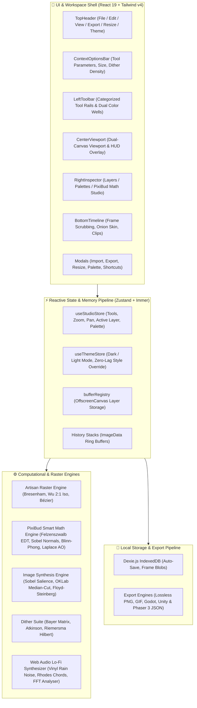
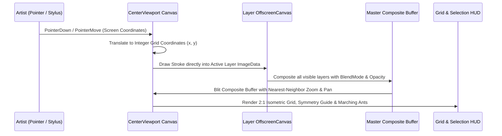
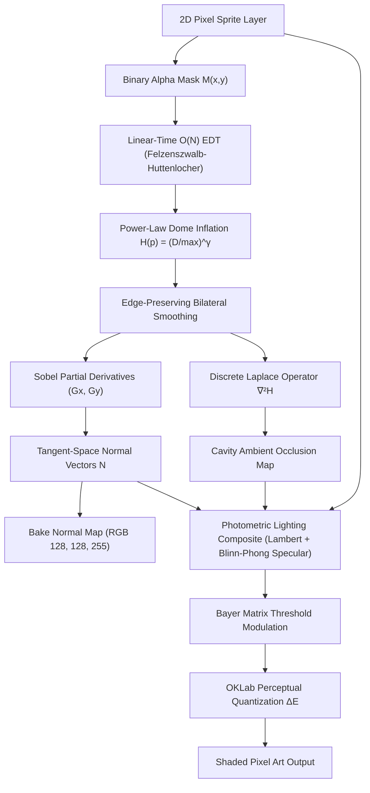
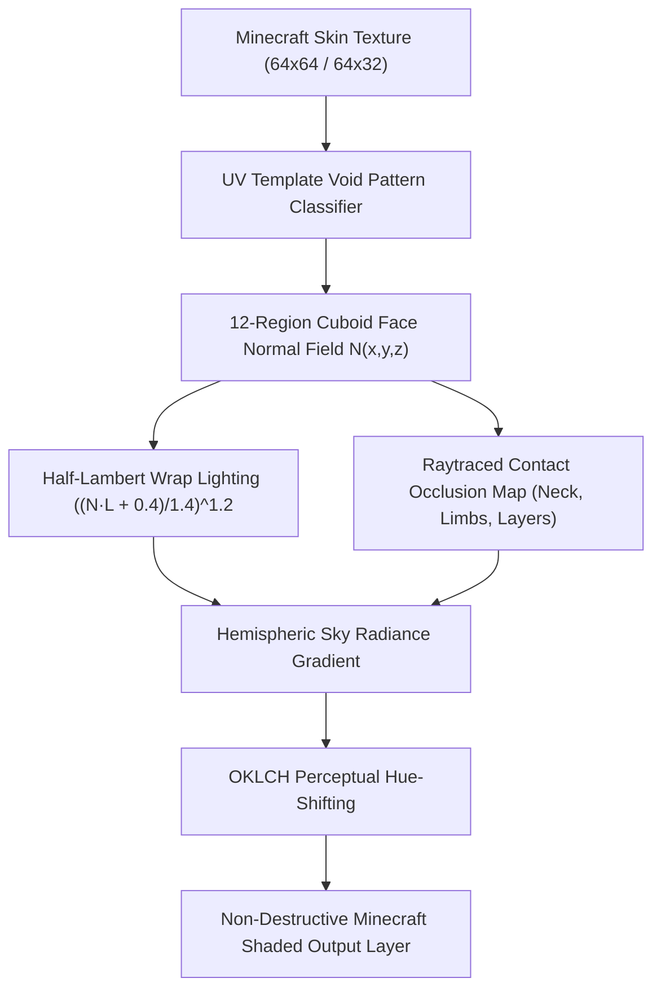
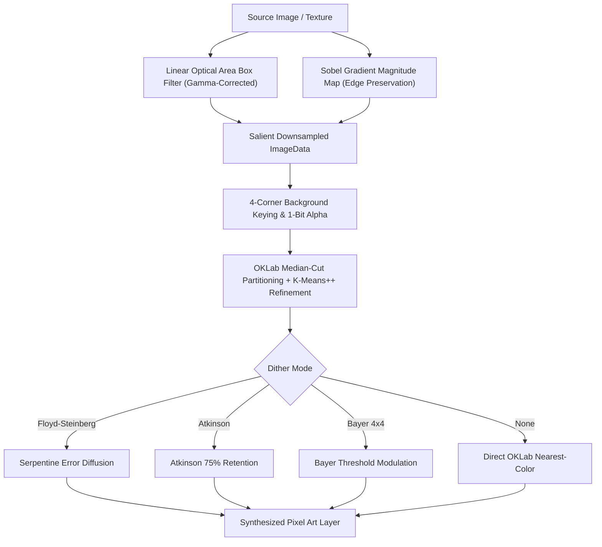
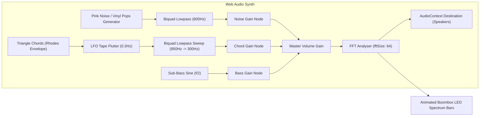

# 🏛️ Architecture & System Design — PixiBun Atelier

```text
  /\_/\   ✦  .  *  .  ✦  *  .  ✦  *  .  ✦  *
 ( o.o )   A R C H I T E C T U R E
  > ^ <    Technical Blueprint & Engineering Reference
```

> **A high-performance, offline-first raster graphics workstation designed for sub-16ms interactive drawing latency and mathematically sound 2.5D computer graphics.**

---

## 1. System Topology Overview

PixiBun is structured as a client-side single-page application built on **Next.js 16 (App Router)** with zero mandatory server dependencies for drawing, animation, synthesis, or exporting.



---

## 2. Canvas & Rendering Pipeline

### Dual-Canvas Architecture
To avoid browser layout recalculations and achieve smooth 60 FPS viewport manipulation, rendering is separated into two tiers:



### Direct Buffer Memory Management (`src/lib/engine/bufferRegistry.ts`)
Layers are maintained as raw `HTMLCanvasElement` and `OffscreenCanvas` objects indexed by layer UUID in memory. When the user resizes the canvas:
1. `resizeAllBuffers(newWidth, newHeight, anchor, resample)` shifts and re-allocates existing canvas buffers with 9-point anchor alignment and optional nearest-neighbor resampling.
2. Memory leaks are eliminated by explicitly clearing and discarding dereferenced buffers via `deleteBuffers(layerId)`.

---

## 3. PixiBud Smart Math & Computer Graphics Engine (`src/lib/ai/smartMathEngine.ts`)



### Key Mathematical Formulations:
1. **$O(N)$ Euclidean Distance Transform:**
   Uses separable 1D lower parabolic envelope scans:
   $$D(p) = \min_{q \notin \Omega} \sqrt{(p_x - q_x)^2 + (p_y - q_y)^2}$$
2. **Analytical Tangent Normals:**
   $$\mathbf{N} = \frac{1}{\sqrt{s_x^2 G_x^2 + s_y^2 G_y^2 + 1}} \begin{pmatrix} -s_x G_x \\ -s_y G_y \\ 1 \end{pmatrix}$$
3. **Blinn-Phong Specular Half-Vector:**
   $$\mathbf{H} = \frac{\mathbf{L} + \mathbf{V}}{\|\mathbf{L} + \mathbf{V}\|}, \quad I_s = k_s (\max(0, \mathbf{N} \cdot \mathbf{H}))^\alpha$$
4. **Discrete Laplace Cavity Occlusion:**
   $$\nabla^2 H \approx H * \begin{bmatrix} 0 & 1 & 0 \\ 1 & -4 & 1 \\ 0 & 1 & 0 \end{bmatrix}, \quad AO(p) = \text{clamp}(1.0 - k_{\text{ao}} \max(0, -\nabla^2 H), 0, 1)$$

---

## 4. State Management & Undo Architecture

The application state is managed by Zustand with Immer middleware:
* **`useStudioStore`:** Single source of truth for tool settings, primary/secondary colors, frame lists, layer hierarchies, zoom/pan parameters, and UI visibility.
* **Undo/Redo History:** Implemented as a ring buffer of `ImageData` snapshots per layer (50 steps deep). Undo/Redo restores the exact layer pixels in $O(1)$ time without re-rendering unrelated layers.
* **`bufferVersion` Signal:** Atomic counter incremented on every pixel-level mutation, notifying decoupled observers (like the floating live preview window) without triggering full-tree React component re-renders.

---

## 5. Local-First Storage Architecture (`src/lib/storage/db.ts`)

* **Database Engine:** Dexie.js wrapping browser IndexedDB.
* **Tables:**
  * `projects`: Stores project metadata, dimensions, frame sequences, layer hierarchies, and custom palettes.
  * `frames`: Stores raw binary PNG blobs for each animation frame to ensure instantaneous project loading.
* **Autosave Loop:** Debounced continuous state synchronization runs automatically in the background on every stroke completion.
* **Versioned `.pixibun` Format (`src/lib/project/schema.ts`):** Zero-dependency structural validation enforcing schema contracts before project hydration to prevent malformed data from corrupting session state.

---

## 6. Vercel & CI/CD Deployment Pipeline

* **Framework Engine:** Next.js 16 App Router on Vercel Edge Network.
* **Continuous Deployment:** Every push to `main` triggers automated typechecking (`tsc --noEmit`), linting (`eslint`), unit testing (`vitest`), and static optimization before deploying to production.

---

## 7. 3D Minecraft Skin Recognition & Domain Shading Engine

When an imported or active sprite matches the standard Java/Bedrock $64\times64$ or $64\times32$ UV bounding template, the engine bypasses 2.5D heightmap inflation and routes directly into the dedicated **3D Minecraft Skin Photometric Shading Engine**:



### Mathematical Formulations:
1. **Half-Lambertian Wrapped Diffuse:**
   $$\text{wrap}(\mathbf{N} \cdot \mathbf{L}) = \left(\frac{\mathbf{N} \cdot \mathbf{L} + 0.4}{1.4}\right)^{1.2}$$
2. **Raytraced Anatomical Contact Ambient Occlusion:**
   $$AO(x, y) = \min(AO_{\text{neck}}, AO_{\text{armpit}}, AO_{\text{thigh}}, AO_{\text{ground}}, AO_{\text{layer}})$$
3. **Perceptual OKLCH Hue-Shifting:**
   * **Highlight:** $H_{\text{new}} = \text{shiftHueToward}(H_{\text{orig}}, 65^\circ, \Delta_{\text{sun}})$ (Sunlight amber)
   * **Shadow:** $H_{\text{new}} = \text{shiftHueToward}(H_{\text{orig}}, 260^\circ, \Delta_{\text{sky}})$ (Cool ambient indigo, never flat gray)

---

## 8. Optical Flow In-Between Animation Morphing

The frame morphing engine (`src/lib/ai/pixelAiEngine.ts`) implements **2D Block-Matching Optical Flow & Signed Distance Field (SDF)** interpolation:

1. **Motion Displacement Field:**
   $$\mathbf{v}(x, y) = \arg\min_{(u, v) \in \mathcal{W}} \sum_{p \in \mathcal{B}} |I_A(p) - I_B(p + (u, v))|$$
2. **Intermediate Synthesis at $t = 0.5$:**
   Pixels are displaced along trajectory vectors $\mathbf{x} - t \mathbf{v}$ and blended in OKLab perceptual color space, producing clean tween frames between keyframes without ghosting or tearing.

---

## 9. Intelligent Image-to-Pixel-Art Synthesis Pipeline (`src/lib/ai/pixelizeEngine.ts`)



1. **Linear Optical Gamma Correction:**
   $$C_{\text{linear}} = \begin{cases} C_{\text{sRGB}} / 12.92 & C_{\text{sRGB}} \le 0.04045 \\ \left(\frac{C_{\text{sRGB}} + 0.055}{1.055}\right)^{2.4} & C_{\text{sRGB}} > 0.04045 \end{cases}$$
2. **Sobel Salience Weighting:**
   $$W_{\text{salience}}(x, y) = W_{\text{area}} \cdot (1.0 + 0.05 \cdot \|\nabla I(x, y)\|)$$
3. **OKLab Median-Cut & Lloyd K-Means Refinement:**
   Clusters color bounding boxes along the axis of maximal perceptual variance in OKLab space ($L, a, b$), followed by iterative centroid convergence:
   $$\mu_k^{(t+1)} = \frac{1}{|S_k|} \sum_{p \in S_k} p$$

---

## 10. Procedural Web Audio Ambient Radio (`src/lib/audio/lofiRadio.ts`)



* **Zero-Bandwidth:** Synthesizes warm rain ambiance, subtle vinyl crackles, Rhodes chords, and sub-bass completely in code without loading external `.mp3` or `.wav` assets.
* **Real-Time Spectrum Visualizer:** 4-band FFT frequency analyzer samples frequency buckets ($b_0, b_1, b_2, b_3$) on every animation frame for animated LED spectrum feedback.

---

## 11. Zero-Lag Theme Architecture (`src/stores/themeStore.ts`)

To prevent simultaneous layout recalculations and repaint stutter across thousands of DOM elements during Dark (Cozy Midnight) $\leftrightarrow$ Light (Morning Atelier) switching:
1. **Transition Suppression:** Injects a high-priority stylesheet (`pixibun-theme-transition-killer`) with `transition: none !important` before mutating `data-theme`.
2. **Synchronous Reflow:** Reads `getComputedStyle(css).opacity` to force instantaneous layout evaluation while transitions are disabled.
3. **Clean Teardown:** Removes the temporary stylesheet on the subsequent `requestAnimationFrame` tick, restoring silky micro-interactions without flash or delay.
