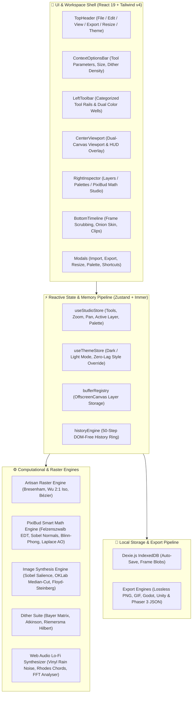
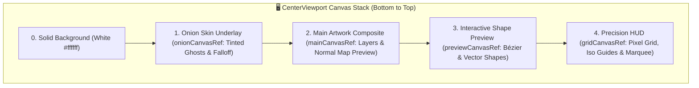
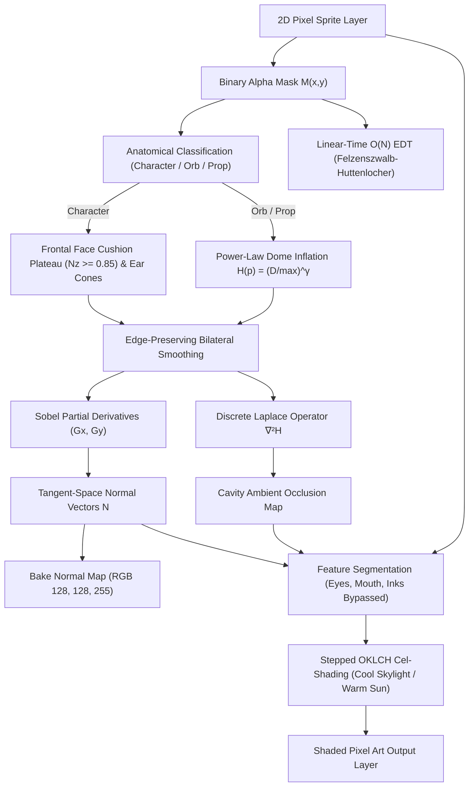
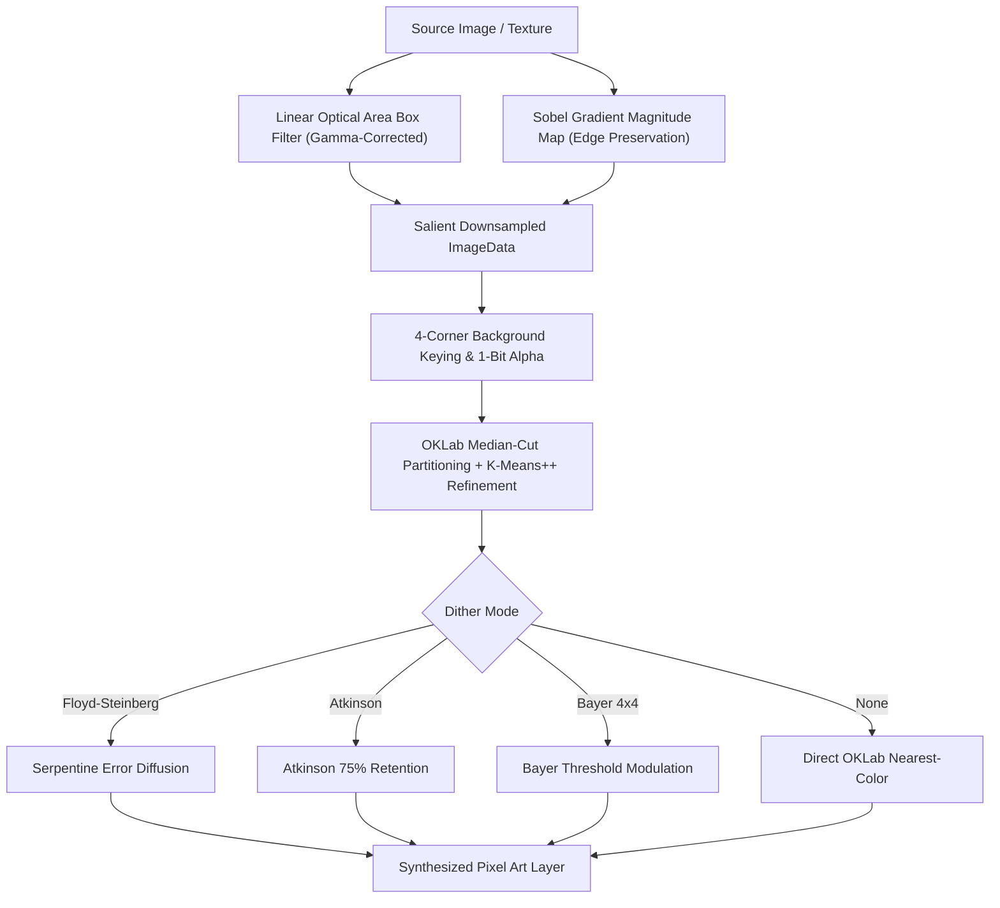
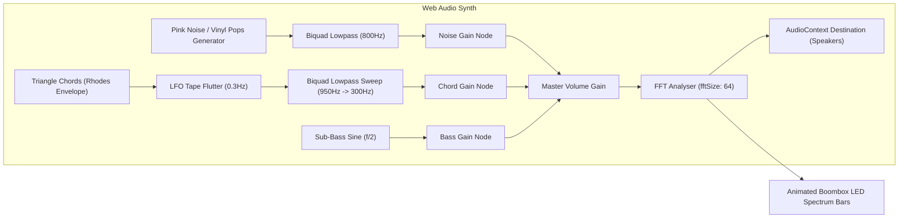

# 🏛️ Architecture & System Design — PixiBun Atelier

```text
  /\_/\   ✦  .  *  .  ✦  *  .  ✦  *  .  ✦  *
 ( o.o )   A R C H I T E C T U R E
  > ^ <    Technical Blueprint & Engineering Reference
```

> **A high-performance, offline-first raster graphics workstation designed for sub-16ms interactive drawing latency and mathematically sound 2.5D computer graphics.**

---

## 1. System Topology Overview

PixiBun is structured as a client-side single-page application built on **Next.js 16 (App Router)** with zero mandatory server dependencies for drawing, animation, synthesis, or exporting.



---

## 2. Canvas & Rendering Pipeline

### Multi-Canvas Layered Viewport Stack
To avoid browser layout recalculations, eliminate visual ghost contamination during color picking, and achieve sub-16ms interactive drawing latency, viewport rendering is separated into a hardware-accelerated 5-layer stack:



### Pure Compositor & Eyedropper Isolation (`src/lib/render/compositor.ts`)
The `compositeFrame()` module serves as the single visual source of truth for pure pixel compositing:
- **Zero Editor Chrome**: Bottom-up compositing honoring layer visibility, opacity, and blend modes without including onion skin ghosts, grid lines, or selection marquees.
- **Eyedropper & Exporters**: The eyedropper samples directly from `compositeFrame()`, making color picking completely immune to normal-map preview modes, HUD guides, and ghost underlays.
- **Living Timeline Thumbnails**: Timeline frame cards render `<FrameThumbnail>` elements backed by `compositeFrame()`, with live re-compositing restricted to the active frame on `bufferVersion` updates to maintain $O(1)$ stroke performance.

### Pure Onion Skinning Engine (`src/lib/render/onionSkin.ts`)
- Pure, DOM-free `getOnionSkinSpecs()` computes clamped previous/next ghost specifications with distance falloff `base * (1 - 0.25 * (dist - 1))` and `prevColor`/`nextColor` tint mapping.
- Tinting is executed offscreen via `source-atop` before blitting to the underlay canvas.

### Direct Buffer Memory Management (`src/lib/engine/bufferRegistry.ts`)
Layers are maintained as raw `HTMLCanvasElement` and `OffscreenCanvas` objects indexed by layer UUID in memory. When the user resizes the canvas:
1. `resizeAllBuffers(newWidth, newHeight, anchor, resample)` shifts and re-allocates existing canvas buffers with 9-point anchor alignment and optional nearest-neighbor resampling.
2. Memory leaks are eliminated by explicitly clearing and discarding dereferenced buffers via `deleteBuffers(layerId)`.

### Pure History Engine (`src/lib/engine/historyEngine.ts`)
The undo/redo pipeline is fully decoupled from the React rendering tree into a pure, DOM-free `HistoryEngine` module:
- Maintains a 50-step FIFO history ring with automatic pruning of oldest steps when capacity is reached.
- Invalidates the redo tail upon any new drawing action or canvas mutation.
- Captures pre-stroke and post-stroke layer `ImageData` snapshots for deterministic $O(1)$ state restoration via `ctx.putImageData`.
- Provides reactive boolean getters (`canUndo`, `canRedo`) synchronized with `useStudioStore`.

---

## 3. PixiBud Smart Math & Computer Graphics Engine (`src/lib/ai/math/`)

The graphics intelligence engine is decomposed into modular, deterministic mathematical modules under `src/lib/ai/math/` and `src/lib/ai/`:
- `edtNormalMap.ts`: Felzenszwalb-Huttenlocher $O(N)$ EDT, non-linear dome inflation ($\gamma = 0.5$), bilateral smoothing, content-aware heightmaps, anatomical part segmentation, frontal face cushion plateau ($N_z \ge 0.85$), independent ear cone ridges, and Sobel tangent normal vector fields.
- `photometricLighting.ts`: Parametric 2.5D Blinn-Phong lighting, feature preservation (eyes/mouth/outlines), stepped OKLCH cel-shading with perceptual hue shifts, and in-place tagged relighting (`Photometric <material>`).
- `photometricAuto.ts`: Canvas art morphology analysis, anatomical classification (`character`, `orb`, `prop`), connected-component feature clustering (eyes, mouth, whiskers), convex lobe ear/horn scanning, and automated lighting parameter inference.
- `shadowAuto.ts`: Canvas sprite geometry analysis, contact baseline detection, and directional shadow parameter inference.
- `shadowRayMarcher.ts`: 2.5D bounded sprite cast shadows with 1-to-1 sheared silhouette projection, classic ground contact drop shadow ellipses (`shadowStyle: 'drop'`), and uniform flat opacity (`ditherMode: 'none'`).
- `colorSpace.ts`: sRGB $\leftrightarrow$ linear $\leftrightarrow$ OKLab $\leftrightarrow$ OKLCH conversions and perceptual hue shifting (`shiftHue`).



### Key Mathematical Formulations:
1. **$O(N)$ Euclidean Distance Transform:**
   Uses separable 1D lower parabolic envelope scans:
   $$D(p) = \min_{q \notin \Omega} \sqrt{(p_x - q_x)^2 + (p_y - q_y)^2}$$
2. **Analytical Tangent Normals & Light Vector (Compass Convention):**
   $$\mathbf{N} = \frac{1}{\sqrt{s_x^2 G_x^2 + s_y^2 G_y^2 + 1}} \begin{pmatrix} -s_x G_x \\ -s_y G_y \\ 1 \end{pmatrix}, \quad \mathbf{L}(\theta, \phi) = \begin{pmatrix} \sin\theta \cos\phi \\ -\cos\theta \cos\phi \\ \sin\phi \end{pmatrix}$$
   *Standard navigation/Photoshop azimuth convention: $0^\circ = \text{North (Top)}, 45^\circ = \text{North-East}, 135^\circ = \text{South-East}, 225^\circ = \text{South-West}, 315^\circ = \text{North-West (Top-Left)}$.*
3. **Frontal Face Cushion Plateau & Feature Normal Stabilization:**
   For character forms, to avoid "bowling-ball" inflation where half the face is plunged into darkness ($N \cdot L < 0$), height within 2.8px of the boundary contour bevels smoothly while the interior reaches a flat plateau:
   $$\text{ratio} = \min\left(1.0, \frac{D(p)}{2.8}\right), \quad H_{\text{face}}(p) = H(p) \cdot (0.6 + 0.4 \cdot \text{ratio})$$
   Normals across the face interior satisfy $N_z \ge 0.85$, confining form shadows to the unlit silhouette edge. Features (eyes, mouth, whiskers) receive camera-facing normals $\mathbf{N} = (0, 0, 1)^T$.
4. **100% Feature Preservation & 4-Tone Discrete OKLCH Cel-Shading:**
    Pixels tagged `isFeature = 1` or `isInkLine = 1` bypass lighting multipliers entirely, preserving exact original RGB values. Unshaded base colors receive discrete stepped tone quantization in OKLCH via `buildCelRamp()` (4 tones):
    * **Base Tone:** Original artist color preserved (55%–60% of lit surface)
    * **Unified Shadow:** $L_{\text{shadow}} = \max(0.18, L_{\text{base}} \times 0.78)$, $H_{\text{shadow}} = \text{shiftHue}(H_{\text{base}}, 260^\circ, 14^\circ)$, $C_{\text{shadow}} = \min(0.35, C_{\text{base}} \times 1.05)$ (cool indigo skylight)
    * **Deep Crevice:** $L_{\text{deep}} = \max(0.12, L_{\text{base}} \times 0.60)$, $H_{\text{deep}} = \text{shiftHue}(H_{\text{base}}, 260^\circ, 20^\circ)$, $C_{\text{deep}} = \min(0.35, C_{\text{base}} \times 1.08)$ (concave seams where $AO < 0.60$)
    * **Highlight:** $L_{\text{hi}} = \min(0.98, L_{\text{base}} + (0.98 - L_{\text{base}}) \times 0.28)$, $H_{\text{hi}} = \text{shiftHue}(H_{\text{base}}, 65^\circ, 10^\circ)$, $C_{\text{hi}} = \min(0.35, C_{\text{base}} \times 0.95)$ (warm sunlight, shiny materials only: $k_s > 0.1$ and not matte/fabric)
    * **Shadow Terminator (v1.10.2):** Shadow placement is driven purely by the directional diffuse signal $\text{diffSignal} = \text{wrapNdotL} \times \text{effectiveFalloff}$, thresholded at $0.55$. The ambient contribution is excluded from shadow placement to prevent it from overwhelming the directional terminator ($\text{ambSignal} \approx 1.27$ would otherwise push all pixels above threshold). Optional Bayer matrix dither modulation perturbs the threshold for organic shadow edges.
5. **Blinn-Phong Specular Half-Vector:**
   $$\mathbf{H} = \frac{\mathbf{L} + \mathbf{V}}{\|\mathbf{L} + \mathbf{V}\|}, \quad I_s = k_s (\max(0, \mathbf{N} \cdot \mathbf{H}))^\alpha$$
   In discrete pixel-art ramps, sparse specular highlights are isolated when $I_s > 0.35$.
6. **Discrete Laplace Cavity Occlusion:**
   $$\nabla^2 H \approx H * \begin{bmatrix} 0 & 1 & 0 \\ 1 & -4 & 1 \\ 0 & 1 & 0 \end{bmatrix}, \quad AO(p) = \text{clamp}(1.0 - k_{\text{ao}} \max(0, -\nabla^2 H), 0, 1)$$
7. **2D Subsurface Scattering (Beer-Lambert + Henyey-Greenstein Forward Phase):**
   $$T(\mathbf{x}) = 2\sqrt{\max\left(0, R^2 - D(\mathbf{x})^2\right)}, \quad I_{SSS}(\mathbf{x}) = C_{scatter} \exp\left(-\boldsymbol{\sigma}_t \frac{T(\mathbf{x})}{d_{trans}}\right) \cdot P_{2D}(\mathbf{L}', \mathbf{V}, g)$$
   $$P_{2D}(\theta, g) = \frac{1 - g^2}{2\pi (1 + g^2 - 2g \cos\theta)^{3/2}}$$
   *(Note: Evaluates the 3D Henyey-Greenstein kernel in 2D with a $2\pi$ circumference prefactor as an empirical forward-scattering highlight curve, clamped to $[0, 1.0]$ in the relighting pipeline).*
8. **Dielectric Fresnel Reflectance with Cauchy Chromatic Dispersion:**
   $$F(\theta) = F_0 + (\max(1 - \alpha, F_0) - F_0) \cdot (1 - \cos\theta)^{p_{fresnel}}, \quad \eta_R = \eta_0 - \Delta\eta, \; \eta_B = \eta_0 + \Delta\eta$$
9. **Kajiya-Kay Anisotropic Cylindrical Specular:**
   $$\sin(\mathbf{T}, \mathbf{H}) = \sqrt{\max\left(0, 1 - (\mathbf{T}\cdot\mathbf{H})^2\right)}, \quad I_{aniso} = k_{s1} \sin^{p_1}(\mathbf{T}_1, \mathbf{H}) + k_{s2} \sin^{p_2}(\mathbf{T}_2, \mathbf{H})$$
10. **Bounded 2.5D Sprite Cast Shadows & Ground Drop Shadows (`shadowRayMarcher.ts`):**
    * **1-to-1 Sheared Silhouette Ground Projection:**
      $$h = y_{\text{base}} - y_s \ge 0$$
      $$\text{projX} = \text{round}(x_s + h \cdot \text{shear}_x), \quad \text{projY} = \text{round}(y_{\text{ground}} + h \cdot \text{shear}_y)$$
      Sub-step traversal strictly along the shear vector preserves hollow leg arches and waist indentations without bounding-box bloat.
    * **Ground Contact Drop Shadow Style (`shadowStyle: 'drop'`):**
      Renders a crisp Bresenham pixel ellipse under the character contact baseline ($y_{\text{base}}$):
      $$\frac{(x - x_{\text{center}})^2}{r_x^2} + \frac{(y - y_{\text{base}})^2}{r_y^2} \le 1.0$$
    * **Uniform Flat Pixel Art Opacity (`ditherMode: 'none'`):**
      Shadow pixels receive uniform flat opacity $\text{round}(\text{shadowOpacity} \times 255)$, completely eliminating continuous 256-level float gradients.
    * **Non-Destructive Tagged Output:** Writes directly to `Layer.tag = 'cast-shadow'`.
11. **Interactive On-Canvas Pixel Light Bulb Gizmo & Reticle Mathematics (`PixelLightBulbGizmo.tsx`):**
    * Dynamic azimuth calculation from pointer coordinates orbiting around a stationary subject center reticle:
      $$\theta = \left(\text{atan2}(x_{\text{ptr}} - x_{\text{center}}, -(y_{\text{ptr}} - y_{\text{center}})) \times \frac{180}{\pi} + 360\right) \pmod{360}$$
    * Decoupled focal point reticle handle ($x_{\text{center}}, y_{\text{center}}$) allowing artists to reposition the lighting anchor without altering the light direction angle.
    * 60fps `requestAnimationFrame` throttled preview updates.
12. **Spherical Convex Dome Inflation & Slope AO Decoupling:**
    * Spherical dome height inflation with exact zero derivative at the apex peak:
      $$H(p) = R \sqrt{\max\left(0, 1 - \left(1 - \frac{D(p)}{R}\right)^2\right)}$$
    * Eliminates conical pinch creases on convex primitives while providing true vertical silhouette tangents.
    * Decouples direct key light from cavity ambient occlusion on convex slopes to eliminate center-locked apex highlight glitches.

---

## 4. State Management, Layer Security & Undo Architecture

The application state is managed by Zustand with Immer middleware:
* **`useStudioStore`:** Single source of truth for tool settings, primary/secondary colors, frame lists, layer hierarchies, zoom/pan parameters, and UI visibility.
* **50-Step Circular Ring Buffer Undo History:** Maintains a memory-efficient circular ring buffer of up to 50 `ImageData` snapshots (`createHistoryEngine(50)` matching `SKILL.md:26` and `src/hooks/viewport/useViewportDrawing.ts:33`). Undo/Redo restores the exact layer pixels in $O(1)$ time without re-rendering unrelated layers.
* **History Layer Lifecycle (`createdLayerId`):** When AI operations (`Photometric`, `Specular`, `Cast Shadow`) create a new layer, the history snapshot tracks `createdLayerId`. Undoing the action removes the layer entirely from the frame stack and purges its buffer memory, while redoing cleanly restores it.
* **Locked Layer Drawing Protection:** `handlePointerDown` checks `currentLayer.locked` prior to dispatching raster strokes. When locked, execution returns immediately and triggers an animated HUD warning toast (`Active layer is locked! Unlock it in the Layers panel to draw.`) with `<PixelIcon name="lock" />`.
* **`bufferVersion` Signal & Stroke Decoupling:** Atomic counter throttled via `requestAnimationFrame` strictly for external observers (`BottomTimeline`, `FloatingPreviewWindow`). Decoupled completely from `CenterViewport` to eliminate React reconciliation cascades during pen/eraser strokes (0 re-renders during pointer moves).
* **Layer Merge Down (`mergeLayerDown`):** Blends active layer onto underlying layer respecting opacity and blend modes, deletes upper buffer memory in $O(1)$, and selects lower layer cleanly.

---

## 5. Local-First Storage & Multi-Project Lifecycle (`src/lib/storage/db.ts`, `src/lib/project/schema.ts`)

* **Database Engine:** Dexie.js wrapping browser IndexedDB (`PixiBunDB`, Schema v4).
* **Tables:**
  * `projects`: Indexed by `id, name, updatedAt, createdAt`. Stores serialized `.pixibun` payload (`dataJson`), canvas bounds (`width, height`), `fps`, `createdAt`, `updatedAt`, and a downscaled composite preview (`thumbnailDataUrl`) for instant gallery card rendering.
  * `layerBlobs`: Indexed by `++id, [projectId+layerId+frameIndex], projectId, layerId`. Stores raw binary PNG image `Blob` instances directly, eliminating JSON base64 stringification CPU overhead and reducing autosave storage footprints by ~33%.
  * `diagnostics`: Indexed by `id, kind, timestamp`. Stores local telemetry and crash events in an on-device ring buffer (200 entries max).
* **Multi-Project Workspace Management (`ProjectsGalleryModal.tsx`):**
  * Artists can maintain an unlimited on-device portfolio of sprites and animations.
  * Supports full lifecycle management: instant switching, project duplication (`duplicateProject`), inline renaming (`renameProject`), and safe deletion (`deleteProject`).
* **P0 History Stack Invalidation (`pixibun:history-clear`):**
  * When switching projects, loading an artwork, or creating a new blank project, `hydrateProject` and `resetToNewProject` dispatch `pixibun:history-clear`.
  * `CenterViewport` clears the 50-step `HistoryEngine` and resets `canUndo`/`canRedo` flags, eliminating cross-project undo state corruption.
* **Persistent Storage Failure & Auto-Recovery Banner:** `autoSaveWorkspace` returns a boolean status. If 2 consecutive saves fail (e.g. disk quota exceeded, incognito clearance), a sticky warning banner appears with a 1-click `"Export Drawing"` button. When storage clears and autosave succeeds, the banner auto-dismisses and resets error counts.
* **Full-Fidelity v1 $\to$ v2 Migration Engine (`migrateProjectPayload`):**
  * Auto-detects legacy or unversioned (`version: undefined`) files.
  * Backfills default `customRamps: []`, `clips: []`, `onionSkin`, and per-layer `blendMode: 'source-over'`, `opacity: 1.0`, `visible: true`, `locked: false`.
  * Upgrades `version` to `PROJECT_FORMAT_VERSION = 2`.
* **Forward Compatibility Guard:** Rejects files saved with a newer format (`input.version > PROJECT_FORMAT_VERSION`) with an explicit update prompt: `"This project was saved in format v${input.version}, but this version of PixiBun only supports up to v${PROJECT_FORMAT_VERSION}. Please update PixiBun to open this file."`.

---

## 6. Multi-Engine Export & Web Worker Pipeline (`src/lib/export/`)

* **Tag Clip Export Scoping (`ExportModal.tsx`):** Allows artists to select specific named clips (`Walk [1-4]`, `Attack [5-8]`). Frames are sliced to the clip range, output files are dynamically renamed (`hero_Walk-4x.gif`), and SpriteSheet atlas metadata is cleanly $0$-indexed for Godot/Unity/Phaser.
* **Multi-Threaded Web Worker GIF Encoding (`gifEncoder.worker.ts`):** Offloads CPU-intensive Median-Cut color quantization and variable-length LZW compression to a background Web Worker.
* **Variable Frame Duration Centisecond Timing:** Passes frame-specific delay arrays ($D_i = \max(2, \text{round}(\text{durationMs}_i / 10))$) directly to GIF Graphic Control Extensions, honoring variable hold and transition speeds authored in `BottomTimeline`.
* **Zero-Copy Transferable Objects:** Frame pixel buffers are transferred as `ArrayBuffer` transferables (`postMessage(msg, [buffer])`), eliminating memory copying overhead on $128\times128+$ 50-frame animations.
* **Live Worker Progress Bar:** Dispatches `{ type: 'progress', current, total }` messages, driving real-time progress percentages in the `ExportModal`.
* **Transparent Main-Thread Fallback:** Automatically falls back to synchronous execution in environments without Web Worker support or under strict CSP policies.


## 7. 3D Minecraft Skin Recognition & Domain Shading Engine (`src/lib/ai/math/minecraftSkin.ts`)

When an imported or active sprite canvas has dimensions $64\times64$ or $64\times32$, the photometric lighting system distinguishes between authentic Minecraft 3D player skin texture atlases and single-character / object illustrations before routing normal generation:


### Topological Invariant Discriminator:
1. **Texture Atlas vs. Contiguous 2.5D Silhouette:**
   * **Minecraft Skin Texture Atlas:** Disconnected planar unwrap of geometric cuboid islands separated by empty void channels. Bilateral limbs occupy the extreme lateral flanks ($x \in [0, 16)$ for Right Leg, $x \in [40, 56)$ for Right Arm). Both extremities must be populated for valid skin detection.
   * **Centered 2D Character / Object Sprite:** Single contiguous silhouette centered horizontally with empty lateral flanks ($x < 10$ and $x > 48$). The dominant connected component contains $\ge 68\%$ of all opaque pixels, and lacks bilateral limb islands. Even if an ear or accessory touches the head coordinate quadrant, it is classified as a 2.5D character sprite and shaded with true continuous tangent normals, eliminating flat $(0, 0, 1.0)$ fallback vectors.
2. **Canonical Void Zone Preservation:**
   * Mojang's specification mandates empty rectangular corners at $(0, 0, 8, 8)$, $(24, 0, 8, 8)$, $(32, 0, 8, 8)$, $(56, 0, 8, 8)$, and joint voids at $y = 16$. Void pollution $> 25\%$ immediately rejects the atlas.
3. **User Sovereignty (`PhotometricLightingSection.tsx`):**
   * On $64\times64$ and $64\times32$ canvases, the inspector provides a tactile `Skin 3D Shading: [ Auto | On | Off ]` toggle (`setMinecraftSkinMode`), giving creators manual override over the auto-discriminator.

### Mathematical Formulations:
1. **Half-Lambertian Wrapped Diffuse:**
   $$\text{wrap}(\mathbf{N} \cdot \mathbf{L}) = \left(\frac{\mathbf{N} \cdot \mathbf{L} + 0.4}{1.4}\right)^{1.2}$$
2. **Raytraced Anatomical Contact Ambient Occlusion:**
   $$AO(x, y) = \min(AO_{\text{neck}}, AO_{\text{armpit}}, AO_{\text{thigh}}, AO_{\text{ground}}, AO_{\text{layer}})$$
3. **Perceptual OKLCH Hue-Shifting:**
   * **Highlight:** $H_{\text{new}} = \text{shiftHueToward}(H_{\text{orig}}, 65^\circ, \Delta_{\text{sun}})$ (Sunlight amber)
   * **Shadow:** $H_{\text{new}} = \text{shiftHueToward}(H_{\text{orig}}, 260^\circ, \Delta_{\text{sky}})$ (Cool ambient indigo, never flat gray)

---

## 8. Optical Flow In-Between Animation Morphing

The frame morphing engine (`src/lib/ai/pixelAiEngine.ts`) implements **2D Block-Matching Optical Flow & Signed Distance Field (SDF)** interpolation:

1. **Motion Displacement Field (with Zero-Motion Center Bias):**
   $$\mathbf{v}(x, y) = \arg\min_{(u, v) \in \mathcal{W}} \left( \sum_{p \in \mathcal{B}} |I_A(p) - I_B(p + (u, v))| + 0.05 \cdot (u^2 + v^2) \right)$$
   *The quadratic displacement penalty $0.05 \cdot (u^2 + v^2)$ provides tie-break stabilization, preventing false ghosting artifacts across uniform, solid color, or transparent background regions.*
2. **Intermediate Synthesis at $t = 0.5$:**
   Pixels are displaced along trajectory vectors $\mathbf{x} - t \mathbf{v}$ and blended in OKLab perceptual color space, producing clean tween frames between keyframes without ghosting or tearing.

---

## 9. Intelligent Image-to-Pixel-Art Synthesis Pipeline (`src/lib/ai/pixelizeEngine.ts`)



1. **Linear Optical Gamma Correction:**
   $$C_{\text{linear}} = \begin{cases} C_{\text{sRGB}} / 12.92 & C_{\text{sRGB}} \le 0.04045 \\ \left(\frac{C_{\text{sRGB}} + 0.055}{1.055}\right)^{2.4} & C_{\text{sRGB}} > 0.04045 \end{cases}$$
2. **Sobel Salience Weighting:**
   $$W_{\text{salience}}(x, y) = W_{\text{area}} \cdot (1.0 + 0.05 \cdot \|\nabla I(x, y)\|)$$
3. **OKLab Median-Cut & Lloyd K-Means Refinement:**
   Clusters color bounding boxes along the axis of maximal perceptual variance in OKLab space ($L, a, b$), followed by iterative centroid convergence:
   $$\mu_k^{(t+1)} = \frac{1}{|S_k|} \sum_{p \in S_k} p$$

---

## 10. Procedural Web Audio Ambient Radio (`src/lib/audio/lofiRadio.ts`)



* **Zero-Bandwidth:** Synthesizes warm rain ambiance, subtle vinyl crackles, Rhodes chords, and sub-bass completely in code without loading external `.mp3` or `.wav` assets.
* **Real-Time Spectrum Visualizer:** 4-band FFT frequency analyzer samples frequency buckets ($b_0, b_1, b_2, b_3$) on every animation frame for animated LED spectrum feedback.

---

## 11. Zero-Lag Theme Architecture (`src/stores/themeStore.ts`)

To prevent simultaneous layout recalculations and repaint stutter across thousands of DOM elements during Dark (Cozy Midnight) $\leftrightarrow$ Light (Morning Atelier) switching:
1. **Transition Suppression:** Injects a high-priority stylesheet (`pixibun-theme-transition-killer`) with `transition: none !important` before mutating `data-theme`.
2. **Synchronous Reflow:** Reads `getComputedStyle(css).opacity` to force instantaneous layout evaluation while transitions are disabled.
3. **Clean Teardown:** Removes the temporary stylesheet on the subsequent `requestAnimationFrame` tick, restoring silky micro-interactions without flash or delay.

---

## 12. Zero-GC Memory Management & Buffer Pooling (`src/lib/engine/bufferPool.ts`)

High-frequency mathematical operations (Euclidean Distance Transforms, Bilateral Filters, Laplace Normal Map baking, downsampling) require substantial TypedArray scratch space. To eliminate garbage collection pauses during live canvas interactions:
- **Pool Sizing & Lifecycle:** Pre-allocates and bounds reusable `Float32Array`, `Int32Array`, and `Uint8ClampedArray` buffers.
- **Resource Borrows:** Callers acquire buffers with `acquireFloat32Buffer(minLen)` and release them in `finally` blocks with `releaseFloat32Buffer(buf)`.
- **Zero-Fill Guarantees:** Buffers are sanitized/cleared on release, preventing cross-frame data corruption.
- **Compositor Canvas Pooling:** `compositeFrame()` leverages a persistent offscreen canvas singleton and accepts an optional `targetCanvas` destination to avoid allocating DOM canvas elements on every render tick.

---

## 13. Multithreaded Worker & Deterministic CG Math Architecture

Compute-bound tasks are balanced between background Web Workers and on-device TypedArray math:
- **Web Worker GIF Encoding (`src/lib/export/gifEncoder.worker.ts`):** LZW compression and median-cut color quantization run off-thread with zero-copy transferable `ArrayBuffer` lists (`postMessage(payload, [buffer])`).
- **Deterministic On-Device Graphics Math (`src/lib/ai/math/`, `src/lib/ai/shadowRayMarcher.ts`):** 2.5D photometric lighting, $O(N)$ EDT, content-aware heightmaps, and bounded sprite cast shadows run synchronously with zero latency using pre-allocated `bufferPool.ts` scratch buffers.

---

## 14. Strongly-Typed Studio Event Bus (`src/lib/events/studioEvents.ts`)

Cross-component triggers (normal map baking, palette quantization, volumetric lighting triggers, raymarched shadows) are managed through a strongly-typed subscriber facade bridging DOM CustomEvents:
- **Discriminated Event Map:** All 32 studio actions are strictly typed in `StudioEventMap` with validated payload schemas.
- **Subscriber Ergonomics:** `CenterViewport` and studio panels subscribe via `studioEvents.on(event, handler)` with automatic unsubscription cleanup and type-safe payload extraction, receiving events dispatched across studio panels via `window.dispatchEvent` or `studioEvents.emit`.

---

## 15. Vercel & CI/CD Deployment Pipeline

* **Framework Engine:** Next.js 16 App Router on Vercel Edge Network.
* **Continuous Deployment:** Every push to `main` triggers automated typechecking (`tsc --noEmit`), linting (`eslint`), unit testing (`vitest`), and static optimization before deploying to production.

---

## 16. P2P Co-Draw Sync Bridge (`src/lib/sync/coDrawBridge.ts`)

The CRDT engine (`src/lib/collab/crdtPixelBuffer.ts`) and WebRTC transport (`src/lib/sync/p2pSync.ts`) are pure, DOM-free modules; the bridge is the single integration point that connects them to the live studio. It is a module-scoped singleton so sessions survive modal unmount and drawing code can reach it without prop drilling.

* **Structure Join:** On connection, the host broadcasts a `STRUCTURE_SYNC` message (`src/lib/sync/p2pSync.ts`, validated by `validateStructurePayload`) so both peers adopt one layer-ID namespace — the prerequisite for routing per-layer CRDT ops. The host owns the layer/frame tree for the session; guest structural edits stay local (documented MVP constraint that keeps identity deterministic).
* **Full-State Antientropy Join:** Following Shapiro et al. (SSS 2011, §4), the host seeds one `CrdtPixelBuffer` per layer from the live canvas pixels and transmits complete per-layer snapshots. A bounded retry loop handles the window where `RTCPeerConnection` reports `connected` before the RFC 8831 data channels are open.
* **Delta Propagation:** On every stroke commit, the pre-stroke history snapshot is diffed against the live buffer (`src/lib/sync/strokeDiff.ts`) and each changed pixel becomes an LWW op broadcast per layer. Receivers apply ops through the HLC clock (bounded drift, deterministic peerId tie-break) and repaint layer buffers in one `getImageData`/`putImageData` pass.
* **Rendering & Persistence Integration:** Applied remote ops dispatch `pixibun:request-composite` (consumed by `CenterViewport.tsx`) and `pixibun:remote-change` (consumed by `StudioLayout.tsx` to schedule the same debounced autosave as local edits).
* **Presence:** Cursor moves broadcast at ~30fps over the unreliable PR-SCTP channel and render through `src/components/studio/RemoteCursorsOverlay.tsx` with staleness pruning.

---

## 17. Diagnostics Relay Hardening (`src/app/api/diagnostics/relay/route.ts`)

* **Rate Limiting:** Token bucket (12 requests/minute, burst 12) keyed by client IP, implemented as a pure module in `src/lib/server/tokenBucket.ts`. State is per-process memory — correct for a single Node instance, a per-instance limit on multi-instance deployments.
* **Input Ceilings:** 64KB request-body ceiling enforced before JSON parsing, and a 100-event cap on forwarded batches, with explicit 413/429 responses.
* **SSRF Guard (unchanged):** Upstream is strictly the operator-configured HTTPS `DIAGNOSTICS_RELAY_URL`; client payloads are forwarded only as a bounded `{ app, version, timestamp, events }` envelope.

---

## 18. Algorithmic Scope Boundaries & Target System Envelope

To maintain sub-16ms interactive drawing latency and prevent runaway complexity, PixiBun's algorithms operate within explicit, mathematically defined envelopes:

* **Target Canvas & Project Envelope:** Purpose-engineered for $16\times16$, $32\times32$, $64\times64$, and $128\times128$ pixel art characters, props, tilesets, and animation loops. Unlike native desktop applications (e.g. Aseprite) optimized for 500+ frame 4K cinematic timelines using native C++ file I/O, PixiBun targets instant zero-install browser crafting with IndexedDB binary blob persistence (`layerBlobs`), zero-copy Web Worker export codecs, and real-time 2.5D photometric cel-shading.
* **WaveFunctionCollapse (`src/lib/procedural/waveFunctionCollapse.ts`):** Implements an overlapping pattern synthesis model with periodic boundary conditions optimized specifically for small pixel art tiles and terrain textures ($16\times16$ to $64\times64$ output dimensions, $N=2$ or $N=3$ neighborhood kernels). Adjacency constraint graphs are bounded to input sample entropy, with deterministic pseudorandom seed stepping.
* **Vector Depixelization (`src/lib/export/depixelizeVector.ts`):** Domain-tailored planar graph ambiguity solver based on Kopf-Lischinski (SIGGRAPH 2011) principles, converting 2D pixel clusters into valence-aware polygonal boundaries with Catmull-Rom cubic Bézier smoothing specifically for scalable SVG sprite sheet export.
* **Zero-Egress LAN Default & Network Boundaries:** Core creative features (raster engine, layers, animation timeline, photometric studio, color science, export encoders, and IndexedDB persistence) operate 100% on-device without network access. P2P co-draw defaults to `LAN_ICE_SERVERS = []` for true zero-egress local network collaboration. Public Internet WebRTC STUN NAT traversal and the optional diagnostics relay are the only subsystems that require network access, both requiring explicit user activation.

---

## 19. 2.5D Normal Chisel & Bas-Relief Sculptor (`src/lib/art/normalSculptor.ts`)

* **Tangent-Space Normal Vector Encoding:** Standard OpenGL convention where $+Y$ points Up (green channel increases towards the top of the sprite) and flat perpendicular surfaces encode to $(128, 128, 255)$. Decoded vectors are strictly normalized to unit length $\|(N_x, N_y, N_z)\| = 1$.
* **Analytical Bevel & Chamfer Geometry:** Given compass azimuth $\alpha \in [0, 360^\circ)$ ($0^\circ=\text{North}$, $90^\circ=\text{East}$) and slope incline $\phi \in (0, 90^\circ]$, directional normal vectors are evaluated analytically:
  $$N_x = \sin\phi \sin\alpha, \quad N_{y,\text{OpenGL}} = \sin\phi \cos\alpha, \quad N_z = \cos\phi$$
  Dual-flank V-groove carving calculates bilateral ridge facets perpendicular to brush stroke drag vectors.
* **Flattened Spherical Rivet / Stud Stamp:** For circular stamps of radius $R$, surface normal vectors follow shallow ellipsoid dome geometry parameterized by flattening factor $h \in (0, 1]$:
  $$\mathbf{N} = \text{normalize}\left(h \frac{dx}{R}, h \frac{dy}{R}, \sqrt{1 - \frac{dx^2 + dy^2}{R^2}}\right)$$
  An inversion flag reverses $(N_x, N_y)$ components to carve countersunk screwhole dimples without altering base surface normal depth.
* **Reoriented Normal Mapping (RNM):** Implements Colin Barré-Brisebois & Stephen Hill (2012) quaternion-based normal blending:
  $$\mathbf{t} = (B_x, B_y, B_z + 1), \quad \mathbf{u} = (-D_x, -D_y, D_z), \quad \mathbf{r} = \mathbf{t}(\mathbf{t} \cdot \mathbf{u}) - \mathbf{u} \, t_z, \quad \mathbf{N}_{\text{blended}} = \frac{\mathbf{r}}{\|\mathbf{r}\|}$$
  This rotates the stamped micro-relief into the tangent frame of underlying base normal maps (e.g. generated via Euclidean Distance Transform) without flattening slope angles.
* **Intra-Stroke Envelope Buffer (`ChiselStrokeSession`):** Continuous stroke stamping writes normal vectors and coverage alpha into an intra-stroke envelope session, tracking dirty indices in a Set. The composite pass blends the envelope onto the underlying layer snapshot via RNM in a single pass, eliminating intra-stroke angular accumulation artifacts.
* **Layer Tag Convention (`normal` vs `normal-map`):** Dedicated normal sculptor layers carry the canonical machine identifier `tag = 'normal'` (with `'normal-map'` fully supported as a transparent alias across viewport compositing, photometric shaders, and export pipelines).
* **Pure Tag-Based Compositing & Diffuse Albedo Exclusion:** `compositeBaseArtwork` explicitly excludes `tag === 'normal'` and `tag === 'normal-map'` (alongside `tag === 'specular'` and `tag === 'photometric'`). Normal maps store $(N_x, N_y, N_z)$ surface normal vectors mapped to RGB colors (e.g. flat perpendicular baseline at `#8080FF`); including them in the diffuse composite would treat vector data as albedo colors and severely corrupt the base sprite texture. Normal maps are composited independently via `compositeNormalMapSnapshot()` and passed into `photometricLighting.ts` as `normalMapData`. All legacy display-name sniffing (`layer.name.toLowerCase().startsWith(...)`) has been completely purged across `useViewportStudioEvents.ts` in favor of strict machine-tag matching (`l.tag === tag`).

| Live Normal Preview (RNM Blended) | 45° vs 225° Relit Difference (32,558 Modified Px) | Rivet Dome Stamping Controls |
|:---:|:---:|:---:|
|  |  |  |

---

## 20. Mark Ferrari 8-Bit Dynamic Palette Cycling Engine (`src/lib/color/paletteCycling.ts`)

* **Amiga IFF ILBM `CRNG` & Commodore Graphicraft `CCRT` Codecs:** Full binary parsing and serialization for legacy 8-byte `CRNG` and 14-byte `CCRT` chunks, including big-endian 16-bit rates ($16384 = 60\text{Hz}$), direction flags, and microsecond intervals.
* **Zero-Allocation 60 FPS LUT Renderer (`updateLivePaletteLUT32`):** Direct update of a preallocated `Uint32Array` LUT packed in little-endian `0xAABBGGRR` format. Applied directly to canvas `ImageData` 32-bit views, eliminating object allocation and garbage collection pauses during active animation.
* **Ping-Pong Fencepost Safety:** Correct triangle-wave folding period $M = 2(S - 1)$ where $S = \text{high} - \text{low} + 1$:
  $$p = \lfloor\text{phase}\rfloor \pmod M; \quad \text{offset} = \begin{cases} p & \text{if } p < S \\ M - p & \text{otherwise} \end{cases}$$
  Guarantees registers visit endpoints once per period without double-dwell glitches.
* **Sub-Step BlendShift:** Linear interpolation of RGB color components at fractional phase offsets:
  $$\mathbf{C}(t) = (1 - \text{frac}) \cdot \mathbf{C}_{\lfloor p \rfloor} + \text{frac} \cdot \mathbf{C}_{\lfloor p \rfloor + 1}$$
* **Farey Rational Retuning (`retuneTracksForSeamlessLoop`):** Solves coprime LCM explosion when exporting loopable APNG or GIF animations. Given target duration $T$, each track's rate is harmonically snapped to the nearest integer cycle count $k = \operatorname{round}(T \cdot \text{rate} / M)$, producing perfectly seamless loop cycles with zero boundary seam pop.
* **Hardware Shader Generation (`src/lib/export/shaderExporter.ts`):** Produces standalone Godot 4 CanvasItem shaders (`.gdshader`) and Unity URP 2D HLSL shaders with nearest-neighbor point filtering and half-texel LUT sampling.

<p align="center">
  
</p>

---

## 21. Database & Canvas Teardown Lifecycle Invariants (`src/lib/storage/db.ts`, `tests/e2e/chiselAndPaletteLiveProof.spec.ts`)

To ensure sequential test isolation, prevent cross-run state accumulation, and protect multi-tab sessions:
* **Explicit Connection Teardown (`db.close()`):** Before initiating database deletion or project resets, active Dexie database instances are explicitly closed via `window.__pixibunDb.close()`. This ensures no hanging locks or open transactions block schema drops.
* **Fail-Fast Deletion with `onblocked` Rejection:** Deletion requests via `indexedDB.deleteDatabase('PixiBunDB')` are wrapped in an explicit Promise that immediately rejects upon receiving `req.onblocked = () => reject(new Error('Deletion blocked by open connection'))`. This converts silent asynchronous deadlocks into loud, immediate errors.
* **Post-Reload Store State Assertions:** After browser reload, clean canvas invariants are verified directly against Zustand store state before test execution:
  - `frameCount === 1`
  - `layerCount === 1`
  - `baseLayerName === 'Base Layer'`
  - `hasNormalLayer === false`
  - `showNormalPreview === false`
* **Zero State Leakage:** Prevents concentric-circle stamp accumulation or dirty layer retention across consecutive automated test runs, guaranteeing deterministic ground-truth verification from turn one.

---

## 22. Bitwise Normalization, Hot-Path Viewport Decoupling & Export Pipeline Hardening

* **Signed vs. Unsigned 32-Bit Bitwise Invariant (`src/lib/canvas/floodFill.ts`):** JavaScript bitwise operators coerce values to 32-bit signed integers. When packing RGBA color words via `(a << 24 | b << 16 | g << 8 | r)`, any fully opaque pixel ($a = 255$) sets the sign bit (bit 31), yielding a negative number (e.g. `-16777216`). Direct comparison against values from a `Uint32Array` view (which yields unsigned integers, e.g. `4278190335`) evaluated to `false`, terminating flood fill after a single pixel on opaque regions. All 32-bit color word conversions strictly enforce unsigned casting via the zero-fill right shift operator `>>> 0`. In addition, `Uint32Array` buffer views are constructed with explicit byte offset and aligned byte length parameters `new Uint32Array(data.buffer, data.byteOffset, data.byteLength >> 2)`.
* **Viewport Hot-Path Decoupling (`src/components/layout/CursorStatusBadge.tsx`):** Moving high-frequency cursor coordinates (`cursorCoords`) out of parent `CenterViewport.tsx` state into a standalone `CursorStatusBadge` subscriber prevents React re-render cascades on every pointer move event during active brush strokes, preserving sub-16ms interactive latency.
* **Deferred Object URL Revocation (`src/components/modals/ExportModal.tsx`):** Synchronously invoking `URL.revokeObjectURL(url)` immediately following `link.click()` creates race conditions in browser download managers (such as Firefox and Safari) where the memory blob is released before the file stream is opened. Revocations are deferred by 1000ms via `setTimeout(() => URL.revokeObjectURL(url), 1000)` across all export codecs.
* **Video Encoding Dimension Alignment (`src/lib/export/mp4Encoder.ts`):** H.264 macroblock encoders and YUV 4:2:0 chroma subsampling require even-numbered dimensions ($2 \times 2$ pixel blocks). Video export canvases pad odd widths and heights to the nearest even integer `(w + 1) & ~1` and `(h + 1) & ~1`.
* **Dynamic WebRTC Layer Antientropy (`src/lib/sync/coDrawBridge.ts`):** Layer tracking (`syncedLayerIds`) detects newly added layers and dimension changes post-connection, dynamically pushing initial state snapshots to peers and pruning obsolete CRDT replicas.


