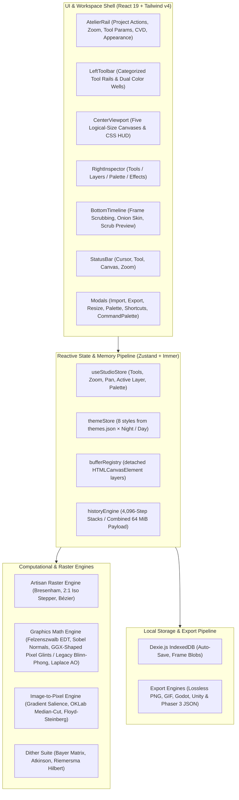
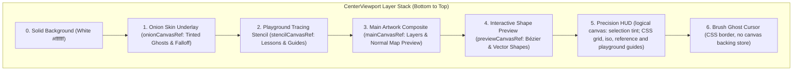
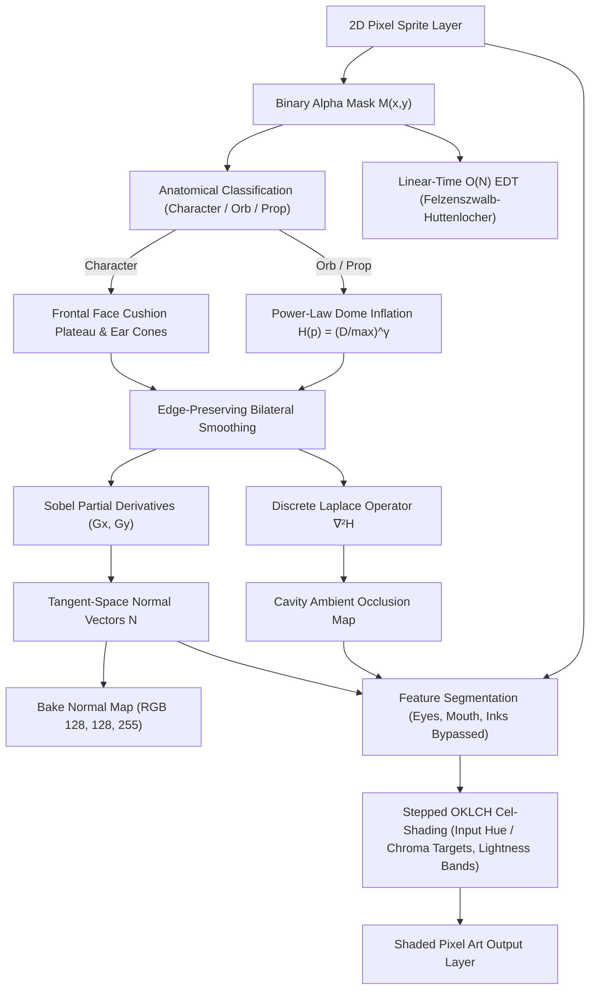
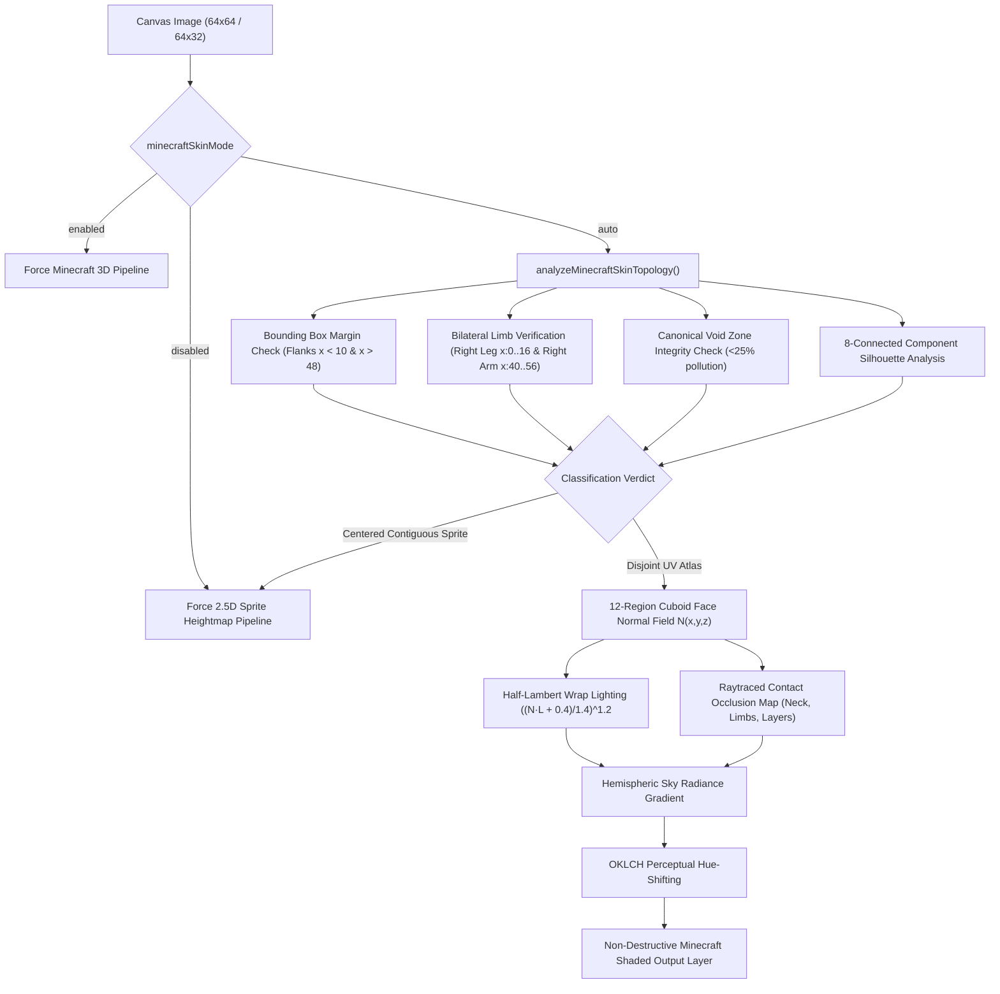
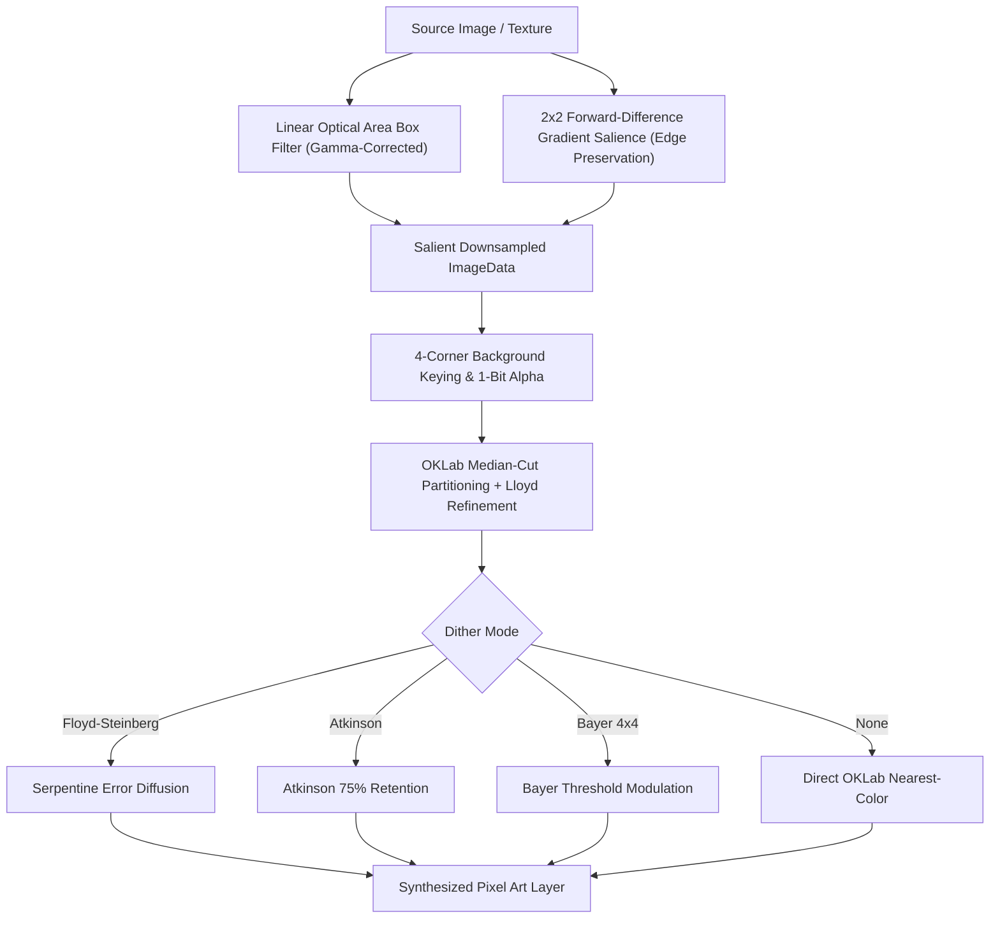
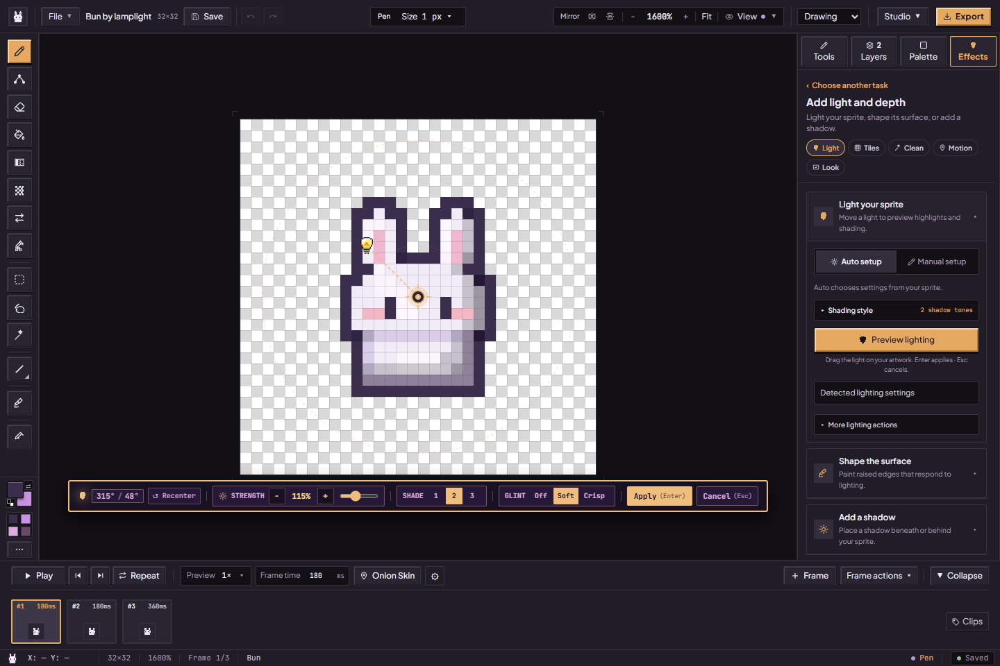
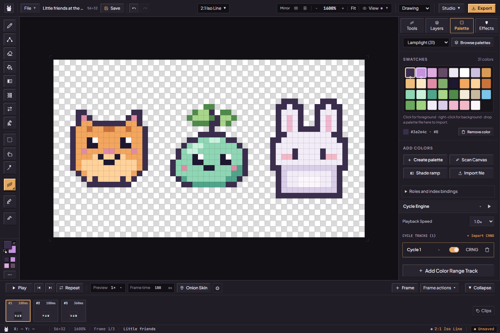
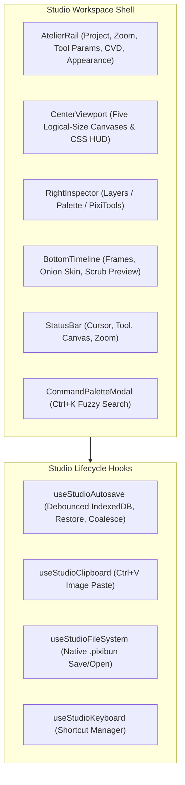

# Architecture & System Design — PixiBun

## Current source update — 15 October 2026

The [source and documentation review](docs/releases/2026-10-15-codebase-and-documentation.md) covers recent main commits through `e9b5e682` and the integrated playground, homepage, inspector, theme and update changes. Earlier dated updates retain their original verification scope.

| Area | Current owner and behavior |
| --- | --- |
| Drawing history | [pixelPatch](src/lib/engine/pixelPatch.ts) retains before/after dirty rectangles with layer offsets; [historyEngine](src/lib/engine/historyEngine.ts) defaults to 4,096 entries per stack with a combined 64 MiB payload cap. Replay baselines are separate. Motion settings retain their separate 50-entry parameter history. |
| Selection | [selectionMask](src/lib/canvas/selectionMask.ts) constrains raster tools across tool switches. Unshifted H/V flips a selection; Shift+H/V toggles drawing symmetry. |
| Collaboration history | [selectiveRestore](src/lib/engine/selectiveRestore.ts) restores changed RGBA cells only while their live bytes still equal the step's expected result. It preserves differing later peer pixels, not author identity for equal-color overwrites. Structural history and created-layer steps retain their separate behavior. |
| Playback | [usePlaybackClock](src/hooks/studio/usePlaybackClock.ts) owns one elapsed-time rAF clock per workspace, preserves time across frame publications, caps one contribution at 250 ms and suspends hidden-tab time. Studio and desktop practice share it; speed is a preview multiplier. M3 scheduling qualification remains open. |
| Playground | [PlaygroundLayout](src/components/layout/PlaygroundLayout.tsx) uses CoachPanel, ToolDock, FilmStrip and ghost/gap overlays. [lessonArt](src/lib/art/lessonArt.ts) paints all twelve curricula; [playgroundCoach](src/lib/art/playgroundCoach.ts) supplies display names and coaching. Pocket has eight 16×16 lessons plus its temporary 32×32 free pad. |
| Homepage | [NightStory](src/components/landing/night/NightStory.tsx) follows scroll through sketch, light, motion and export; the hero reacts to Bun taps and sky drawing. [showcaseExport](src/components/landing/showcase/showcaseExport.ts) creates real animation files and image/metadata ZIP kits for its separate sample. |
| Inspector | [InspectorKit](src/components/layout/inspector/InspectorKit.tsx) shares section, field and control styling across Tools, Layers and Palette. Timeline thumbnails are admitted while visible, and the existing Studio cards remain 72 px wide. |
| Theme | [useLiveThemeChoice](src/stores/themeStore.ts) supplies saved palette values to canvas consumers during hydration; markup keeps server-compatible values. [themeTransition](src/lib/theme/themeTransition.ts) optionally reveals Day/Night through View Transitions, with an immediate reduced-motion/unsupported fallback. |
| Updates | [appRestart](src/lib/system/appRestart.ts) delegates to the active Studio's real save coordinator. The initiating page saves before APPLY_UPDATE and rechecks before reload; other pages do not automatically reload. The worker retains old caches when multiple window clients exist and can read their assets through CacheStorage. See [deployment](docs/guides/deployment.md). |

## Studio Labs and UI motion — 15 October 2026

[Studio Labs](src/experimental/README.md) owns four removable experiments behind [labsStore](src/experimental/labsStore.ts). Flags persist per browser and are gated to scene themes; automated runs default off unless their fixture opts in. [DynamicIsland](src/experimental/island/DynamicIsland.tsx) measures only its mounted content, deduplicates target sizes and retargets separate width/height springs. Tool replacement temporarily keeps old controls inert, then swaps at zero opacity and blooms the new controls. The scale handoff uses `MotionValue.jump()` to reset outgoing velocity. The inspector combines Labs liquid tabs with the audited readable classic-tab layout. See the [Studio Labs motion update](docs/releases/2026-10-15-studio-labs-motion.md).

## Strategy Phase 0 and 0.5 update — 14 October 2026

| Area | Ownership |
| --- | --- |
| Offline precache | `next build` runs [writePrecacheManifest.mjs](scripts/writePrecacheManifest.mjs), which lists every emitted `/_next/static` file in `public/precache-manifest.json`. The [service worker](src/app/sw.js/route.ts) precaches that list at install only when its version matches and it contains every file the served shell references, so development servers and other builds fall back to shell-only precaching. |
| Lazy panel failure | Code-split dialogs and the PixiTools panel load through [lazyPanel](src/components/system/lazyPanel.tsx): a failed chunk stays inside its panel with Try again instead of unmounting the Studio route. |
| Truthful crash screen | The [Studio error screen](src/app/studio/error.tsx) saves through the registered route session ([studioCrashSave](src/lib/project/studioCrashSave.ts)) and publishes a resume ticket before claiming the drawing is saved. |
| Themes | Eight styles live in [themes.json](src/lib/theme/themes.json); [generateThemeCss.mjs](scripts/generateThemeCss.mjs) writes `src/app/themes.generated.css` (core tokens per style and mode plus one derived-token block). Scene styles draw [procedural scenes](src/lib/theme/scenes.ts) behind floating panels. The theme store starts at server defaults (zustand serves `getInitialState()` for hydration) and [ThemeSync](src/components/system/ThemeSync.tsx) re-applies the `<html>` attributes React drops. |
| Onboarding | [WelcomeJourney](src/components/onboarding/WelcomeJourney.tsx) and [CoachTips](src/components/onboarding/CoachTips.tsx) read [preferencesStore](src/stores/preferencesStore.ts) (experience, onboarded time, seen tips, tips switch). Automated browsers skip the journey unless `?welcome=1` is present. |


## Nibbli and Studio ownership update — 13 October 2026

Nibbli is repository developer tooling layered over the production Studio UI, separate from the deterministic graphics engine and application state. Its provider-neutral planner boundary accepts conversation replies or deterministic mocks; it does not start a model service or require a provider API key. The loop is goal → plan → whole-plan validation → real UI execution → screenshots/native pixels/files → critique → at most three corrections.

| Boundary | Responsibility |
| --- | --- |
| [Artist protocol and adapters](scripts/nibbli/artist/protocol.ts) | Strict command/critique envelopes, observation identity, action/point/call/token/time and reported-cost budgets; adapters supply plans without choosing a provider globally. |
| [Shared controller](scripts/nibbli/controller.ts) | Real mouse/keyboard/tool/layer/timeline/save/export actions, measured canvas coordinates and bounded selection transforms; no application-state or raster injection. |
| [Vision](scripts/nibbli/vision.ts) and [attempt memory](scripts/nibbli/memory.ts) | Read-only native pixels, independently decoded files and immutable evidence-linked attempts. Functional expectations remain separate from artistic opinions; experience memory does not train model weights. |

Hands preflights same-layer/frame 32×32 moves, disjoint copies, H/V mirrors and exact clockwise quarter turns against protected metadata/RGBA. Free-angle rotation is a separate trusted diagnostic, not a planner command. Source/build changes invalidate browser qualification; raw evidence stays local. [Agent contract](docs/guides/nibbli-agent.md), [testing](docs/guides/testing.md) and [current status](docs/current-status.md) define the operational limits and retained verdicts.

Curve now has a dedicated draft/adjust/apply/cancel handler and [screen-space handles](src/components/studio/CurveAdjustmentGizmo.tsx). It binds pending work to its initiating workspace/history, cancels on frame/layer/project switches and checks the exact latest Undo entry before re-edit. Re-edit is Undo-based: Cancel leaves the curve undone and Redo restores it. The published source qualified primary-color safety; the pre-S4 hardening additionally preserves the initiating/recorded color and responds only to explicit edits of its chosen well. Pasted-copy transforms initialize gizmo bounds and one Undo baseline; Cancel writes back only genuinely lifted source pixels. [Drawing guidance](docs/guides/drawing-tools.md#bézier-curve), [current status](docs/current-status.md#local-pre-s4-hardening-candidate) and the [published change record](docs/releases/2026-10-13-studio-and-nibbli.md) keep their source/build scopes separate.

Current project hydration uses a temporary profile-free PNG decoder copy to retain raw layer samples; original stored/portable bytes and atomic publication/rollback remain intact. Timelapse receives a separately captured, ownership-checked terminal composite without mutating Undo, and GIF forwards the eviction baseline. [Storage](docs/contracts/storage.md#project-layer-png-samples) and [export](docs/contracts/exports.md) describe admission and remaining capability limits. Firefox H.264's positive support query did not produce a working encoder; WebKit's overflow fixture also stalled before the product refusal could be tested. Neither is closed by passing unit tests or the clean Motion run.

At the 13 October publication, reduced decorative paint cost did not close M3's intermittent WebKit scheduling/visible-pose issue and the clock was unchanged. The current shared clock is described in the 15 October update above; extracting it does not close M3 qualification.

## Import, worker and navigation ownership — 11 October 2026

Image/sheet import stages destination structure, pixels, history and optional palette before publication. Replacement clears transparent input areas and refuses locked destinations; failed admission preserves artwork. The admitted transaction coordinates grouped Undo/Redo, redraw and persistence. The worker starts healthy network requests independently of optional cache access, bounds that access at 250 ms, and captures the owned cache at event arrival so late work does not reopen a retired bucket. Cache failure does not guarantee offline availability when no readable cached bytes exist. Home decorative light updates use transition priority; starter reveals fade while their hit areas remain fixed. These named repairs and their scope are recorded in the [current status](docs/current-status.md).

## Motion and workspace ownership update — 8 October 2026

The current checkout has one rigid-part motion session, source-bound capture/preview/bake, saved format-v4 rig definitions and atomic saved-rig Open. [pixiMotion.ts](src/lib/animation/pixiMotion.ts) validates the source cel, raster generation/revision, layer state and admission before baking ready cels in one structural history action. [motionRigWorkspace.ts](src/lib/animation/motionRigWorkspace.ts) validates saved fingerprints and opens the source frame/layer with End pose and playback stopped. Floating selections, active Co-Draw and normal-tagged or normal-map-effect sources are refused. Movement also refuses source frames with normal artwork or research siblings that depend on the moving source. Separate bounded pose/pivot/timing Undo/Redo and precise controls are implemented; multi-part rigs and source rebinding remain open; saved rig metadata is separate from the transient retained raster/mask. [Storage](docs/contracts/storage.md), [rendering](docs/contracts/rendering.md) and the [cross-phase review (local archive)](docs/archives.md#record-docs-research-2026-10-07-piximotion-cross-phase-hardening-md) own the limits and evidence.

Workspace transactions stage raster/history/metadata and publish one coherent notification batch, containing subscriber errors after commit. Source-owned asynchronous jobs reject stale output and release reservations on settlement. Selection Cancel also checks the lifted raster's owner before restoring pixels. Motion preview and UI Bake use an isolated, cancellable worker with source/session checks and latest-preview coalescing. Its typed-array output is a rotated rectangle with destination offsets, shared by the worker, bounded fallback and clipped preview/bake stamping; composition and other algorithm previews still have main-thread work. These boundaries cover the named paths, not every editor mutation. Broader device and artist qualification remains pending. [Editing and quality follow-up (local archive)](docs/archives.md#record-docs-research-2026-10-07-editing-quality-release-hardening-md).

## Audit integration update — 3 October 2026

Co-draw checkpoints the original project before adopting a separate shared identity. Peer admission rejects unsafe clock values and malformed typed signaling; reliable delivery distinguishes a transient interruption from terminal cleanup. Workspace input yields to dialogs, editable controls and IME composition, while selection transforms and primary-touch strokes have a single owner. Import previews use bounded display surfaces and source pixels for empty-cell filtering. APNG yields between frames, supports cancellation and prefers native compression with a stored-block fallback. Diagnostics apply bounded write/send queues and recheck consent before transmission.

Deployment uses the successful same-repository main-push CI SHA, environment-based credentials and an explicit service-worker build identity. The [session publication record (local archive)](docs/archives.md#record-docs-research-2026-10-03-audit-session-publication-md) links each repair and its scoped checks. Twelve passing executable local workflows are separate from TestSprite's incomplete cloud artwork coverage; neither establishes a deployed release or broad device/network qualification.

## Audit session architecture update — 2026-10-01

The local implementation adds revision-safe saves and conflict copies; bounded export/worker operations; estimated shared memory admission; animation-review regions and intentional exceptions; shared clip/hold exports, semantic palette registers and a Godot kit; and canonical research recipes for protected simplification, shared stylized lighting and small tile scenes. Research previews use an owned worker, retain source rasters, reject stale publication and publish ready buffers before a single structural history step. Recipes survive project serialization and undo/redo; merging clears single-source research provenance.

Research workflows admit at most 256 pixels per axis, 16 frames and 262,144 source pixels; scenes admit at most 16 tiles and 20,000 search states. These local recipe workflows do not establish general collaboration convergence, physically accurate lighting or large-world generation. See the [phase implementation report (local archive)](docs/archives.md#record-docs-research-phase-implementation-status-md) and [session completion record (local archive)](docs/archives.md#record-docs-research-session-completion-2026-10-01-md). Existing numbered architecture sections remain the broader system reference.

```text
  /\_/\   *  .  *  .  *  *  .  *  *  .  *  *
 ( o.o )   A R C H I T E C T U R E
  > ^ <    Technical Blueprint & Engineering Reference
```

> **A browser-based raster and animation studio with local persistence, reversible pixel workflows and stylized 2.5D graphics.** Integrated input-to-display latency is unmeasured; sub-16ms interaction is a design target, not an achieved result.

---

## How to use this reference

This document describes subsystem ownership and integration. For artist workflows, start with [the README](README.md); for algorithms and their limitations, use [the deep dive (local archive)](docs/archives.md#record-pixibun-deep-dive-md). The numbered sections retain their existing anchors for linked historical records.

| Question | Canonical reference |
| --- | --- |
| What project shapes and sizes are admitted? | [Storage limits](docs/contracts/storage.md#admission-and-optional-metadata) |
| Who owns buffers, previews and worker results? | [Rendering](docs/contracts/rendering.md) |
| What do save, backup and recovery mean? | [Artwork safety](docs/guides/artwork-safety.md) |
| What does each output preserve? | [Exports](docs/contracts/exports.md) |
| What security assumptions apply? | [Security boundaries](docs/contracts/security-boundaries.md) |
| Which checks actually ran? | [Current status](docs/current-status.md) |

## Table of Contents

- [1. System Topology Overview](#1-system-topology-overview)
- [2. Canvas & Rendering Pipeline](#2-canvas--rendering-pipeline)
- [3. Deterministic Graphics Math Engine (`src/lib/ai/math/`)](#3-deterministic-graphics-math-engine-srclibaimath)
- [4. State Management, Layer Security & Undo Architecture](#4-state-management-layer-security--undo-architecture)
- [5. Local-First Storage & Multi-Project Lifecycle (`src/lib/storage/db.ts`, `src/lib/project/schema.ts`)](#5-local-first-storage--multi-project-lifecycle-srclibstoragedbts-srclibprojectschemats)
- [6. Multi-Engine Export & Web Worker Pipeline (`src/lib/export/`)](#6-multi-engine-export--web-worker-pipeline-srclibexport)
- [7. 3D Minecraft Skin Recognition & Domain Shading Engine (`src/lib/ai/math/minecraftSkin.ts`)](#7-3d-minecraft-skin-recognition--domain-shading-engine-srclibaimathminecraftskints)
- [8. Signed Distance Field (SDF) In-Between Animation Morphing (`src/lib/ai/pixelAiEngine.ts`)](#8-signed-distance-field-sdf-in-between-animation-morphing-srclibaipixelaienginets)
- [9. Image-to-Pixel-Art Conversion Pipeline (`src/lib/ai/pixelizeEngine.ts`)](#9-image-to-pixel-art-conversion-pipeline-srclibaipixelizeenginets)
- [10. Theme Architecture (`src/stores/themeStore.ts`)](#10-theme-architecture-srcstoresthemestorets)
- [11. Bounded Idle Buffer Pooling (`src/lib/engine/bufferPool.ts`)](#11-bounded-idle-buffer-pooling-srclibenginebufferpoolts)
- [12. Multithreaded Worker & Deterministic CG Math Architecture](#12-multithreaded-worker--deterministic-cg-math-architecture)
- [13. Strongly-Typed Studio Event Bus (`src/lib/events/studioEvents.ts`)](#13-strongly-typed-studio-event-bus-srclibeventsstudioeventsts)
- [14. Vercel & CI/CD Deployment Pipeline](#14-vercel--cicd-deployment-pipeline)
- [15. P2P Co-Draw Sync Bridge (`src/lib/sync/coDrawBridge.ts`)](#15-p2p-co-draw-sync-bridge-srclibsynccodrawbridgets)
- [16. Diagnostics Relay Hardening (`src/app/api/diagnostics/relay/route.ts`)](#16-diagnostics-relay-hardening-srcappapidiagnosticsrelayroutets)
- [17. Algorithmic Scope Boundaries & Target System Envelope](#17-algorithmic-scope-boundaries--target-system-envelope)
- [18. 2.5D Normal Chisel & Bas-Relief Sculptor (`src/lib/art/normalSculptor.ts`)](#18-25d-normal-chisel--bas-relief-sculptor-srclibartnormalsculptorts)
- [19. Mark Ferrari 8-Bit Dynamic Palette Cycling Engine (`src/lib/color/paletteCycling.ts`)](#19-mark-ferrari-8-bit-dynamic-palette-cycling-engine-srclibcolorpalettecyclingts)
- [20. Database & Canvas Teardown Lifecycle Invariants (`src/lib/storage/db.ts`, `tests/e2e/chiselAndPaletteLiveProof.spec.ts`)](#20-database--canvas-teardown-lifecycle-invariants-srclibstoragedbts-testse2echiselandpaletteliveproofspects)
- [21. Bitwise Normalization, Hot-Path Viewport Decoupling & Export Pipeline Hardening](#21-bitwise-normalization-hot-path-viewport-decoupling--export-pipeline-hardening)
- [22. Selection Free-Transform Gizmo, Sprite Sheet Slicer & Web Worker Offloading Engine](#22-selection-free-transform-gizmo-sprite-sheet-slicer--web-worker-offloading-engine)
- [23. Workstation Architectural Upgrades (`p2pHostAuthority`, `structuralHistory`, `desktopFS`, `47-blob`, `isobmffMuxer`)](#23-workstation-architectural-upgrades-p2p-host-authority-structural-history-desktop-fs-47-blob-autotile--pure-isobmff-muxer)
- [24. Comprehensive Defensive Hardening & Invariant Architecture](#24-comprehensive-defensive-hardening--invariant-architecture)
- [25. Autonomous Local CI/CD Quality Gate & Git Pre-Push Protection](#25-autonomous-local-cicd-quality-gate--git-pre-push-protection)
- [26. Studio Workstation Ergonomics, Focus Trapping & Unsaved Invariants](#26-studio-workstation-ergonomics-focus-trapping--unsaved-invariants)
- [27. Photometric Studio Resolution-Aware Bevel Scaling & Dark Palette Protection](#27-photometric-studio-resolution-aware-bevel-scaling--dark-palette-protection)
- [28. Studio UI Architecture & Design System Primitives](#28-studio-ui-architecture--design-system-primitives)
- [29. Teaching Animation Board & Playground Education System](#29-teaching-animation-board--playground-education-system)
- [30. Neutral 2.5D Relighting & Smart-Effect Recipe Provenance (Phase 63)](#30-neutral-25d-relighting--smart-effect-recipe-provenance-phase-63)
- [31. Restricted Recovery Mode, Envelope Guards & Streaming Archive Architecture (Phase 1A & Phase 1B)](#31-restricted-recovery-mode-envelope-guards--streaming-archive-architecture-phase-1a--phase-1b)

---

## 1. System Topology Overview

PixiBun is structured as a client-side single-page application built on **Next.js 16 (App Router)** with client-side creative operations after loading; initial access requires the Next.js server/platform runtime.



---

## 2. Canvas & Rendering Pipeline


*Local production build on 15 October 2026, with PixiBun's own artwork imported through the project dialog. [Capture details](docs/assets/screenshots/2026-10-15-current-ui/run.json); [all themes](docs/guides/themes.md).*

### Multi-Canvas Layered Viewport Stack
To avoid browser layout recalculations and keep editor guides out of color picking, viewport rendering uses five logical-size canvas layers, CSS screen-pixel guides, and a CSS brush cursor. Zoom changes the stage's display size without multiplying any canvas backing store; the interactive SVG selection gizmo supplies the screen-space marquee.

The stage and main composite canvas use no layout-affecting border. A CSS outline marks the stage edge, leaving the artwork raster and grid overlay with the same CSS origin and dimensions (`canvasWidth × zoom / 100` by `canvasHeight × zoom / 100`). Pointer coordinates are mapped through the main canvas bounds, so this equality also protects tool hit positions at high zoom.



### Iso Line and floating preview controls

Iso ON keeps the projected 2:1 stepper; FREE uses the ordinary clipped line path in both useShapePointerHandler preview and commit. Brush size and symmetry still use the common drawing path. CenterViewport owns one floating preview outside the translated drawing stage. Its pointer controls do not start parent canvas strokes, and expanding a minimized preview recomposites current pixels. [Current instructions and phase 3 evidence (local archive)](docs/archives.md#record-docs-research-2026-10-02-feature-repairs-phase3-md).

### Overlay-Free Compositor & Eyedropper Isolation (`src/lib/render/compositor.ts`)
The `compositeFrame()` module is the shared overlay-free compositor for its callers. It reads DOM canvases and registry state; the main viewport also has its own display composition path:
- **Zero Editor Chrome**: Bottom-up compositing honoring layer visibility, opacity, and blend modes without including onion skin ghosts, grid lines, or selection marquees.
- **Eyedropper & Exporters**: The eyedropper samples directly from `compositeFrame()`, making color picking completely immune to normal-map preview modes, HUD guides, and ghost underlays.
- **Living Timeline Thumbnails**: Visible/nearby `<FrameThumbnail>` cells use aspect-correct surfaces up to 24 px per axis; hover previews use up to 96 px. [framePreview.ts](src/lib/render/framePreview.ts) invalidates by the frame's layer order, visibility, opacity, blending and raster generations/revisions. It reserves a temporary native-size `compositeFrame()` surface before downsampling once; offscreen retained preview surfaces unmount. Timing or unrelated frame edits do not redraw a preview. Native composition still scales with pixel area.

### Pure Onion Skinning Engine (`src/lib/render/onionSkin.ts`)
- Pure, DOM-free `getOnionSkinSpecs()` computes clamped previous/next ghost specifications with distance falloff `base * (1 - 0.25 * (dist - 1))` and `prevColor`/`nextColor` tint mapping.
- Tinting is executed offscreen via `source-atop` before blitting to the underlay canvas.

### Direct Buffer Memory Management (`src/lib/engine/bufferRegistry.ts`)
Layers are maintained as detached `HTMLCanvasElement` objects indexed by layer UUID in memory. When the user resizes the canvas:
1. `resizeAllBuffers(newWidth, newHeight, anchor, resample)` shifts and re-allocates existing canvas buffers with 9-point anchor alignment and optional nearest-neighbor resampling.
2. `deleteBuffers(layerIds)` removes registry entries for an array of layer IDs; supported structural teardown/restoration also reconciles live ownership. This controls registry retention, without proving that every browser/GPU/history reference has been released.

### Pure History Engine (`src/lib/engine/historyEngine.ts`)
The undo/redo ledger is independent of React rendering in `HistoryEngine`; its mutable stacks, replay baseline and memory accounting are not a mathematically pure function. Integration hooks restore canvas pixels and store metadata:
- Undo and redo stacks are independently depth-bounded (up to 4,096 entries each), while their combined retained HistoryStep payload is constrained by the configured 64 MiB history byte envelope. Oldest undo steps are evicted when capacity or byte limits are reached, folding evicted steps into the Process Replay baseline checkpoint across both push and redo operations. Oldest redo entries are evicted under combined byte pressure without mutating the baseline.
- Invalidates the redo tail upon any new drawing action or canvas mutation.
- Captures full-layer pre/post images during commit, then retains only the changed rectangle and its offset for ordinary pixel steps. The first pixel edit after structural history retains the full layer for replay continuity. Solo restoration uses `putImageData`; Co-Draw uses expected/live RGBA comparisons before restoring changed cells.
- Provides reactive boolean getters (`canUndo`, `canRedo`) synchronized with `useStudioStore`.
- Layer property and frame-duration edits use metadata-only structural snapshots; continuous opacity and duration controls group one interaction into one history step. History-backed structural mutations estimate both Undo and Redo snapshot sizes before changing artwork and reject over-budget edits without clearing existing history.

---

## 3. Deterministic Graphics Math Engine (`src/lib/ai/math/`)

The `ai` folder name is historical; nothing in it is a generative or trained model. A rename to `src/lib/graphics` is planned.

The graphics intelligence engine is decomposed into modular, deterministic mathematical modules under `src/lib/ai/math/` and `src/lib/ai/`:
- `edtNormalMap.ts`: Felzenszwalb-Huttenlocher $O(N)$ EDT, non-linear dome inflation ($\gamma = 0.5$), bilateral smoothing, content-aware heightmaps, anatomical part segmentation, frontal face cushion plateau (level camera-facing plateau), independent ear cone ridges, and Sobel tangent normal vector fields.
- `photometricLighting.ts`: Parametric 2.5D lighting, protected features/ink, stepped OKLCH diffuse shading and live tagged relighting. Explicit glint choices use the pixel reflection path; calls omitting the choice retain legacy renderer behavior.
- `pixelGlint.ts`: Finite GGX-shaped reflection masks, painted-normal priority with OpenGL-up conversion, two flat core/shoulder coverage levels, bounded hue-related lightness lifts, and preserved source alpha. This is artist-directed pixel shading, not a full energy-conserving BRDF.
- `photometricAuto.ts`: Canvas art morphology analysis, anatomical classification (`character`, `orb`, `prop`), connected-component feature clustering (eyes, mouth, whiskers), convex lobe ear/horn scanning, and automated lighting parameter inference.
- `shadowAuto.ts`: Canvas sprite geometry analysis, contact baseline detection, and directional shadow parameter inference.
- `shadowRayMarcher.ts`: 2.5D bounded sprite cast shadows with 1-to-1 sheared silhouette projection, classic ground contact drop shadow ellipses (`shadowStyle: 'drop'`), and uniform flat opacity (`ditherMode: 'none'`).
- `colorSpace.ts`: sRGB $\leftrightarrow$ linear $\leftrightarrow$ OKLab $\leftrightarrow$ OKLCH conversions and perceptual hue shifting (`shiftHue`).
- `spriteCleanup.ts`: Multi-stage scan and non-destructive pixel cleanup, faint alpha stripping, small detached speck removal, neutral-gray shade reduction, and optional line thinning with before/after previews.



### Key Mathematical Formulations:
1. **$O(N)$ Euclidean Distance Transform:**
   Uses separable 1D lower parabolic envelope scans:
   $$D(p) = \min_{q \notin \Omega} \sqrt{(p_x - q_x)^2 + (p_y - q_y)^2}$$
2. **Analytical Tangent Normals & Light Vector (Compass Convention):**
   $$\mathbf{N} = \frac{1}{\sqrt{s_x^2 G_x^2 + s_y^2 G_y^2 + 1}} \begin{pmatrix} -s_x G_x \\ -s_y G_y \\ 1 \end{pmatrix}, \quad \mathbf{L}(\theta, \phi) = \begin{pmatrix} \sin\theta \cos\phi \\ -\cos\theta \cos\phi \\ \sin\phi \end{pmatrix}$$
   *Standard navigation/Photoshop azimuth convention: $0^\circ = \text{North (Top)}, 45^\circ = \text{North-East}, 135^\circ = \text{South-East}, 225^\circ = \text{South-West}, 315^\circ = \text{North-West (Top-Left)}$.*
3. **Frontal Face Cushion Plateau & Feature Normal Stabilization:**
   For character forms, to avoid "bowling-ball" inflation where half the face is plunged into darkness ($N \cdot L < 0$), height within the outer silhouette bevel of radius $R_{\text{char}} = 2.8 \times \text{scaleFactor}$ (where $\text{scaleFactor} = \max(1.0, \min(W, H) / 32)$) bevels smoothly while the interior reaches a flat plateau:
   $$\text{rimRatio} = \min\left(1.0, \frac{D_{\text{macro}}(p)}{R_{\text{char}}}\right), \quad H_{\text{macro}}(p) = \max(D_{\text{macro}}) \cdot \sqrt{\text{rimRatio}}$$
   Normals across the face interior level off to a camera-facing plateau, confining form shadows to the unlit silhouette edge. Features (eyes, mouth, whiskers) receive camera-facing normals $\mathbf{N} = (0, 0, 1)^T$.
4. **Feature Segmentation & Discrete OKLCH Cel-Shading:**
    Pixels tagged `isFeature = 1` or `isInkLine = 1` bypass lighting multipliers entirely, preserving exact original RGB values. The cel path uses `buildCelRamp()` with base, soft-shadow, shadow, deep-shadow and highlight entries. The 1/2/3 shadow-band setting selects the directional partition; a cavity can select the deep entry independently of that setting. These are per-base-color ramps, not a fixed total output palette:
    * **Base Tone:** Original artist color preserved where the lighting thresholds select the base tone; no universal surface percentage
    * **Directional Mid-Shadow:** $L_{\text{shadow}} = \max(0.04, \min(L_{\text{base}} \times 0.86, L_{\text{base}} - 0.025))$, with the ramp input's OKLCH hue and chroma retained as conversion targets.
    * **Deep Crevice:** $L_{\text{deep}} = \max(0.02, \min(L_{\text{base}} \times 0.72, L_{\text{base}} - 0.05))$ with the ramp input's hue and chroma retained as targets (concave seams where $AO < \text{creviceAOThresh}$, dynamically bounded to $[0.12, 0.30]$ scaling with cavity strength).
    * **Highlight:** $L_{\text{hi}} = \min(0.98, L_{\text{base}} + (0.98 - L_{\text{base}}) \times 0.22)$ with the ramp input's hue and chroma retained as targets (shiny materials only: $k_s > 0.1$ and not matte/fabric; penumbra uses $L_{\text{soft}} = \max(0.05, \min(L_{\text{base}} \times 0.93, L_{\text{base}} - 0.015))$).
    * **Exposure-Compensated Directional Terminator (Phase 63):** Cel shadow placement is evaluated purely over the directional diffuse signal $\text{diffSignal} = \text{wrapNdotL} \times \text{effectiveFalloff}$. Brightness changes the shadow threshold and therefore can move the boundary between cel tones. The piecewise linear mapping uses baseline 1.15 ($\text{shadowThresh} = 0.52 + t \times 0.30$ for $\text{brightness} \le 1.15$, or $0.52 - t \times 0.32$ for $\text{brightness} > 1.15$). Optional Bayer matrix dither modulation perturbs the threshold for organic pixel art stippling.
    * **Neutral Macro-Form & Material-Scale Synthesis (Phase 63):** Superseded fixed head/neck/torso height priors with neutral macro-form and multi-scale material detail ($H_{\text{composite}} = 0.70 H_{\text{macro}} + 0.30 H_{\text{micro}}$ for characters), keeping the base normal inference separate from lighting; appendage stabilization can depend on azimuth and allowing tones to dynamically track the light bulb across $360^\circ$ azimuth. Interior ink detection requires opposing two-sided luminance dips ($(\text{neighbor}_{\text{opposing}} - \text{lum}) \ge 0.12$), preventing painted shadow boundaries from being carved as permanent ink crevices. Connected-component flood fill clusters authored ramps by hue and chroma proximity ($\Delta\text{hue} \le 35^\circ, \Delta\text{chroma} \le 0.25$).

    `buildCelRamp()` varies lightness while keeping its input OKLCH hue/chroma coordinates; gamut-limited RGB conversion can change the realized coordinates. Optional painted-shading normalization and later lighting/material/glint operations have separate color behavior. This is not a promise that every generated pixel preserves the original sprite's hue/chroma.
5. **Legacy Blinn-Phong Specular Half-Vector (current bulb glints use a separate GGX-shaped quantized response):**
   $$\mathbf{H} = \frac{\mathbf{L} + \mathbf{V}}{\|\mathbf{L} + \mathbf{V}\|}, \quad I_s = k_s (\max(0, \mathbf{N} \cdot \mathbf{H}))^\alpha$$
   In discrete pixel-art ramps, sparse specular highlights are isolated when $I_s > 0.35$.
6. **Discrete Laplace Cavity Occlusion:**
   $$\nabla^2 H \approx H * \begin{bmatrix} 0 & 1 & 0 \\ 1 & -4 & 1 \\ 0 & 1 & 0 \end{bmatrix}, \quad AO(p) = \text{clamp}(1.0 - k_{\text{ao}} \max(0, -\nabla^2 H), 0, 1)$$
7. **2D Subsurface Scattering (Beer-Lambert + Henyey-Greenstein Forward Phase):**
   The implemented empirical optical chord is direction-dependent, not a circular chord reconstruction:
   $$T(p) = \frac{2\max(0.5,D(p))}{\max(0.08,\mathbf{N}\cdot\mathbf{L}+wrap)},\quad T_{scaled}(p)=\frac{T(p)}{\max(1,d_{trans})}$$
   Per-channel transmission is $\exp(-\sigma_c T_{scaled})$. Gemstone/slime extinction adapts to base pigment; core masks, forward glow, light color and later tone quantization also affect the output. See `photometricLighting.ts`; this is not measured physical scattering.
   $$P_{2D}(\theta, g) = \frac{1 - g^2}{2\pi (1 + g^2 - 2g \cos\theta)^{3/2}}$$
   *(Note: Evaluates the 3D Henyey-Greenstein kernel in 2D with a $2\pi$ circumference prefactor as an empirical forward-scattering highlight curve, clamped to $[0, 1.0]$ in the relighting pipeline).*
8. **Dielectric Fresnel Reflectance with Cauchy Chromatic Dispersion:**
   $$F(\theta) = F_0 + (\max(1 - \alpha, F_0) - F_0) \cdot (1 - \cos\theta)^{p_{fresnel}}, \quad \eta_R = \eta_0 - \Delta\eta, \; \eta_B = \eta_0 + \Delta\eta$$
9. **Kajiya-Kay Anisotropic Cylindrical Specular:**
   $$\sin(\mathbf{T}, \mathbf{H}) = \sqrt{\max\left(0, 1 - (\mathbf{T}\cdot\mathbf{H})^2\right)}, \quad I_{aniso} = k_{s1} \sin^{p_1}(\mathbf{T}_1, \mathbf{H}) + k_{s2} \sin^{p_2}(\mathbf{T}_2, \mathbf{H})$$
10. **Bounded 2.5D Sprite Cast Shadows & Ground Drop Shadows (`shadowRayMarcher.ts`):**
    * **1-to-1 Sheared Silhouette Ground Projection:**
      $$h = y_{\text{base}} - y_s \ge 0$$
      $$\text{projX} = \text{round}(x_s + h \cdot \text{shear}_x), \quad \text{projY} = \text{round}(y_{\text{ground}} + h \cdot \text{shear}_y)$$
      Sub-step traversal strictly along the shear vector preserves hollow leg arches and waist indentations without bounding-box bloat.
    * **Ground Contact Drop Shadow Style (`shadowStyle: 'drop'`):**
      Renders a crisp Bresenham pixel ellipse under the character contact baseline ($y_{\text{base}}$):
      $$\frac{(x - x_{\text{center}})^2}{r_x^2} + \frac{(y - y_{\text{base}})^2}{r_y^2} \le 1.0$$
    * **Uniform Flat Pixel Art Opacity (`ditherMode: 'none'`):**
      Shadow pixels receive uniform flat opacity $\text{round}(\text{shadowOpacity} \times 255)$, completely eliminating continuous 256-level float gradients.
    * **Non-Destructive Tagged Output:** Writes directly to `Layer.tag = 'cast-shadow'`.
11. **Interactive On-Canvas Pixel Light Bulb Gizmo & Reticle Mathematics (`PixelLightBulbGizmo.tsx`):**
    * Dynamic azimuth calculation from pointer coordinates orbiting around a stationary subject center reticle:
      $$\theta = \left(\text{atan2}(x_{\text{ptr}} - x_{\text{center}}, -(y_{\text{ptr}} - y_{\text{center}})) \times \frac{180}{\pi} + 360\right) \pmod{360}$$
    * Decoupled focal point reticle handle ($x_{\text{center}}, y_{\text{center}}$) allowing artists to reposition the lighting anchor without altering the light direction angle.
    * requestAnimationFrame-scheduled preview updates; 60 FPS is a target, not a guaranteed achieved rate.
12. **Spherical Convex Dome Inflation & Slope AO Decoupling:**
    * Heightmap blends spherical dome inflation ($0.75$) with a gamma curve ($0.25$, default $\gamma = 0.5$):
      $$H(p) = \max(D) \cdot \left(0.75 \sqrt{\max\left(0, 1 - \left(1 - \frac{D(p)}{\max(D)}\right)^2\right)} + 0.25 \left(\frac{D(p)}{\max(D)}\right)^\gamma\right)$$
    * Eliminates conical pinch creases on convex primitives while providing true vertical silhouette tangents.
    * Decouples direct key light from cavity ambient occlusion on convex slopes to eliminate center-locked apex highlight glitches.

---

## 4. State Management, Layer Security & Undo Architecture

The application state is managed by Zustand with Immer middleware:
* **`useStudioStore`:** Single source of truth for tool settings, primary/secondary colors, frame lists, layer hierarchies, zoom/pan parameters, and UI visibility.
* **Byte-budgeted drawing history:** Undo and redo stacks are independently depth-bounded (up to 4,096 entries each, `createHistoryEngine()` matching `src/hooks/viewport/useViewportDrawing.ts`), while their combined retained HistoryStep payload is constrained by the configured 64 MiB history byte envelope. Undo/Redo restores saved pixels with `putImageData`; work scales with the affected pixel region and does not re-run unrelated effect calculations.
* **History Layer Lifecycle (`createdLayerId`):** When PixiTools operations (`Photometric`, `Specular`, `Cast Shadow`) create a new layer, the history snapshot tracks `createdLayerId`. Undoing the action removes the layer entirely from the frame stack and purges its buffer memory, while redoing cleanly restores it.
* **Locked Layer Drawing Protection:** `handlePointerDown` checks `currentLayer.locked` prior to dispatching raster strokes. When locked, execution returns immediately and triggers an animated HUD warning toast (`Active layer is locked! Unlock it in the Layers panel to draw.`) with `<PixelIcon name="lock" />`.
* **`bufferVersion` Signal & Stroke Decoupling:** A raster invalidation counter supports leaf previews and the current viewport's motion-preview subscription. Cursor coordinates remain in a separate HUD subscriber, but artwork changes can render `CenterViewport`. Subscription structure is not a measured guarantee of zero parent renders or sub-16ms interaction.
* **Layer Merge Down (`mergeLayerDown`):** Refuses a hidden source or destination and asks the artist to show it; admits editable visible layers, composites their visible Normal (`source-over`) contribution with opacity, and publishes a neutral raster on the lower layer with generated provenance cleared. Visible non-Normal blending is refused because its backdrop-dependent result cannot generally be flattened into an independent layer. Pixel composition/history work scales with affected area; registry deletion alone is not the cost of the whole merge.

---

## 5. Local-First Storage & Multi-Project Lifecycle (`src/lib/storage/db.ts`, `src/lib/project/schema.ts`)

The database and portable project formats are separate contracts: Dexie schema v5 versus `.pixibun` format v4. Logical `StoredLayerBlob` APIs expose Blob; current physical records store ArrayBuffer bytes plus `blobType`, reconstructing Blob on reads and retaining legacy Blob support. ArrayBuffer reads remove the physical MIME field from the logical record; other unknown fields remain subject to strict recovery validation. Metadata and raster commits are atomic with revision checks. Older deployments can lack the binary read path even with the same database version.

`AutoSaveOutcome` is success or `conflict`, `memory-limit`, `invariant-invalid`, `aborted`, `quota-exceeded`, or `error`. A changed/deleted stored revision returns conflict and preserves active work for Save a copy. Debounced saves (800 ms) do not imply instant durability; encoding and commit add time, and newer edits queue another save. Restore/admission/cancellation states are coordinated separately from save outcomes.

The schema validates dimensions, frame/layer counts, aggregate footprint, decoded raster geometry, versions and optional metadata. Newer unsupported versions are rejected; legacy migrations remain supported. See [storage and compatibility](docs/contracts/storage.md), [artwork safety and backup](docs/guides/artwork-safety.md) and [recovery architecture](#31-restricted-recovery-mode-envelope-guards--streaming-archive-architecture-phase-1a--phase-1b).

---

## 6. Multi-Engine Export & Web Worker Pipeline (`src/lib/export/`)

* **Tag Clip Export Scoping (`ExportModal.tsx`):** Allows artists to select specific named clips (`Walk [1-4]`, `Attack [5-8]`). Frames are sliced to the clip range, output files are dynamically renamed (`hero_Walk-4x.gif`), and SpriteSheet atlas metadata is cleanly $0$-indexed for Godot/Unity/Phaser.
* **Multi-Threaded Web Worker GIF Encoding (`gifEncoder.worker.ts`):** Offloads CPU-intensive Median-Cut color quantization and variable-length LZW compression to a background Web Worker.
* **Variable Frame Duration Centisecond Timing:** Passes frame-specific delay arrays ($D_i = \max(2, \text{round}(\text{durationMs}_i / 10))$) directly to GIF Graphic Control Extensions, honoring variable hold and transition speeds authored in `BottomTimeline`.
* **Transferable Objects:** GIF encoding transfers owned pixel snapshots with `ArrayBuffer` lists, avoiding a second structured-clone copy during dispatch. Extraction and scaling still allocate/copy; live project buffers are not transferred.
* **Live Worker Progress Bar:** Dispatches `{ type: 'progress', current, total }` messages, driving real-time progress percentages in the `ExportModal`.
* **Main-Thread Fallback:** Missing workers or initialization failure can use the still-owned snapshot within admission bounds. Failure after transfer rejects rather than retrying detached arrays or extracting potentially changed artwork. Cancellation, cleanup and a 30-second deadline bound the worker path.
* **Sprite-Sheet Geometry Preflight & Dimension Ceilings (`spriteSheetPacker.ts`, `ExportModal.tsx`):** Preflights sheet geometry (`calculateSpriteSheetGeometry`, `validateExportGeometry`) before initiating frame compositing loops, preventing multi-frame bitmap allocation when output bounds exceed `MAX_SAFE_CANVAS_DIMENSION` (4096 px) or `MAX_SAFE_CANVAS_PIXELS` (16,777,216 px). The underlying packer (`packSpriteSheet`) independently enforces these bounds as a defense-in-depth safety ceiling, throwing `RangeError` before canvas allocation.
* **Animated Export Geometry Preflight & Ceilings (`exportGeometryValidation.ts`, `ExportModal.tsx`, `AnimatedExportTab.tsx`):** Preflights output geometry across all animated formats (GIF, APNG, MP4, WebM) and cycle loops via `validateExportGeometry` before invoking frame compositing loops, rejecting exports when scaled bounds exceed PixiBun's configured safety boundaries `MAX_SAFE_CANVAS_DIMENSION` (4096 px) or `MAX_SAFE_CANVAS_PIXELS` (16,777,216 px). For formats with upfront uncompressed frame retention (GIF and APNG), preflight additionally enforces an aggregate source pixel ceiling (`MAX_EXPORT_AGGREGATE_PIXELS` = 67,108,864 aggregate pixels = 64 MP = 256 MiB of raw RGBA at 4 bytes/pixel), bounding raw-frame export workloads to reduce OOM risk. The encoders (`scaleCanvas.ts`, `gifEncoder.ts`, `apngEncoder.ts`, `mp4Encoder.ts`, `webmEncoder.ts`) independently enforce these ceilings as a defense-in-depth barrier, throwing `RangeError` before allocating buffers, workers, or media encoders.


## 7. 3D Minecraft Skin Recognition & Domain Shading Engine (`src/lib/ai/math/minecraftSkin.ts`)

When an imported or active sprite canvas has dimensions $64\times64$ or $64\times32$, the photometric lighting system distinguishes between authentic Minecraft 3D player skin texture atlases and single-character / object illustrations before routing normal generation:



### Topological Invariant Discriminator:
1. **Texture Atlas vs. Contiguous 2.5D Silhouette:**
   * **Minecraft Skin Texture Atlas:** Disconnected planar unwrap of geometric cuboid islands separated by empty void channels. Bilateral limbs occupy the extreme lateral flanks ($x \in [0, 16)$ for Right Leg, $x \in [40, 56)$ for Right Arm). Both extremities must be populated for valid skin detection.
   * **Centered 2D Character / Object Sprite:** Single contiguous silhouette centered horizontally with empty lateral flanks ($x < 10$ and $x > 48$). The dominant connected component contains $\ge 68\%$ of all opaque pixels, and lacks bilateral limb islands. Even if an ear or accessory touches the head coordinate quadrant, it is classified as a 2.5D character sprite and shaded with true continuous tangent normals, eliminating flat $(0, 0, 1.0)$ fallback vectors.
2. **Canonical Void Zone Preservation:**
   * PixiBun's topology heuristic checks rectangular corner regions at $(0, 0, 8, 8)$, $(24, 0, 8, 8)$, $(32, 0, 8, 8)$, $(56, 0, 8, 8)$, and joint regions at $y = 16$. Void pollution $\ge 25\%$ rejects the skin classification; these regions are detector choices, not a stated Mojang validity rule.
3. **User Sovereignty (`PhotometricLightingSection.tsx`):**
   * On $64\times64$ and $64\times32$ canvases, the inspector provides a tactile `Skin 3D Shading: [ Auto | On | Off ]` toggle (`setMinecraftSkinMode`), giving creators manual override over the auto-discriminator.

### Mathematical Formulations:
1. **Half-Lambertian Wrapped Diffuse:**
   $$\text{wrap}(\mathbf{N} \cdot \mathbf{L}) = \left(\frac{\mathbf{N} \cdot \mathbf{L} + 0.4}{1.4}\right)^{1.2}$$
2. **Raytraced Anatomical Contact Ambient Occlusion:**
   $$AO(x, y) = \min(AO_{\text{neck}}, AO_{\text{armpit}}, AO_{\text{thigh}}, AO_{\text{ground}}, AO_{\text{layer}})$$
3. **Perceptual OKLCH Hue-Shifting:**
   * **Highlight:** $H_{\text{new}} = \text{shiftHueToward}(H_{\text{orig}}, 65^\circ, \Delta_{\text{sun}})$ (Sunlight amber)
   * **Shadow:** $H_{\text{new}} = \text{shiftHueToward}(H_{\text{orig}}, 260^\circ, \Delta_{\text{sky}})$ (Cool ambient indigo, never flat gray)

---

## 8. Signed Distance Field (SDF) In-Between Animation Morphing (`src/lib/ai/pixelAiEngine.ts`)

The frame morphing engine generates smooth intermediate tween frames between keyframes via **Separable Euclidean Distance Transform (EDT) Signed Distance Fields (SDF)** combined with multi-source nearest-color sampling:

1. **Signed Distance Field Generation:**
   Continuous distance fields $D_{\text{opaque}}$ and $D_{\text{transparent}}$ are evaluated using 1D separable parabolic envelope scans ($O(W \times H)$ complexity):
   $$\text{SDF}(p) = D_{\text{opaque}}(p) - D_{\text{transparent}}(p)$$
   where $\text{SDF}(p) \le 0$ represents pixels within the active shape boundary and $\text{SDF}(p) > 0$ denotes transparent background.
2. **Intermediate Boundary Tweening at Fraction $t \in [0, 1]$:**
   $$\text{SDF}_t(p) = (1 - t) \cdot \text{SDF}_A(p) + t \cdot \text{SDF}_B(p)$$
   Pixels satisfying $\text{SDF}_t(p) \le 0$ form the morphed silhouette at fractional time $t$.
3. **Multi-Source BFS Nearest-Color Sampling & Cross-Fade:**
   An 8-connected multi-source Breadth-First Search precomputes nearest opaque color seeds for all pixels in $O(W \times H)$ time once per frame. Lit pixels sample nearest seed colors $\mathbf{C}_A$ and $\mathbf{C}_B$ and blend via linear sRGB cross-fading:
   $$\mathbf{C}_t(p) = \operatorname{round}\left( (1 - t) \cdot \mathbf{C}_A(p) + t \cdot \mathbf{C}_B(p) \right)$$

---

## 9. Image-to-Pixel-Art Conversion Pipeline (`src/lib/ai/pixelizeEngine.ts`)



1. **Linear Optical Gamma Correction:**
   $$C_{\text{linear}} = \begin{cases} C_{\text{sRGB}} / 12.92 & C_{\text{sRGB}} \le 0.04045 \\ \left(\frac{C_{\text{sRGB}} + 0.055}{1.055}\right)^{2.4} & C_{\text{sRGB}} > 0.04045 \end{cases}$$
2. **2x2 Forward-Difference Gradient Salience Weighting:**
   High-frequency edges are extracted using a forward-difference gradient on luminance $Y = 0.2126R + 0.7152G + 0.0722B$:
   $$G_x(x, y) = Y(x + 1, y) - Y(x, y), \quad G_y(x, y) = Y(x, y + 1) - Y(x, y), \quad \|\nabla I(x, y)\| = \sqrt{G_x^2 + G_y^2}$$
   During area box downsampling, edge pixels receive boosted accumulation weights:
   $$W_{\text{salience}}(x, y) = W_{\text{box}}(x, y) \cdot \left(1.0 + \min(2.5, 3.0 \cdot \|\nabla I(x, y)\|)\right)$$
   This gives edge pixels more influence. Downscaling can still lose one-pixel details, silhouettes or facial features; inspect the resulting image.
3. **OKLab Median-Cut & Lloyd K-Means Refinement:**
   Clusters color bounding boxes along the axis of maximal perceptual variance in OKLab space ($L, a, b$), followed by iterative centroid convergence:
   $$\mu_k^{(t+1)} = \frac{1}{|S_k|} \sum_{p \in S_k} p$$

---

## 10. Theme Architecture (`src/stores/themeStore.ts`)

The two axes are studio style (eight ids from `src/lib/theme/themes.json`; Graphite and Plum keep the stored ids `atelier` and `cozy-classic`) and color scheme (`dark` / `light`, shown as Night / Day). `themeStore.ts` temporarily suppresses CSS transitions, updates root attributes/classes and performs a synchronous style read before restoring transitions on a following animation frame. This avoids overlapping transition animations; it still performs layout/repaint work and is not a zero-lag guarantee. Appearance choices are under the Studio menu. Qualify rendered colors, focus and reduced-motion states with the relevant UI checks.

---

## 11. Bounded Idle Buffer Pooling (`src/lib/engine/bufferPool.ts`)

Scratch arrays use exact-size Float32/Int32 buckets. A miss allocates; a reused buffer is cleared on acquire. Release can retain the full buffer without clearing. Each bucket holds at most 16 arrays; all idle buffers share a 32 MiB cap with oldest-idle eviction and empty-bucket removal. Idle retention is registered as `scratchPool` in the estimated combined memory ledger and refused/evicted under admission pressure. Duplicate release, partial backing views, empty and oversized arrays are not retained. `clearBufferPool()` drops idle references without invalidating active callers.

The combined 512 MiB ledger estimates selected active and suspended rasters/history/collaboration/pool retention plus reservations. It is not total browser/worker/GPU/decoder/codec RAM. Checked-out scratch arrays need their operation's own ownership/reservation policy. Reuse reduces allocation; it does not eliminate all garbage collection or establish a frame rate.

`compositeFrame()` returns a fresh DOM canvas by default; an explicit target takes precedence. `freshCanvas: false` reuses one mutable shared canvas. Retained frame arrays must not use that shared surface. The compositor reads registry/DOM state and excludes editor overlays; it is not a DOM-free pure function. [Rendering/ownership contract](docs/contracts/rendering.md).

---

## 12. Multithreaded Worker & Deterministic CG Math Architecture

Compute-bound tasks are balanced between background Web Workers and on-device TypedArray math:
- **Web Worker GIF Encoding (`src/lib/export/gifEncoder.worker.ts`):** LZW compression and median-cut color quantization run off-thread with zero-copy transferable `ArrayBuffer` lists (`postMessage(payload, [buffer])`).
- **Live photometric preview and Apply (`src/hooks/viewport/events/usePhotometricEvents.ts`, `src/lib/ai/math/`, `src/lib/ai/shadowRayMarcher.ts`):** Analysis, including its EDT/height/normal passes when required, photometric rendering and bounded sprite cast shadows execute synchronously on the main thread using reusable scratch buffers. The live session can reuse owned analysis; changing inference inputs can recompute it. This path is separate from normal-map baking. For audit finding H1 (resolved), `computeContentAwareHeightmap` records component membership in a linear pass, then visits each component's members and propagates distances through them using one shared canvas-sized `cDist` buffer. The component stage avoids repeated full-canvas scans and per-component distance-buffer allocations. For audit finding H6 (resolved), the affected photometric render path reuses one content-aware analysis instead of recomputing the same full analysis twice, while retaining the separate specular silhouette cushion: `renderParametric2p5DLighting` hoists geometric analysis via `computePhotometricAnalysis` and feeds `precomputedAnalysis` directly into `executePhotometricPipeline`.

- **Normal-map Bake:** The same viewport event owner calls `runEdtNormalMapInWorker()` for EDT, bilateral smoothing and normal-field output through `heavyCompute.worker.ts`. Source-bound jobs reject stale results before publication. Its bounded synchronous fallback is described in sections 22–23; moving this bake off-thread does not move the live photometric path off-thread.

---

## 13. Strongly-Typed Studio Event Bus (`src/lib/events/studioEvents.ts`)

`StudioEventMap` and typed emit/on helpers provide compile-time event shapes over DOM CustomEvents. Runtime DOM details are cast by the facade; the event bus does not run a schema for every action. Individual handlers, project admission, recipe parsers, worker and WebRTC boundaries have their own validators. Do not infer trusted runtime input from TypeScript types or a bare action count. Subscribers must unsubscribe at teardown; externally dispatched events still require boundary validation where used.

---

## 14. Vercel & CI/CD Deployment Pipeline

This Next.js 16 build has dynamic request-time responsibilities, including CSP nonces, routes and the optional relay. A Next-capable Node/platform runtime is required; the existing build is not a plain static export and CDN distribution is not an all-Edge-runtime guarantee. Creative raster work runs client-side after load; warm-cache offline behavior is a separate contract.

GitHub and GitLab checks have different scope. GitHub runs the full gate/build, Chromium development workflows, three-engine compiled-production checks and Lighthouse. GitLab runs the standard gate and main-branch build. Coverage thresholds are configured but coverage is a separate command. Publication, deployment and release approval are distinct actions. [Operator guide](docs/guides/deployment.md), [testing matrix](docs/guides/testing.md).

---

## 15. P2P Co-Draw Sync Bridge (`src/lib/sync/coDrawBridge.ts`)

The current bridge holds one `P2PSyncSession`, so a session supports one host and one guest. General multi-peer convergence is outside the verified v1 scope.

The CRDT engine (`src/lib/collab/crdtPixelBuffer.ts`) and WebRTC transport (`src/lib/sync/p2pSync.ts`) are pure, DOM-free modules; the bridge is the single integration point that connects them to the live studio. It is a module-scoped singleton so sessions survive modal unmount and drawing code can reach it without prop drilling.

* **Structure Join:** On connection, the host broadcasts a `STRUCTURE_SYNC` message (`src/lib/sync/p2pSync.ts`, validated by `validateStructurePayload`) so both peers adopt one layer-ID namespace — the prerequisite for routing per-layer CRDT ops. The host owns the layer/frame tree for the session; guest structure controls are locked and receiving boundaries enforce host-owned layer/frame identity.
* **Full-State Antientropy Join:** Following Shapiro et al. (SSS 2011, §4), the host seeds one `CrdtPixelBuffer` per layer from the live canvas pixels and transmits complete per-layer snapshots. A bounded retry loop handles the window where `RTCPeerConnection` reports `connected` before the RFC 8831 data channels are open.
* **Delta Propagation:** On every stroke commit, the pre-stroke history snapshot is diffed against the live buffer (`src/lib/sync/strokeDiff.ts`) and each changed pixel becomes an LWW op broadcast per layer. Receivers apply ops through the HLC clock (bounded drift, deterministic peerId tie-break) and repaint layer buffers in one `getImageData`/`putImageData` pass.
* **Rendering & Persistence Integration:** Applied remote ops dispatch `pixibun:request-composite` (consumed by `CenterViewport.tsx`) and `pixibun:remote-change` (consumed by `StudioLayout.tsx` to schedule the same debounced autosave as local edits).
* **Presence:** Cursor moves broadcast at ~30fps over the unreliable PR-SCTP channel and render through `src/components/studio/RemoteCursorsOverlay.tsx` with staleness pruning.
* **P2P Admission Envelopes & Backpressure (`src/lib/sync/p2pSync.ts`):** Enforces canonical workspace envelope boundaries (`WORKSPACE_ENVELOPE.MAX_CANVAS_DIMENSION = 2048px`, `MAX_CANVAS_FRAMES = 500`, `MAX_CANVAS_LAYERS = 100` per frame, and pixel operation coordinate boundaries $0 \le x, y < 2048$), bounding untrusted peer operations. Per-frame limits are distinct from project-total layer and raster limits; see [the storage contract](docs/contracts/storage.md#admission-and-optional-metadata). Enforces a 256KB maximum payload size per message (`MAX_P2P_PAYLOAD_SIZE`) and backpressure thresholds (1MB data channel ceiling / 64KB presence ceiling), using token-bucket traffic shaping on the presence channel and RTCDataChannel.bufferedAmount thresholding on the reliable channel.

---

## 16. Diagnostics Relay Hardening (`src/app/api/diagnostics/relay/route.ts`)

The optional relay accepts a provided Origin only when it matches the request URL's exact scheme/host/port; absent Origin is accepted. This is browser-origin admission, not authentication or server proof of client consent. Proxy normalization and sanitized forwarded IP headers are operator responsibilities.

Requests are limited to 64 KiB bodies / 100 events; process-local token buckets admit burst 12 and refill 12/minute per client key. Limits multiply across processes. A server-owned HTTPS target and five-second deadline bound upstream handling; configuration/redirect behavior still needs operator review. Forwarded events have bounded generic envelopes, not universal runtime DiagnosticEntry schemas.

Local diagnostic capture defaults on; transmission defaults off and requires strict boolean opt-in. Messages/details may include free text, pathname and browser data; truncation is not PII redaction. [Security](SECURITY.md), [operator configuration](docs/guides/deployment.md).

---

## 17. Algorithmic Scope Boundaries & Target System Envelope

To target responsive drawing and bound admitted operation complexity, PixiBun's algorithms operate within explicit, mathematically defined envelopes:

* **Target Canvas & Project Envelope:** Purpose-engineered for $16\times16$, $32\times32$, $64\times64$, and $128\times128$ pixel art characters, props, tilesets, and animation loops. PixiBun targets browser-based crafting with IndexedDB binary blob persistence (`layerBlobs`), transferable buffers for worker export, and 2.5D photometric cel-shading.
* **WaveFunctionCollapse (`src/lib/procedural/waveFunctionCollapse.ts`):** Retained as an internal and legacy-project algorithm; the artwork-replacing Generate Seamless Pattern control is retired. The current Patterns & Tilesets panel previews an exact 3×3 repeat of the selected tile and exports that tile unchanged. The retained WFC solver implements an overlapping model with periodic boundaries for small textures ($16\times16$ to $64\times64$ outputs, $N=2$ or $N=3$ kernels). Its modeled working set is admitted against `MAX_WFC_WORKING_SET_BYTES` (64 MiB) before dominant allocations.
* **Unique-tile delivery (`src/lib/export/tilesetBundle.ts`):** A bounded selected-layer scan exports one PNG/PixiBun JSON/Tiled map ZIP. Hash buckets retain exact-byte deduplication, row-major atlas IDs and native alpha; partial edges, stale buffers/settings, cancellation and PNG timeout refuse publication. The shared memory ledger tracks temporary work and retained results. Godot kits separately admit one neutral manual or baked normal layer through `normalLayers.ts`; SVG labels describe approximate contours. [Export contract](docs/contracts/exports.md), [phase 4 execution (local archive)](docs/archives.md#record-docs-research-2026-10-02-feature-repairs-phase4-md).
* **Vector Depixelization (`src/lib/export/depixelizeVector.ts`):** Domain-designed planar similarity graph ambiguity solver inspired by Kopf-Lischinski (SIGGRAPH 2011) principles, resolving diagonal crossing ambiguities via local 1-hop parity connectivity heuristics, shifting contour corners by $\pm 0.05$, and smoothing cell boundaries via cubic Bézier paths for scalable SVG export.
* **Network Boundaries:** After resources are loaded/cached, core drawing, processing, export and persistence run on-device. App loading and service-worker updates still make same-origin requests. LAN co-draw defaults to `LAN_ICE_SERVERS = []`, avoiding configured public STUN requests; peer traffic still uses the network. Public STUN traversal and the diagnostics relay require explicit user activation. This describes application configuration, not a browser-wide zero-egress guarantee.

---

## 18. 2.5D Normal Chisel & Bas-Relief Sculptor (`src/lib/art/normalSculptor.ts`)

* **Tangent-Space Normal Vector Encoding:** Standard OpenGL convention where $+Y$ points Up (green channel increases towards the top of the sprite) and flat perpendicular surfaces encode to $(128, 128, 255)$. Decoded vectors are strictly normalized to unit length $\|(N_x, N_y, N_z)\| = 1$.
* **Analytical Bevel & Chamfer Geometry:** Given compass azimuth $\alpha \in [0, 360^\circ)$ ($0^\circ=\text{North}$, $90^\circ=\text{East}$) and slope incline $\phi \in (0, 90^\circ]$, directional normal vectors are evaluated analytically:
  $$N_x = \sin\phi \sin\alpha, \quad N_{y,\text{OpenGL}} = \sin\phi \cos\alpha, \quad N_z = \cos\phi$$
  Dual-flank V-groove carving calculates bilateral ridge facets perpendicular to brush stroke drag vectors.
* **Rivet Stamp retirement:** The stamp tool, shortcut, and generated-normal operation were removed. Existing normal-map layers still decode and render; the chisel and normal blending paths remain available.
* **Reoriented Normal Mapping (RNM):** Adapts Colin Barré-Brisebois & Stephen Hill (2012) shortest-arc normal blending:
  $$\mathbf{t} = (B_x, B_y, B_z + 1), \quad \mathbf{u} = (-D_x, -D_y, D_z), \quad \mathbf{r} = \mathbf{t}(\mathbf{t} \cdot \mathbf{u}) - \mathbf{u} \, t_z, \quad \mathbf{N}_{\text{blended}} = \frac{\mathbf{r}}{\|\mathbf{r}\|}$$
  The code floors $t_z$ at $10^{-5}$, clamps resulting $r_z$ to nonnegative before normalization, and returns the flat normal for a near-zero vector. This rotates detail toward the base tangent frame; the guards/byte encoding mean the equation alone does not guarantee exact slope preservation for every input.
* **Intra-Stroke Envelope Buffer (`ChiselStrokeSession`):** Continuous stroke stamping writes normal vectors and coverage alpha into an intra-stroke envelope session, tracking dirty indices in a Set. The composite pass blends the envelope onto the underlying layer snapshot via RNM in a single pass, eliminating intra-stroke angular accumulation artifacts.
* **Layer Tag Convention (`normal` vs `normal-map`):** Dedicated normal sculptor layers carry the canonical machine identifier `tag = 'normal'` (with `'normal-map'` fully supported as a transparent alias across viewport compositing, photometric shaders, and export pipelines).
* **Pure Tag-Based Compositing & Diffuse Albedo Exclusion:** `compositeSourceSnapshot` explicitly excludes `tag === 'normal'` and `tag === 'normal-map'` (alongside `tag === 'specular'` and `tag === 'photometric'`). Normal maps store $(N_x, N_y, N_z)$ surface normal vectors mapped to RGB colors (e.g. flat perpendicular baseline at `#8080FF`); including them in the diffuse composite would treat vector data as albedo colors and severely corrupt the base sprite texture. Normal maps are composited independently via `compositeNormalMapSnapshot()` and passed into `photometricLighting.ts` as `normalMapData`. All legacy display-name sniffing (`layer.name.toLowerCase().startsWith(...)`) has been completely purged across `useViewportStudioEvents.ts` in favor of strict machine-tag matching (`l.tag === tag`).



*Current local lighting preview on 15 October 2026. Apply/Cancel remains visible; normal-map and RNM tests have separate scope. [Rendering contract](docs/contracts/rendering.md#lighting-and-normals), [capture details](docs/assets/screenshots/2026-10-15-current-ui/run.json).*

The editor's separate one-click Material Shading and Glow & Translucent Materials panel has been removed. Legacy `volumetric-optics` effect layers remain loadable so older projects retain their pixels and metadata. This removal does not change the photometric lighting or relighting pipeline. In PixiTools, raster cleanup and color effects render temporary before/after previews; the scan/apply path rejects a preview when the source revision, buffer, frame, layer, or relevant settings have changed.

---

## 19. Mark Ferrari 8-Bit Dynamic Palette Cycling Engine (`src/lib/color/paletteCycling.ts`)

* **Amiga IFF ILBM `CRNG` & Commodore Graphicraft `CCRT` Codecs:** Full binary parsing and serialization for legacy 8-byte `CRNG` and 14-byte `CCRT` chunks, including big-endian 16-bit rates ($16384 = 60\text{Hz}$), direction flags, and microsecond intervals.
* **Allocation-Free Per-Pixel LUT Blit (`updateLivePaletteLUT32`):** Direct update of a preallocated `Uint32Array` LUT packed in little-endian `0xAABBGGRR` format. Per-pixel blitting operates without memory allocation on `ImageData` 32-bit views, while per-frame LUT recomputations incur small, bounded scratch allocations.
* **Ping-Pong Fencepost Safety:** Correct triangle-wave folding period $M = 2(S - 1)$ where $S = \text{high} - \text{low} + 1$:
  $$p = \lfloor\text{phase}\rfloor \pmod M; \quad \text{offset} = \begin{cases} p & \text{if } p < S \\ M - p & \text{otherwise} \end{cases}$$
  Guarantees registers visit endpoints once per period without double-dwell glitches.
* **Sub-Step BlendShift:** Linear interpolation of RGB color components at fractional phase offsets:
  $$\mathbf{C}(t) = (1 - \text{frac}) \cdot \mathbf{C}_{\lfloor p \rfloor} + \text{frac} \cdot \mathbf{C}_{\lfloor p \rfloor + 1}$$
* **Harmonic Rational Retuning (`retuneTracksForSeamlessLoop`):** Adjusts supported track rates toward an integral cycle count over the chosen duration. Sampling, GIF timing/color quantization and the artist's track ranges still affect the delivered loop; inspect the decoded seam rather than inferring perfect playback from rate retuning.
* **Hardware Shader Generation (`src/lib/export/shaderExporter.ts`):** Produces standalone Godot 4 CanvasItem shaders (`.gdshader`) and Unity URP 2D HLSL shaders with nearest-neighbor point filtering and half-texel LUT sampling.



*Current local controls on 15 October 2026. Shader/CPU parity and decoded-loop checks have separate scope. [Artist walkthrough](docs/guides/palettes-and-cycling.md), [capture details](docs/assets/screenshots/2026-10-15-current-ui/run.json).*

---

## 20. Database & Canvas Teardown Lifecycle Invariants (`src/lib/storage/db.ts`, `tests/e2e/chiselAndPaletteLiveProof.spec.ts`)

The following describes the named browser-test fixture's database teardown, not a blanket production reset policy or protection for other tabs:
* **Explicit Connection Teardown (`db.close()`):** Before initiating database deletion or project resets, active Dexie database instances are explicitly closed via `window.__pixibunDb.close()`. This ensures no hanging locks or open transactions block schema drops.
* **Fail-Fast Deletion with `onblocked` Rejection:** Deletion requests via `indexedDB.deleteDatabase('PixiBunDB')` are wrapped in an explicit Promise that immediately rejects upon receiving `req.onblocked = () => reject(new Error('Deletion blocked by open connection'))`. This converts silent asynchronous deadlocks into loud, immediate errors.
* **Post-Reload Store State Assertions:** After browser reload, clean canvas invariants are verified directly against Zustand store state before test execution:
  - `frameCount === 1`
  - `layerCount === 1`
  - `baseLayerName === 'Base Layer'`
  - `hasNormalLayer === false`
  - `showNormalPreview === false`
* **Fixture Isolation:** Checks for stamp accumulation or dirty layer retention in the named automated runs; restoration/readiness must still be awaited. No universal zero-leak guarantee follows.

---

## 21. Bitwise Normalization, Hot-Path Viewport Decoupling & Export Pipeline Hardening

* **Signed vs. Unsigned 32-Bit Bitwise Invariant (`src/lib/canvas/floodFill.ts`):** JavaScript bitwise operators coerce values to 32-bit signed integers. When packing RGBA color words via `(a << 24 | b << 16 | g << 8 | r)`, any fully opaque pixel ($a = 255$) sets the sign bit (bit 31), yielding a negative number (e.g. `-16777216`). Direct comparison against values from a `Uint32Array` view (which yields unsigned integers, e.g. `4278190335`) evaluated to `false`, terminating flood fill after a single pixel on opaque regions. All 32-bit color word conversions strictly enforce unsigned casting via the zero-fill right shift operator `>>> 0`. In addition, `Uint32Array` buffer views are constructed with explicit byte offset and aligned byte length parameters `new Uint32Array(data.buffer, data.byteOffset, data.byteLength >> 2)`.
* **Imported-Color Bucket Semantics:** The bucket passes its own 0–255 RGBA-distance tolerance to `performFloodFill` (default 0, exact RGBA match); Color Replace retains a separate exact-match default. Connected fill compares to the clicked source color, stops at nonmatching boundaries, and can optionally absorb visible, fully enclosed islands of at most eight pixels. Transparent holes, larger details, and islands open to the region boundary remain untouched. The optional island pass uses bounded typed buffers and avoids per-pixel neighbor-array allocation.
* **Sampled Color Erasure Engine (`src/lib/canvas/eraseMatchingColor.ts`):** Erases exact or nearby shades to transparent alpha on the active layer or across animation frames. Features default color-family cleanup that removes faint background specks and repairs dark color spill embedded within outlines, respecting selection masks and locked layers with single undoable steps.
* **Viewport Hot-Path Decoupling (`src/components/layout/CursorStatusBadge.tsx`):** Moving high-frequency cursor coordinates (`cursorCoords`) out of parent `CenterViewport.tsx` state into a standalone `CursorStatusBadge` subscriber isolates cursor updates and reduces avoidable parent rendering. Integrated stroke latency and render counts have not been established by this separation alone.
* **Object URL Lifetime (`src/components/modals/ExportModal.tsx`):** The modal's anchor-download helper delays revocation by 1,000 ms so the browser can begin consuming the Blob. Native file writes and other export/backup adapters own different lifetimes. This is a lifetime policy, not proof that every codec or browser uses the same path.
* **Video Encoding Dimension Alignment (`src/lib/export/mp4Encoder.ts`):** H.264 macroblock encoders and YUV 4:2:0 chroma subsampling require even-numbered dimensions ($2 \times 2$ pixel blocks). Video export canvases pad odd widths and heights to the nearest even integer `(w + 1) & ~1` and `(h + 1) & ~1`.
* **Cross-Platform Canvas Safety Ceilings & Scale Isolation (`ExportModal.tsx`, `PngExportTab.tsx`):** Unchecked upscaling of large canvases (e.g. $512\times512$ @ $32\times = 16,384\times16,384\text{ px}$) allocates $>1\text{ GB}$ of raw 32-bit RGBA pixel memory, causing out-of-memory browser tab crashes on mobile WebKit and iOS Safari. PixiBun establishes strict hard bounds (`MAX_SAFE_CANVAS_DIMENSION = 4096`, `MAX_SAFE_CANVAS_PIXELS = 16_777_216`). Export tabs dynamically disable scaling factors exceeding these ceilings with explanatory tooltips, while per-tab export scale states are fully isolated (preventing GIF/Spritesheet scales from contaminating PNG/SVG export settings).
* **Dynamic WebRTC Layer Antientropy (`src/lib/sync/coDrawBridge.ts`):** Layer tracking (`syncedLayerIds`) detects newly added layers and dimension changes post-connection, dynamically pushing initial state snapshots to peers and pruning obsolete CRDT replicas.

---

## 22. Selection Free-Transform Gizmo, Sprite Sheet Slicer & Web Worker Offloading Engine

* **RotSprite v3 (`rotSpriteContour` in `src/lib/canvas/rotSprite.ts`):** Arbitrary angles now rotate structural layers separately: Scale8x coverage of filled cells for the silhouette, one-pixel strokes redrawn as a rotated graph, outline rings rebuilt at their measured 0–3 px width and coloured from the same source ring, a Scale8x vote over interior cells, and area-preserving connected stamps for small or one-pixel-thin details. Output colours are copied from the source. See the [current contract](docs/contracts/rendering.md#pixel-art-rotation-rotsprite-v3).
* **RotSprite v2 (`rotSpriteV2`, retained for comparison):** A PixiBun-specific adaptation with voting, bounded candidate search and restoration heuristics; it is not a claim of canonical RotSprite equivalence. Quarter turns use direct pixel-center mapping within requested bounds. Its arbitrary-angle stages were:
  1. **Scale8x Cascade:** Three sequential passes of the Scale2x (EPX / AdvMAME2x) corner-connectivity operator expand the original sprite by $8\times$ ($2\times \to 4\times \to 8\times$). Scale2x interpolates diagonal slopes using 4-neighborhood comparison without introducing new intermediate color values:
     The default threshold is zero: neighbors match by exact RGBA equality. A caller can supply a positive Manhattan RGBA threshold for near-color matching; the default Scale8x cascade does not enable it.
  2. **Subpixel Inverse Affine Rotation:** The $8\times$ supersampled buffer is rotated onto a destination grid via backward mapping around the chosen pivot crosshair $(p_x, p_y)$, utilizing nearest-neighbor sampling on the dense grid.
  3. **Weighted Voting:** Each $8\times8$ block votes for sampled packed RGBA values rather than averaged colors. Solid thresholds depend on pixel-perfect mode and whether the center core is occupied: 0.40/0.46 in pixel-perfect mode and 0.38/0.45 otherwise. These thresholds are heuristics, not guaranteed thin-line preservation.
  4. **Candidate Search and Detail Restoration:** Fractional offsets (0, ±0.25 source px) produce nine candidates for sources up to 1,024 pixels, five up to 4,096, and one above that. Candidate penalties consider competing claims, enclosed holes, eight-connected alpha silhouettes and visible area. Small color-component restoration and boundary/interior color restoration address observed fixtures; they do not prove semantic feature or topology preservation. Contour restoration uses source RGB with retained output alpha, which can form a new RGBA combination; classification stops above 4,096 distinct source colors.
  - **Paeth option:** [paethRotation.ts](src/lib/canvas/paethRotation.ts) provides an integer-sampled three-shear variant with fractional pivots and separate quarter-turn handling. Its name or UI label does not establish universal bijection or preservation of a dither pattern. Normal data uses [normalMapRotation.ts](src/lib/canvas/normalMapRotation.ts). Source fractional alpha, clipping and later alpha-over composition have separate semantics. [Current contract](docs/contracts/rendering.md#pixel-art-rotation-rotsprite-v3).
* **Selection Free-Transform Gizmo & Marching Ants (`src/lib/canvas/selectionUtils.ts`, `src/hooks/viewport/useViewportSelectionTransform.ts`, `src/components/studio/SelectionTransformGizmo.tsx`):**
  - **Orthogonal Boundary Extraction (`extractSelectionBoundarySegments`):** Traverses arbitrary 1-bit binary selection masks and extracts pixel boundary segments along cell edges $(x, y) \to (x+1, y)$ and $(x, y) \to (x, y+1)$ where selection state transitions $0 \leftrightarrow 1$. Converts contiguous edge segments into SVG path strings (`boundarySegmentsToSvgPath`) rendered with dual-pass contrasting strokes (white on black) and animated CSS dashoffset marching ants.
  - **Screen-Space Hitbox Invariance:** 8 transformation handles (4 corners, 4 midpoints) maintain a constant 18x18px screen-space hit area regardless of canvas zoom factor ($100\% - 6400\%$).
  - **Center Pivot Crosshair Reticle ($\oplus$):** Draggable pivot point initialized to selection center $((x_1+x_2)/2, (y_1+y_2)/2)$. Serves as the origin for both interactive scaling and RotSprite affine rotation.
  - **Outer Corner Rotation Zone & HUD:** Corner hit zones extend $24\text{px}$ outside the boundary handles to detect rotational drag. Holding `Shift` snaps rotation to $15^\circ$ increments. A floating degree readout badge displays active angle, and a quick-action HUD bar exposes Flip Horizontal, Flip Vertical, Rotate 90° CW/CCW, Commit, and Cancel actions. Lasso preview strokes require an active pointer drag; lifted irregular selections keep excluded bounding-box pixels transparent during scaling and rotation, and the source mask tint disappears while the selection floats.
* **Sprite Sheet Slicer Engine (`src/lib/canvas/spritesheetSlicer.ts`, `src/lib/canvas/spriteSheetAnalysis.ts`, `src/components/modals/ImportModal.tsx`):**
  - High-performance grid computation (`computeGridDimensions`) partitioning arbitrary atlas sheets into uniform cells (presets: 16x16, 24x24, 32x32, 48x48, 64x64, custom).
  - `analyzeSpriteSheetGrid` examines source pixels for transparent or dominant-background cut lines, repeating occupied bands, margins, and gutters. A dimension-only `suggestSpriteSheetGrid` result remains a labeled guess when pixel evidence is insufficient; both suggestions are editable before import. Analysis is bounded to images of at most 4,194,304 pixels.
  - 32-bit alpha scanning (`isCellEmpty`) to optionally filter blank cells.
  - Live interactive cutline preview canvas rendering neon boundary lines and numbered frame badges (`#1`, `#2`, ...).
  - Direct integration into `StudioLayout.tsx` supporting batch frame ingestion for timeline append and timeline replacement workflows. Blank cells remain timing frames unless the artist explicitly skips them; cells larger than the target canvas require a resize before import.
* **Heavy Compute Web Worker Offloading (`src/workers/heavyCompute.worker.ts`, `src/lib/engine/workerDispatcher.ts`):**
  - Dedicated background Web Worker for current RotSprite v3 transforms, EDT normal-map baking and in-between SDF morphing. WFC remains an internal request/algorithm path; it is not an active Studio synthesis control.
  - Copies live input pixel buffers before transferring those copies to the worker, so the caller's buffers stay usable. Transferable `ArrayBuffer` messages avoid an additional structured-clone copy during dispatch.
  - When a worker is unavailable or blocked, supported operations can execute synchronously only within `MAX_SYNC_FALLBACK_WORK_UNITS` (1,048,576 estimated units). The dispatcher admits at most four pending requests with a default 10-second deadline. Aborts, deadlines and fatal worker termination reject work; they do not guarantee successful fallback. Synchronous work can block the UI.

---

## 23. Workstation Architectural Upgrades (P2P Host Authority, Structural History, Desktop FS, 47-Blob Autotile & Pure ISOBMFF Muxer)

* **P2P Co-Draw Guest UI Mutation Locking (`src/hooks/useCoDrawStatus.ts`, `src/components/layout/inspector/LayersPanel.tsx`, `src/components/layout/BottomTimeline.tsx`):**
  - Establishes host-authoritative structural protection across WebRTC peer connections.
  - When connected as a guest (`peerRole === 'guest'`), layer creation, duplication, merge-down, deletion, frame creation, deletion, and timeline drag-and-drop reordering are disabled (`opacity-40 cursor-not-allowed`) with informative tooltips.
  - Guarantees predictable UX by preventing guest structural edits from being silently overwritten on the next host `STRUCTURE_SYNC` push.
* **Undo / Redo Structural Command Pattern (`src/types/canvas.ts`, `src/lib/engine/historyEngine.ts`, `src/lib/engine/structuralHistory.ts`):**
  - Upgrades `HistoryEngine` to a hybrid Command Pattern (`HistoryStep = PixelHistoryStep | StructuralHistoryStep`).
  - Destructive structural operations (layer additions, deletions, reorderings, merge-downs, frame insertions, frame deletions) record a `StructuralHistoryStep` using a hybrid capture architecture: an authoritative full frame/layer metadata tree snapshot cloned via `structuredClone(state.frames)`, paired with targeted raster pixel buffer backups (`captureLayerBuffers`) strictly limited to affected layer IDs (rather than capturing the entire project's raster buffers).
  - Restores both layer/frame structures and targeted layer canvas pixel buffers into the live `bufferRegistry` upon undo and redo.
* **Worker EDT Distance Transform & Normal Map Offloading (`src/workers/heavyCompute.worker.ts`, `src/lib/engine/workerDispatcher.ts`, `src/lib/ai/math/edtNormalMap.ts`):**
  - Offloads CPU-intensive 2D Euclidean Distance Transform, bilateral Gaussian smoothing, and Sobel normal field baking to `heavyCompute.worker.ts`.
  - Copies the outgoing main-thread pixel buffer with `rgba.slice().buffer` to prevent live canvas detachment, then transfers the copy to the worker without another structured-clone copy.
  - Retains bounded synchronous fallback in `runEdtNormalMapInWorker` when a worker is unavailable in tests or restricted browsers. This describes normal-map Bake, not the main-thread live photometric analysis/Apply path.
* **Native Desktop File System Access API (`src/lib/storage/desktopFileSystem.ts`, `src/components/layout/StudioLayout.tsx`):**
  - Integrates W3C File System Access API (`window.showSaveFilePicker`, `window.showOpenFilePicker`, `FileSystemFileHandle`).
  - Binds `Ctrl+S` to instantaneous in-place disk overwriting without file picker prompts once a file handle is active, and `Ctrl+Shift+S` to explicit Save As dialogs.
  - Provides fallback to browser anchor downloads (`<a download>`) and file inputs in unsupported browsers.
* **47-Blob Autotile Interactive Engine (`src/lib/ai/math/autotileEngine.ts`):**
  - Implements canonical 8-neighbor Moore bitmasking with cardinal-corner dominance, collapsing $2^8 = 256$ neighborhood configurations into 47 Wang/Blob equivalence classes.
  - Utilizes a precomputed $O(1)$ 256-element bitmask lookup table (`BITMASK_TO_47_INDEX: Uint8Array`) and a reactive $3\times3$ Chebyshev dirty neighborhood updater (`updateAutotileAt`) that recalculates only affected adjacent tiles.
  - Includes a zero-dependency procedural 47-tile pixel renderer for instant terrain, wall, and platform synthesis.
* **Pure-TypeScript ISOBMFF Fast-Start MP4 Container Muxer (`src/lib/export/isobmffWriter.ts`, `src/lib/export/mp4Encoder.ts`):**
  - The WebCodecs path uses a TypeScript ISO Base Media File Format writer (ftyp/moov/mdat). A supported MediaRecorder fallback still exists and bypasses this writer.
  - Formats boxes for progressive download Fast-Start playback (`moov` preceding `mdat`) and dynamically back-patches chunk offsets in `stco`.
  - Integrates hardware-accelerated WebCodecs `VideoEncoder` (`avc1.42001f`) with instant off-screen encoding, retaining graceful `MediaRecorder` fallback.

---

## 24. Comprehensive Defensive Hardening & Invariant Architecture

To reduce risk from browser anomalies, memory exhaustion, floating-point singularity, and malicious payloads, PixiBun introduces a dedicated, zero-dependency safety substrate (`src/lib/safety/`):

* **Mathematical Viewport Invariants & Line Clipping (`src/lib/safety/mathInvariants.ts`):**
  - **IEEE 754 Floating-Point Invariants:** Grounded in Goldberg (1991) and Knuth (1997), `clampZoom(zoom, fallback)` sanitizes zoom values against `NaN`, `Infinity`, $\le 0$, and bounds to $[0.05, 64.0]$. `safeDivide(n, d, fallback)` prevents zero-division singularities.
  - **Cohen-Sutherland 2D Line Clipping (`clipLineToCanvas`):** Formulates 4-bit outcodes (`INSIDE=0`, `LEFT=1`, `RIGHT=2`, `BOTTOM=4`, `TOP=8`) based on Foley et al. (1990) to clip raster line segments to canvas boundaries $[0, w-1] \times [0, h-1]$ prior to pixel traversal.
* **Safe Canvas Hardware Boundary Clamping (`src/lib/safety/safeCanvas.ts`):**
  - Selection extraction in `useViewportSelection.ts` uses these `createImageData` and `getImageData` wrappers. They enforce positive integer dimensions, bound allocation requests against probed hardware limits, and return empty or padded `ImageData` for out-of-bounds selections. Other canvas readback paths use their own guards and are not covered by this wrapper.
* **CWE-409 Decompression Bomb & Pixel Bomb Mitigation (`src/lib/safety/imageHeaderProbe.ts`):**
  - Pre-flight parses raw binary file headers (streaming window paging up to 256KB+) for PNG (`IHDR`), JPEG (`SOF0`/`SOF2`), GIF, and BMP formats. Rejects dimensions $>8192\text{px}$ or pixel areas $>67\text{ MP}$ before memory buffer allocation or `createImageBitmap` invocation.
* **CWE-1321 Prototype Pollution Defense & Safe JSON Parsing (`src/lib/safety/safeJson.ts`, `src/lib/project/schema.ts`):**
  - Recursive JSON sanitizer stripping `__proto__`, `constructor`, and `prototype` keys, enforcing a maximum nesting recursion depth of 32. Project admission applies field-specific name bounds (project name 256 characters, layer name 128) and structural ceilings of 50 palettes, 100 clips, 500 frames, 100 layers per frame and 2,000 total layers; aggregate pixels impose another combined limit. [Storage admission](docs/contracts/storage.md#admission-and-optional-metadata).
* **Storage Resilience & Quota Exhaustion Recovery (`src/lib/safety/storageResilience.ts`, `src/lib/storage/db.ts`):**
  - Standardized cross-engine detection of WHATWG `QuotaExceededError`. Automatically prunes volatile diagnostic telemetry logs during disk pressure, safeguarding active user project data.
* **WebRTC Backpressure & Traffic Shaping (`src/lib/sync/p2pSync.ts`):**
  - Implements token-bucket rate limiting on the presence channel and `bufferedAmount` backpressure on the reliable data channel, shielding client threads against packet floods and CPU starvation.

---

## 25. Autonomous Local CI/CD Quality Gate & Git Pre-Push Protection

The local gate runs documentation checks, strict project compilation, lint and unit/integration assertions; `gate:full` adds the production build. Browser, coverage, Lighthouse, physical-device and participant checks are separate. Runner discovery describes inventory, not successful execution.

The convenience pre-push hook checks the current working tree, which may differ from pushed commits; Git hooks can be bypassed. The installer resolves Git's hook path, supports linked worktrees and core.hooksPath, upgrades its own managed hook, and preserves unrelated hooks with a manual integration message. It does not overwrite custom hooks or promise an unbypassable boundary. CI/review is still required.

`verify:docs` checks all owned local links/headings, live generated inventory, selected tool/encoder/runtime contracts, monotonic sections, phase uniqueness, historical path exceptions and version parity. It reports existing versus explicitly allowed removed paths separately. It cannot determine the truth of every narrative/performance claim. [Contributor guide](CONTRIBUTING.md), [testing/evidence](docs/guides/testing.md).

---

## 26. Studio Workstation Ergonomics, Focus Trapping & Unsaved Invariants

The workstation implements dirty-state and focus behavior; WCAG targets still require rendered-state and manual assistive-technology qualification:

* **Unsaved Dirty Invariants & Native Exit Guards (`src/components/layout/StudioLayout.tsx`, `src/stores/slices/createHistorySlice.ts`):**
  - Synchronizes active document title with unsaved dirty status (`● Project — PixiBun`), automatically clearing upon save.
  - Requests a `beforeunload` prompt while dirty. Browsers can suppress prompts; this cannot guarantee preservation on tab closure, crash or device loss.
* **Affirmative Save Toast Notification (`src/components/layout/StudioLayout.tsx`):**
  - Triggers transient, non-modal confirmation toasts (`* Saved "project" to browser storage`) on `Ctrl+S` desktop saves and toolbar clicks.
* **Modal Accessibility & Focus Restoration (`src/components/ui/ModalWrapper.tsx`, `tests/components/ModalWrapper.test.tsx`):**
  - Supports focus-order/visibility goals relevant to WCAG 2.4.3 and 2.4.11; unit/browser checks are not a full conformance determination.
  - Enforces programmatic initial focus on modal title or first focusable interactable.
  - Implements circular Tab / Shift+Tab keyboard focus containment, preventing focus leakage to obscured background layers.
  - Restores focus to the triggering opener button upon modal dismissal.
* **Shortcut Collision Prevention & Quantized Zoom Stepping (`src/components/layout/StudioLayout.tsx`):**
  - Shields viewport keyboard shortcuts (e.g. `s` silhouette squint mode) from firing when focused in text inputs or executing `Ctrl+S`.
  - Enforces monotonic quantized zoom progression across discrete power-of-two magnification levels.

---

## 27. Photometric Studio Resolution-Aware Bevel Scaling & Dark Palette Protection

To ensure that the 2.5D Photometric Studio delivers mathematically sound volumetric lighting across all canvas sizes ($16\times16$ through $128\times128$) and dark color palettes:

* **Resolution-Aware Bevel Scaling (`src/lib/ai/math/edtNormalMap.ts`):**
  - Introduces a dimensionless scale factor $\text{scaleFactor} = \max\left(1.0, \frac{\min(W, H)}{32}\right)$.
  - Dynamically scales the anatomical character bevel radius $R_{\text{char}} = 2.8 \times \text{scaleFactor}$, dynamic bevel radius $R_{\text{bevel}} \in [2.5, 6.0 \times \text{scaleFactor}]$, and appendage width ceilings.
  - Addresses interior normal fields flattening to $N = [0, 0, 1]$ on larger canvases. Recorded byte-exact parity applies to the tested legacy $32\times32$ baseline fixtures, not every possible sprite.
* **Boundary-Aware Ink Line & Crevice Classification (`src/lib/ai/math/edtNormalMap.ts`):**
  - Replaces naive global luminance thresholds ($L < 0.22$) with contextual spatial heuristics:
    1. Dark boundary pixels touching transparent void ($L < 0.14$).
    2. High-contrast interior crevices ($\max_{q \in \mathcal{N}_4} L(q) - L(p) \ge 0.16$).
    3. Near-black true ink lines ($L < 0.035$).
  - Prevents dark body colors (crimson $L=0.18$, navy $L=0.06$) from being falsely classified as unshaded line art.
* **Monotonic Cel-Shading Ramp Clamping (`src/lib/ai/math/photometricLighting.ts`):**
  - Current mid/deep lightness uses factors 0.86/0.72 and minimum drops 0.025/0.05, with floors 0.04/0.02. Floors mean this is not a strict darker-than-base guarantee at every possible lightness. See the rendering contract.
* **Dynamic Appendage Normal Stabilization & Drag Decoupling (`src/lib/ai/math/edtNormalMap.ts`, `src/lib/ai/math/photometricLighting.ts`):**
  - Decouples static pixel geometry (EDT, part segmentation, composite heightmap, bilateral filter, Laplace AO) from light-direction-coupled appendage normal stabilization.
  - Appendage stabilization updates narrow-feature normals using base fields, candidate metadata and light azimuth. End-to-end drag latency is unmeasured.
  - Scheduled previews target responsive dragging; commit recomputes a fresh result. Recorded fixture parity does not guarantee every artwork/azimuth or 60 FPS.

---

### Audit clarifications (2026-09-19; updated Phase 74)

Undo and redo stacks are independently depth-bounded to 4,096 entries each and share one 64 MiB combined retained HistoryStep byte envelope, and are not serialized. Export scale selection is automatically reduced when canvas dimensions make a previous choice unsafe. Squint preview takes precedence over a selected CVD lens. CRDT merge uses per-pixel clock comparison and deterministic peer-ID tie-breaking; mixed legacy timestamp/HLC inputs follow the normalization in `crdtPixelBuffer.ts`. This is not a certification of convergence for every full-app workflow. Reliable co-draw messages now remain in a bounded queue until acknowledged and are retried after congestion; explicit disconnect discards that session queue, and a new session starts from the host snapshot. Both peers must run the acknowledgment-capable protocol.

---

## 28. Studio UI Architecture & Design System Primitives

### Workspace Shell Decomposition
Phase 62 restructures the studio workspace from a monolithic `StudioLayout.tsx` into a modular shell architecture:



* **AtelierRail (`src/components/layout/AtelierRail.tsx`):** Unified top header rail merging the former `TopHeader` and `ContextOptionsBar`. Keeps one 48px row at tested 1024–1920px desktop widths. File groups Projects/New/Import/Canvas size; Studio groups appearance/Co-Draw/Help. Save, history, drawing options and Export remain direct. Mirror, Zoom/Fit and View share an adjacent frame; larger tool forms open on demand.
* **StatusBar (`src/components/layout/StatusBar.tsx`):** Fixed 24px bottom chrome bar displaying live canvas cursor coordinates via `CursorStatusBadge` subscription, active tool name, canvas dimensions, zoom factor, and active layer/frame info.
* **CommandPaletteModal (`src/components/modals/CommandPaletteModal.tsx`):** Accessible keyboard-driven fuzzy-search modal (`Ctrl+K`) with categorized commands (Tools, View & Guides, Animation, Project & Studio), keyboard arrow navigation, and shortcut hint badges.

### Design System Component Library
All inspector panels and studio controls are standardized on a tactile, accessible component library:

| Component | Path | Purpose |
|---|---|---|
| `StudioSlider` | `src/components/ui/StudioSlider.tsx` | Range slider with real-time fill gradient, numeric badge, and golden accent |
| `StudioSelect` | `src/components/ui/StudioSelect.tsx` | Styled native `<select>` with studio surface tokens and focus-visible highlights |
| `StudioToggle` | `src/components/ui/StudioToggle.tsx` | Sliding pill toggle switch with hidden checkbox and gold indicator thumb |
| `StudioNumberInput` | `src/components/ui/StudioNumberInput.tsx` | Numeric input with min/max bounds, step increments, and unit suffix |
| `StudioTooltip` | `src/components/ui/StudioTooltip.tsx` | Delay-activated tooltip with keyboard focus support and shortcut badges |
| `IconButton` | `src/components/ui/IconButton.tsx` | 24–32px tactile icon button with ghost/surface/danger variants |
| `PanelSection` | `src/components/ui/PanelSection.tsx` | Collapsible accordion section with persistent localStorage state and action header slot |

### Viewport Pointer & Studio Event Handler Decomposition
The monolithic pointer event architecture has been decomposed into dedicated per-tool handlers and modular studio event hooks while retaining unified coordination for canvas coordinate mapping, panning, history snapshots, and cursor HUD broadcasting:

| Handler / Event Hook | Purpose & Tools | Path |
|---|---|---|
| `useBrushPointerHandler` | Pen, Eraser, Dither stroke rasterization | `src/hooks/viewport/useBrushPointerHandler.ts` |
| `useChiselPointerHandler` | Normal Chisel sculpting sessions | `src/hooks/viewport/useChiselPointerHandler.ts` |
| `useSelectionPointerHandler` | Marquee box, lasso, wand, floating buffer drag | `src/hooks/viewport/useSelectionPointerHandler.ts` |
| `useShapePointerHandler` | Line, 2:1 iso line, rect, ellipse | `src/hooks/viewport/useShapePointerHandler.ts` |
| `useCurvePointerHandler` | Quadratic Curve draft, adjustable handles, Apply/Cancel and source/history-bound re-edit | `src/hooks/viewport/useCurvePointerHandler.ts` |
| `usePhotometricEvents` | On-canvas light gizmo drag, preview sessions, cancel tokens | `src/hooks/viewport/events/usePhotometricEvents.ts` |
| `useArtisanEvents` | Freehand drawing event dispatch and Bresenham raster loops | `src/hooks/viewport/events/useArtisanEvents.ts` |
| `useGeometricEvents` | Generated shading, normals, shadows, outlines and source-owned layer rotation | `src/hooks/viewport/events/useGeometricEvents.ts` |
| `useViewportStudioEvents` | Central event coordinator orchestrating pointer capture and tools | `src/hooks/viewport/useViewportStudioEvents.ts` |
| `useViewportDrawing` | Dirty-rectangle history, selective Co-Draw Undo/Redo and structural restoration | `src/hooks/viewport/useViewportDrawing.ts` |


### Dual-Axis Theme Architecture
The theme system (`src/stores/themeStore.ts`) supports two orthogonal axes:
1. **Studio Theme** (`studioTheme`): any id in `src/lib/theme/themes.json`; Moonlit is the default, scene styles add an animated backdrop and floating panels, Graphite (`'atelier'`) and Plum (`'cozy-classic'`) stay flat
2. **Color Scheme** (`colorScheme`): `'dark'` or `'light'`

Theme mutations apply synchronously via `applyThemeToDOM()`, which injects a temporary `transition: none !important` stylesheet to suppress reflow/repaint flicker, sets `data-studio-theme` and `data-color-scheme` attributes on `<html>`, and removes the suppression after one animation frame.

The `AppearancePopover` (`src/components/ui/AppearancePopover.tsx`) provides a flyout UI for switching both axes with live preview swatches, focus trapping, and `Escape` dismiss handling.

### Contextual Tool Motion Previews & Tactile Affordances
The tool preview architecture (`src/components/ui/ToolMotionPreview.tsx`, `src/components/ui/ToolPreviewCanvas.tsx`, `src/components/ui/ToolMotionPreview.module.css`) delivers instant visual affordances across the studio without mutating document state:
1. **Interactive Pixel Previews:** Procedural 96×54 canvas scenes cycle through before, action, and result states for 43 drawing and PixiTools effects. The Lasso traces an irregular path; Magic Wand marks one connected color region. The preview card is 304px wide, and step labels render as crisp HTML over the canvas. Reduced-motion users see the result state. These demonstrations do not mutate artwork.
2. **Dual-Layer Context Architecture:**
   - `DrawingToolsPreviewLayer`: Mounted around `LeftToolbar` to anchor previews to the right of drawing tool buttons.
   - `PixiToolsPreviewLayer`: Mounted around `AiToolsPanel` to anchor previews to the left of photometric, procedural, and cleanup action controls.
3. **Motion Ergonomics & Gliding Transitions:** Hover transitions between adjacent controls glide smoothly (`0.18s` cubic bezier) with warmth tracking (`450ms` window) eliminating pop flicker. Re-anchors dynamically on container scroll and clamps safely within the viewport (`minY = 48px` to preserve header visibility).
4. **User Preferences & Dismissal:** Provides an explicit "Don't show again" option and close button on each card, with a master toggle in `AppearancePopover`. Setting state persists in `localStorage` under `pixibun:tool-previews-disabled` with real-time cross-tab/window event synchronization (`pixibun:tool-previews-changed`).

`AiToolsPanel.tsx` begins with lighting, tiles, and cleanup task choices, keeps Browse all available, and remembers the choice for the browser tab. `PhotometricLightingSection.tsx` exposes the primary lighting action before specialist settings.

---

## 29. Teaching Animation Board & Playground Education System

The Playground (`/playground`) includes twelve coached desktop lessons, a tool dock, pose previews/ghost demos, progress and gap feedback, and a timing-aware filmstrip. The old OnboardingOverlay and ArtisanHandbookPanel have been removed. The Teaching Animation Board remains available from the header or lesson picker. Below 1024 px only Pocket Doodle Pad mounts, with eight 16×16 lessons and a separate 32×32 free doodle.

Desktop `PracticeWorkspace` awaits the original Studio save before `practiceSession` detaches its full store snapshot, raster references and native-file association. Practice uses a new project identity and separate history. Return or route cleanup restores the original; Keep confirms a separate save and adopts its version into Studio. The viewport retains one project-keyed history engine across client-route handoffs; project-open history clear still applies. A verified session-storage pointer selects the saved original after refresh, through normal admission. Unkept practice, Undo history and OS file handles are not durable across reload. Co-Draw blocks entry. See [learning custody](docs/contracts/learning.md), [storage handoff](docs/contracts/storage.md) and [phase 2 checks (local archive)](docs/archives.md#record-docs-research-2026-10-02-feature-repairs-phase2-md).

* **TeachingAnimationBoard (`src/components/playground/TeachingAnimationBoard.tsx`):** Interactive visual drafting board with 2 character curricula (Bun and Slime), 10-frame jump cycles demonstrating squash & stretch and anticipation, frame duration pacing, onion-skin ghosting, step-by-step 7-stage sprite construction, and a direct inject-to-timeline action.
* **TeachingBoardModal (`src/components/playground/TeachingBoardModal.tsx`):** Accessible modal container with backdrop blur, focus trapping, and `Escape` dismiss.
* **teachingBoardData (`src/lib/art/teachingBoardData.ts`):** Comprehensive 16×16 pixel grid datasets for characters, 7 progressive construction stages, 10-frame physics-based jump curves with hold timings, and 8 semantic alt colorways.
* **Studio Event:** Triggered via the `pixibun:open-teaching-board` studio event.

---

## 30. Neutral 2.5D Relighting & Smart-Effect Recipe Provenance (Phase 63)

Legacy `LayerEffectRecipe` retains recognized kinds and bounded generic parameter containers as provenance. This is not a per-kind executable schema and does not make every generated tool editable/recomputable. Supported Edit FX workflows reload their saved controls; baked results remain raster buffers. Serialization/history retain supported metadata and pixels together. Merge/transform may detach single-source provenance; older readers can drop optional metadata.

Canonical research recipes are a different versioned contract, with bounded settings and source/normal fingerprints. Try a new look supports protected simplification, common stylized light and small tile scenes. Previews retain source pixels; worker generation/source freshness and ownership are checked before publishing ready buffers and one structural history step. Apply/Cancel/Undo/Redo and refusal are separate verified behaviors. Maximum 256 px/axis, 16 frames and 262,144 source pixels; scene search admits at most 16 tiles / 20,000 states.

The photometric base uses macro-form/material-scale inference but appendage stabilization can depend on light azimuth. Heuristic cue strength is not a calibrated probability. Source shading normalization is explicit and bounded, not general intrinsic-image decomposition. Current bulb glints, legacy pills and shared-light research rendering are distinct paths. [Rendering/recipe contract](docs/contracts/rendering.md), [phase evidence (local archive)](docs/archives.md#record-docs-research-phase-implementation-status-md).

---

## 31. Restricted Recovery Mode, Envelope Guards & Streaming Archive Architecture (Phase 1A & Phase 1B)

Phase 1A and Phase 1B establish defensive boundaries against runaway workspace complexity, prototype pollution, malformed stored records, and storage corruption, providing non-destructive forensic diagnosis and a low-level streaming archive-writer foundation.

> **Implementation Boundary Note:** Restricted Recovery Mode is implemented and accepted through Phase 1B.8 (including envelope guards, policy validator, metadata classifier, recovery ledger, stored-project blob assessment, low-level ZIP32 writer, untouched archive assembly, safe export adapters, deterministic recovery plan builder, trusted recovery orchestrator with atomic recovered-copy persistence, startup recovery routing / admission hydration, interactive recovery modal, repair wizard, and bounded safe-mode lifecycle integration). Phase 2+ capabilities remain deferred and not started.

### 1. Workspace Envelope Guard & Decoupled Import Execution (Phase 1A)
* **Workspace Envelope Enforcement (`src/lib/project/workspaceEnvelopeGuard.ts`):** Guards runtime mutations against breaching configured complexity limits (`MAX_PROJECT_AGGREGATE_PIXELS = 67,108,864`, `MAX_PROJECT_TOTAL_LAYERS = 2,000`). Pre-evaluates canvas resize dimensions, layer insertions, and frame duplications prior to buffer allocation, reducing admitted allocation complexity. These estimates do not cover total browser/GPU/codec memory or guarantee that a tab cannot exhaust resources.
* **Bounded Image Import Pipeline (`src/lib/project/imageImportExecution.ts`):** Isolates external raster decodes from core domain logic. Enforces dimension ceilings and pre-allocation checks before creating canvas surfaces.

### 2. Policy-Driven Schema Validation & Typed SafeJson Defense (Phase 1B.1)
* **Unified Validation Core (`src/lib/project/schema.ts`):** Shared structural validation engine providing public entry points `validateProjectWithPolicy`, `validateProjectJsonWithPolicy`, and `validateProjectFile`, parameterized by envelope modes `'strict'` and `'collect-recoverable'`. Replaces duplicated validators while preserving full backward compatibility for normal strict callers.
* **SafeJson Defense (`src/lib/safety/safeJson.ts`):** `SafeJson.parse` strips prototype-pollution keys (`__proto__`, `constructor`, `prototype`), enforces a maximum total payload size of 50 MB (`50 * 1024 * 1024` bytes), and limits recursion depth to 32. Emits typed error classes: `SafeJsonPayloadLimitError`, `SafeJsonNestingDepthError`, `SafeJsonTraversalLimitError`, `SafeJsonOptionError`, and `SafeJsonSyntaxError`. The recovery classifier supplies a specific metadata traversal ceiling `RECOVERY_INSPECTION_CEILINGS.MAX_METADATA_NODES` (50,000 nodes) to `validateProjectJsonWithPolicy` (configured specifically per-operation rather than as an unconditional global ceiling).
* **Typed Metadata Classification (`src/lib/recovery/recoveryClassifier.ts`):** Inspects untrusted project metadata JSON without raster decoding, classifying documents into five discrete states:
  - `valid`
  - `recoverable-envelope-exceeded`
  - `malformed`
  - `unsupported-version`
  - `unsafe-content`

### 3. Recovery Ledger & Bounded Stored-Blob Diagnosis (Phase 1B.2)
* **IndexedDB Recovery Ledger (`src/lib/storage/db.ts`, `src/lib/recovery/recoveryLedger.ts`):** Dexie schema v5 adds the `recoveryRecords` table (`projectId, classificationState, lastConfirmedAt`) with `projectId` as primary key. `RecoveryRecord` stores `projectId`, `classificationState`, `firstDetectedAt`, `lastConfirmedAt`, and `reasonCodes`. Supports single-transaction multi-table rollbacks across `projects`, `layerBlobs`, and `recoveryRecords` in `deleteProject`. The compound index `[projectId+id]` is maintained on `layerBlobs` for keyset resumption.
* **Non-Destructive Stored-Blob Assessment (`src/lib/recovery/recoveryDiagnosis.ts`):** `assessStoredProject` evaluates stored project health without mutating user state or allocating full raster buffers. Scans the complete `layerBlobs` compound-index key space `[projectId+id]` via keyset batch pagination (batches of 25). Probes a bounded 24-byte Blob slice (`record.blob.slice(0, 24)`) using `ImageHeaderProbe` to validate PNG format and dimensions without decoding the image. Ordinary zero-blob layers are intentionally valid transparent layers under hydration semantics. Diagnoses corrupted PNG headers, dimension mismatches, duplicate blob mappings, orphan blob records, embedded raster fields, and storage-record corruption. Stored-project assessment distinguishes: `valid`, `recoverable-envelope-exceeded`, `recoverable-blob-invalid`, `malformed`, `unsupported-version`, `unsafe-content`, `not-found`, `cancelled`, and `transient-load-failure`.

### 4. Streaming Store-Only ZIP32 Archive Writer Core (Phase 1B.3)
* **Pure TypeScript Archive Writer Core (`src/lib/recovery/zipWriter.ts`):** Dependency-free streaming PKZIP 2.0 / ZIP32 implementation (`writeStoreOnlyZip`) serving as a low-level archive-writer foundation (the Phase 1B.1 foundation; later adapters/orchestration/UI wire it into stored recovery archives).
* **Store-Only (Method 0) Streaming:** Eliminates CPU compression overhead, streaming uncompressed chunks directly to a consumer sink (`RecoveryZipSink`).
* **Memory & Write Bounds:** Bounded to $O(1)$ payload-processing memory relative to payload size, payload sink writes capped at 64 KiB per write, and archive bookkeeping bounded at $O(\text{entry count})$ capped at 65,535 entries.
* **Bit 3 + Bit 11 Data Descriptor Framing (`0x0808`):** Emits standard 16-byte signed Data Descriptors (`0x08074b50`) after each stream payload, enabling single-pass streaming CRC-32 calculation and size verification without modifying previously emitted local headers.
* **Preflight Immutable Snapshot & Array Stabilization:** Captures `entries.length` once, shallow-copies entry references into `entrySources` before evaluating any getters, binds `sink.write` exactly once at entry, and validates all paths, declared sizes, and 32-bit offsets into an immutable plan before writing byte 0.
* **Security & Path Sanitization:** Rejects path traversal (`..`), leading slashes, drive letters, backslashes, NUL characters, and lone UTF-16 surrogates.
* **Responsive Cancellation:** Uses `AbortSignal` with `DOMException('AbortError')` priority to promptly cancel pending stream readers and release reader locks across all terminal paths.

### 5. Untouched Recovery Archive Assembly & Safe Export Adapters (Phase 1B.4)
* **Single Read-Only IndexedDB Snapshot (`src/lib/recovery/recoveryBackup.ts`):** `prepareUntouchedRecoveryArchive` counts the source index before loading raster payloads, refusing more than 10,000 matching records. The count, admitted `layerBlobs` enumeration, project record and optional ledger read share a read-only transaction. No source records are mutated or raster images decoded. The native index count may still inspect the matching range; this is not a total-memory or constant-time guarantee. See [archive admission](docs/contracts/storage.md#untouched-archive-admission).
* **Bounded Full-Compound-Keyspace Enumeration:** Queries stored blobs through the complete compound-index keyspace `[projectId+id]` from `[projectId, Dexie.minKey]` through `[projectId, Dexie.maxKey]` with `.limit(MAX_INSPECTABLE_STORED_BLOBS + 1)` (10,001 entries) via `.toArray()`, failing closed on oversized databases.
* **Untouched Data Preservation:** Retains `dataJson` byte-for-byte as exact WHATWG UTF-8 without JSON parsing, formatting, or modification, safely preserving empty strings, whitespace, and malformed syntax.
* **Closed-Schema Recovery Manifest:** Generates `recovery-manifest.json` under format `'pixibun-recovery-backup'` version 1, mapping deterministic ordinal archive entries (`layers/blob_000001.png`), byte lengths, MIME types, and ledger diagnostic states.
* **Sealed Non-Forgeable Trust Boundary:** Maintains prepared archive internals (`PreparedArchiveInternal`) in module-private collections (`trustedPreparedArchives` WeakSet and `preparedArchiveInternals` WeakMap). Public descriptors (`PreparedBlobDescriptor`) expose strictly scalar metadata without `Blob`, `Uint8Array`, or stream handles. `assertTrustedPreparedArchive()` validates the token and returns `void`, preventing parameter tampering or internal state exposure.
* **Multi-Pass Manifest Reusability:** Manifest streams emit defensive byte copies (`manifestBytes.slice()`) on each open, protecting multi-pass writers against downstream chunk mutation.
* **Protected Post-Open File-Handle Lifecycle (`src/lib/recovery/recoveryBackupTransport.ts`):** `writeRecoveryArchiveToFileHandle` evaluates and binds methods at most once, immediately captures `writable.abort` upon `createWritable()` resolution, ensures failures/cancellations trigger a best-effort destination abort without masking primary errors, and strictly avoids calling `close()` after abort or failure.
* **Bounded In-Memory Blob Fallback:** `createRecoveryArchiveBlob` validates an estimated size ceiling of 250 MiB (`MAX_FALLBACK_BLOB_BYTES`) before streaming, copies incoming chunks defensively (`chunk.slice()`), and clears retained chunk references on all error and cancellation paths.
* **Responsive Cancellation:** Uses `AbortSignal` with genuine `DOMException('AbortError')` semantics, propagating cancellations without lingering stream locks or incomplete writes.

### 6. Deterministic Recovery Plan Builder & Safe Candidate Reconstruction (Phase 1B.5)
* **Domain Planning Boundary (`src/lib/recovery/recoveryPlanBuilder.ts`):** Pure domain plan builder (`buildRecoveryPlan`) that synthesizes diagnostic assessment and authoritative source records into deterministic candidate reconstruction plans without IndexedDB persistence or UI integration.
* **Typed Result States:** Distinguishes `ready`, `additional-deletion-required`, `clip-consent-required`, `unrecoverable-blocked`, and `cancelled`.
* **Explicit Decision Handling:** Accepts caller-provided `deleteFrameIndices`, `deleteLayerIds`, and `clipConsentGranted`. Performs bounded indexed snapshots of decision arrays, rejecting out-of-bounds, duplicate, or non-existent layer/frame deletions.
* **Snapshot Isolation & Single-Evaluation Runtime Boundaries:** Performs preflight structural validation of the source project via `validateProjectWithPolicy({ envelopeMode: 'collect-recoverable' })` before any `await`. Captures assessment scalar/project fields, decision properties, source record fields, and `blob.size`/`blob.type` exactly once into local constants, eliminating accessor or Proxy mutation vulnerabilities.
* **Bounded Indexed Array Snapshots:** Captures array `.length` once, validates against inspection ceilings, verifies `sourceBlobs.length === safeScannedBlobsCount` prior to element indexing, and copies elements via direct numeric index offsets (`[i]`), strictly avoiding `Symbol.iterator`, `values()`, `Array.from()`, or spread syntax on caller-controlled arrays.
* **Header Probing Without Bitmap Allocation:** Probes 24-byte Blob slices (`Blob.prototype.slice.call(blob, 0, 24)`) via `ImageHeaderProbe` to confirm PNG format and dimensions matching project dimensions without canvas bitmap allocation, `createImageBitmap`, or image decoding.
* **Exact MIME Preservation & Deterministic Remapping:** Preserves exact `Blob.type` string identities (including empty string and custom MIME types) and byte sizes in `CandidateBlobRemapEntry`. Remaps blobs deterministically by ascending record ID; excludes deleted-layer and orphan blobs into ascending `excludedRecordIds`; supports transparent layers with zero Blobs.
* **Clip Remapping Invariants:** Detects animation clips intersecting deleted frames; blocks for explicit consent (`clip-consent-required`) if consent is false; remaps surviving clip intervals strictly in lockstep with surviving frame offsets when consent is granted.
* **Fail-Closed All-Frame Deletion Defense:** Immediately blocks recovery with `ALL_FRAMES_DELETED` if all frames are marked for deletion, failing closed prior to probing or clip evaluation.
* **Responsive Cancellation:** Checks `signal?.aborted` immediately at function entry before preflight allocations; gives cancellation absolute priority over simultaneous probe failures during pending operations.
* **Runtime Immutability:** Deep-freezes all candidate result trees, projects, and remap entries via `deepFreeze()`.
### 7. Trusted Recovery Orchestration & Atomic Recovered-Copy Persistence (Phase 1B.6)
* **Trusted Plan Preparation (`src/lib/recovery/recoveryOrchestrator.ts`):** Evaluates authoritative IndexedDB snapshots (`acquireStoredProjectSnapshot`) in memory. Computes dual SHA-256 binary fingerprints: `sourceContentFingerprint` (covering stored project record, exact UTF-8 `dataJson`, complete ordered blob keyspace, metadata, and 32-byte blob digests) and `commitPreimageFingerprint` (chaining source-content fingerprint with existing `recoveryRecords` ledger state to compare the preimage atomically and refuse changed source/ledger state).
* **Token Branding & One-Use Semantics:** Protects candidate plans via module-private `WeakMap` token branding, enforcing one-use semantics (`TOKEN_ALREADY_CONSUMED`) and concurrent commit locking (`TOKEN_ALREADY_COMMITTING`).
* **Atomic Persistence:** Re-evaluates exact source snapshot in-transaction with `Dexie.waitFor()` keepalive on asynchronous Web Crypto digests. Executes atomic persistence across `projects`, `layerBlobs`, and `recoveryRecords` in a single readwrite transaction, preserving the damaged source project untouched, persisting reconstructed data under a fresh collision-checked project ID (bounded retries $N=3$), remapping survivor blobs byte-for-byte, and appending resolution audit metadata. Rollback on mid-flight failure leaves zero partial destination state. Supports cooperative cancellation before, during, and after commit (`cancellationIgnoredPostCommit`).

### 8. Startup Recovery Routing & Controlled Hydration (Phase 1B.7)
* **Authoritative Admission Boundary (`src/lib/recovery/projectAdmission.ts`):** Single entry point (`inspectAndAdmitStoredProject`) combining bounded snapshot acquisition, Phase 1B.2 blob diagnosis (`assessStoredSnapshot`), and strict schema validation (`validateProjectFile`) before normal hydration. Bounded index-only latest project query in `src/lib/storage/db.ts` (`getLatestStoredProjectId`).
* **Controlled Hydration & Rollback (`src/hooks/studio/useStudioAutosave.ts`, `src/lib/project/serialize.ts`):** Single reactive lifecycle state machine (`RestoreLifecycleState`) with synchronous ref mirror, request epoch tracking, and hook-local `AbortController` cancellation. Suspends autosave in non-active phases; establishes fresh workspace with new ID and enables autosave for newly created workspace while protecting damaged source record read-only. Guarded stale opens via `canPublish` guard, and implemented two-phase consistent store/buffer rollback in `hydrateProject` (`src/lib/project/serialize.ts`) ensuring store state and buffer registry roll back together upon publication or notification errors.

### 9. Recovery UI, Safe Modes & Repair Wizard (Phase 1B.8)
* **Authoritative Recovery Workflow (`src/components/modals/RecoveryModal.tsx`, `src/components/layout/StudioLayout.tsx`, `src/hooks/studio/useStudioAutosave.ts`):**
  Coordinates non-destructive recovery presentation, plan consent, and safe-mode routing:
  ```text
  damaged source ID
  → bounded assessment/admission (inspectAndAdmitStoredProject)
  → pendingRecovery context
  → safe active workspace (fresh blank on startup, preserved existing on gallery open)
  → RecoveryModal UI
  → deterministic recovery plan presentation
  → explicit user consent (clip adjustments, corrupted layer omissions, copy confirmation)
  → commitRecoveredProject (atomic multi-table persistence to new destination ID)
  → separate recovered destination
  → inspectAndAdmitStoredProject(destination)
  → hydrateProject(destination)
  → publish destination as active workspace
  → clear pendingRecovery
  ```
* **Failure Preservation Invariants:**
  If post-commit destination admission or canvas hydration fails:
  - The previous safe active workspace remains active and undisturbed;
  - `pendingRecovery` remains attached for the original damaged source project;
  - `sessionStorage` recovery routing token (`pixibun:pending-recovery-source`) remains preserved;
  - The recovered destination copy is never published;
  - The original damaged source records in `db.projects` and `db.layerBlobs` remain 100% untouched.
* **Bounded Reload Durability:**
  `sessionStorage` stores strictly the bounded source project ID (`pixibun:pending-recovery-source`). No binary blobs, image data, or candidate plans are cached in session storage. On browser reload, diagnostic assessment and recovery plans are reconstructed deterministically from authoritative IndexedDB records. Stale, purged, or malformed session storage identifiers are automatically sanitized and pruned upon startup inspection.
* **Modal & Banner Lifecycle Semantics:**
  - *Close Recovery Modal:* Dismissing the wizard modal dialog retains `pendingRecovery` in memory and session storage, surfacing the persistent top safe-mode banner (`pending-recovery-banner`) so recovery can be reviewed or re-opened at any time.
  - *Dismiss Recovery Banner:* Explicitly clicking `✕` on the recovery banner invokes `clearPendingRecovery()`, removing the session storage token and clearing in-memory pending recovery state.
  - *Successful Activation:* `clearPendingRecovery()` executes strictly after the recovered copy has passed admission, completed hydration, and published as the active workspace.
* **Custody & Safe Backup:**
  Source project records are never repaired in place. The recovery dialog offers *"Export Untouched Backup"* through `prepareUntouchedRecoveryArchive` and `writeRecoveryArchiveToFileHandle` / `createRecoveryArchiveBlob`. Backup admission is separate from repair admission: the source record count, manifest, ZIP32 and transport limits can refuse export even when the action is visible. Failure feedback stays inside the dialog and the source remains intact; an available button or prior diagnosis does not prove an archive was saved.

### 10. Deferred Capabilities (Phase 2+ — Not Started)
* **Phase 2+ Capabilities:** Long-term enhancements, WebGPU acceleration, and subsequent roadmap items remain strictly not started.

## Palette authoring follow-up — 2026-10-01

`CreatePaletteModal` owns local draft state; creation uses the admitted `addExtractedPalette` action and closes only on success. `compactPalette.ts` scans into at most 32,768 RGB bins, weighs samples by alpha, clusters in OKLab, picks actual source representatives and merges nearly identical results. Scan Canvas and the draft artwork source share the six-color summary. `removePaletteColor` captures palette history, retains surviving semantic entry IDs, drops bindings to the removed entry and remaps cycle ranges; source buffers are never edited. [Behavior and evidence (local archive)](docs/archives.md#record-docs-research-palette-creator-2026-10-01-md).

## Palette cycle scope follow-up — 2026-10-01

`PaletteCycleColors` presents ordered range endpoints as matching swatch rows. `buildCycleRegisterMask` identifies registers belonging to moving enabled tracks; live canvas playback and CPU animation frame generation copy the original RGBA bytes for pixels mapped outside that mask. The nearest-RGB register mapping and indexed shader formats remain unchanged. [Scope and evidence (local archive)](docs/archives.md#record-docs-research-palette-cycle-scope-2026-10-01-md).

Cycle Loop export owns a separate frame-rate setting. Frame-count admission and frame generation share that value. Preview speed scales track rates before the existing seamless-loop retuning. APNG encodes integer FPS as 1/FPS unless authored holds override it; GIF accumulates centisecond boundary rounding. [Details (local archive)](docs/archives.md#record-docs-research-palette-cycle-export-2026-10-01-md).

GIF LZW dictionary resets now restart without carrying the previous phrase into the fresh dictionary. This shared encoder fix applies to worker and main-thread GIF paths. Strict test decompression and a native Chromium decode verify actual raster bytes beyond headers and frame timing. [Evidence (local archive)](docs/archives.md#record-docs-research-gif-8x-corruption-2026-10-01-md).
