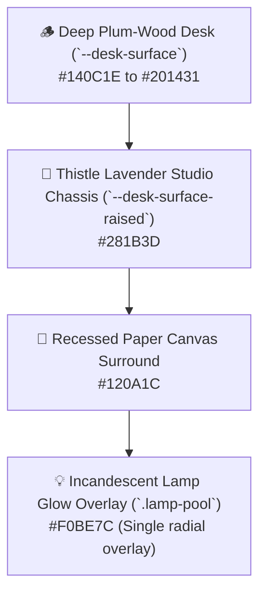
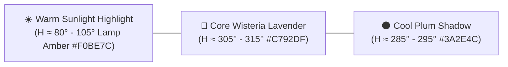
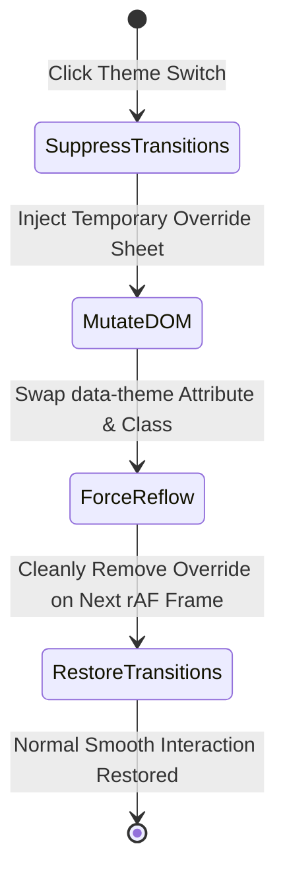
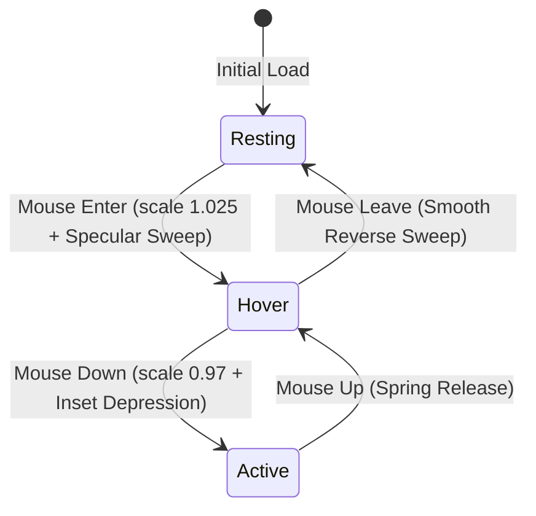
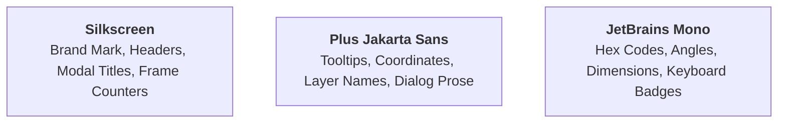

# 🎨 Design System & Spatial Architecture — PixiBun Atelier

```text
  /\_/\   ✦  .  *  .  ✦  *  .  ✦  *  .  ✦  *
 ( o.o )   D E S I G N   S Y S T E M
  > ^ <    The Lamplit Drafting Desk Specification
```

> **A tactile, disciplined design system for creative workbenches.**  
> Grounded in physical materials (dark plum-wood, warm tactile paper, incandescent lamplight, and soft wisteria petals).

---

## 1. Core Visual Metaphor: The Lamplit Drafting Desk

PixiBun is structured around the physical sensation of sitting at a solid wooden drafting desk late at night.



### Material Invariants
* **The Single Lamp Pool:** There is at most **one** warm amber illumination pool per scene (`.lamp-pool`). It is rendered as a soft, non-interactive radial gradient overlay (`pointer-events: none`) that batches over the viewport without altering pixel export data.
* **Wood Grain & Dither Inset Textures:**
  * `.texture-dither`: 4px static checkerboard pattern at $\le 6\%$ opacity for inset wells and recessed slider tracks.
  * `.texture-wood-grain`: Static linear gradient streaks representing brushed timber grain.
* **Anti-Slop Discipline:**
  * **Zero ambient floating or bobbing animations.** Elements stay anchored to their physical surfaces.
  * **Zero generic AI sparkles (✨) as feature markers.**
  * **Zero template purple/cyan gradients.** All tones are derived strictly from our semantic OKLCH palette tokens.

---

## 2. Semantic Color Tokens

Our color system is authored in **OKLCH** color space to guarantee perceptual uniformity, verified WCAG AA contrast compliance (4.5:1 for body copy, 3:1 for large controls), and natural directional hue-shifting.



### Cozy Midnight (Dark Theme Tokens)

| Token Variable | Hex Code | OKLCH Equivalent | Role & Context |
|---|---|---|---|
| `--desk-bg` | `#140C1E` | `oklch(0.16 0.04 300)` | Master room backdrop, outer layout base |
| `--desk-surface` | `#201431` | `oklch(0.22 0.05 305)` | Master chassis, toolbar, inspector panels |
| `--desk-surface-raised` | `#281B3D` | `oklch(0.26 0.06 308)` | Raised tool blocks, active button plates |
| `--desk-border` | `#3A2E4C` | `oklch(0.32 0.07 310)` | 2px tactile bezel divider, structural outline |
| `--text-heading` | `#EDE8F4` | `oklch(0.93 0.02 300)` | Crisp white/cream headings, button icons |
| `--text-body` | `#D0C4DF` | `oklch(0.82 0.05 305)` | Functional labels, coordinates, layer names |
| `--text-muted` | `#a496b8` | `oklch(0.66 0.05 305)` | Inactive tools, helper hints, unit tags |
| `--accent-wisteria` | `#C792DF` | `oklch(0.72 0.15 315)` | Primary active states, selection marquee, play button |
| `--accent-plum` | `#DCABDF` | `oklch(0.79 0.11 320)` | Highlight blooms, secondary guides, curve knots |
| `--accent-gold` | `#F0BE7C` | `oklch(0.82 0.13 80)` | Focus rings, key lights, primary action buttons |
| `--btn-hover` | `#603B82` | `oklch(0.42 0.13 312)` | Amethyst Wisteria button hover surface & light-sweep bed |
| `--color-danger` | `#E06B7D` | `oklch(0.68 0.18 15)` | Destructive actions, delete layer, discard |

### Morning Atelier (Light Theme Tokens)

| Token Variable | Hex Code | OKLCH Equivalent | Role & Context |
|---|---|---|---|
| `--desk-bg` | `#FBF8F3` | `oklch(0.98 0.01 80)` | Bright morning room base & clean desk surface |
| `--desk-surface` | `#F3EBE0` | `oklch(0.94 0.02 75)` | Warm tactile paper chassis & tool panels |
| `--desk-surface-raised` | `#FFFDF9` | `oklch(0.99 0.01 80)` | Raised card and inspector surfaces |
| `--desk-border` | `#3C2254` | `oklch(0.30 0.09 315)` | High-contrast structural bezel framing |
| `--text-heading` | `#221233` | `oklch(0.20 0.06 315)` | High-contrast dark violet titles & buttons |
| `--text-body` | `#4A3559` | `oklch(0.35 0.06 315)` | Body text, tool parameters, coordinates |
| `--text-muted` | `#78608A` | `oklch(0.50 0.06 315)` | Subtle badges, shortcut keys, secondary text |
| `--accent-gold` | `#8a4500` | `oklch(0.48 0.14 55)` | Warm sunlit highlights & primary button fill |
| `--accent-plum` | `#7E2B96` | `oklch(0.48 0.19 320)` | Active tool accents and focus outlines |
| `--accent-wisteria` | `#9940B5` | `oklch(0.55 0.20 315)` | Timeline scrubbers and hover rings |

---

## 3. Dual Theme Switching & Zero-Lag Transition Engine

The studio supports instant switching between **Cozy Midnight** (Dark) and **Morning Atelier** (Light) via the tactile `ThemeToggle` switch:



* **Zero-Lag Transition Suppression:** During theme swaps, a temporary `<style>` block disables all CSS transitions across the DOM (`transition: none !important`), forces a synchronous reflow, and removes itself on the next `requestAnimationFrame` tick. This eliminates layout thrashing and repaint stutter across thousands of UI nodes.
* **Animated Tactile Knob:** Spring-physics switch (<kbd>stiffness: 550, damping: 32</kbd>) hosting custom hand-pixelled SVG sprites: a radiant morning sun with geometric rays for Light mode and a cozy crescent moon with a twinkling star for Dark mode.

---

## 4. Tactile Physics & Button Mechanical Standard

All interactive buttons and tool wells in PixiBun adhere to a strict 4-state physical mechanics protocol:



1. **Resting State:**
   * 2px rounded corners (`rounded-[2px]`).
   * 2px solid border (`border-2 border-[var(--desk-border)]`).
   * Subtle bottom shadow (`box-shadow: 0 2px 0 var(--btn-shadow)`).
2. **Hover State (Light Sweep):**
   * Micro-scale lift: `transform: scale(1.025)`.
   * Amethyst Wisteria background tint (`#603B82`) providing a 4.6:1 contrast ratio against gold and 6.2:1 against cream text (WCAG 2.2 AA compliant).
   * Dual-band specular reflection light-sweep with wisteria flanking wings gliding from left (`-160%`) to right (`+160%`).
3. **Hover Leave (Unhover):**
   * Controlled transition back to `scale(1.0)` with the specular sweep gliding back to the left (`-160%`).
4. **Active / Depression State (Click):**
   * Mechanical depression bounce: `transform: scale(0.97) translateY(1px)`.
   * Inset shadow replacement: `box-shadow: inset 0 2px 4px rgba(0,0,0,0.4)`.
5. **Focus Visible State:**
   * 2px solid amber ring (`outline: 2px solid #F0BE7C; outline-offset: 2px`).

---

## 5. 16-Bit Pixel Cursor & Interactive Atmosphere

On fine-pointer devices (mouse / trackpad), PixiBun activates a custom 16-bit pixel cursor system:
* **Custom SVG Cursors:** Sharp pixel-art quill/arrow for resting state and an illuminated golden wand for clickable elements.
* **Golden Sparkle Particle Trail (`PixelCursor.tsx`):** Lightweight canvas overlay emitting soft amber/wisteria micro-sparkles on rapid cursor movement, with an automatic sleep state when idle to conserve battery and CPU cycles.

---

## 6. Typography Scale & Hierarchies

PixiBun pairs a retro pixel display typeface with a crisp, geometric sans-serif:



| Role | Font Family | Size | Weight | Line Height | Usage |
|---|---|---|---|---|---|
| **Display Title** | `Silkscreen` | `18px - 22px` | `700 Bold` | `1.2` | Brand headers, modal banners |
| **Section Label** | `Silkscreen` / `JetBrains Mono` | `10px - 11px` | `700 Bold` | `1.0` | Uppercase module titles, pill badges |
| **UI Body** | `Plus Jakarta Sans` | `12px - 13px` | `500 Medium` | `1.4` | Layer names, dialog descriptions |
| **Numeric Value** | `JetBrains Mono` | `10px - 11px` | `700 Bold` | `1.0` | Coordinate HUD, degree sliders, zoom % |

---

## 7. Anti-Slop Voice & Copywriting Guidelines

* **Voice:** Written from one craftsperson to another — humble, warm, precise, and practical.
* **Banned Buzzwords:** Never use *"Transform your workflow"*, *"The ultimate all-in-one platform"*, *"Seamlessly supercharge"*, *"Unlock next-gen capabilities"*, or fake robotic status codes (*"Payload initialized"*).
* **Positive Framing:** Explain the tangible physical utility clearly: *"Bakes a 3D tangent normal map into a new layer for Godot/Unity"* instead of *"AI-powered magic normal generator"*.

---

## 8. Viewport Ergonomics & HUD Precision Guidance

### Canvas Brush Bounding Box (HUD Cursor Overlay)
At high zoom factors ($\ge 400\%$), navigating multi-pixel brush sizes ($2\text{px}$ to $16\text{px}$) requires direct spatial feedback:
* **Geometry:** A 1px crisp bounding box matching `tools.brushSize` centered on the cursor canvas coordinate.
* **Color & Contrast:** 1px stroke in warm studio amber (`#F0BE7C` at 60% opacity) layered over a 1px dark shadow stroke (`#140C1E` at 50% opacity) ensuring visibility over both light and dark pixels.
* **Performance Invariant:** Rendered exclusively onto `gridCanvasRef` on `pointermove` without touching Zustand state or triggering React re-renders.

### Viewport Fit & Scale Navigation Standards
Keyboard conventions for rapid drafting ergonomics:
* **`Ctrl + 0` (Fit to Screen):** Recomputes zoom and offsets so the entire canvas fills the viewport with at least 32px padding on all sides, aligned to integer zoom steps ($100\%, 200\%, \dots$).
* **`Ctrl + 1` (100% Real Scale):** Resets viewport zoom to exactly 100% with the canvas centered in the drafting desk.

### Accessible Form Controls & Screen Reader Semantics
* **Native Range Sliders:** Native `<input type="range">` elements natively communicate `min`, `max`, and `value` to assistive technologies. Custom `aria-valuemin/max/now` attributes MUST NOT be added redundantly.
* **Mandatory Label Association:** Every slider must be programmatically associated with its text label via `<label htmlFor="...">` or an explicit `aria-label` (e.g. `aria-label="Brush size"`).

---

## 9. Animation Spacing & Variable Timing Visualizer

### Classical Timing vs. Spacing Principles
Grounded in Richard Williams (*The Animator's Survival Kit*) and Disney's 12 Principles of Animation:
* **Proportional Timeline Frame Cards:** Rather than uniform-width cards, timeline frame cards scale their horizontal width proportionally when `durationMs` deviates from the baseline frame duration ($T_{\text{base}} = 1000 / \text{fps}$):
  $$W_{\text{card}} = \text{clamp}\left(48\text{px}, \; 48\text{px} \times \frac{\text{durationMs}}{T_{\text{base}}}, \; 160\text{px}\right)$$
* **Timing Hold Badge:** Frames with $\text{durationMs} \ge 2 \times T_{\text{base}}$ display an understated amber duration pill (`+125ms`) on the top-right corner of the card.
* **Ghost Frame Spacing Falloff:** Onion skin ghost opacity scales down during extended holds so stationary poses do not overwhelm adjacent in-betweens.

---

## 10. Direct Manipulation Lighting Gizmo (`PixelLightBulbGizmo.tsx`)

Grounded in Ben Shneiderman's 1983 direct-manipulation paradigm:
* **Interactive Light Bulb Token:** A tactile incandescent pixel light bulb handle rendered on the canvas viewport representing the directional light vector ($\theta$ azimuth, $\phi$ elevation, and light distance radius).
* **Decoupled Focal Reticle Anchor:** An independent central focal reticle handle (`lightCenterX`, `lightCenterY` / `stageCentroid`). Artists can reposition the focal anchor without perturbing the light direction angle, or orbit the bulb token around the anchor with zero drift.
* **Azimuth Sweep Arc & Distance Line:** A subtle dashed indicator connecting the focal point to the orbiting bulb, visualizing the directional ray in real-time.
* **Tactile Physics & 60fps rAF Updates:** Dragging either handle recalculates azimuth ($\theta = (\text{atan2}(dx, -dy) \times \frac{180}{\pi} + 360) \pmod{360}$) and elevation, rendering in-place preview frames via throttled `requestAnimationFrame` with zero perceptible UI latency.
* **HUD Hotkeys & Micro-Steppers:** Embedded HUD pill with tactile `[-]` / `[+]` brightness steppers, mouse wheel scroll intensity adjustment, quick commit (<kbd>Enter</kbd>), cancel (<kbd>Esc</kbd>), and focal anchor reset (<kbd>R</kbd>).

---

## 11. Tileset Palette & Stamping Workflow

### Grid Partitioning & Slicing Viewport
* **Tile Grid Geometry:** Strict integer grid overlay supporting $16\times16$, $24\times24$, and $32\times32$ pixel tiles.
* **Active Tile Selection:** Double-line brass bezel (`#F0BE7C` outer, `#140C1E` inner) highlighting currently active stamp tile.
* **Stamp Tool Preview:** When the stamp tool is active, the cursor renders a 50% translucent ghost preview of the selected tile snapped to the canvas pixel grid.

---

## 12. Perceptual Accessibility: CVD (Colorblindness) Lens

Grounded in Machado, Oliveira & Fernandes (2009, IEEE TVCG):
* **Non-Destructive Lens Simulation:** A post-composite SVG filter / matrix multiplication pass simulating:
  1. **Protanopia:** L-cone deficiency (red-weakness).
  2. **Deuteranopia:** M-cone deficiency (green-weakness).
  3. **Tritanopia:** S-cone deficiency (blue-weakness).
  4. **Monochromacy:** Pure luminance contrast validation.
* **Lens Invariant:** Operates strictly on viewport display output; project data and exported files remain 100% untouched.

---

## 13. Silhouette & Value Contrast Testing (Squint Mode)

* **Game Art Silhouette Discipline:** A 1-key HUD toggle rendering all non-transparent sprite pixels as solid silhouette black (`#140C1E`) over white background.
* **Utility:** Allows character animators and game artists to immediately evaluate readability, weight distribution, and negative space without color distractions.


