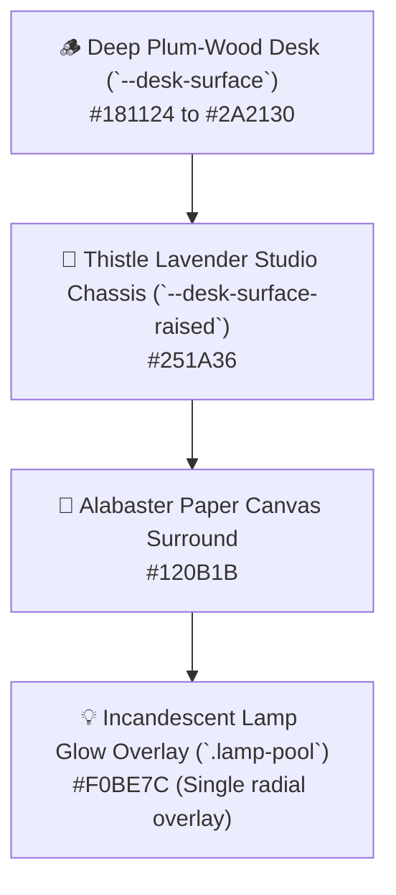
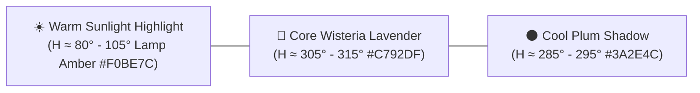
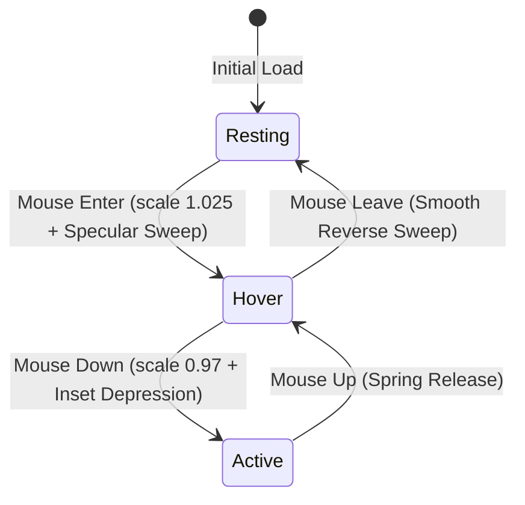
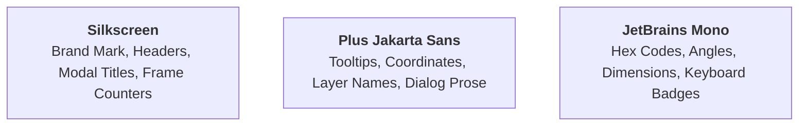
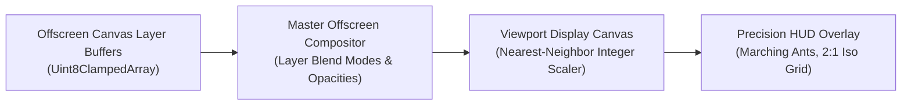

# 🎨 Design System & Spatial Architecture — PixiBun Atelier

```text
  /\_/\   ✦  .  *  .  ✦  *  .  ✦  *  .  ✦  *
 ( o.o )   D E S I G N   S Y S T E M
  > ^ <    The Lamplit Drafting Desk Specification
```

> **A tactile, disciplined design system for creative workbenches.**  
> Grounded in physical materials (dark plum-wood, tactile alabaster paper, warm amber incandescent lamplight, and soft wisteria petals).

---

## 1. Core Visual Metaphor: The Lamplit Drafting Desk

PixiBun is structured around the physical sensation of sitting at a solid wooden drafting desk late at night.



### Material Invariants
* **The Single Lamp Pool:** There is at most **one** warm amber illumination pool per scene (`.lamp-pool`). It is rendered as a soft, non-interactive radial gradient overlay (`pointer-events: none`) that batches over the viewport without altering pixel export data.
* **Wood Grain & Dither Inset Textures:**
  * `.texture-dither`: 4px static checkerboard pattern at $\le 6\%$ opacity for inset wells and recessed slider tracks.
  * `.texture-wood-grain`: Static linear gradient streaks representing brushed dark plum timber.
* **Anti-Slop Discipline:**
  * **Zero ambient floating or bobbing animations.** Elements stay anchored to their physical surfaces.
  * **Zero generic AI sparkles (✨) as feature markers.**
  * **Zero template purple/cyan gradients.** All tones are derived strictly from our semantic OKLCH palette tokens.

---

## 2. Semantic Color Tokens

Our color system is authored in **OKLCH** color space to guarantee perceptual uniformity, verified WCAG AA contrast compliance (4.5:1 for body copy, 3:1 for large controls), and natural directional hue-shifting.



### Color Token Reference Table

| Token Variable | Hex Code | OKLCH Equivalent | Role & Context |
|---|---|---|---|
| `--desk-surface` | `#181124` | `oklch(0.18 0.04 300)` | Master room backdrop, outer layout base |
| `--desk-surface-raised` | `#251A36` | `oklch(0.24 0.06 305)` | Raised panel chassis, inspector tabs, toolbar rail |
| `--desk-border` | `#352248` | `oklch(0.30 0.07 310)` | 2px tactile bezel divider, structural outline |
| `--canvas-bg` | `#120B1B` | `oklch(0.14 0.03 300)` | Viewport surround, deepest recessed well |
| `--text-heading` | `#EDE8F4` | `oklch(0.93 0.02 300)` | Crisp white/cream headings, button icons |
| `--text-body` | `#CDBFDF` | `oklch(0.81 0.05 305)` | Functional labels, coordinates, layer names |
| `--text-muted` | `#8A76A0` | `oklch(0.57 0.06 305)` | Inactive tools, helper hints, unit tags |
| `--accent-wisteria` | `#C792DF` | `oklch(0.72 0.15 315)` | Primary active states, selection marquee, play button |
| `--accent-lilac` | `#DCABDF` | `oklch(0.79 0.11 320)` | Highlight blooms, secondary guides, curve knots |
| `--lamp-amber` | `#F0BE7C` | `oklch(0.82 0.13 80)` | Focus rings, key lights, primary action buttons |
| `--danger-berry` | `#FF99AA` | `oklch(0.74 0.16 15)` | Destructive actions, delete layer, discard |

---

## 3. Tactile Physics & Button Mechanical Standard

All interactive buttons and tool wells in PixiBun adhere to a strict 4-state physical mechanics protocol:



1. **Resting State:**
   * 2px rounded corners (`rounded-[2px]`).
   * 2px solid border (`border-2 border-[var(--desk-border)]`).
   * Subtle bottom shadow (`box-shadow: 0 2px 0 #130e20`).
2. **Hover State (Light Sweep):**
   * Micro-scale lift: `transform: scale(1.025)`.
   * Specular reflection light-sweep gliding from left (`-160%`) to right (`+160%`).
3. **Hover Leave (Unhover):**
   * Controlled transition back to `scale(1.0)` with the specular sweep gliding back to the left (`-160%`).
4. **Active / Depression State (Click):**
   * Mechanical depression bounce: `transform: scale(0.97) translateY(1px)`.
   * Inset shadow replacement: `box-shadow: inset 0 2px 4px rgba(0,0,0,0.4)`.
5. **Focus Visible State:**
   * 2px solid amber ring (`outline: 2px solid #F0BE7C; outline-offset: 2px`).

---

## 4. Typography Scale & Hierarchies

PixiBun pairs a retro pixel display typeface with a crisp, geometric sans-serif:



| Role | Font Family | Size | Weight | Line Height | Usage |
|---|---|---|---|---|---|
| **Display Title** | `Silkscreen` | `18px - 22px` | `700 Bold` | `1.2` | Brand headers, modal banners |
| **Section Label** | `Silkscreen` / `JetBrains Mono` | `10px - 11px` | `700 Bold` | `1.0` | Uppercase module titles, pill badges |
| **UI Body** | `Plus Jakarta Sans` | `12px - 13px` | `500 Medium` | `1.4` | Layer names, dialog descriptions |
| **Numeric Value** | `JetBrains Mono` | `10px - 11px` | `700 Bold` | `1.0` | Coordinate HUD, degree sliders, zoom % |

---

## 5. Canvas & Graphics Engine Invariants



* **Integer Pixel Grid Snapping:**
  All mouse and stylus events translate via:
  $$x_{\text{canvas}} = \lfloor (x_{\text{event}} - \text{panX}) / \text{zoom} \rfloor, \quad y_{\text{canvas}} = \lfloor (y_{\text{event}} - \text{panY}) / \text{zoom} \rfloor$$
* **Zero Smoothing:**
  `ctx.imageSmoothingEnabled = false` is enforced unconditionally across every offscreen buffer and main viewport.
* **True 3D Photometric Shading:**
  No linear diagonal shortcuts. All auto-shading evaluates 2.5D surface normal vectors $\mathbf{N}$, Lambertian diffuse term $\max(0, \mathbf{N}\cdot\mathbf{L})$, and Blinn-Phong specular half-vector $\mathbf{H} = \frac{\mathbf{L}+\mathbf{V}}{\|\mathbf{L}+\mathbf{V}\|}$.

---

## 6. Anti-Slop Voice & Copywriting Guidelines

* **Voice:** Written from one craftsperson to another — humble, warm, precise, and practical.
* **Banned Buzzwords:** Never use *"Transform your workflow"*, *"The ultimate all-in-one platform"*, *"Seamlessly supercharge"*, *"Unlock next-gen capabilities"*, or fake robotic status codes (*"Payload initialized"*).
* **Positive Framing:** Explain the tangible physical utility clearly: *"Bakes a 3D tangent normal map into a new layer for Godot/Unity"* instead of *"AI-powered magic normal generator"*.
