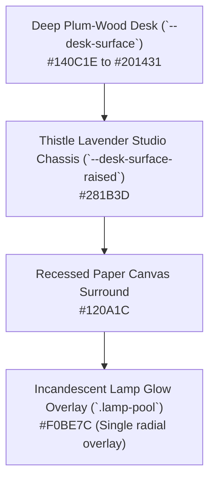
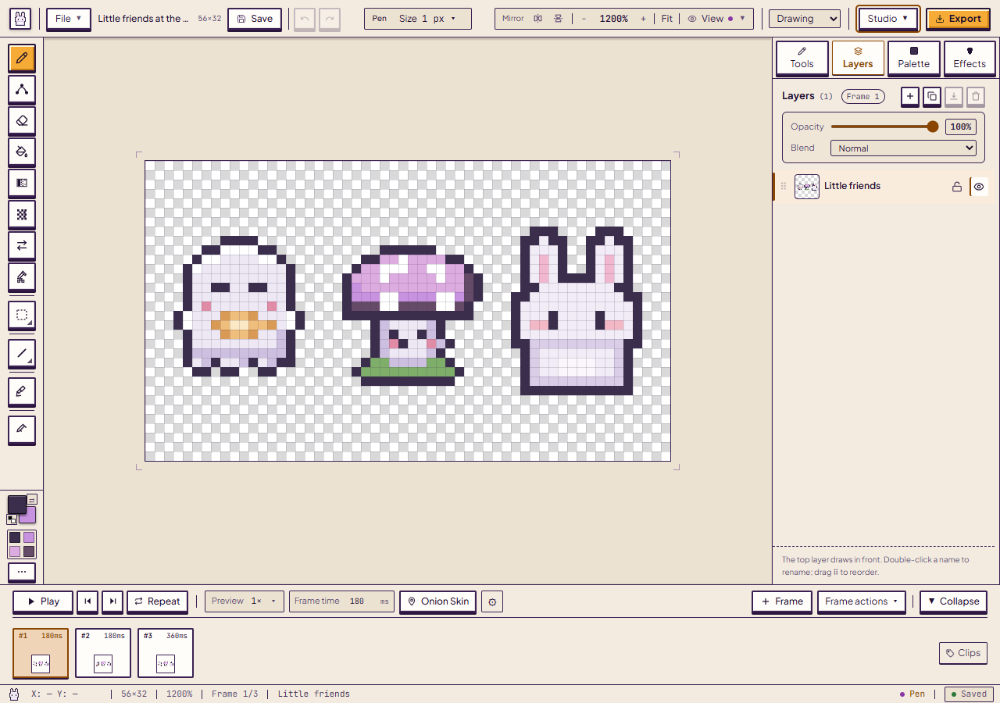
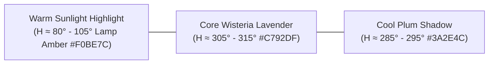
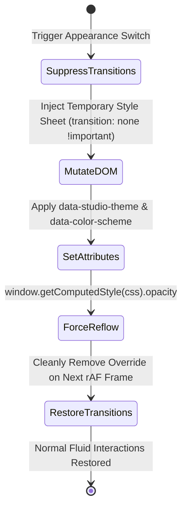
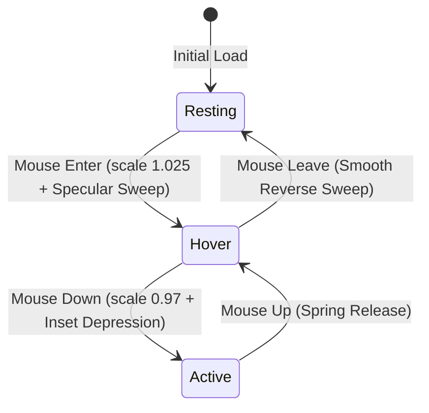
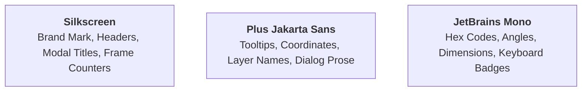

# Design System & Spatial Architecture — PixiBun

Current engineering verification and remaining release checks are recorded in the [current status](docs/current-status.md).

**Studio interaction update — 13 October 2026:** The header/tool-option layout, color flyout with explicit Close control, pinned picker, palette/layer strips and compact tool-help cards have been refined. Curve exposes start/end/bend handles with Apply/Cancel and guarded re-edit; context switches cancel pending curves. Tool illustrations use a handcrafted pixel heart and explanatory shading/normal/light examples. They are tutorial demonstrations, not measured physical-lighting results. The [drawing guide](docs/guides/drawing-tools.md#bézier-curve) documents current behavior; older pictures retain their actual capture dates.

The canvas surround uses bounded outlines and a small gradient in place of large blurred decorations. Frame-card transitions and active decorative shadows are disabled during playback. That 13 October change reduced decorative paint work while retaining the then-existing clock; the current Studio and playground share usePlaybackClock. Intermittent WebKit visible-pose stability remains open. They do not change the photometric cast-shadow engine or globally prohibit tactile button shadows. The [source change record](docs/releases/2026-10-13-studio-and-nibbli.md) separates functional checks, visual observations and remaining manual/device qualification.

> **Audit-session interaction update — 2026-10-01:** PixiTools includes animation review and Try a new look (previously Explore variations), with native before/after previews, protected rectangles, common light settings and tile border/path diagnostics. Later interface refinements are described in the [Phase 6 UX report (local archive)](docs/archives.md#record-docs-research-phase6-ux-hardening-md). Automated accessibility/layout checks establish their tested scope; artist usefulness remains unmeasured. See the [session record (local archive)](docs/archives.md#record-docs-research-session-completion-2026-10-01-md).

```text
  /\_/\   *  .  *  .  *  *  .  *  *  .  *  *
 ( o.o )   D E S I G N   S Y S T E M
  > ^ <    The Lamplit Drafting Desk Specification
```

> **A tactile, disciplined design system for creative workbenches.**  
> Grounded in physical materials (dark plum-wood, warm tactile paper, incandescent lamplight, and soft wisteria petals).

---

## Current interface — 15 October 2026

The [source review](docs/releases/2026-10-15-codebase-and-documentation.md) covers the inspector's shared sections/fields, theme-aware canvas previews and the desktop coach/tool-dock/filmstrip layout. Pocket opens on lessons before its separate free pad. The homepage has a scroll-driven creation story, per-demo Try-this tasks, collapsible explanations and real Bun sample downloads. Decorative markers and scene motion exist in the current app; the material rules below are guidance, not an assertion that every existing component follows them. Theme pictures show the current UI; historical token tables retain their dated scope.

## Studio Labs motion — 15 October 2026

Scene themes offer the optional island, liquid tabs, paint-pot palette and quick effects described in [Studio Labs](src/experimental/README.md). Graphite and Plum retain classic controls. The island anchors its top control row while settings expand below it. Tool names shrink to 97% during a 110 ms exit, then enter at 95% with 12 px blur; a spring at stiffness 600, damping 26 and mass 0.9 adds one small bounce. Blur/opacity reveal takes 420 ms after a 60 ms handoff delay. Width and height use separate springs (420/31 and 460/25, mass 1); shell motion does not stretch glyphs. Reset the new label’s scale velocity at the invisible swap rather than carrying its predecessor’s decay. The island subscribes to reduced-motion changes and snaps its measured geometry when enabled. Every tool appears as its name plus ▾; settings, including Pen/Eraser sizes and Clean corners, open below. Hover or keyboard focus pulls a glass-like quick-action droplet from the right end cap. One separation spring drives bud, neck, pinch-off and return; the pill responds only in pixels at its right edge and rests at full size. Keep the glyphs and the circle’s click target fixed; only the body, neck, sheen and visual face morph. Liquid controls give sliders a glass lens handle, and give the tool rail the liquid tab lens as its active highlight ([record](docs/releases/2026-10-15-labs-liquid-controls.md)). These values describe UI motion, not artwork playback or a physical-device frame-rate guarantee. [Studio Labs motion update](docs/releases/2026-10-15-studio-labs-motion.md).

## 1. Core Visual Metaphor: The Lamplit Drafting Desk

PixiBun is structured around the physical sensation of sitting at a solid wooden drafting desk late at night.



### Material Invariants

These are design rules and targets for new work, not a declaration that every existing animation, marker or component already complies. Current interface states are illustrated below; manual accessibility and artist evaluation remain separately qualified.
* **The Single Lamp Pool:** There is at most **one** warm amber illumination pool per scene (`.lamp-pool`). It is rendered as a soft, non-interactive radial gradient overlay (`pointer-events: none`) that batches over the viewport without altering pixel export data.
* **Wood Grain & Dither Inset Textures:**
  * `.texture-dither`: 4px static checkerboard pattern at $\le 6\%$ opacity for inset wells and recessed slider tracks.
  * `.texture-wood-grain`: Static linear gradient streaks representing brushed timber grain.
* **Anti-Slop Discipline:**
  * **Keep workbench controls anchored.** Procedural scene particles, Bun reactions and the optional Day/Night reveal are deliberate current exceptions; respect reduced-motion handling in their owners.
  * **Avoid generic AI sparkles as feature markers.**
  * **Zero template purple/cyan gradients.** All tones are derived strictly from our semantic OKLCH palette tokens.

---

## 2. Semantic Color Tokens

### Current Studio examples — 15 October 2026


*Graphite Night in the current local production build. [Capture details](docs/assets/screenshots/2026-10-15-current-ui/run.json).*



*Plum Day in the same build and with the same artwork. [All 16 appearances](docs/guides/themes.md). These illustrate themes; contrast and conformance checks have separate scope.*

Our color system is authored in **OKLCH** color space to maintain perceptual uniformity, target WCAG AA contrast ratios (4.5:1 for body copy, 3:1 for large controls); actual compliance requires testing rendered states, and natural directional hue-shifting.



<a id="1-atelier-theme-tokens-modern-workstation-baseline"></a>

### 1. Historical Atelier Theme Tokens — 2 October 2026

<a id="atelier-dark-default-midnight-studio"></a>

#### Atelier Dark — default at that capture
| Token Variable | Hex Code | Role & Context |
|---|---|---|
| `--desk-bg` | `#16141a` | Neutral dark slate room backdrop |
| `--desk-surface` | `#201d26` | Master chassis, toolbar docks, and inspector panels |
| `--desk-surface-raised` | `#282530` | Raised tool buttons and panel cards |
| `--desk-border` | `#35313d` | Fine tactile bezel divider |
| `--text-heading` | `#ede8f4` | Crisp light headings and active icons |
| `--text-body` | `#cfc7d8` | Body text, tool parameters, coordinates |
| `--text-muted` | `#968ca2` | Inactive tools, helper hints, unit tags |
| `--accent-gold` | `#e5a962` | Warm amber focus rings, key light, primary buttons |
| `--accent-wisteria` | `#b596d9` | Active tool indicator, navigation accents |
| `--accent-plum` | `#9d7ec4` | Secondary guides, curve knots |
| `--accent-sage` | `#7d9d7f` | Positive feedback, success states |

#### Atelier Light (Warm Alabaster Morning)
| Token Variable | Hex Code | Role & Context |
|---|---|---|
| `--desk-bg` | `#ece5d8` | Warm alabaster room base |
| `--desk-surface` | `#f7f1e6` | Tactile parchment panels |
| `--desk-surface-raised` | `#ffffff` | Elevated cards and inputs |
| `--desk-border` | `#442a5c` | High-contrast structural framing |
| `--text-heading` | `#221233` | Deep violet headings |
| `--text-body` | `#4a3559` | Legible dark body text |
| `--text-muted` | `#685179` | High-contrast muted metadata |
| `--accent-gold` | `#8a4500` | Golden sunlit accent buttons |
| `--accent-wisteria` | `#9940b5` | Active tool state and focus rings |

---

### 2. Cozy Classic Theme Tokens (Original Historical Identity)

#### Cozy Classic Dark (Cozy Midnight)
| Token Variable | Hex Code | Role & Context |
|---|---|---|
| `--desk-bg` | `#140c1e` | Deep plum-wood desk surface |
| `--desk-surface` | `#201431` | Thistle lavender studio chassis |
| `--desk-surface-raised` | `#281b3d` | Raised button plates |
| `--desk-border` | `#3a2e4c` | Rich plum-wood structural bezels |
| `--text-heading` | `#ede8f4` | Crisp cream headings |
| `--text-body` | `#d0c4df` | Legible dark-mode body text |
| `--text-muted` | `#a496b8` | Subdued metadata & secondary text |
| `--accent-gold` | `#f0be7c` | Lamp amber focus rings & key light |
| `--accent-wisteria` | `#c792df` | Signature wisteria lavender brand accent |
| `--accent-plum` | `#dcabdf` | Highlight blooms & secondary guides |

#### Cozy Classic Light (Morning Atelier)
| Token Variable | Hex Code | Role & Context |
|---|---|---|
| `--desk-bg` | `#fbf8f3` | Clean morning desk base |
| `--desk-surface` | `#f3ebe0` | Warm tactile paper panels |
| `--desk-surface-raised` | `#fffdf9` | Elevated cards and inputs |
| `--desk-border` | `#3c2254` | High-contrast velvet border |
| `--text-heading` | `#221233` | Crisp legible ink headings |
| `--text-body` | `#4a3559` | Legible morning body text |
| `--text-muted` | `#685179` | High-contrast muted metadata |
| `--accent-gold` | `#8a4500` | Morning sunlight buttons |
| `--accent-wisteria` | `#9940b5` | Active tool indicator & wisteria accents |
| `--accent-plum` | `#7e2b96` | Deep plum active tool accents |

---

## 3. Dual-Axis Theme Switching & Theme Transition Engine

The studio supports two independent theme dimensions:
1. **Studio Theme:** eight styles defined in `src/lib/theme/themes.json` and generated into `src/app/themes.generated.css` (`npm run themes:css`). Scene styles (Moonlit, Sakura, Tidepool, Ember, Moss, Arcade) float the panels over an animated pixel scene (`src/lib/theme/scenes.ts`); flat styles are Graphite (stored id `atelier`) and Plum (stored id `cozy-classic`). Each palette lists about 25 core colors; every other token derives from them, and `tests/themeRegistry.test.ts` holds text to WCAG AA contrast.
2. **Color Scheme:** shown as `Night` vs. `Day` (stored as `dark` / `light`).

The token tables above record the Cozy Classic and Atelier values as documented on 2 October 2026; `themes.json` is the current source.

Both axes are selectable through the **Studio** appearance popover (`src/components/ui/AppearancePopover.tsx`). Its Day/Night buttons set the color scheme directly. The homepage Daylight switch uses `src/lib/theme/themeTransition.ts`: capable browsers reveal the new scheme from that switch, while reduced-motion and unsupported browsers switch immediately. Canvas consumers use the saved palette during hydration through `useLiveThemeChoice`; markup keeps the server-compatible hydration boundary.



* **Temporary Transition Suppression:** During theme swaps, a temporary `<style>` block disables all CSS transitions across the DOM (`transition: none !important`), sets `data-studio-theme` and `data-color-scheme`, forces a synchronous reflow, and removes itself on the next `requestAnimationFrame` tick. This suppresses overlapping transitions; the synchronous style read and theme repaint still perform work and require measurement.
* **Appearance Popover Swatches:** Interactive flyout provides real-time swatch palettes representing each theme's core colors before selection, with accessible keyboard navigation and Escape dismissal.

---

## 4. Tactile Physics & Button Mechanical Standard

The following is a design target for tactile buttons, not a claim that every existing control has identical border, scale, motion or focus styles. Current primitives also use the quiet mechanical tokens in `globals.css`:



1. **Resting State:**
   * 2px rounded corners (`rounded-[2px]`).
   * 2px solid border (`border-2 border-[var(--desk-border)]`).
   * Subtle bottom shadow (`box-shadow: 0 2px 0 var(--btn-shadow)`).
2. **Hover State (Light Sweep):**
   * Micro-scale lift: `transform: scale(1.025)`.
   * Amethyst Wisteria background tint (`#603B82`) providing a 4.6:1 contrast ratio against gold and 6.2:1 against cream text (color-pair contrast calculation, not whole-interface conformance).
   * Dual-band specular reflection light-sweep with wisteria flanking wings gliding from left (`-160%`) to right (`+160%`).
3. **Hover Leave (Unhover):**
   * Controlled transition back to `scale(1.0)` with the specular sweep gliding back to the left (`-160%`).
4. **Active / Depression State (Click):**
   * Mechanical depression bounce: `transform: scale(0.97) translateY(1px)`.
   * Inset shadow replacement: `box-shadow: inset 0 2px 4px rgba(0,0,0,0.4)`.
5. **Focus Visible State:**
   * 2px solid amber ring (`outline: 2px solid #F0BE7C; outline-offset: 2px`).

---

## 5. 16-Bit Pixel Cursor & Interactive Atmosphere

On fine-pointer devices (mouse / trackpad), the landing hero uses custom pixel cursors. Its current interactions are owned by [NightHero](src/components/landing/night/NightHero.tsx):
* **Custom SVG Cursors:** Sharp pixel-art quill/arrow for resting state and an illuminated golden wand for clickable elements.
* **Hero interactions:** Bun taps trigger companion reactions; drawing in the sky adds temporary constellations. `src/components/reactbits/ClickSpark.tsx` is retained source but is not mounted by the current app.

---

## 6. Typography Scale & Hierarchies

PixiBun pairs a retro pixel display typeface with a crisp, geometric sans-serif:



| Role | Font Family | Size | Weight | Line Height | Usage |
|---|---|---|---|---|---|
| **Display Title** | `Silkscreen` | `18px - 22px` | `700 Bold` | `1.2` | Brand headers, modal banners |
| **Section Label** | `Silkscreen` / `JetBrains Mono` | `10px - 11px` | `700 Bold` | `1.0` | Uppercase module titles, pill badges |
| **UI Body** | `Plus Jakarta Sans` | `12px - 13px` | `500 Medium` | `1.4` | Layer names, dialog descriptions |
| **Numeric Value** | `JetBrains Mono` | `10px - 11px` | `700 Bold` | `1.0` | Coordinate HUD, degree sliders, zoom % |

Tool motion preview cards use a 304px frame with a 14px title, 13px description, and 11px dismiss action. The 96×54 artwork stays pixelated; action/result labels are regular HTML text at 11px so they remain readable at card scale. The close target is 24×24px. Under reduced motion, the preview displays its result frame.

---

## 7. Anti-Slop Voice & Copywriting Guidelines

* **Voice:** Written from one craftsperson to another — humble, warm, precise, and practical.
* **Banned Buzzwords:** Never use *"Transform your workflow"*, *"The ultimate all-in-one platform"*, *"supercharge"*, *"Unlock next-gen capabilities"*, or fake robotic status codes (*"Payload initialized"*).
* **Positive Framing:** Explain the tangible physical utility clearly: *"Bakes a 3D tangent normal map into a new layer for Godot/Unity"* instead of *"AI-powered magic normal generator"*.

---

## 8. Viewport Ergonomics & HUD Precision Guidance

### Brush Bounding Box (HUD Cursor Overlay)
At high zoom factors ($\ge 400\%$), navigating multi-pixel brush sizes ($2\text{px}$ to $16\text{px}$) requires direct spatial feedback:
* **Geometry:** A crisp CSS bounding box matching the square `tools.brushSize` footprint centered on the cursor's artwork coordinate.
* **Color & Contrast:** 1px stroke in warm studio amber (`#F0BE7C` at 60% opacity) layered over a 1px dark shadow stroke (`#140C1E` at 50% opacity) ensuring visibility over both light and dark pixels.
* **Performance Invariant:** The cursor is a CSS element with no canvas backing store; pointer movement updates its position and size without touching Zustand state or triggering React re-renders.

### Artwork Grid Alignment
The stage border is a CSS outline, outside the layout box. The main artwork canvas, selection/grid overlay, and stage share an identical screen origin and size at every zoom. CSS grid pitch is `zoom / 100` screen pixels per artwork pixel. A visible grid line must never drift across an artwork pixel as zoom increases.

### Imported-Art Bucket Controls
The Bucket toolbar exposes Connected/Global, a separately labeled tolerance slider (default 0, exact RGBA match), and an optional **Enclosed specks** switch for tiny visible color islands. The switch starts off because artists may intend small contrasting details. Transparent holes remain transparent. Color Replace keeps its own exact-match tolerance setting.

### Viewport Fit & Scale Navigation Standards
Keyboard conventions for rapid drafting ergonomics:
* **`Ctrl + 0` (Fit to Screen):** `calculateFitZoom` subtracts 48 px from the available width/height, selects a fitting zoom-ladder value at or above 100%, and uses integer percentages below 100% for large canvases. The configured minimum can limit fitting on very small viewports; this is not a fixed 32px margin on every side or an exclusively whole-multiple zoom policy.
* **`Ctrl + 1` (100% Real Scale):** Resets viewport zoom to exactly 100% with the canvas centered in the drafting desk.

### Accessible Form Controls & Screen Reader Semantics
* **Native Range Sliders:** Native `<input type="range">` elements natively communicate `min`, `max`, and `value` to assistive technologies. Custom `aria-valuemin/max/now` attributes MUST NOT be added redundantly.
* **Mandatory Label Association:** Every slider must be programmatically associated with its text label via `<label htmlFor="...">` or an explicit `aria-label` (e.g. `aria-label="Brush size"`).

---

## 9. Animation Spacing & Variable Timing Visualizer

### Classical Timing vs. Spacing Principles
Grounded in Richard Williams (*The Animator's Survival Kit*) and Disney's 12 Principles of Animation:
* **Current Timeline Frame Cards:** [BottomTimeline](src/components/layout/BottomTimeline.tsx) uses fixed 72px-wide cards. Each displays its frame number and duration in milliseconds; an absent explicit hold falls back to `round(1000 / fps)`. Duration-proportional card widths and a special long-hold badge are not implemented controls.
* **Ghost Frame Spacing Falloff:** [onionSkin](src/lib/render/onionSkin.ts) uses $\max(0.1, 1 - 0.25 \times (\text{dist} - 1))$, multiplied by the configured opacity and clamped to $[0,1]$. Ghosts render only when enabled, with multiple frames and playback paused.

---

## 10. Direct Manipulation Lighting Gizmo (`PixelLightBulbGizmo.tsx`)

Grounded in Ben Shneiderman's 1983 direct-manipulation paradigm:
* **Interactive Light Bulb Token:** A tactile incandescent pixel light bulb handle rendered on the canvas viewport representing the directional light vector ($\theta$ azimuth, $\phi$ elevation, and light distance radius).
* **Decoupled Focal Reticle Anchor:** An independent central focal reticle handle (`lightCenterX`, `lightCenterY` / `stageCentroid`). Artists can reposition the focal anchor without perturbing the light direction angle, or orbit the bulb token around the anchor with zero drift.
* **Azimuth Sweep Arc & Distance Line:** A subtle dashed indicator connecting the focal point to the orbiting bulb, visualizing the directional ray in real-time.
* **Tactile Physics & rAF-Scheduled Updates:** Dragging either handle recalculates azimuth ($\theta = (\text{atan2}(dx, -dy) \times \frac{180}{\pi} + 360) \pmod{360}$) and elevation, rendering in-place preview frames via throttled `requestAnimationFrame` with a low-latency target; complete interaction latency remains unmeasured.
* **HUD Hotkeys & Micro-Steppers:** Embedded HUD pill with tactile `[-]` / `[+]` brightness steppers, mouse wheel scroll intensity adjustment, quick commit (<kbd>Enter</kbd>), cancel (<kbd>Esc</kbd>), and focal anchor reset (<kbd>Alt</kbd>+<kbd>R</kbd>).

---

## 11. Tileset Palette & Stamping Workflow

The stamp interaction below is a design proposal. The canonical 17-tool list has no tile-stamp tool. Current tile controls provide selected-tile repeat/export, unique-tile bundles and contour previews, documented in [cleanup and tiles](docs/guides/pixitools-cleanup-and-tiles.md); the sprite-sheet importer has its own cell-size choices.

### Grid Partitioning & Slicing Viewport
* **Tile Grid Geometry:** Strict integer grid overlay supporting $16\times16$, $24\times24$, and $32\times32$ pixel tiles.
* **Active Tile Selection:** Double-line brass bezel (`#F0BE7C` outer, `#140C1E` inner) highlighting currently active stamp tile.
* **Stamp Tool Preview:** When the stamp tool is active, the cursor renders a 50% translucent ghost preview of the selected tile snapped to the canvas pixel grid.

---

## 12. Perceptual Accessibility: CVD (Colorblindness) Lens

Grounded in Machado, Oliveira & Fernandes (2009, IEEE TVCG):
* **Non-Destructive Lens Simulation:** A post-composite SVG filter / matrix multiplication pass simulating:
  1. **Protanopia:** L-cone deficiency (red-weakness).
  2. **Deuteranopia:** M-cone deficiency (green-weakness).
  3. **Tritanopia:** S-cone deficiency (blue-weakness).
  4. **Monochromacy:** Pure luminance contrast validation.
* **Lens Invariant:** Operates strictly on viewport display output; project data and exported files remain untouched.

---

## 13. Silhouette & Value Contrast Testing (Squint Mode)

* **Game Art Silhouette Discipline:** A 1-key HUD toggle rendering all non-transparent sprite pixels as solid silhouette black (`#140C1E`) over white background.
* **Utility:** Allows character animators and game artists to immediately evaluate readability, weight distribution, and negative space without color distractions.


When squint preview and a CVD lens are both selected, squint takes precedence.

---

## 14. Studio Design System Primitives

The shared component library supplies tactile, labeled primitives. Current controls also include direct HTML and feature-specific forms; using a primitive alone is not accessibility conformance.

### Control Inventory

| Primitive | Visual Behavior | Accessibility |
|---|---|---|
| **StudioSlider** | Real-time percentage fill gradient track with numeric badge and golden accent thumb | Labeled native range, implicit slider semantics and native min/max/value; keyboard arrows |
| **StudioSelect** | Native `<select>` wrapper matching studio surface and border tokens | Labeled native single-select, implicit combobox semantics; focus-visible highlight |
| **StudioToggle** | Sliding pill visual with a hidden checkbox input and gold indicator thumb | Labeled native checkbox, checked state and keyboard Space; the visual button is hidden from accessibility and tab order |
| **StudioNumberInput** | Labeled numeric input with min/max bounds, step increments, and unit suffix | Native number/spinbutton semantics; blur/Enter commit |
| **StudioTooltip** | Delay-activated (400ms default) tooltip with position anchors (top/bottom/left/right) | Keyboard focus trigger, shortcut badge display |
| **IconButton** | 24–32px square tactile button with ghost/surface/danger variants and translation depression | `focus-visible:ring-2`, `aria-label` required, disabled state |
| **PanelSection** | Collapsible accordion with chevron indicator and action header slot | `aria-expanded`; open/closed state persists in `localStorage` only when a `storageKey` is supplied |

### Token Integration
All primitives consume the v2 design token scale defined in `globals.css`:
* **Spacing:** `--space-0` through `--space-8` are 0, 2, 4, 6, 8, 12, 16, 24 and 32 px.
* **Radii:** `--radius-sm` (2px) through `--radius-pill` (9999px).
* **Motion:** press 50ms, tool 90ms, popover 120ms, deck 160ms, timeline 180ms and modal 150ms.
* **Surfaces:** `--surface-0` through `--surface-3` for layered elevation.

### Appearance Popover
The `AppearancePopover` (`src/components/ui/AppearancePopover.tsx`) consolidates theme management into a single flyout, superseding the standalone `ThemeToggle` as the primary entry point. It exposes two orthogonal axes:
1. **Studio Theme:** Moonlit, Sakura, Tidepool, Ember, Moss, Arcade, Graphite (`atelier`) or Plum (`cozy-classic`), sourced from `src/lib/theme/themes.json`.
2. **Color Scheme:** Dark or Light.

Live preview swatches show the target theme's accent/surface colors. The popover uses `applyThemeToDOM()` in `themeStore.ts`, briefly suppressing ordinary CSS transitions. Its Day/Night buttons apply directly. The homepage Daylight switch additionally uses [themeTransition](src/lib/theme/themeTransition.ts), with an immediate reduced-motion/unsupported fallback.

---

## 15. PixiBunLogo Brand Geometry & Scale System (`PixiBunLogo.tsx`)

Phase 63 standardizes brand mark geometry into a single responsive component (`src/components/ui/PixiBunLogo.tsx`) unifying identity across the studio header rail, playground, landing navigation, hero showcase, mobile gates, and error boundaries:

### Scale Hierarchy

| Scale | Mascot Tile Size | Mascot Graphic | Title Typography | Optional Subtitle Typography | Container Gap |
|---|---|---|---|---|---|
| `'sm'` | `w-7 h-7` (28px) | 18px | `text-xs font-display` | `text-[9px] font-mono` | `gap-2` (8px) |
| `'md'` | `w-8 h-8` (32px) | 22px | `text-sm font-display` | `text-[10px] font-mono` | `gap-2.5` (10px) |
| `'lg'` | `w-10 h-10` (40px) | 28px | `text-base font-display` | `text-xs font-mono` | `gap-3` (12px) |

### Design Invariants
* **Tactile Mascot Tile:** Housed in a raised bezel (`bg-[var(--desk-surface-raised)] border-2 border-[var(--desk-border)] rounded-[2px] shadow-sm`) with Bun mascot micro-animation.
* **Typography Lockup:** `PIXIBUN` uses display type with `tracking-wider` at sm/md and `tracking-widest` at lg. The optional amber `STUDIO` subtitle uses mono type and `tracking-tight`; `showSubtitle` defaults to true.
* **Elevation:** The mascot tile supplies `shadow-sm`. Additional wrapper styling comes from the caller's `className`/`style`; the logo does not enforce hero/footer drop-shadow variants.

---

## 16. Smart-Effect Recipe Provenance & FX Inspector Semantics

Grounded in non-destructive digital art workflows (such as Blender geometry nodes and Photoshop smart filters):

### 1. Layers Panel FX Provenance
Any layer with a saved `effect` displays the wisteria `FX` badge in [LayersPanel](src/components/layout/inspector/LayersPanel.tsx). The active-layer card exposes kind, source mode, version, selected parameters and available analysis rationale. Current generated effects and retained legacy recipes share the badge; legacy volumetric-optics/WFC layers are explicitly described as saved pixels, not current synthesis controls:
* The tag identifies stored effect provenance; it does not prove that the present raster is still an unedited algorithm output.
* Hover tooltip displays the recipe generation kind (`Generated from a saved photometric recipe`).

### 2. Live Recipe Reopening (`Edit FX`)
Photometric and specular layers offer `Edit FX` with an accessible label naming the lighting/glint effect. Other effect kinds do not all support reopening:
* Clicking `Edit FX` loads the saved `LayerEffectRecipe.params` into the studio store.
* Mounts the `PixelLightBulbGizmo` directly in place on the canvas with the exact azimuth, elevation, brightness, and material previously applied.
* Artists can adjust the light angle or intensity in real-time and commit changes non-destructively, preserving the underlying hand-drawn artwork untouched.

### 3. Real-Time Analysis Readout Card
`PhotometricLightingSection.tsx` mounts a live heuristic analysis readout card listening to `pixibun:photometric-analysis`:
* **Detected Form:** Upper-case badge indicating detected geometry (`CHARACTER`, `PROP`, `ORB`).
* **Material & Source Light:** Reports inferred material preset and existing light coordinates ($\theta^\circ / \phi^\circ$).
* **Directional Shading Cue:** Continuous heuristic strength rating (`Weak` $< 0.25$, `Medium` $< 0.65$, `Strong` $\ge 0.65$) describing the detected directional-shading cue, not a calibrated probability of correct interpretation.
* **Surface Interpretation Overrides:** Tactical segmented buttons (`[ Auto | Character | Prop | Orb ]`) allowing the artist to override morphology heuristics when working on stylized or ambiguous subjects.

---

## 17. Discrete Shading Tones & 3D Specular Highlight System

In retro arcade and pixel art styles, surfaces are shaded using controlled, discrete tonal ramps rather than continuous 24-bit gradients. Phase 63 formalizes pixel-art cel-shading band modes and specular highlights:

### 1. Shading Tones Modes

These counts describe directional shadow choices per base color, not the entire output palette. Cavity shading can select the deep tone even in Single mode; multicolor artwork, highlights, glints and other material operations can add output colors.

* **1 Single:** Base color plus one directional shadow choice, with separate cavity handling. Ideal for clean game sprites and low-color retro palettes (e.g. Capcom CPS2).
* **2 Dual:** Core shadow + deep boundary shadow. The studio default, providing depth and form definition without visual clutter.
* **3 Trio:** Soft penumbra ($L \approx 0.93 \cdot L_{\text{base}}$) + core mid-shadow + deep umbra crescent. Emulates rich hand-drawn anime and 16-bit RPG boss sprites.
* **Studio Controls:** The inspector's **Shading style** disclosure contains the **Shading tones count** group (1 tone / 2 tones / 3 tones). The bulb HUD labels its 1/2/3 choices **Shade**.

### 2. Current live pixel glints

Off/Soft/Crisp sits beside Shade in the bulb bar. The reflection uses a bright core and a stepped shoulder at native resolution; Soft is wider and Crisp tighter. Matte and fabric retain visible highlights. A smaller bulb without a glow, quiet idle guides and an interaction-only angle badge expose more artwork. Equal-height choices stay on one toolbar row within the workspace at tested compact desktop widths. Apply commits the exact preview and Cancel restores prior artwork.

The [current glint report (local archive)](docs/archives.md#record-docs-research-specular-glint-2026-10-01-md) records painted-normal priority, ink/alpha protection and real-character contrast checks.

### 3. Legacy continuous highlight pill

The following Phase 63 description applies to renderer calls that omit the new glint choice; it does not describe the current studio bulb.
* **Legacy Volumetric Pill:** Legacy calls use Blinn-Phong with a hard intensity gate and intensity-scaled alpha; the current pixel glint uses a separate two-level response.
* **Macro-Silhouette Normal Field:** Normals are sampled from the smooth inflated dome (`specularNormalField`), reducing reflective artifacts around interior eye depressions and color boundaries.
* **Physical Visibility Gating:** Strict line-of-sight gate ($N_{3D} \cdot L_{3D} > 0$) ensures specular highlights only appear on lit surfaces facing the light source.
* **Feature Shielding:** Facial features (eyes, mouth) and dark outlines are masked out, ensuring highlights land only on organic surface curves.
