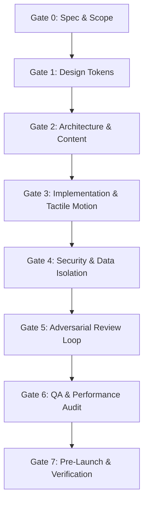

# The Anti-Slop Operating System (v2)
### The Hardened Engineering, Security, and Design Protocol for Full-Stack Web Apps

*A comprehensive operational protocol and reference manual for human engineers and autonomous AI coding agents. Synthesized from modern web platform standards, design-system research, security incident post-mortems, and anti-slop engineering principles. Current as of August 2026.*

---

## 1. Executive Summary & The Core Thesis

**AI slop is not an aesthetic failure; it is a process failure.**

When an AI agent or a developer builds without strict constraints, the output statistically collapses to the unexamined median of its training data: purple gradients, bento grids, generic marketing filler, unindexed database tables, and unvalidated client state.

Distinctive design, rock-solid security, sub-16ms rendering performance, and accessible code are not competing goals. They fail for the exact same underlying reason: **unconstrained defaults**.

This document is organized into a two-tier architecture:
1. **The Operating System (The 8 Gates):** The linear enforcement spine defining mandatory requirements (`MUST`), strong standards (`SHOULD`), and hard exit criteria.
2. **The Reference Manual:** The technical deep-dives, failure modes, code mechanics, case studies, and templates that explain how and why to execute each gate.

---

## 2. Normative Language & Requirement Levels

The key words **MUST**, **MUST NOT**, **SHOULD**, **SHOULD NOT**, and **MAY** in this document are to be interpreted as described in RFC 2119:

| Level | Definition | Enforcement |
|---|---|---|
| **MUST** | Absolute, non-negotiable requirement. | **Violation results in immediate gate failure and code rejection.** |
| **MUST NOT** | Absolute, non-negotiable prohibition. | **Presence of pattern blocks deployment and merges.** |
| **SHOULD** | Strong engineering or design standard. | Valid exceptions exist, but **deviation requires written technical justification** in the spec or PR. |
| **SHOULD NOT** | Discouraged pattern or recognized anti-pattern. | Requires explicit rationale before acceptance. |
| **MAY** | Optional or stylistic choice. | Discretion of the lead developer / product owner. |

---

## 3. Verified System Assumptions (Living Technical Registry)

*Verified platform baseline as of August 2026. If underlying tooling versions change, verify directly against official platform documentation.*

| Subsystem | Verified Standard | Key Architectural Invariants |
|---|---|---|
| **Frontend Framework** | Next.js 16 (App Router) | Turbopack is the default bundler; React Compiler is built-in; View Transitions, `<Activity>`, and `"use cache"` are native primitives. |
| **Styling Engine** | Tailwind CSS v4 | CSS-first configuration (`@theme` block); native cascade layers; container queries; default `oklch()` color space. |
| **Headless UI Primitives** | Base UI v1.0 | Unstyled, fully accessible headless primitives (standardized default across modern shadcn/ui ecosystems). |
| **Motion & Animation** | GSAP (Timeline/Scroll) + Motion | GSAP plugins (ScrollTrigger, MorphSVG, SplitText) are 100% free for commercial use. Motion (`motion/react`) handles declarative React transitions. |
| **Backend & Database** | Supabase / Managed Postgres | Row-Level Security (RLS) is disabled by default on new tables and **MUST** be explicitly enabled and forced. |
| **Authentication** | Better Auth / Supabase Auth | Server-verified session tokens; passkey/MFA support; zero hand-rolled auth crypto. |
| **Security Standards** | OWASP Top 10:2025/2026 | Explicit guards against Broken Access Control (#1), Security Misconfiguration (#2), Supply Chain Vulnerabilities (#3), and Exceptional Condition Mishandling (#4). |

---

# Part I — The 8 Operational Gates (The Development Spine)

Every project and feature **MUST** progress linearly through these 8 gates. An agent or developer **MUST NOT** proceed to the next gate until all exit criteria are satisfied and verified.



---

### Gate 0 — Spec, Problem Statement & Scope Boundaries

*Goal: Eliminate ambiguity before any code or layout is generated.*

- **Inputs:** Raw user request, business objective, target audience description.
- **Requirements:**
  - `MUST` define the exact target user, the specific job-to-be-done, and measurable success criteria in one clear paragraph ([Ref §1.1](#ref-11-defining-the-actual-problem)).
  - `MUST` conduct a 5–10 site competitive audit documenting what to deliberately avoid and what to adapt ([Ref §1.2](#ref-12-competitive-audits)).
  - `MUST` establish explicit scope boundaries: what is in-scope for v1 and what is strictly out-of-scope ([Ref §1.6](#ref-16-spec-driven-development)).
  - `MUST NOT` proceed with vague prompts like "make it look modern" or "build a cool platform."
- **Exit Criteria:** `MAIN.md` and `TASKS.md` are written, committed, and reviewed.

---

### Gate 1 — Token System & Signature Design Decision

*Goal: Establish a mathematically cohesive, accessible design language.*

- **Inputs:** `MAIN.md`, subject matter visual references.
- **Requirements:**
  - `MUST` define 4–6 semantic color roles in **OKLCH** color space (Background, Surface, Text, Accent, Danger) with tested WCAG AA contrast (4.5:1 for body text, 3:1 for large text) ([Ref §3.2](#ref-32-color-systems-in-oklch)).
  - `SHOULD` select a characterful display typeface paired with a functional body typeface, specifying an explicit numeric type scale ([Ref §3.1](#ref-31-typography-systems)).
  - `SHOULD` declare **one signature design element** (e.g., custom tactile physics, unique 2.5D shading, custom micro-interactions) that makes the product memorable. Everything else `MUST` remain disciplined around it ([Ref §3.6](#ref-36-the-one-signature-element-principle)).
  - `MUST NOT` default to unexamined purple/indigo gradients or template swatches without stated design rationale. (Purple is permitted when chosen deliberately from a subject-matter token system).
- **Exit Criteria:** `DESIGN.md` is locked and tokens are declared in `@theme` CSS.

---

### Gate 2 — Information Architecture, Flow & Real Content

*Goal: Shape layout around real sentences and structural logic.*

- **Inputs:** `DESIGN.md`, feature specifications.
- **Requirements:**
  - `MUST` write complete, meaningful, human-like copy (headlines, feature explanations, pricing, error messages) prior to component scaffolding ([Ref §3.7](#ref-37-meaningful-human-copywriting)).
  - `MUST NOT` use generic placeholder text ("Lorem ipsum", "Transform your workflow", "The ultimate platform", "Supercharge your productivity").
  - `MUST` define wireflows and user navigation hierarchies before selecting UI card patterns ([Ref §1.4](#ref-14-information-architecture)).
  - `SHOULD` structure numbered steps or bento boxes only if the underlying data is genuinely sequential or multi-dimensional ([Ref §3.3](#ref-33-layout--spatial-composition)).
- **Exit Criteria:** Real content is mapped to route structures and state trees.

---

### Gate 3 — Implementation, Tactile Physics & Pixel Integrity

*Goal: Build responsive, high-performance UI components with tactile physical feedback.*

- **Inputs:** Gate 0–2 artifacts, UI primitives.
- **Requirements:**
  - `MUST` implement exact tactile physics on all interactive button components ([Ref §3.4.1](#ref-341-tactile-physics--button-animation-standard)):
    1. **Hover:** Micro-scale (`scale(1.025)` max) + specular CC light-sweep gleam gliding from left (`-160%`) to right (`+160%`).
    2. **Hover Leave (Unhover):** Smooth release back to `scale(1.0)` with the specular light sweep gliding back to the left (`-160%`).
    3. **Active / Click:** Tactile physical depression bounce (`scale(0.97)` + 1px down translation) with pressed inset shadow.
  - `MUST` enforce crisp integer pixel rendering for all 2D canvas operations (`ctx.imageSmoothingEnabled = false`) ([Ref §3.9](#ref-39-pixel-art--canvas-integrity)).
  - `MUST` calculate true 3D surface normal lighting (e.g. Lambertian elliptical terminator curves and Blinn-Phong specular glints) rather than linear diagonal cuts ([Ref §3.9](#ref-39-pixel-art--canvas-integrity)).
  - `MUST NOT` introduce unprompted floating text, ambient wobbles, endless bounce loops, or generic AI slop animations ([Ref §2.4](#ref-24-motion--interaction-tells)).
  - `MUST NOT` include random emoji clutter in UI headers, markdown documentation, or code comments.
  - `SHOULD` select an icon family intentionally (Phosphor, Heroicons, Tabler, Untitled UI) rather than accepting unexamined defaults ([Ref §4.6](#ref-46-icons)).
- **Exit Criteria:** Interactive components pass local unit tests, render with sub-16ms latency, and compile cleanly with 0 TypeScript errors.

---

### Gate 4 — Security Boundary & Data Isolation

*Goal: Ship infrastructure that cannot be casually breached.*

- **Inputs:** Database schemas, API endpoints, auth handlers.
- **Requirements:**
  - `MUST` enable and enforce Row-Level Security (`ALTER TABLE ... ENABLE ROW LEVEL SECURITY` and `FORCE ROW LEVEL SECURITY`) on every database table ([Ref §6.3](#ref-63-access-control--rls-deep-dive)).
  - `MUST` verify database policies directly through an unprivileged client session holding the public `anon` key—never solely inside the SQL Editor as a superuser ([Ref §6.3](#ref-63-access-control--rls-deep-dive)).
  - `MUST` validate every request payload server-side using strict Zod schemas ([Ref §5.4](#ref-54-api-design-and-validation)).
  - `MUST` isolate all API secrets in server environment variables (zero secrets in `NEXT_PUBLIC_` variables or git history) ([Ref §6.2](#ref-62-secrets--configuration)).
  - `MUST` enforce file upload restrictions: server-side MIME-type magic byte verification, file size caps, and storage bucket RLS policies ([Ref §6.4](#ref-64-input-upload-and-injection-defenses)).
  - `MUST NOT` trust client-supplied user IDs, roles, pricing numbers, or authorization flags.
- **Exit Criteria:** Automated security scan passes with zero open RLS tables, zero exposed secrets, and zero client-only validation paths.

---

### Gate 5 — The Adversarial Review Loop (Dual-Agent Audit)

*Goal: Prevent self-approval bias and catch edge cases.*

- **Inputs:** Completed feature branch or commit range.
- **Requirements:**
  - `MUST` execute a dedicated adversarial audit using a clean context window or secondary reviewer prompt instructed specifically to attack the output ([Ref §8.2](#ref-82-the-adversarial-review-loop)).
  - `MUST` audit against the 4 critical categories:
    1. **Security & RLS bypass attempts.**
    2. **UI slop & generic template tell regressions.**
    3. **Edge-case inputs (empty states, oversized text, network dropouts).**
    4. **Code cleanliness (zero dead code, zero empty catch blocks, zero redundant narrative comments).**
  - `MUST NOT` allow the implementation agent to self-approve its own code without adversarial scrutiny.
- **Exit Criteria:** Adversarial review findings are logged in `LOGS.md` and all identified vulnerabilities/regressions are resolved.

---

### Gate 6 — Quality Assurance, Accessibility & Performance

*Goal: Guarantee production-grade robustness across devices and assistive technologies.*

- **Inputs:** Staged application build.
- **Requirements:**
  - `MUST` achieve full keyboard navigability (visible focus rings, logical tab order, escape key modal dismissal) ([Ref §8.1](#ref-81-accessibility-baseline)).
  - `MUST` respect `prefers-reduced-motion` across all CSS and JavaScript animation loops ([Ref §3.4](#ref-34-motion-with-intent)).
  - `MUST` pass WCAG AA contrast compliance across all color ramps and states ([Ref §3.2](#ref-32-color-systems-in-oklch)).
  - `MUST` maintain Core Web Vitals targets: LCP < 2.5s, INP < 200ms, CLS < 0.1 ([Ref §7.1](#ref-71-core-web-vitals-in-depth)).
  - `MUST NOT` leak memory in event listeners, canvas contexts, animation timers, or un-debounced window resize handlers ([Ref §7.4](#ref-74-memory-leak-prevention)).
- **Exit Criteria:** Lighthouse score >= 95 in Performance, Accessibility, and Best Practices; zero console errors.

---

### Gate 7 — Pre-Launch Verification & Deployment

*Goal: Deploy cleanly with comprehensive operational observability.*

- **Inputs:** Production release candidate.
- **Requirements:**
  - `MUST` configure custom Open Graph preview images, favicon suites, and accurate meta tags ([Ref §9.1](#ref-91-pre-launch-checklist)).
  - `MUST` verify production error tracking (Sentry / Crashlytics) and automated database backup schedules ([Ref §9.2](#ref-92-production-infrastructure)).
  - `MUST` confirm security headers (`Content-Security-Policy`, `X-Frame-Options: DENY`, `Strict-Transport-Security`) ([Ref §6.6](#ref-66-security-headers)).
  - `MUST` verify that all legal pages (Terms of Service, Privacy Policy) are present, accurate, and accessible ([Ref §9.1](#ref-91-pre-launch-checklist)).
- **Exit Criteria:** Production deployment verified on live domain with clean HTTPS handshake and operational telemetry active.

---

# Part II — The Reference Manual

This manual provides the technical derivations, failure mode analyses, architectural trade-offs, and implementation mechanics referenced by the 8 Gates.

---

## 1. Planning & Specification Mechanics

<a id="ref-11-defining-the-actual-problem"></a>
### 1.1 Defining the Actual Problem
Write one concise paragraph defining the user, the core job-to-be-done, and measurable success. Avoid abstract SaaS formulations ("a platform for X"). An agent fed an abstract brief will interpolate generic SaaS boilerplate.

<a id="ref-12-competitive-audits"></a>
### 1.2 Competitive Audits
Audit 5–10 real competitor sites in the exact target vertical. For each site, record:
1. **Patterns to Deliberately Avoid:** Specific layout cliches (e.g. 3-tier pricing cards, centered feature icons).
2. **Patterns Working Well:** Domain-specific workflows to refine and adapt.

<a id="ref-14-information-architecture"></a>
### 1.4 Information Architecture
Sketch structural wireflows (numbered steps, route transitions, nested sidebars) prior to component implementation. Structure must encode information hierarchy, not arbitrary visual decoration.

<a id="ref-16-spec-driven-development"></a>
### 1.6 Spec-Driven Development
A production spec for an AI agent must contain:
- The exact problem and target audience.
- Explicit design constraints and token declarations.
- Specific boundaries (what the agent must not touch or introduce).
- Verifiable acceptance criteria (passing tests, measurable metrics).

---

## 2. Diagnostic Taxonomy of AI Slop

<a id="ref-24-motion--interaction-tells"></a>
### 2.1 Visual & Structural Tells
- **Unexamined Defaults:** Purple gradients used because they were the template default.
- **Bento Grid Spreading:** Forcing 3-column card layouts onto data that has no multi-dimensional relationship.
- **Uniform Radii:** Applying `rounded-xl` to every container, badge, and button without scale hierarchy.
- **Fake Terminals:** Displaying terminal mockups on non-developer product pages.
- **Sparkle Tropes:** Using sparkle icons () as an automatic marker for AI features.

### 2.2 Motion & Interaction Tells
- **Ambient Floating:** Continuous floating or bobbing keyframes without user interaction.
- **Indiscriminate Hover Glows:** Applying glows, lifts, or scales to non-interactive elements.

### 2.3 Copywriting Tells
- **Generic Marketing Buzzwords:** Phrases like *"Transform your workflow"*, *"The ultimate all-in-one platform"*, *"manage"*, *"Supercharge your productivity"*.
- **Robotic Boilerplate:** Cold strings like *"Processing payload..."*, *"Canvas dimensions 32x32 verified"*.
- **Rhetorical Crutches:** Overuse of em dashes (—) and contrastive reframing (*"It's not X, it's Y"*).

---

## 3. Distinctive Design & Tactile Physics

<a id="ref-31-typography-systems"></a>
### 3.1 Typography Systems
Pair a characterful display typeface with a quiet, functional body typeface.
- **Independent Foundries:** Fontshare (Satoshi, Clash Display, General Sans, Cabinet Grotesk), Klim Type Foundry (Söhne), Pangram Pangram (Editorial New).
- **Google Fonts (Modern Curation):** Instrument Serif, Bricolage Grotesque, Fraunces, Plus Jakarta Sans.
- **Rules:** Self-host font files using modern WOFF2 formats; declare strict numeric type scales; avoid unexamined defaults.

<a id="ref-32-color-systems-in-oklch"></a>
### 3.2 Color Systems in OKLCH
OKLCH is a perceptually uniform color space where lightness matches human ocular perception.
$$\text{OKLCH: } L \in [0, 1], \ C \in [0, 0.4], \ H \in [0, 360^\circ]$$
- **Directional Hue-Shifting:**
  - Highlights shift toward **Warm Sunlight** ($H \approx 105^\circ$).
  - Shadows shift toward **Cool Indigo Sky** ($H \approx 285^\circ$).
- Contrast validation: Verify 4.5:1 for body copy and 3:1 for large text across all dynamic states.

<a id="ref-33-layout--spatial-composition"></a>
### 3.3 Layout & Spatial Composition
- Use CSS container queries (`@container`) so components respond to parent container dimensions rather than viewport width.
- use Tailwind v4 cascade layers (`@layer theme, base, components, utilities`) to eliminate CSS specificity conflicts.

<a id="ref-34-motion-with-intent"></a>
### 3.4 Motion with Intent
One orchestrated sequence outperforms scattered micro-animations. Always wrap animations with `@media (prefers-reduced-motion: reduce)`.

<a id="ref-341-tactile-physics--button-animation-standard"></a>
#### 3.4.1 Tactile Physics & Button Animation Standard
Interactive elements must follow physical mechanical feedback:
1. **Hover State:** Micro-scale (`scale(1.025)` max) + specular CC light sweep gliding across the surface from left (`-160%`) to right (`+160%`).
2. **Hover Leave (Unhover):** Controlled return to `scale(1.0)` with the specular sweep gliding back to the left (`-160%`).
3. **Active / Click:** Tactile physical depression (`scale(0.97)` + 1px down translation) with pressed inset shadow (`box-shadow: inset 0px 2px 4px rgba(0,0,0,0.25)`).

<a id="ref-36-the-one-signature-element-principle"></a>
### 3.6 The One-Signature-Element Principle
Select exactly one unforgettable characteristic for the product (e.g. tactile mechanical sound feedback, custom 2.5D shading, dynamic lighting) and keep every supporting component disciplined and understated.

<a id="ref-37-meaningful-human-copywriting"></a>
### 3.7 Meaningful, Human Copywriting
Write from the user's perspective. Eliminate generic marketing abstractions. Empty states, tooltips, and error messages must read as clear, friendly communication from one craftsperson to another.

<a id="ref-39-pixel-art--canvas-integrity"></a>
### 3.9 Pixel Art & Canvas Integrity
- **Integer Pixel Math:** Canvas coordinates must always round to integer values.
- **Smoothing Disabled:** Enforce `ctx.imageSmoothingEnabled = false` across all canvas renderers.
- **Analytical 3D Illumination:**
  - 3D Surface Normal: $\hat{N} = \left(\frac{x-c_x}{R_x}, \frac{y-c_y}{R_y}, \sqrt{\max(0, 1 - u^2 - v^2)}\right)$
  - Key Light: $\hat{L} = (-0.5, -0.5, 0.7071)$
  - Diffuse Term: $I = \hat{N} \cdot \hat{L} = -0.5u - 0.5v + 0.7071 \sqrt{1 - u^2 - v^2}$ (produces a true curved elliptical terminator).
  - Blinn-Phong Specular Glint: $(\hat{N} \cdot \hat{H})^{12}$ at half-vector $\hat{H} = (-0.2706, -0.2706, 0.9239)$.

---

## 4. UI Library & Tooling Landscape

### 4.1 Headless Primitives
- **Base UI v1.0:** The modern unstyled headless primitive standard across React ecosystems.
- **Radix UI:** Battle-tested headless standard in legacy shadcn installs.
- **React Aria (Adobe):** Deep accessibility and internationalization primitives for enterprise/compliance projects.

### 4.2 Customizing shadcn Primitives
shadcn source files must be customized away from defaults: change color tokens, adjust border-radius curves, and replace default icons with chosen project icon families.

### 4.3 Animation Tooling
- **GSAP:** Imperative, framework-agnostic animation engine operating via a single `requestAnimationFrame` loop (free for commercial use).
- **Motion (`motion/react`):** Declarative React layout animations and gesture handling.

<a id="ref-46-icons"></a>
### 4.6 Icons
- **Phosphor:** 7,000+ icons across 6 weights (thin, light, regular, bold, fill, duotone).
- **Heroicons:** designed for Tailwind UI interfaces.
- **Tabler Icons:** Comprehensive free MIT set on a consistent 24px grid.
- **Untitled UI:** Figma-native component properties.

---

## 5. Full-Stack Architecture

### 5.1 Next.js 16 App Router Mechanics
- Server Components for direct backend data-fetching.
- Server Actions for mutations.
- React Compiler for automatic fine-grained memoization.
- View Transitions API for route morphing.

<a id="ref-54-api-design-and-validation"></a>
### 5.4 API Design and Validation
- Validate all incoming payloads server-side using strict Zod schemas.
- Shape API responses explicitly—never return unmasked database rows to client callers.

---

## 6. Security Mechanics & Case Studies

### 6.1 Real-World Security Incident Post-Mortems
> **Case Study 1: The Tea App Breach (July 2025)**
> A mobile platform exposed 72,000 identity verification images and 13,000 government IDs due to a public cloud storage bucket with directory listing enabled and zero auth rules. **Rule: All storage buckets MUST default to private access with explicit tokenized access.**

> **Case Study 2: Supabase RLS Exposures (CVE-2025-48757)**
> Security researchers identified 300+ endpoints across 170 apps where database tables were readable by anyone holding the public `anon` key because Row-Level Security was never enabled. **Rule: Every table MUST have RLS explicitly enabled and forced.**

<a id="ref-62-secrets--configuration"></a>
### 6.2 Secrets & Configuration
- Never hardcode secrets.
- Isolate client keys (`NEXT_PUBLIC_`) strictly to public anonymous identifiers.
- Scrub committed credentials with `git-filter-repo` and rotate compromised keys immediately.

<a id="ref-63-access-control--rls-deep-dive"></a>
### 6.3 Access Control & RLS Deep Dive
- `ALTER TABLE table_name ENABLE ROW LEVEL SECURITY;`
- `ALTER TABLE table_name FORCE ROW LEVEL SECURITY;`
- Index all foreign key columns referenced in RLS policies to prevent full-table scan denial-of-service.
- Test policies using unprivileged client sessions holding the `anon` JWT.

<a id="ref-64-input-upload-and-injection-defenses"></a>
### 6.4 Input, Upload & Injection Defenses
- Verify file uploads using magic byte inspection (e.g. `image/png` header `89 50 4E 47 0D 0A 1A 0A`) rather than trusting client MIME strings.
- Enforce parameterized database queries across all data layers.

<a id="ref-66-security-headers"></a>
### 6.6 Security Headers
Enforce production headers:
```http
Content-Security-Policy: default-src 'self'; img-src 'self' data: blob:; script-src 'self';
X-Frame-Options: DENY
X-Content-Type-Options: nosniff
Referrer-Policy: strict-origin-when-cross-origin
Strict-Transport-Security: max-age=63072000; includeSubDomains; preload
```

---

## 7. Performance & Core Web Vitals

<a id="ref-71-core-web-vitals-in-depth"></a>
### 7.1 Core Web Vitals
- **Largest Contentful Paint (LCP < 2.5s):** Optimize hero assets; preload critical fonts; eliminate render-blocking scripts.
- **Interaction to Next Paint (INP < 200ms):** Offload heavy parsing to Web Workers; break up long main-thread tasks.
- **Cumulative Layout Shift (CLS < 0.1):** Set explicit width/height on image and canvas containers.

<a id="ref-74-memory-leak-prevention"></a>
### 7.4 Memory Leak Prevention
- Clean up all `addEventListener`, `setInterval`, `requestAnimationFrame`, and WebGL/Canvas buffer allocations inside React `useEffect` return blocks.

---

## 8. QA, Accessibility & Adversarial Auditing

<a id="ref-81-accessibility-baseline"></a>
### 8.1 Accessibility Baseline
- Maintain WCAG AA contrast ratios (4.5:1 text, 3:1 graphical elements).
- Full keyboard operability: visible `:focus-visible` styling, logical tab order, ARIA attributes on dynamic controls.

<a id="ref-82-the-adversarial-review-loop"></a>
### 8.2 The Adversarial Review Loop
Execute dual-agent review sessions:
1. Agent 1 implements the feature according to spec.
2. Agent 2 (clean context) attacks the implementation searching for RLS bypasses, input overflow glitches, memory leaks, and UI slop tells.

---

## 9. Pre-Launch & Infrastructure

<a id="ref-91-pre-launch-checklist"></a>
### 9.1 Pre-Launch Checklist
- Verify Open Graph metadata, dynamic preview cards, and favicon suites.
- Confirm presence and legal accuracy of Terms of Service and Privacy Policy pages.

<a id="ref-92-production-infrastructure"></a>
### 9.2 Production Infrastructure
- Configure real-time telemetry (Sentry error tracking).
- Verify automated daily database backup snapshots.

---

# Part III — Appendices & Enforceable Contracts

---

## Appendix A — Complete Anti-Slop Visual & Structural Audit

Check every UI screen against these failure modes:
- [ ] No unexamined purple/indigo default gradients.
- [ ] No arbitrary bento-grid card cramming.
- [ ] No uniform `rounded-xl` radii across all hierarchy levels.
- [ ] No unexamined default icon sets without project-level curation.
- [ ] No fake terminal windows on non-developer products.
- [ ] No sparkle icons () used as automatic AI feature markers.
- [ ] No generic AI slop copy (*"Transform your workflow"*, *"manage"*).
- [ ] No random emoji clutter in UI headers or documentation.
- [ ] No unprompted ambient floating text or continuous bobbing animations.

---

## Appendix B — Complete Security Audit Checklist

Verify every backend and data boundary:
- [ ] RLS enabled and forced on all tables.
- [ ] RLS verified using unprivileged `anon` client sessions.
- [ ] RLS foreign key columns indexed.
- [ ] Zero secrets in `NEXT_PUBLIC_` variables or git history.
- [ ] File uploads validated via magic bytes and capped by size.
- [ ] Server-side Zod payload validation on all mutation endpoints.
- [ ] Security headers active in production middleware.

---

## Appendix C — Curated Toolbox (2026 Reference)

| Category | Primary Recommendation | Secondary / Specialized Alternative |
|---|---|---|
| **Headless UI** | Base UI v1.0 | React Aria (Enterprise A11y) |
| **Styling** | Tailwind CSS v4 (`@theme`) | Native Cascade Layers + Tokens |
| **Animation** | GSAP (Timeline/Scroll) | Motion (`motion/react`) |
| **Database/BaaS** | Supabase (Postgres + RLS) | Neon + Drizzle ORM |
| **Auth** | Better Auth | Supabase Auth |
| **Typeface Discovery** | Fontshare (ITF) | Google Fonts Modern Curation |

---

## Appendix D — Code & Process Professionalism Audit

Verify code cleanliness before merging:
- [ ] Zero narrative/redundant code comments.
- [ ] Zero empty catch blocks (`catch (e) {}`).
- [ ] Zero unhandled promise rejections.
- [ ] Clean Conventional Commits (`feat:`, `fix:`, `refactor:`, `perf:`).
- [ ] Lockfiles committed and in sync with package manifests.

---

## Appendix E — The Enforceable AI Agent Contract

*Copy and paste this exact block into `SKILL.md`, `AGENTS.md`, or system prompts to enforce development discipline.*

```markdown
=== ENFORCEABLE AGENT CONTRACT ===

ROLE
You are a senior full-stack and graphics engineer with rigorous product taste. You make deliberate, mathematically grounded decisions over safe statistical defaults. You never introduce a dependency, pattern, or animation without stating why.

CORE OPERATIONAL INVARIANTS:
1. NEVER invent UI patterns or layouts before understanding the product, audience, and real content.
2. NEVER use default colors, fonts, or component libraries without an explicit design token rationale.
3. NEVER add an external dependency where clean, testable native logic achieves the goal with zero bloat.
4. NEVER call a feature complete without verifying its acceptance criteria, edge cases, and type safety.
5. NEVER trust client-side authorization, user IDs, or unverified payload parameters.
6. NEVER ship generic placeholder text, robotic system boilerplate, or marketing buzzwords. Write authentic, warm, human-like copy.
7. NEVER self-approve your own implementation. Submit code to adversarial review.
8. NEVER continue past a failed gate. Fix root causes before proceeding.

TACTILE MOTION & CANVAS STANDARDS:
- Buttons: Subtle hover scale (<= 1.025) with smooth specular CC light-sweep gliding left-to-right (-160% to +160%) -> smooth reverse glide on mouse leave -> mechanical depression bounce (scale 0.97 + 1px Y) on click.
- Canvas: Always enforce integer pixel math and ctx.imageSmoothingEnabled = false.
- Shading: Calculate true 3D surface normals (Lambertian elliptical terminators and Blinn-Phong specular glints) in OKLCH space.

COMMUNICATION & CODE CLEANLINESS:
- No emoji clutter in documentation, markdown files, UI headers, or code comments.
- No redundant narrative comments; document only non-obvious mathematical invariants and security boundaries.
- Follow Conventional Commits (feat:, fix:, refactor:, perf:).
==================================
```

---

## Appendix F — Project Bootstrap Blueprint Files

Every production repository **MUST** contain the following foundation documents in its root:
1. **`MAIN.md`**: Problem statement, audience definition, v1 scope boundaries, and stack architecture rationale table.
2. **`DESIGN.md`**: OKLCH color tokens, typography scale, tactile physics specification, signature design element, and explicitly rejected patterns.
3. **`SKILL.md`**: The enforceable AI agent contract, project-specific invariants, and non-negotiable rules.
4. **`TASKS.md`**: The 8-gate build plan with verifiable deliverables and human testing checkpoints.
5. **`LOGS.md`**: Chronological build log recording delivered features, automated test outputs, adversarial review findings, and resolved bugs.
6. **`README.md`**: Clean, human-written project overview, quickstart instructions, and live deployment links.

---

## Appendix G — V1 to V2 Comprehensive Preservation Audit

This table verifies that 100% of the rich technical material, case studies, comparison matrices, and engineering checklists from V1 are preserved and integrated into the V2 Two-Tier Operating System:

| V1 Section / Feature | V2 Location | Architectural Role | Status | Unique Content Preserved? |
|---|---|---|---|---|
| **Problem Definition & Competitive Audit** | Gate 0 + Ref §1.1, §1.2 | Gate requirements + methodology | Preserved & Linked | **Yes** — Full 5-10 site audit method intact |
| **Spec-Driven Development** | Gate 0 + Ref §1.6 | Upfront planning invariant | Preserved & Linked | **Yes** — Spec requirements and boundaries intact |
| **Taxonomy of AI Slop (Bento, Purple, etc.)** | Gate 1, Gate 2 + Ref §2.1–§2.3 + App A | Reject criteria + diagnostic manual | Reorganized & Expanded | **Yes** — All visual, motion, copy tells preserved |
| **Typography Systems & Foundry Lists** | Gate 1 + Ref §3.1 | Foundries (Fontshare, Söhne, Fraunces) | Preserved & Linked | **Yes** — Full foundry table & pairing rules intact |
| **OKLCH Color Theory & Hue-Shifting** | Gate 1 + Ref §3.2 | Mathematical color model | Preserved & Linked | **Yes** — Directional Sun/Shadow math intact |
| **Layout & Container Queries** | Gate 2 + Ref §3.3 | Spatial engineering | Preserved & Linked | **Yes** — Cascade layers & `@container` intact |
| **Motion with Intent & Tactile Physics** | Gate 3 + Ref §3.4, §3.4.1 | Button micro-mechanics specification | Preserved & Expanded | **Yes** — CC Light-Sweep & Depression bounce detailed |
| **Pixel Art & 3D Normal Equations** | Gate 3 + Ref §3.9 | Canvas & shader integrity | Preserved & Formatted | **Yes** — Lambertian & Blinn-Phong equations intact |
| **One-Signature-Element Principle** | Gate 1 + Ref §3.6 | Distinctive brand discipline | Preserved & Linked | **Yes** — Core decision framework intact |
| **Meaningful Human Copywriting** | Gate 2 + Ref §3.7 | Anti-slop copywriting standards | Preserved & Expanded | **Yes** — Banned buzzwords & peer tone intact |
| **Headless UI Primitives (Base UI v1.0, Radix)** | Ref §4.1 + App C | Tooling evaluation matrix | Preserved & Linked | **Yes** — Base UI 2026 status & shadcn role intact |
| **Animation Tooling (GSAP Free License, Motion)** | Ref §4.3 + App C | Motion stack selection | Preserved & Linked | **Yes** — GSAP free license & Motion status intact |
| **Icon Libraries (Phosphor, Heroicons, Tabler)** | Gate 3 + Ref §4.6 + App C | Icon curation standards | Preserved & Linked | **Yes** — All 4 icon library profiles intact |
| **Next.js 16 App Router & React Compiler** | Ref §5.1 | Frontend architecture baseline | Preserved & Linked | **Yes** — Turbopack, `"use cache"`, `<Activity>` intact |
| **Security Case Studies (Tea App, Supabase CVE)** | Gate 4 + Ref §6.1 | Threat post-mortems | Preserved & Linked | **Yes** — Full narrative case studies intact |
| **Access Control & RLS Enforcement** | Gate 4 + Ref §6.3 + App B | Mandatory database boundary | Preserved & Linked | **Yes** — Forced RLS & client testing intact |
| **Secrets Isolation & Upload Restrictions** | Gate 4 + Ref §6.2, §6.4 | Data injection defense | Preserved & Linked | **Yes** — Magic byte & `NEXT_PUBLIC_` rules intact |
| **Security Headers** | Gate 7 + Ref §6.6 | Production HTTP headers | Preserved & Linked | **Yes** — Full CSP & HSTS snippet intact |
| **Core Web Vitals & Performance** | Gate 6 + Ref §7.1 | Metric thresholds (LCP, INP, CLS) | Preserved & Linked | **Yes** — Exact web.dev thresholds intact |
| **Memory Leak Auditing** | Gate 6 + Ref §7.4 | Lifecycle cleanup rules | Preserved & Linked | **Yes** — Listener & timer cleanup intact |
| **Dual-Agent Adversarial Review Loop** | Gate 5 + Ref §8.2 | Quality & security verification | Preserved & Linked | **Yes** — 4-category attack prompt intact |
| **Pre-Launch & Post-Launch Operations** | Gate 7 + Ref §9.1, §9.2 | Launch readiness | Preserved & Linked | **Yes** — OG tags, telemetry, backups intact |
| **Appendices A–F (Audits, Contract, Templates)** | App A–F | Direct copy-paste artifacts | Preserved & Linked | **Yes** — All checklists, contract, templates intact |
| **RFC 2119 Normative Levels** | Section 2 | Precision requirement definitions | Added in V2 | **Yes** — `MUST` vs `SHOULD` vs `MAY` codified |

<!-- session-publication-2026-10-01 -->
## Session checkpoint — 2026-10-01

The project status references below do not change this document's operating instructions. The latest studio follow-up keeps File, drawing controls, adjacent Mirror/Zoom/Fit/View, Studio and Export on one desktop header row. The live bulb offers Off/Soft/Crisp glints with a brighter pixel core and stepped edge, preserves outlines and alpha, and supports Cancel, Apply and exact Undo/Redo. See the [UI/UX record](docs/research/session-ui-ux-2026-10-01.md) and [glint research, screenshots and evidence](docs/research/specular-glint-2026-10-01.md).

The latest full gate passed documentation, types, lint, **1,482 unit/integration tests across 144 suites**, and the production build. Three focused Chromium glint scenarios passed; the current discovered editor inventory is **149 tests in 33 files**, plus 39 separate compiled-production scenarios. Earlier full-run results retain their dates and scope. The user requested Git publication of this checkpoint; it does not authorize deployment or replace the existing release sign-off. [Delivered work and open validation](docs/research/session-completion-2026-10-01.md).
<!-- /session-publication-2026-10-01 -->
