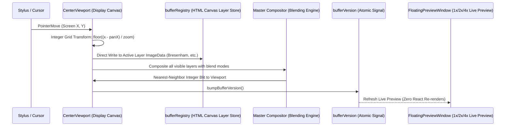
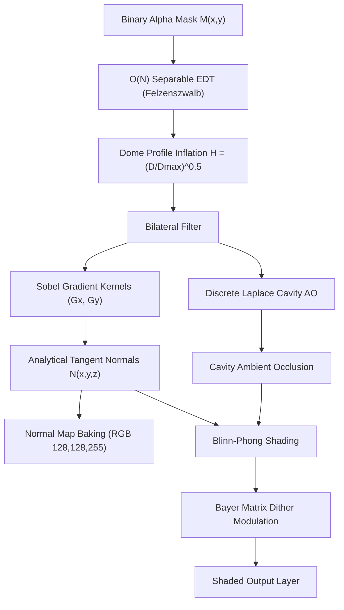
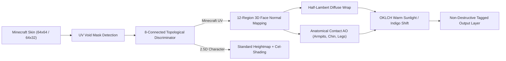

# PixiBun: Comprehensive Technical, Mathematical & Architectural Reference

```text
  /\_/\   *  .  *  .  *  *  .  *  *  .  *  *
 ( o.o )   P I X I B U N   D E E P   D I V E
  > ^ <    Engineering, Computer Graphics & Architecture Reference
```

> **This document provides an in-depth technical explanation of PixiBun's raster drawing engine, 2.5D photometric mathematics laboratory, optical color quantization algorithms, memory management, and tactile design system.**

---

## Table of Contents

- [1. Directory & File Architecture](#1-directory--file-architecture)
- [2. Memory Architecture & Dual-Layer Drawing Pipeline](#2-memory-architecture--dual-layer-drawing-pipeline)
- [3. Raster, Geometry & Canvas Algorithms](#3-raster-geometry--canvas-algorithms)
- [4. PixiBud 2.5D Photometric Studio](#4-pixibud-25d-photometric-studio)
- [5. 3D Minecraft Skin Recognition & Dedicated Shading](#5-3d-minecraft-skin-recognition--dedicated-shading)
- [6. Signed Distance Field (SDF) In-Between Animation Morphing](#6-signed-distance-field-sdf-in-between-animation-morphing)
- [7. Image-to-Pixel Synthesis (`pixelizeEngine.ts`)](#7-image-to-pixel-synthesis-pixelizeenginets)
- [8. Storage, Serialization & Game Engine Exports](#8-storage-serialization--game-engine-exports)
- [9. Bounded 2.5D Sprite Cast Shadows & Ground Drop Shadows (`shadowRayMarcher.ts`)](#9-bounded-25d-sprite-cast-shadows--ground-drop-shadows-shadowraymarcherts)
- [10. 2.5D Normal Sculptor & Reoriented Normal Mapping (`normalSculptor.ts`)](#10-25d-normal-sculptor--reoriented-normal-mapping-normalsculptorts)
- [11. Mark Ferrari 8-Bit Dynamic Palette Cycling (`paletteCycling.ts`)](#11-mark-ferrari-8-bit-dynamic-palette-cycling-palettecyclingts)
- [12. Bitwise Buffer Normalization, Hot-Path Viewport Decoupling & Export Safety](#12-bitwise-buffer-normalization-hot-path-viewport-decoupling--export-safety)
- [13. RotSprite-Inspired Rotation & Vector Depixelization](#13-rotsprite-inspired-rotation--vector-depixelization)
- [14. Viewport Lenses, Accessibility & Direct Hotkeys](#14-viewport-lenses-accessibility--direct-hotkeys)
- [15. Modern Studio Shell & Design System Primitives Architecture](#15-modern-studio-shell--design-system-primitives-architecture)
- [16. Teaching Animation Board & Discrete Jump Physics Engine](#16-teaching-animation-board--discrete-jump-physics-engine)
- [17. Smart-Effect Recipe Architecture & Non-Destructive Workflow](#17-smart-effect-recipe-architecture--non-destructive-workflow)

---

# 1. Directory & File Architecture

PixiBun is built on Next.js 16 (App Router), React 19, Tailwind CSS v4, Zustand + Immer, and Dexie.js (IndexedDB) as a modular, desktop-grade raster graphics studio:

```text
src/
├── app/
│   ├── api/diagnostics/relay/route.ts # SSRF-guarded diagnostics proxy (optional, zero telemetry, token-bucket rate limited)
│   ├── globals.css                  # Tailwind v4 @theme, OKLCH variables, tactile shadows, v2 design tokens
│   ├── layout.tsx                   # Root layout (Silkscreen, Plus Jakarta Sans, JetBrains Mono fonts)
│   ├── page.tsx                     # Landing Page (Living desk scene, diorama, artisan story)
│   ├── playground/page.tsx          # Interactive tutorial, sandbox, and Teaching Animation Board
│   └── studio/page.tsx              # Main studio drawing editor and workspace
├── components/
│   ├── landing/                     # Landing components (AtelierDeskScene, PixelVines, etc.)
│   ├── layout/                      # Studio shell (AtelierRail, LeftToolbar, CenterViewport, StatusBar, CursorStatusBadge, RightInspector + PanelSection subpanels, BottomTimeline)
│   ├── modals/                      # Dialog windows (CommandPaletteModal, ImportModal, ExportModal, CanvasResizeModal, ShortcutsModal, CoDrawModal, ProjectsGalleryModal)
│   ├── playground/                  # Educational modules (TeachingAnimationBoard, TeachingBoardModal)
│   ├── studio/                      # Floating windows & gizmos (FloatingPreviewWindow, PixelLightBulbGizmo, SelectionTransformGizmo, ViewportLensFilters, RemoteCursorsOverlay)
│   └── ui/                          # Tactile design system (PixiBunLogo, AppearancePopover, IconButton, PanelSection, StudioSlider, StudioSelect, StudioToggle, StudioNumberInput, StudioTooltip, TactileButton, PixelIcon)
├── hooks/
│   ├── studio/                      # Lifecycle hooks (useStudioAutosave, useStudioClipboard, useStudioFileSystem, useStudioKeyboard)
│   └── viewport/                    # Viewport pointer handlers (useBrushPointerHandler, useChiselPointerHandler, useSelectionPointerHandler, useShapePointerHandler)
├── lib/
│   ├── ai/
│   │   ├── math/                    # Modular graphics math laboratory
│   │   │   ├── curvesAndLines.ts    # Quadratic Bézier curves and 2:1 isometric line stepping
│   │   │   ├── morphology.ts        # Zhang-Suen 1px topological skeleton thinning
│   │   │   ├── edtNormalMap.ts      # O(N) EDT, dome inflation, content-aware heightmaps, frontal cushion
│   │   │   ├── photometricLighting.ts# Blinn-Phong lighting, feature protection, stepped OKLCH cel-shading
│   │   │   ├── photometricAuto.ts   # Art morphology analysis, anatomical classification (character/orb/prop)
│   │   │   ├── shadowAuto.ts        # Sprite bounds, ground contact detection, shadow parameter inference
│   │   │   ├── colorSpace.ts        # sRGB/OKLab/OKLCH conversions and perceptual hue-shifting
│   │   │   ├── dithering.ts         # Atkinson and Riemersma error-diffusion dithering
│   │   │   ├── rotSprite.ts         # RotSprite-inspired 8x Scale2x rotation adapter
│   │   │   └── minecraftSkin.ts     # Minecraft player skin UV detection and normal mapping
│   │   ├── pixelAiEngine.ts         # SDF morphing, jaggy cleanup, ground shadow, outline
│   │   ├── pixelizeEngine.ts        # Image-to-pixel: Sobel salience, OKLab Median-Cut + K-Means++
│   │   └── shadowRayMarcher.ts      # Bounded 2.5D sprite cast shadow projection, drop shadow, Aaltonen cone tracing
│   ├── art/                         # normalSculptor.ts (2.5D normal chisel & rivet dome stamp), starter templates
│   ├── canvas/                      # Raster fundamentals: Bresenham, 2:1 iso stepper, Bezier, Flood Fill, Dither matrices, rotSprite.ts, spritesheetSlicer.ts
│   ├── collab/                      # CRDT engine: crdtPixelBuffer (per-pixel LWW-Register with HLC clocks and bounded drift)
│   ├── color/                       # paletteCycling.ts (Mark Ferrari 8-bit cycling, IFF CRNG/CCRT, 32-bit LUT, harmonic rational retuning)
│   ├── engine/                      # Memory management: bufferRegistry (HTML canvas buffers), ID generator, bufferPool, workerDispatcher.ts
│   ├── events/                      # Typed event bus (studioEvents.ts)
│   ├── export/                      # Export pipeline: spriteSheetPacker, gifEncoder, webmEncoder, mp4Encoder, apngEncoder, processReplayExport, depixelizeVector, shaderExporter.ts
│   ├── project/                     # Project serialization: schema.ts (validator), serialize.ts (.pixibun IO)
│   ├── procedural/                  # waveFunctionCollapse.ts (WFC overlapping constraint satisfaction pattern synthesis)
│   ├── render/                      # Pure compositor (compositor.ts) and template renderer (templateRenderer.ts)
│   ├── server/                      # Pure server modules: tokenBucket.ts (token-bucket rate limiter for route handlers)
│   ├── sync/                        # P2P co-draw: coDrawBridge (studio integration), p2pSync (WebRTC transport + validation), strokeDiff (stroke delta extraction)
│   └── storage/
│       └── db.ts                    # Dexie.js (IndexedDB Schema v5) local database and continuous autosave
├── stores/
│   ├── studioStore.ts               # Zustand + Immer studio state manager (composed from 5 modular slices)
│   └── themeStore.ts                # Dual theme manager and Zero-Lag CSS transition suppressor
├── workers/                         # Background Web Workers (heavyCompute.worker.ts offloading RotSprite 8x, WFC & SDF in-between morphing)
└── types/                           # TypeScript definitions (canvas, tools, animation, project, theme)
```

---

# 2. Memory Architecture & Dual-Layer Drawing Pipeline

React's Virtual DOM is unsuitable for high-frequency pixel-level operations (120+ cursor events per second). PixiBun uses React state strictly for metadata, managing pixel buffers in external memory:



### 1. `bufferRegistry.ts` (Layer Buffer Store)
* Layer pixels are stored in a `Map<string, BufferEntry>`; each entry holds a detached `HTMLCanvasElement` and its `CanvasRenderingContext2D`.
* When a layer is created (`getOrCreateBuffer`), an independent HTML canvas is allocated at canvas dimensions.
* **Memory Safety:** When a layer is deleted, `deleteBuffers(layerId)` cleans up references immediately.
* **9-Point Anchor Resizing (`resizeAllBuffers`):** Canvas dimensions resize relative to 9 anchor points (`top-left`, center, `bottom-right`, etc.) with nearest-neighbor resampling options.

### 2. `bufferVersion` Reactive Signal
* On stroke completion, fill, or smart shading pass, `bumpBufferVersion()` notifies subscribers.
* FloatingPreviewWindow subscribes to this integer counter and redraws its preview when the buffer changes.

### 3. Undo/Redo History Engine
* `src/lib/engine/historyEngine.ts` maintains independently depth-bounded 50-step undo and redo stacks (`createHistoryEngine(50)`), while their combined retained HistoryStep payload is constrained by the configured 64 MiB history byte envelope.
* Prior to each stroke, ctx.getImageData(0, 0, width, height) captures a layer snapshot for pixel restoration. Layer properties and frame duration use metadata-only structural snapshots. Structural edits are rejected before mutation when their projected Undo or Redo snapshot exceeds the history budget.

---

# 3. Raster, Geometry & Canvas Algorithms

Mathematical algorithms in src/lib/canvas/ are optimized for retro pixel precision:

### 1. Pixel-Perfect Bresenham (`filterPixelPerfect`)
Standard Bresenham produces duplicate "L" corner pixels on rapid turns. A 3-point state machine prunes redundant intermediary pixels:

$$\text{If } (x_i = x_{i-1} \lor y_i = y_{i-1}) \land (x_{i+1} \ne x_i \land y_{i+1} \ne y_i) \implies \text{Prune middle pixel}$$

### 2. Quantized 2:1 Isometric Line Stepper (`getIsometric2p1Line`)
For standard $26.565^\circ$ ($\arctan(0.5)$ dimetric) isometric projections:

$$y_{\text{iso}} = y_0 + \text{sign}(dy) \cdot \left\lfloor \frac{|x - x_0|}{2} \right\rfloor$$

### 3. Quadratic Bézier Curves (`getQuadraticBezierPoints`)
Calculates integer de Casteljau curves across 3 control points ($P_0, P_1, P_2$):

$$B(t) = (1-t)^2 P_0 + 2(1-t)t P_1 + t^2 P_2, \quad t \in [0, 1]$$

### 4. Flood Fill (performFloodFill)
* Exact matching compares unsigned 32-bit RGBA words through `Uint32Array` views; nonzero tolerance compares the clicked source color to each candidate's RGBA distance.
* Connected fill uses an iterative four-neighbor stack and a typed visited mask. It does not allocate neighbor arrays per pixel, though the stack itself is a JavaScript array.
* The Bucket toolbar supplies its own default tolerance of 24. Optional enclosed-speck cleanup walks unfilled components inside the filled region's bounds, recoloring only visible islands of up to eight pixels and preserving transparent holes.

### 5. Erase Sampled Color (`eraseMatchingColor.ts`)
* Performs tolerance-guided color matching to make targeted colors transparent on the active layer or across animation frames.
* Color-family matching clears faint background specks and repairs dark color spill embedded within outlines.
* Supports bounding boxes, selection masks, and locked-layer exclusion with single-action undo/redo bounded by the history byte envelope.

---

# 4. PixiBud 2.5D Photometric Studio

src/lib/ai/smartMathEngine.ts generates analytical 3D lighting and normal maps from 2D pixel drawings:



### 1. $O(N)$ Linear-Time Euclidean Distance Transform (EDT)
Uses Felzenszwalb-Huttenlocher separable squared parabolic lower envelopes along rows and columns:

$$D(x, y) = \min_{x'} \left( (x - x')^2 + D_{\text{col}}(x', y) \right)$$

### 2. Dome Profile Inflation & Bilateral Filtering
Distance values are converted to volumetric dome heights via $\gamma = 0.5$ power curve:

$$H(x, y) = \left(\frac{D(x, y)}{\max D}\right)^{0.5}$$

### 3. Analytical Tangent-Space Normals & Sobel Gradients
Discrete $3\times3$ Sobel kernels derive directional gradients ($G_x, G_y$):

$$\mathbf{N}(x, y) = \frac{1}{\sqrt{s_x^2 G_x^2 + s_y^2 G_y^2 + 1}} \begin{pmatrix} -s_x G_x \\ -s_y G_y \\ 1 \end{pmatrix}$$

### 4. Normal Map Baking
Unit vectors $\mathbf{N} = (N_x, N_y, N_z)$ map directly to RGB $[0, 255]$ for Godot, Unity, and Unreal:

$$R = \lfloor (N_x \cdot 0.5 + 0.5) \cdot 255 \rfloor, \quad G = \lfloor (N_y \cdot 0.5 + 0.5) \cdot 255 \rfloor, \quad B = \lfloor (N_z \cdot 0.5 + 0.5) \cdot 255 \rfloor$$

### 5. Content-Aware Frontal Face Cushion & Anatomical Feature Isolation
For character sprites, naive hemispherical dome inflation creates extreme slope gradients across the face ($N_x > 0.8$), causing directional light to plunge half the character's face into shadow.
* **Frontal Cushion Plateau:** Within the outer silhouette bevel of radius $R_{\text{char}} = 2.8 \times \text{scaleFactor}$ (where $\text{scaleFactor} = \max(1.0, \min(W, H) / 32)$), height bevels smoothly via $\text{rimRatio} = \min(1.0, D_{\text{macro}}(x, y) / R_{\text{char}})$ and $H_{\text{macro}}(x, y) = \max(D_{\text{macro}}) \cdot \sqrt{\text{rimRatio}}$. The face interior reaches a flat plateau facing the camera, ensuring form shadows naturally hug only the unlit silhouette rim.
* **Independent Ear Cones:** Distinct convex lobes in the silhouette retain independent 3D height peaks without arbitrary pixel caps.
* **4-Tone Discrete OKLCH Cel-Shading:** Unshaded flat base colors receive discrete stepped tone quantization via `buildCelRamp()` — **Base** (artist color), **Directional Mid-Shadow** ($L \times 0.86$, preserving authored hue/chroma), **Deep Crevice** ($L \times 0.72$, triggers at $AO < \text{creviceAOThresh}$ in concave seams), and **Highlight** ($L + (0.98 - L) \times 0.22$, shiny materials only; soft penumbra uses $L \times 0.93$). In Phase 63, `creviceAOThresh` is dynamically bounded to $[0.12, 0.30]$ scaling with `cavityStrength` ($\min(0.30, \max(0.12, 0.12 + 0.16 \times \text{cavStrength}))$), requiring $\text{diffSignal} < \text{shadowThresh} + 0.10$ to prevent dark bands from engulfing unlit sides.
* **Neutral Macro-Form & Exposure-Compensated Terminator (Phase 63):** Superseded fixed head/neck/torso height priors with neutral macro-form and multi-scale material detail ($H_{\text{composite}} = 0.70 H_{\text{macro}} + 0.30 H_{\text{micro}}$ for characters), ensuring the 2.5D surface normal field $\mathbf{N}$ is 100% decoupled from light direction. Directional cel shadow placement uses an exposure-compensated terminator evaluated via a piecewise linear mapping around baseline 1.15 ($\text{shadowThresh} = 0.52 + t \times 0.30$ for $\text{brightness} \le 1.15$, or $0.52 - t \times 0.32$ for $\text{brightness} > 1.15$), preventing high lamp brightness from shifting geometric boundaries.
* **Source Shading Normalization (Phase 63):** Added `sourceShadingRemoval` ($0\% - 100\%$) to reduce pre-authored directional value bands before relighting. Two-sided interior ink detection requires opposing luminance dips ($(\text{neighbor}_{\text{opposing}} - \text{lum}) \ge 0.12$), preventing painted drop shadows from being carved as permanent ink crevices. Connected-component flood fill clusters authored ramps by hue and chroma proximity ($\Delta\text{hue} \le 35^\circ, \Delta\text{chroma} \le 0.25$).

### 6. Interactive On-Canvas Pixel Light Bulb Gizmo & Reticle Architecture
* **Decoupled Orbit and Focus Reticle:** A draggable bulb token orbits smoothly around a draggable middle focus reticle (`stageCentroid`). Dragging the bulb rotates light azimuth ($\theta = \text{atan2}(dx, -dy)$) and elevation without mutating the center anchor position.
* **60fps Throttled Direct Pipeline:** Renders in-place preview frames during pointer movement using `requestAnimationFrame` with zero UI latency, invalidating the analysis cache on $\ge 20^\circ$ angular drift and executing a fresh single-shot pass on drag commit to guarantee zero azimuth staleness (Phase 60a).
* **Spherical Dome Normal Math Calibration:** Calibrated dome inflation blends spherical dome profile ($0.75\sqrt{1 - (1 - d/\max(D))^2}$) with a gamma power curve ($0.25(d/\max(D))^\gamma$, $\gamma = 0.5$), providing a softened profile at the apex peak to eliminate conical pinch creases and center-locked highlights on spherical primitives.

---

# 5. 3D Minecraft Skin Recognition & Dedicated Shading

Minecraft skins ($64 \times 64$ or $64 \times 32$) require domain-specific 3D cuboid normal mapping:



1. **Deep Topological Discriminator (`analyzeMinecraftSkinTopology`):** 8-connected component flood analysis with dominant component ratio ($\ge 68\%$ → centered sprite), bilateral limb verification ($x \in [0, 16)$ Right Leg, $x \in [40, 56)$ Right Arm), canonical void zone integrity ($<20\%$ pollution), and bounding box margin checks. Centered character sprites are decisively routed to standard 2.5D lighting instead of cuboid UV mapping.
2. **User Sovereignty:** Tactile `Skin 3D Shading: [ Auto | On | Off ]` inspector toggle with `minecraftSkinMode: 'auto' | 'enabled' | 'disabled'`.
3. **12-Region 3D Normal Mapping:** Assigns analytical 3D normals for Head, Hat, Torso, Jacket, Arms, and Legs.
4. **Half-Lambert Wrap:**

$$\text{wrap}(\mathbf{N}\cdot\mathbf{L}) = \left(\frac{\mathbf{N}\cdot\mathbf{L} + 0.4}{1.4}\right)^{1.2}$$

5. **Anatomical Contact AO:** Applies contact shadowing under chin ($0.80$), armpits ($0.82$), and inner limbs ($0.85$).

---

# 6. Signed Distance Field (SDF) In-Between Animation Morphing

`src/lib/ai/pixelAiEngine.ts` implements Signed Distance Field (SDF) shape morphing paired with 8-connected multi-source BFS color sampling:

1. **Signed Distance Field Computation:** For keyframes $A$ and $B$, separable Euclidean Distance Transforms (EDT) compute boundary distance metrics:
   $$\text{sdf}_A(x, y) = d_{\text{outside}}^A(x, y) - d_{\text{inside}}^A(x, y)$$
   $$\text{sdf}_B(x, y) = d_{\text{outside}}^B(x, y) - d_{\text{inside}}^B(x, y)$$
2. **Linear SDF Interpolation:** For any in-between time fraction $t \in [0, 1]$:
   $$\text{sdf}_t(x, y) = (1 - t) \cdot \text{sdf}_A(x, y) + t \cdot \text{sdf}_B(x, y)$$
   A coordinate $(x, y)$ belongs to the morphed sprite if $\text{sdf}_t(x, y) \le 0$.
3. **Multi-Source BFS Color Sampling:** Precomputes a nearby opaque pixel index across the grid in $O(W \times H)$ time via 8-connected queue propagation (eliminating $O(W \times H \times R^2)$ spiral searches). Queue distance follows 8-connected steps, so this is not Euclidean nearest-color sampling.
4. **Channelwise Color Blending:** Source RGBA channel values $C_A$ and $C_B$ are blended at fraction $t$ in their stored sRGB representation:
   $$C_t(x, y) = \operatorname{round}\left((1 - t) \cdot C_A + t \cdot C_B\right)$$

---

# 7. Image-to-Pixel Synthesis (`pixelizeEngine.ts`)

1. **Linear Optical Gamma Correction:** Downsamples in linear energy space ($sRGB \to \text{Linear}$) to prevent dark fringe perimeter artifacts:
   $$I_{\text{linear}} = \begin{cases} \frac{C}{12.92} & C \le 0.04045 \\ \left(\frac{C + 0.055}{1.055}\right)^{2.4} & C > 0.04045 \end{cases}$$
2. **Forward-Difference Salience Edge Preservation:** Weights high-frequency facial and weapon contours using $2\times2$ forward differences:
   $$G_x = I_{\text{lum}}(x + 1, y) - I_{\text{lum}}(x, y), \quad G_y = I_{\text{lum}}(x, y + 1) - I_{\text{lum}}(x, y)$$
   $$\|\nabla I(x, y)\| = \sqrt{G_x^2 + G_y^2}$$
   $$W_{\text{salience}}(x, y) = W_{\text{box}} \cdot \left(1.0 + \min\left(2.5, 3.0 \cdot \|\nabla I(x, y)\|\right)\right)$$
   This guarantees edge weight boosts remain stably bounded in $[1.0, 3.5]$.
3. **OKLab Median-Cut & K-Means++:** Quantizes palettes along maximum perceptual variance axes in OKLab space.
4. **Serpentine Floyd-Steinberg & Atkinson Dithering:** Alternating scan direction prevents directional worming artifacts.

---

# 8. Storage, Serialization & Game Engine Exports

### 1. IndexedDB Workspace & Format v3 (db.ts, schema.ts)
* Dexie-backed multi-project workspace with dedicated binary `layerBlobs` table storing raw PNG blobs directly (eliminating base64 serialization overhead).
* Asynchronous autosave snapshots layers, palettes, and thumbnails without main-thread stalls, triggered on both pixel history commits and document `editRevision` updates.
* **Project Format Specification v3:** Native `.pixibun` v3 saves structured `LayerEffectRecipe` provenance on generated layers while maintaining raster cache and backwards compatibility with v1/v2 files.

### 2. Game Engine Export Pipeline (spriteSheetPacker.ts)
* **Godot 4:** Generates valid .tres SpriteFrames text resources with AtlasTexture sub-resources.
* **TexturePacker / Unity:** Emits standard TexturePacker Array JSON format compatible with Unity and game engine importers.
* **Phaser 3:** Generates Phaser multiatlas JSON structures.

### 3. GIF89a LZW Encoder (gifEncoderCore.ts)
* Lightweight, multithreaded worker encoder with per-frame Local Color Tables and Uint8Array stream buffering.

### 4. Animated PNG Encoder (apngEncoder.ts)
* Zero-dependency streaming APNG builder assembling `acTL` (animation control), `fcTL` (frame control), and `fdAT` (frame data) chunks with lossless deflate compression and full 32-bit RGBA alpha support.

### 5. WebM & MP4 Hardware-Accelerated Video (webmEncoder.ts, mp4Encoder.ts)
* **WebM Encoder:** Encodes VP8/VP9 frames via `VideoEncoder` / MediaStream recording with alpha transparency preservation.
* **MP4 Encoder:** Emits H.264 video streams with even integer dimension clamping (`(w * scale + 1) & ~1`) for $16\times16$ macroblock alignment.

### 6. Process Replay Speedpaint Timelapse (processReplayExport.ts)
* Serializes the session's fine-grained stroke command log, synthesizing variable-speed timelapse animations from blank canvas to finished artwork.

### 7. Standalone Game Engine Shaders (shaderExporter.ts)
* Emits production-ready Godot 4 `.gdshader` (visual shader canvas item with normal/lighting pass and dynamic palette cycling uniform arrays) and Unity URP 2D HLSL shaders.

---

# 9. Bounded 2.5D Sprite Cast Shadows & Ground Drop Shadows (shadowRayMarcher.ts)

### 1. Exact 1-to-1 Sheared Silhouette Projection
Rather than tracing an unbounded 2D planar wedge across the floor, the engine projects sprite pixels directly onto the ground plane:
$$h = y_{\text{base}} - y_s \ge 0$$
$$\text{projX} = \text{round}(x_s + h \cdot \text{shear}_x), \quad \text{projY} = \text{round}(y_{\text{ground}} + h \cdot \text{shear}_y)$$
Sub-step sampling strictly along the shear vector prevents pinhole gaps without expanding bounding spans, preserving hollow leg arches and waist indentations.

### 2. Ground Contact Drop Shadows (shadowStyle: 'drop')
For classic top-down RPG style (*The Legend of Zelda*, *Pokémon*), renders a crisp stylized Bresenham pixel ellipse anchored at the contact base:
$$\frac{(x - x_{\text{center}})^2}{r_x^2} + \frac{(y - y_{\text{base}})^2}{r_y^2} \le 1.0$$

### 3. Authentic Uniform Flat Opacity (ditherMode: 'none')
When `ditherMode === 'none'`, shadows render with crisp uniform flat opacity $\text{round}(\text{shadowOpacity} \times 255)$, completely eliminating continuous 256-level float gradients. Optional Bayer matrix stippling is available via `2x2`, `4x4`, and `8x8` modes.

---

# 10. 2.5D Normal Sculptor & Reoriented Normal Mapping (normalSculptor.ts)

### 1. Tangent Space Normal Vector Encoding
Normal vectors follow the standard OpenGL tangent space convention ($+Y$ points up, $+X$ points right, $+Z$ points outward towards the camera):
$$\mathbf{C}_{\text{encoded}} = \text{round}\left((\mathbf{N} + 1) \times 127.5\right)$$
Flat perpendicular baseline planes $(0, 0, 1)$ map to $(128, 128, 255)$ lavender.

### 2. Analytical Directional Bevels & Rivet Dome Stamping
* **Directional Bevel:** Given compass heading $\alpha \in [0, 360^\circ)$ and slope incline $\phi \in (0, 90^\circ]$:
  $$N_x = \sin\phi \sin\alpha, \quad N_{y,\text{OpenGL}} = \sin\phi \cos\alpha, \quad N_z = \cos\phi$$
* **Rivet Dome Stamp:** For circular stamps of radius $R$ and flattening factor $h \in (0, 1]$:
  $$\mathbf{N} = \text{normalize}\left(h \frac{dx}{R}, h \frac{dy}{R}, \sqrt{1 - \frac{dx^2 + dy^2}{R^2}}\right)$$

### 3. Reoriented Normal Mapping (RNM)
Rotates stamped micro-relief normals $\mathbf{D}$ into the tangent frame of the underlying base surface $\mathbf{B}$ via shortest-arc quaternion rotation without slope flattening:
$$\mathbf{t} = (B_x, B_y, B_z + 1), \quad \mathbf{u} = (-D_x, -D_y, D_z)$$
$$\mathbf{r} = \mathbf{t}(\mathbf{t} \cdot \mathbf{u}) - \mathbf{u} \, t_z, \quad \mathbf{N}_{\text{blended}} = \frac{\mathbf{r}}{\|\mathbf{r}\|}$$

| Live Normal Preview (RNM Blended) | 45° vs 225° Relit Difference (32,558 px) | Rivet Dome Stamping |
|:---:|:---:|:---:|
|  |  |  |

---

# 11. Mark Ferrari 8-Bit Dynamic Palette Cycling (paletteCycling.ts)

### 1. IFF ILBM `CRNG` & Commodore `CCRT` Binary Codecs
Binary parser and serializer supporting classic Deluxe Paint II/III/IV animation tracks:
* 8-byte `CRNG`: 16-bit big-endian cycle rate ($16384 = 60\text{Hz}$), flags (active, reverse), and range bounds `[low..high]`.
* 14-byte `CCRT`: Microsecond timing precision with custom color register offsets.

### 2. 60 FPS 32-Bit LUT Renderer
Preallocated `Uint32Array` LUT packed in little-endian `0xAABBGGRR` blits directly into canvas `ImageData` 32-bit buffers:
```typescript
lut32[idx] = (a << 24) | (b << 16) | (g << 8) | r;
```
The per-pixel remap uses packed integers without allocating per pixel. Recomputing the LUT still allocates small RGB tuples during palette parsing and blending; the measured animation path stays within the documented 60 FPS budget.

### 3. Ping-Pong Triangle Wave Fencepost Safety
Period $M = 2(S - 1)$ where $S = \text{high} - \text{low} + 1$:
$$p = \lfloor\text{phase}\rfloor \pmod M; \quad \text{offset} = \begin{cases} p & \text{if } p < S \\ M - p & \text{otherwise} \end{cases}$$
Registers ping-pong smoothly across boundaries without double-frame dwell pauses.

### 4. Harmonic Rational Retuning
Snaps each track's rate to harmonic periods over target duration $T$:
$$k = \operatorname{round}\left(\frac{T \cdot \text{rate}}{M}\right), \quad \text{rate}_{\text{retuned}} = \frac{k \cdot M}{T}$$
Guarantees loop unrolling into loopable APNG, GIF, and standalone Godot 4 (`.gdshader`) / Unity URP 2D HLSL shaders.

<p align="center">
  
</p>

---

# 12. Bitwise Buffer Normalization, Hot-Path Viewport Decoupling & Export Safety

### 1. Unsigned 32-Bit Bitwise Invariant (`floodFill.ts`)
JavaScript bitwise operations evaluate in signed 32-bit two's complement. For fully opaque pixels with alpha $A = 255$:
$$(255 \ll 24) = -16,777,216$$
Comparing this against an unsigned `Uint32Array` view (`4,278,190,335`) evaluated to `false`, terminating flood fill on the first clicked pixel on opaque colored backgrounds.
Enforcing zero-fill right shift (`>>> 0`) guarantees unsigned integer parity:
```typescript
const targetColor32 = ((targetA << 24) | (targetB << 16) | (targetG << 8) | targetR) >>> 0;
```
Buffer views are safely offset via `new Uint32Array(data.buffer, data.byteOffset, data.byteLength >> 2)`.

### 2. Viewport Cursor HUD Decoupling (`CursorStatusBadge.tsx`)
Cursor coordinate state is isolated from the parent `CenterViewport` component tree. By subscribing `CursorStatusBadge` directly to pointer move coordinates, active pen and brush drawing strokes achieve zero component re-renders on the hot-path canvas.

### 3. Asynchronous Object URL Teardown (`ExportModal.tsx`)
Synchronous `URL.revokeObjectURL` calls immediately following synthetic link clicks risk aborting downloads before browser streams finish reading the blob. All export formats employ a 1000ms deferred teardown:
```typescript
setTimeout(() => URL.revokeObjectURL(url), 1000);
```

### 4. H.264 / YUV 4:2:0 Macroblock Alignment (`mp4Encoder.ts`)
Hardware video encoders require even integer dimensions for $16 \times 16$ macroblock partitioning. Export canvases are padded via `(width * scale + 1) & ~1` and `(height * scale + 1) & ~1`.

---

# 13. RotSprite-Inspired Rotation & Vector Depixelization

### 1. RotSprite-Inspired Rotation (`rotSprite.ts`)
PixiBun combines an 8x Scale2x expansion, inverse sampling, and its own majority-vote downscaler. It does not implement Xenowhirl's canonical rotation-offset search or single-pixel detail-restoration pass:
* **Scale2x (EPX) Cascade:** 3 sequential passes of the Scale2x expansion kernel scale the input buffer by $8\times$ ($800\%$) along both axes, reconstructing diagonal edges without introducing blurred intermediate colors.
* **Inverse Coordinate Mapping:** Destination subpixel coordinates $(x', y')$ are rotated by $-\theta$ around the transformed bounding box center to map back into source space:
  $$\begin{pmatrix} u \\ v \end{pmatrix} = \begin{pmatrix} \cos\theta & \sin\theta \\ -\sin\theta & \cos\theta \end{pmatrix} \begin{pmatrix} x' - cx' \\ y' - cy' \end{pmatrix} + \begin{pmatrix} cx \\ cy \end{pmatrix}$$
* **Parabolic Majority Voting Downsampling:** An $8\times8$ subpixel window reconstructs each destination pixel. Candidate colors are evaluated by radial distance from the cell center using a parabolic kernel:
  $$w(u, v) = 1.0 + 0.01 \cdot \left(25 - (u^2 + v^2)\right), \quad u, v \in \{-3.5, -2.5, \ldots, 3.5\}$$
  The color with the highest cumulative weight wins the pixel cell.
* **Fast Orthogonal Transformations:** For exact $90^\circ$ and $270^\circ$ rotations on arbitrary rectangular canvases ($W \ne H$), the algorithm transposes dimensions ($W' = H, H' = W$) and directly permutes pixel coordinates:
  $$90^\circ: (x', y') = (H - 1 - y, x), \quad 270^\circ: (x', y') = (y, W - 1 - x)$$
  This bypasses the $8\times$ cascade entirely for instantaneous, lossless orthogonal rotation.

### 2. Adapted Kopf-Lischinski Vector Depixelization (`depixelizeVector.ts`)
Converts pixel art into resolution-independent SVG vector graphics following the principles of Kopf & Lischinski (*ACM Trans. Graph. / SIGGRAPH 2011*):
* **Pixel Grid Dual Graph:** Reconstructs the 8-connected planar graph where vertices represent pixel corners.
* **1-Hop Parity Crossing Heuristic:** Resolves ambiguous diagonal $2\times2$ checkerboard crossings by evaluating local 1-hop color valence to decide whether diagonals connect or stay separate.
* **Corner Shifts:** Displaces vertices by $\pm 0.05$ based on local contour curvature to soften staircase turns.
* **Cubic Bézier Spline Fitting:** Fits smooth cubic Bézier splines across simplified boundary contours, outputting clean SVG `<path>` elements.

---

# 14. Viewport Lenses, Accessibility & Direct Hotkeys

### 1. Silhouette / Squint Mode Lens (<kbd>S</kbd>)
Toggles a high-contrast binary luminance lens on the viewport display. It computes perceived luminance $Y = 0.299R + 0.587G + 0.114B$ and maps pixels to pure black or pure white against a configurable threshold. This allows artists to evaluate readability, value hierarchies, and negative space without mutating the artwork's color data.

### 2. CVD Colorblindness Simulation Lens (<kbd>P</kbd>)
Cycles display-only simulation matrices for color vision deficiencies:
* **Protanopia:** Red-cone absence simulation via Brettel-Viénot LMS transformation.
* **Deuteranopia:** Green-cone absence simulation.
* **Tritanopia:** Blue-cone absence simulation.
* **Achromatopsia / Grayscale:** Total absence of color perception.

### 3. Precision Tool Hotkeys
* <kbd>N</kbd> (or <kbd>Shift</kbd> + <kbd>K</kbd>): Direct activation of the 2.5D Rivet Dome Stamp tool.
* <kbd>K</kbd>: Direct activation of the Normal Chisel tool.
* <kbd>R</kbd>: Direct activation of the Color Replace tool.
* <kbd>Shift</kbd> + <kbd>R</kbd>: Direct activation of the Erase Sampled Color tool.
* <kbd>Ctrl</kbd> + <kbd>K</kbd>: Fuzzy-search Command Palette launcher.
* <kbd>Ctrl</kbd> + <kbd>S</kbd>: Direct project persistence commit to IndexedDB and active native file handle.

---

# 15. Modern Studio Shell & Design System Primitives Architecture

### 1. Workspace Shell Decomposition
The monolithic `StudioLayout.tsx` has been decomposed into a decoupled shell architecture:
* **`AtelierRail.tsx`**: Top studio rail unifying project identity, file actions (Save, Save As, Import, Export, Gallery, Co-Draw), Undo/Redo controls, zoom group with responsive fit calculation (`handleFitToScreen`), tool-specific contextual parameter controls, CVD colorblindness lenses, squint mode, symmetry rulers, and `AppearancePopover`.
* **`StatusBar.tsx`**: 24px bottom chrome bar displaying real-time cursor coordinates via decoupled `CursorStatusBadge` subscription, active tool name, canvas dimensions, zoom factor, and active layer/frame indicators.
* **`CommandPaletteModal.tsx`**: Accessible fuzzy-search launcher (`Ctrl+K` / `Cmd+K`) with categorized commands (Tools, View & Guides, Animation, Project & Studio), keyboard arrow navigation, and shortcut hint badges.

### 2. Design System Component Library (`src/components/ui/`)
All studio inspector panels and dialogs are standardized on tactile, accessible primitives conforming to WCAG 2.2 AA:
* **`StudioSlider`**: Linear gradient fill track with real-time numeric badge, golden accent thumb, and ARIA slider semantics.
* **`StudioSelect`**: Styled native `<select>` with studio surface elevation tokens and high-visibility focus rings.
* **`StudioToggle`**: Tactile sliding pill switch with hidden checkbox input and gold indicator thumb.
* **`StudioNumberInput`**: Numeric input with min/max clamping, step increments, and unit suffix.
* **`StudioTooltip`**: Delay-activated tooltip (300ms) with keyboard focus support and shortcut badges.
* **`IconButton`**: 24–32px tactile icon button with ghost/surface/danger variants and translation depression physics.
* **`PanelSection`**: Collapsible accordion section with persistent `localStorage` open/closed state and header action slot.

---

# 16. Teaching Animation Board & Discrete Jump Physics Engine

### 1. Interactive Teaching Animation Board (`TeachingAnimationBoard.tsx`)
Built into `/playground` (and openable in the studio via `pixibun:open-teaching-board`), the Teaching Animation Board provides structured visual pixel art education:
* **Character Curricula**: Interactive profiles for **Bun** (the 16×16 atelier bunny mascot) and **Gel Slime** (translucent bouncing slime).
* **7-Stage Progressive Construction**: Step-by-step sprite breakdown: Silhouette Base $\to$ Core Volume $\to$ Face Cavities $\to$ Inward Details $\to$ Cel-Shading $\to$ Highlights $\to$ Final Inks.
* **10-Frame Jump Cycle Anatomy**: Full physics breakdown covering Anticipation / Squash, Takeoff / Stretch, Ascent, Apex Hang, Descent, Ground Contact, Recovery Cushion, and Rest.
* **8 Alt Palette Colorways**: Interactive colorway swatches (Classic Lavender, Matcha Sage, Sakura Rose, Midnight Obsidian, Solar Gold, Frost Cyan, Rust Copper, Twilight Indigo).
* **1-Click Inject-to-Timeline**: Instantly loads the constructed multi-frame jump cycle into the studio timeline with authentic frame hold timings.

---

# 17. Smart-Effect Recipe Architecture & Non-Destructive Workflow

Phase 63 introduces a portable, non-destructive effect recipe model (`LayerEffectRecipe`) across all generated layer types:

### 1. Unified Recipe Model (`src/types/canvas.ts`)
```typescript
export type SmartEffectKind =
  | 'photometric'
  | 'auto-shade'
  | 'cast-shadow'
  | 'ground-shadow'
  | 'volumetric-optics'
  | 'normal-map'
  | 'specular'
  | 'sel-out'
  | 'outline'
  | 'autotile'
  | 'wfc';

export interface LayerEffectRecipe {
  id: string;
  kind: SmartEffectKind;
  version: 1;
  sourceMode: 'composite-excluding-self' | 'active-layer' | 'selection';
  params: Record<string, SmartEffectParameter>;
  analysis?: {
    formType?: 'character' | 'orb' | 'prop';
    sourceLightAzimuth?: number;
    sourceLightElevation?: number;
    cueStrength?: number;
    rationale?: string;
  };
  updatedAt: number;
}
```

### 2. Non-Destructive Layer Provenance & Runtime Invariants
* **Pre-rendered Blitting:** The raster result of the effect remains in the layer's detached HTML canvas buffer. Viewport zooming, panning, and timeline playback do not re-run the effect calculation.
* **Atomic Undo/Redo Snapshots:** `PixelHistoryStep` records `layerEffect?: LayerEffectRecipe`, ensuring that undoing or redoing an effect operation atomically synchronizes both the raster bitmap and its parameter metadata.
* **Interactive Light Gizmo Reopening:** Photometric layers render an `Edit FX` button in `LayersPanel.tsx`. Reopening reads `recipe.params`, mounts the `PixelLightBulbGizmo`, and binds real-time updates directly to the target layer.
* **P2P Structural Sync Guard:** P2P collaboration validates incoming remote recipes through `validateLayerEffect()`, strictly rejecting unrecognized keys, uncalibrated parameters, and excessive string lengths.

### 3. Discrete Cel-Shading Ramps & 3D Specular Highlight System
* **Discrete Shading Tones:** When generating photometric shading layers, the engine quantizes directional lighting into discrete OKLCH palette ramps driven by `shadingBands`:
  - **1 Single (2 Tones):** Base color + 1 directional shadow tone ($S < T \rightarrow \text{ramp.shadow}$).
  - **2 Dual (3 Tones):** Base color + core shadow + deep boundary umbra ($S < 0.48 \cdot T \rightarrow \text{ramp.deep}, S < T \rightarrow \text{ramp.shadow}$).
  - **3 Trio (4 Tones):** Base color + soft penumbra + core mid-shadow + deep umbra ($S < 0.32 \cdot T \rightarrow \text{ramp.deep}, S < 0.65 \cdot T \rightarrow \text{ramp.shadow}, S < T \rightarrow \text{ramp.soft}$).
  Operates across all pixel art forms (orbs, characters, props), keeping artwork clean without muddy 24-bit floating point gradients.
* **Continuous 3D Specular Highlight Pill:**
  - Evaluates Blinn-Phong half-vector specular reflection over a smooth macro-silhouette normal field (`specularNormalField`), preventing internal feature depressions (such as eye sockets) from carving reflective cliff scars.
  - Enforces a physical line-of-sight visibility gate ($\hat{N}_{3D} \cdot \hat{L}_{3D} > 0$), strictly preventing specular glints from leaking onto unlit shadow hemispheres.
  - Uses a hard $I_{\text{spec}} > 0.35$ gate followed by $\alpha = \min(255, \text{round}(I_{\text{spec}} \cdot 255))$, producing masked highlight pills over the lit pixels while protecting eyes and ink lines.


