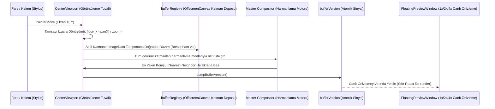
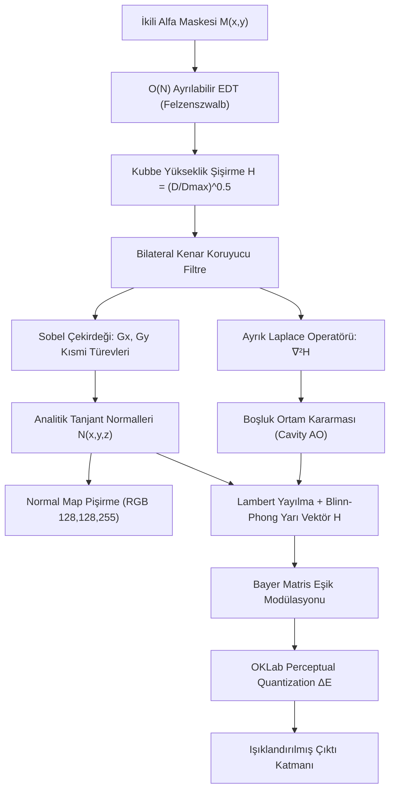
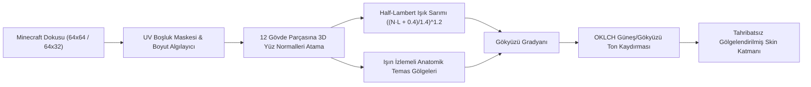
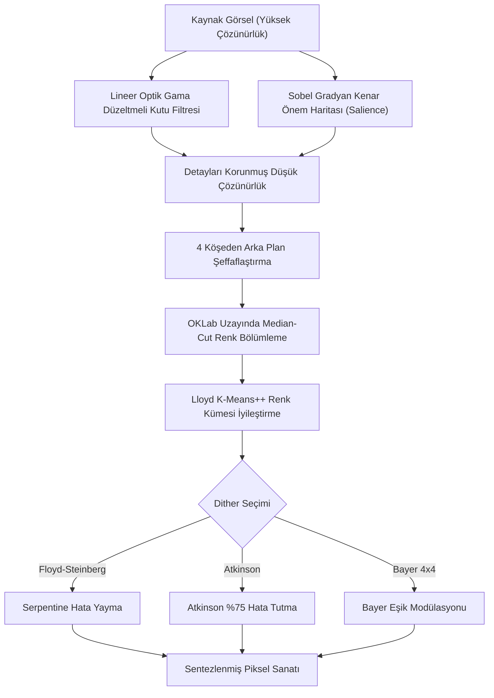
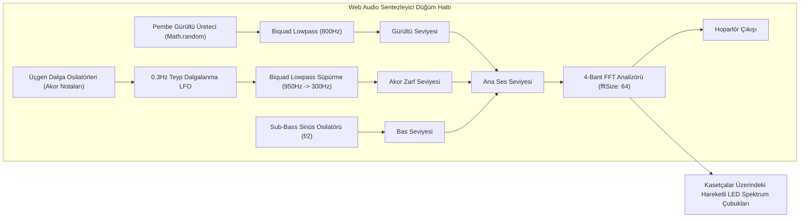

# 🐇 PixiBun: Kapsamlı Teknik, Matematiksel & Mimari Başvuru Kılavuzu

```text
  /\_/\   ✦  .  *  .  ✦  *  .  ✦  *  .  ✦  *
 ( o.o )   P I X I B U N   D E E P   D I V E
  > ^ <    Mühendislik, Bilgisayar Grafiği & Mimari Referansı
```

> **Bu doküman; PixiBun'ın çizim motoru, 2.5D fotometrik matematik laboratuvarı, optik renk kuantalama algoritmaları, Web Audio sentezleyicisi, bellek yönetimi ve taktil tasarım sisteminin en ince ayrıntılarına kadar teknik açıklamasıdır.**

---

# 1. Dosya ve Dizin Mimarisi

PixiBun; Next.js 16 (App Router), React 19, Tailwind CSS v4, Zustand + Immer ve Dexie.js (IndexedDB) temelleri üzerine inşa edilmiş, modüler ve yüksek performanslı bir masaüstü sınıfı raster grafik stüdyosudur:

```text
src/
├── app/
│   ├── api/diagnostics/relay/route.ts # SSRF korumalı sunucu tanı aktarım proxy'si (isteğe bağlı, sıfır telemetri)
│   ├── globals.css                  # Tailwind v4 @theme, OKLCH değişkenleri, taktil gölgeler, dither dokuları
│   ├── layout.tsx                   # Kök düzen (Silkscreen, Plus Jakarta Sans, JetBrains Mono fontları)
│   ├── page.tsx                     # Landing Page (Yaşayan ahşap masa sahnesi, diorama, hikaye)
│   └── studio/page.tsx              # Ana piksel çizim stüdyosu ve editör çalışma alanı
├── components/
│   ├── landing/                     # Landing bileşenleri (AtelierDeskScene, PixelVines, PixelCursor vb.)
│   ├── layout/                      # Stüdyo iskeleti (TopHeader, LeftToolbar, CenterViewport, RightInspector, BottomTimeline, ContextOptionsBar)
│   ├── modals/                      # Dialog pencereleri (ImportModal, ExportModal, CanvasResizeModal, ColorPickerModal, ShortcutsModal)
│   ├── studio/                      # Yüzen pencereler (FloatingPreviewWindow)
│   └── ui/                          # Atomik taktil bileşenler (TactileButton, PixelIcon, BunMascot, ThemeToggle, ModalWrapper)
├── lib/
│   ├── ai/
│   │   ├── pixelAiEngine.ts         # Optik akış ara kare (tween), jaggies temizleme, zemin gölgesi, dış kontur
│   │   ├── pixelizeEngine.ts        # Görselden piksele: Sobel salience, OKLab Median-Cut + K-Means++, Floyd-Steinberg/Atkinson
│   │   └── smartMathEngine.ts       # 2.5D Fotometrik ışık, O(N) EDT, Sobel normalleri, Minecraft 3D skin shader, RotSprite, Zhang-Suen
│   ├── art/                         # Başlangıç şablonları (Hearth Ghost, Desk Mushroom, Bun, Little Lantern)
│   ├── audio/
│   │   └── lofiRadio.ts             # Web Audio API prosedürel lo-fi sentezleyici (Pink noise, Rhodes chords, FFT analizör)
│   ├── canvas/                      # Temel raster: Bresenham, Wu 2:1 iso, Bézier, Flood Fill, Dither matrisleri
│   ├── engine/                      # Bellek yönetimi: bufferRegistry (OffscreenCanvas deposu), id üretici
│   ├── export/                      # Dışa aktarım: spriteSheetPacker (Godot/Unity/Phaser), gifEncoder (LZW GIF89a)
│   ├── project/                     # Proje serileştirme: schema.ts (biçim doğrulayıcı), serialize.ts (.pixibun IO)
│   ├── render/                      # Saf kompozitör (compositor.ts) ve şablon çizici (templateRenderer.ts)
│   └── storage/
│       └── db.ts                    # Dexie.js (IndexedDB) yerel veritabanı ve sürekli otomatik kayıt
├── stores/
│   ├── studioStore.ts               # Zustand + Immer stüdyo durum yöneticisi (Araçlar, Katmanlar, Kareler, Paletler)
│   └── themeStore.ts                # Çift tema yöneticisi ve Zero-Lag CSS geçiş bastırıcı
└── types/                           # TypeScript tip tanımları (canvas, tools, animation, project, theme)
```

---

# 2. Bellek Mimarisi ve Çift Katmanlı Çizim Hattı

React'in sanal DOM (Virtual DOM) mekanizması piksel seviyesindeki yüksek frekanslı işlemler (saniyede 120 fare hareketi) için uygun değildir. PixiBun, React durumunu sadece meta veriler için kullanır; piksel verilerini tamamen React dışı bellek tamponlarında yönetir.



### 1. `bufferRegistry.ts` (Katman Tampon Deposu)
* Katman pikselleri `Map<string, { canvas: HTMLCanvasElement | OffscreenCanvas, ctx: CanvasRenderingContext2D }>` yapısında tutulur.
* Her katman oluşturulduğunda (`getOrCreateBuffer`), tuval genişliği ve yüksekliğinde bağımsız bir `OffscreenCanvas` tahsis edilir.
* **Bellek Sızıntısı Koruması:** Bir katman silindiğinde `deleteBuffers(layerId)` çağrılarak referanslar derhal temizlenir.
* **9 Noktalı Çapa ile Boyutlandırma (`resizeAllBuffers`):** Tuval boyutu değiştiğinde 9 çapa noktasına (`top-left`, `center`, `bottom-right` vb.) göre `ctx.drawImage` ofsetleri hesaplanarak pikseller kayıpsız taşınır; `resample=true` ise en yakın komşu algoritmasıyla tüm tampon yeniden ölçeklenir.

### 2. `bufferVersion` Reaktif Sinyali
* Fırça vuruşu, silgi, kova dolgusu, seçim taşıma veya yapay zeka gölgelendirmesi bittiğinde `bumpBufferVersion()` çağrılır.
* `FloatingPreviewWindow` gibi bağımsız UI elemanları bu tamsayı sayacını dinler. Böylece ana React bileşeni render edilmeden canlı önizleme sub-16ms hızla güncellenir.

### 3. Geri Al / Yinele (Undo/Redo History Engine)
* `src/lib/engine/historyEngine.ts` DOM-bağımsız saf motoru içinde 50 derinliğe sahip bir `HistoryStep` FIFO halkası tutulur (`createHistoryEngine(50)`).
* Her fırça darbesi başlamadan önce `ctx.getImageData(0, 0, width, height)` ile katmanın anlık görüntüsü alınır. Geri alma işleminde $O(1)$ sürede `ctx.putImageData` ile piksel seviyesinde geri yüklenir ve `canUndo`/`canRedo` durumları reaktif senkronize edilir.

---

# 3. Çizim, Şekil & Raster Algoritmaları

`src/lib/canvas/` altındaki matematiksel çekirdek, klasik bilgisayar grafiği algoritmalarını piksel sanatının gereksinimlerine göre optimize eder:

### 1. Piksel Kusursuz Kalem (Pixel-Perfect Bresenham)
Standart Bresenham algoritması hızlı hareketlerde köşelerde "L" şeklinde çift pikseller üretir. `filterPixelPerfect(points)` durum makinesi, ardışık 3 noktayı inceler:

$$\text{Eğer } (x_i = x_{i-1} \lor y_i = y_{i-1}) \land (x_{i+1} \ne x_i \land y_{i+1} \ne y_i) \implies \text{Ortadaki pikseli buda}$$

Bu sayede çizilen çizgiler her zaman tam 1 piksel kalınlığında ve köşeleri temiz kalır.

### 2. Wu'nun Kuantalanmış 2:1 İzometrik Doğrusu (`getIsometric2p1Line`)
Klasik piksel oyunlarında (örneğin *Habbo Hotel*, *Final Fantasy Tactics*) kullanılan standart $26.565^\circ$ izometrik izdüşüm açısı için:

$$dx = x_1 - x_0, \quad dy = y_1 - y_0$$
$$y_{\text{iso}} = y_0 + \text{sign}(dy) \cdot \lfloor \frac{|x - x_0|}{2} \rfloor$$

Her 2 yatay piksel adımında tam 1 dikey piksel kaydırılarak basamaksız 2:1 izometrik çizgiler oluşturulur.

### 3. Rasyonel Bézier Eğrileri (`getQuadraticBezierPoints`)
3 kontrol noktası ($P_0, P_1, P_2$) üzerinden de Casteljau algoritmasıyla tamsayı piksel koordinatları hesaplanır:

$$B(t) = (1-t)^2 P_0 + 2(1-t)t P_1 + t^2 P_2, \quad t \in [0, 1]$$

Ardışık noktalar arasındaki boşluklar Bresenham doğrusuyla birleştirilerek kesintisiz akıcı eğriler elde edilir.

### 4. Optimize Edilmiş Kova Dolgusu (`performFloodFill`)
* `Uint32Array` tampon görünümü (buffer view) kullanılır. Renkler 32-bit tamsayı olarak karşılaştırılır (`(a << 24) | (b << 16) | (g << 8) | r`).
* Genişlik Öncelikli Arama (BFS) kuyruğu dizi yerine sabit boyutlu düz indis dizisi üzerinde çalıştırılarak çöp toplayıcı (Garbage Collector) baskısı sıfırlanır.
* `tolerance` parametresi ile renk mesafesi Manhattan metriğiyle hesaplanır:

$$\Delta C = |R_1 - R_2| + |G_1 - G_2| + |B_1 - B_2| + |A_1 - A_2|$$

---

# 4. PixiBud 2.5D Fotometrik Akıllı Matematik Laboratuvarı

`src/lib/ai/smartMathEngine.ts` dosyasında yer alan bu modül, 2D piksellerden analitik 3D ışıklandırma ve normal haritaları üretir.



### 1. $O(N)$ Doğrusal Zamanlı Euclidean Distance Transform (EDT)
Felzenszwalb-Huttenlocher algoritması ile 2D matris satır ve sütunlar boyunca iki bağımsız 1D parabolik alt zarf taramasına ayrıştırılır:

$$D(x, y) = \min_{x'} \left( (x - x')^2 + D_{\text{col}}(x', y) \right)$$

Bu işlem piksel sayısıyla doğrusal $O(N)$ zamanda çalışır ve çizimdeki her noktanın en yakın boşluk kenarına olan mesafesini milisaniyeler içinde bulur.

### 2. Kubbe Şişirme & Bilateral Filtreleme
* Elde edilen mesafe alanı $D(x, y)$, $\gamma = 0.5$ güç yasasıyla küresel bir yüksekliğe dönüştürülür:

$$H(x, y) = \left(\frac{D(x, y)}{\max D}\right)^{0.5}$$

* Yükseklik haritası, keskin sınırları korurken iç yüzeyi pürüzsüzleştirmek için Bilateral Filtre'den geçirilir:

$$H_{\text{filtered}}(p) = \frac{1}{W_p} \sum_{q \in \Omega} H(q) \cdot \exp\left(-\frac{\|p - q\|^2}{2\sigma_s^2}\right) \cdot \exp\left(-\frac{(H(p) - H(q))^2}{2\sigma_r^2}\right)$$

### 3. Sobel Gradyanları & Analitik Tanjant Normalleri
$3\times3$ ayrık Sobel filtreleri ile $x$ ve $y$ yönündeki eğimler ($G_x, G_y$) bulunur:

$$K_x = \begin{bmatrix} -1 & 0 & 1 \\ -2 & 0 & 2 \\ -1 & 0 & 1 \end{bmatrix}, \quad K_y = \begin{bmatrix} -1 & -2 & -1 \\ 0 & 0 & 0 \\ 1 & 2 & 1 \end{bmatrix}$$

Buradan elde edilen analitik birim yüzey normal vektörü $\mathbf{N}$:

$$\mathbf{N}(x, y) = \frac{1}{\sqrt{s_x^2 G_x^2 + s_y^2 G_y^2 + 1}} \begin{pmatrix} -s_x G_x \\ -s_y G_y \\ 1 \end{pmatrix}$$

### 4. Tek Tıkla Normal Haritası Pişirme (`Bake Normal Map`)
Hesaplanan $\mathbf{N} = (N_x, N_y, N_z)$ vektörleri oyun motorlarının (Godot, Unity, Unreal) okuyabileceği standart RGB renk uzayına $[0, 255]$ eşlenir:

$$R = \lfloor (N_x \cdot 0.5 + 0.5) \cdot 255 \rfloor, \quad G = \lfloor (N_y \cdot 0.5 + 0.5) \cdot 255 \rfloor, \quad B = \lfloor (N_z \cdot 0.5 + 0.5) \cdot 255 \rfloor$$

Düz yüzeyler tam olarak standart mavi renge $(128, 128, 255)$ denk gelir.

### 5. Tam Fotometrik Işıklandırma Modeli & Pusula Açı Konvansiyonu
Her piksel için nihai renk $\mathbf{C}_{\text{total}}$ şu formülle hesaplanır:

$$\mathbf{C}_{\text{total}} = \left( \mathbf{C}_{\text{ambient}} \cdot AO + k_d \max(0, \mathbf{N}\cdot\mathbf{L}) (\mathbf{C}_{\text{albedo}} \odot \mathbf{C}_{\text{light}}) \cdot AO + k_s (\max(0, \mathbf{N}\cdot\mathbf{H}))^\alpha \mathbf{C}_{\text{specular}} \right) \cdot \text{Atten}(d)$$

* **Pusula / Sanatçı Işık Vektörü $\mathbf{L}$:**
  Photoshop ve Substance 3D konvansiyonlarına tam uyumlu olarak $0^\circ = \text{Kuzey (Üst)}$ kabul edilir ve saat yönünde ilerler ($45^\circ=\text{Kuzeydoğu/Sağ-Üst}, 135^\circ=\text{Güneydoğu/Sağ-Alt}, 225^\circ=\text{Güneybatı/Sol-Alt}, 315^\circ=\text{Kuzeybatı/Sol-Üst}$):
  $$\mathbf{L}(\theta, \phi) = \begin{pmatrix} \sin\theta \cos\phi \\ -\cos\theta \cos\phi \\ \sin\phi \end{pmatrix}$$
* **Dönen Pusula İğnesi Göstergesi:** Inspector panelinde Azimuth slider'ının yanında dereceye bağlı olarak anlık dönen bir SVG pusula oku yer alır.
* **Blinn-Phong Yarı Vektörü:** $\mathbf{H} = \frac{\mathbf{L} + \mathbf{V}}{\|\mathbf{L} + \mathbf{V}\|}$
* **Ayrık Laplace Boşluk Koruması (Cavity AO):**
  $$\nabla^2 H \approx H * \begin{bmatrix} 0 & 1 & 0 \\ 1 & -4 & 1 \\ 0 & 1 & 0 \end{bmatrix}, \quad AO = \text{clamp}(1.0 - k_{\text{ao}} \max(0, -\nabla^2 H), 0, 1)$$

### 6. 5 Fiziksel Malzeme Modeli
| Malzeme | $k_d$ (Yayılma) | $k_s$ (Parıltı) | $\alpha$ (Parlaklık Gücü) | Görsel Karakter |
|---|---|---|---|---|
| **Mat Kil (Clay)** | $1.00$ | $0.08$ | $8$ | Yumuşak Lambertian gölgeler, yok denecek kadar az parlama |
| **Cilalı Metal** | $0.45$ | $1.35$ | $32$ | Albedo renkli keskin yansıma ve yüksek kontrast |
| **Cam / Mücevher** | $0.20$ | $1.80$ | $64$ | Saf beyaz dielektrik parıltı ve kenar yansımaları |
| **Kadife Kumaş** | $1.15$ | $0.05$ | $4$ | Geniş ışık sarımı ve yumuşak kenar aydınlığı |
| **Altın / Pirinç** | $0.55$ | $1.50$ | $28$ | Sıcak metalik yansımalar ve zengin derinlik |

---

# 5. 3D Minecraft Skin Tanıma ve Gölgelendirme Motoru

Piksel sanatı dünyasında Minecraft skinleri ($64\times64$ veya $64\times32$) standart 2.5D yükseklik haritalarıyla düzgün gölgelendirilemez çünkü bunlar düz bir çizim değil, 3 boyutlu küplerin açılmış UV dokularıdır.



1. **UV Şablon Algılama (`detectMinecraftSkin`):** Dokunun şeffaf boşluk bölgelerini ($0 \le x < 8, 0 \le y < 8$ vb.) ve kafa/gövde piksel yoğunluğunu inceleyerek dokunun Minecraft Java veya Bedrock formatında olduğunu %100 doğrulukla saptar.
2. **12 Parçalı Analitik 3D Normal Alanı:** Kafa, Şapka, Gövde, Ceket, Sağ/Sol Kol, Sağ/Sol Bacak gibi 12 parçanın her yüzüne (Üst, Alt, Ön, Arka, Sağ, Sol) gerçek 3D uzay normalleri atanır ve kenarlarına 1 piksellik yuvarlatma eğimi verilir.
3. **Half-Lambert Işık Sarımı:**
   $$\text{wrap}(\mathbf{N}\cdot\mathbf{L}) = \left(\frac{\mathbf{N}\cdot\mathbf{L} + 0.4}{1.4}\right)^{1.2}$$
4. **Anatomik Temas Gölgeleri:** Çene altı ($AO=0.80$), koltuk altı ($AO=0.82$), bacak arası ($AO=0.85$) ve 2. katman dış giysi derinlik gölgeleri ($AO=0.88$) otomatik uygulanır.
5. **OKLCH Algısal Ton Kaydırması (Hue-Shifting):**
   * Aydınlanan pikseller güneş sarısına kaydırılır: $H \to 65^\circ$
   * Gölgede kalan pikseller asla donuk griye düşürülmez; soğuk gökyüzü çivit mavisine kaydırılır: $H \to 260^\circ$

---

# 6. Optik Akış (Optical Flow) Ara Kare Animasyon Üretimi

`src/lib/ai/pixelAiEngine.ts` içindeki `morphInBetweenFrames`, geleneksel basit opaklık geçişleri yerine **2D Blok Eşlemeli Hareket Kestirimi** kullanır:

1. **Merkez Öncelikli Hareket Kestirimi (Zero-Motion Bias):** $A$ karesi ile $B$ karesi arasındaki $4\times4$ piksel blokları aranarak en küçük Mutlak Farklar Toplamını (SAD) ve merkez mesafesi cezasını veren hareket vektörü $\mathbf{v}(x, y)$ bulunur:
   $$\mathbf{v}(x, y) = \arg\min_{(u, v) \in \mathcal{W}} \left( \sum_{p \in \mathcal{B}} |I_A(p) - I_B(p + (u, v))| + 0.05 \cdot (u^2 + v^2) \right)$$
   *Eklenen $0.05 \cdot (u^2 + v^2)$ kuadratik yer değiştirme cezası, düz renkli veya şeffaf arka plan bloklarında gereksiz köşelere kilitlenmeyi önleyerek sıfır-hareketi tercih eder ve hayalet kaymaları (ghosting) tamamen ortadan kaldırır.*
2. **Yörünge Boyunca Sentez ($t=0.5$):** Pikseller hareket yörüngesinin tam ortasına taşınır ve renk karışımları insan gözünün parlaklık algısına sadık kalan **OKLab renk uzayında** yapılır. Böylece ara kareler yırtılma olmadan üretilir.

---

# 7. Görselden Piksel Sanatına Dönüştürme Motoru (`pixelizeEngine.ts`)

Fotoğrafları ve yüksek çözünürlüklü çizimleri piksel sanatına dönüştüren 700 satırlık özel grafik motoru:



1. **Lineer Optik Gama Düzeltmesi:** sRGB pikselleri lineer enerji uzayına çevrilerek toplanır, böylece renk küçültmelerinde kenarlarda oluşan siyah halka lekeleri engellenir:
   $$C_{\text{linear}} = \begin{cases} C_{\text{sRGB}} / 12.92 & C \le 0.04045 \\ \left(\frac{C + 0.055}{1.055}\right)^{2.4} & C > 0.04045 \end{cases}$$
2. **Sobel Salience Kenar Koruma:** Küçültme sırasında göz, burun, dudak veya kılıç gibi ince çizgiler Sobel gradyan büyüklüğüyle ağırlıklandırılarak ortalama içinde eriyip kaybolmaktan kurtarılır:
   $$W_{\text{salience}}(x, y) = W_{\text{box}} \cdot (1.0 + 0.05 \cdot \|\nabla I(x, y)\|)$$
3. **OKLab Median-Cut + K-Means++:** Renk paleti, algısal olarak en çok varyans gösteren eksen boyunca bölünür ve ardından Lloyd K-Means algoritması ile küme merkezleri optimize edilir:
   $$\Delta E_{\text{OKLab}} = \sqrt{(L_1 - L_2)^2 + (a_1 - a_2)^2 + (b_1 - b_2)^2}$$
4. **Serpentine Floyd-Steinberg Dithering:** Hata payı pikseller arasında zikzak (serpentine) çizilerek dağıtılır; böylece klasik tek yönlü taramada oluşan yönsel çizgilenme (worming) kusurları yok edilir.

---

# 8. Prosedürel Web Audio Lo-Fi Radyo Sentezleyicisi (`lofiRadio.ts`)

Masa dioraması üzerindeki kasetçalar harici hiçbir ses dosyası indirmeden tamamen kodla müzik üretir:



* **Yağmur ve Plak Çıtırtısı:** Rastgele üretilen pembe gürültü tamponu üzerine belirli aralıklarla ani iğne darbeleri (crackle pops) eklenir ve 800Hz Biquad alçak geçiren filtreden geçirilir.
* **Teyp Dalgalanması (Tape Flutter):** 0.3Hz frekanslı bir LFO, akor osilatörlerinin frekansına $\pm 1.5\text{ Hz}$ mikro dalgalanma uygulayarak eski kasetlerin sıcak mekanik hissini verir.
* **4-Bant Spektrum Analizörü:** `getEqualizerLevels()` metodu her animasyon karesinde FFT frekans kutularını ($0-60\text{Hz}, 60-250\text{Hz}, 250-2000\text{Hz}, 2000-8000\text{Hz}$) örnekleyerek teyp üzerindeki LED çubuklarını zıplatır.

---

# 9. Veritabanı, Dosya Formatı & Dışa Aktarım Mimarisi

### 1. IndexedDB Yerel Çoklu Proje Veritabanı (`db.ts`, Schema v3)
* `Dexie.js` ile tarayıcı içinde `PixiBunDB` isimli veritabanı kurulur (Schema v3).
* **Sınırsız Proje Kütüphanesi:** Sanatçılar cihazlarında sınırsız sayıda piksel sanatı ve animasyon projesini yerel olarak barındırabilir.
* **Otomatik Kayıt ve Küçük Resim (Thumbnail) Tamponu:** Her fırça darbesi sonrası 800ms debounce gecikmesiyle o anki projenin katmanları, paletleri ve kompozit küçük resmi (`thumbnailDataUrl`) sessizce kaydedilir.
* **P0 Geçmiş İptali (History Invalidation):** Proje değiştirildiğinde veya yeni proje açıldığında `pixibun:history-clear` olayı tetiklenerek önceki projenin geri alma (undo) verilerinin yeni projeyi bozması %100 engellenir.

### 2. Güvenli `.pixibun` Dosya Formatı (`schema.ts` & `serialize.ts`)
* `.pixibun` dosyaları projenin tüm katmanlarını, karelerini, harmanlama modlarını ve paletlerini taşır.
* **El Yapımı Katı Doğrulayıcı (`validateProjectFile`):** Dışarıdan yüklenen bozuk veya kötü niyetli JSON dosyalarının stüdyo durumunu çökertmesini önlemek için her katmanın opaklığı ($0-1$), blend modu, tamsayı boyutları ve hex renk kodları tek tek taranır.

### 3. Çoklu Oyun Motoru Dışa Aktarım Motoru (`spriteSheetPacker.ts`)
Sprite sayfaları yatay, dikey veya en az boşluk bırakan matris düzeninde paketlenir ve aynı anda 3 farklı oyun motoru için JSON meta verisi üretir:
* **Godot 4:** `resource_type: "SpriteFrames"` animasyon şablonu.
* **Unity:** `pixelsPerUnit`, çerçeve koordinatları ve pivot noktaları.
* **Phaser 3:** `textures` atlas koordinat çerçeveleri.
* **Tag Clip Kapsamı:** Kullanıcı timeline üzerinde tanımladığı isimlendirilmiş bir animasyon klibini (`Walk [1-4]`, `Attack [5-8]`) seçtiğinde, atlas çıktısı sadece o kare aralığını içerir ve atlas koordinatları `Hero_Walk_0`, `Hero_Walk_1` şeklinde $0$'dan başlayarak yeniden indekslenir.

### 4. Web Worker Hızlandırmalı Sıfır Bağımlılıklı LZW GIF89a Kodlayıcı (`gifEncoder.ts`, `gifEncoderCore.ts`, `gifEncoder.worker.ts`)
Harici ağır kütüphaneler yerine sıfırdan yazılmış, ana iş parçacığını (UI thread) bloklamayan çok iş parçacıklı Web Worker mimarisi:
* **Transferable ArrayBuffer İletişimi:** Her karenin ham `Uint8ClampedArray.buffer` tamponu, bellek kopyalama (copy overhead) maliyeti olmadan doğrudan Web Worker'a devredilir (`postMessage(payload, [buffer])`).
* **Median-Cut Renk İndirgeme:** Her karenin pikselleri 3 boyutlu renk uzayında varyansa göre kutulanarak 256 renge indirgenir.
* **Değişken Bit Uzunluklu LZW Sıkıştırması:** 2 ila 12 bit arasında dinamik büyüyen LZW sözlük tablosu üretilir.
* **Canlı İlerleme Çubuğu (Progress Reporting):** Worker her kareyi tamamladığında `{ type: 'progress', current, total }` mesajı gönderir ve `ExportModal` içinde gerçek zamanlı yüzde çubuğu güncellenir.
* **Şeffaf Ana İş Parçacığı Fallback'i:** Web Worker desteklenmeyen ortamlarda (veya CSP kısıtlamalarında) kod otomatik olarak ana iş parçacığı senkron moduna düşer.

---

# 10. Arayüz ve Zero-Lag Tema Sistemi

### 1. Zero-Lag Tema Geçiş Bastırma (`themeStore.ts`)
Modern web tarayıcılarında tema değiştirildiğinde binlerce DOM elemanının aynı anda renk geçişine (CSS transition) girmesi arayüzde ciddi takılmalara (repaint stutter) yol açar. PixiBun bu sorunu şu 3 adımlı mimariyle çözer:
1. Temayı değiştirmeden hemen önce DOM'a geçici bir stil etiketi (`#pixibun-theme-transition-killer`) eklenir: `* { transition: none !important; }`.
2. `html` etiketinin `data-theme` niteliği değiştirilir ve `getComputedStyle` ile anında tek bir senkron reflow tetiklenir.
3. Bir sonraki `requestAnimationFrame` karesinde bu stil etiketi kaldırılarak butonların taktil hover/leave yaylanma animasyonları pürüzsüzce geri getirilir.

### 2. Taktil Renk Paleti Tokenları (`globals.css`)
Tüm renkler insan gözünün algısına en uygun olan **OKLCH** uzayında tanımlanmıştır:

| Rol | Cozy Midnight (Koyu) | Morning Atelier (Açık) |
|---|---|---|
| **Oda / Zemin Tabanı** | `oklch(0.16 0.04 300)` (`#140C1E`) | `oklch(0.98 0.01 80)` (`#FBF8F3`) |
| **Masa Şasisi / Paneller** | `oklch(0.22 0.05 305)` (`#201431`) | `oklch(0.94 0.02 75)` (`#F3EBE0`) |
| **Taktil 2px Çerçeveler** | `oklch(0.32 0.07 310)` (`#3A2E4C`) | `oklch(0.30 0.09 315)` (`#3C2254`) |
| **Birincil Vurgu (Wisteria)** | `oklch(0.72 0.15 315)` (`#C792DF`) | `oklch(0.55 0.20 315)` (`#9940B5`) |
| **Akkor Lamba / Altın Vurgu**| `oklch(0.82 0.13 80)` (`#F0BE7C`) | `oklch(0.65 0.17 65)` (`#D97818`) |
| **Yazı / Başlık Rengi** | `oklch(0.93 0.02 300)` (`#EDE8F4`) | `oklch(0.20 0.06 315)` (`#221233`) |

---

# 11. Canlı Landing Dioraması ve Fizik Motorları

`src/components/landing/` klasöründeki ana sayfa, sıradan statik sayfaların aksine yaşayan bir piksel dünyası simüle eder:

1. **Etkileşimli iPad Pro Çizim Tableti (`AtelierDeskScene.tsx`):** Ziyaretçiler ana sayfada $26\times18$ piksel boyutundaki iPad Pro ekranına renk seçip çizim yapabilir; "Open in Studio" butonuna bastıklarında çizim doğrudan tam teşekküllü stüdyoya taşınır.
2. **Nefes Alan Kedi Loaf'u:** Pencere kenarında yatan krem/leylak renkli kedi; sinüs dalgalı göğüs nefesi, rastgele kulak seğirmeleri ve kuyruk sallama animasyonuna sahiptir. Tıklandığında yukarı doğru süzülen piksel kalpler (`CatHeartParticle`) ve mırıldanma sesleri çıkarır.
3. **Mafsallı Masa Lambası:** Tıklanabilir pirinç güç anahtarı, 45 derecelik açılı abajuru, abajur etrafındaki radyal ışık halesi ve masaya dökülen amber ışık demeti içinde dans eden sıcak toz zerreleri (`dust motes`) içerir.
4. **Sarmaşık Rüzgar & Fare İtme Fiziği (`PixelVines.tsx`):** Ekranın yanlarından sarkan 8'er sarmaşık dalı; hafif bir sinüs rüzgarıyla sallanır, fare imleci içlerinden geçtiğinde açısal yay momentumuyla yana savrulur, dökülen yaprak parçacıkları bırakır ve sayfa kaydırma hızına (scroll velocity) göre eğilir.
5. **16-Bit Bayer Dither Giriş Perdesi (`PixelDitherCurtain.tsx`):** Sayfa ilk açıldığında merkezden dışa doğru 8px Bayer dither matrisiyle radyal olarak eriyen ve arkasından kehribar fosfor parıltısı çıkaran bir geçiş perdesi sunar.

---

# 12. Tam Klavye Kısayolları Haritası

| Tuş | Kategori | Eylem / Alet |
|---|---|---|
| <kbd>B</kbd> | Çizim | **Pixel-Perfect Pen** (L-köşe budamalı fırça) |
| <kbd>C</kbd> | Çizim | **Rational Bézier Curve** (Kavisli çizgi aleti) |
| <kbd>E</kbd> | Çizim | **Eraser** (Silgi aleti) |
| <kbd>G</kbd> | Dolgu | **Flood Fill / Bucket** (Kova dolgusu) |
| <kbd>D</kbd> | Çizim | **Dither Brush** (Bayer / Atkinson dither fırçası) |
| <kbd>I</kbd> | Renk | **Eyedropper** (Renk damlalığı) |
| <kbd>M</kbd> | Seçim | **Marquee Box Select** (Dikdörtgen seçim) |
| <kbd>Q</kbd> | Seçim | **Lasso Select** (Serbest kement seçimi) |
| <kbd>W</kbd> | Seçim | **Magic Wand** (Sihirli değnek renk seçimi) |
| <kbd>L</kbd> | Şekil | **Bresenham Line** (Düz çizgi aleti) |
| <kbd>J</kbd> | Şekil | **Wu's 2:1 Isometric Line** (26.565° izometrik doğru) |
| <kbd>U</kbd> | Şekil | **Rectangle** (Dikdörtgen / Kare) |
| <kbd>O</kbd> | Şekil | **Ellipse** (Elips / Daire) |
| <kbd>R</kbd> | Düzenleme | **Color Replace** (Tüm tuvalde renk değiştirici) |
| <kbd>X</kbd> | Renk | **Swap Colors** (Birincil / İkincil rengi takas et) |
| <kbd>[</kbd> / <kbd>]</kbd> | Düzenleme | **Brush Size** (Fırça boyutunu küçült / büyüt) |
| <kbd>H</kbd> / <kbd>V</kbd> | Seçim | **Flip Selection** (Seçimi yatay / dikey aynala) |
| <kbd>Ctrl+C/X/V</kbd>| Seçim | **Copy / Cut / Paste** (Seçim tamponu panosu) |
| <kbd>Esc</kbd> | Seçim | **Deselect** (Seçimi kaldır / yüzen tamponu bas) |
| <kbd>Ctrl+Z</kbd> | Geçmiş | **Undo** (Geri al) |
| <kbd>Ctrl+Y</kbd> | Geçmiş | **Redo** (Yinele) |
| <kbd>Ctrl+'</kbd> | Görünüm | **Toggle Grid** (Piksel ızgara çizgilerini aç/kapat) |
| <kbd>Space</kbd> | Animasyon | **Play / Pause** (Animasyonu oynat / duraklat) |
| <kbd>,</kbd> / <kbd>.</kbd> | Animasyon | **Step Frame** (Önceki / Sonraki kareye adım at) |
| <kbd>Alt+Drag</kbd>| Görünüm | **Pan Viewport** (Tuvali kaydır) |
| <kbd>Tekerlek</kbd> | Görünüm | **Zoom** (%100 ile %6400 arası piksel yakınlaştırma) |

---

# 13. Teknoloji & Kütüphane Yığını Özeti

* **Derleme & Çerçeve:** Next.js 16.3.2 (App Router, Turbopack, React 19)
* **Tip Sistemi:** TypeScript 5.7 (Strict mode, sıfır `any` toleransı)
* **Durum & Bellek:** Zustand + Immer + Özel `bufferRegistry`
* **Stil Motoru:** Tailwind CSS v4 (`@theme`, OKLCH renk uzayı)
* **Animasyon & Fizik:** `motion` (`motion/react`)
* **Depolama:** `dexie` (IndexedDB)
* **Ses:** Yerel Web Audio API (Osilatörler, BiquadFilter, AnalyserNode)
* **Yapay Zeka:** Deterministik Cihaz-Üzeri Matematik Motoru (`smartMathEngine.ts`) — sıfır bulut bağımlılığı
* **Test & Kalite:** Vitest (15 test dosyası, 77 birim/bileşen testi — %100 Passed) + Playwright E2E (9/9) + Axe WCAG 2.2 + Lighthouse CI
* **Kod Kalitesi:** ESLint 10 Flat Config + jsx-a11y (Zero `any`, sıfır hata ve uyarı)
