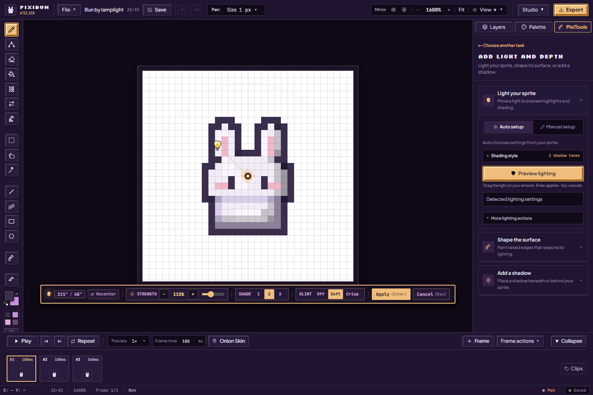

<p align="center">
  
</p>

# PixiBun Atelier

**A quiet little studio for pixel art and animation.**

Make a small character, a flickering flame, or the first tile of a world. PixiBun gives you a place to draw, try colors and bring those little things to life, right in your browser. No account needed.

Plum shadows, wisteria accents, amber buttons and a few live pixel glints make Cozy Classic feel like a desk with the lamp still on.


*A little company at the drawing desk. PixiBun's own starter characters, arranged in a three-frame project.*

[Illustrated artist handbook](docs/guides/README.md) · [Every feature](docs/features.md) · [Your first few pixels](#your-first-few-pixels) · [Keep your work safe](#keep-your-work-safe) · [Run locally](#run-locally) · [Explore the docs](docs/README.md)

## Small canvas, plenty of room to play

- **Draw something that feels like yours.** Start with a pixel pen, shapes and fills. Add layers, select a detail, move it around, or undo a stroke and try again. Import an image or sprite sheet when you already have a starting point.
- **Try a gentle first lesson.** Desktop Playground gives you a fresh practice sheet while your Studio drawing stays separate. **Return to drawing** brings it back; **Keep practice in Studio** saves a new project. The [12 illustrated lessons](docs/guides/learning-and-playground.md) help you find a starting point. Practice is temporary until you keep it.
- **Give it a little life.** Draw frames, use onion skin to see faded guides from the neighboring poses, choose how long each frame stays on screen and play a loop. Group frames into named clips to keep different movements together.
- **Move one selected part.** On an unlocked color layer, capture a selection as a rigid part, set Start and End poses with precise controls and session Undo/Redo, preview the arc and bake 2–30 editable cels. Save a named rig to reopen its settings while the source artwork still matches. [Rigid-part workflow](docs/guides/artist-workspace.md#rotate-a-detail-or-try-rigid-part-motion).
- **Find your colors.** Create a named palette, rearrange its colors, or scan the canvas for up to six main colors. Choose the First and Last colors you want to cycle; choosing just the fire colors can keep the wood and outlines still.
- **Try a different light.** PixiTools opens a lighting preview with a movable bulb. Adjust the light, see how your sprite responds, then Apply or Cancel. Cleanup tools also offer before/after previews so you can look before making a change.
- **Take your pixels somewhere.** Save a still image as PNG, a moving image as GIF or APNG, or a sprite sheet with your frames in one image. Video options depend on your browser. The [illustrated export guide](docs/guides/exporting.md) helps you choose a format, including options for games.

Palette cycling changes colors in the active frame. Draw changing poses in the timeline, or try rigid-part motion for a selected detail. Rigid motion does not infer anatomy or generate a complete character animation; inspect and refine each result.

## A little light for Bun



*An afternoon experiment: turn the light, watch the colors, keep the version you like. This screenshot shows the preview before applying it.*

## Pick the desk that feels right

Cozy Classic comes in dark and light: deep plum for a late evening, warm parchment for a brighter afternoon. Atelier offers another look, with a more restrained modern palette. Open **Studio** to choose your theme and light or dark scheme.


*The same little friends, with the curtains open.*

## Your first few pixels

1. Open the studio and choose **File → New drawing**. A canvas 32 pixels wide and 32 pixels tall is a comfortable place to begin.
2. Choose a color and draw with **Pen**. Press **B** for Pen or **E** for Eraser; **Ctrl/Cmd+Z** undoes a step.
3. Open **Palette** to make a small set of colors. A few shades are enough for a face, a flower or a tiny house.
4. Add a frame to try an animation. Turn on **Onion Skin** to see faded guides from the neighboring poses.
5. Use **Save**, then **Export** when you're ready to keep a project backup or share an image.

Use **Ctrl** on Windows or Linux, and **Cmd** on a Mac. Looking for a tool? **Ctrl/Cmd+K** opens a searchable list of tools and actions. The [shortcut reference](docs/contracts/shortcuts.md) is there when you want to settle into a rhythm.

PixiBun is happiest with small sprites and tiles, especially around 16–128 pixels. **File → Canvas size…** offers 4–512 pixels per side. Imported projects can admit up to 2,048 pixels per side within the [project](docs/contracts/storage.md) and [memory limits](docs/contracts/rendering.md). Import files are limited to 50 MiB (about 52 MB).

## Keep your work safe

Your projects are saved in this browser on this device. **Saved** means a local save has finished. For artwork you want to keep, use **Export → project backup** to download an editable `.pixibun` file too. Clearing browser data or losing the device can remove local projects. The [save and backup guide](docs/guides/artwork-safety.md) covers autosave, conflicts and recovery.

Load the studio online first so your browser can keep a copy for offline drawing and editing. No account or cloud sync is required. Basic troubleshooting information is kept in your browser by default; sending it through an optional reporting service needs your permission. See [privacy and security](SECURITY.md) for the details.

## Run locally

Want to run PixiBun on your own computer or help improve it? The setup is below; you can skip this part if you're here to draw.

<details>
<summary>Set up a local studio</summary>

You'll need **Git**, **Node.js 22** and **npm 10 or newer**, plus access to the GitHub repository. If GitHub asks you to sign in or request access, use an account with permission. In a terminal, run:

```sh
git clone https://github.com/lxcario/PixiBun.git
cd PixiBun
npm ci
npm run dev
```

Then open [localhost:3000/studio](http://localhost:3000/studio).

If you'd like to help tend the studio, start with [Contributing](CONTRIBUTING.md). Before sharing a change, run `npm run gate:full` to check the documentation and code and make sure the app builds. Tests that open the app in a browser run separately; the [testing guide](docs/guides/testing.md) walks through them.

</details>

## A few useful shelves

| When you want to… | Start here |
| --- | --- |
| Learn a tool or explore every feature with pictures | [Artist handbook](docs/guides/README.md) and [complete feature index](docs/features.md) |
| Keep an editable copy of your work | [Artwork safety and backup](docs/guides/artwork-safety.md) |
| Choose an export format | [Illustrated export guide](docs/guides/exporting.md) |
| Learn the keys | [Keyboard shortcuts](docs/contracts/shortcuts.md) |
| See what's available and what's been checked | [Current project status](docs/current-status.md) |
| Understand the engine | [Architecture](ARCHITECTURE.md) and [rendering](docs/contracts/rendering.md) |
| Explore ideas for the future | [v2 vision](V2_VISION.md), a proposal for future work |

These screenshots show the local studio on **2 October 2026**, using Cozy Classic and PixiBun's own artwork. [About this version](docs/current-status.md) explains which changes are included and how they were checked. [Screenshot details](docs/assets/screenshots/2026-10-02-feature-repairs-phase5/run.json) are available too.

PixiBun is licensed under the [MIT License](LICENSE).

*A few colors. A little patience. Something only you could make.*
