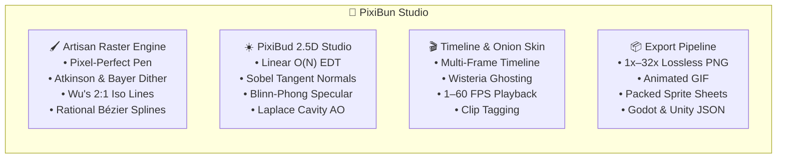

# 🐇 PixiBun Atelier

```text
  /\_/\   ✦  .  *  .  ✦  *  .  ✦  *  .  ✦  *
 ( o.o )   P I X I B U N   A T E L I E R
  > ^ <    A quiet, cozy desk for pixel art & animation
```

> **A tactile, offline-first pixel art studio and animation workbench built with care, tea, and mathematical precision.**  
> Pull up a wooden chair, turn on the amber desk lamp, and craft something that brings you joy.

---

## ☕ Why PixiBun?

Modern creative software has grown noisy — cluttered with account walls, mandatory cloud syncs, subscription banners, and confusing menus.

**PixiBun is designed to feel like a wooden drafting desk late at night.**

* **No Accounts or Logins** — Open the studio and begin placing pixels immediately.
* **100% On-Device & Private** — Zero tracking, zero telemetry, zero cloud data scraping. Your frames and palettes live exclusively in your local IndexedDB storage.
* **Tactile Mechanical Feedback** — Integer-aligned strokes, physical button depression physics, specular light-sweeps, and homestyle palettes.
* **Mathematical Graphics Engine** — Built-in 2.5D photometric lighting, analytical normal mapping, RotSprite 8x distortion-free rotation, and OKLab perceptual color science.

---

## ✨ Features & Capabilities



### 🖌️ Artisan Raster & Drawing Engine
* **Pixel-Perfect Pen:** Automatic double-pixel / L-corner elimination (Bresenham stroke smoothing).
* **Wu's Quantized 2:1 Isometric Lines & Guides:** Crisp, authentic 26.565° isometric grid snapping and 2:1 diamond viewport guide lines without jagged stepping.
* **3x3 Seamless Pattern Matrix Viewport:** Real-time 8-tile ghost matrix wrapping the canvas to test repeatable textures and terrain tiles on the fly.
* **Rational Bézier Curves:** Exact quadratic and cubic integer de Casteljau curves for fluid ribbon and contour plotting.
* **Flood Fill & Color Replacement:** Both contiguous region fill and global canvas-wide color swapping with adjustable tolerance.
* **Marquee Box, Lasso & Wand Selection:** Move, nudge, duplicate, flip horizontally/vertically, and paste selection buffers.
* **Dual Overlapping Tactile Color Wells:** Primary/Secondary color slots with quick swap (<kbd>X</kbd>), reset (<kbd>D</kbd>), and 8-color quick palette dock.

---

### ☀️ PixiBud 2.5D Photometric Studio & Smart Math Engine
* **3D Minecraft Skin Recognition & Dedicated Shading:** Automatically detects $64\times64$ and $64\times32$ Java/Bedrock UV layouts, computes analytical 3D unit normal vectors $\mathbf{N}$ for all 12 cuboid faces, and executes professional skin shading (Half-Lambert wrap, contact ambient occlusion under chin/armpits/limbs, sky hemisphere radiance, and warm sunlight/cool indigo hue-shifting).
* **Linear-Time $O(N)$ Euclidean Distance Transform (EDT):** Felzenszwalb-Huttenlocher separable squared parabolic lower envelopes compute distance fields in milliseconds.
* **Non-Linear Dome Profile Inflation & Bilateral Filtering:** Curves linear distance cones into spherical 2.5D volumetric domes ($\gamma = 0.5$) while preserving sharp segment outlines.
* **Analytical Tangent-Space Normal Generation:** Discrete Sobel kernels derive partial derivatives ($\frac{\partial H}{\partial x}, \frac{\partial H}{\partial y}$) and surface normal vectors $\mathbf{N} = \frac{(-s_x G_x, -s_y G_y, 1)}{\sqrt{s_x^2 G_x^2 + s_y^2 G_y^2 + 1}}$.
* **1-Click Normal Map Baking:** Exports standard blue tangent-space normal maps $(128, 128, 255)$ directly to a new layer for immediate use in **Godot**, **Unity**, and **Unreal Engine**.
* **Directional Selective Outlining (Sel-Out):** Evaluates surface normal azimuth alignment against the light source, applying illuminated rim tones to light-facing edges and deep saturated material tones to shadow edges.
* **Smart Sub-Pixel Anti-Aliasing (De-Jaggy):** Evaluates staircase L-crooks in 1px lines and inserts soft intermediate OKLab blend pixels for smooth hand-drawn contours without creating holes.
* **Full Photometric Lighting Equation:**
  $$\mathbf{C}_{\text{total}} = \left( \mathbf{C}_{\text{ambient}} \cdot AO(p) + I_d (\mathbf{C}_{\text{albedo}} \odot \mathbf{C}_{\text{light\_diffuse}}) \cdot AO(p) + I_s \mathbf{C}_{\text{light\_specular}} \right) \cdot \text{Atten}(d)$$
* **5 Physical Material Presets:**
  * **Matte Clay:** Soft Lambertian diffuse with subtle specular gloss ($k_d=1.0, k_s=0.08, \alpha=8$).
  * **Polished Metal:** Albedo-tinted specular reflection with high shininess ($k_d=0.45, k_s=1.35, \alpha=32$).
  * **Glossy Glass / Gem:** Pure white dielectric specular glint with rim reflection ($k_d=0.20, k_s=1.80, \alpha=64$).
  * **Velvet Fabric:** Broad diffuse wrap with soft rim illumination ($k_d=1.15, k_s=0.05, \alpha=4$).
  * **Gold / Brass:** Warm metallic specular with rich contrast ($k_d=0.55, k_s=1.50, \alpha=28$).
* **Discrete Laplace Cavity Map / Ambient Occlusion (AO):** Evaluates $\nabla^2 H \approx H * K_{\text{Laplace}}$ to darken crevices, seams, and joint cracks.
* **RotSprite 8x Engine:** 3-pass Scale2X (EPX) upscaling + nearest-neighbor rotation + snap sampling for crisp, artifact-free pixel art rotation.
* **Zhang-Suen Line Thinning:** Morphological skeleton algorithm for normalizing thick strokes down to clean 1px lines.

---

### 🎨 Color Science & Advanced Dithering Suite
* **OKLab Perceptual Matching:** Color differences computed via $\Delta E_{\text{OKLab}} = \sqrt{\Delta L^2 + \Delta a^2 + \Delta b^2}$ to respect human ocular sensitivity.
* **Bayer Matrix Ordered Dithering:** Recursive $2\times2$, $4\times4$, and $8\times8$ threshold offset modulation before quantization to prevent dirty color pollution.
* **Atkinson 75% Error Retention Dither:** Classic vintage Macintosh error-diffusion for high-contrast, atmospheric shading.
* **Riemersma Space-Filling Hilbert Dither:** Space-filling curve error propagation that eliminates directional worming artifacts.
* **Harmonic Ramp Generator:** Generates 5-step highlight and shadow ramps in OKLCH space with natural warm sun / cool shadow hue-shifting.
* **Atmospheric Photographic Color Grading:** Physical Kelvin temperature shifts (+2800K Golden Sunset, -3500K Cool Moonlight, Neon Dusk, DMG Game Boy).

---

### 🎬 Animation Suite & Layer Stack
* **2D Optical Flow In-Between Morphing:** Block-matching motion displacement fields and Signed Distance Field (SDF) interpolation generating smooth intermediate tween frames in OKLab space.
* **Multi-Layer Compositor:** Individual layer opacity, lock, visibility, and 8 blend modes (*Normal, Multiply, Screen, Overlay, Color Dodge, Darken, Lighten, Difference*).
* **Frame-by-Frame Timeline:** Duplicate, reorder, delete, and tag animation clips (e.g. *Idle, Walk, Attack, Cast*).
* **Warm Onion Skinning:** Configurable past frame (Wisteria Lavender) and future frame (Plum Lilac) ghosting.
* **Floating Live Preview Popout:** Draggable, resizable $1\times/2\times/4\times$ live preview window with custom backdrops (*Checkerboard, Dark Obsidian, Alabaster Paper, Amber Lamp*).

---

### 📦 Game-Ready Export Pipeline
* **Lossless PNG:** Integer scaling from $1\times$ to $32\times$ with crisp nearest-neighbor sampling.
* **Animated GIF:** Lightweight looped GIFs with per-frame millisecond durations.
* **Packed Sprite Sheets:** Horizontal, vertical, or matrix packed layouts with ready-to-use JSON metadata for **Godot 4**, **Unity**, and **Phaser 3**.
* **Native `.pixibun` Files:** Single-click project file export and restore containing all frames, layers, palettes, and metadata.

---

## 🎨 Signature Atelier Palette Tokens

| Token | Hex Code | Role & Atmosphere |
|---|---|---|
| **Midnight Desk** | `#1e1730` | Deepest room backdrop & ink shadows |
| **Plum Shadow** | `#3a2e4c` | Structural outlines & tactile bezel frames |
| **Wisteria Lavender** | `#c792df` | Primary brand accent & onion-skin past frames |
| **Lilac Blush** | `#dcabdf` | Highlight bloom & secondary tool accents |
| **Lamp Amber** | `#f0be7c` | Warm incandescent focus rings & key light |
| **Warm Paper White** | `#ede8f4` | Canvas base & specular highlights |

---

## ⌨️ Keyboard Shortcuts Reference

| Key | Tool / Action |
|---|---|
| <kbd>B</kbd> | **Pen** Tool (Pixel-Perfect) |
| <kbd>V</kbd> | **Rational Bézier Curve** Tool |
| <kbd>E</kbd> | **Eraser** Tool |
| <kbd>G</kbd> | **Flood Fill / Bucket** |
| <kbd>D</kbd> | **Dither Brush** |
| <kbd>I</kbd> | **Eyedropper / Color Picker** |
| <kbd>M</kbd> | **Marquee Box Select** |
| <kbd>L</kbd> | **Bresenham Line** Tool |
| <kbd>J</kbd> | **Wu's 2:1 Isometric Line** Tool |
| <kbd>U</kbd> | **Rectangle** Tool |
| <kbd>O</kbd> | **Ellipse** Tool |
| <kbd>R</kbd> | **Color Replace** Tool |
| <kbd>X</kbd> | **Swap Primary / Secondary Colors** |
| <kbd>[</kbd> / <kbd>]</kbd> | **Decrease / Increase Brush Size** |
| <kbd>Ctrl</kbd> + <kbd>Z</kbd> | **Undo** last stroke |
| <kbd>Ctrl</kbd> + <kbd>Y</kbd> / <kbd>Ctrl</kbd> + <kbd>Shift</kbd> + <kbd>Z</kbd> | **Redo** stroke |
| <kbd>Space</kbd> | **Play / Pause** animation playback |
| <kbd>,</kbd> / <kbd>.</kbd> | **Previous / Next** animation frame |
| <kbd>Alt</kbd> + <kbd>Drag</kbd> | **Pan** viewport canvas |
| <kbd>Mouse Wheel</kbd> | **Zoom** in / out (up to 3200%) |

---

## 🚀 Getting Started

### Prerequisites
* **Node.js:** v20.x or later
* **Package Manager:** `npm`, `pnpm`, or `yarn`

### Setup & Run Locally
```bash
# 1. Clone the repository
git clone https://github.com/lxcarios/pixibun.git
cd pixibun

# 2. Install dependencies
npm install

# 3. Start the Turbopack dev server
npm run dev
```

Open [http://localhost:3000](http://localhost:3000) in your browser.

---

## 🛠️ Technical Architecture

| Subsystem | Technology | Architectural Rationale |
|---|---|---|
| **Framework** | Next.js 16 (App Router) + React 19 | Turbopack compilation, React Compiler memoization, zero client bundle bloat. |
| **Raster Engine** | OffscreenCanvas Compositor | Direct `ImageData` Uint8ClampedArray access with $O(1)$ integer blitting. |
| **State Management** | Zustand + Immer | Decoupled layer buffers, sub-16ms zero-re-render stroke pipelines. |
| **Color Science** | OKLCH & OKLab Color Models | Perceptually uniform lightness and hue-shifting ramps. |
| **Tactile UI** | Tailwind CSS v4 + Motion | Physical button depression physics, CSS `@theme` cascade tokens. |
| **Local Persistence** | Dexie.js (IndexedDB) | Fast, transactional on-device storage with zero network overhead. |
| **Quality & Tests** | Vitest + TypeScript 5.7 | Strict type safety and unit test coverage. |

---

## 📜 Craft Values & Open Source

* **100% Local-First:** No accounts, no telemetry, no tracking, no subscriptions.
* **Offline-Capable:** Runs fully without an active internet connection.
* **License:** [MIT](./LICENSE) — open source and free forever.

*Handcrafted with pixels, coffee, and care.* ✦
