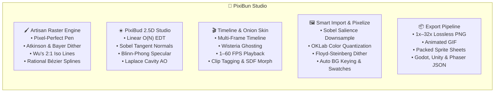

# 🐇 PixiBun Atelier

```text
  /\_/\   ✦  .  *  .  ✦  *  .  ✦  *  .  ✦  *
 ( o.o )   P I X I B U N   A T E L I E R
  > ^ <    A quiet, cozy desk for pixel art & animation
```

> **A tactile, offline-first pixel art studio and animation workbench built with care, tea, and mathematical precision.**  
> Pull up a wooden chair, turn on the amber desk lamp, put on the lo-fi radio, and craft something that brings you joy.

---

## ☕ Why PixiBun?

Modern creative software has grown noisy — cluttered with account walls, mandatory cloud syncs, subscription banners, and confusing menus.

**PixiBun is designed to feel like a wooden drafting desk late at night.**

* **No Accounts or Logins** — Open the studio and begin placing pixels immediately.
* **100% On-Device & Private** — Zero tracking, zero telemetry, zero cloud data scraping. Your frames and palettes live exclusively in your local IndexedDB storage.
* **Tactile Mechanical Feedback** — Integer-aligned strokes, physical button depression physics, specular light-sweeps, and homestyle palettes.
* **Mathematical Graphics Engine** — Built-in 2.5D photometric lighting, analytical normal mapping, RotSprite 8x distortion-free rotation, OKLab perceptual color science, and intelligent image pixelization.
* **Procedural Lo-Fi Radio** — Real-time Web Audio synthesizer with vinyl noise, gentle rain, and warm Rhodes chord progressions playing from a vintage desktop boombox.

---

## ✨ Features & Capabilities



### 🖌️ Artisan Raster & Drawing Engine
* **Pixel-Perfect Pen:** Automatic double-pixel / L-corner elimination (Bresenham stroke smoothing).
* **Wu's Quantized 2:1 Isometric Lines & Guides:** Authentic 26.565° isometric grid snapping and 2:1 diamond viewport guide lines without jagged stepping.
* **3x3 Seamless Pattern Matrix Viewport:** Real-time 8-tile ghost matrix wrapping the canvas to test repeatable textures and terrain tiles on the fly.
* **Rational Bézier Curves:** Exact quadratic and cubic integer de Casteljau curves (<kbd>C</kbd>) for fluid ribbon and contour plotting.
* **Flood Fill & Global Color Replacement:** Contiguous island fill and canvas-wide color swapping with adjustable tolerance.
* **Full Selection Suite:** Marquee Box (<kbd>M</kbd>), Freehand Lasso (<kbd>Q</kbd>), and Magic Wand (<kbd>W</kbd>) with Shift (Union) and Alt (Subtract) modifier modes, floating buffer nudging, copy/cut/paste (<kbd>Ctrl+C/X/V</kbd>), and horizontal/vertical flipping (<kbd>H</kbd> / <kbd>V</kbd>).
* **Canvas Brush Ghost Cursor & Zoom Ergonomics:** Non-destructive 1px footprint bounding box matching brush size at $\ge 400\%$ zoom, with `Ctrl + + / - / 0 / 1` integer keyboard navigation.
* **Dual Overlapping Tactile Color Wells:** Primary/Secondary color slots with quick swap (<kbd>X</kbd>), custom HSV/HEX modal picker, and 8-color quick palette dock.
* **9-Point Anchor Canvas Resizing:** Expand or crop from any anchor corner or center, with optional aspect-ratio locking and nearest-neighbor content resampling.

---

### ☀️ PixiBud 2.5D Photometric Studio & Smart Math Engine
* **Deep Canvas Art Understanding & Anatomical Classification:** Analyzes artwork morphology to classify forms into `character` (creatures with ears/horns, facial features, limbs) vs. `orb` (geometric spheres) vs. `prop`. Connected-component clustering isolates eyes, pupils, mouth, snout, and lateral whiskers (`isFeature`, `isInkLine`), completely protecting them from diffuse darkening or ambient crush.
* **Frontal Face Cushion Plateau & Independent Ear Geometry:** For character forms, the interior face height forms a flat camera-facing plateau ($N_z \ge 0.85$), ensuring light illuminates faces without splitting them in half with shadow, while form shadows hug only the 1–2px unlit silhouette bevel. Distinct convex lobes preserve independent 3D cone geometry for ears and horns.
* **Perceptual OKLCH Stepped Cel-Shading:** Unshaded flat character sprites receive crisp discrete tone steps (Base, Shadow, Highlight) with natural atmospheric hue shifts (cooler shadows toward 260° skylight, warmer highlights toward 65° sunlight), avoiding muddy continuous float gradients.
* **Bounded 2.5D Sprite Cast Shadows & Ground Drop Shadows:** Replaced infinite planar raymarch wedges with professional 2.5D bounded sprite cast shadows. Evaluates exact 1-to-1 sheared silhouette projection ($h = y_{\text{base}} - y_s \ge 0$) anchored at the sprite contact baseline, strictly preserving leg arches and waist indentations without bounding-box bloat or muddy center blobs. Includes classic RPG ground contact drop shadows (`shadowStyle: 'drop'`) with crisp Bresenham ellipses under feet, defaulting to uniform flat opacity (`ditherMode: 'none'`).
* **Smart Canvas Art Auto-Analysis:** Dedicated "Analyze & Render" engines for photometric lighting and cast shadows automatically infer optimal light azimuth, elevation, intensity, contact base, bounds, and material presets from canvas pixel data.
* **Interactive On-Canvas Pixel Light Bulb Gizmo:** Live on-canvas interactive draggable bulb handle with real-time 60fps lighting updates during dragging. Decoupled bulb orbit from middle light point focus reticle so artists can anchor and drag the light source or focal point independently. Dynamically aligns directional light vectors with on-canvas pointer coordinates. Includes hotkey brightness adjustment (`+` / `-` / mouse wheel scroll), quick commit (<kbd>Enter</kbd>), cancel (<kbd>Esc</kbd>), and focus reset (<kbd>R</kbd>).
* **3D Minecraft Skin Recognition & Dedicated Shading:** Automatically detects $64\times64$ and $64\times32$ Java/Bedrock UV layouts, computes analytical 3D unit normal vectors $\mathbf{N}$ for all 12 cuboid regions, and executes domain skin shading (Half-Lambert wrap, contact ambient occlusion under chin/armpits/limbs, sky hemisphere radiance, and warm sunlight/cool indigo hue-shifting).
* **Linear-Time $O(N)$ Euclidean Distance Transform (EDT):** Felzenszwalb-Huttenlocher separable squared parabolic lower envelopes compute distance fields in milliseconds.
* **Non-Linear Dome Profile Inflation & Bilateral Filtering:** Curves linear distance cones into spherical 2.5D volumetric domes ($\gamma = 0.5$) while preserving sharp segment outlines.
* **Analytical Tangent-Space Normal Generation & Compass Alignment:** Discrete Sobel kernels derive surface normal vectors with standard artist compass heading navigation ($0^\circ = \text{North/Top}, 315^\circ = \text{North-West/Top-Left}$) and a dynamic rotating SVG compass needle in the studio inspector.
* **1-Click Normal Map Baking:** Exports standard blue tangent-space normal maps $(128, 128, 255)$ directly to a new layer for immediate use in **Godot**, **Unity**, and **Unreal Engine**.
* **Directional Selective Outlining (Sel-Out):** Evaluates surface normal azimuth alignment against the light source, applying illuminated rim tones to light-facing edges and deep saturated material tones to shadow edges.
* **Smart Sub-Pixel Anti-Aliasing (De-Jaggy):** Evaluates staircase L-crooks in 1px lines and inserts soft intermediate OKLab blend pixels for smooth hand-drawn contours without creating holes.
* **2D Volumetric Optics & Subsurface Scattering (SSS):** Beer-Lambert exponential spectral decay through distance-field chord lengths $T(\mathbf{x}) = 2\sqrt{\max(0, R^2 - D(\mathbf{x})^2)}$ combined with 2D Henyey-Greenstein forward phase scattering for luminous gemstones, potion vials, and translucent slimes.
* **Dielectric Fresnel Rim Reflection with Cauchy Dispersion:** Schlick grazing angle reflectance modulated by per-channel IOR splitting ($F_{0, R} < F_{0, G} < F_{0, B}$) for crystalline edges and rim-lit character contours.
* **Kajiya-Kay Anisotropic Highlight:** Curvature and directional tangent vector fields $\mathbf{T}(\mathbf{x})$ with dual-cuticle shifts for continuous specular highlight bands across hair strands, fur, and brushed metal blades.
* **Contact Ground Drop Shadows & Auto Outline:** 1-click generation of soft elliptical contact shadows under feet and clean 1px outer stroke silhouette layers.
* **Canonical Xenowhirl RotSprite Engine:** 3-pass Scale2X (EPX) cascade ($1\times \to 2\times \to 4\times \to 8\times$) + strict subpixel center continuous inverse sampling with single-pixel presence conservation, completely eliminating 45° distortion, blooming, and outline erosion while preserving 100% bilateral symmetry and palette purity.
* **Zhang-Suen Line Thinning:** Morphological skeleton algorithm for normalizing thick strokes down to clean 1px lines.
* **5 Physical Material Presets:** Matte Clay, Polished Metal, Glossy Glass/Gem, Velvet Fabric, and Gold/Brass.

---

### 🖼️ Intelligent Image-to-Pixel-Art Synthesis & Import Suite
* **Linear Optical Gamma-Corrected Area Box Downsampling:** Accurately integrates light flux during downscaling without dark-halo fringe artifacts.
* **Sobel Gradient Salience Edge-Preservation:** Boosts high-contrast edge weights to preserve delicate line-art, facial features, and character silhouettes when converting photos or high-res art.
* **OKLab Perceptual Color Quantization:** Median-Cut partitioning with K-Means++ Lloyd cluster refinement in OKLab perceptual color space.
* **Advanced Error Diffusion & Ordered Dithering:** Choice of Serpentine Floyd-Steinberg, Atkinson 75% error retention, or Bayer 4x4 matrix dither during image conversion.
* **Auto-Background Transparency Keying:** Automatically identifies and removes solid background colors by sampling canvas corners with adjustable tolerance.
* **Exact 1:1 Pixel Import:** Option to preserve imported sprites byte-for-byte with automatic canvas dimension matching.
* **Automatic Swatch Extraction:** Derives up to 32 dominant colors from imported artwork and adds them straight into your active palette swatches.

---

### 🎨 Color Science & Advanced Dithering Suite
* **OKLab Perceptual Matching:** Color differences computed via $\Delta E_{\text{OKLab}} = \sqrt{\Delta L^2 + \Delta a^2 + \Delta b^2}$ to respect human ocular sensitivity.
* **Bayer Matrix Ordered Dithering:** Recursive $2\times2$, $4\times4$, and $8\times8$ threshold offset modulation before quantization to prevent dirty color pollution.
* **Atkinson 75% Error Retention Dither:** Classic vintage Macintosh error-diffusion for high-contrast, atmospheric shading.
* **Riemersma Space-Filling Hilbert Dither:** Space-filling curve error propagation that eliminates directional worming artifacts.
* **Harmonic Ramp Generator:** Generates 5-step highlight and shadow ramps in OKLCH space with natural warm sun / cool shadow hue-shifting.
* **Atmospheric Photographic Color Grading:** Physical Kelvin temperature shifts (+2800K Golden Sunset, -3500K Cool Moonlight, Neon Dusk, DMG Game Boy).
* **Scan & Snap Palette Tools:** Scan entire canvas to create instant palettes or snap layer pixels to the active palette colors.

---

### 🎬 Animation Suite & Layer Stack
* **2D Optical Flow In-Between Morphing:** Block-matching motion displacement fields with zero-motion center bias and Signed Distance Field (SDF) interpolation generating smooth intermediate tween frames in OKLab space without background ghosting.
* **Multi-Layer Compositor & Layer Security:** Individual layer opacity, lock toggle with live HUD feedback (`🔒 Active layer is locked`), visibility, and 5 blend modes (*Normal, Multiply, Screen, Overlay, Color Dodge*).
* **Frame-by-Frame Timeline & Tag Clips:** Duplicate, reorder, delete, and tag animation clips (e.g. *Idle, Walk, Attack, Cast*).
* **Warm Onion Skinning:** Configurable past frame (Wisteria Lavender) and future frame (Plum Lilac) ghosting.
* **Floating Live Preview Popout:** Draggable, resizable $1\times/2\times/4\times$ live preview window with custom backdrops (*Checkerboard, Dark Obsidian, Alabaster Paper, Amber Lamp*).

---

### 📦 Game-Ready Export Pipeline
* **Tag Clip Export Scope:** Choose to export the full project or isolate a specific named clip (`Walk [1-4]`) into an individual GIF or SpriteSheet with automatic $0$-indexed game engine metadata.
* **Multi-Threaded Web Worker GIF Encoder:** Background LZW bit-packing with transferable `ArrayBuffer` objects, eliminating main-thread UI lag, featuring cancellation via `AbortController` and a live progress bar.
* **Lossless PNG:** Integer scaling from $1\times$ to $32\times$ with crisp nearest-neighbor sampling.
* **Packed Sprite Sheets:** Horizontal, vertical, or matrix packed layouts with ready-to-use JSON metadata for **Godot 4**, **Unity**, and **Phaser 3**.
* **Native `.pixibun` Files:** Single-click project file export and restore with schema v2 migration and forward-compatibility guards.

---

---

## 🎨 Signature Atelier Palette Tokens

### Cozy Midnight (Dark Theme)
| Token | Hex Code | Role & Atmosphere |
|---|---|---|
| **Midnight Desk** | `#140c1e` | Deepest room backdrop & outer wood grain |
| **Desk Surface** | `#201431` | Workspace chassis & raised panel base |
| **Plum Border** | `#3a2e4c` | Structural tactile bezel dividers |
| **Wisteria Lavender** | `#c792df` | Primary brand accent & active tool state |
| **Lilac Blush** | `#dcabdf` | Highlight bloom & secondary tool accents |
| **Lamp Amber** | `#f0be7c` | Warm incandescent focus rings & key light |
| **Warm Paper White** | `#ede8f4` | Headings, canvas base & specular glints |

### Morning Atelier (Light Theme)
| Token | Hex Code | Role & Atmosphere |
|---|---|---|
| **Alabaster Desk** | `#fbf8f3` | Bright morning room base & clean desk surface |
| **Parchment Surface** | `#f3ebe0` | Warm tactile paper chassis & tool panels |
| **Deep Velvet Border** | `#3c2254` | High-contrast structural framing |
| **Plum Accent** | `#7e2b96` | Primary tool highlights & active focus states |
| **Morning Gold** | `#d97818` | Warm sunny highlights & primary buttons |
| **Ink Heading** | `#221233` | Crisp, legible text and numeric values |

---

## ⌨️ Keyboard Shortcuts Reference

| Key | Tool / Action |
|---|---|
| <kbd>B</kbd> | **Pen** Tool (Pixel-Perfect) |
| <kbd>C</kbd> | **Rational Bézier Curve** Tool |
| <kbd>E</kbd> | **Eraser** Tool |
| <kbd>G</kbd> | **Flood Fill / Bucket** |
| <kbd>D</kbd> | **Dither Brush** |
| <kbd>I</kbd> | **Eyedropper / Color Picker** |
| <kbd>M</kbd> | **Marquee Box Select** |
| <kbd>Q</kbd> | **Lasso Select** |
| <kbd>W</kbd> | **Magic Wand Select** |
| <kbd>L</kbd> | **Bresenham Line** Tool |
| <kbd>J</kbd> | **Wu's 2:1 Isometric Line** Tool |
| <kbd>U</kbd> | **Rectangle** Tool |
| <kbd>O</kbd> | **Ellipse** Tool |
| <kbd>R</kbd> | **Color Replace** Tool |
| <kbd>X</kbd> | **Swap Primary / Secondary Colors** |
| <kbd>[</kbd> / <kbd>]</kbd> | **Decrease / Increase Brush Size** |
| <kbd>H</kbd> / <kbd>V</kbd> | **Flip Selection Horizontally / Vertically** |
| <kbd>Ctrl</kbd> + <kbd>C</kbd> / <kbd>X</kbd> / <kbd>V</kbd> | **Copy / Cut / Paste** Selection Buffer |
| <kbd>Esc</kbd> | **Deselect / Commit Floating Selection** |
| <kbd>Ctrl</kbd> + <kbd>Z</kbd> | **Undo** last stroke |
| <kbd>Ctrl</kbd> + <kbd>Y</kbd> / <kbd>Ctrl</kbd> + <kbd>Shift</kbd> + <kbd>Z</kbd> | **Redo** stroke |
| <kbd>Ctrl</kbd> + <kbd>'</kbd> | **Toggle Pixel Grid** |
| <kbd>?</kbd> | **Open Keyboard Shortcuts Modal** |
| <kbd>Space</kbd> | **Play / Pause** animation playback |
| <kbd>,</kbd> / <kbd>.</kbd> | **Previous / Next** animation frame |
| <kbd>Alt</kbd> + <kbd>Drag</kbd> / <kbd>Middle Drag</kbd> | **Pan** viewport canvas |
| <kbd>Mouse Wheel</kbd> | **Zoom** in / out (100% to 6400%) |

---

## 🚀 Getting Started

### Prerequisites
* **Node.js:** v20.x or later
* **Package Manager:** `npm`, `pnpm`, or `yarn`

### Setup & Run Locally
```bash
# 1. Clone the repository
git clone https://github.com/lxcario/PixiBun.git
cd PixiBun

# 2. Install dependencies
npm install

# 3. Start the Turbopack dev server
npm run dev
```

Open [http://localhost:3000](http://localhost:3000) in your browser.

---

---

## 📱 Offline PWA, Accessibility & Privacy Observability

PixiBun is engineered as a true production-grade, local-first web application:

* **Installable Offline PWA:** Hand-rolled zero-dependency Service Worker precaches the app shell, fonts, and assets with Stale-While-Revalidate caching, an offline fallback, and `navigator.storage.persist()` protecting user artwork from eviction.
* **WCAG 2.2 AA Conformance:** Full keyboard navigation alternatives for drag actions (arrow key canvas panning and selection nudging), focus traps with return-to-opener in modal dialogues, minimum target hit sizes ($\ge 24\text{px}$), consistent help surfaces, and zero axe-core violations.
* **Privacy-First Local Diagnostics:** Zero third-party trackers or external scripts. Diagnostics and Web Vitals are captured strictly into a local IndexedDB ring buffer (200 entries max) with an instant "Export Diagnostics" JSON tool and an explicit opt-in crash relay.
* **Continuous Quality & Performance Gates:** 406 unit and integration tests across 63 suites and 17 E2E specs with automated axe audits, and Lighthouse CI performance/accessibility score budgets.

---

## 🛠️ Technical Architecture

| Subsystem | Technology | Architectural Rationale |
|---|---|---|
| **Framework** | Next.js 16 (App Router) + React 19 | Turbopack compilation, React Compiler memoization, zero client bundle bloat. |
| **PWA & Offline** | Hand-rolled Service Worker + Manifest | Shell precaching, Stale-While-Revalidate static assets, zero-dependency reliability. |
| **Raster Engine** | OffscreenCanvas Compositor | Direct `ImageData` Uint8ClampedArray access with $O(1)$ integer blitting. |
| **Smart Math & AI** | Felzenszwalb EDT, Sobel, Blinn-Phong, Aaltonen Ray Marching | Deterministic on-device computer graphics math for 2.5D shading, raymarched soft shadows, and normal baking. |
| **Image Synthesis** | Sobel Salience + OKLab Median-Cut | Lossless & retro pixel art downsampling with Floyd-Steinberg and Atkinson dithering. |
| **Audio Engine** | Web Audio API Synthesizer | Procedural vinyl rain generator and tape-flutter chord progressions with zero network bandwidth. |
| **State Management** | Zustand + Immer | Decoupled layer buffers, sub-16ms zero-re-render stroke pipelines. |
| **Accessibility** | WCAG 2.2 AA + ESLint JSX-A11y + Axe | Keyboard drag alternatives, focus traps, accessible roles, high-visibility focus rings. |
| **Observability** | Local IndexedDB Buffer + Web Vitals | Zero telemetry promise kept; diagnostics stay on user device by default. |
| **Tactile UI** | Tailwind CSS v4 + Motion | Physical button depression physics, CSS `@theme` cascade tokens, and zero-lag theme transitions. |
| **Local Persistence** | Dexie.js (IndexedDB Schema v4) | Dedicated `layerBlobs` table storing raw PNG blobs without base64 JSON stringify overhead, multi-project workspace management. |
| **Quality & Tests** | Vitest + Playwright + Lighthouse CI | 406 unit and integration tests across 63 suites and 17 E2E specs + Axe WCAG scans + LHCI budgets. |

---

## 📜 Craft Values & Open Source

* **100% Local-First & Zero Telemetry:** No accounts, no telemetry, no tracking, no subscriptions.
* **100% Offline-Capable:** Runs fully without an active internet connection via installed PWA.
* **License:** [MIT](./LICENSE) — currently private, planned open source and free forever.

*Handcrafted with pixels, coffee, and care.* ✦
