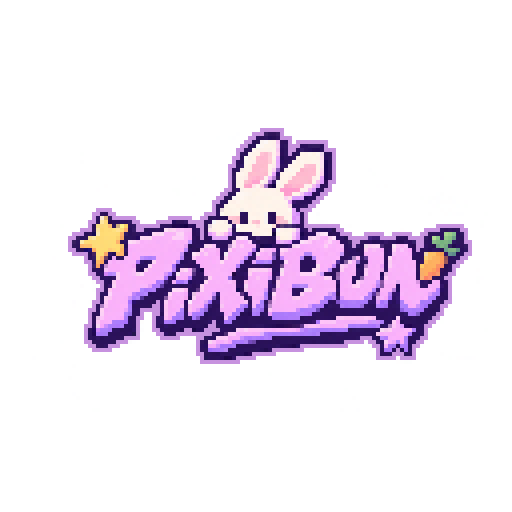
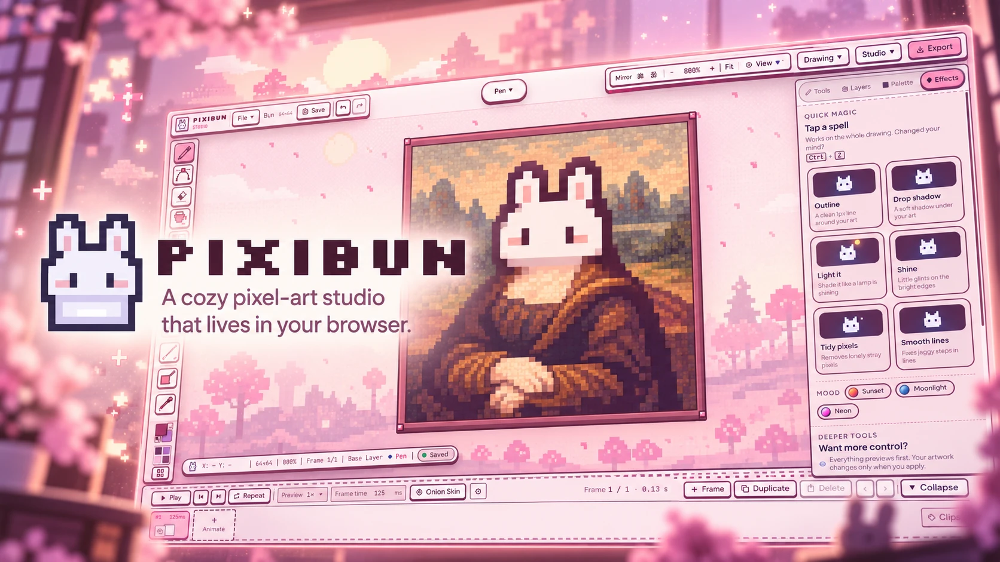
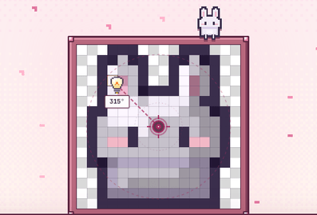
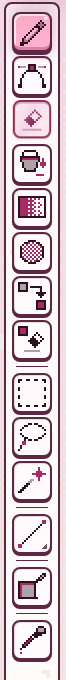
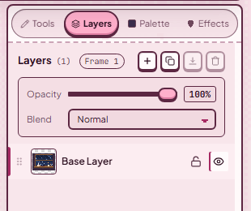
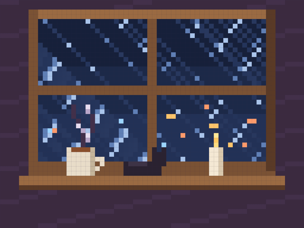
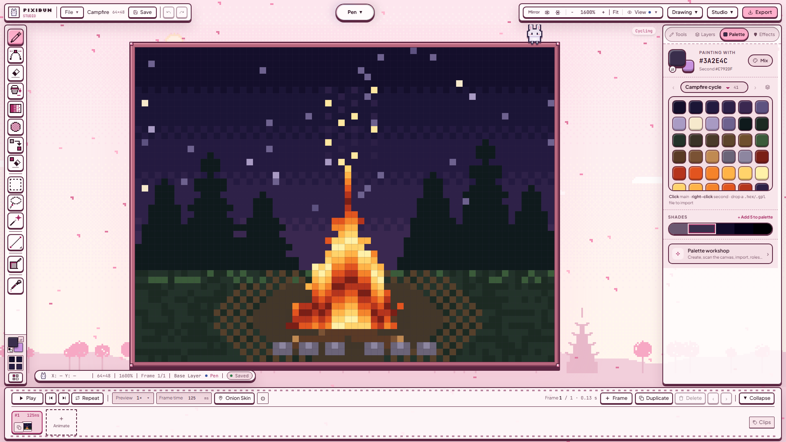
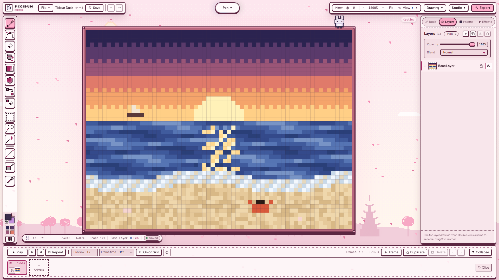
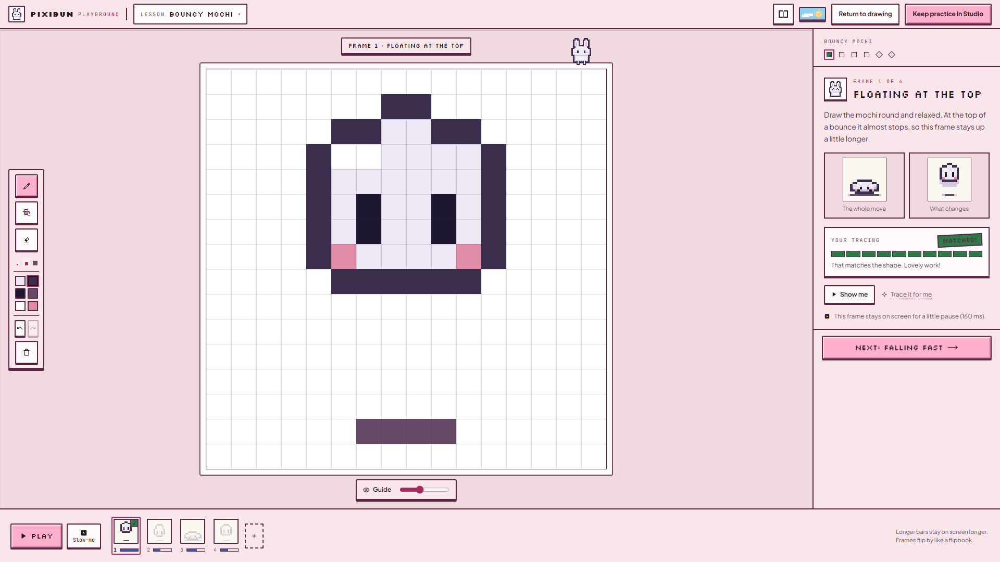
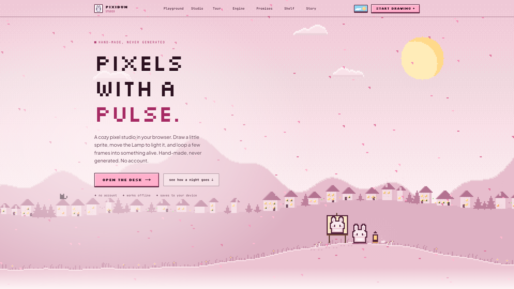

<p align="center">
  
</p>

<p align="center">
  <a href="https://youtu.be/ic4LoLqSFvA"></a>
</p>

<p align="center">
  <b>Pixels with a pulse.</b> A cozy pixel-art studio that lives in your browser.<br />
  <a href="https://pixibun.vercel.app/studio"><b>Open the desk</b></a> ·
  <a href="https://youtu.be/ic4LoLqSFvA">Watch the demo</a> ·
  <a href="docs/testsprite/README.md">See how we test it</a>
</p>

<p align="center"><sub>No account. Works offline. Saves to your device. Every tool is graphics algorithms and math, and nothing ever trains on your art (<a href="src/app/pledge/page.tsx">our pledge</a>). Made with love.</sub></p>

---

## Pull up a chair

Some evenings you want to make something small. A bunny sixteen pixels tall. A campfire that flickers. A window with rain on it and a cat asleep on the sill.

PixiBun is a desk for exactly that. It has a pixel pen and a timeline, a little Lamp you can drag around your sprite, palettes that breathe, and a mascot called **Bun** who will happily sit for a portrait (on the homepage, Bun is painting itself as the Mona Lisa). Here is how an evening at the desk tends to go.

### Things you won't find in other pixel editors

| | |
| --- | --- |
| 🕯️ **A Lamp for your sprite** | Drag a light bulb around your drawing and watch real shading and a cast shadow follow it, built from your own colors. Preview first, keep it only if you like it. |
| 🌧️ **Animation without frames** | Six living postcards (rain on a window, a campfire, a waterfall…) move through *palette cycling*: a few colors taking turns. Change one color and your change moves too. |
| 🃏 **A drawing you can hand to a friend** | **Export → Cart** makes a trading-card PNG with the whole editable drawing inside it. Anyone can open the card, watch your making-of replay and light it with a lamp on their phone. Nothing is uploaded. |
| 🧾 **A receipt for your patience** | PixiBun quietly counts your strokes and drawing time, and can add a making-of replay to your cart, if you choose. |
| 🎬 **Light Sweep** | A five-second phone video of a lamp drifting over your drawing at night, ready to share. |
| 📖 **Lessons with a ghost pen** | Twelve coached lessons show one pose at a time and point at the pixels you missed. Practice never touches your real drawing. |
| 🤝 **Draw together** | Co-Draw connects two browsers directly so a friend can draw on your canvas with you. |
| 🎮 **Straight into your game** | Sprite sheets, GIF and APNG, and a Godot kit with its frames and clips ready to drop into a project. |
| 🌗 **A desk with a sky** | Twelve themes, each with a Night and a Day. Switch on the homepage and the moon sets behind the hills while the sun rises. |
| 🤍 **Your art, on your terms** | No account, no tracking, works offline and saves to your device. The Lamp, cleanup, rotation and dithering are graphics algorithms and math you can tune, and nothing trains on your drawings. |

## 🕯️ 7 pm · Light the lamp

<p align="center"></p>

Draw Bun (or open the starter), then open **Effects → Add light and depth** and grab the bulb. The shading follows your hand: the Studio builds new tones from your own artwork and the light, and casts a real shadow. Nothing changes until you press **Apply**, so wander as long as you like.

## 🫧 8 pm · Pick up a tool and feel the glass

<table>
  <tr>
    <td align="center" width="38%"></td>
    <td align="center"></td>
  </tr>
  <tr>
    <td align="center"><sub>The tool rail: a glass lens follows you from Pen to Eraser to Fill.</sub></td>
    <td align="center"><sub>The inspector: slide across its tabs, and slider handles turn to glass as you drag.</sub></td>
  </tr>
</table>

These are **Studio Labs**, small experiments that are on by default. Open **Studio → Labs** to turn any of them off, or choose **Classic studio** for the calm original desk.

## 🌧️ 9 pm · Start from something already alive

<p align="center"></p>

Six **living postcards** wait on the desk: Rainy Window, Campfire, Waterfall, Neon Café, Tide at Dusk and Lava Cave. None of them is a video. The rain, the steam and the candlelight are **palette cycles**: a few colors taking turns. Open one, change a color, and watch your change start moving too.

<table>
  <tr>
    <td></td>
    <td></td>
  </tr>
</table>

## 📖 10 pm · Practise without fear

<p align="center"></p>

The **Playground** has [12 coached lessons](docs/guides/learning-and-playground.md): one pose at a time, a ghost pen that shows the way and gentle hints about missing pixels. Your Studio drawing stays safe while you practise. **Return to drawing** brings it back, and **Keep practice in Studio** saves your practice as a new project. Phones get the Pocket Doodle Pad, with eight little lessons and a free doodle.

## 🏡 11 pm · Take it home

Export a **PNG**, a **sprite sheet**, a looping **GIF** or **APNG**, a video where your browser supports one, or a **Godot kit** for your game. Every format tells you what you'll get before you download. The [export guide](docs/guides/exporting.md) helps you choose. For anything you love, also keep an editable `.pixibun` backup: your projects live in this browser on this device, and [here's how to keep them safe](docs/guides/artwork-safety.md).

## ☀️ The next morning

<p align="center"></p>

Every theme has a **Night** and a **Day**. Ten of the twelve float the desk over a little animated world: a sleepy town, a blossom festival under Mt. Fuji, a glowing reef, a hearth with drifting sparks, fireflies, a neon grid, snowed-in cabins, a rainy café street, harvest fields, a lighthouse bay. [Meet all twelve](docs/guides/themes.md).

## Shaped by early testers

Six people tried PixiBun between 29 September and 13 October and told us what they thought. Four were drawing pixel art for the first time, and five of the six would recommend it at 9 or 10 out of 10. Their answers shaped the 5 October workspace release: the triangle color picker, a palette library with previews, workspace layouts, composition guides, a whole-canvas navigator, gradients inside a selection, custom onion skin and Canvas only (Shift+Tab). Friends sent bug reports over Discord too. [What they said, and what changed](docs/research/2026-10-user-feedback.md).

## Tested on every pull request

*🧾 Little promises, kept on every push.* A lock should keep its promise. Undo should bring a pose back. A downloaded file should hold the pixels you drew. We wrote **121 TestSprite test cases** to follow those promises, and the **TestSprite GitHub App runs all of them by itself** on every push to [PR #6](https://github.com/lxcario/PixiBun/pull/6). It took 19 automatic runs to go from 33 passing to **all 121 passing**, and on 24 October [PR #6](https://github.com/lxcario/PixiBun/pull/6) merged through the required check. Every run, red ones included, is in the [run log](docs/testsprite/run-log.md).

TestSprite didn't just count checkmarks for us. It found bugs we didn't know we had, several of them inside tests that were looking for something else:

| The promise | What TestSprite caught | How we fixed it |
| --- | --- | --- |
| Lift a piece of your drawing, change your mind, and it goes home. | A test couldn't find the transform buttons (their names were only arrow glyphs). Retracing its steps by hand: flip a selection, press Escape, and the pixels were **gone, with no Undo**. | The buttons got real names, and a lifted selection now remembers where it came from ([`ff320663`](https://github.com/lxcario/PixiBun/commit/ff320663), [`c534cc99`](https://github.com/lxcario/PixiBun/commit/c534cc99)). Five browser tests guard every way home. |
| Lock a layer, and it stays locked. | A cloud run locked a layer and pressed Delete on a selection: 768 color channels changed anyway. | Selection edits now check the lock before touching a pixel ([`37b37191`](https://github.com/lxcario/PixiBun/commit/37b37191)). |
| Bun keeps its colors. | Following a Normal Chisel case showed it could paint surface-map colors into ordinary paint. | The canvas refuses that stroke and explains why ([`2c9cf43f`](https://github.com/lxcario/PixiBun/commit/2c9cf43f)). |
| Type 24, get 24. | The automatic App run typed 24 into the canvas size and got **44**: each keystroke was clamped before the next one arrived. | Values are checked when you finish typing ([`4d838ca9`](https://github.com/lxcario/PixiBun/commit/4d838ca9)); later automatic runs pass it. |
| A palette loop trusts its own default. | The App run found a loop marking its own 6 Hz default speed as invalid. | The rate field accepts real fractions ([`f2f13f3c`](https://github.com/lxcario/PixiBun/commit/f2f13f3c)). |
| A warning over a dialog is heard. | An error shown over an open dialog was invisible to screen readers (and to the test agent). | Messages now appear inside the open dialog ([`e43248c0`](https://github.com/lxcario/PixiBun/commit/e43248c0)); the very next automatic run passed the same case. |

Each of these fixes came with a regression test so it can't sneak back. All thirteen bugs, the run-by-run climb, the stored Python replays and what the cloud agent can't do are in **[the evidence page](docs/testsprite/README.md)**.

> **Season 4 judges, start here:** [our entry](SUBMISSION.md) · [▶ demo video](https://youtu.be/ic4LoLqSFvA) · [live app](https://pixibun.vercel.app/) · [evidence page](docs/testsprite/README.md) · [PR #6 and its checks](https://github.com/lxcario/PixiBun/pull/6) · [121 cases in TestSprite](https://www.testsprite.com/dashboard-v3/o/8da317b3-5f3e-506d-b110-a2ae9c2af7b8/projects/ae8453ac-f859-4324-9ca2-5016e683bc6c/test-cases) · [run log](docs/testsprite/run-log.md) · [mutation proof](docs/testsprite/mutation-proof.md)

## Your first few pixels

1. Open the [Studio](https://pixibun.vercel.app/studio) and choose **File → New drawing**. 32 × 32 is a comfortable start.
2. Pick a color and draw with **Pen** (**B**). **E** is the Eraser, **Ctrl/Cmd+Z** undoes, **Ctrl/Cmd+Shift+Z** redoes.
3. Open **Palette** and make a small set of colors. A few shades are enough for a face or a flower.
4. Add a frame, switch on **Onion Skin** to see faded guides from the neighboring poses, and press **Play**.
5. **Save**, then **Export** when you're ready to share.

Can't find a tool? **Ctrl/Cmd+K** opens a searchable list of everything. PixiBun is happiest around 16–128 pixels; **File → Canvas size…** goes from 4 to 512 per side. The [shortcut card](docs/contracts/shortcuts.md) is there when you settle in.

<details>
<summary><b>Everything on the desk</b></summary>

- **Drawing:** pen, shapes, fills, dither brushes, mirror symmetry, layers, selections you can move, flip and rotate, and image or sprite-sheet import.
- **Animation:** frames with their own hold times, onion skin, named clips, and rigid-part motion that bakes 2–30 editable frames from a selected detail. [How rigid motion works](docs/guides/artist-workspace.md#rotate-a-detail-or-try-rigid-part-motion).
- **Color:** named palettes you can reorder, a canvas scan for up to six main colors, and palette cycles with First and Last colors so only the fire moves.
- **Light and cleanup:** the Lamp, Quick magic (Outline, Drop shadow, Light it, Shine, Tidy pixels, Smooth lines) and cleanup tools, all with a preview before anything changes.
- **Export:** PNG, GIF, APNG, sprite sheets, Godot kits and browser-supported video.

The [illustrated handbook](docs/guides/README.md) and [complete feature index](docs/features.md) have the rest, with pictures.

</details>

<details>
<summary><b>Run the desk on your own computer</b></summary>

You'll need **Git**, **Node.js 22** (exact version in `.nvmrc`) and **npm 10 or newer**:

```sh
git clone --depth 1 https://github.com/lxcario/PixiBun.git
cd PixiBun
npm ci
npm run dev
```

Then open [localhost:3000/studio](http://localhost:3000/studio). Before sharing a change, run `npm run gate:full`; browser tests run separately ([testing guide](docs/guides/testing.md)). Start with [Contributing](CONTRIBUTING.md).

For agent developers, **Nibbli** is a repository companion that drives the real Studio controls, checks pixels and exported files, and keeps its failed attempts. See the [Nibbli guide](docs/guides/nibbli.md) and [agent contract](docs/guides/nibbli-agent.md).

</details>

## A few useful shelves

| When you want to… | Start here |
| --- | --- |
| Learn a tool, with pictures | [Artist handbook](docs/guides/README.md) · [every feature](docs/features.md) |
| Keep an editable copy of your work | [Artwork safety and backup](docs/guides/artwork-safety.md) |
| Choose an export format | [Export guide](docs/guides/exporting.md) |
| See what's been checked, and when | [Current status](docs/current-status.md) · [TestSprite evidence](docs/testsprite/README.md) |
| Read what early testers said | [Early tester feedback](docs/research/2026-10-user-feedback.md) |
| Understand the engine | [Architecture](ARCHITECTURE.md) · [rendering](docs/contracts/rendering.md) |
| Dream a little | [v2 vision](V2_VISION.md) |

<sub>Screenshots and GIFs: Sakura theme by Day at 1920 × 1080, captured 22–23 October 2026 ([capture notes](docs/assets/screenshots/2026-10-23-sakura-day/run.json)). Thank you to Holly and the TestSprite team for patient answers through Season 4.</sub>

PixiBun is [MIT-licensed](LICENSE). The bundled fonts keep their [SIL Open Font License](src/app/fonts/OFL.txt).

<p align="center"><i>A few colors. A little patience. Something only you could make.</i> 🐰</p>
