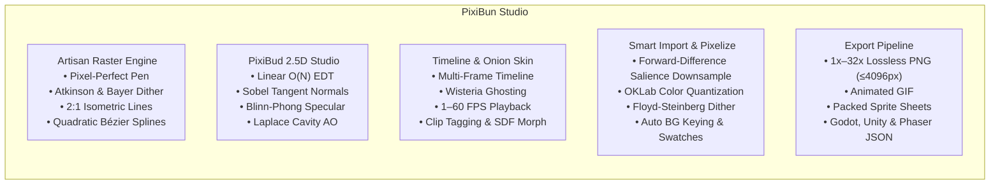

#  PixiBun Atelier — v1.14.1

> **Release Status:** `v1.14.1 hardening complete` (Phases A, B, and C verified).

```text
  /\_/\   *  .  *  .  *  *  .  *  *  .  *  *
 ( o.o )   P I X I B U N   A T E L I E R
  > ^ <    A quiet, cozy desk for pixel art & animation
```

> **A tactile, offline-first pixel art studio and animation workbench built with care, tea, and mathematical precision.**  
> Pull up a wooden chair, turn on the amber desk lamp, put on the lo-fi radio, and craft something that brings you joy.

---

##  Why PixiBun?

Modern creative software has grown noisy — cluttered with account walls, mandatory cloud syncs, subscription banners, and confusing menus.

**PixiBun is designed to feel like a wooden drafting desk late at night.**

* **No Accounts or Logins** — Open the studio and begin placing pixels immediately.
* **Local-First & Private Core** — Artwork and frame metadata persist on-device in IndexedDB. Undo history is strictly bounded to 64 MiB / 50 entries. The replay baseline is separately bounded by current project raster complexity and does not grow with session duration. Local diagnostics are enabled by default; transmission requires opt-in. Co-draw defaults to zero-egress LAN mode; public WebRTC STUN signaling and the optional diagnostics relay require explicit user opt-in.
* **Purpose-Built for Indie & Game Jam Sprites** — Optimized for $16\times16$ to $128\times128$ character sprites, tilesets, and animation loops. Rather than competing with heavy native desktop software (e.g., Aseprite) for 500+ frame 4K cinematic timelines, PixiBun is engineered for instant zero-install browser crafting, 2.5D photometric lighting, and frictionless game engine exports.
* **Tactile Mechanical Feedback** — Integer-aligned strokes, physical button depression physics, specular light-sweeps, and homestyle palettes.
* **Mathematical Graphics Engine** — Built-in 2.5D photometric lighting, analytical normal mapping, RotSprite 8x distortion-free rotation, OKLab perceptual color science, and intelligent image pixelization.
* **Procedural Lo-Fi Radio** — Real-time Web Audio synthesizer with vinyl noise, gentle rain, and warm Rhodes chord progressions playing from a vintage desktop boombox.
* **Command Palette** — Press <kbd>Ctrl+K</kbd> to fuzzy-search and launch any tool, toggle, or project action instantly.
* **Dual Studio Themes** — Switch between **Atelier** (modern midnight) and **Cozy Classic** (plum & wisteria) via the Appearance Popover, each available in dark and light color schemes.

---

## Features & Capabilities



###  Live Interactive Engine Showcase (Landing Page)
Before stepping into the full studio, visitors can interact directly with PixiBun's computer graphics algorithms right on the home desk (`#engine-showcase`):
* **2.5D Photometric Studio & Shadows:** Interactive draggable pixel light bulb gizmo with live continuous azimuth/elevation orbit, real-time stepped OKLCH cel-shading on the Hearth Ghost sprite, 5 Blinn-Phong material profiles (*Matte, Metal, Gold, Glass, Fabric*), and Aaltonen raymarched ground cast shadows vs. contact drop AO.
* **RotSprite Precision Rotation:** Live angular slider demonstrating Xenowhirl 8x Scale2X continuous inverse sampling vs. standard nearest-neighbor affine rotation (`imageSmoothingEnabled = false`), maintaining crisp single-pixel contours at 45°.
* **Intelligent Image Synthesis:** Real-time downsampling interactive demo showcasing Forward-difference gradient salience edge-preservation and OKLab color quantization.
* **Game Engine Exports:** Live sprite sheet packing viewer with instant Godot 4 `.tres`, Unity, and Phaser 3 JSON metadata inspection.

---

### ️ Artisan Raster & Drawing Engine
* **Pixel-Perfect Pen:** Automatic double-pixel / L-corner elimination (Bresenham stroke smoothing).
* **Quantized 2:1 Isometric Lines & Guides:** Authentic 26.565° ($\arctan 0.5$ dimetric) isometric grid snapping and 2:1 diamond viewport guide lines without jagged stepping.
* **3x3 Pattern Matrix Viewport:** Real-time 8-tile ghost matrix wrapping the canvas to test repeatable textures and terrain tiles on the fly.
* **Quadratic Bézier Curves:** Exact quadratic integer de Casteljau curves (<kbd>C</kbd>) for fluid ribbon and contour plotting.
* **Flood Fill & Global Color Replacement:** Contiguous island fill and canvas-wide color swapping with unsigned 32-bit bitwise normalization and adjustable tolerance.
* **Full Selection Suite:** Marquee Box (<kbd>M</kbd>), Freehand Lasso (<kbd>Q</kbd>), and Magic Wand (<kbd>W</kbd>) with Shift (Union) and Alt (Subtract) modifier modes, floating buffer nudging, copy/cut/paste (<kbd>Ctrl+C/X/V</kbd>), and horizontal/vertical flipping (<kbd>H</kbd> / <kbd>V</kbd>).
* **Canvas Brush Ghost Cursor & Zoom Ergonomics:** Non-destructive 1px footprint bounding box matching brush size at $\ge 400\%$ zoom, with `Ctrl + + / - / 0 / 1` integer keyboard navigation.
* **Dual Overlapping Tactile Color Wells:** Primary/Secondary color slots with quick swap (<kbd>X</kbd>), custom HSV/HEX modal picker, and 8-color quick palette dock.
* **9-Point Anchor Canvas Resizing:** Expand or crop from any anchor corner or center, with optional aspect-ratio locking and nearest-neighbor content resampling.

---

### ️ PixiBud 2.5D Photometric Studio & Smart Math Engine
* **Deep Canvas Art Understanding & Anatomical Classification:** Analyzes artwork morphology to classify forms into `character` (creatures with ears/horns, facial features, limbs) vs. `orb` (geometric spheres) vs. `prop`. Connected-component clustering isolates eyes, pupils, mouth, snout, and lateral whiskers (`isFeature`, `isInkLine`), preserving original artist RGB values from diffuse darkening or ambient crush.
* **Frontal Face Cushion Plateau & Independent Ear Geometry:** For character forms, the interior face height forms a flat camera-facing plateau ($N_z \ge 0.88$), ensuring light illuminates faces without splitting them in half with shadow, while form shadows hug only the 1–2px unlit silhouette bevel. Distinct convex lobes preserve independent 3D cone geometry for ears and horns. Dynamic scale factor $\text{scaleFactor} = \max(1.0, \min(W, H) / 32)$ scales bevel radii proportionally for $64\times64$ and $128\times128$ canvases to prevent premature normal collapse while maintaining byte-exact output on $32\times32$ sprites.
* **Perceptual OKLCH Stepped Cel-Shading & Shading Band Modes (Single / Dual / Trio):** Unshaded and pre-shaded pixel art sprites receive crisp discrete tone steps across all forms (orbs, characters, props). Supports **1 Single** (1 shadow tone for classic 2-tone arcade sprites), **2 Dual** (core + deep shadow, default), and **3 Trio** (soft penumbra $L \times 0.93$ + core mid-shadow + deep umbra crescent along outer boundaries). Dynamic cavity AO auto-scaling adapts `cavityStrength` and scales `creviceAOThresh` with silhouette complexity, preventing hair spikes and thin fur tufts from being engulfed in non-directional shadow tone. Shadow placement is driven purely by directional diffuse signal (`diffSignal < shadowThresh`), decoupled from ambient fill to ensure crisp anatomical shadow termination.
* **Continuous 3D Blinn-Phong Specular Highlight Pill:** Specular reflections render as smooth, continuous 3D highlight pills with natural alpha falloff ($I_{\text{spec}} > 0.35, \alpha = \min(255, \text{round}(I_{\text{spec}} \times 255))$). Normals are sampled from the smooth macro-silhouette dome (`specularNormalField`), eliminating facial cliff cuts and ear scars, with a strict line-of-sight visibility gate ($N_{3D} \cdot L_{3D} > 0$) shielding the unlit shadow side, and feature masking protecting eyes, mouth, and line art.
* **Bounded 2.5D Sprite Cast Shadows & Ground Drop Shadows:** Replaced infinite planar raymarch wedges with professional 2.5D bounded sprite cast shadows. Evaluates exact 1-to-1 sheared silhouette projection ($h = y_{\text{base}} - y_s \ge 0$) anchored at the sprite contact baseline, strictly preserving leg arches and waist indentations without bounding-box bloat or muddy center blobs. Includes classic RPG ground contact drop shadows (`shadowStyle: 'drop'`) with crisp Bresenham ellipses under feet, defaulting to uniform flat opacity (`ditherMode: 'none'`).
* **Smart Canvas Art Auto-Analysis:** Dedicated "Analyze & Render" engines for photometric lighting and cast shadows infer light azimuth, elevation, intensity, contact base, bounds, and material presets from canvas pixel data. Pre-existing painted shading is separated from the base color estimate so old dark bands do not remain pinned in place when the bulb moves; the inspector reports the detected form, source light, confidence, and rationale.
* **Interactive On-Canvas Pixel Light Bulb Gizmo:** Live on-canvas interactive draggable bulb handle with real-time 60fps lighting updates during dragging. Decoupled bulb orbit from middle light point focus reticle so artists can anchor and drag the light source or focal point independently. Dynamically aligns directional light vectors with on-canvas pointer coordinates, invalidating analysis caching on $\ge 20^\circ$ angular drift and executing a fresh single-shot pass on drag commit to guarantee zero azimuth staleness on saved artwork. Includes hotkey brightness adjustment (<kbd>+</kbd> / <kbd>-</kbd> / mouse wheel scroll), quick commit (<kbd>Enter</kbd>), cancel (<kbd>Esc</kbd>), focus reset (<kbd>Alt+R</kbd>), and on-canvas tone band toggles (`SHADE: 1 | 2 | 3`).
* **3D Minecraft Skin Recognition & Dedicated Shading:** Automatically detects $64\times64$ and $64\times32$ Java/Bedrock UV layouts via deep 8-connected topological discriminator (`analyzeMinecraftSkinTopology`: dominant component ratio, bilateral limb verification, canonical void zone integrity, bounding box margins) that protects centered character sprites from false-positive classification. Computes analytical 3D unit normal vectors $\mathbf{N}$ for all 12 cuboid regions, and executes domain skin shading (Half-Lambert wrap, contact ambient occlusion under chin/armpits/limbs, sky hemisphere radiance, and warm sunlight/cool indigo hue-shifting). Includes tactile `Skin 3D Shading: [ Auto | On | Off ]` inspector controls for user sovereignty.
* **Linear-Time $O(N)$ Euclidean Distance Transform (EDT):** Felzenszwalb-Huttenlocher separable squared parabolic lower envelopes compute distance fields in milliseconds.
* **Non-Linear Dome Profile Inflation & Bilateral Filtering:** Curves linear distance cones into spherical 2.5D volumetric domes ($\gamma = 0.5$) while preserving sharp segment outlines.
* **Analytical Tangent-Space Normal Generation & Compass Alignment:** Discrete Sobel kernels derive surface normal vectors with standard artist compass heading navigation ($0^\circ = \text{North/Top}, 315^\circ = \text{North-West/Top-Left}$) and a dynamic rotating SVG compass needle in the studio inspector.
* **1-Click Normal Map Baking:** Exports standard blue tangent-space normal maps $(128, 128, 255)$ directly to a new layer for immediate use in **Godot**, **Unity**, and **Unreal Engine**.
* **2.5D Normal Sculptor & Micro-Relief Chisel:** Directional bevel/chamfer carving (<kbd>K</kbd>) with analytical surface normal orientation $(\alpha \in [0, 360^\circ), \phi \in (0, 90^\circ])$, V-groove blade ridge carving, and shallow spherical rivet/stud stamp (<kbd>N</kbd> / <kbd>Shift+K</kbd>) with flattening factor $h \in (0, 1]$ and countersunk screwhole dimpling.
* **Reoriented Normal Mapping (RNM):** Quaternion-based detail normal blending (Colin Barré-Brisebois & Stephen Hill 2012) rotating sculpted micro-relief onto base EDT normal maps without slope flattening or loss of high-frequency details.
* **Real-Time Normal Preview & Live Relighting:** Interactive Studio toggle rendering tangent-space normal maps directly on canvas, with immediate 3D photometric relighting responding to the draggable pixel light bulb gizmo.

| Tangent Normal Preview (RNM Blended) | 45° vs 225° Relit Difference (32,558 px) | Rivet Dome Stamping |
|:---:|:---:|:---:|
|  |  |  |

* **Directional Selective Outlining (Sel-Out):** Evaluates surface normal azimuth alignment against the light source, applying illuminated rim tones to light-facing edges and deep saturated material tones to shadow edges.
* **Smart Sub-Pixel Anti-Aliasing (De-Jaggy):** Evaluates staircase L-crooks in 1px lines and inserts soft intermediate OKLab blend pixels for smooth hand-drawn contours without creating holes.
* **2D Screen-Space Volumetric Optics & Subsurface Scattering (SSS):** Stylized 2D approximation of Beer-Lambert exponential spectral decay through distance-field chord lengths $T(\mathbf{x}) = 2\sqrt{\max(0, R^2 - D(\mathbf{x})^2)}$ paired with a 2D Henyey-Greenstein forward phase function for luminous gemstones, potion vials, and translucent slimes.
* **Dielectric Fresnel Rim Reflection with Cauchy Dispersion:** Stylized grazing angle reflectance modulated by per-channel index-of-refraction splitting ($F_{0, R} < F_{0, G} < F_{0, B}$) for crystalline edges and rim-lit character contours.
* **Kajiya-Kay Anisotropic Highlight:** Directional tangent vector fields $\mathbf{T}(\mathbf{x})$ with dual-cuticle shifts for continuous specular highlight bands across hair strands, fur, and brushed metal blades.
* **Contact Ground Drop Shadows & Auto Outline:** 1-click generation of soft elliptical contact shadows under feet and clean 1px outer stroke silhouette layers.
* **Canonical Xenowhirl RotSprite Engine:** 3-pass Scale2X (EPX) cascade ($1\times \to 2\times \to 4\times \to 8\times$) combined with subpixel continuous inverse sampling and parabolic majority voting, substantially reducing 45° distortion, blooming, and outline erosion while preserving palette purity.
* **Zhang-Suen Line Thinning:** Morphological skeleton algorithm for normalizing thick strokes down to clean 1px lines.
* **5 Physical Material Presets:** Matte Clay, Polished Metal, Glossy Glass/Gem, Velvet Fabric, and Gold/Brass.

---

### ️ Intelligent Image-to-Pixel-Art Synthesis & Import Suite
* **Linear Optical Gamma-Corrected Area Box Downsampling:** Accurately integrates light flux during downscaling without dark-halo fringe artifacts.
* **Forward-Difference Gradient Salience Edge-Preservation:** Boosts high-contrast edge weights to preserve delicate line-art, facial features, and character silhouettes when converting photos or high-res art.
* **OKLab Perceptual Color Quantization:** Median-Cut partitioning with four Lloyd iterations initialized by median-cut centroids in OKLab perceptual color space.
* **Advanced Error Diffusion & Ordered Dithering:** Choice of Serpentine Floyd-Steinberg, Atkinson 75% error retention, or Bayer 4x4 matrix dither during image conversion.
* **Auto-Background Transparency Keying:** Automatically identifies and removes solid background colors by sampling canvas corners with adjustable tolerance.
* **Exact 1:1 Pixel Import:** Option to preserve imported sprites byte-for-byte with automatic canvas dimension matching.
* **Automatic Swatch Extraction:** Derives up to 32 dominant colors from imported artwork and adds them straight into your active palette swatches.

---

###  Color Science & Advanced Dithering Suite
* **OKLab Perceptual Matching:** Color differences computed via $\Delta E_{\text{OKLab}} = \sqrt{\Delta L^2 + \Delta a^2 + \Delta b^2}$ to respect human ocular sensitivity.
* **Bayer Matrix Ordered Dithering:** Recursive $2\times2$, $4\times4$, and $8\times8$ threshold offset modulation before quantization to prevent dirty color pollution.
* **Atkinson 75% Error Retention Dither:** Classic vintage Macintosh error-diffusion for high-contrast, atmospheric shading.
* **Riemersma Space-Filling Hilbert Dither:** Space-filling curve error propagation that eliminates directional worming artifacts.
* **Harmonic Ramp Generator:** Generates 5-step highlight and shadow ramps in OKLCH space with natural warm sun / cool shadow hue-shifting.
* **Atmospheric Photographic Color Grading:** Physical Kelvin temperature shifts (+2800K Golden Sunset, -3500K Cool Moonlight, Neon Dusk, DMG Game Boy).
* **Scan & Snap Palette Tools:** Scan entire canvas to create instant palettes or snap layer pixels to the active palette colors.
* **Mark Ferrari 8-Bit Dynamic Palette Cycling Engine:** Full binary support for Amiga IFF ILBM `CRNG` (8-byte) and Commodore Graphicraft `CCRT` (14-byte) chunks. Features zero-allocation 32-bit LUT renderer (`updateLivePaletteLUT32`) running at 60 FPS, triangle-wave ping-pong period with zero-bound fencepost safety, sub-step `BlendShift` linear color interpolation, harmonic rational retuning for loop baking, and standalone Godot 4 (`.gdshader`) & Unity URP 2D HLSL shader generation.

<p align="center">
  
</p>

---

###  Animation Suite & Layer Stack
* **Signed Distance Field (SDF) In-Between Morphing:** Euclidean distance field tweening with multi-source nearest-color sampling and linear cross-fading, producing smooth intermediate in-between frames at arbitrary fractional time $t \in [0, 1]$ without background ghosting.
* **Multi-Layer Compositor & Layer Security:** Individual layer opacity, lock toggle with live HUD feedback (` Active layer is locked`), visibility, and 5 blend modes (*Normal, Multiply, Screen, Overlay, Color Dodge*).
* **Frame-by-Frame Timeline & Tag Clips:** Duplicate, reorder, delete, and tag animation clips (e.g. *Idle, Walk, Attack, Cast*).
* **Warm Onion Skinning:** Configurable past frame (Wisteria Lavender) and future frame (Plum Lilac) ghosting.
* **Floating Live Preview Popout:** Draggable, resizable $1\times/2\times/4\times$ live preview window with custom backdrops (*Checkerboard, Dark Obsidian, Alabaster Paper, Amber Lamp*).
* **Interactive Beginner Playground (`/playground`):** Guided tutorial sandbox with Bun covering core pixel art animation fundamentals — squash and stretch, anticipation, and onion skinning. Includes the interactive **Teaching Animation Board** with a 10-frame jump anatomy breakdown, 7-stage progressive character construction (Bun and Gel Slime profiles), 8 semantic alt palette colorways, and instant 1-click timeline injection.

---

###  Game-Ready Export Pipeline
* **Tag Clip Export Scope:** Choose to export the full project or isolate a specific named clip (`Walk [1-4]`) into an individual GIF or SpriteSheet with automatic $0$-indexed game engine metadata.
* **Multi-Threaded Web Worker GIF Encoder:** Background LZW bit-packing with transferable `ArrayBuffer` objects, eliminating main-thread UI lag, featuring cancellation via `AbortController` and a live progress bar.
* **Lossless PNG:** Integer scaling from $1\times$ up to $32\times$ with crisp nearest-neighbor sampling (available up to the universal $4096\text{px}$ / $16.7\text{ MP}$ browser safety ceiling; up to $32\times$ for sprites $\le 128\times128$, with higher scales dynamically disabled on larger canvases to prevent browser allocation crashes).
* **APNG Animated PNG:** Lossless full 24-bit RGB + 8-bit alpha animated sequences with configurable loop iteration control (zero-dependency uncompressed deflate store-block streaming for instant client-side rendering).
* **MP4 & WebM Video:** Hardware-accelerated canvas video encoding with automated even-dimension macroblock padding (WebM with VP8/VP9; MP4 recording via H.264 MediaRecorder where supported by the browser platform, with WebM fallback).
* **Timelapse Speedpaint Recorder:** Step-by-step canvas history replay exported to animated GIF or video.
* **Packed Sprite Sheets:** Horizontal, vertical, or matrix packed layouts with ready-to-use JSON metadata for **Godot 4**, **Unity**, and **Phaser 3**.
* **Native `.pixibun` Files:** Single-click project file export and restore with schema v3 smart-effect recipes, legacy migration, and forward-compatibility guards.

---

##  Dual First-Party Studio Themes

PixiBun Atelier features two distinct, fully crafted visual identities selectable via the **Appearance Popover** in the top rail, each supporting both Dark and Light color schemes with zero-lag transition suppression:

### 1. Atelier Theme (Modern Midnight Studio Default)
| Token | Dark (Midnight Atelier) | Light (Warm Alabaster) | Role & Atmosphere |
|---|---|---|---|
| **Chassis / Desk** | `#16141a` | `#ece5d8` | Modern workstation background & room depth |
| **Surface Base** | `#201d26` | `#f7f1e6` | Panels, toolbar docks, and inspector chassis |
| **Surface Raised** | `#282530` | `#ffffff` | Raised buttons, card surfaces, and modal dialogs |
| **Bezel Border** | `#35313d` | `#442a5c` | Precision tactile divider outlines |
| **Creative Accent** | `#e5a962` | `#8a4500` | Warm golden incandescent highlights & active tools |
| **Navigation Accent**| `#b596d9` | `#9940b5` | Wisteria lavender tool focus & timeline guides |
| **Text Primary** | `#ede8f4` | `#221233` | Crisp headings, coordinates, and pixel values |

### 2. Cozy Classic Theme (Original Plum & Wisteria Identity)
| Token | Dark (Cozy Midnight) | Light (Morning Atelier) | Role & Atmosphere |
|---|---|---|---|
| **Chassis / Desk** | `#140c1e` | `#fbf8f3` | Deep plum-wood desk & vintage room atmosphere |
| **Surface Base** | `#201431` | `#f3ebe0` | Thistle lavender studio chassis & inspector tabs |
| **Surface Raised** | `#281b3d` | `#fffdf9` | Raised tool blocks and tactile button beds |
| **Bezel Border** | `#3a2e4c` | `#3c2254` | Rich plum-wood structural bezels |
| **Brand Accent** | `#c792df` | `#7e2b96` | Signature wisteria lavender focus & active states |
| **Lamp Amber** | `#f0be7c` | `#d97818` | Incandescent desk lamp pool & primary actions |
| **Text Primary** | `#ede8f4` | `#221233` | Warm paper white titles and high-contrast labels |

---

## ️ Keyboard Shortcuts Reference

| Key | Tool / Action |
|---|---|
| <kbd>Ctrl</kbd> + <kbd>K</kbd> | **Command Palette** (Fuzzy search all tools, view toggles, commands) |
| <kbd>Ctrl</kbd> + <kbd>S</kbd> | **Save Project** (IndexedDB browser storage & native desktop file) |
| <kbd>Ctrl</kbd> + <kbd>Shift</kbd> + <kbd>S</kbd> | **Save As** (Native `.pixibun` file export) |
| <kbd>B</kbd> | **Pen** Tool (Pixel-Perfect Bresenham) |
| <kbd>C</kbd> | **Quadratic Bézier Curve** Tool |
| <kbd>E</kbd> | **Eraser** Tool |
| <kbd>G</kbd> | **Flood Fill / Bucket** |
| <kbd>D</kbd> | **Dither Brush** (Bayer, Atkinson, Riemersma) |
| <kbd>I</kbd> | **Eyedropper / Color Picker** |
| <kbd>M</kbd> | **Marquee Box Select** |
| <kbd>Q</kbd> | **Lasso Select** |
| <kbd>W</kbd> | **Magic Wand Select** |
| <kbd>L</kbd> | **Bresenham Line** Tool |
| <kbd>J</kbd> | **2:1 Isometric Line** Tool |
| <kbd>U</kbd> | **Rectangle** Tool |
| <kbd>O</kbd> | **Ellipse** Tool |
| <kbd>K</kbd> | **Normal Chisel** Tool |
| <kbd>Shift</kbd> + <kbd>K</kbd> / <kbd>N</kbd> | **Rivet Stamp** Tool |
| <kbd>R</kbd> | **Color Replace** Tool |
| <kbd>S</kbd> | **Toggle Squint / Silhouette Mode** (Display-Only Value Lens) |
| <kbd>P</kbd> | **Cycle CVD Colorblindness Lens** (Protanopia, Deuteranopia, Tritanopia, Grayscale) |
| <kbd>X</kbd> | **Swap Primary / Secondary Colors** |
| <kbd>[</kbd> / <kbd>]</kbd> | **Decrease / Increase Brush Size** |
| <kbd>H</kbd> / <kbd>V</kbd> | **Flip Selection Horizontally / Vertically** |
| <kbd>Ctrl</kbd> + <kbd>C</kbd> / <kbd>X</kbd> / <kbd>V</kbd> | **Copy / Cut / Paste** Selection Buffer |
| <kbd>Esc</kbd> | **Deselect / Commit Floating Selection** |
| <kbd>Ctrl</kbd> + <kbd>Z</kbd> | **Undo** last stroke (50-step memory ring) |
| <kbd>Ctrl</kbd> + <kbd>Y</kbd> / <kbd>Ctrl</kbd> + <kbd>Shift</kbd> + <kbd>Z</kbd> | **Redo** stroke |
| <kbd>Ctrl</kbd> + <kbd>'</kbd> | **Toggle Pixel Grid** |
| <kbd>Ctrl</kbd> + <kbd>0</kbd> | **Fit Canvas to Viewport** |
| <kbd>Ctrl</kbd> + <kbd>1</kbd> | **Reset Zoom to 100%** |
| <kbd>?</kbd> | **Open Keyboard Shortcuts Modal** |
| <kbd>Space</kbd> | **Play / Pause** animation playback |
| <kbd>,</kbd> / <kbd>.</kbd> | **Previous / Next** animation frame |
| <kbd>Alt</kbd> + <kbd>Drag</kbd> / <kbd>Middle Drag</kbd> | **Pan** viewport canvas |
| <kbd>Mouse Wheel</kbd> | **Zoom** in / out (100% to 6400%) |

---

##  Getting Started

### Prerequisites
* **Node.js:** v22.x (Active LTS, e.g., v22.14.0)
* **Package Manager:** `npm`, `pnpm`, or `yarn`

### Setup & Run Locally
```bash
# 1. Clone the repository
git clone https://github.com/lxcario/PixiBun.git
cd PixiBun

# 2. Install dependencies
npm install

# 3. Start the Turbopack dev server
npm run dev
```

Open [http://localhost:3000](http://localhost:3000) in your browser.

### ️ Autonomous Quality Gate & Git Pre-Push Protection
PixiBun includes an automated, zero-dependency local Quality Gate runner that executes before every push:
```bash
# Run documentation checks, typecheck, lint, and the unit test suite
npm run gate

# Run full suite including Next.js production compilation
npm run gate:full
```
The Git pre-push hook (`.git/hooks/pre-push`) is automatically configured on `npm install` via `npm run prepare`, blocking any push if a test, typecheck, or document check fails.

---

##  Offline PWA, Accessibility & Privacy Observability

PixiBun is engineered as a local-first web application:

* **Installable Offline PWA:** Hand-rolled zero-dependency Service Worker precaches the app shell, fonts, and assets with Stale-While-Revalidate caching, an offline fallback, and `navigator.storage.persist()` protecting user artwork from eviction. The core creation and export suite runs entirely offline without network connectivity. P2P co-draw defaults to zero-egress LAN mode (`iceServers: []`), while public Internet WebRTC STUN signaling and the optional diagnostics relay require network access.
* **Accessibility support and testing:** Full keyboard navigation alternatives for drag actions (arrow key canvas panning and selection nudging), focus traps with return-to-opener in modal dialogues, accessible touch and toolbar hit sizes ($\ge 24\text{px}$ touch targets), consistent help surfaces, and automated axe-core scans. Passing scans are scoped to the pages and states exercised; they are not a conformance certification.
* **Privacy-First Local Diagnostics:** Zero third-party trackers or external scripts. Diagnostics and Web Vitals are captured strictly into a local IndexedDB ring buffer (200 entries max) with an instant "Export Diagnostics" JSON tool and a strictly opt-in, rate-limited crash relay.
* **Continuous Quality & Performance Gates:** 1049 unit and integration tests across 114 suites (including an automated $4000\times3000$ photo downsampling benchmark under a 10s budget in `tests/benchmark.test.ts`), 11 E2E spec suites (48 tests, including live studio chisel, normal preview, relighting, and palette cycling proof in `tests/e2e/chiselAndPaletteLiveProof.spec.ts`, 4-theme browser accessibility audits in `tests/e2e/themeAccessibility.spec.ts`, and real Chromium IndexedDB transaction liveness and recovery persistence proof in `tests/e2e/recoveryTransactionLiveness.spec.ts`) with automated axe audits, and Lighthouse CI performance/accessibility score budgets.

---

## ️ Technical Architecture

| Subsystem | Technology | Architectural Rationale |
|---|---|---|
| **Framework** | Next.js 16 (App Router) + React 19 | Turbopack compilation, fine-grained leaf subscriptions, zero client bundle bloat. |
| **Studio Shell** | AtelierRail, StatusBar, CommandPaletteModal | Modular studio chrome: consolidated top rail, persistent 24px coordinate status bar, fuzzy-search launcher (`Ctrl+K`), and live lo-fi radio widget. |
| **Design System** | Tactile UI Component Library | Accessible `StudioSlider`, `StudioSelect`, `StudioToggle`, `StudioNumberInput`, `StudioTooltip`, `IconButton`, and collapsible `PanelSection` with WCAG AA focus rings. |
| **Modular Hooks** | Studio Lifecycle & Viewport Handlers | Decoupled `useStudioAutosave`, `useStudioClipboard`, `useStudioFileSystem`, and tool-specific `useBrushPointerHandler`, `useChiselPointerHandler`, `useSelectionPointerHandler`, `useShapePointerHandler`. |
| **PWA & Offline** | Hand-rolled Service Worker + Manifest | Shell precaching, Stale-While-Revalidate static assets, zero-dependency reliability. |
| **Raster Engine** | OffscreenCanvas Compositor | Direct `ImageData` Uint8ClampedArray access with $O(1)$ integer blitting. |
| **Smart Math & AI** | Felzenszwalb EDT, Sobel, Blinn-Phong, RNM Normal Sculptor, Aaltonen Ray Marching, Mark Ferrari Cycling | Deterministic on-device computer graphics math for 2.5D shading, micro-relief carving, raymarched soft shadows, 60 FPS palette cycling, and normal baking. |
| **Image Synthesis** | Forward-Difference Salience + OKLab Median-Cut | Lossless & retro pixel art downsampling with Floyd-Steinberg and Atkinson dithering. |
| **Audio Engine** | Web Audio API Synthesizer | Procedural vinyl rain generator and tape-flutter chord progressions with zero network bandwidth. |
| **State Management** | Zustand + Immer | Decoupled layer buffers, sub-16ms zero-re-render stroke pipelines, atomic revision tracking (`saveRevision.ts`). |
| **Accessibility** | WCAG 2.2 AA + ESLint JSX-A11y + Axe | Keyboard drag alternatives, focus traps, accessible roles, high-visibility focus rings. |
| **Observability** | Local IndexedDB Buffer + Web Vitals | Zero telemetry promise kept; diagnostics stay on user device by default. |
| **Tactile UI** | Tailwind CSS v4 + Motion | Physical button depression physics, CSS `@theme` cascade tokens, and zero-lag dual-axis theme transitions (`AppearancePopover`). |
| **Local Persistence & Recovery Foundation** | Dexie.js (IndexedDB Schema v5) + ZIP32 Streaming Core | Dedicated `layerBlobs` and `recoveryRecords` tables, atomic multi-table rollbacks, keyset-paginated stored-blob assessment, low-level Store-only ZIP32 writer, and untouched backup archive assembly. |
| **Collaboration** | P2P WebRTC + CRDT Sync Bridge | Dual-channel LWW-CRDT pixel buffer with delivery ACKs, backpressure queueing, and retry deduplication. |
| **Quality & Tests** | Vitest + Playwright + Lighthouse CI | 1049 unit and integration tests across 114 suites and 11 E2E spec suites (48 tests) + Axe WCAG scans + LHCI budgets. |

---

##  Future Roadmap & v2 Architecture

For an academic deep-dive into the next-generation architecture of PixiBun — exploring WebGPU Compute Shaders (WGSL), WASM 128-bit SIMD, Kleppmann-Beresford Move-Tree CRDTs, Display-P3 wide color gamuts, and Tauri 2.0 desktop packaging — see the comprehensive blueprint in [`V2_VISION.md`](./V2_VISION.md).

---

##  Craft Values & Open Source
 
* **Local-First & Zero Telemetry:** No user accounts, no telemetry, no tracking, no subscriptions.
* **Offline-First Studio:** Core drawing, animation, lighting, and export pipelines run entirely in-browser without network access via the installable PWA.
* **Contributing & Governance:** Check [`CONTRIBUTING.md`](./CONTRIBUTING.md) for local Quality Gate workflow and pure-TS invariant guidelines.
* **Security & Invariants:** Read our defense-in-depth policy in [`SECURITY.md`](./SECURITY.md).
* **License:** Licensed under the [MIT License](./LICENSE).
 
*Handcrafted with pixels, coffee, and care.* *

