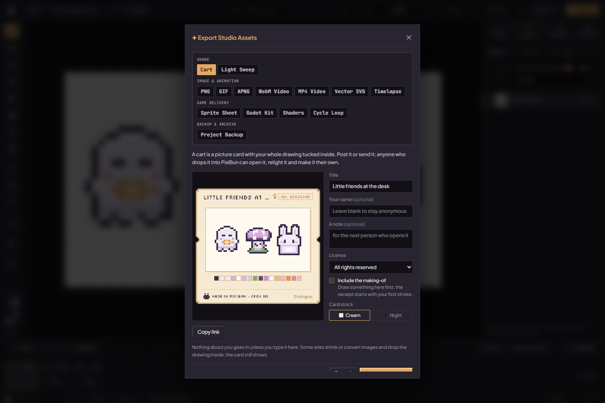
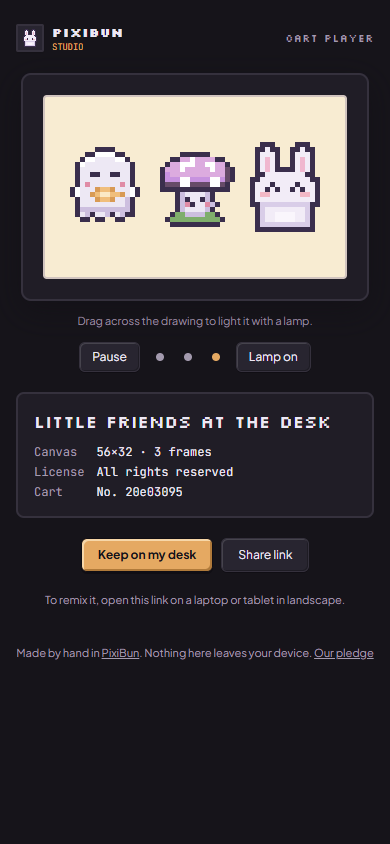

# Carts

A cart is a PNG that is a picture, a drawing and its making-of at once. Any image viewer shows the card; PixiBun opens the drawing inside it. Source: [cartFormat.ts](../../src/lib/cart/cartFormat.ts), [pngChunks.ts](../../src/lib/cart/pngChunks.ts).

## Format (cart version 1)

| Part | Contract |
| --- | --- |
| Carrier | One `pxBn` chunk before `IEND`: ancillary, private, safe to copy. Other chunks and the card pixels are untouched. |
| Chunk data | One encoding byte (`1` = deflate JSON), then a zlib (`deflate`) stream of UTF-8 JSON. At most 16 MiB packed and 50 MiB unpacked; inflation stops at the cap. |
| Record | `format: "pixibun-cart"`, `version: 1`, `title`, optional `maker` and `note`, `license` (`all-rights-reserved`, `cc-by`, `cc-by-sa`, `cc0`), `createdAt`, optional `light` (azimuth, elevation, brightness, radius), optional `receipt` (`strokes`, `activeMs`, optional `track`), `lineage` (`id`, `parents`), `project` (a normal `.pixibun` project, including palettes and their cycle tracks). |
| Id | The first 16 hex digits of SHA-256 over the normalized project without its timestamps. Readers recompute it; a cart cannot claim another drawing's id. |
| Lineage | Up to 16 ancestors, nearest first, each `{ id, title?, maker? }`. Opening a cart remembers it in this browser only (`pixibun-cart-origins`), so a cart made from that drawing lists it. |

## The card

[cartCard.ts](../../src/lib/cart/cartCard.ts) draws the face on whole pixels: a title strip with a postmark number (the cart id) and a small light bulb when the cart carries its light, the active frame at the largest whole scale that keeps it near 320 px, a row of its most used colors, the maker, receipt and remix lines, and a stitched footer where Bun says "Made in PixiBun · open me" beside the license. **Cream** and **Night** card stocks are offered; the night card sets the drawing on lamp-lit paper so dark outlines stay readable. The card art is only a picture; opening always uses the drawing inside.

## Receipts

While Studio is open, [receiptRecorder.ts](../../src/lib/cart/receiptRecorder.ts) keeps each drawing's receipt in this browser's `pixibun-receipts` IndexedDB, keyed by project: a stroke count, drawing time (gaps over 90 seconds count as breaks) and a making-of track. After each edit settles, the active frame as shown is compared with the previous snapshot and only changed pixels are stored ([receiptTrack.ts](../../src/lib/cart/receiptTrack.ts)): varint time, an optional reset to a new canvas size, then gaps between changed positions and references into a running color table. Replaying the steps rebuilds every recorded stage exactly. A new receipt starts from the drawing as it opened (blank, a template or an opened cart), so a remix's making-of begins at its source. The raw track stops growing at 6 MiB while the counts continue.

**Include the making-of** in Export → Cart is off until chosen (the choice is remembered). The track is deflated and stored as base64url in `receipt.track`; links keep the counts only. The player's **Watch the making** replays the track in about 15 seconds. Steps recorded while a drawing's ledger is loading are queued, so early strokes are not merged.

## Links

[cartLink.ts](../../src/lib/cart/cartLink.ts) puts the packed cart after the `#` of `/open#c1.<base64url>`. Browsers never send the fragment to a server, so the link is the file. The receipt keeps its stroke count and time but drops its stroke track. Links over 2,000 characters are allowed with a warning (some apps cut them); links over 32,000 characters are refused in favor of the card.

## Player

`/open` ([CartPlayer.tsx](../../src/components/cart/CartPlayer.tsx)) opens a cart from its link, a chosen PNG or the desk shelf, on any screen including phones. The drawing shows at a whole-number scale on lamp-lit paper; multi-frame drawings play with their own holds. Dragging across the drawing moves a lamp: the Studio's 2.5D lighting relights the frame, cached per 15° ([relight.ts](../../src/lib/cart/relight.ts)), and loads only when the lamp is used. **Keep on my desk** stores the packed cart in this browser's `pixibun-shelf` IndexedDB, separate from projects (newest 48 kept). **Share link** uses the system share sheet or copies the link. On screens 1024 px or wider, **Open in Studio** hands the cart over through session storage, and Studio offers it in the same "A cart arrived" dialog.

## Reading rules

Carts are untrusted. Chunk lengths and CRCs are checked; JSON goes through SafeJson with the project import node ceiling; the project goes through the normal project schema; text is stripped of control characters and capped; unknown fields are dropped; nothing in a cart is executed. A PNG without a `pxBn` chunk imports as an ordinary image. A damaged `pxBn` chunk is reported as a damaged cart rather than imported as a picture. A newer version or encoding is refused with an update message. Links, shelf entries and Studio handovers decode through the same path.

Opening a cart uses the normal project import: the current drawing is saved first, then the cart's drawing and light replace the desk.

## Limits

Sites that re-encode uploads (to JPEG or WebP, or by stripping private chunks) remove the drawing; the card still shows. A receipt is a record of how a drawing was made in PixiBun, not proof: a determined person can script strokes. Nothing identifying is added by default; the maker name, note and receipt are chosen at export.
