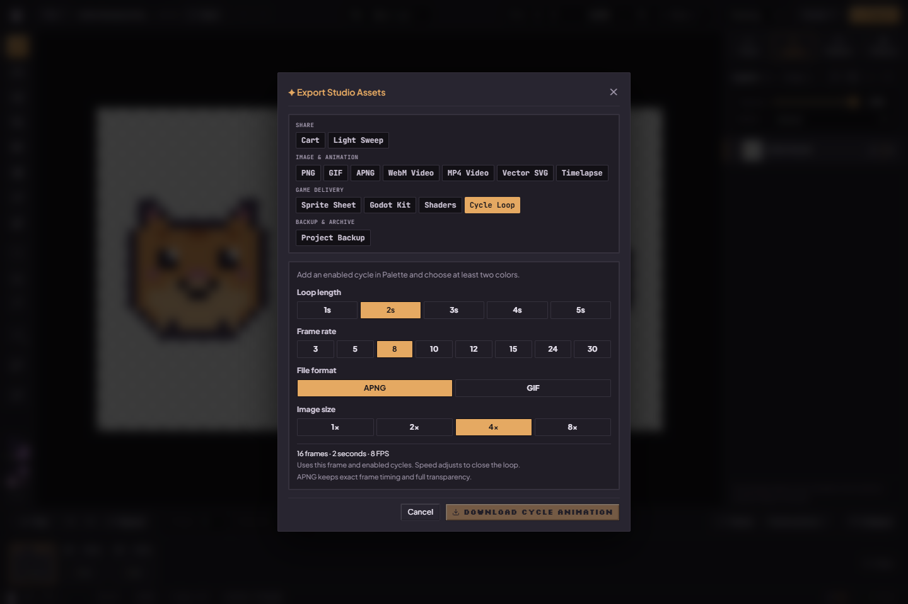

# Export capability matrix

The [current status](../current-status.md) records the qualifying revision and observed limits for this contract; production-host and device qualification remain separate.

For step-by-step format choices and current screenshots, use the [artist export guide](../guides/exporting.md).

The direct **Export** button opens format choices. **E selects Eraser**; there is no E shortcut for Export. Normal timeline export and **Cycle Loop** are different inputs.

| Output | Actual path | Fidelity and timing limits |
| --- | --- | --- |
| Cart | `src/lib/cart/` card renderer + `pxBn` chunk | Card art is the active frame at an integer scale on a PNG card; the drawing inside is the full project plus light, license, optional receipt and lineage. Sites that re-encode images drop the drawing. [Cart format](carts.md) |
| Light Sweep | `src/lib/cart/lightSweep.ts` + MP4/WebM encoders | 270×480 whole-pixel frames doubled to 540×960, 12 fps, 5 s; the cart player's relighting per 15°; MP4 when WebCodecs H.264 is available, else WebM, else a refusal message |
| PNG / sprite sheet | Canvas PNG + `spriteSheetPacker.ts` | Raster output, alpha; nearest-neighbor admitted scaling. A sheet needs metadata for pose order/holds |
| APNG | `apngEncoder.ts` | Admitted RGBA and rational frame delays; native zlib-framed compression where available, otherwise stored DEFLATE blocks. Builds a Blob from chunks; can be large; no streaming sink contract |
| GIF | worker/shared `gifEncoderCore.ts` | Palette quantization, at most 256 table entries including transparency policy; binary rather than arbitrary RGBA alpha. Delays rounded to GIF centiseconds; LZW dictionary reset fixed, old damaged files need re-export |
| WebM | `webmEncoder.ts` → `videoRecorder.ts` | Canvas captureStream + MediaRecorder (supported VP8/VP9). Real-time scheduling/capability dependent; arbitrary alpha preservation is not promised |
| MP4 | WebCodecs H.264 + `isobmffWriter.ts`, supported MediaRecorder fallback | Pads odd dimensions to even values without rescaling; not rounding to 16×16. Codec/browser availability applies. Fallback bypasses the custom muxer; no general alpha guarantee |
| Process Replay | `processReplay.ts` | Retained session history (dirty-rectangle patches applied onto each layer's first edited state) plus eviction baseline and a separately captured current terminal composite; not complete from-blank history and not restored Undo from a saved file |
| Godot / TexturePacker / Phaser metadata | Shared animation model + sheet/resource writers | Ordered poses and supported holds/loop semantics represented by the target format; consumer import support must be qualified |
| Palette shader / indexed assets | Shader and palette-register exporters | Source shades/register/alpha constraints apply. CPU cycling and shader indexing are distinct paths; do not infer arbitrary-source parity |
| SVG | `depixelizeVector.ts` | PixiBun contour/diagonal heuristic inspired by Kopf–Lischinski, not their full canonical algorithm or byte-identical raster output |
| Unique tiles | `tilesetBundle.ts` | Selected-layer native PNG + zero-based PixiBun JSON + one-based Tiled map in one ZIP; bounded admission and stale-result checks |
| Portable project / recovery archive | Serialization / recovery ZIP | Different backup purposes; see [artwork safety](../guides/artwork-safety.md) |

## Scope, holds and cycling

Opening the panel on an image, game-delivery or backup format does not query native video codec support. WebM is checked when WebM is selected; MP4 also checks WebM for its fallback suggestion. MP4 capability checks run only for MP4 or Timelapse MP4, using the scaled output dimensions and that export's frame rate. Timelapse uses its chosen replay FPS rather than the timeline FPS. Availability remains configuration-dependent; these checks do not qualify every browser's media backend. In WebKit on Linux (WebKitGTK, WPE) no H.264 check runs at all and MP4 is refused: in CI, the check froze the page when the MP4 tab opened and closed it during a Light Sweep save (`h264FreezesThisBrowser` in `mp4Encoder.ts`).

The local pre-S4 run found Firefox returning a supported H.264 configuration while real encoding failed. A positive query does not guarantee a working encoder. Chromium's downloaded two-pose MP4 decoded locally; WebKit's unsupported path was refused. These are separate outcomes, and broad MP4/backend qualification remains open. See [current status](../current-status.md#local-pre-s4-hardening-candidate).

The local replay repair captures the authored active-frame composite independently of Undo and appends a copied/scaled terminal frame. GIF now uses the supplied eviction baseline. The source workspace is checked before encoding and before download; temporary surfaces/reservations are released on all outcomes. Retained snapshots with different canvas dimensions refuse with project-backup/animation-export advice. This does not reconstruct complete historical multi-frame/multi-layer authoring or qualify actual MP4 timelapse playback.

*Local production UI on 15 October 2026, before download; this picture illustrates controls. [Artist walkthrough](../guides/palettes-and-cycling.md), [capture details](../assets/screenshots/2026-10-15-current-ui/run.json).*

Shared animation export models preserve selected clip pose order and durations where the format can represent them. GIF rounds holds; MediaRecorder samples in real time. Browser playback scheduling is not guaranteed by encoded frame timestamps. Inspect the chosen scope before exporting.

Cycle Loop samples the active frame's color animation, not moving silhouettes across the drawn timeline. It offers 3/5/8/10/12/15/24/30 FPS, initially 8. A two-second 8 FPS loop has 16 samples. Cycle rate remains separate from export FPS. First/Last swatches bound each track: source colors outside active ranges keep their bytes in live CPU cycling and generated frames. Shared source colors cannot simultaneously belong to two independent semantic objects without authoring changes.

## Homepage sample downloads

The homepage bench ([benchStage](../../src/components/landing/bench/benchStage.ts)) downloads a transparent four-frame GIF (20×24 frames at 4×, holds 160/100/200/100 ms, quantized to centiseconds) of the visitor's edited and lit starter. It is separate from Studio project export and does not qualify any game engine. Until 15 October 2026 the homepage instead offered a fixed 20×22 Bun sample as APNG, GIF and Godot/Unity/Phaser ZIP kits; that sample code was removed.

## Resource boundaries and evidence

PNG companion metadata uses separate hidden Blob-only download contexts so WebKit does not coalesce several same-frame downloads. The primary PNG remains in the main frame. Companion contexts are removed on failure or by scheduled cleanup after navigation starts; this is resource cleanup rather than a test delay or a guarantee that every browser setting permits multiple downloads. The browser-download fallback is distinct from OS-native picker qualification. See the [Studio/Nibbli change record](../releases/2026-10-13-studio-and-nibbli.md) for source and scoped evidence.

Cancel, dialog close, external close and unmount abort active asynchronous exports and backups. Within the mounted Studio, an operation keeps its ownership until started native work drains; reopening the dialog cannot start another export during that cleanup and retains the active operation's tab. A newly mounted Studio has its own dialog owner; the shared memory ledger still accounts for draining work. Encoders' late results are checked before download. Portable backup cancellation starts no further queued PNG work and waits for already-started native callbacks. Once a file close or download click has committed, cancellation cannot retract it.

APNG shares revision-checked, cancellable source preparation with GIF/video exports. Palette-cycle export admits its source, unrolled frames and scratch estimate before allocation, passes cancellation to both image encoders and releases surfaces on success/failure/cancellation. Its unrolling remains synchronous after an initial yield; it is not a measured latency guarantee. A failed frame context rejects the loop rather than silently dropping that pose.

The [3 October challenge execution (local archive)](../archives.md#record-docs-research-2026-10-03-testsprite-full-run-md) observes cancellation during a 24-frame APNG encode with no download, then decodes a later PNG into the exact source pixels. Its backup round-trip restores distinct frames and 240/700 ms holds in Firefox's browser-download flow. The native Chromium Save picker remains outside that automated qualification; the cloud service's failed/blocked statuses are retained separately.

Output dimensions are at most 4096 per axis / 16,777,216 pixels. Animated-image admission additionally bounds aggregate retained raw frames to 67,108,864 pixels; combined memory reservations and operation-specific constraints also apply. Admission reduces resource risk; it is not a cap on total browser RAM or codec internals.

APNG composition and encoding yield to browser tasks between frames and honor cancellation. A single frame's pixel extraction and the fallback compressor remain synchronous; this is not a worker or streaming encoder. Preparing fresh composite frames reserves memory before allocation and releases those exclusively owned surfaces on completion, failure or cancellation. Capacity failures offer frame/scale advice; rendering or codec failures offer a retry or another format. Native compression size depends on the artwork and browser.

GIF, MP4 and WebM source preparation also reserves before compositing, yields between frames and honors cancellation before entering the encoder. Queued frame raster changes refuse a mixed export. Source composites release on success, failure and cancellation; codec reservations remain separate. Sprite-sheet preparation reserves source composites plus estimated sheet/PNG work and releases its canvases. These paths retain whole admitted frame batches; they are not streaming encoders or measured browser-RAM limits.

See [geometry validation](../../src/lib/export/exportGeometryValidation.ts), [export source](../../src/lib/export), [GIF correction (local archive)](../archives.md#record-docs-research-gif-8x-corruption-2026-10-01-md), [cycle timing evidence (local archive)](../archives.md#record-docs-research-palette-cycle-export-2026-10-01-md), [game-delivery phase (local archive)](../archives.md#record-docs-research-phase-implementation-status-md). The recorded Godot run applies to its named version/backend/fixture; generic Unity/Phaser compatibility requires consumer verification. The production browser suite checks the scenarios in [generated inventory](../generated/test-inventory.json), not every format/codec/input combination.

## Unique-tile bundle

Tile slicing uses the active layer's stored RGBA canvas at native size, rather than a frame composite. Tile sizes are 8/16/32 px. Width/height must be positive integral multiples, each at most 4096 px, together at most four million pixels and 4096 source cells. Admission refuses partial edges and missing/mismatched buffers without creating or resizing source pixels. Hash buckets are followed by exact-byte comparison; IDs use first appearance, row-major, without rotations/flips.

A single ZIP contains tileset.png, tilemap.json and map.tmj. The PNG has a square-ish row-major atlas with zero margin/spacing and transparent unused end cells. PixiBun JSON version 1 includes source/map/atlas dimensions, image filename, unique count and zero-based 2D tile IDs. The Tiled finite orthogonal JSON uses firstgid 1, flat row-major GIDs and the same image/atlas dimensions. A transparent tile is retained as a tile; it is not confused with Tiled's empty GID 0.

Preparation reserves estimated CPU allocations against the shared ledger, snapshots pixels before asynchronous PNG encoding and checks project/frame/layer/dimensions/tile size/edit/buffer revision and generation afterward. Missing/null PNGs, cancellation, 30-second timeout and source changes refuse publication and release temporary reservations. The component releases retained bundle reservations on source changes, rescan and unmount; Copy/Download recheck the source. A component ownership generation also prevents a released result or pending UI state from reviving when an earlier frame/layer/tile size is selected again. Browser/GPU/codec internals are outside the estimated ledger. No current engine tilemap adapter is bundled; consumer qualification is separate. [Artist steps and captures](../guides/pixitools-cleanup-and-tiles.md#slice-into-unique-tiles), [Tiled JSON fields](https://doc.mapeditor.org/en/stable/reference/json-map-format/), [global IDs](https://doc.mapeditor.org/en/stable/reference/global-tile-ids/).

## Normal sources and demonstration labels

Godot normal admission accepts tags normal and normal-map, or a normal-map effect. Preflight and export share the exactly-one/full-opacity/source-over rule. A selected hidden normal is allowed; a visible normal is excluded from the diffuse atlas when normal export is enabled. Stored convention is preserved, as required by [Godot CanvasTexture](https://docs.godotengine.org/en/stable/classes/class_canvastexture.html). Current homepage sample APNG/GIF downloads use real encoders, as described above; Studio exports use the artist's artwork. SVG UI describes an approximation. The linked 2 October record describes the former text-note downloads and retains that historical scope. [Phase 4 execution scope (local archive)](../archives.md#record-docs-research-2026-10-02-feature-repairs-phase4-md).
