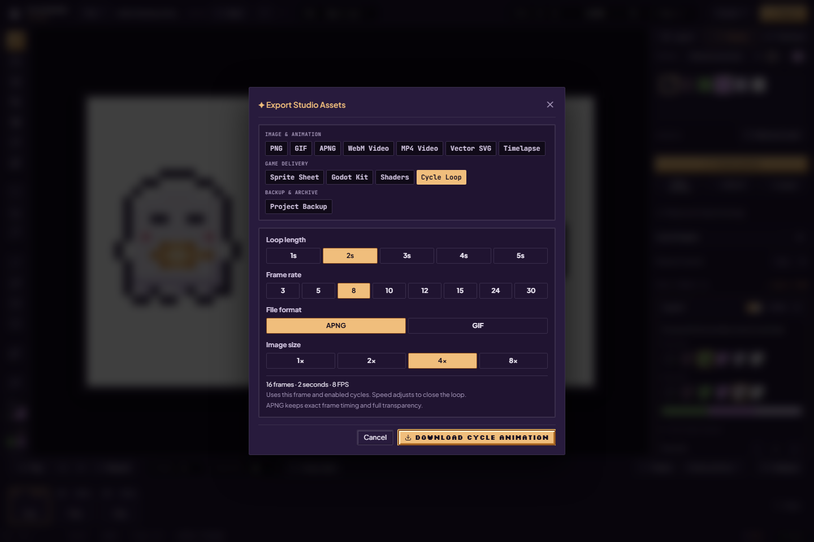

# Export capability matrix

For step-by-step format choices and current screenshots, use the [artist export guide](../guides/exporting.md).

The direct **Export** button opens format choices. **E selects Eraser**; there is no E shortcut for Export. Normal timeline export and **Cycle Loop** are different inputs.

| Output | Actual path | Fidelity and timing limits |
| --- | --- | --- |
| PNG / sprite sheet | Canvas PNG + `spriteSheetPacker.ts` | Raster output, alpha; nearest-neighbor admitted scaling. A sheet needs metadata for pose order/holds |
| APNG | `apngEncoder.ts` | Admitted RGBA and rational frame delays; native zlib-framed compression where available, otherwise stored DEFLATE blocks. Builds a Blob from chunks; can be large; no streaming sink contract |
| GIF | worker/shared `gifEncoderCore.ts` | Palette quantization, at most 256 table entries including transparency policy; binary rather than arbitrary RGBA alpha. Delays rounded to GIF centiseconds; LZW dictionary reset fixed, old damaged files need re-export |
| WebM | `webmEncoder.ts` → `videoRecorder.ts` | Canvas captureStream + MediaRecorder (supported VP8/VP9). Real-time scheduling/capability dependent; arbitrary alpha preservation is not promised |
| MP4 | WebCodecs H.264 + `isobmffWriter.ts`, supported MediaRecorder fallback | Pads odd dimensions to even values without rescaling; not rounding to 16×16. Codec/browser availability applies. Fallback bypasses the custom muxer; no general alpha guarantee |
| Process Replay | `processReplay.ts` | Retained session history plus eviction baseline; not complete from-blank history and not restored Undo from a saved file |
| Godot / TexturePacker / Phaser metadata | Shared animation model + sheet/resource writers | Ordered poses and supported holds/loop semantics represented by the target format; consumer import support must be qualified |
| Palette shader / indexed assets | Shader and palette-register exporters | Source shades/register/alpha constraints apply. CPU cycling and shader indexing are distinct paths; do not infer arbitrary-source parity |
| SVG | `depixelizeVector.ts` | PixiBun contour/diagonal heuristic inspired by Kopf–Lischinski, not their full canonical algorithm or byte-identical raster output |
| Unique tiles | `tilesetBundle.ts` | Selected-layer native PNG + zero-based PixiBun JSON + one-based Tiled map in one ZIP; bounded admission and stale-result checks |
| Portable project / recovery archive | Serialization / recovery ZIP | Different backup purposes; see [artwork safety](../guides/artwork-safety.md) |

## Scope, holds and cycling

Opening the panel on an image, game-delivery or backup format does not query native video codec support. WebM is checked when WebM is selected; MP4 also checks WebM for its fallback suggestion. MP4 capability checks run only for MP4 or Timelapse MP4, using the scaled output dimensions and that export's frame rate. Timelapse uses its chosen replay FPS rather than the timeline FPS. Availability remains configuration-dependent; these checks do not qualify every browser's media backend.

*Local UI on 2 October 2026, before download; the screenshot documents available controls rather than a decoded-file verdict. [Artist walkthrough](../guides/palettes-and-cycling.md), [capture details](../assets/screenshots/2026-10-02-docs/run.json).*

Shared animation export models preserve selected clip pose order and durations where the format can represent them. GIF rounds holds; MediaRecorder samples in real time. Browser playback scheduling is not guaranteed by encoded frame timestamps. Inspect the chosen scope before exporting.

Cycle Loop samples the active frame's color animation, not moving silhouettes across the drawn timeline. It offers 3/5/8/10/12/15/24/30 FPS, initially 8. A two-second 8 FPS loop has 16 samples. Cycle rate remains separate from export FPS. First/Last swatches bound each track: source colors outside active ranges keep their bytes in live CPU cycling and generated frames. Shared source colors cannot simultaneously belong to two independent semantic objects without authoring changes.

## Resource boundaries and evidence

The [3 October challenge execution](../research/2026-10-03-testsprite-full-run.md) observes cancellation during a 24-frame APNG encode with no download, then decodes a later PNG into the exact source pixels. Its backup round-trip restores distinct frames and 240/700 ms holds in Firefox's browser-download flow. The native Chromium Save picker remains outside that automated qualification; the cloud service's failed/blocked statuses are retained separately.

Output dimensions are at most 4096 per axis / 16,777,216 pixels. Animated-image admission additionally bounds aggregate retained raw frames to 67,108,864 pixels; combined memory reservations and operation-specific constraints also apply. Admission reduces resource risk; it is not a cap on total browser RAM or codec internals.

APNG composition and encoding yield to browser tasks between frames and honor cancellation. A single frame's pixel extraction and the fallback compressor remain synchronous; this is not a worker or streaming encoder. Preparing fresh composite frames reserves memory before allocation and releases those exclusively owned surfaces on completion, failure or cancellation. Capacity failures offer frame/scale advice; rendering or codec failures offer a retry or another format. Native compression size depends on the artwork and browser.

See [geometry validation](../../src/lib/export/exportGeometryValidation.ts), [export source](../../src/lib/export), [GIF correction](../research/gif-8x-corruption-2026-10-01.md), [cycle timing evidence](../research/palette-cycle-export-2026-10-01.md), [game-delivery phase](../research/phase-implementation-status.md). The recorded Godot run applies to its named version/backend/fixture; generic Unity/Phaser compatibility requires consumer verification. The production browser suite checks the scenarios in [generated inventory](../generated/test-inventory.json), not every format/codec/input combination.

## Unique-tile bundle

Tile slicing uses the active layer's stored RGBA canvas at native size, rather than a frame composite. Tile sizes are 8/16/32 px. Width/height must be positive integral multiples, each at most 4096 px, together at most four million pixels and 4096 source cells. Admission refuses partial edges and missing/mismatched buffers without creating or resizing source pixels. Hash buckets are followed by exact-byte comparison; IDs use first appearance, row-major, without rotations/flips.

A single ZIP contains tileset.png, tilemap.json and map.tmj. The PNG has a square-ish row-major atlas with zero margin/spacing and transparent unused end cells. PixiBun JSON version 1 includes source/map/atlas dimensions, image filename, unique count and zero-based 2D tile IDs. The Tiled finite orthogonal JSON uses firstgid 1, flat row-major GIDs and the same image/atlas dimensions. A transparent tile is retained as a tile; it is not confused with Tiled's empty GID 0.

Preparation reserves estimated CPU allocations against the shared ledger, snapshots pixels before asynchronous PNG encoding and checks project/frame/layer/dimensions/tile size/edit/buffer revision and generation afterward. Missing/null PNGs, cancellation, 30-second timeout and source changes refuse publication and release temporary reservations. The component releases retained bundle reservations on source changes, rescan and unmount; Copy/Download recheck the source. A component ownership generation also prevents a released result or pending UI state from reviving when an earlier frame/layer/tile size is selected again. Browser/GPU/codec internals are outside the estimated ledger. No current engine tilemap adapter is bundled; consumer qualification is separate. [Artist steps and captures](../guides/pixitools-cleanup-and-tiles.md#slice-into-unique-tiles), [Tiled JSON fields](https://doc.mapeditor.org/en/stable/reference/json-map-format/), [global IDs](https://doc.mapeditor.org/en/stable/reference/global-tile-ids/).

## Normal sources and demonstration labels

Godot normal admission accepts tags normal and normal-map, or a normal-map effect. Preflight and export share the exactly-one/full-opacity/source-over rule. A selected hidden normal is allowed; a visible normal is excluded from the diffuse atlas when normal export is enabled. Stored convention is preserved, as required by [Godot CanvasTexture](https://docs.godotengine.org/en/stable/classes/class_canvastexture.html). Welcome APNG/GIF downloads are explicitly labeled text notes; actual encoders remain in Studio. SVG UI describes an approximation. [Phase 4 execution scope](../research/2026-10-02-feature-repairs-phase4.md).
