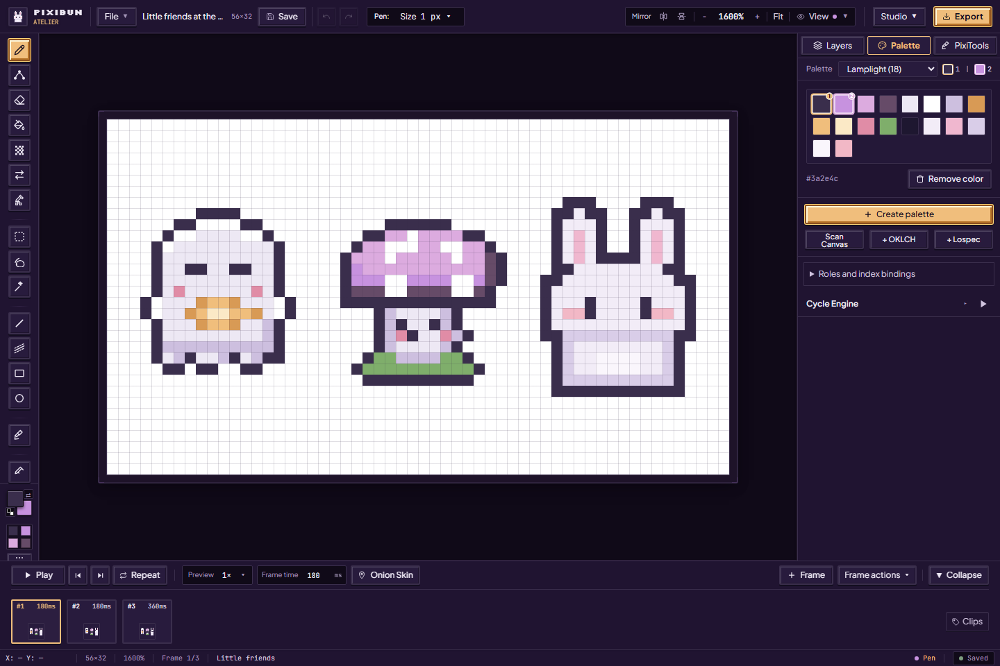

# The PixiBun artist handbook

For the tested revision and remaining accessibility, device and host checks, see the [current status](../current-status.md).

A little drawing can begin with just one color and a few pixels. Pick the guide you need today; the other shelves will still be here when you're ready.

For a facilitated observation session, use the [artist workflow study kit](artist-study.md). It separates complete automated journeys from real participant and device observations.

## Your first small drawing

1. [Meet the studio](welcome-and-demos.md), then open a starter friend or a blank 32×32 canvas.
2. [Find your way around](studio-workspace.md) and try [Pen and Eraser](drawing-tools.md).
3. [Gather a few colors](palettes-and-cycling.md). Add [animation frames](animation-and-review.md) if you'd like your drawing to move.
4. [Save an editable backup](artwork-safety.md), then [export an image or animation](exporting.md) to share.

## Choose a shelf

| When you want to… | Illustrated guide |
| --- | --- |
| Explore the welcome page, four starters and four demonstrations | [Meet the little studio](welcome-and-demos.md) |
| Open, import, resize and organize a drawing; use layers, selections and view controls | [Settle into your studio](studio-workspace.md) |
| Learn every drawing tool and its settings | [All 17 drawing tools](drawing-tools.md) |
| Save layouts, pin the color triangle, browse palette previews or inspect the whole canvas | [Arrange an artist workspace](artist-workspace.md) |
| Create/import palettes, make ramps, name color roles and animate a color range | [Palettes and color loops](palettes-and-cycling.md) |
| Draw poses, adjust holds and clips, use onion skin and review a loop | [Animation and review](animation-and-review.md) |
| Pose one selected rigid part, bake editable cels or save a motion rig | [Rigid-part motion](artist-workspace.md#save-a-motion-rig) |
| Move a light, choose materials, shape normals and add a shadow | [Lighting and surfaces](lighting-and-surfaces.md) |
| Clean up pixels, rotate, try color moods and inspect tiles | [Cleanup and tiles](pixitools-cleanup-and-tiles.md) |
| Preview simplification, shared lighting and small tile scenes | [Variations and scenes](variations-and-scenes.md) |
| Choose among all 12 export tabs, including game delivery and project backup | [Take your pixels with you](exporting.md) |
| Practice all 12 lessons, inspect the Teaching Board or doodle on a phone | [Learning and Playground](learning-and-playground.md) |
| Draw with one guest, use the cached studio offline and choose diagnostic preferences | [Collaboration and privacy](collaboration-and-privacy.md) |
| Keep a backup, handle save conflicts or recover damaged local records | [Artwork safety and backup](artwork-safety.md) |

The [complete feature index](../features.md) connects available features to instructions and implementation, with dated illustrations where captured. New motion/rotation/Curve adjustment controls have no fresh handbook picture yet. For exact keys and file/resource limits, use the [shortcut](../contracts/shortcuts.md), [storage](../contracts/storage.md) and [export](../contracts/exports.md) references.

For agent developers helping with drawing or verification, [Nibbli](nibbli.md) and its [agent contract](nibbli-agent.md) describe the separate repository tooling. Artist plans come from your conversation or mocks, and Hands currently supports bounded 32×32 edits. It is not an assistant button inside the Studio; functional checks and artistic opinions remain separate.

## About the pictures

Most guides show the local application on **2 October 2026**; the [artist workspace](artist-workspace.md) also has **4 October** captures. Screenshots are actual UI captures, including previews before Apply, and do not depict every later control. Lesson images show provided templates traced through the UI. Recovery examples use deliberately damaged sample records in isolated browser storage. None are participant results or proof of a current public deployment.

The [new capture record](../assets/screenshots/2026-10-02-feature-guide/run.json) identifies the revision, image hashes and scope; the [earlier October illustrations](../assets/screenshots/2026-10-02-docs/run.json) have their own record. The later [practice captures](../assets/screenshots/2026-10-02-feature-repairs-phase2/run.json) show the separate Keep/Return workspace and all twelve current lesson illustrations. The [phase 3 control captures](../assets/screenshots/2026-10-02-feature-repairs-phase3/run.json) show current Iso ON/FREE and the single floating preview. The [phase 4 export captures](../assets/screenshots/2026-10-02-feature-repairs-phase4/run.json) show manual-normal preflight, approximate SVG, welcome text notes and current/stale tile bundles. The [phase 5 reconciliation captures](../assets/screenshots/2026-10-02-feature-repairs-phase5/run.json) refresh the cozy desk overview, welcome text, sampling explanation and qualified APNG/MP4 panels; the [additional welcome captures](../assets/screenshots/2026-10-02-feature-repairs-phase5-welcome/run.json) show current lighting/rotation explanations and feature cards in reduced-motion mode. Historical research and release evidence keeps its original screenshots. See the [documentation map](../README.md) for contributor and operator guides.
