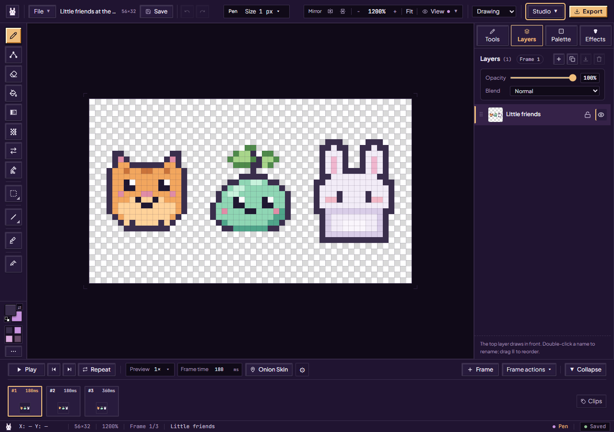

# The PixiBun artist handbook

For the tested revision and remaining accessibility, device and host checks, see the [current status](../current-status.md).

A little drawing can begin with just one color and a few pixels. Pick the guide you need today; the other shelves will still be here when you're ready.

For a facilitated observation session, use the [artist workflow study kit](artist-study.md). It separates complete automated journeys from real participant and device observations.

On scene themes, [Studio Labs](studio-workspace.md#studio-labs) offers a morphing tool island, liquid tabs, liquid sliders and tool rail, a paint-pot palette and quick effects. Switch them off individually or choose **Classic studio** from Studio → Labs; Graphite and Plum always stay classic.

## Your first small drawing

1. [Meet the studio](welcome-and-demos.md), then open a starter friend or a blank 32×32 canvas.
2. [Find your way around](studio-workspace.md) and try [Pen and Eraser](drawing-tools.md).
3. [Gather a few colors](palettes-and-cycling.md). Add [animation frames](animation-and-review.md) if you'd like your drawing to move.
4. [Save an editable backup](artwork-safety.md), then [export an image or animation](exporting.md) to share.

## Choose a shelf

| When you want to… | Illustrated guide |
| --- | --- |
| Compare every Studio theme in Day and Night | [All 24 desk appearances: 12 styles, Night and Day](themes.md) |
| Explore the welcome page, four starters and four demonstrations | [Meet the little studio](welcome-and-demos.md) |
| Open, import, resize and organize a drawing; use layers, selections and view controls | [Settle into your studio](studio-workspace.md) |
| Learn every drawing tool and its settings | [All 17 drawing tools](drawing-tools.md) |
| Save layouts, pin the color triangle, browse palette previews or inspect the whole canvas | [Arrange an artist workspace](artist-workspace.md) |
| Create/import palettes, make ramps, name color roles and animate a color range | [Palettes and color loops](palettes-and-cycling.md) |
| Draw poses, adjust holds and clips, use onion skin and review a loop | [Animation and review](animation-and-review.md) |
| Pose one selected rigid part, bake editable cels or save a motion rig | [Rigid-part motion](artist-workspace.md#save-a-motion-rig) |
| Move a light, choose materials, shape normals and add a shadow | [Lighting and surfaces](lighting-and-surfaces.md) |
| Clean up pixels, rotate, try color moods and inspect tiles | [Cleanup and tiles](pixitools-cleanup-and-tiles.md) |
| Preview simplification, shared lighting and small tile scenes | [Variations and scenes](variations-and-scenes.md) |
| Choose among all 14 export tabs, from carts and GIFs to game delivery and project backup | [Take your pixels with you](exporting.md) |
| Practice all 12 lessons, inspect the Teaching Board or doodle on a phone | [Learning and Playground](learning-and-playground.md) |
| Draw with one guest, use the cached studio offline and choose diagnostic preferences | [Collaboration and privacy](collaboration-and-privacy.md) |
| Keep a backup, handle save conflicts or recover damaged local records | [Artwork safety and backup](artwork-safety.md) |

The [complete feature index](../features.md) connects available features to instructions and implementation. Current pictures include tool settings, motion poses, Curve adjustment, Playground and [every theme](themes.md). For exact keys and file/resource limits, use the [shortcut](../contracts/shortcuts.md), [storage](../contracts/storage.md) and [export](../contracts/exports.md) references.

For agent developers helping with drawing or verification, [Nibbli](nibbli.md) and its [agent contract](nibbli-agent.md) describe the separate repository tooling. Artist plans come from your conversation or mocks, and Hands currently supports bounded 32×32 edits. It is not an assistant button inside the Studio; functional checks and artistic opinions remain separate.

## About the pictures

The guide pictures show the local production build on **15 October 2026**. They include previews before Apply, all twelve current desktop lessons, Pocket's two modes, game exports, recovery and sharing. Lesson images show provided templates traced through the UI. Recovery examples use deliberately damaged sample records in isolated browser storage. The [theme gallery](themes.md) shows the eight desks of the 15 October build in Day and Night; Cocoa, Drizzle, Harvest and Harbor were added later. These illustrate the UI; participant, device and public-deployment results have separate scope.

The [capture record](../assets/screenshots/2026-10-15-current-ui/run.json) identifies the source/build, image hashes, viewport sizes and procedures. The replaced originals retain their source Git blobs and verified [local archive receipt](../assets/screenshots/2026-10-15-current-ui/retired-images.json); dated research and release verdicts keep their original scope. See the [documentation map](../README.md) for contributor and operator guides.
