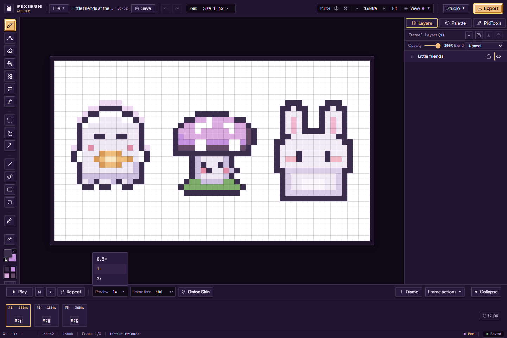
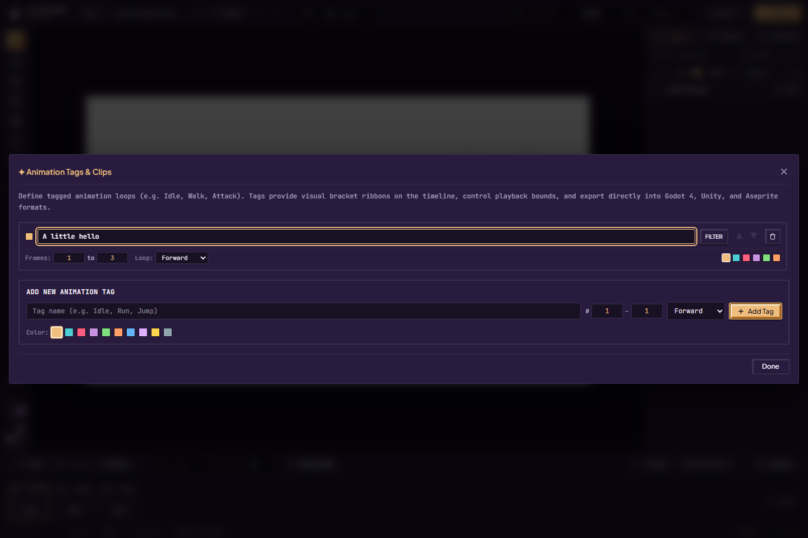
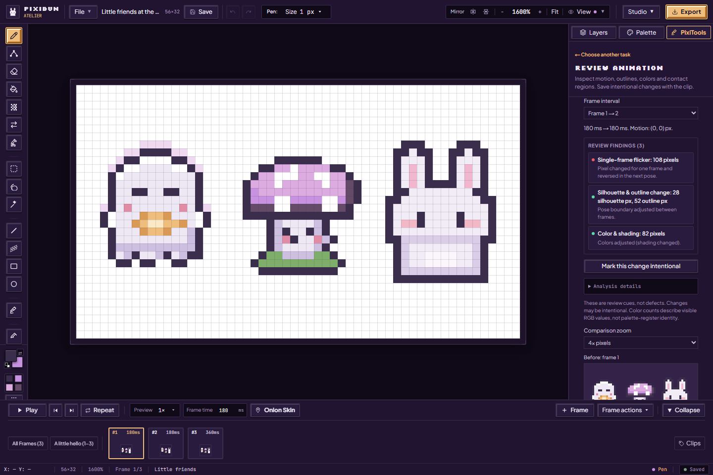
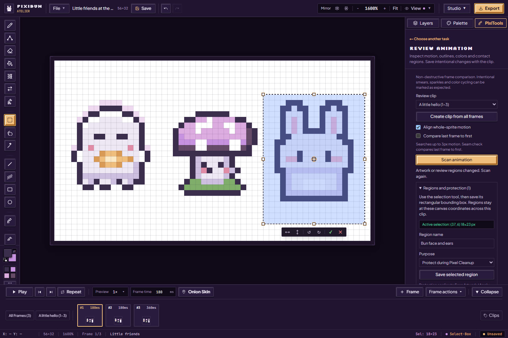
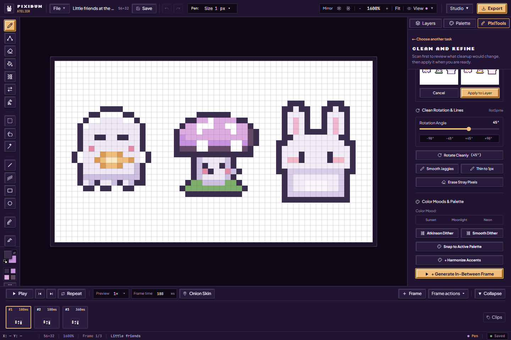

# Give your little sprite a moment to move

For the tested revision and remaining accessibility, device and host checks, see the [current status](../current-status.md).

[Handbook](README.md) · [Exports](exporting.md) · [All features](../features.md)

Start with two or three poses. A blink or a small bounce is plenty for a first animation. Each frame has independent layer pixels, and **frame time** controls how long that pose stays on screen.

The timeline control row keeps a fixed height. Onion-skin help occupies a reserved slot on wider desks; compact desks expose the same explanation through the button description. Toggling it keeps the canvas and timeline in place. For layered drawings and motion preparation, follow the [rigid-part workflow](artist-workspace.md#save-a-motion-rig).

## Frames, holds and playback

1. Choose a frame thumbnail to edit it. **+ Frame** adds a blank pose with the current layer names and settings. For a starting pose with actual pixels, use **Frame actions → Duplicate frame**.
2. Paint the difference on the intended layer. Turn on **Onion Skin** to see nearby poses faintly behind the current artwork. Notices explain when a project budget limits the preview.
3. Set **Frame time** in milliseconds. A smaller number is quicker; a longer hold can make a blink or the top of a jump easier to read. Admitted holds range from 1 to 60,000 ms.
4. Press **Play / Space**. **Repeat**, **Ping-Pong** and **Once** change the playback loop. **Preview** offers 0.5×, 1× and 2× speed for inspection; preview speed is separate from the stored frame holds and export timing.
5. Pause before rearranging. Drag a thumbnail or use **Frame actions → Move frame earlier / later**. The same menu deletes the active frame when more than one remains. **,** and **.** step backward and forward. Collapse the timeline for more drawing room, and expand it again when needed.

Duplicating a frame includes the copy in every clip containing its source; clips after the insertion keep their existing artwork. Reordering follows existing clip members and refuses a move that would split a clip into separate ranges. Adjust that clip's range first if you intend to reorganize it. Deleting a frame contracts affected clips and removes an empty clip. These changes are undoable. Frame/layer/pixel limits can refuse growth; adding a frame does not guarantee unlimited memory. [Storage and history limits](../contracts/storage.md) describe admission and bounded Undo.

For tempo, edit each pose's **Frame time**. The project retains an FPS value for defaults/compatibility, but the current Studio timeline does not offer a separate project-FPS editor. Open the gear beside **Onion Skin** for independent previous/next counts (0–5), tints, opacity and presets. **F3** toggles ghosts with canvas focus. Pause playback to inspect them; these guides are never exported. See the [artist workspace controls](artist-workspace.md#inspect-poses-with-onion-skin).

## Build a readable walk cycle

Pixel artist Raymond Schlitter starts a small character animation with a simplified dummy, establishes contact/down/passing/up poses and adds detail later. His example walk uses eight frames at 120 ms per frame; those are starting examples for his sprites, not requirements. [SLYNYRD's run-and-gun study](https://www.slynyrd.com/blog/2026/1/26/side-view-run-n-gun).

Try this manual exercise in PixiBun with a simple two- or three-color figure. It adapts that pose-first approach to the current editor:

| Frame | Pose to draw | Check before continuing |
| --- | --- | --- |
| 1 | Left foot forward, right foot back; first contact | Keep the floor at one fixed canvas row |
| 2 | Body lowers into the step | The planted foot stays on the floor |
| 3 | Free foot passes beneath the body | Preserve torso size; separate overlapping limbs clearly |
| 4 | Body rises before the opposite contact | Adjust the head and shoulders together |
| 5–8 | Repeat the four poses with opposite leg positions | Compare corresponding proportions and silhouette |

1. Draw the first contact pose. Use **Duplicate frame** to retain its pixels while making the next pose. **+ Frame** is blank; it does not copy the previous pose.
2. Use **Previous pose** onion skin at a low opacity while editing. Compare the foot, torso and head separately. Increase the ghost range only when you need to see an arc; too many guides can obscure the current pixels.
3. Set each hold to 120 ms for an initial inspection, then play at **1×** and inspect the navigator at small scale. Change holds or poses where the weight reads poorly. Preview speed is only an inspection setting.
4. Step between frames 8 and 1 to check the seam. Onion trails stop at project edges, so inspect those poses manually. Leave out an extra copy of frame 1 at the end unless you intentionally want that longer hold.
5. Once the motion reads clearly, add clothes, hair and shading. Recheck moving highlights, one-pixel flicker and any foot that slides. Then test the exported loop in its actual game or viewer.

Pixel size limits how much movement can be represented. Schlitter's separate top-down study uses six frames and uneven displacement for a more lively bounce. There is no rule that adding frames makes motion better. [Top-down character study](https://www.slynyrd.com/blog/2025/3/24/pixelblog-55-top-down-character-animation).

For attacks, plan the readable anticipation, action and recovery poses by hand and give them intentional holds. The current editor's in-between heuristic cannot infer anatomy, weapon arcs, foot contact or game responsiveness; inspect and correct its output before keeping it.

## Tags and clips

Open **Clips** at the right of the timeline to reach **Animation Tags & Clips**. Add a name such as Idle or Wave, choose the first and last frames and a ribbon color, then add the tag. Its bounds are inclusive and shown as ordinary one-based frame numbers in the UI.

Existing tags can be renamed, resized, reordered, recolored or deleted. Choose Forward, Reverse or Ping-Pong for the tag's ordering, and use **Filter** to preview that range. **All frames** clears a clip filter when the timeline presents it. Tags and clips use the shared animation model; they are not a second copy of the pixels.

Sprite sheets and game-delivery exports can include clip metadata; format support differs. The in-app sentence about “Aseprite formats” does **not** mean there is an `.aseprite` project exporter. The current export choices are [listed individually](exporting.md). Verify a generated resource in the engine you will actually use.

## Review animation

Open **PixiTools → Review animation → Animation stability**. This is a non-destructive comparison tool; scanning does not repair or paint the frames.

1. Select **Review clip**, or create a clip from all frames. A comparison needs at least two frames.
2. Choose whether to **Align whole-sprite motion** and **Compare last frame to first**. Alignment searches a bounded motion of up to three pixels; the last-to-first option checks the loop seam.
3. Choose **Scan animation**. A pending scan can be canceled. If art, regions or the selected clip changes, scan again rather than trusting stale findings.
4. Pick a **Frame interval** in the report. Findings include protected-detail changes, one-frame reversals, contact drift, silhouette/outline differences and color changes. Clicking a finding focuses the reviewed frame.
5. Compare **Before**, **Aligned**, and **Changed pixels** at 1×, 4× or 8×. The small panes can scroll. Red marks disappeared pixels, blue appeared pixels and purple color/alpha differences; alignment can move edge changes outside the view.
6. If a smear, sparkle or color change is intentional, choose **Mark this change intentional**. **Reopen this interval** or **Clear saved exceptions** removes the mark. Marks apply to the exact reviewed frame data and settings; later edits require a fresh review.

“Consistent transition” means the implemented comparisons found no reported change, not that the motion is artistically correct. Color counts describe visible RGB values, not palette-register identities. Human evaluation of the tool's usefulness remains pending.

## Regions and protection

Open **Regions and protection**, make a canvas selection and give it a name. Choose a purpose, then **Save selected region**:

| Purpose | What it does | What it does not promise |
| --- | --- | --- |
| Protect during Pixel Cleanup | Keeps that rectangle from the Scan Artwork / Apply Cleanup workflow while this clip is selected | Does not lock Pen, transforms, other filters or every cleanup button |
| Ignore intentional motion | Excludes the named region from applicable review comparisons | Does not alter animation pixels |
| Watch contact drift | Reports changes in the content center within a contact region | Does not implement skeletal or foot-pinning correction |

The saved region is the selection's **bounding rectangle**, at fixed canvas coordinates across the clip. A lasso's irregular mask is not preserved as the region. Removing or changing regions clears saved exceptions. [Clean and refine](pixitools-cleanup-and-tiles.md#scan-before-cleaning) shows the cleanup workflow that uses this protection.

## Add an in-between pose

Open **PixiTools → Clean and refine**, scroll to **Generate In-Between Frame**, and select the first of two adjacent keyframes. The action creates an intermediate pose using the implemented pixel morphing heuristic. Inspect the new frame's outline, timing and layer content, then adjust by hand or Undo. It is not a promise of anatomically correct interpolation, a rig, or motion generated by a trained model.

To share the result, choose [APNG/GIF/video](exporting.md) or a sprite sheet. To preserve editable frames and layers, choose **Project Backup** instead.

## Move one rigid part

For a selected detail or a whole unlocked color layer, **Tools → Create Motion Part** offers Start/End poses, a pivot, easing and 2–30 poses. Numeric controls and session Undo/Redo help adjust parameters precisely; one gesture is one step. Cancel the session to return to artwork/library history. Preview uses the source cel hold time, and baked cels copy that hold. Inspect the preview, then **Bake to timeline** for editable cels in one Undo action. Rendering runs in a dedicated background worker; slow previews can skip poses, and rigid rotation does not lock feet to the ground. Named saved rigs retain settings and reopen only while their source artwork matches. Finish a floating selection and close Co-Draw first. Normal-tagged or normal-map-effect sources are refused. Parameter edits remain temporary until saved or baked; body-part extraction and multi-part character animation remain future work. Follow the [motion and saved-rig guide](artist-workspace.md#save-a-motion-rig).

Sources: [timeline](../../src/components/layout/BottomTimeline.tsx), [tags](../../src/components/modals/TagManagerModal.tsx), [review panel](../../src/components/layout/inspector/AnimationReviewSection.tsx), [scan](../../src/lib/animation/scanClip.ts), [in-between action](../../src/components/layout/inspector/PixiBudAssistanceSection.tsx).
