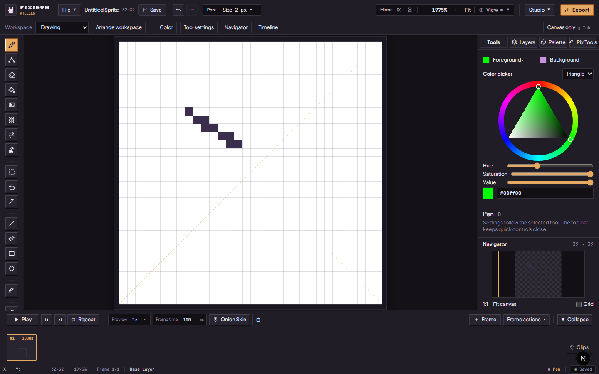
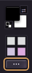
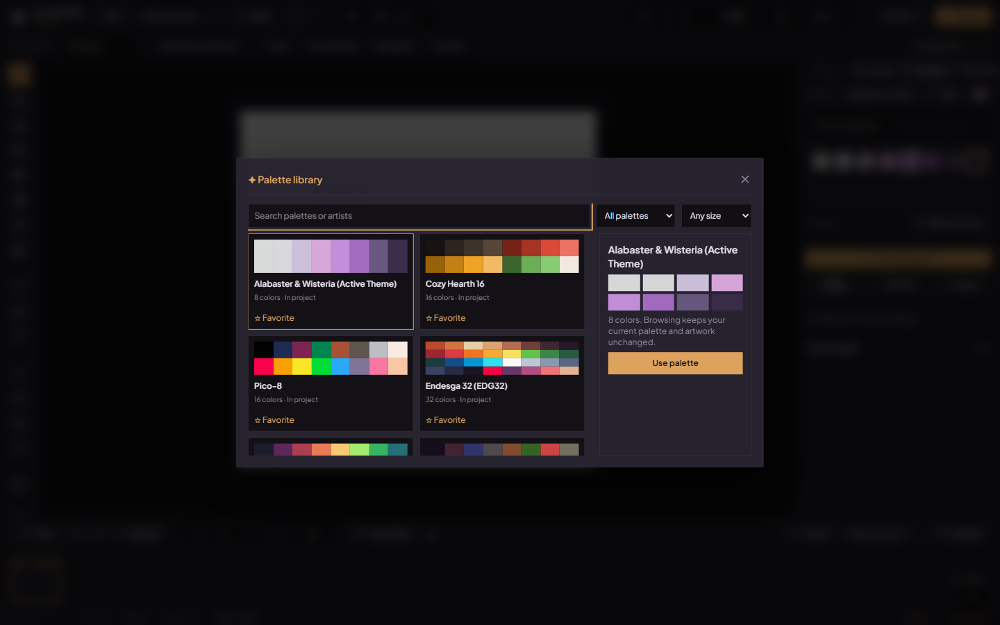
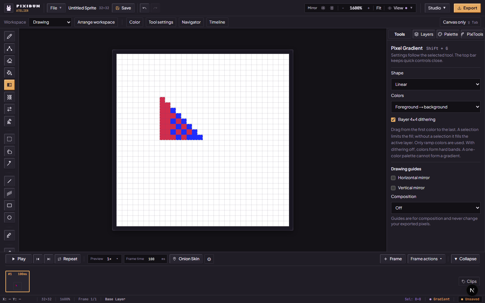
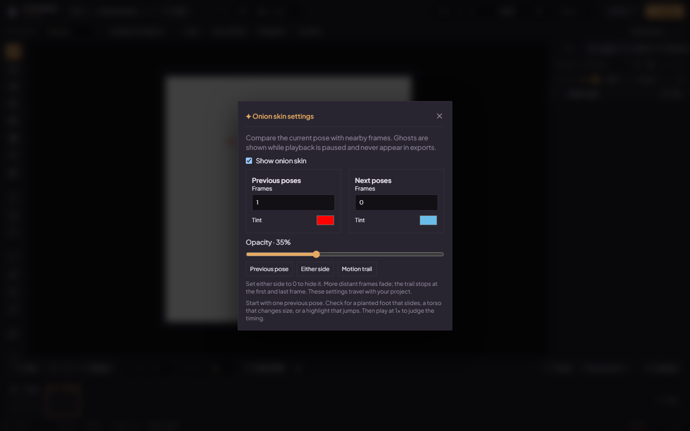

# Arrange a desk for drawing and animation

[Handbook](README.md) · [Drawing tools](drawing-tools.md) · [Animation](animation-and-review.md)

Use the **Workspace** list in the project rail to keep the panels you need nearby. These are desktop Studio controls; the phone's Pocket interface has its own layout. At compact desktop widths, shorter labels keep project and drawing actions together. Open **Size** (or the pixel-size button) for presets and **Clean corners**; the extra inline presets appear on wider desks. The offline badge uses a disconnected-network icon at compact widths, with its full status available to assistive technology and in the hover description.

## Choose and save a layout

| Layout | Starting arrangement |
| --- | --- |
| Drawing | Right inspector, 292 px wide, Tools selected, timeline visible |
| Animation | Right inspector, 320 px wide, Layers selected, navigator and timeline visible |
| Lighting | Right inspector, 340 px wide, PixiTools selected, pinned color picker and navigator visible, timeline hidden |

Open **View → Arrange...** to put the inspector on the left or right, set its width from 260 to 420 px, and show or hide the color picker, navigator and timeline. Enter a name and **Save layout**; keep up to six named layouts. A saved layout includes the selected inspector tab and PixiTools task. Choose it from the Workspace list to restore that task and arrangement. Lighting opens **Add light and depth**; reloading restores the stored task even when session preferences were cleared. Later adjustments affect the current arrangement; save another named layout to keep that variation. **Restore preset** restores the selected built-in preset, or Drawing when a user layout is selected.

Layouts, color-picker shape and palette favorites belong to this browser and site origin. They are separate from project artwork and are not included in a project backup. This version moves the whole inspector; it does not detach individual panels or drag tabs into arbitrary docks. Switching layouts does not change pixels or frame holds.

## Keep colors and settings close

Choose **View → Arrange... → Color picker** to pin the picker. **Foreground / Background** chooses which drawing color you edit. The outer ring sets hue; the triangle mixes that hue with white and black. Choose **Square** if you prefer independent saturation and value axes. The Hue, Saturation and Value sliders also support keyboard input; the hex field accepts `#rrggbb`, or `#rgb` when you leave the field. Changing a drawing color does not recolor existing pixels.

The Palette tab always offers a picker and its **Pin color panel / Unpin color panel** action. Pinning keeps one picker available when you switch inspector tabs; its layout choice survives reload. The active motion editor temporarily occupies the inspector instead. Unpinning hides the shared picker on other tabs while keeping color editing available in Palette.

The compact color dock at the bottom of the left tool shelf uses overlapping Foreground/Background wells, four quick swatches, corner Swap/Reset actions and a narrow ellipsis button. Click a well for quick colors; double-click for the full picker. Click a quick swatch to set Foreground, or right-click to set Background. **X** swaps colors and **Shift+D** restores black/white when drawing shortcuts own focus. Hover and press feedback keep the dock in place.

Choose the inspector's **Tools** tab for the selected tool's controls: brush size, clean corners, shape fill, fill tolerance, selection tolerance, dither pattern or chisel settings as applicable. The top bar retains quick controls. The settings panel scrolls when several optional panels are open.

**Composition** offers Off, Rule of thirds, Golden ratio, Center, Diagonals and Safe area (10%). The safe-area guide is a framing aid, not a guarantee about a target engine or screen. Guides never become artwork or appear in exports.

## Compare palettes before choosing

Open **Palette → Browse palettes**. Cards display all swatches together; search by palette or artist, filter project/library/favorites, or limit the color count. Clicking a card previews it without changing the active palette. **Favorite** keeps it in this browser's favorites; **Use palette** selects an existing project palette or adds the chosen library palette once.

The additional library includes [Sweetie 16 by GrafxKid](https://lospec.com/palette-list/sweetie-16), [DawnBringer 16 by DawnBringer](https://lospec.com/palette-list/dawnbringer-16), [Endesga 16 by ENDESGA](https://lospec.com/palette-list/endesga-16) and [1bit Monitor Glow by Polyducks](https://lospec.com/palette-list/1bit-monitor-glow). Each card links to its source. Choosing a palette does not recolor existing RGBA artwork. Use the separate palette-snap workflow when you intend to change artwork colors.

## See the whole canvas

Choose **View → Navigator** for a small, unsmoothed whole-canvas overview with a viewport outline. Its aspect ratio stays fixed, so artwork pixels retain their proportions. Click or drag the overview to center the main view on that location. Focus the overview and use arrows to move by one artwork pixel, Shift+arrows by eight, or Enter to center. **1:1** restores 100%; **Fit canvas** uses the same workspace fit as the header, Ctrl/Cmd+0 and command search, including zoom below 100% for large artwork. The zoom slider covers 10–6400%. Its optional grid covers the complete image on canvases up to 128×128; larger canvases disable that grid to avoid a dense, unreadable overlay.

## Draw a pixel gradient

1. Work on an unlocked layer. Make a box, lasso or wand selection when only part of the layer should change.
2. Choose **Pixel Gradient** or press **Shift+G** with the canvas focused. Open the inspector's **Tools** tab.
3. Choose **Linear** or **Radial**, then **Foreground → background** or **Active palette, in order**. A useful palette ramp needs an intentional swatch order; a general-purpose palette is not automatically a good shading ramp.
4. Keep **Bayer 4×4 dithering** on for a patterned transition, or turn it off for hard bands. Drag from the first color toward the last; a radial drag runs from the center to its radius. Inspect the live preview, then release to commit one Undo step.

Only supplied ramp RGB colors are painted, at full opacity. No interpolated RGB colors are introduced. Without a selection, the fill covers the active layer, including transparent pixels; it can replace that layer's existing artwork. A one-color palette or zero-length drag does nothing. Canceling the pointer gesture leaves artwork unchanged. Gradient fill does not apply drawing mirrors; edit or duplicate a selected result deliberately if you need a mirrored fill.

## Inspect poses with onion skin

Open the gear beside **Onion Skin** in the expanded timeline. Set **Previous / Next** counts independently from 0 to 5, choose each tint and adjust opacity. **Previous pose** isolates the last pose; **Either side** compares both neighbors; **Motion trail** shows three on each side. Distant ghosts fade. Trails stop at the project's first and last frame; they do not wrap or stop at a clip tag boundary. Memory admission can reduce available previews.

Ghosts appear while paused, and remain separate from artwork and exports. **F3** toggles them with canvas focus. These settings travel with the saved project. Try one previous pose first: compare the planted foot, torso size and highlight placement; use playback at 1× to judge timing. The [walk-cycle exercise](animation-and-review.md#build-a-readable-walk-cycle) gives a concrete sequence.

## Rotate a detail or try rigid-part motion

With a selection active, open **Tools** to choose RotSprite or Paeth for rotation. Move the pivot and inspect thin features, outline and dither at the intended angle. Paeth's three-shear sampling is an alternative look, not a guarantee that every pattern survives. Normal layers use a separate vector-aware rotation path. The older selection screenshots predate these choices; see the [rotation contract](../contracts/rendering.md#pixel-art-rotation-rotsprite-v2).

## Save a motion rig

Commit or cancel any floating selection first. On one unlocked color layer, open **Tools**, then choose **Create Motion Part**. Select an area first to capture that detail, or leave it unselected to capture the whole layer. Close co-draw before starting; normal-map layers use the separate layer-rotation workflow. Adjust its pivot, Start/End poses, frame count and easing. Give it a **Rig name** and choose **Save motion rig**, then save the project with the workspace Save button. Each saved rig currently contains one rigid part. Pose adjustments remain temporary until Save or Bake, with their own bounded session Undo/Redo.

For a drawing spread across color layers, choose **Merge artwork & animate**. This explicitly combines all visible layers of the current frame with their opacity/blending into one color layer, then captures the complete combined drawing even if an area was selected. Hidden layers stay separate; visible locked layers, normal maps and co-draw block preparation. The merge is an artwork Undo step: Cancel, then Undo restores the separate layers. Undo after Bake first restores the unbaked drawing; another Undo restores the layers. Older saved rigs whose source was merged require a fresh capture. **Create Motion Part** continues to move only the active layer/selected detail, leaving other layers still.

**Generated Frames** and **Motion frames** both offer 2–30 poses, matching the engine and saved-rig format. New captures and **Center Pivot** use the geometric center of the captured bounds, including half-pixel coordinates for odd sizes. Opening a saved rig retains its authored pivot. Position controls enter whole pixels; rotation and pivot controls retain finite fractions. Saved rigs can also retain fractional positions until edited. Raster translations round to whole pixels using the same rule in static preview, playback and bake. **Reset Pose** resets the selected Start or End pose. **Undo pose / Redo pose**, keyboard Undo/Redo and the workspace buttons edit motion parameters while this session is open. One drag or held range-key gesture is one step; cancelled gestures do not consume an Undo step. Cancel the session to return to artwork/library history. The last 50 parameter steps are session-local and are not portable backups.

Preview and baked cels use the source cel's duration. Motion rendering runs in a separate worker; playback waits for a pose to finish presenting before requesting the next one, so a slow worker can skip poses without leaving the preview frozen. Neighboring onion ghosts are hidden and cleared during motion preview, then restored after closing the session. Bake replaces the source cel with the sampled Start pose and inserts the remaining poses; it does not retain an extra original cel. Parts crossing a canvas edge are clipped; the preview reports the number of painted samples outside the canvas in the current pose. Adjust the pose if those pixels should remain visible. To enlarge the canvas, cancel motion, resize, and capture a fresh part before baking. This count does not measure arbitrary-angle resampling quality. Cancel during Bake leaves unfinished cels unapplied. If the source frame has normal artwork or a derived layer that depends on the moving source, motion refuses movement until you remove or separate those layers; this version cannot keep them aligned with a moved part. Rotating a rigid part does not keep feet on a ground plane automatically—inspect contact and small details, then repair baked cels as needed.

**Cancel** closes the motion session while keeping saved rigs. After reopening the project, return to **Tools** and choose **Open** beside the saved rig. Opening checks its source artwork, selects its source frame/layer and shows its End pose with playback stopped. If you changed the source pixels, resized the canvas or deleted its source, capture and save a new rig. A saved rig never guesses a replacement from layer names. Close co-draw before opening or editing rigs.

**Bake to timeline** creates editable cels as one Undo action. It copies existing palette regions to the new frames at their original canvas positions; review these regions before indexed export because they do not automatically follow moving artwork. Saved definitions stay in the project; opening them again checks the source. **Delete** removes a saved rig and Undo restores it. Portable project backups include the definitions, but these new format-v4 files require a reader that supports that format.

## Work with only the canvas

Focus the drawing canvas and press **Shift+Tab**, or choose **View → Canvas Only**. The project rail, workspace row, tool shelf, inspector, timeline, status bar and floating preview are hidden. Press **Shift+Tab** again, or choose **Restore panels**, to recover the same arrangement. Playback can continue while the timeline is hidden. Focus mode is temporary and is not restored after reload.

Shift+Tab in an input, dialog or focused button keeps its ordinary keyboard-navigation behavior. F3 and drawing shortcuts also yield to dialogs and editable controls. The existing [focus policy](../contracts/shortcuts.md) remains applicable.
