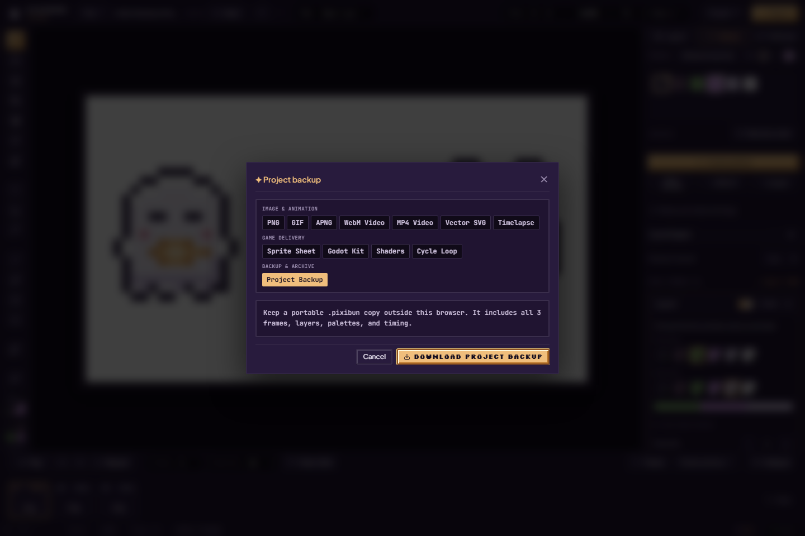
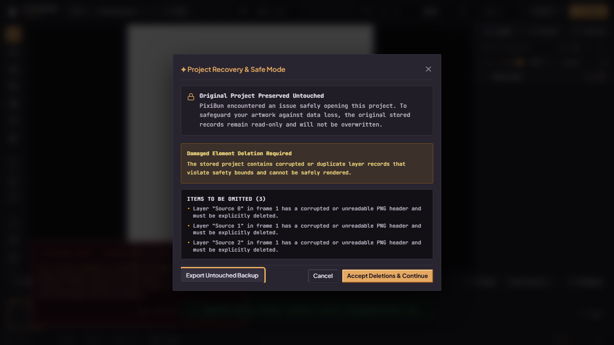
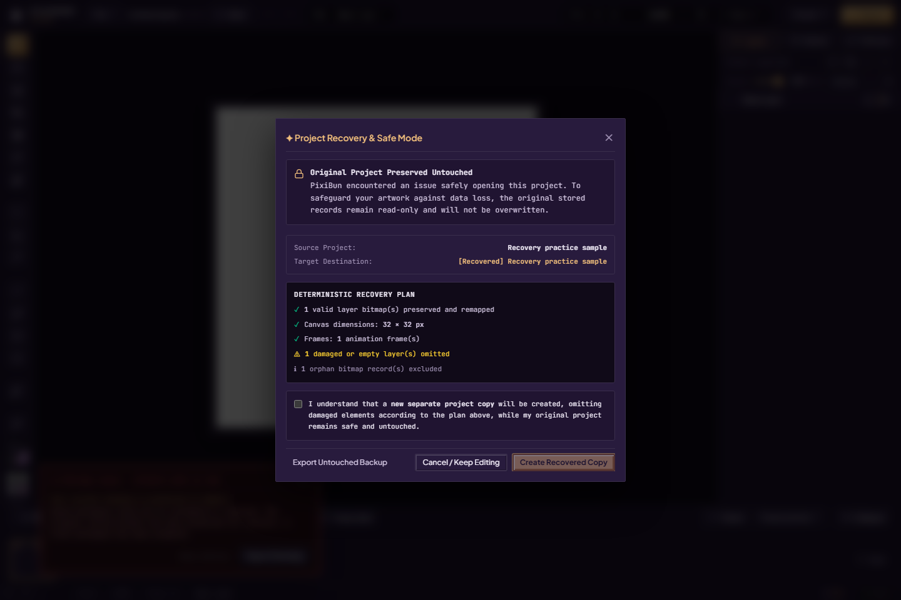
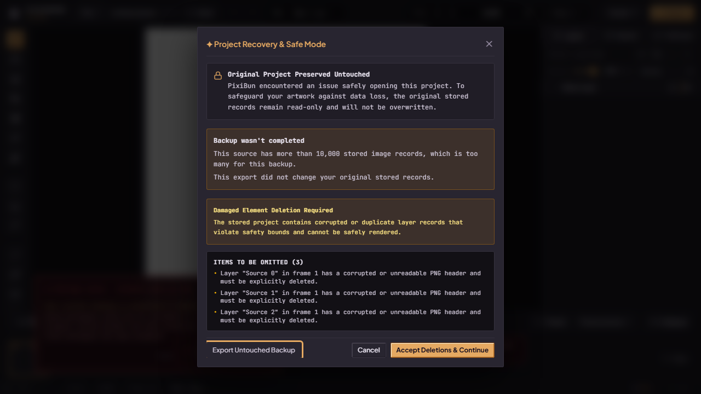

# Artwork safety and backup

PixiBun saves projects in this browser's IndexedDB. **Saved** means the latest completed local save, not a cloud copy or a downloaded project file. Clearing site data, browser eviction, private browsing and device loss can remove local projects. Persistent-storage requests can be refused.

Edits schedule autosave after an 800 ms debounce. Encoding and the transaction take additional time. Closing during that window can lose recent changes. Use the direct **Save** button or **Ctrl/Cmd+S**, wait for Saved, then create a portable backup for work you need to keep.

Use **Export → project backup** to save a `.pixibun` project file. That includes admitted raster artwork and supported project metadata. Exporting a PNG or GIF is an artwork output, not an editable-project backup. Picker cancellation is not a successful backup. Reopen a saved project file periodically to check that your backup works.

Some browsers open a native **Save** dialog for the project backup; others download through the browser. Choose a destination and finish the native dialog when shown. If it is cancelled, the drawing remains open but no backup was created. Automated Firefox download/re-import checks do not qualify interaction with Chromium's native OS picker.

Creating a project file does not confirm a browser-storage save. If browser saving failed, that warning remains even after downloading a backup. A failed file write reports an error and leaves the drawing open for retry. Closing an export stops pending work; reopening waits for its cleanup. Cancellation cannot retract a file write or download that already completed.

## Practicing without replacing your drawing

Desktop Playground saves a checkpoint of your original before opening separate practice. **Return to drawing** restores it; **Keep practice in Studio** saves a new project first. Practice has no autosave. A refresh loses unkept practice, while Return restores the saved original through normal admission. Session Undo/Redo and native-file handles are not portable. If the checkpoint or Keep fails, stay on the page and read the warning; your original is not replaced by practice. [Step-by-step practice and return](learning-and-playground.md#keep-your-drawing-try-something-new).

## Save and restore outcomes

*Project Backup in the local studio on 2 October 2026. Opening this panel is not a completed backup: download the file, keep it somewhere safe and reopen it to check it. [Capture details](../assets/screenshots/2026-10-02-docs/run.json).*

| State/outcome | Meaning and next action |
| --- | --- |
| Unsaved / dirty | The in-memory project has changes beyond the saved revision |
| Saving | A revision snapshot is encoding/writing; newer edits may queue another save |
| Saved | The completed revision matches the current project; newer edits are not falsely marked saved |
| Conflict / stale revision / deleted project | Another tab changed or removed the stored project. Keep the workspace open and use **Save a copy** to preserve both versions |
| Memory limit / invalid workspace | The save was refused; reduce the operation/workspace or keep a portable admitted backup |
| Quota / other failure | Work can remain in memory, but has not been committed. Make a backup before closing; review storage availability |
| Aborted / superseded restore | A cancelled or older load must not publish over the active workspace |

A conflict copy is a separate save that can itself fail. Do not treat clicking Save a copy as proof that a copy exists; wait for the result. Opening projects is under **File → Projects**. Failed admission or hydration should preserve the existing active artwork rather than blanking it.

In Projects, **Rename artwork** opens the title field. Save with its checkmark or **Enter**; **Escape** in the field cancels renaming and keeps the gallery open. The current drawing's rename saves through the same coordinator as its artwork. If the title cannot be saved, keep the drawing open and follow its save warning. A project changed since the gallery was loaded may need the gallery reopened before an inactive rename can be retried.

When using multiple tabs, reopening a page can restore the most recently opened project, including a conflict copy. Use **File → Projects** and select the original by name to check that specific saved drawing.

## Damaged stored projects

Recovery assessment reads the original records before decoding them. The Repair Wizard builds a separately admitted recovered copy and retains the source. Options and loss summaries depend on the assessed damage; not every corrupt raster can be reconstructed.

1. Keep the recovery dialog open and read the damage summary. Use **Export Untouched Backup** first to preserve the original records when that option is available.
2. If the assessment offers deletion of unreadable records, inspect the proposed loss before **Accept Deletions & Continue**. Acceptance does not reconstruct the missing pixels.
3. Read the recovery plan and its warnings. Check the stated frames/layers and prospective loss. The wizard does not promise reconstruction of an unreadable bitmap.
4. Tick the plan's consent checkbox only after reviewing it, then **Create Recovered Copy**. Wait for its actual outcome; a plan preview or button click is not a completed recovery.
5. Inspect the recovered drawing and make a normal Project Backup if useful. The source records are retained; an entirely unreadable project may have no viable recoverable artwork. **Cancel / Keep Editing** leaves the wizard without authorizing a copy.

*These pictures use deliberately damaged sample records in an isolated browser context. No real artist project was damaged, and the pictured recovered copy has not been created.*

An **untouched recovery ZIP** is a forensic archive of original metadata and raw records, with a manifest. It is different from a normal `.pixibun` export and is not promised to open as a repaired project. The file sink can stream; the in-memory fallback has a 250 MiB admission ceiling. Preserve the archive before destructive browser-storage cleanup.

If **Export Untouched Backup** reports too many stored records, no archive has been saved. The warning appears inside the recovery dialog. The export checks the current source again and refuses more than 10,000 records before loading their raster payloads. Keep the original browser storage intact and read the warning; retrying the same oversized source does not remove the limit. A successful earlier diagnosis does not guarantee a later export will fit. [Admission details](../contracts/storage.md#untouched-archive-admission).

*These two current recovery captures use temporary damaged fixtures in the compiled Chromium app. The first has an independently checked untouched ZIP download; neither depicts a completed repair. [Capture details](../assets/screenshots/2026-10-02-feature-repairs-phase6/run.json), [verification and limits](../research/2026-10-02-feature-repairs-phase6.md).*

Undo is session-local, bounded by independent depth caps and a combined 64 MiB payload budget. An oversized history-backed edit is refused before mutation. Process Replay reconstructs retained history and its eviction baseline; it is not a durable complete recording of every earlier stroke.

Implementation: [autosave](../../src/hooks/studio/useStudioAutosave.ts), [database](../../src/lib/storage/db.ts), [recovery admission](../../src/lib/recovery/projectAdmission.ts), [recovery orchestration](../../src/lib/recovery/recoveryOrchestrator.ts). For persistence compatibility see [storage](../contracts/storage.md).
