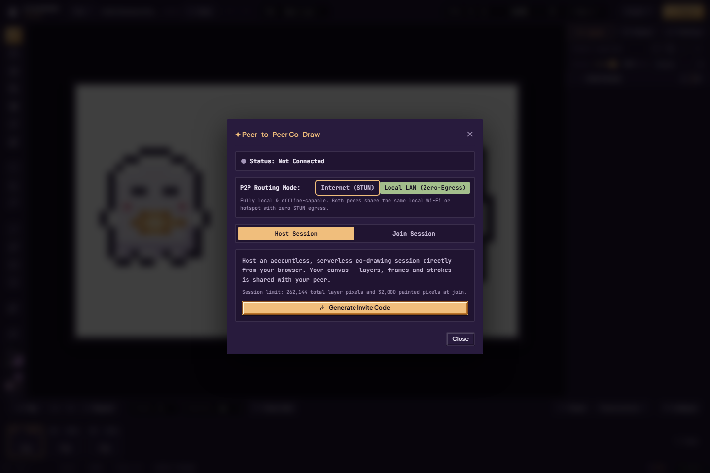
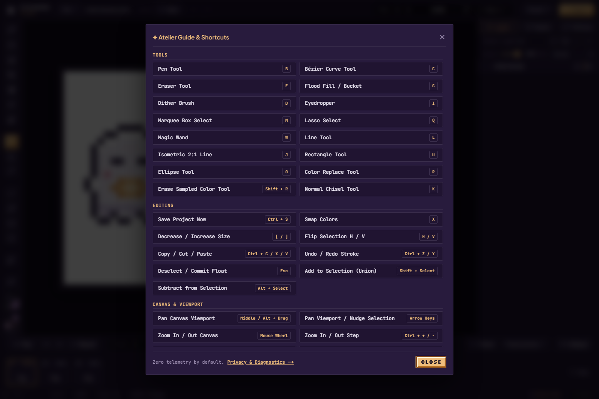
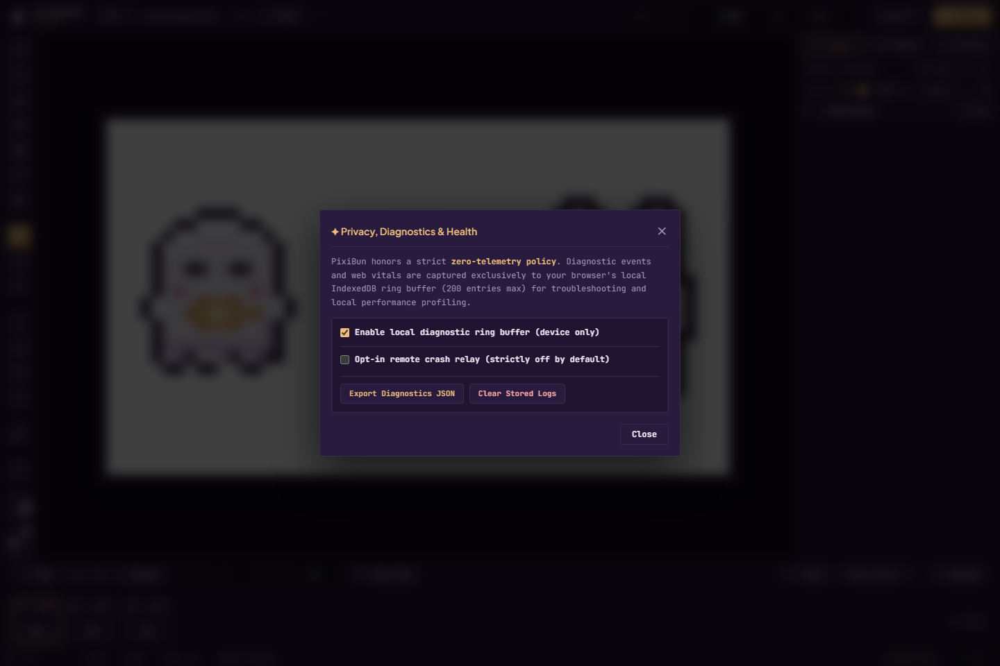

# Draw together, and know what stays here

[Handbook](README.md) · [Artwork safety](artwork-safety.md) · [Security policy](../../SECURITY.md) · [All features](../features.md)

## Co-Draw

Open **Studio → Co-Draw**. The current workflow connects **one host and one guest** using WebRTC and manually exchanged tokens. There is no account, lobby, multi-person room or cloud-sync service.

1. Both people should back up important work before joining. The host chooses the project that will be shared; the guest should preserve any local artwork before accepting that session's workspace.
2. Choose a routing mode. **Internet (STUN)** uses Google STUN to discover connection routes. **Local LAN** omits STUN and is intended for peers on the same reachable local network. Network/browser restrictions can prevent a connection; no general relay/TURN fallback is promised.
3. The host chooses **Host Session → Generate Invite Code**, then sends the invite to the intended partner through a channel they choose.
4. The guest chooses **Join Session**, pastes the host invite and generates an **Answer Token**. Send that token back to the host.
5. The host pastes the answer and completes the connection. Wait for **Connected** rather than treating a generated invite as success. Paint on the available layers; remote pixel updates and cursor indicators appear while the session is connected.
6. Use **Disconnect Session** to end the connection. Save local work and make a portable backup when you are done.

The host owns structural changes such as frames and layers; guests paint within the permitted structure. Initial session admission allows **262,144 total layer pixels** and **32,000 painted pixels at join**. This is a smaller workspace limit than ordinary local editing. Collaboration is an implemented protocol/integration; real two-machine, varied-network and long-session stress qualification remains pending. The screenshot shows initial controls, not a completed live connection.

Tokens can contain connection addresses and session information. Share them with the person joining your drawing. The canvas protocol is peer-to-peer; that does not mean visiting the website makes no network requests. Internet STUN contacts an external service, and the site still loads its application assets. “Local LAN (Zero-Egress)” describes the connection mode's STUN choice, not a proof that the whole deployed site is isolated from every external service.

## Local saves and offline drawing

Load Studio online first so the application/service-worker cache can be populated. The implemented warm-cache workflow supports drawing, editing and local persistence while offline. A first visit with no cached app cannot be assumed to work offline, and clearing the cache or site data can remove what the browser needs.

Browser install/home-screen options depend on browser support and deployment. An installed icon is still the web app using browser-managed storage; it does not create a native application or cloud backup. Use [Project Backup](artwork-safety.md) to preserve editable work outside that storage.

## Help and diagnostics

Open **Studio → Help**, or **?** when the canvas owns keyboard input. The guide lists tool/edit/view/animation shortcuts; its **Privacy & Diagnostics** link opens the settings below. **Ctrl/Cmd+K** is an alternative way to find commands by name.

| Control | What it does | A useful habit |
| --- | --- | --- |
| Enable local diagnostic ring buffer | Local diagnostic/performance records, enabled by default; bounded to 200 entries | Turn it off if you do not want ongoing local logging |
| Opt-in remote crash relay | Enables the optional reporting path; off by default; destination is operator-configured | Enable deliberately only when you want that reporting path |
| Export Diagnostics JSON | Downloads local records for inspection/sharing | Read the file before sharing it; free-text errors can include paths or context |
| Clear Stored Logs | Clears retained diagnostic records | This is separate from deleting your artwork/projects |

“Zero telemetry” in the in-app paragraph means remote reporting is off by default. Local logging does run by default; an opted-in configured relay can send reports. No upstream configuration means no forwarding to an upstream service. These distinctions are documented in the [security boundaries](../contracts/security-boundaries.md).

To report a vulnerability privately, follow [SECURITY.md](../../SECURITY.md) and contact **resquedzn05@gmail.com**. No response deadline or bounty is promised. Do not post sensitive project files, secrets or an exploit publicly just to obtain a troubleshooting record.

Sources: [Co-Draw dialog](../../src/components/modals/CoDrawModal.tsx), [remote cursors](../../src/components/studio/RemoteCursorsOverlay.tsx), [diagnostics dialog](../../src/components/modals/DiagnosticsModal.tsx), [help dialog](../../src/components/modals/ShortcutsModal.tsx), [service-worker route](../../src/app/sw.js/route.ts). For developer setup/deployment use the separate [deployment guide](deployment.md).
