# Drawing, one pixel at a time

For the tested revision and remaining accessibility, device and host checks, see the [current status](../current-status.md).

Animated tool previews appear on hover or focus. Activating a tool dismisses its preview immediately so the first drawing gesture can reach the canvas. The preview's Close and disable controls remain available while browsing tools.

[Handbook](README.md) · [Workspace and layers](studio-workspace.md) · [All features](../features.md)

Pick a tool from the left-hand toolbar. On shorter windows the toolbar folds related tools into one button (Lines and shapes first, then Selection, then Drawing; if that still does not fit, the buttons shrink from 40 to 36 px); click the button for the tool it shows, or its corner arrow or right-click for the rest of the group. The button keeps the last tool you used there, and letter shortcuts always work. Its controls appear along the top; some open under **tool options**, while brush size has its own small menu. Click a color swatch for your primary color. Right-click a swatch for your secondary color, and press **X** to swap them.

Work on the intended frame and a visible, unlocked layer. Most drawing tools change that layer's pixels; selecting a tool alone changes no artwork. On a hidden or locked layer, strokes, fills, shapes, curves and a selection's Cut, Delete, move or paste are refused with a message and change nothing; Eyedropper, Copy and making a selection still work. A moved or pasted selection drops back onto the layer it came from, or was pasted onto, even if you choose another layer before committing; if that layer has been locked or hidden meanwhile, the selection stays floating until it is editable. **Undo** or **Ctrl+Z** restores a committed drawing action while it remains in session history. A selected area can limit drawing. Clear it with **Esc** before painting elsewhere. [Shortcut details](../contracts/shortcuts.md) explain keyboard focus and selection exceptions.

Letter shortcut labels name QWERTY key positions, so a different keyboard layout can use the same positions. Symbols such as brackets follow your keyboard. Workspace shortcuts pause while a dialog is open or you are typing. By default, hold Space to pan, Alt-click to pick a color, Shift-click to draw a straight line from the last pixel and right-click to paint the secondary color; **Guide & Shortcuts** (`?`) can switch to the PixiBun classic keys. [Both keymaps](../contracts/shortcuts.md). On a landscape tablet wide enough for Studio (1024px+), one finger draws; extra fingers do not join that stroke. Use the zoom controls for the canvas. Browser gestures outside the drawing viewport keep their existing behavior.

There are **17 current toolbar tools**. The [15 October captures](../assets/screenshots/2026-10-15-current-ui/run.json) show the current tool settings. Choose **Tools** in the inspector to see the selected tool's controls. The pictures illustrate interface states; tested gestures have separate records.

## Pen

Press **B**, choose a color, then click for a dot or drag for a stroke. Open **Size** to choose a brush preset or enter a size; **[** and **]** adjust it from the canvas. **Clean corners** removes redundant L-corner pixels along a pen stroke. Leave it off when you want every corner you drew to remain. Mirror drawing is available in the top rail and [View options](studio-workspace.md#view-and-symmetry).

Clean corners follows the whole stroke across pointer samples. Repeated dwell samples are ignored; nonconsecutive revisits remain part of the path. A trailing stamp can be corrected at the next turn; its original pixels are restored, including mirrored brush footprints. Undo/Redo covers the committed stroke.

## Bézier Curve

Press **C**, choose a color and brush size, then drag between the start and end of your curve. **Tightness** sets the initial bend. After release, drag the start, end or bend handles to adjust the quadratic curve. **Apply (Enter)** bakes it into the initiating layer as one undoable edit; **Cancel (Esc)** discards the pending preview. Switching tools applies a valid pending curve. Switching frame, layer or project cancels it, and changed source pixels or a newly locked layer refuse publication. Moving a handle beyond the canvas clamps its position to the edge.

Immediately after Apply, **Re-edit Curve** reopens the latest curve by undoing that edit. It is available only while the source and latest history entry still match. Cancel ends that re-edit with the curve undone; **Redo** restores the committed curve. An unrelated edit invalidates re-edit so it cannot undo newer work. Keyboard input in dialogs, fields and focused buttons keeps its own behavior. This is a quadratic curve editor, not a multi-point vector path editor. The first picture shows current tool settings; the pending curve and adjustment handles appear below.

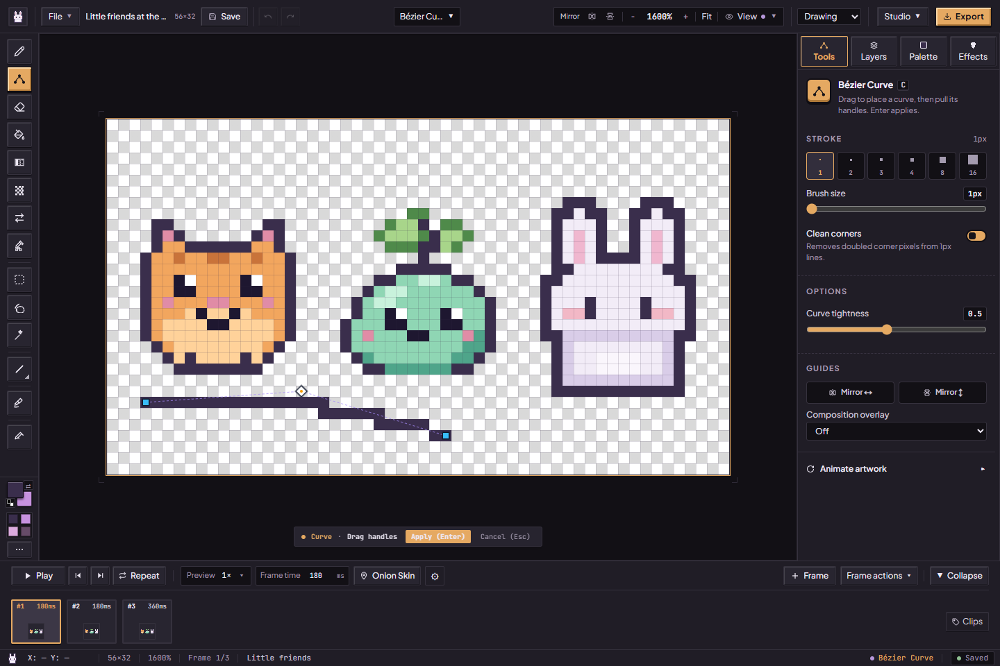

The current Curve keeps the color chosen at the start: start it with the right mouse button (hold **Shift** in the PixiBun classic keymap) to use the secondary well. Re-edit keeps the committed color even if the wells have changed. Explicitly changing the chosen well updates adjustment; changing the other well or brush size preserves the chosen color. Twelve native color cases passed across three engines, including exact Undo/Redo and saved reload for secondary cyan. The older `8c207b22` publication had the adjustment-color issue. The subsequent repair is integrated in main; those twelve checks retain their original source/build labels in [current status](../current-status.md#local-pre-s4-hardening-candidate).

## Eraser

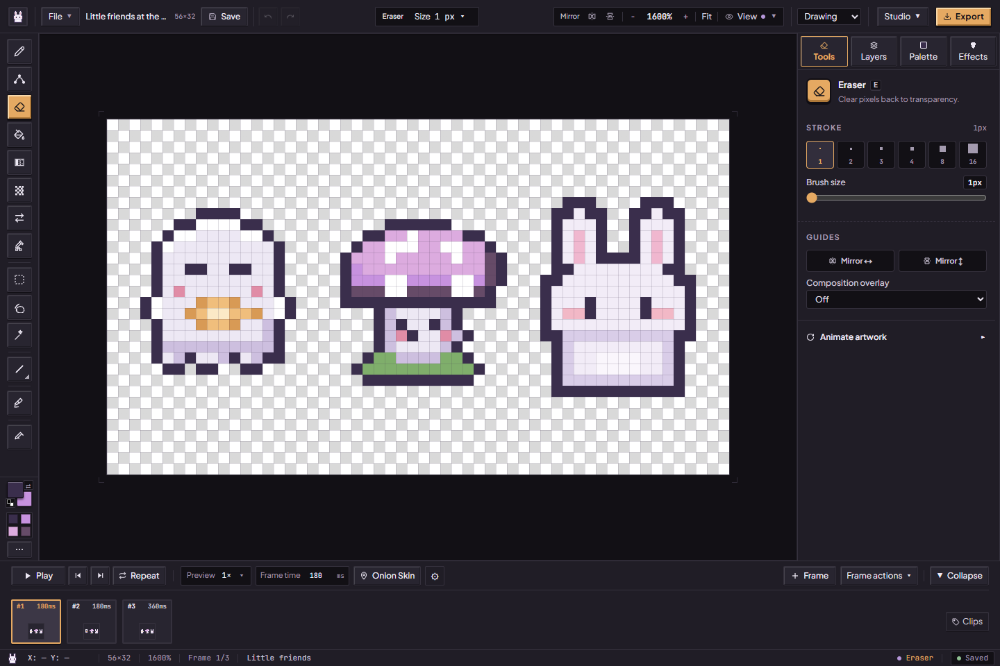

Press **E**, set the brush size, and drag over pixels to make them transparent on the active layer. This reveals lower layers or the checkerboard. For an entire matching color rather than a brush stroke, use [Erase Sampled Color](#erase-sampled-color). **E does not open Export**; Export is the button at the upper right.

## Flood Fill

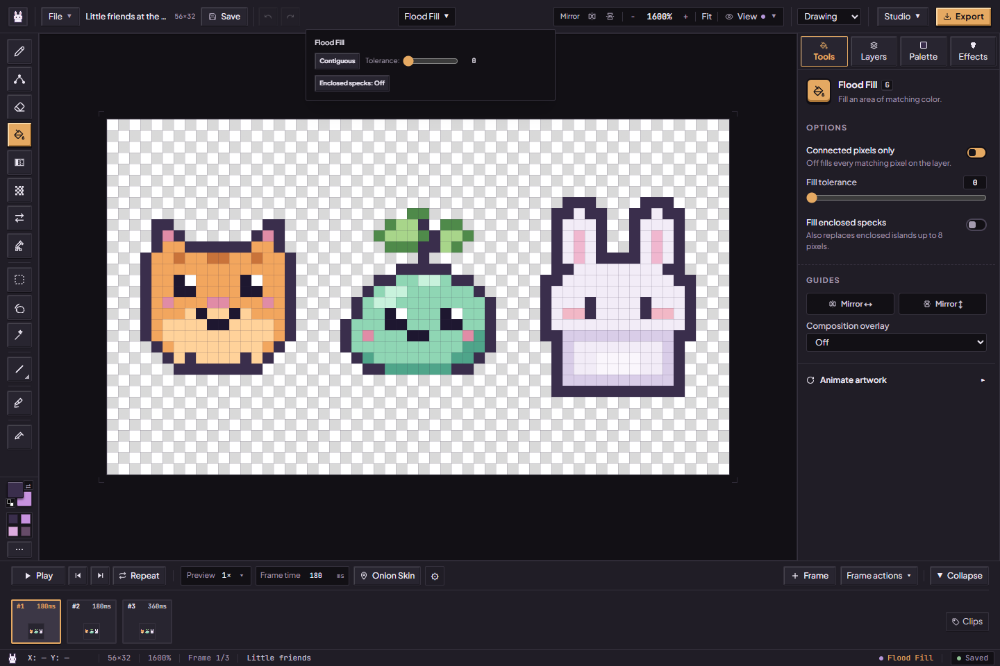

Press **G**, choose the replacement color and click an area. **Contiguous** fills a connected island; **Global Replace** finds matching colors across the active layer. Begin with low **Tolerance**, then increase it to include nearby shades; it measures red, green, blue and alpha together. If the fill crosses an outline, undo and lower tolerance. **Enclosed specks** can fill small color islands of up to eight pixels surrounded by the fill; it can also remove deliberate tiny details.

## Pixel Gradient

Press **Shift+G**, then choose the inspector's **Tools** tab. Drag a linear or radial gradient using foreground/background colors or the active palette in swatch order. Turn Bayer 4×4 dithering on for a patterned transition, or off for hard bands. The tool paints only the supplied RGB colors at full opacity; it does not introduce interpolated shades. A selection's actual mask constrains the fill. Without a selection it fills the active layer, including transparent pixels. Use an unlocked layer, inspect the preview, release to commit and Undo if needed. A zero-length drag or one-color palette does nothing. Drawing mirrors do not duplicate the fill.

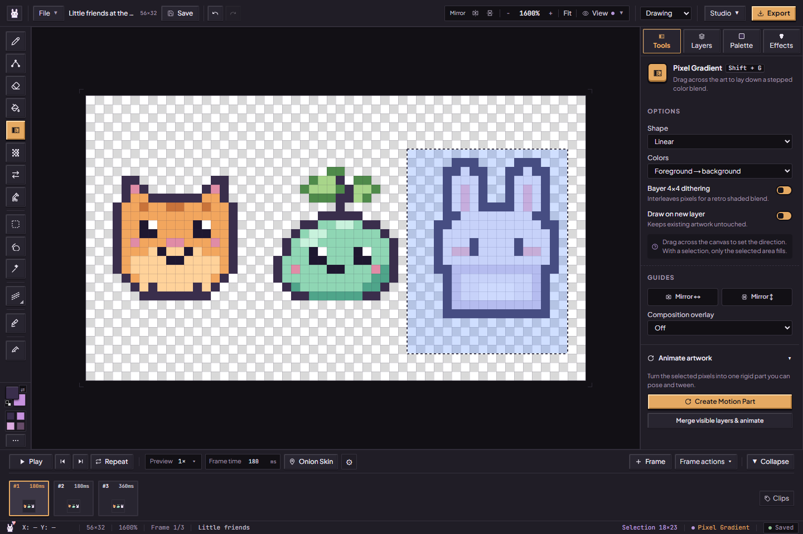

See [the gradient workflow](artist-workspace.md#draw-a-pixel-gradient) for ramp ordering, whole-layer scope and cancellation.

## Dither Brush

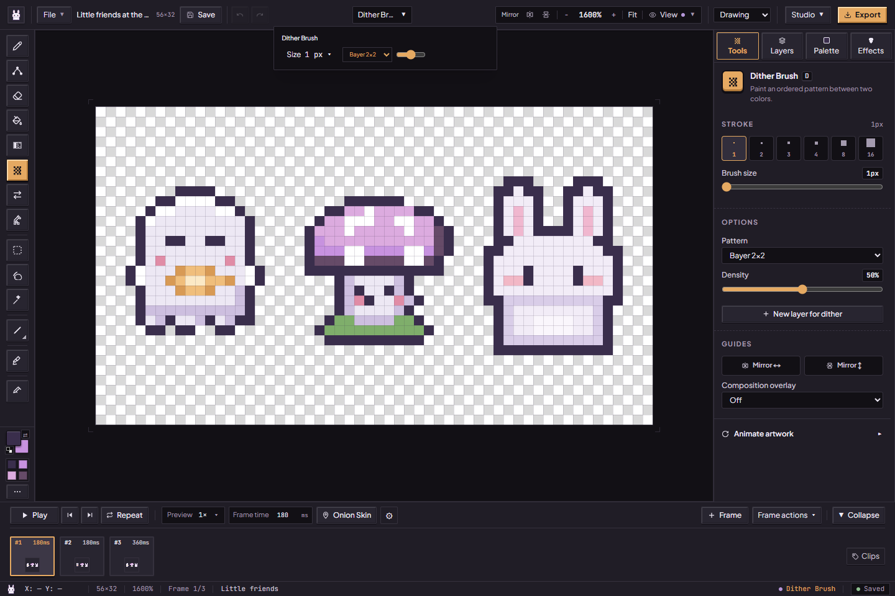

Press **D**, set your two colors and drag a patterned stroke. Choose **Bayer 2×2, 4×4 or 8×8**, **Blue Noise**, or **Atkinson** in the pattern menu; adjust **Density** and brush size to make the texture gentler or stronger. This paints a brush pattern. Whole-layer Atkinson and Smooth Dither previews live separately in [Clean and refine](pixitools-cleanup-and-tiles.md#color-moods-and-dithering).

Fast drags interpolate brush centers between received points instead of stamping only their endpoints. The pattern tests canvas coordinates, so a one-pixel brush keeps its pattern anchored as you draw. Larger sizes retain square stamp footprints.

## Color Replace

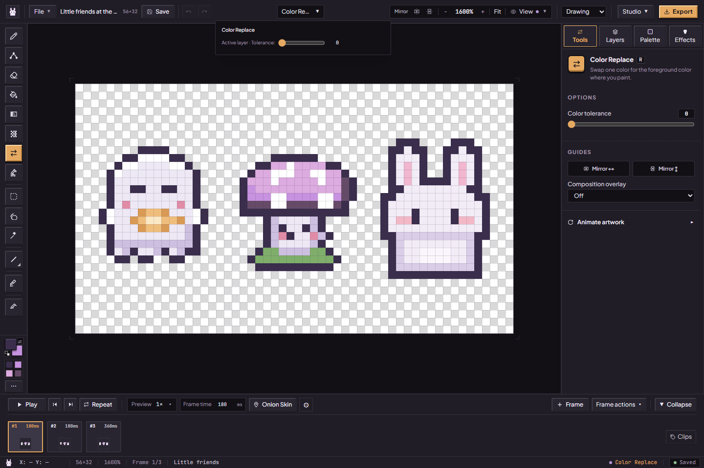

Press **R**, choose the new primary color, then click the color you want to replace in the artwork. Matching visible colors change on the active layer; other layers and transparent pixels are preserved. **Tolerance** widens the range to similar shades. It measures red, green and blue only, so each pixel keeps its own alpha. It is a color replacement action, rather than a brush that only changes pixels beneath the pointer. Start at zero when two details must keep separate colors.

## Erase Sampled Color

Press **Shift+R**, choose the matching settings, and click a visible color to remove it. **Connected** targets its connected region; **All matches** searches across the layer. **Color family** includes related shades and dark edge spill, protects neutral outlines, and enables searching all matching pixels. Tolerance widens the match, measuring red, green and blue together; with **Color family** on it widens the range of hues instead. These are heuristics, so inspect small details after using them.

Keep **This frame** selected for a first attempt. **All frames** finds one uniquely named counterpart with the same generated tag in every frame, regardless of stack order, and skips locked counterparts. A missing or ambiguous match refuses the batch; give counterparts matching unique names or choose This frame. Undo restores an admitted action. The tool removes pixels to transparency, rather than painting the background color.

## Marquee Box

Press **M** and drag a rectangle around the pixels you want to work with. Hold **Shift** to add another area or **Alt** to subtract one. Drag inside to move the selection; use its handles and action bar to transform it. See [moving and transforming selections](studio-workspace.md#selections-and-transforms) for copy, paste, flips, rotation and commit behavior.

## Lasso Select

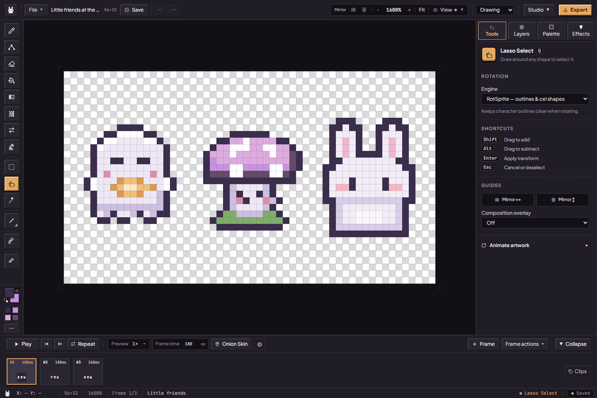

Press **Q** and draw around an irregular detail. The selection mask follows the enclosed shape; its rectangular bounds do not mean every pixel in that box is selected. Shift adds, Alt subtracts. Copying, flipping and rotating preserve the selection mask. Animation protection and research region tools save the **bounding rectangle**, so those regions can include pixels outside the lasso itself.

## Magic Wand

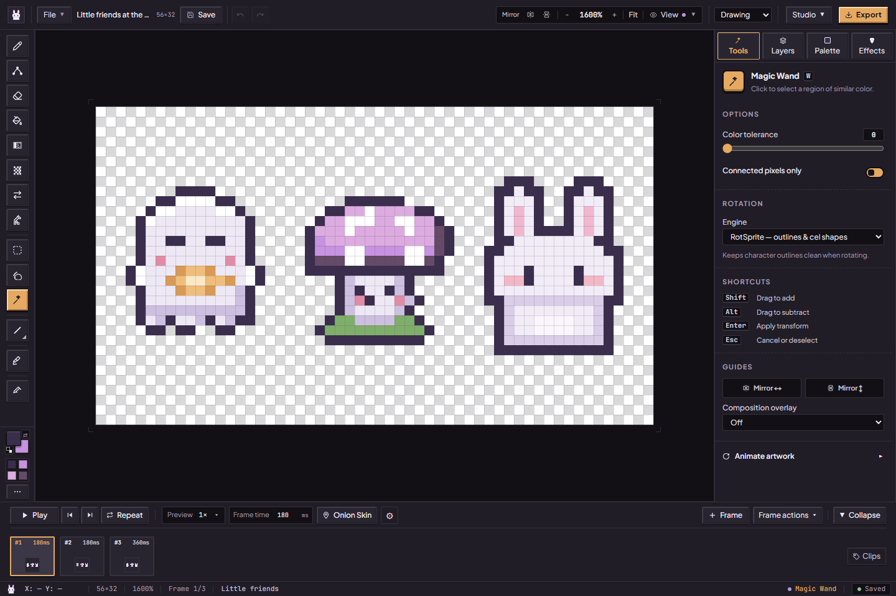

Press **W** and click a color region to select matching pixels. It shares **Color tolerance** with Color Replace and **Connected pixels only** with the Paint Bucket; set them under **Tools**, as the wand has no top-rail tolerance editor. The wand allows that difference in each channel, alpha included, while Color Replace measures red, green and blue together, so the same number selects and replaces slightly different ranges. The panel says which under each slider. Shift adds a region and Alt subtracts one. Review the outline before moving or deleting it, especially after changing matching settings in another tool.

## Line

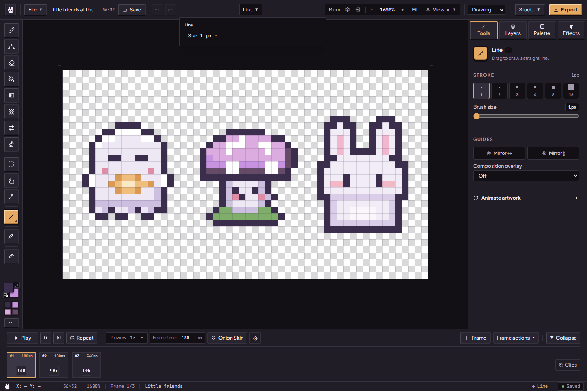

Press **L**, choose a color and size, then drag from one endpoint to the other. Reversing the same endpoints produces the same pixels, including half-step ties; clipping uses that same consistent endpoint order. The unsnapped Iso Line and Standard keymap's Shift-click straight segment share this rule. Freehand strokes retain their directional sampling. Line, Iso Line, Rectangle and Ellipse previews respect the active selection mask, brush footprint and drawing mirrors just as the committed stamps do. Release to commit the raster line. This is useful for borders and straight stems; choose the isometric line tool for a repeated two-across, one-up slope.

## 2:1 Iso Line

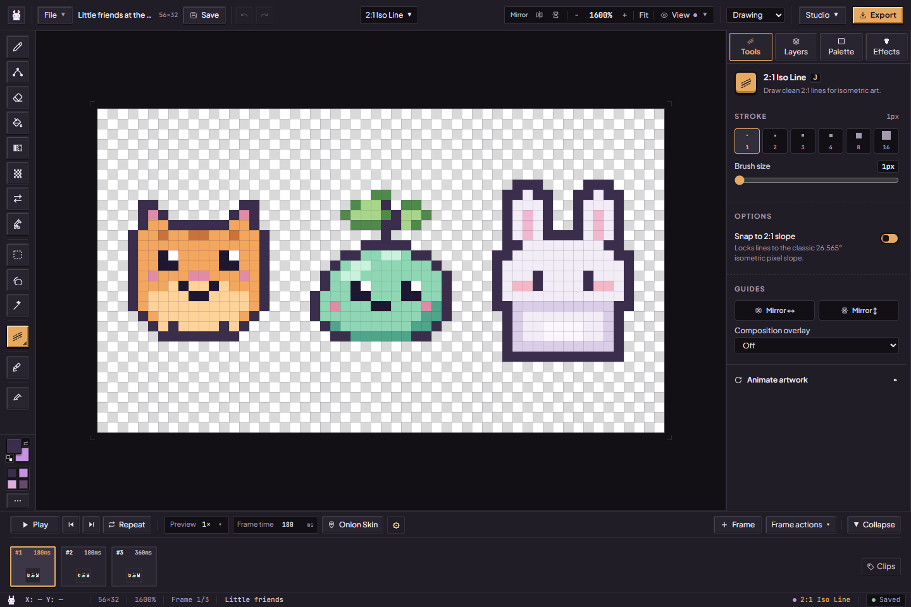

Press **J**, then open the **Isometric-line** tool-options button in the header. The **2:1 Snap** switch now controls both the preview while you drag and the pixels you leave when you release.

1. Leave **ON** for the familiar two-across, one-down diagonal. The endpoint is projected onto that slope, so it may finish beside your pointer. Pure horizontal and vertical drags stay straight.
2. Choose **FREE** for a line that follows your chosen endpoints, including shallow and steep slopes. It uses the same line path as **Line**.
3. Choose a brush size if you want a thicker stroke. Mirror H/V can draw a matching reflected stroke. Drag, release, and use **Ctrl+Z** or **Ctrl+Shift+Z** to Undo/Redo the finished pixels.
4. Turn on **View → Iso grid** (2:1 guides) if you would like a guide behind the artwork. The grid is only a viewing aid and is not included in exports.

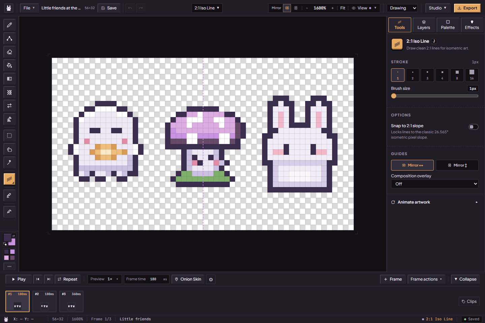

The [capture record](../assets/screenshots/2026-10-15-current-ui/run.json) identifies these current controls. Layer locks, playback and normal session/history limits still apply.

## Rectangle

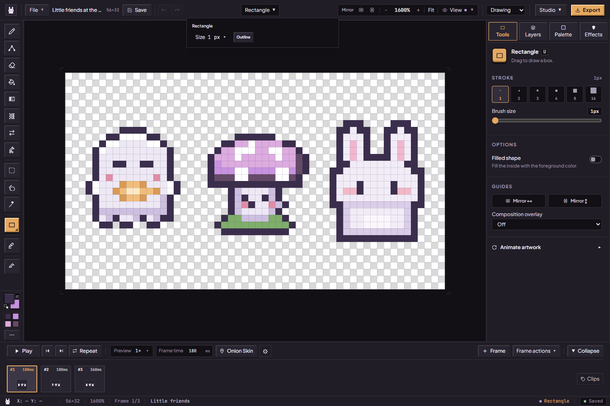

Press **U**, choose **Outline** or **Filled**, then drag opposite corners. Brush size controls the stroke thickness where applicable. Undo and redraw when you need another size; the committed rectangle becomes pixels, rather than a separately editable vector object.

## Ellipse

Press **O**, choose **Outline** or **Filled**, and drag its bounding rectangle. The result is a pixel ellipse on the active layer that touches all four sides of the dragged box, like the Rectangle tool's box: an 8×8 drag draws an 8×8 circle around a 2×2 centre, and a 9×9 drag a 9×9 circle around one centre pixel. At small sizes, inspect the staircase of pixels and touch it up with Pen if you want a particular silhouette.

## Normal Chisel

Press **K** to select the chisel. To paint safely, first open **Effects → Add light and depth → Shape the surface** and create or select an unlocked **surface/Normal** layer. Choose a direction, slope and bevel width, then paint raised or recessed edges there. It encodes surface directions as color values for lighting, rather than painting the sprite's visible colors. [The full surface guide](lighting-and-surfaces.md#shape-the-surface) shows the active controls and explains the blend modes.

## Eyedropper

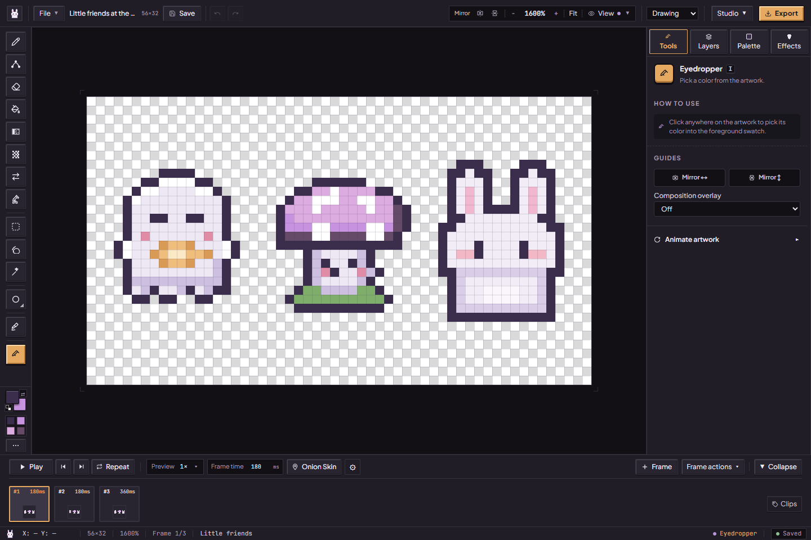

Press **I** and click a visible pixel to pick its color for drawing. It changes the selected drawing color, rather than recoloring the artwork. Return to **B** to use that color with Pen. If you want to collect a small palette from the whole frame, use [Palette → Create palette → From artwork](palettes-and-cycling.md).

## If a tool seems quiet

Check the active frame, selected layer, lock state and selection mask first. A chisel needs a surface layer; a transform needs a selection; preview playback can also obscure the frame you meant to edit. A small admission error is a reason to reduce size or scope, not evidence that all browser memory is exhausted. Keep a [portable backup](artwork-safety.md) before a long session.

Implementation references: [canonical tool list](../../src/config/shortcuts.ts), [rail controls](../../src/components/layout/AtelierRail.tsx), [pointer dispatch](../../src/hooks/viewport/useViewportPointerEvents.ts), [shape gestures](../../src/hooks/viewport/useShapePointerHandler.ts), [selection matching](../../src/hooks/viewport/useSelectionPointerHandler.ts).
