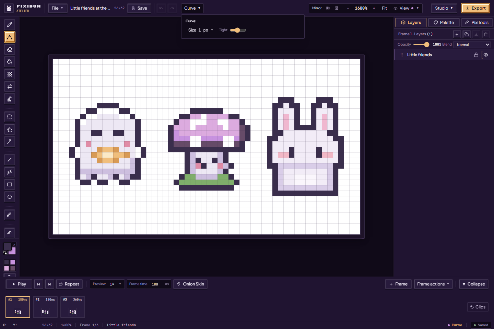
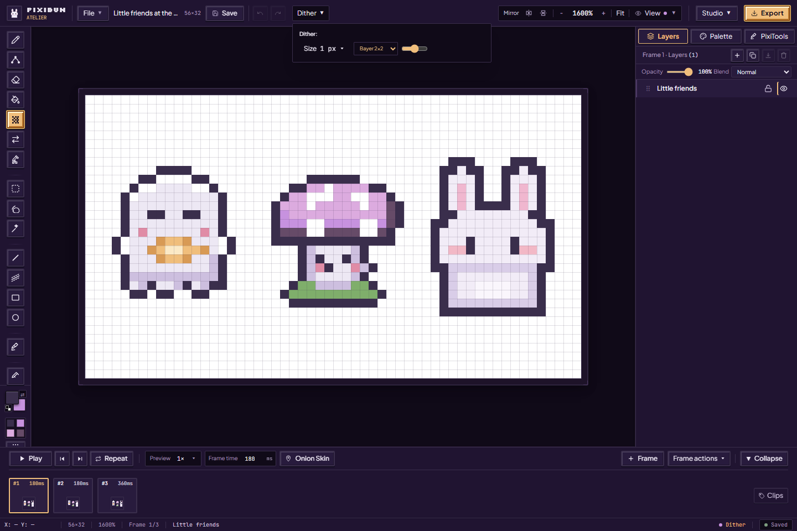
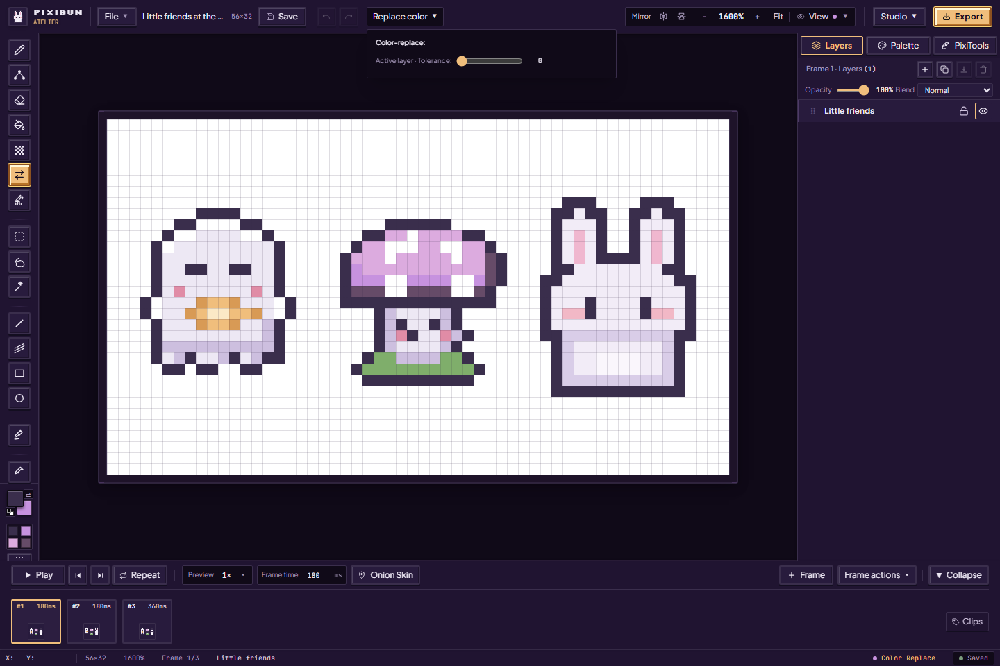
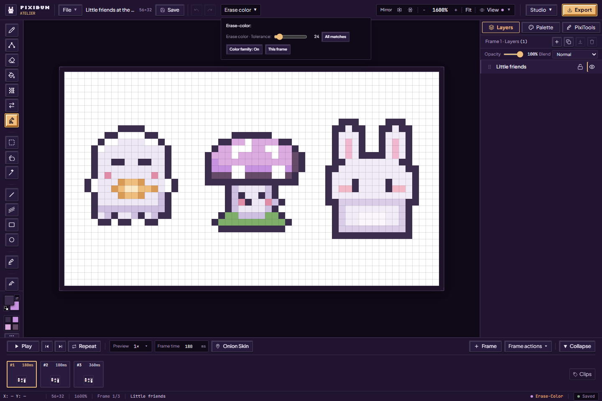
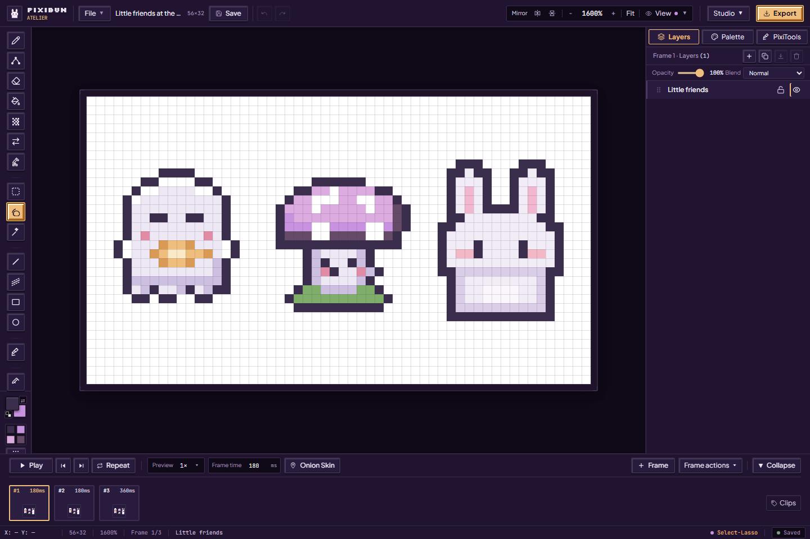
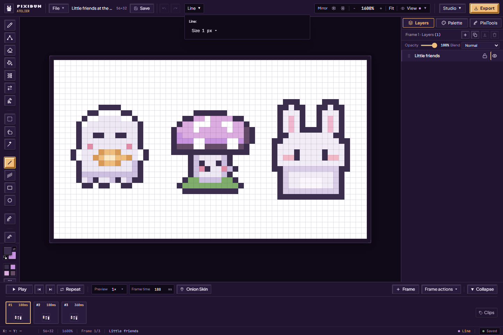
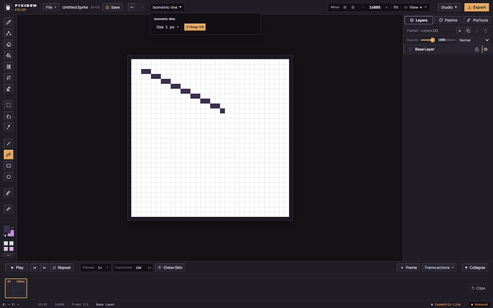
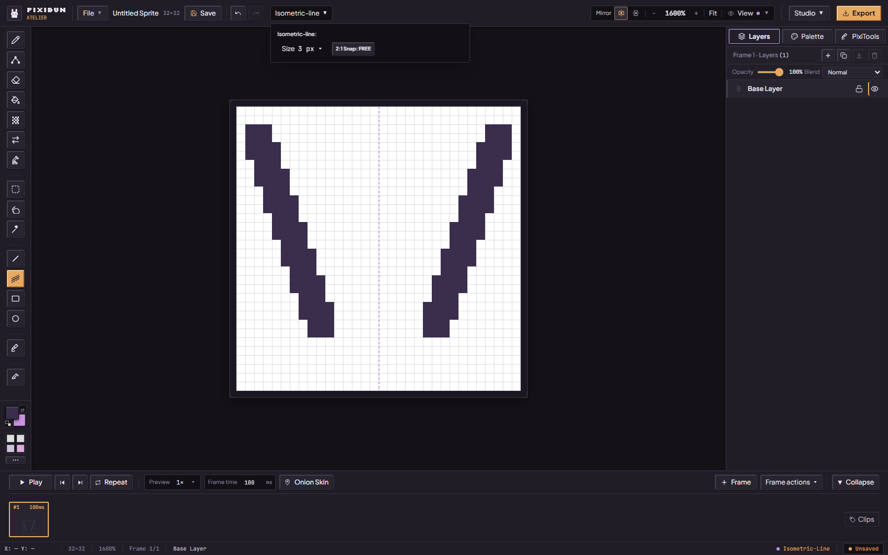
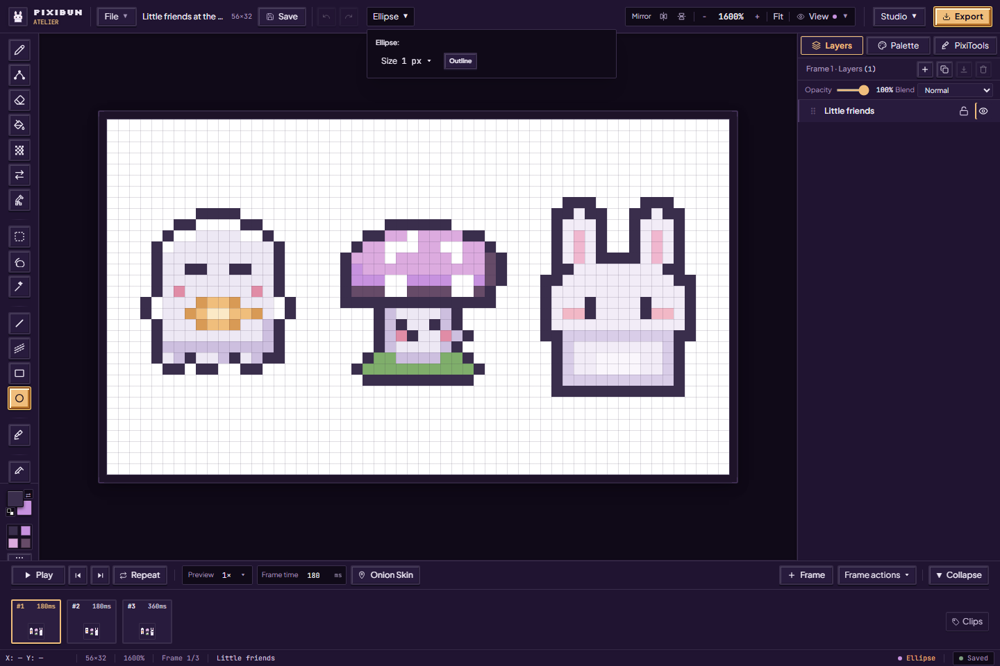
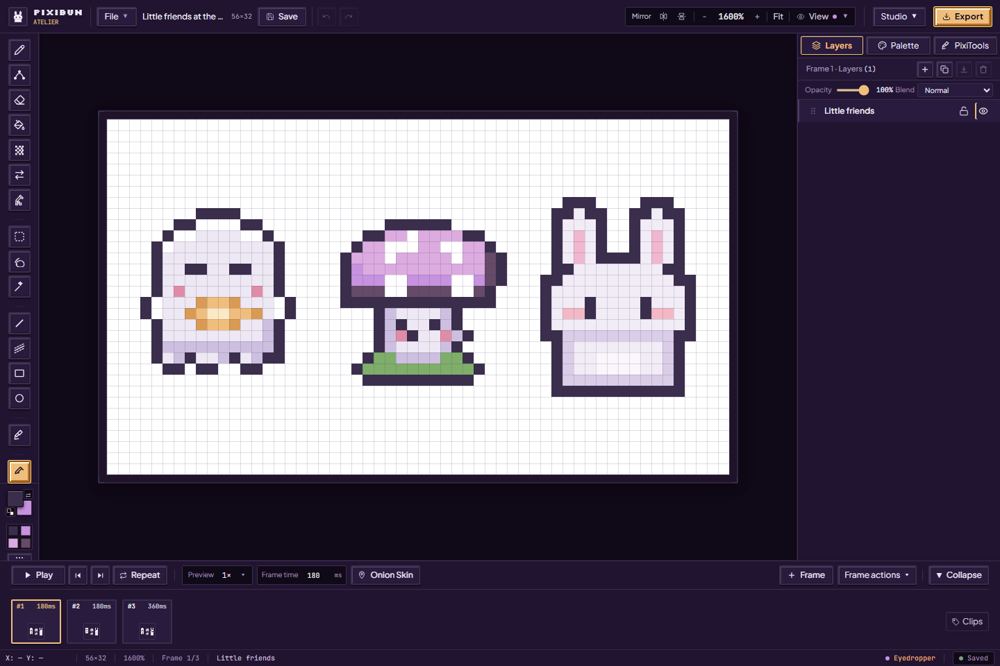

# Drawing, one pixel at a time

[Handbook](README.md) · [Workspace and layers](studio-workspace.md) · [All features](../features.md)

Pick a tool from the left-hand toolbar. Its controls appear along the top; some open under **tool options**, while brush size has its own small menu. Click a color swatch for your primary color. Right-click a swatch for your secondary color, and press **X** to swap them.

Work on the intended frame and an unlocked layer. Most drawing tools change that layer's pixels; selecting a tool alone changes no artwork. **Undo** or **Ctrl+Z** restores a committed drawing action while it remains in session history. A selected area can limit drawing. Clear it with **Esc** before painting elsewhere. [Shortcut details](../contracts/shortcuts.md) explain keyboard focus and selection exceptions.

The illustrations below show each of the **16 current toolbar tools** selected in the real studio. They show available controls, rather than claiming that every possible gesture was tested in this capture. [Capture record](../assets/screenshots/2026-10-02-feature-guide/run.json).

## Pen

Press **B**, choose a color, then click for a dot or drag for a stroke. Open **Size** to choose a brush preset or enter a size; **[** and **]** adjust it from the canvas. **Clean corners** removes redundant L-corner pixels along a pen stroke. Leave it off when you want every corner you drew to remain. Mirror drawing is available in the top rail and [View options](studio-workspace.md#view-and-symmetry).

## Bézier Curve

Press **C**, choose a color and brush size, then drag between the start and end of your curve. **Tightness** changes the generated bend. This is a drag-based curve tool; it does not expose a path editor with independently movable control points. Undo and redraw if the bend does not suit your sprite.

## Eraser

Press **E**, set the brush size, and drag over pixels to make them transparent on the active layer. This reveals lower layers or the checkerboard. For an entire matching color rather than a brush stroke, use [Erase Sampled Color](#erase-sampled-color). **E does not open Export**; Export is the button at the upper right.

## Flood Fill

Press **G**, choose the replacement color and click an area. **Contiguous** fills a connected island; **Global Replace** finds matching colors across the active layer. Begin with low **Tolerance**, then increase it to include nearby shades. If the fill crosses an outline, undo and lower tolerance. **Enclosed specks** can fill small color islands of up to eight pixels surrounded by the fill; it can also remove deliberate tiny details.

## Dither Brush

Press **D**, set your two colors and drag a patterned stroke. Choose **Bayer 2×2, 4×4 or 8×8**, **Blue Noise**, or **Atkinson** in the pattern menu; adjust **Density** and brush size to make the texture gentler or stronger. This paints a brush pattern. Whole-layer Atkinson and Smooth Dither previews live separately in [Clean and refine](pixitools-cleanup-and-tiles.md#color-moods-and-dithering).

## Color Replace

Press **R**, choose the new primary color, then click the color you want to replace in the artwork. Matching visible colors change on the active layer; other layers and transparent pixels are preserved. **Tolerance** widens the range to similar shades. It is a color replacement action, rather than a brush that only changes pixels beneath the pointer. Start at zero when two details must keep separate colors.

## Erase Sampled Color

Press **Shift+R**, choose the matching settings, and click a visible color to remove it. **Connected** targets its connected region; **All matches** searches across the layer. **Color family** includes related shades and dark edge spill, protects neutral outlines, and enables searching all matching pixels. Tolerance widens the match. These are heuristics, so inspect small details after using them.

Keep **This frame** selected for a first attempt. **All frames** edits the same layer position in each frame and skips locked layers; a layer with the same name elsewhere is not automatically the target. Undo restores an admitted action. The tool removes pixels to transparency, rather than painting the background color.

## Marquee Box

Press **M** and drag a rectangle around the pixels you want to work with. Hold **Shift** to add another area or **Alt** to subtract one. Drag inside to move the selection; use its handles and action bar to transform it. See [moving and transforming selections](studio-workspace.md#selections-and-transforms) for copy, paste, flips, rotation and commit behavior.

## Lasso Select

Press **Q** and draw around an irregular detail. The selection mask follows the enclosed shape; its rectangular bounds do not mean every pixel in that box is selected. Shift adds, Alt subtracts. Copying, flipping and rotating preserve the selection mask. Animation protection and research region tools save the **bounding rectangle**, so those regions can include pixels outside the lasso itself.

## Magic Wand

Press **W** and click a color region to select matching pixels. Its implementation shares the stored color-match tolerance and contiguous setting with the related fill/color controls; the wand has no separate top-rail tolerance editor. Shift adds a region and Alt subtracts one. Review the outline before moving or deleting it, especially after changing matching settings in another tool.

## Line

Press **L**, choose a color and size, then drag from one endpoint to the other. Release to commit the raster line. This is useful for borders and straight stems; choose the isometric line tool for a repeated two-across, one-up slope.

## 2:1 Iso Line

Press **J**, then open the **Isometric-line** tool-options button in the header. The **2:1 Snap** switch now controls both the preview while you drag and the pixels you leave when you release.

1. Leave **ON** for the familiar two-across, one-down diagonal. The endpoint is projected onto that slope, so it may finish beside your pointer. Pure horizontal and vertical drags stay straight.
2. Choose **FREE** for a line that follows your chosen endpoints, including shallow and steep slopes. It uses the same line path as **Line**.
3. Choose a brush size if you want a thicker stroke. Mirror H/V can draw a matching reflected stroke. Drag, release, and use **Ctrl+Z** or **Ctrl+Shift+Z** to Undo/Redo the finished pixels.
4. Turn on **View → 2:1 Iso Grid** if you would like a guide behind the artwork. The grid is only a viewing aid and is not included in exports.

The [phase 3 capture record](../assets/screenshots/2026-10-02-feature-repairs-phase3/run.json) identifies these current controls. Layer locks, playback and normal session/history limits still apply.

## Rectangle

Press **U**, choose **Outline** or **Filled**, then drag opposite corners. Brush size controls the stroke thickness where applicable. Undo and redraw when you need another size; the committed rectangle becomes pixels, rather than a separately editable vector object.

## Ellipse

Press **O**, choose **Outline** or **Filled**, and drag its bounding rectangle. The result is a pixel ellipse on the active layer. At small sizes, inspect the staircase of pixels and touch it up with Pen if you want a particular silhouette.

## Normal Chisel

Press **K** to select the chisel. To paint safely, first open **PixiTools → Add light and depth → Shape the surface** and create or select an unlocked **surface/Normal** layer. Choose a direction, slope and bevel width, then paint raised or recessed edges there. It encodes surface directions as color values for lighting, rather than painting the sprite's visible colors. [The full surface guide](lighting-and-surfaces.md#shape-the-surface) shows the active controls and explains the blend modes.

## Eyedropper

Press **I** and click a visible pixel to pick its color for drawing. It changes the selected drawing color, rather than recoloring the artwork. Return to **B** to use that color with Pen. If you want to collect a small palette from the whole frame, use [Palette → Create palette → From artwork](palettes-and-cycling.md).

## If a tool seems quiet

Check the active frame, selected layer, lock state and selection mask first. A chisel needs a surface layer; a transform needs a selection; preview playback can also obscure the frame you meant to edit. A small admission error is a reason to reduce size or scope, not evidence that all browser memory is exhausted. Keep a [portable backup](artwork-safety.md) before a long session.

Implementation references: [canonical tool list](../../src/config/shortcuts.ts), [rail controls](../../src/components/layout/AtelierRail.tsx), [pointer dispatch](../../src/hooks/viewport/useViewportPointerEvents.ts), [shape gestures](../../src/hooks/viewport/useShapePointerHandler.ts), [selection matching](../../src/hooks/viewport/useSelectionPointerHandler.ts).
