# Take your pixels with you

For the tested revision and remaining accessibility, device and host checks, see the [11 October validation handoff](../research/2026-10-11-validation-handoff.md).

[Handbook](README.md) · [Backup safety](artwork-safety.md) · [Format contract](../contracts/exports.md) · [All features](../features.md)

Choose **Export** at the upper right. The panel has **12 format choices**, grouped into images/animation, game delivery and backup. Choose the kind of file you need, review its settings, then use the download action. Opening this panel does not mean a file has been saved: check your browser's downloads and open the result.

Video availability is checked when you choose a video format. You can open image, game-delivery and backup options without waiting for a video codec check. For Timelapse MP4, availability follows your chosen replay frame rate.

When **Export Scope** appears, review **All Frames** versus a named clip. Animated files use the relevant ordered poses and holds. A **PNG** or **Vector SVG** still uses the **active frame**, even when a clip-scope selector is visible; choosing a clip does not turn a still image into a multi-frame file. Timelapse uses retained history, and Project Backup includes the whole admitted project.

## PNG

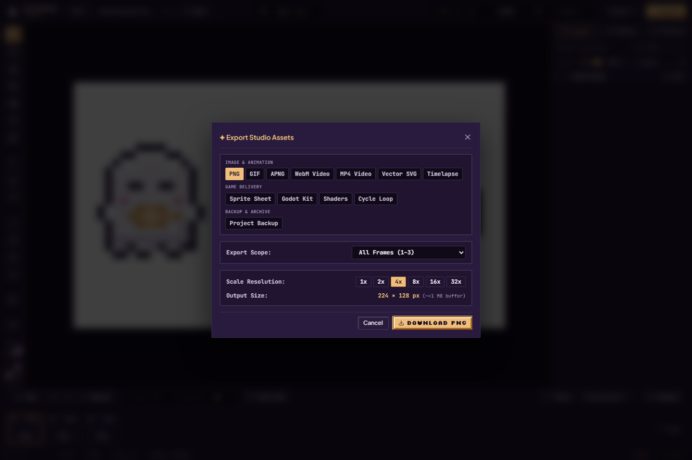

Choose **PNG**, pick 1×, 2×, 4×, 8×, 16× or 32× where admitted, and download. It exports the visible composite of the active frame with transparency and crisp nearest-neighbor scaling. Use 1× for native pixels, or a larger integer scale for sharing. It preserves the image, not separate editable layers, animation or the Undo history.

## GIF

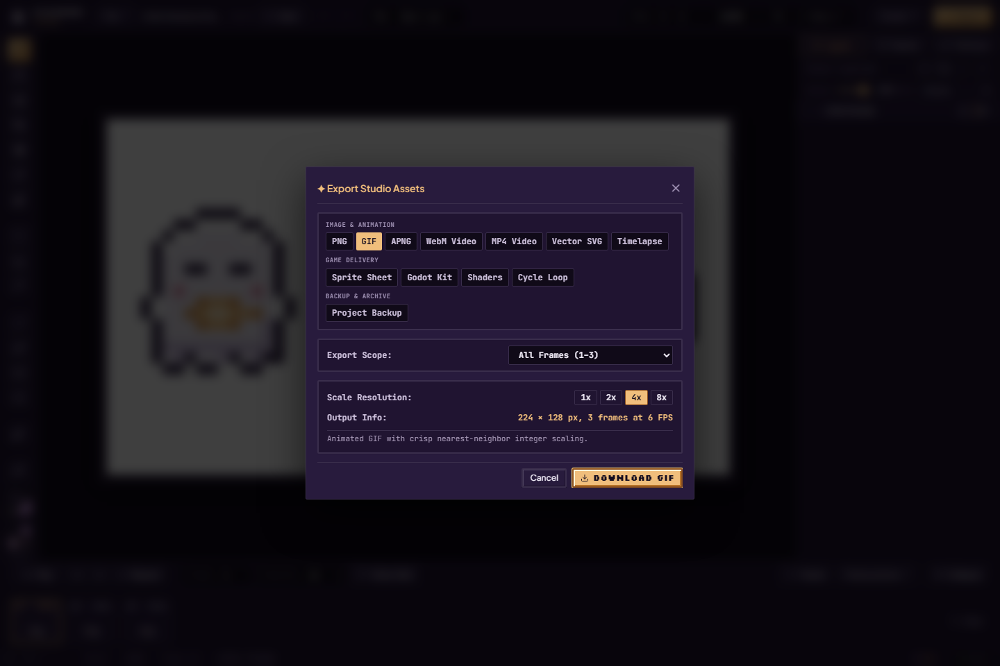

Choose **GIF**, review the frame scope and 1×–8× scale, then export. GIF is convenient for sharing a loop, but colors are quantized to its palette and transparency is binary. Holds are rounded to centiseconds, so very short or uneven timings can look different. Use APNG when full RGBA transparency and more precise frame delays matter.

## APNG

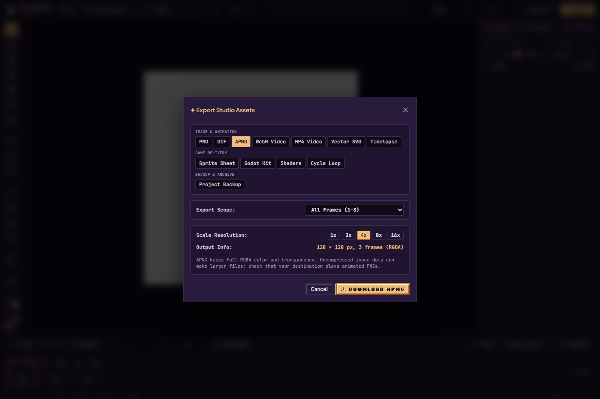

Choose **APNG**, scope and an admitted 1×–16× scale, then export. The generated animated PNG uses full RGBA frames and rational frame delays. It downloads with a **`.png` extension**; it can still be animated. Native browser compression is used where available, with a stored-block fallback; file size depends on the artwork and browser. Encoding yields between frames. Press **Escape** or close the export dialog to cancel while progress is active; the disabled Cancel button is not available during this operation. Wait for the operation's result before starting another export. Check the destination viewer's animation support rather than mistaking a still preview for a missing animation.

## WebM Video

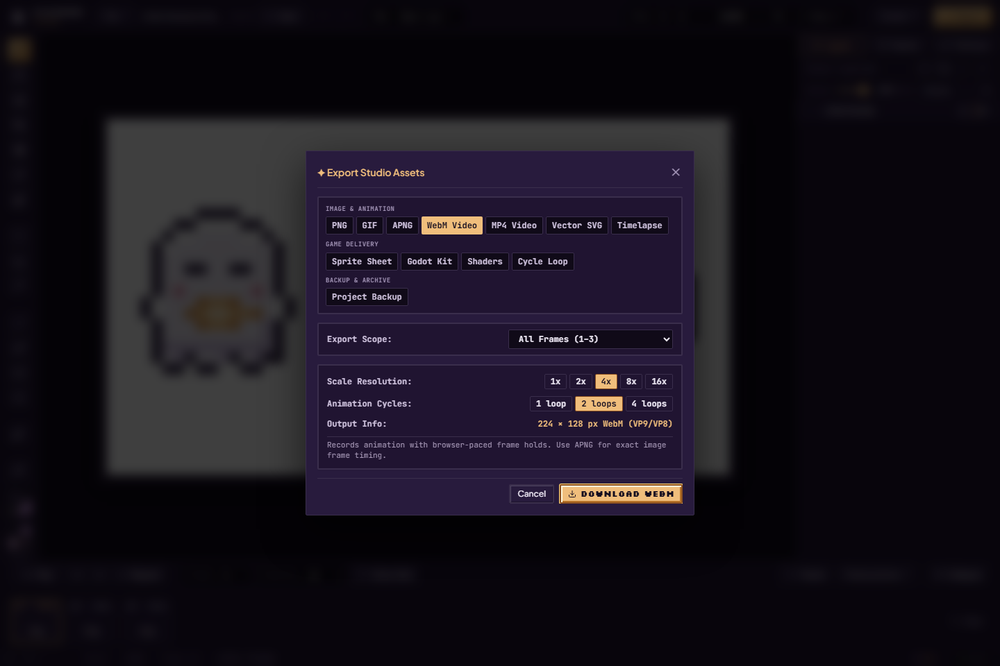

Choose **WebM Video**, scope, scale and 1 / 2 / 4 animation cycles. Export records via supported canvas/MediaRecorder capabilities. Keep the page running while recording. Codec availability and real-time scheduling matter; arbitrary transparency preservation is not promised. If unavailable, use the panel's GIF/APNG alternatives.

## MP4 Video

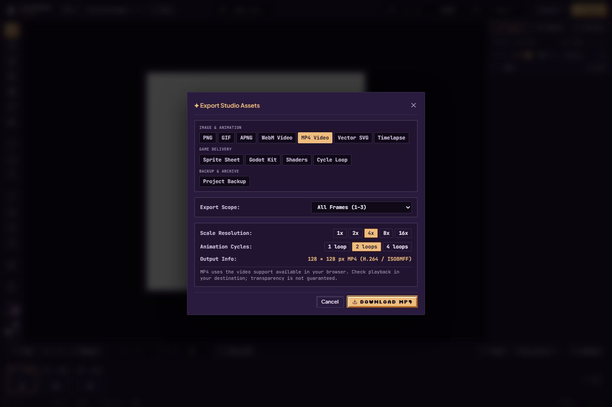

Choose **MP4 Video**, scope, admitted scale and animation cycles. Supported configurations use H.264 WebCodecs with an MP4 writer, or a supported recording fallback. Odd output dimensions are padded to even values without rescaling the pixels. Alpha is not generally guaranteed. An unsupported browser/configuration disables this path; choose WebM, GIF or APNG instead.

## Sprite Sheet

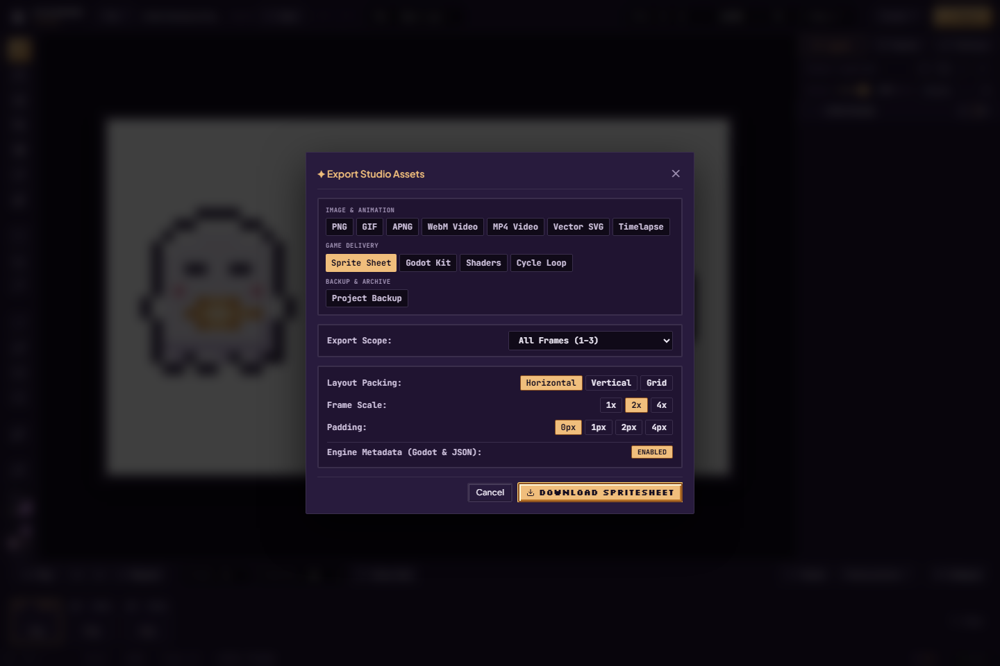

1. Choose **Sprite Sheet** and the frame scope.
2. Select Horizontal, Vertical or Grid packing, 1× / 2× / 4× scale and 0 / 1 / 2 / 4 px padding.
3. Enable **Engine Metadata** when you need frame/clip descriptions. The current download path emits the sheet PNG plus supported Godot `.tres` and JSON metadata; allow multiple browser downloads and keep the files together.
4. Import and check the pose order, holds, names and nearest filtering in your consumer.

The PNG alone does not describe animation holds. The JSON download prefers the TexturePacker representation; source helpers for other targets do not mean separate downloadable Unity/Phaser packages appear in this dialog. Broad target-engine compatibility remains something to verify.

## Godot Kit

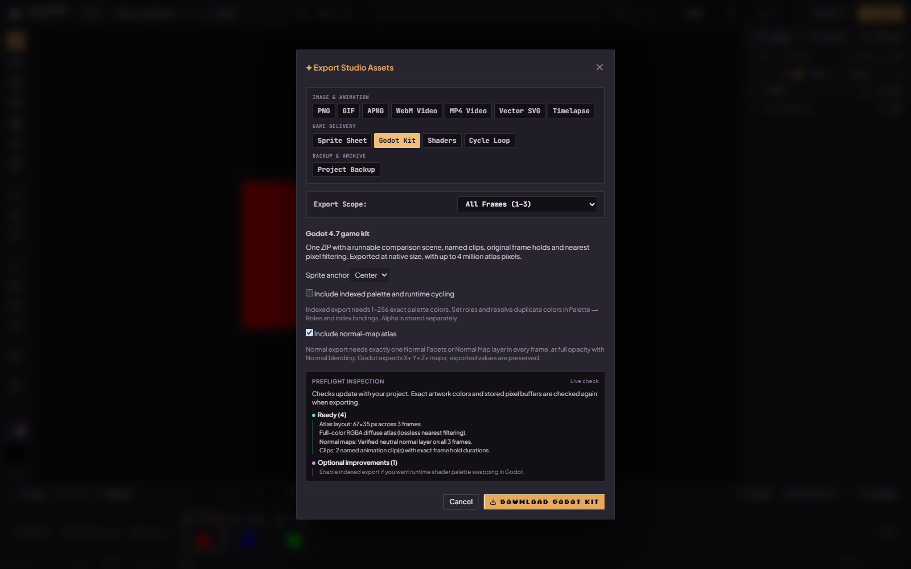

Choose **Godot Kit** for a ZIP targeting **Godot 4.7**. Set the anchor to **Center** or **Feet**, choose optional indexed cycling / normal atlas, then read **Preflight inspection**. It includes a runnable comparison scene, named clips, frame holds and native-size nearest-filtered artwork; atlas admission is up to four million pixels.

For indexed export, every visible source RGB must have an exact admitted palette entry. Palettes have 1–256 registers; resolve duplicate-color ambiguity with [roles and index bindings](palettes-and-cycling.md#roles-and-index-bindings). Register bytes and alpha are separate data textures. There is no hidden quantization to rescue non-palette colors.

Normal export accepts exactly one **Normal Facets**, baked **Normal Map**, or matching normal-map effect layer per exported frame, at full opacity with Normal blending. A hidden data layer is accepted too. If a frame has both manual and baked normals, choose which to keep before exporting; the kit refuses ambiguous sources. The chosen normal layer is kept out of the diffuse image. Godot expects X+ Y+ Z+ data. Stored values are preserved; the exporter does not automatically flip an imported green channel. Check the source convention before export. Guessed/generated lighting is not guaranteed correct.

Download, unpack and open `project.godot` in the intended Godot version. Compare the original and runtime views. This guide's screenshot shows preflight controls, not a fresh Godot execution. [Earlier engine evidence](../research/phase-implementation-status.md) and the [manual-normal import/resource/pixel checks](../research/2026-10-02-feature-repairs-phase4.md) apply only to their named builds, versions and fixtures. Rendered manual-normal lighting remains unverified. Unity/Phaser are not included as runnable kits here.

## Timelapse

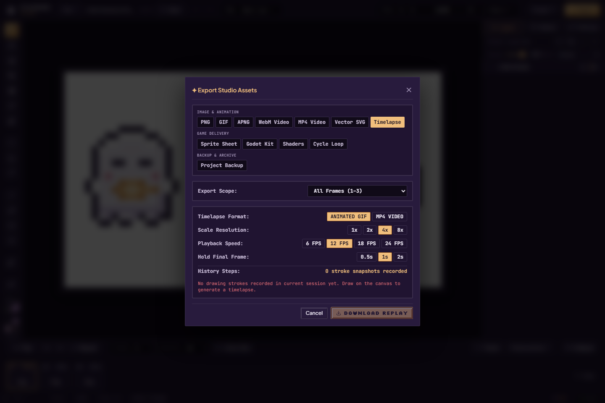

Choose **Timelapse** after making edits in this session. Select Animated GIF or supported MP4, scale, 6 / 12 / 18 / 24 playback FPS and a 0.5 / 1 / 2 second final hold. Read the **History Steps** count and any **Earlier Steps Evicted** notice before downloading.

It reconstructs retained drawing history and an eviction baseline. It is not a complete recording from a blank canvas, and reopening a saved project does not restore the old Undo session. A freshly imported untouched project can have no replay steps and a disabled download. That state is shown honestly in the sample screenshot.

## Vector SVG

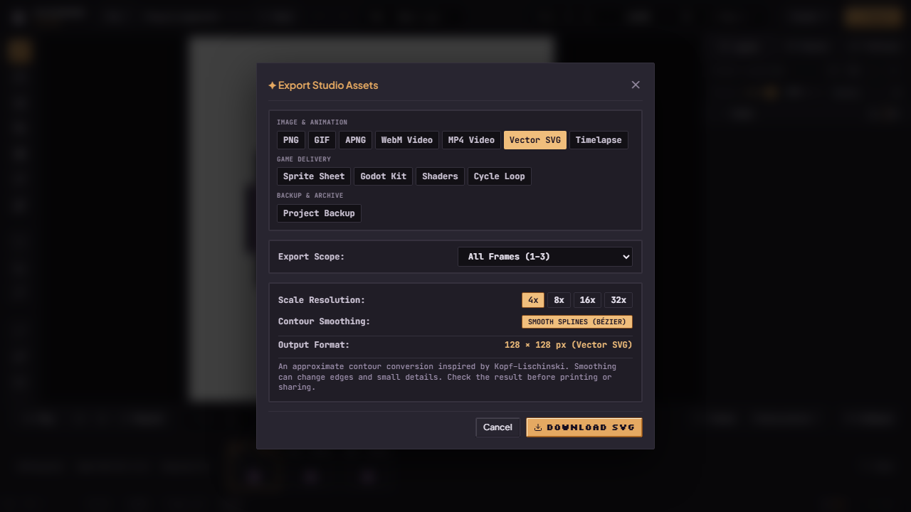

Choose **Vector SVG**, set 4× / 8× / 16× / 32× display scale and choose **Smooth Splines** or **Crisp Polygons**, then export the active frame. Inspect the result in a vector viewer, particularly diagonals, tiny gaps and outlines.

The converter uses PixiBun's contour/diagonal heuristic inspired by Kopf–Lischinski. Its panel describes an approximate conversion. It is not the full canonical research algorithm or guaranteed pixel-exact reconstruction. A smooth contour can intentionally look different from the original pixels.

## Shaders

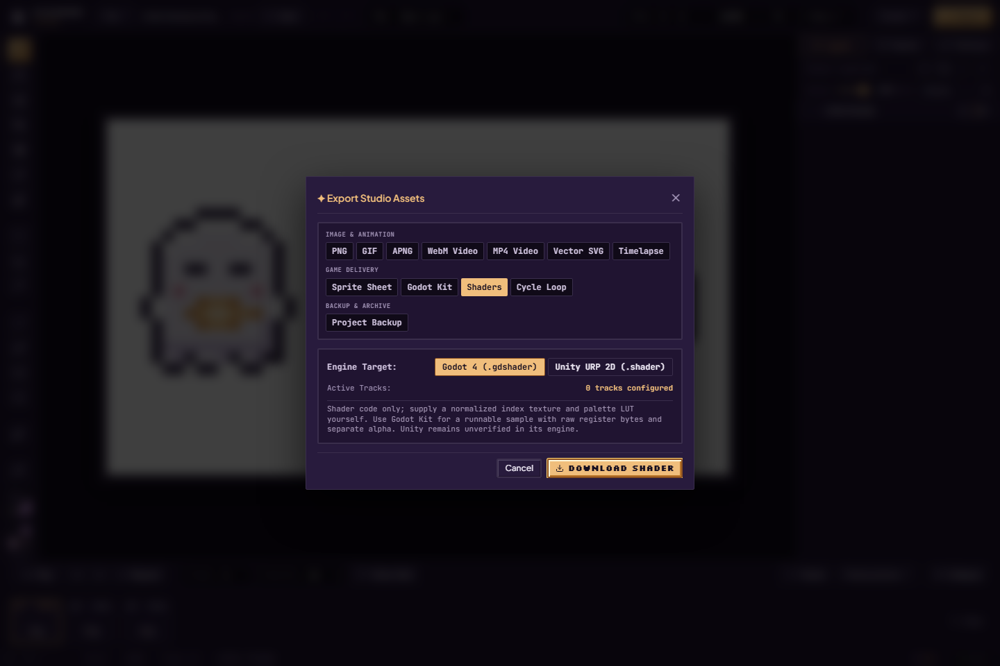

Choose **Shaders**, then **Godot 4 (.gdshader)** or **Unity URP 2D (.shader)**. Check the configured cycle tracks and download the code. This is a shader source file: supply its required normalized index texture and palette lookup yourself. It does not make an ordinary RGBA sprite into an indexed texture automatically. Unity engine execution remains unverified. Choose Godot Kit when you want the accompanying raw-register/alpha assets and a sample scene.

## Cycle Loop

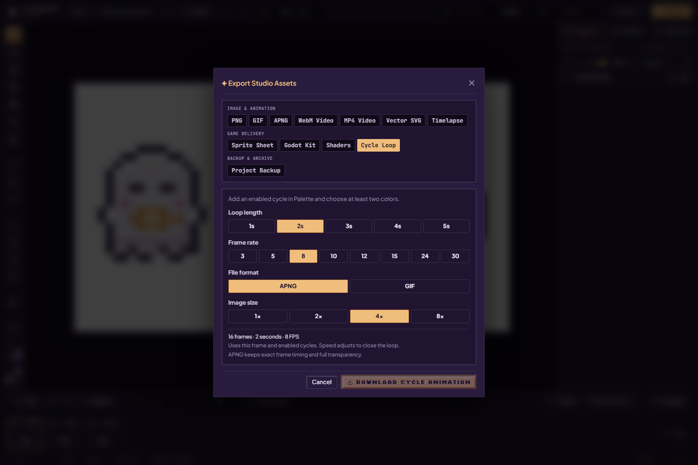

First add and enable a cycle spanning at least two colors in **Palette → Cycle Engine**. Choose **Cycle Loop**, 1–5 seconds, one of 3 / 5 / 8 / 10 / 12 / 15 / 24 / 30 FPS, APNG or GIF, and 1× / 2× / 4× / 8× scale. Initially 2 seconds at 8 FPS means 16 samples. A missing-track notice disables download; the sample panel can show that prerequisite.

This samples **color motion in the active frame**, not changing drawn poses across the timeline. Track speed is adjusted to close the loop; export FPS is separate from track Rate. GIF still quantizes color/transparency/timing. Follow the [full cycling walkthrough](palettes-and-cycling.md) for a configured example with current screenshots.

## Project Backup

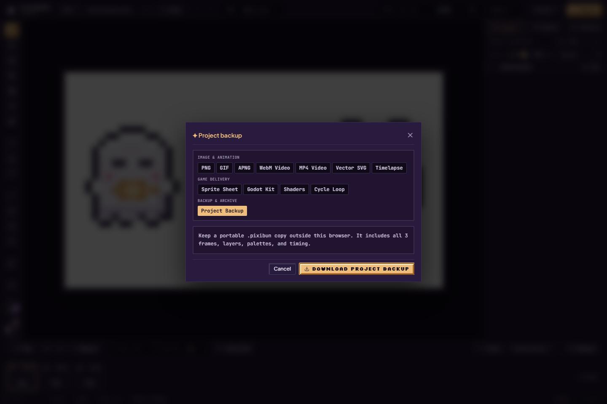

Choose **Project Backup → Download project backup**. Keep the `.pixibun` file outside the browser, then use **File → Import…** and **Confirm Import** to check that it restores the expected artwork. It contains admitted frames, layers, palettes, timing and supported metadata, including saved effects/recipes. It does not contain a durable complete Undo session or a cloud account.

Current backups use project format v4 and include saved single-part motion rigs. Readers limited to format v3 refuse them. Save the rig explicitly before the project backup; a temporary motion preview or unsaved pose adjustment is not a saved definition. See [compatibility](../contracts/storage.md).

**Ctrl/Cmd+Shift+S** also invokes the desktop file-save path where supported, with a download fallback. Picker cancellation is not success. An untouched **recovery ZIP** is a separate archive of damaged source records, described in [artwork safety](artwork-safety.md#damaged-stored-projects); it is not this editable project file.

## If an export cannot start

Reduce scale or frame count if the panel rejects the geometry. Raster output admission bounds each axis to 4096 px and total pixels to 16,777,216; retained raw animated-image frames also have a 67,108,864 aggregate-pixel ceiling. Other workspace/history reservations and codec limits still apply. These checks reduce allocation risk; they do not guarantee a fixed total RAM limit or success in every browser.

During a supported asynchronous export, use its progress/cancel controls and wait for the result before closing the page. A capture of an enabled button is not a download verdict. The [export contract](../contracts/exports.md) keeps codec, fidelity and scope details together.

Sources: [all 12 tabs](../../src/components/modals/export/ExportTabsNav.tsx), [actual download dispatch](../../src/components/modals/ExportModal.tsx), [Godot kit](../../src/lib/export/godotKit.ts), [geometry validation](../../src/lib/export/exportGeometryValidation.ts), [sheet packer](../../src/lib/export/spriteSheetPacker.ts).
