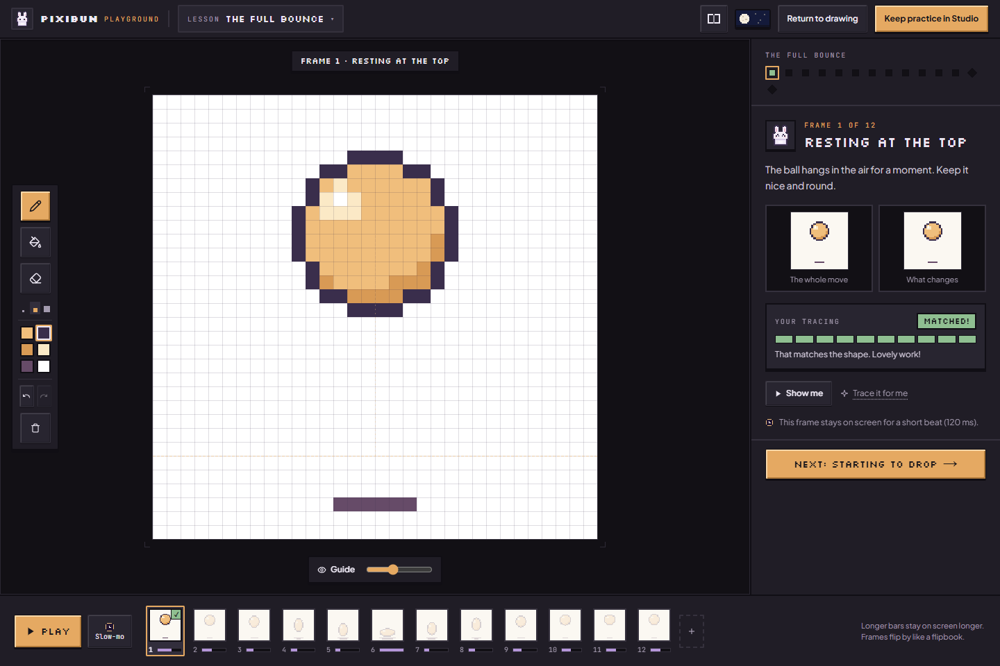
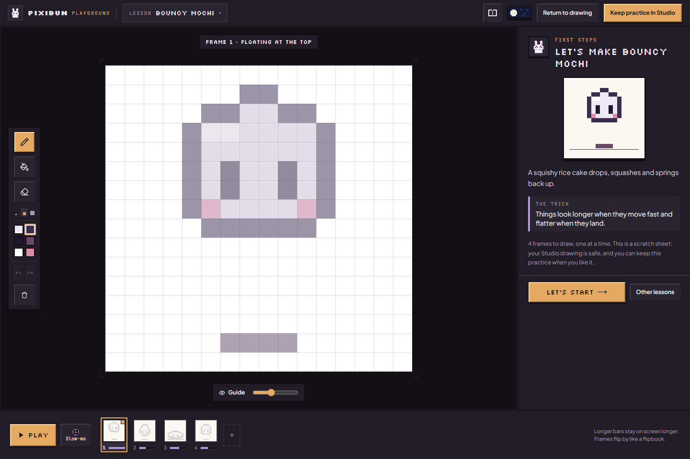
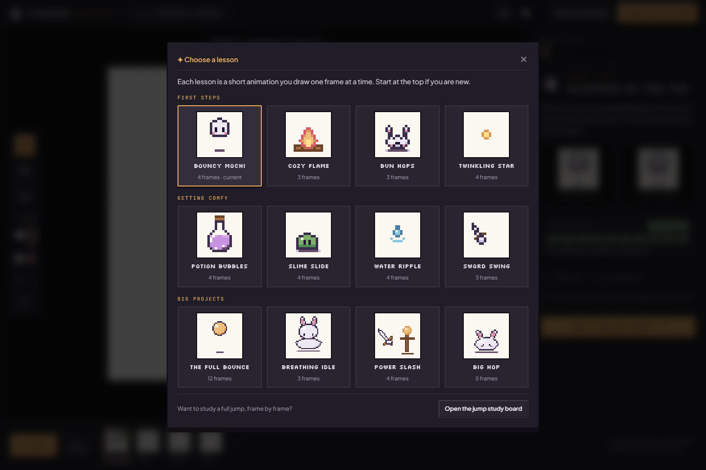
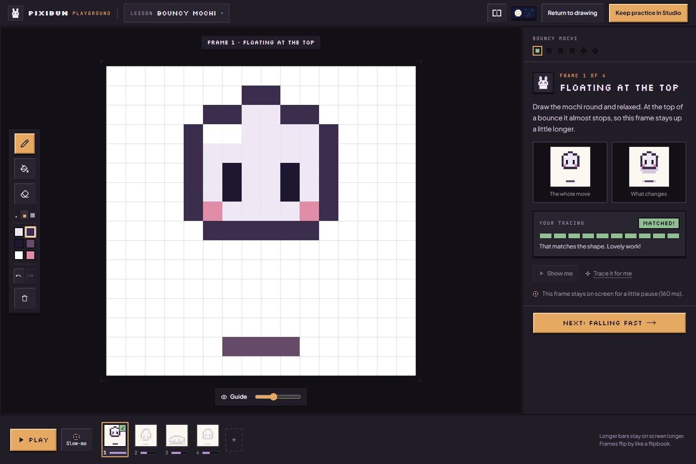
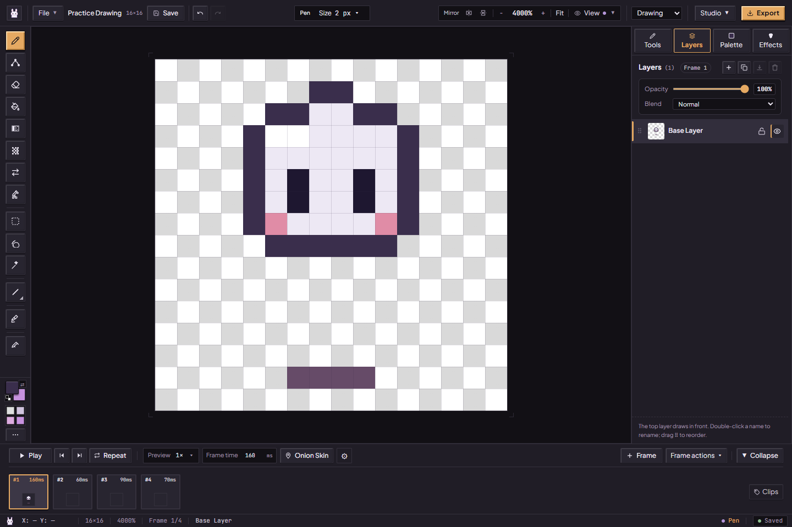
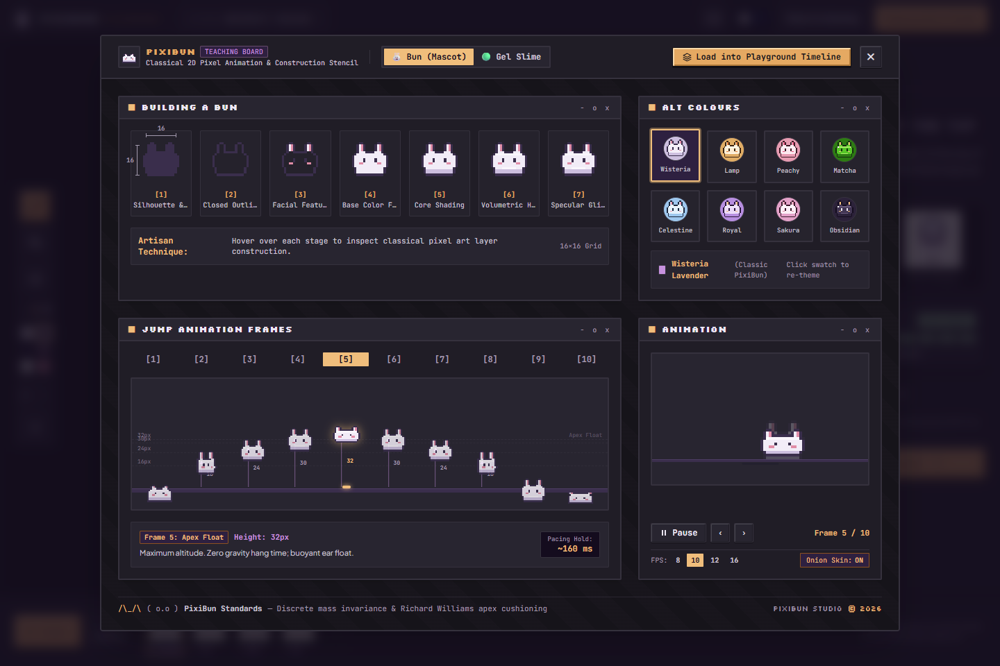
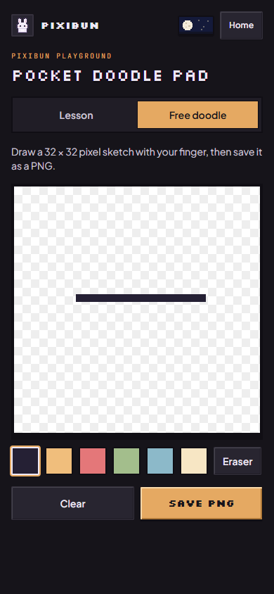
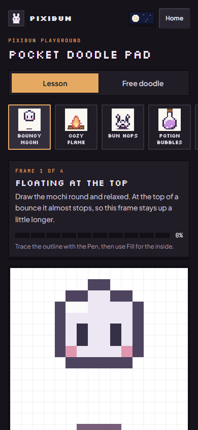
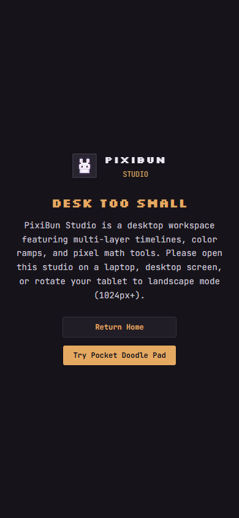

# Begin with a little practice

For the tested revision and remaining accessibility, device and host checks, see the [current status](../current-status.md).

[Handbook](README.md) · [Welcome-page demos](welcome-and-demos.md) · [All features](../features.md)

Choose **Playground** from the welcome-page navigation. A wide screen gets the guided animation workspace; a narrow screen gets **Pocket Doodle Pad**. These are different tools with different saving behavior.

## Desktop lessons

These [15 October captures](../assets/screenshots/2026-10-15-current-ui/run.json) show the current coach, tool dock, filmstrip and lesson art.

At 1024 px wide and above, the canvas fills the middle. A small tool dock sits beside it, one coach card on the right and the frames along the bottom. Change lesson with the **Lesson** button in the header; lessons are grouped from **First steps** to **Big projects**, and **Bouncy Mochi** comes first.

1. Each lesson opens on a short intro that plays the finished animation and names the one idea it teaches. Choose **Let's start**.
2. The coach shows one pose at a time: its name, one sentence on what to draw and why, a looping preview of the whole move and a "what changes" view of this pose over the previous one. The first time you reach an empty frame, a ghost pen draws the pose on the canvas; **Show me** replays it.
3. Trace the faint guide with **Pen (B)**, fill closed shapes with **Fill (G)** and remove pixels with **Eraser (E)**. The dock also has three pen sizes, the pose's own colors, Undo/Redo and **Clear frame**. **Guide** under the canvas hides the guide or changes its strength.
4. The tracing meter fills as the drawing covers the pose. **What's missing?** pulses the cells not reached yet. A drawing that spills far past the pose is held below a match, with a hint to tidy it. At a score of 85 or above, the coach celebrates and the frame gets a tick in the filmstrip. This measures target-cell coverage rather than exact colors; it does not block Next or step jumping.
5. **Start from last frame** overlays the previous frame's visible composite on the active layer, preserving existing destination pixels wherever that source is transparent. **Trace it for me** paints the pose's cells over the current layer without clearing old pixels first. Lesson edits (trace, copy, clear) enter the session's Undo/Redo: **Ctrl+Z** restores, **Ctrl+Shift+Z** or **Ctrl+Y** reapplies. Pause playback and use an unlocked layer. A match after copying does not prove you learned to draw it.
6. **Next** moves to the following pose; the dots under the lesson name jump to any pose, **Watch it play** or the finish. Picking a frame in the filmstrip while drawing moves the lesson to that pose. Each filmstrip card shows your drawing over its faint target, and its bar shows how long the frame stays on screen. **Slow-mo** plays the frames slowly.
7. On **Watch it move!**, press **Play** (or Space). After the playback timer (at least 1.8 seconds, based on the stored loop duration and Slow-mo) the lesson finishes and shows your own frames looping. This does not verify that every pose was displayed. The completion screen is navigation feedback, not a participant evaluation.
8. Choose **Return to drawing** to put your original Studio drawing back, including its pixels, settings and session Undo/Redo. Choose **Keep practice in Studio** to save your practice as a new project and open it in Studio. The coach's and completion screen's **Keep it in Studio** use the same separate-save path. Your original stays in Projects.

Practice shows the canvas on plain paper whatever View → Transparency says; the setting itself is unchanged.

## Keep your drawing, try something new

When you arrive from Studio, PixiBun finishes a local save of your drawing before it opens a fresh practice sheet. Practice uses a separate project identity, pixels, settings and history. Changing lessons or loading the Teaching Board changes this sheet. Studio autosave stays paused during practice; practice is temporary until you choose Keep.

- **Return to drawing** restores the original workspace. Leaving through Home, the browser's Back navigation or a switch to Pocket also closes desktop practice; opening Studio returns to the original. Unkept practice is discarded.
- **Keep practice in Studio** finishes a local save under a new project identity before opening Studio. A failed save leaves practice open so you can retry or Return. Keeping does not write through your original drawing's native-file association. Make a Project Backup of the new drawing if you want a portable copy.
- **Refresh during practice** discards unkept practice. Return loads your original saved drawing from this browser. Undo/Redo and native-file handles are session memory: they survive the tested client-route handoff, but are not restored by a full reload. Browser eviction, cleared site data or device loss can still remove local saves. If the original record is missing, Studio tells you and opens a fresh drawing; import a Project Backup if you have one. It does not pretend to reconstruct missing artwork.
- **If the initial save fails**, practice does not start. Return takes you back to the original in-memory drawing and its save warning. Export a Project Backup before closing if local storage cannot save it. Practice also refuses entry when its refresh-return pointer cannot be stored.
- **Close Co-Draw first.** Practice cannot start while a host or guest session is active. PixiBun waits for an unfinished save. If you Return while it is still saving, Studio waits for that result and keeps the original in memory; it does not load older pixels. Resolve a save conflict before starting.

The Pocket sketch uses its own temporary canvas. It does not adopt desktop lesson artwork. These safeguards are checked locally; they are not a cloud backup or a guarantee against browser storage loss.

## All 12 lessons

Each pose is painted by [lesson art](../../src/lib/art/lessonArt.ts): an outline, fill, shadow side, highlight and ground shadow, moved and squashed by the motion the lesson teaches. The linked 15 October pictures show each current lesson's first pose after clearing and tracing it through the UI.

| Lesson (as shown) | Level | Poses / nominal FPS | What to practice | Current screenshot |
| --- | --- | --- | --- | --- |
| Bouncy Mochi | First steps | 4 / 10 | Squash when it lands, stretch while it falls | [15 Oct](../assets/screenshots/2026-10-15-current-ui/lesson-bouncing-mochi.png) |
| Cozy Flame | First steps | 3 / 8 | A flame that sways and sends up an ember | [15 Oct](../assets/screenshots/2026-10-15-current-ui/lesson-hearth-flame.png) |
| Bun Hops | First steps | 3 / 9 | Crouch, jump with trailing ears, land | [15 Oct](../assets/screenshots/2026-10-15-current-ui/lesson-bun-hop.png) |
| Twinkling Star | First steps | 4 / 10 | Grow a spark into a sparkle and fade it | [15 Oct](../assets/screenshots/2026-10-15-current-ui/lesson-twinkling-star.png) |
| Potion Bubbles | Getting comfy | 4 / 9 | A bubble rising, doming the surface and popping | [15 Oct](../assets/screenshots/2026-10-15-current-ui/lesson-potion-bubble.png) |
| Slime Slide | Getting comfy | 4 / 8 | Reach forward, pull the back along, settle | [15 Oct](../assets/screenshots/2026-10-15-current-ui/lesson-slime-glide.png) |
| Water Ripple | Getting comfy | 4 / 8 | A drop and rings that widen and fade | [15 Oct](../assets/screenshots/2026-10-15-current-ui/lesson-water-ripple.png) |
| Sword Swing | Getting comfy | 3 / 12 | Wind-up, a one-frame smear, follow-through | [15 Oct](../assets/screenshots/2026-10-15-current-ui/lesson-sword-slash.png) |
| The Full Bounce | Big projects | 12 / 12 | A full bounce on 32×32 that keeps the ball's counted non-shadow area at 112–114 cells | [15 Oct](../assets/screenshots/2026-10-15-current-ui/lesson-master-bouncing-ball.png) |
| Breathing Idle | Big projects | 3 / 8 | A one-pixel breath that leaves the head and base still | [15 Oct](../assets/screenshots/2026-10-15-current-ui/lesson-subpixel-idle.png) |
| Power Slash | Big projects | 4 / 12 | Wind-up, smear, a freeze on the hit, recovery | [15 Oct](../assets/screenshots/2026-10-15-current-ui/lesson-combat-slash-hitstop.png) |
| Big Hop | Big projects | 5 / 10 | Crouch, launch stretch, hang time, squash landing, settle | [15 Oct](../assets/screenshots/2026-10-15-current-ui/lesson-character-hop-shock.png) |

Nominal FPS comes from the lesson configuration; per-frame holds can differ. The coach's plain-language copy lives in [playground coaching](../../src/lib/art/playgroundCoach.ts) and describes the intended exercise, not independently measured learning gains or a physical simulation guarantee.

## Teaching Animation Board

Open the **Teaching Board** with the book button in the playground header, or from the bottom of the lesson picker. Choose **Bun (Mascot)** or **Gel Slime**. Hover the construction stages to examine the sample's assembly; select alternate colors to re-theme the demonstration. Click **Inspect frame 1–10** to examine a jump pose and its pacing note.

Play/pause the board, step backward/forward, choose playback FPS and toggle its onion-skin ghost trail. The board's playback is a separate demonstration from the drawing timeline. **Load into Playground Timeline** replaces the isolated practice timeline with its ten sample frames. It can replace your unkept practice, so Keep that practice first if you want both. Your original Studio drawing remains separate. Close the board with its close button or Escape, then edit the sample. Choose **Keep practice in Studio** for a new saved project or **Return to drawing** for your original.

## Pocket Doodle Pad

The picture above shows the current **Free doodle** tab. Below 1024 px, `/playground` opens **Pocket Doodle Pad** on its **Lesson** tab: the eight 16×16 lessons as cards, a coach card with the pose name, hint and tracing meter, and a large canvas showing the guide and a faint onion skin of your previous frame. A ghost pen draws each new pose; **Show me** replays it. Draw with **Pen**, **Fill** or **Eraser** in the pose's colors, use **Start from last frame**, **Guide** and **Clear frame**, step through the frames, then **Play** to watch them at their own timings. **Save PNG** downloads every frame side by side at native size.

The **Free doodle** tab keeps the **32×32** sketchpad: pick a color, draw with a finger, pointer or mouse, **Eraser**, **Clear** and **Save PNG** (native size with transparency).

Both tabs keep their pixels only in the current page. There is no Pocket project gallery, autosave, layer stack or Undo control. Save the PNG before refreshing, leaving or widening the viewport into desktop lessons; switching between the two surfaces remounts their canvases. Home returns to the welcome page. Mobile mounts only Pocket, so hidden desktop lessons do not initialize or change Studio metadata. This is a small phone-friendly practice surface, rather than the full mobile Studio.

The full `/studio` displays **Desk Too Small** on narrow screens and offers Home or Pocket Doodle Pad. Use a viewport at least 1024 px wide for the full workbench. Rotating a tablet helps only when it actually reaches that width.

Sources: [route](../../src/app/playground/page.tsx), [responsive mount](../../src/components/playground/ResponsivePlayground.tsx), [reversible button edits](../../src/lib/art/applyLessonEdit.ts), [practice custody](../../src/lib/project/practiceSession.ts), [desktop playground](../../src/components/layout/PlaygroundLayout.tsx), [lesson list](../../src/lib/art/playgroundLessons.ts), [lesson coach](../../src/components/playground/CoachPanel.tsx), [lesson art](../../src/lib/art/lessonArt.ts), [teaching board](../../src/components/playground/TeachingAnimationBoard.tsx), [Pocket implementation](../../src/components/playground/PocketDoodlePad.tsx), [Studio gate](../../src/components/layout/MobileStudioGate.tsx). The [learning contract](../contracts/learning.md) describes the shipped workspace boundary separately from lesson proposals and pending human studies.
