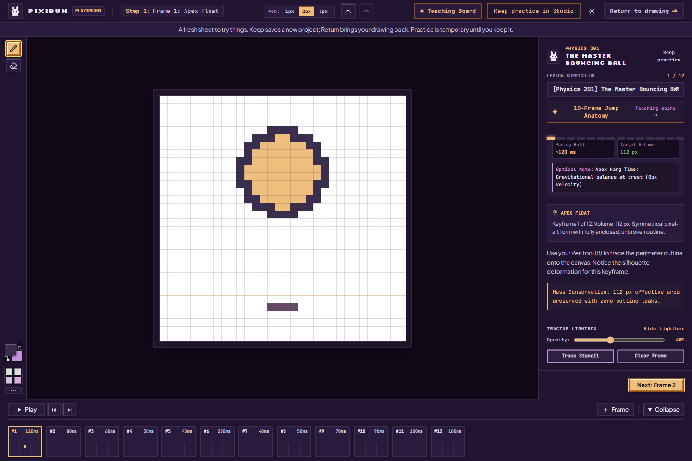
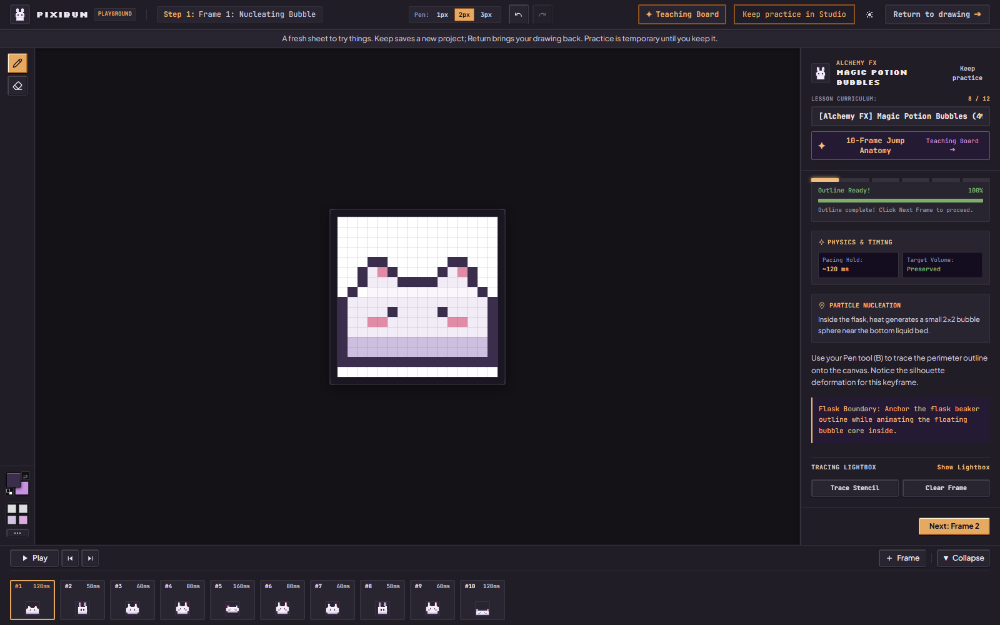
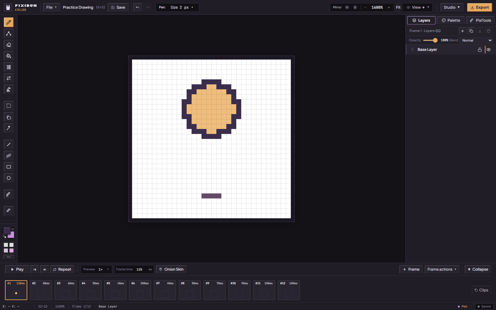
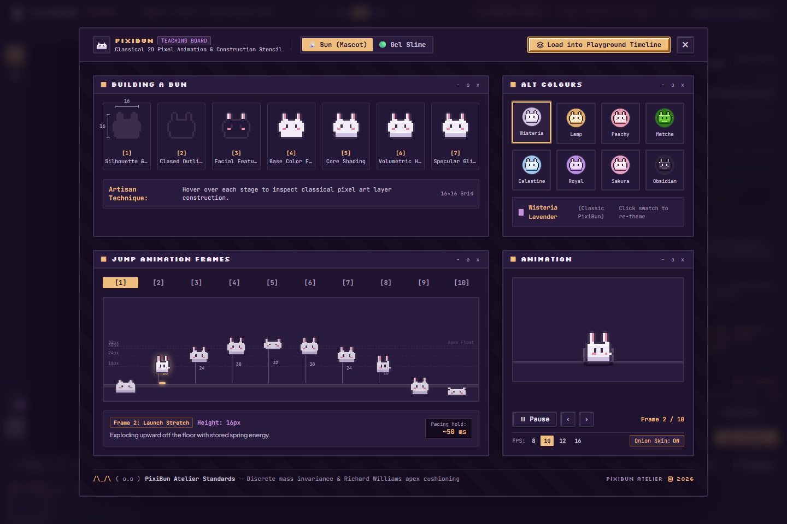
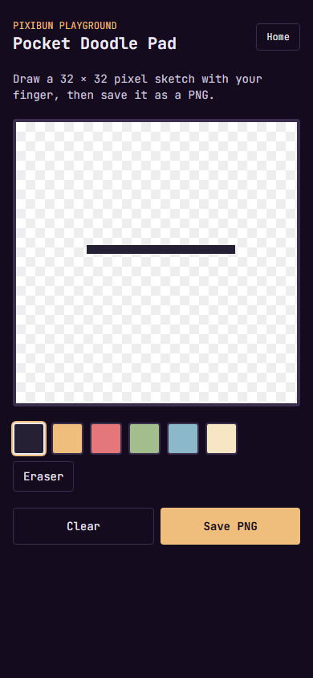
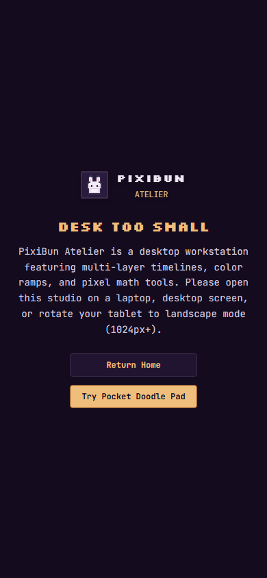

# Begin with a little practice

For the tested revision and remaining accessibility, device and host checks, see the [current status](../current-status.md).

[Handbook](README.md) · [Welcome-page demos](welcome-and-demos.md) · [All features](../features.md)

Choose **Playground** from the welcome-page navigation. A wide screen gets the guided animation workspace; a narrow screen gets **Pocket Doodle Pad**. These are different tools with different saving behavior.

## Desktop lessons

These [new captures](../assets/screenshots/2026-10-02-feature-repairs-phase2/run.json) show the separate practice workspace and its current controls. Earlier captures remain in their dated records; they describe earlier behavior.

At 1024 px wide and above, choose a lesson in **Lesson Curriculum**. The left shelf has Pen and Eraser, color wells and brush-size controls. The handbook on the right explains the pose, shows its stencil and tracks a local outline comparison.

1. Choose a lesson and read the current frame's drawing note.
2. Draw over the lightbox with **Pen (B)**. **Eraser (E)** removes pixels. Show/hide the lightbox or adjust its opacity if the guide is too strong.
3. **Trace Stencil** paints the provided template's colored cells over the current layer; it does not clear old pixels first. Use **Clear Frame** before tracing if you want only the example. Both actions now enter the current session's Undo/Redo history: **Ctrl+Z** restores the previous pixels and **Ctrl+Shift+Z** or **Ctrl+Y** reapplies the edit. Pause playback and use an unlocked layer. Normal session/history limits still apply, so Undo is not a portable backup. A high score after copying does not prove you learned to draw it.
4. Use the step list, **Next** and **Back** to visit poses. The simplified timeline and lesson step synchronize when editing is paused. Play the loop to inspect timing; the completion screen is navigation feedback, not a participant evaluation.
5. Choose **Return to drawing** to put your original Studio drawing back, including its pixels, settings and session Undo/Redo. Choose **Keep practice in Studio** to save your practice as a new project and open it in Studio. The handbook's **Keep practice** and the completion action use the same separate-save path. Your original stays in Projects.

## Keep your drawing, try something new

When you arrive from Studio, PixiBun finishes a local save of your drawing before it opens a fresh practice sheet. Practice uses a separate project identity, pixels, settings and history. Changing lessons or loading the Teaching Board changes this sheet. Studio autosave stays paused during practice; practice is temporary until you choose Keep.

- **Return to drawing** restores the original workspace. Leaving through Home, the browser's Back navigation or a switch to Pocket also closes desktop practice; opening Studio returns to the original. Unkept practice is discarded.
- **Keep practice in Studio** finishes a local save under a new project identity before opening Studio. A failed save leaves practice open so you can retry or Return. Keeping does not write through your original drawing's native-file association. Make a Project Backup of the new drawing if you want a portable copy.
- **Refresh during practice** discards unkept practice. Return loads your original saved drawing from this browser. Undo/Redo and native-file handles are session memory: they survive the tested client-route handoff, but are not restored by a full reload. Browser eviction, cleared site data or device loss can still remove local saves. If the original record is missing, Studio tells you and opens a fresh drawing; import a Project Backup if you have one. It does not pretend to reconstruct missing artwork.
- **If the initial save fails**, practice does not start. Return takes you back to the original in-memory drawing and its save warning. Export a Project Backup before closing if local storage cannot save it. Practice also refuses entry when its refresh-return pointer cannot be stored.
- **Close Co-Draw first.** Practice cannot start while a host or guest session is active. PixiBun waits for an unfinished save. If you Return while it is still saving, Studio waits for that result and keeps the original in memory; it does not load older pixels. Resolve a save conflict before starting.

The Pocket sketch uses its own temporary canvas. It does not adopt desktop lesson artwork. These safeguards are checked locally; they are not a cloud backup or a guarantee against browser storage loss.

## All 12 lessons

Each link opens a fresh screenshot of that lesson's **current layer cleared, then first frame traced through the actual UI**. They show the supplied content and shared controls, not completed participant work.

| Lesson | Poses / nominal FPS | What to practice | Current screenshot |
| --- | --- | --- | --- |
| The Master Bouncing Ball | 12 / 12 | Long bounce cycle, squash/stretch, short fast poses and longer apex/impact holds | [See lesson](../assets/screenshots/2026-10-02-feature-repairs-phase2/lesson-master-bouncing-ball.png) |
| Sub-Pixel Character Idle | 3 / 8 | Small internal highlight/edge-tone changes with a steady outer shape | [See lesson](../assets/screenshots/2026-10-02-feature-repairs-phase2/lesson-subpixel-idle.png) |
| Sword Slash & Combat Hitstop | 4 / 12 | Windup, a smear, impact pause and recovery | [See lesson](../assets/screenshots/2026-10-02-feature-repairs-phase2/lesson-combat-slash-hitstop.png) |
| Character Hop & Shock Absorption | 5 / 10 | Crouch, stretch, apex, trailing ears and landing | [See lesson](../assets/screenshots/2026-10-02-feature-repairs-phase2/lesson-character-hop-shock.png) |
| The Bouncing Mochi | 4 / 10 | A small squash/stretch bounce | [See lesson](../assets/screenshots/2026-10-02-feature-repairs-phase2/lesson-bouncing-mochi.png) |
| The Hearth Flame | 3 / 8 | Changing billows and detached ember details | [See lesson](../assets/screenshots/2026-10-02-feature-repairs-phase2/lesson-hearth-flame.png) |
| The Character Hop | 3 / 9 | A compact Bun hop and ear follow-through | [See lesson](../assets/screenshots/2026-10-02-feature-repairs-phase2/lesson-bun-hop.png) |
| Magic Potion Bubbles | 4 / 9 | A rising bubble, surface shape and burst droplets | [See lesson](../assets/screenshots/2026-10-02-feature-repairs-phase2/lesson-potion-bubble.png) |
| The Slime Glide | 4 / 8 | Forward reach, body catch-up and settle | [See lesson](../assets/screenshots/2026-10-02-feature-repairs-phase2/lesson-slime-glide.png) |
| The Twinkling Star | 4 / 10 | Flare expansion, sparkle and decay | [See lesson](../assets/screenshots/2026-10-02-feature-repairs-phase2/lesson-twinkling-star.png) |
| The Water Ripple | 4 / 8 | Expanding isometric ellipses and a fading wavefront | [See lesson](../assets/screenshots/2026-10-02-feature-repairs-phase2/lesson-water-ripple.png) |
| The Sword Slash | 3 / 12 | A short anticipation/smear/follow-through exercise | [See lesson](../assets/screenshots/2026-10-02-feature-repairs-phase2/lesson-sword-slash.png) |

Nominal FPS comes from the lesson configuration; per-frame holds can differ. Labels such as “mastered,” “physics” or “zero boiling” in lesson copy describe the intended exercise, not independently measured learning gains or a physical simulation guarantee.

## Teaching Animation Board

Open **Teaching Board** from the playground header or handbook. Choose **Bun (Mascot)** or **Gel Slime**. Hover the construction stages to examine the sample's assembly; select alternate colors to re-theme the demonstration. Click **Inspect frame 1–10** to examine a jump pose and its pacing note.

Play/pause the board, step backward/forward, choose playback FPS and toggle its onion-skin ghost trail. The board's playback is a separate demonstration from the drawing timeline. **Load into Playground Timeline** replaces the isolated practice timeline with its ten sample frames. It can replace your unkept practice, so Keep that practice first if you want both. Your original Studio drawing remains separate. Close the board with its close button or Escape, then edit the sample. Choose **Keep practice in Studio** for a new saved project or **Return to drawing** for your original.

## Pocket Doodle Pad

Below 1024 px, `/playground` offers a **32×32** sketchpad. Pick one of its colors, then draw with a finger, pointer or mouse. **Eraser** removes pixels; picking a color returns to painting. **Clear** wipes the sketch. **Save PNG** downloads its native-size image with transparency.

The sketch is kept in the current page's canvas. There is no Pocket project gallery, autosave, layer stack, animation or Undo control. Save the PNG before refreshing, leaving or widening the viewport into desktop lessons; switching between the two surfaces remounts their canvases. Home returns to the welcome page. Mobile now mounts only Pocket, so hidden desktop lessons do not initialize or change Studio metadata. This is a small phone-friendly drawing surface, rather than the full mobile Studio.

The full `/studio` displays **Desk Too Small** on narrow screens and offers Home or Pocket Doodle Pad. Use a viewport at least 1024 px wide for the full workbench. Rotating a tablet helps only when it actually reaches that width.

Sources: [route](../../src/app/playground/page.tsx), [responsive mount](../../src/components/playground/ResponsivePlayground.tsx), [reversible button edits](../../src/lib/art/applyLessonEdit.ts), [practice custody](../../src/lib/project/practiceSession.ts), [desktop playground](../../src/components/layout/PlaygroundLayout.tsx), [lesson list](../../src/lib/art/playgroundLessons.ts), [handbook actions](../../src/components/onboarding/ArtisanHandbookPanel.tsx), [teaching board](../../src/components/playground/TeachingAnimationBoard.tsx), [Pocket implementation](../../src/components/playground/PocketDoodlePad.tsx), [Studio gate](../../src/components/layout/MobileStudioGate.tsx). The [learning contract](../contracts/learning.md) describes the shipped workspace boundary separately from lesson proposals and pending human studies.
