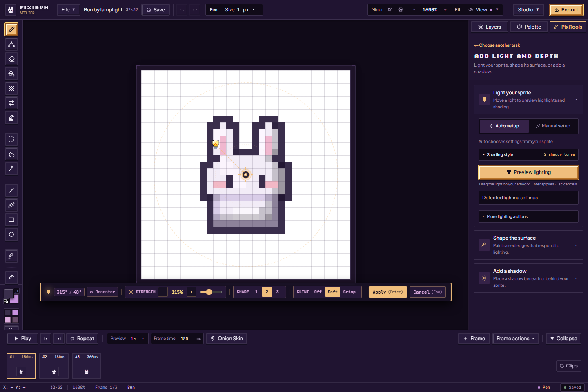
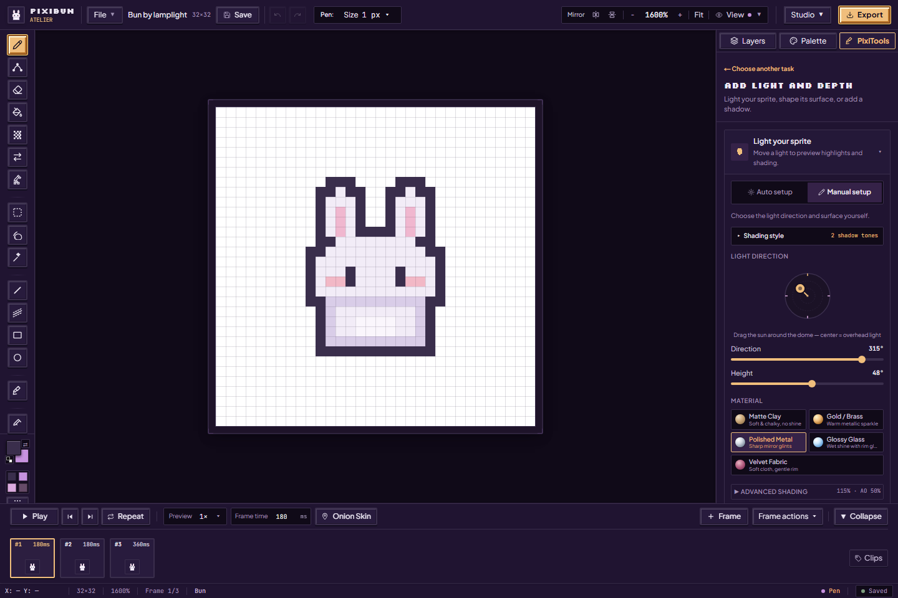
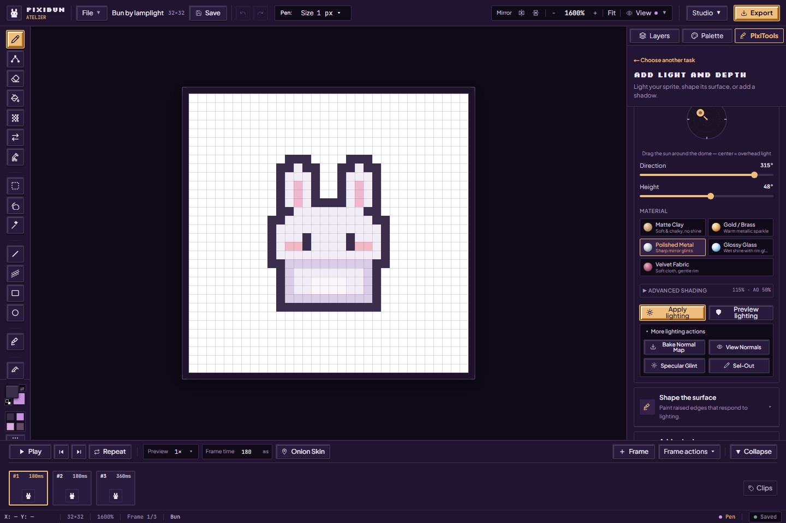
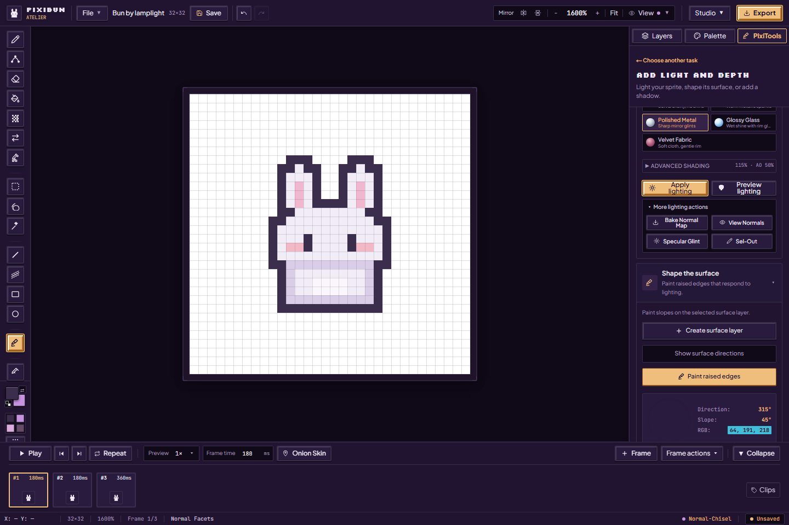
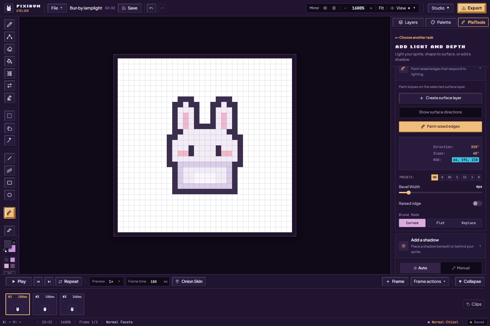

# A little light, a little depth

[Handbook](README.md) · [Variations](variations-and-scenes.md) · [All features](../features.md)

Open **PixiTools → Add light and depth**. The three sections are **Light your sprite**, **Shape the surface**, and **Add a shadow**. Start with a small finished sprite, then explore one effect at a time. These tools use local mathematical and image heuristics; they do not reconstruct a general 3D model or call a trained generative model.

## Move a light before applying it

1. Keep the sprite's source artwork available and open **Light your sprite**. **Auto setup** estimates a form, material and existing light cues from the visible artwork. Read **Detected lighting settings** when available; they are estimates you can revise.
2. Choose **Preview lighting**. Move the bulb around the canvas to change direction. The live toolbar offers direction/height/strength and shading/glint choices. Keyboard controls are labeled on the preview; use its **Apply** or **Cancel** deliberately.
3. Compare the original and preview, especially the face, silhouette and darkest pixels. Confirm only when the new lighting reads well. **Enter** applies a live preview and **Esc** cancels it when that preview owns the interaction.
4. After applying, inspect the generated effect layer and keep a portable backup. Undo restores an admitted effect change while it remains in history.

The source colors and their painted shading influence the estimate. Two sprites with different original shading can respond differently to the same settings. Auto setup is a starting point for an artist, not a measured accuracy guarantee.

## Manual light and shading style

Choose **Manual setup** for direct control. The direction dome and **Direction / Height** sliders set the light. Choose a material: **Matte Clay**, **Gold / Brass**, **Polished Metal**, **Glossy Glass**, or **Velvet Fabric**. Material names describe the shading preset; they do not turn transparent sprite pixels into a physical simulation of glass or cloth.

Open **Shading style** to choose the number of shadow tones. **Advanced Shading** exposes these adjustments:

| Setting | Try this | Limit to understand |
| --- | --- | --- |
| Surface interpretation | Auto, Character, Prop or Orb | A heuristic interpretation, not recovered geometry |
| Brightness | Adjust gradually and inspect light colors | Strong values can flatten detail |
| Remove Painted Shading | Start at 0% to keep authored shades | Higher values conservatively reduce recognized directional shading; they cannot perfectly undo arbitrary painted light |
| Darken creases | Increase a little for contact/cavity emphasis | Image-derived creases can include deliberate line detail |
| Dither Strength | Add a patterned transition if it suits the palette | Dithering changes the look, not the source palette's semantic identity |

Use **Preview lighting** when you want to see it first. **Apply lighting** is a commit action. At 64×64 or 64×32, additional Minecraft atlas interpretation controls appear: Auto / character-sprite / block-atlas modes choose a different shading interpretation. A matching size alone does not prove an imported image is a correct Minecraft UV layout.

## Saved lighting and glint effects

Applying supported photometric or specular previews creates or updates a dedicated tagged effect layer with a saved recipe and source information. Open **Layers**, select that layer, and use **Edit lighting/glint effect** to reopen its bulb. This lets you revise an effect without repeatedly baking the previous result into itself.

Keep its source artwork intact. Changing source pixels can make a recipe's source information stale; inspect the status rather than assuming it will reproduce the earlier image. Effect recipes travel in the portable project backup. Normal-map previews and generated raster layers remain different things.

## More lighting actions

Open **More lighting actions** for the following tools:

| Action | How to use it | Result and caution |
| --- | --- | --- |
| Bake Normal Map | Generate surface directions from the artwork's current interpretation | A separate normal-map layer; inspect it rather than treating guessed depth as ground truth |
| Normal-map preview | Show/hide the encoded surface directions | View inspection; not a permanent recolor of the source sprite |
| Specular Glint | Open the live highlight preview, move the bulb, choose its appearance and apply/cancel | A dedicated specular effect; preview visibility is not a completed bake |
| Sel-Out | Apply selective-outline lighting using the chosen light direction | A generated selective-outline layer; inspect thin facial/interior edges and Undo if needed |

## Shape the surface

1. Open **Shape the surface → Create surface layer**. Select an unlocked Normal layer; painting raised edges stays disabled until this requirement is met.
2. Choose **Paint raised edges / Normal Chisel (K)**. Drag on the direction sphere or use compass presets to set the slope's direction. The sphere shows the RGB encoding, direction and incline.
3. Set **Bevel Width** from 1–32 px. **Raised ridge** changes the groove/ridge form. Choose **Curved**, **Flat** or **Replace** blending: these are respectively RNM, UDN and direct replacement of encoded surface directions.
4. Paint on the surface layer. Toggle **Show surface directions** to inspect it, then return to color view and preview a light to judge the shape.

These encoded colors are lighting data. Do not paint ordinary face colors on the Normal layer. **Normal Facets** is the manual sculpting layer. The [Godot normal atlas](exporting.md#godot-kit) accepts either **Normal Facets** or a baked **Normal Map** (including its matching saved effect). Keep exactly one in every exported frame, at full opacity and Normal blending. Hidden data layers are accepted; two normal sources in one frame are refused. Godot expects X+ Y+ Z+ data; the exporter preserves stored channels and does not flip an imported green channel automatically.

## Add a shadow

Open **Add a shadow**. Choose **From the light** for a projected silhouette, or **Under sprite** for a soft ground oval. **Auto → Add Floor Shadow** analyzes the artwork and commits a generated shadow layer; it is not a preview-only button. Detected settings describe that estimate.

For more control, choose **Manual**. **Match Scene Light** aligns its direction with the studio key light. Adjust **Light X / Y**, **Softness Radius**, **Opacity**, tint (Indigo, Obsidian, Umber, Violet or Teal/Fog) and None / 2×2 / 4×4 / 8×8 dither. Then **Cast Ground Shadow** commits the layer. Inspect the baseline and empty margins; Undo if it does not sit naturally beneath your sprite.

This is bounded 2.5D projection over image-derived shape. It is not a full 3D scene with arbitrary geometry or a guaranteed physically correct shadow. Keep space around the sprite for the projected pixels.

Sources: [lighting panel](../../src/components/layout/inspector/PhotometricLightingSection.tsx), [photometric preview/recipes](../../src/hooks/viewport/events/usePhotometricEvents.ts), [surface controls](../../src/components/layout/inspector/NormalSculptorSection.tsx), [shadow controls](../../src/components/layout/inspector/RaymarchedShadowSection.tsx), [generated geometric effects](../../src/hooks/viewport/events/useGeometricEvents.ts).
