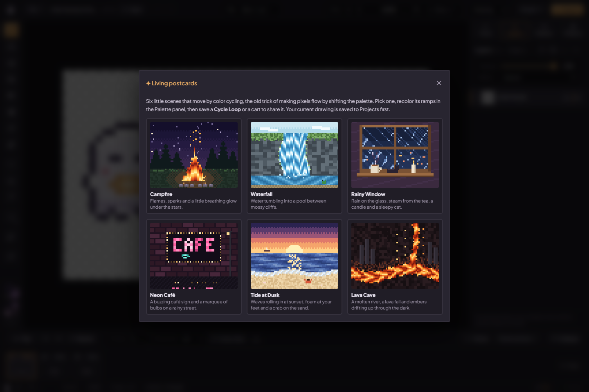
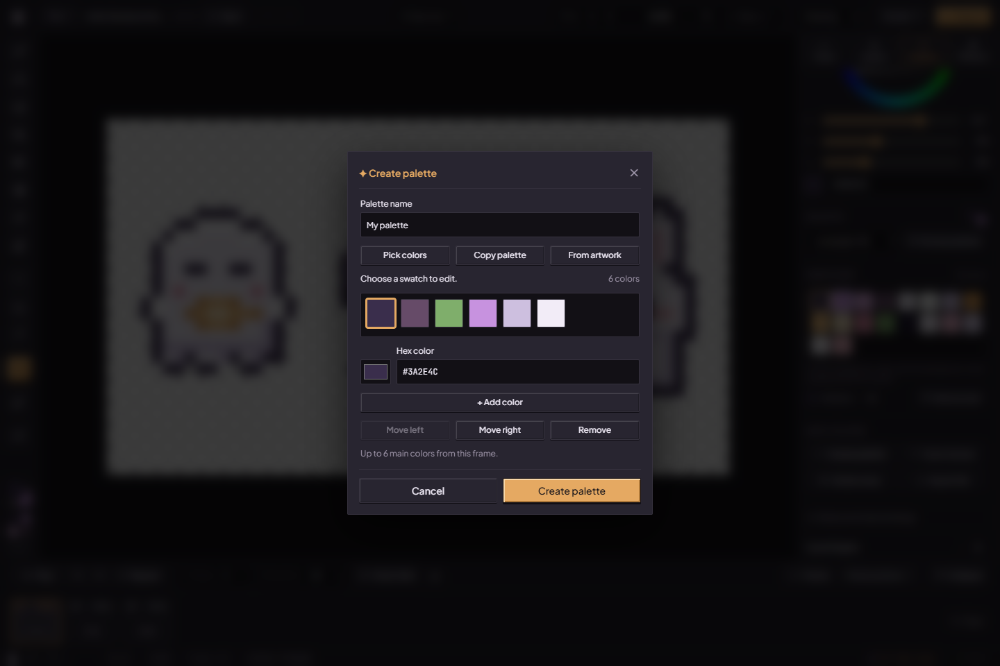
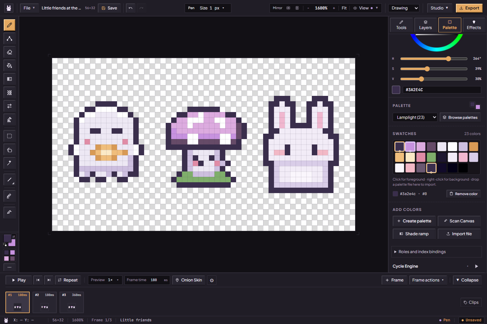
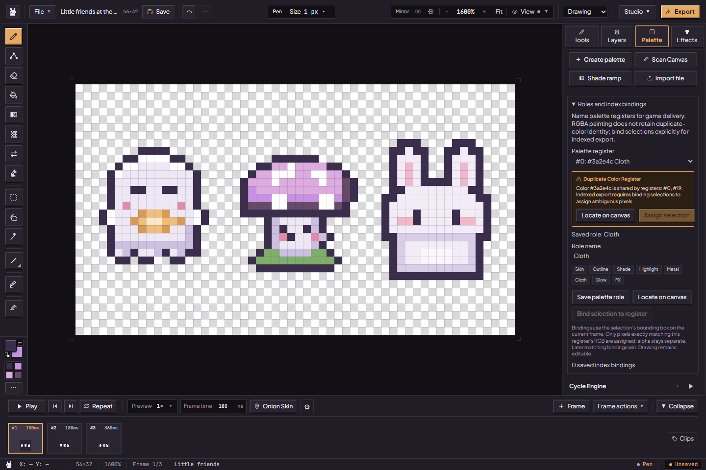

# Make a palette and a little color loop

For the tested revision and remaining accessibility, device and host checks, see the [current status](../current-status.md).

A small palette makes it easier to keep a drawing together. You can build one by picking colors or borrow a few shades from artwork you've already made.

[Handbook](README.md) · [Colors and workspace](studio-workspace.md#colors-close-to-hand) · [All features](../features.md)

## Start from a living postcard

**File → Living postcard…** offers six little scenes painted for color cycling, each already moving in the picker: **Campfire**, **Waterfall**, **Rainy Window**, **Neon Café**, **Tide at Dusk** and **Lava Cave**. Choosing one saves your current drawing first, then opens the 64×48 scene with its palette and cycle tracks and cycling switched on. The motion lives in the palette order, so recoloring a ramp in the Palette panel (a blue fire, a pink waterfall) keeps it moving. Save a **Cycle Loop** to post it, or a cart: the cart player keeps it cycling on phones. [Scenes](../../src/lib/postcards/scenes.ts).

## Gather your colors

1. Open **Palette → Create palette** and give the draft a name.
2. Choose **Pick colors**, **Copy palette** or **From artwork**. From artwork collects at most six main colors from the visible frame; it leaves the drawing alone.
3. Select a swatch to edit its color. Use Move left/right to arrange the colors, or Remove to leave one out.
4. Choose **Create palette** when you're happy, or **Cancel** to leave the project as it was.

*A draft before creation. These are representative artwork colors, not a promise that the source contains only six shades.*

## Swatches, file import and ramps

Use the palette preset list to choose a palette. Left-click a swatch for the primary drawing color; right-click for secondary. **Remove color** removes the selected swatch while retaining at least one color. It leaves painted pixels unchanged. Creating, removing or arranging swatches does not recolor existing RGBA artwork.

**Scan Canvas** creates a palette of up to six representative colors from the visible artwork directly. **Create palette → From artwork** instead lets you review and edit a draft before creation. **+ Lospec** (palette import) accepts supported Lospec `.hex`, GIMP `.gpl`, text and JSON palettes; drop a palette file onto the palette panel as an alternative. It adds colors rather than importing a layered drawing. Malformed or oversized files can be refused.

Choose your primary color, then **+ OKLCH Ramp** for a five-step highlight/shadow palette. This changes palette data, not your sprite's pixels. Paint with those swatches or use a separate [palette-snap action](pixitools-cleanup-and-tiles.md#color-moods-and-dithering) when you deliberately want to recolor artwork.

## Choose which colors will move

### Track controls

Open **Cycle Engine**, choose **Add Color Range Track**, then open the track. The **First** and **Last** rows choose the inclusive range of palette colors that will cycle. Colors outside active ranges keep their source pixels in live CPU cycling and generated loop frames.

For a fire palette, arrange the flame shades together and select that range, leaving wood and outline colors outside it. If two objects share the same selected source color, both can change; make their colors distinct when you want independent animation.

*This example is paused so the chosen range is easy to inspect. Use Play Cycle to preview it; Playback Speed changes the cycling speed.*

Give each track a useful name, enable/disable it, set **Rate (Hz)** between 0.1 and 60, and choose Forward, Reverse or Ping-Pong. **BlendShift (Smooth)** interpolates the moving colors; turn it off for discrete color steps. Global Playback Speed offers ¼×, ½×, 1×, 2× and 4×. Inspect overlapping ranges rather than assuming tracks address independent objects.

Delete a track when you no longer need it. Track **Export** writes its Deluxe Paint CRNG binary chunk; **Import CRNG** accepts the supported `.crng`/`.bin` representation and validates it against the current palette. This transfers cycle parameters, not an image or a complete legacy IFF animation. The panel disables additions at the admitted track limit.

## Roles and index bindings

For [indexed Godot delivery](exporting.md#godot-kit), open **Roles and index bindings** on a palette containing 1–256 colors:

1. Choose a **Palette register**, type a role such as Skin, Outline, Cloth or Glow, then **Save palette role**. Suggested names fill the input; save them explicitly.
2. If duplicate registers share the same RGB, use **Locate on canvas** to find matching pixels on visible layers of the active frame. It creates a bounding rectangle around matches, not a precise disconnected-pixel mask.
3. Select the intended region and **Bind selection to register** (or the duplicate-color banner's **Assign selection**). A binding stores the selection's bounding box on this frame. Only exact matching RGB pixels are assigned; alpha remains separate. Later matching bindings win.
4. Review saved frame/rectangle entries and remove bindings you no longer want. At most 128 bindings are admitted. They do not lock painting or automatically resolve every future pixel change.

Ordinary RGBA painting does not retain the identity of two identical palette registers. Roles and bindings supply that information for supported indexed export; preflight can still refuse missing colors or unresolved ambiguity. They also help supported variation workflows preserve named color roles.

## Save the color loop

Choose **Export → Cycle Loop**, then the loop length, frame rate, image size and APNG or GIF. The initial frame rate is **8 FPS**; a two-second loop contains **16 samples**. Export FPS controls how often the color animation is sampled, separately from Playback Speed.

*These are export settings before download. Wait for the download and open the resulting file to check it.*

Cycle Loop animates the colors of the active frame. To change a flame's shape or make a character hop, draw the changing poses in the timeline and use a timeline animation export instead. GIF has a limited palette, transparency and timing precision; APNG preserves admitted RGBA frames. See [the export contract](../contracts/exports.md) for format and resource limits.

Created palettes and tracks are saved with the project and support Undo/Redo. Keep an editable `.pixibun` copy using [Project Backup](artwork-safety.md).

Screenshots show the local production build on 15 October 2026, using an imported arrangement of PixiBun's own artwork. [Capture details](../assets/screenshots/2026-10-15-current-ui/run.json) record the source/build and scope; execution verdicts are separate.
