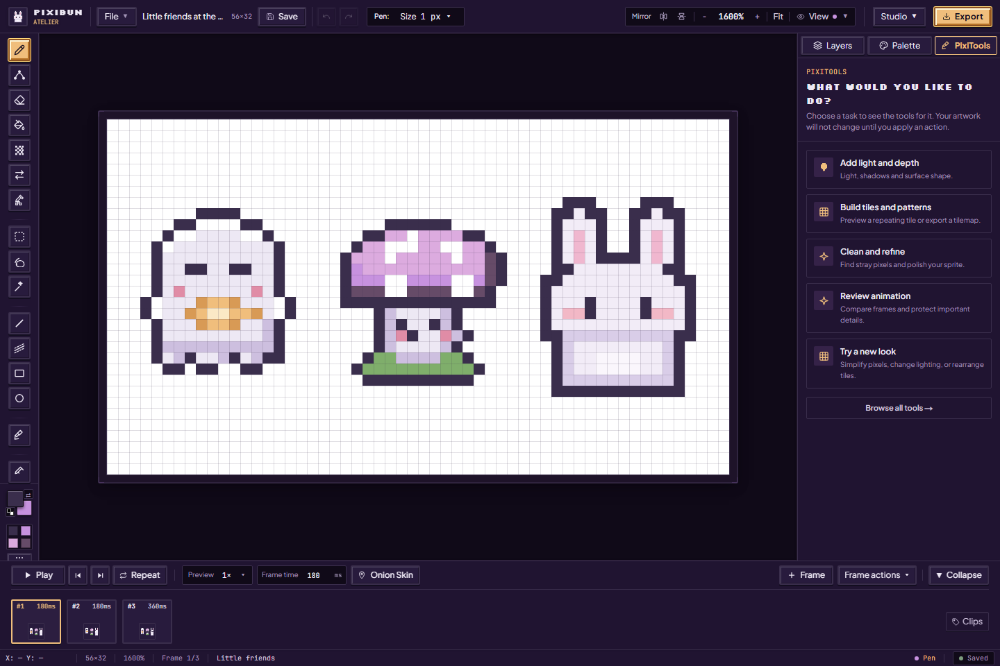
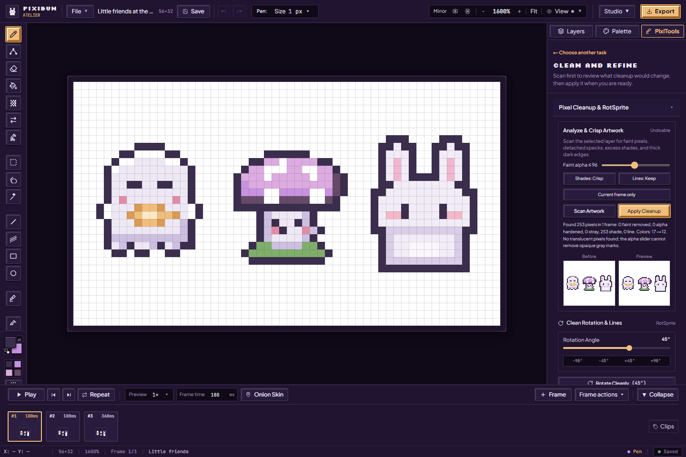
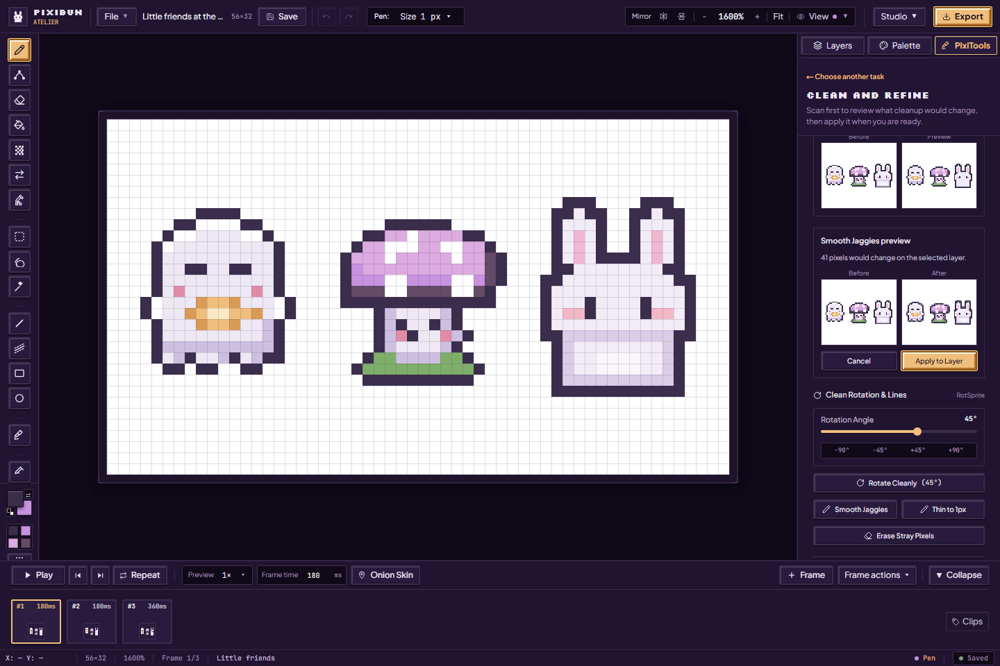
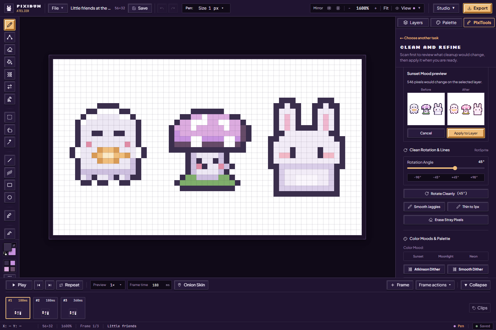
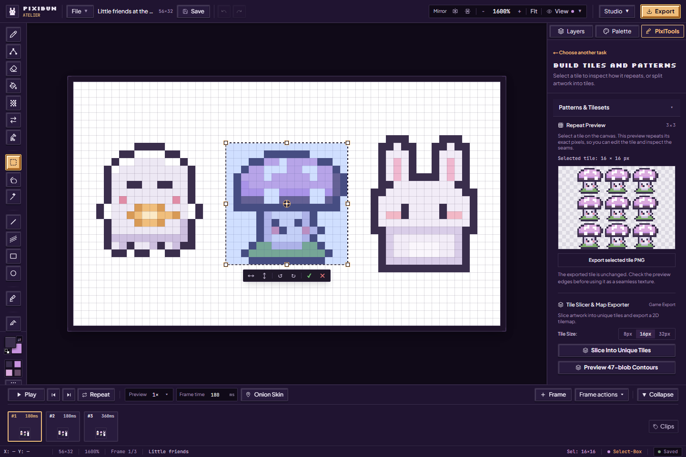
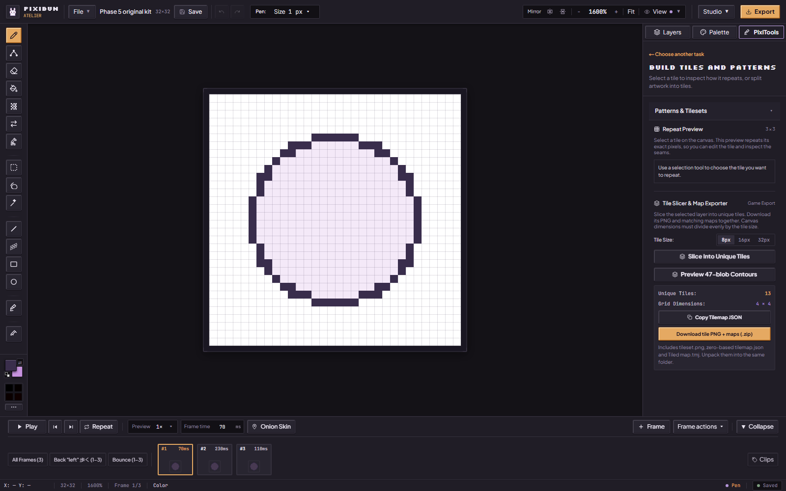
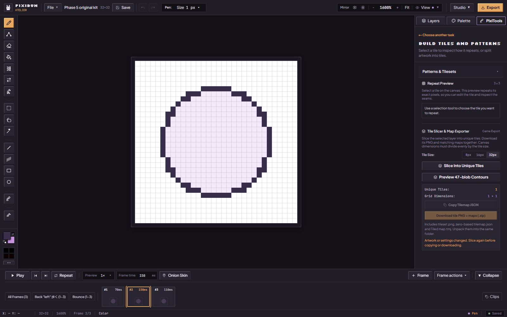
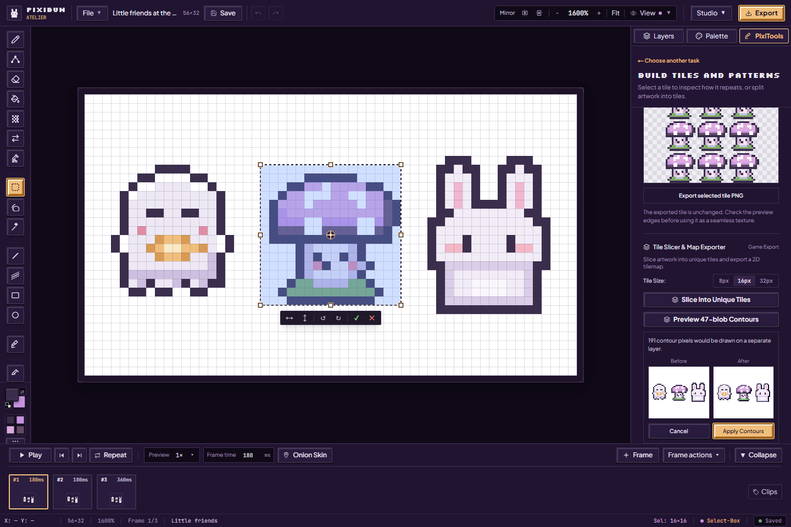

# Polish pixels and explore patterns

For the tested revision and remaining accessibility, device and host checks, see the [current status](../current-status.md).

[Handbook](README.md) · [Animation review](animation-and-review.md) · [Variations](variations-and-scenes.md) · [All features](../features.md)

Choose **Effects** (the PixiTools tab) in the right inspector, then choose a task. **Choose another task** brings you back; **Browse all tools** shows the sections together. The task choice is remembered for the browser session. The five current groups are **Add light and depth**, **Build tiles and patterns**, **Clean and refine**, **Review animation**, and **Try a new look**.

These are local tools with bounded algorithms. A folder named `ai` in the source does not mean an AI image service or trained model is shipped. Some actions commit immediately; the guide calls those out below.

## Scan before cleaning

Open **Clean and refine → Pixel Cleanup & RotSprite**:

1. Select an unlocked artwork layer. Set **Faint alpha**; this threshold concerns transparency, not the brightness of an opaque gray mark.
2. Choose **Shades: Keep / Crisp** and **Lines: Keep / Thin**. Leave line thinning off for a first scan, especially when tiny eyes or interior outlines matter.
3. Choose **Current frame only** or **Same layer across all frames**. Across-frame cleanup finds a uniquely named counterpart with the same generated tag in every frame, regardless of stack order, and skips locked counterparts. Missing or ambiguous matches refuse the batch; use matching unique layer names or Current frame only. Inspect the report's frame and skip counts.
4. Choose **Scan Artwork**. Review its counts and the Before / Preview thumbnails. The scan can propose removing faint pixels and isolated specks, hardening alpha, simplifying shades and thinning dark strokes.
5. Only then choose **Apply Cleanup**. It uses the current analyzed settings and source. If the artwork changed, the stale preview needs a fresh scan. Use Undo to restore the action when retained in history.

Protected rectangles from the active [animation review clip](animation-and-review.md#regions-and-protection) are respected by this **Scan Artwork / Apply Cleanup** workflow. Category counts describe proposals before protection; the protected-pixel count helps explain a difference. Protection is not a lock shared by every filter, brush or transform.

## Clean rotation and lines

| Tool | Steps | When it changes artwork |
| --- | --- | --- |
| Rotate Cleanly (RotSprite) | Set Rotation Angle, then Rotate Cleanly; quick −90°, −45°, +45°, +90° buttons also run rotation | Immediately on action, on the selected layer; inspect clipping within the canvas and Undo if needed |
| Smooth Jaggies | Open it, inspect Before / After and the changed-pixel count | **Apply to Layer** commits the preview |
| Thin to 1px | Preview a reduction of thick strokes | Apply commits; intentional thick features can be lost |
| Erase Stray Pixels | Preview removal of isolated single-pixel dots | Apply commits; sparkles or detached details can be intentional |

Preview actions offer **Cancel** and refuse stale artwork/palette inputs. A zero-change result does not need applying. These individual raster previews do not inherit the animation cleanup protection contract. Save a backup before a long sequence of edits.

## Color moods and dithering

In the same task, scroll to **Color Moods & Palette**. **Sunset**, **Moonlight** and **Neon** preview atmospheric recoloring on the selected layer. Compare the result, then Apply to Layer or Cancel. They are presets, not a guarantee that the resulting colors stay in your palette.

| Action | Use it this way | Scope and limit |
| --- | --- | --- |
| Atkinson Dither | Preview a retro error-diffusion treatment, then apply/cancel | Selected layer; may change shades and texture |
| Smooth Dither | Preview the Riemersma treatment, then apply/cancel | Selected layer; not the same control as Dither Brush density |
| Snap to Active Palette | Select the intended palette first, preview its nearest-color mapping, then apply | Recolors the selected layer; distinct source shades may collapse together |
| Harmonize Accents | Use to add suggested complementary/accent shades | Changes the active palette immediately; it does not recolor the canvas |
| Generate In-Between Frame | Choose the first of two adjacent poses, then generate and inspect | Adds a frame through the implemented morph heuristic; see [animation](animation-and-review.md#add-an-in-between-pose) |

For authoring swatches, ramps, roles and animated color ranges, follow [palettes and cycling](palettes-and-cycling.md).

## Repeat a selected tile

Choose **Build tiles and patterns → Patterns & Tilesets** and open the section. Select a rectangular tile on the canvas. **Repeat Preview** shows that rectangle from the visible frame repeated three times in each direction. Edit the source tile to check whether its edges meet; the preview updates from the current source.

**Export selected tile PNG** saves the selected rectangle at its native size. The preview may shrink a large tile to fit its panel, but that display scale is not the downloaded tile size. A lasso selection contributes its rectangular bounds here. This workflow repeats the authored pixels; it does not invent missing seamless edges.

## Slice into unique tiles

1. Select the source **layer** and choose 8, 16 or 32 px **Tile Size**. Both canvas dimensions must divide evenly by that size; a partial edge is refused so pixels are not silently cropped.
2. Choose **Slice Into Unique Tiles**. It scans that layer's stored canvas pixels, including transparency. Repeat Preview instead uses the visible frame composite. Layer opacity, blend effects and other layers are not baked into this bundle.
3. Read **Unique Tiles** and **Grid Dimensions**. Identical tiles share an ID, assigned by first appearance from left to right, then top to bottom. No rotations or flips are used to merge different tiles.
4. Choose **Download tile PNG + maps (.zip)**. Unpack all three files into the same folder. **Copy Tilemap JSON** is available if clipboard permission allows it, but copying the map alone does not copy its image.

| File | How to use it |
| --- | --- |
| tileset.png | Native-size unique tiles packed row by row. No spacing or margin; unused cells at the end are transparent. |
| tilemap.json | PixiBun format/version, source and map dimensions, atlas filename/dimensions/columns, unique count and a 2D map of zero-based local IDs. Tile 0 is the first real tile. |
| map.tmj | A finite orthogonal Tiled JSON map referencing the same PNG. Its global IDs begin at 1; subtract firstgid (1) to recover the local tile ID. Even a transparent source tile has its own reusable ID. |

The PNG and both maps are prepared from one snapshot and downloaded together. Changing artwork, frame, layer, dimensions or tile size makes the result stale and disables Copy/Download. Slice again to use the new source. Switching back to the earlier frame or tile size does not restore a released bundle; prepare it again. If you edit while encoding, the pending result is discarded. **Cancel tile export** also stops preparation without changing artwork.

Admission allows up to 4096 source tiles, 4096 px per side and four million source pixels, within the shared artwork memory budget. Try a larger tile size or smaller canvas if refused. PNG preparation has a 30-second timeout. These bounds limit work; they do not guarantee success on every device.

Open map.tmj in your intended Tiled version, keeping tileset.png beside it, and inspect the image. The local browser checks reconstruct the source using the documented atlas/GID conventions. A fresh Tiled desktop or general Godot/Unity tilemap import is not claimed by those checks. The [export contract](../contracts/exports.md#unique-tile-bundle) describes the format boundary.

## Preview 47-blob contours

Choose **Preview 47-blob Contours** to inspect highlighted/shaded contours derived from the implemented neighbor-mask rules. Read the proposed pixel count and Before / After thumbnails. **Apply Contours** writes a separate contour layer; **Cancel** leaves the project unchanged. If artwork changes, prepare a new preview.

The name refers to the contour rules. It does not mean the panel exports a complete 47-tile autotile atlas or a general world generator. For a small rule-based layout with pins and walkability, use [Try a new look → Tiles](variations-and-scenes.md#small-tile-scenes).

Sources: [task navigation](../../src/components/layout/inspector/AiToolsPanel.tsx), [cleanup and raster previews](../../src/components/layout/inspector/PixiBudAssistanceSection.tsx), [tile previews and bundles](../../src/components/layout/inspector/TilesetDecomposerSection.tsx), [exact tile bundle](../../src/lib/export/tilesetBundle.ts).
