# Settle into your studio

[Handbook](README.md) · [Drawing tools](drawing-tools.md) · [All features](../features.md)

The studio has a small shelf of tools on the left, your canvas in the middle, **Tools / Layers / Palette / PixiTools** in the inspector, and animation frames below. The **Workspace** row provides Drawing, Animation and Lighting layouts, a left/right inspector, saved arrangements, optional color and navigator panels, and canvas-only mode. Follow [Arrange a desk](artist-workspace.md) for these controls. Start with a little canvas and a few colors; there is no need to learn every panel at once.

## Projects and names

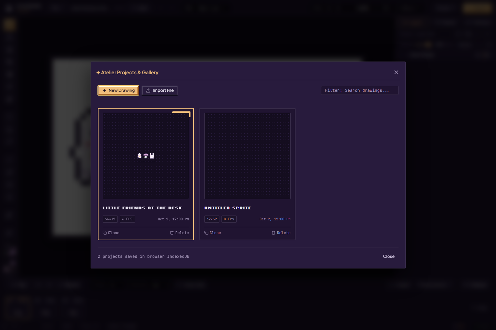

1. Open **File → New drawing** for a blank project. Wait for the current save to finish before switching. A failed save should be resolved or backed up first.
2. Click the project title along the top to rename it. Confirm the edit; the name travels with a project backup.
3. Open **File → Projects** to browse drawings saved in this browser. Search by name, open a thumbnail, **Clone** a drawing for a variation, or rename it in the gallery. Delete uses a confirmation in the project card; keep a portable backup before removing a drawing you might want later.
4. **Save** or **Ctrl+S** asks for an immediate local save. Background autosave waits briefly after edits. The status badge tells you whether a save completed, is pending or needs attention.

This gallery belongs to the current browser storage and site origin. It is not an account or a cloud library. Opening the site in another browser does not bring the gallery with you. See [artwork safety](artwork-safety.md) for portable backups, storage failures, recovery and competing tabs.

## Bring in an image

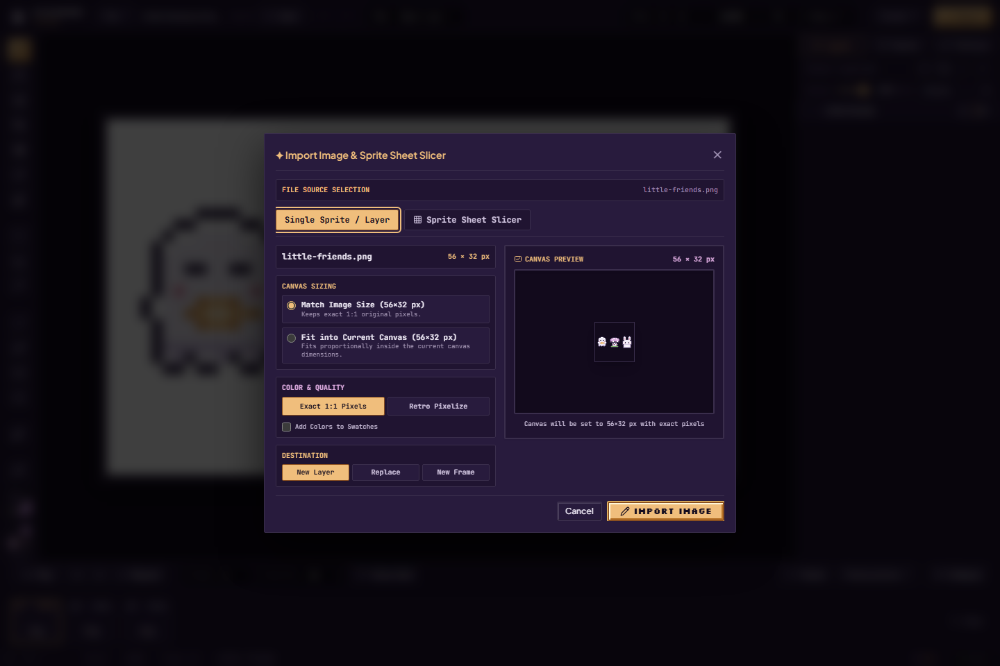

Open **File → Import…** and choose a PNG, JPEG, WebP or `.pixibun` project. Drag-and-drop import is also available in the workspace. For an ordinary image, choose **Single Sprite / Layer** and follow these steps:

The project path also accepts `.json` files containing valid PixiBun project data; arbitrary JSON is not artwork. The image admission path recognizes GIF/BMP headers too when supplied through a supported drop/paste path, although the picker lists PNG/JPEG/WebP. An animated source through this ordinary image path does not automatically become a complete extracted animation timeline.

1. Choose **Match Image Size** to keep admitted native dimensions, or **Fit into Current Canvas** to fit proportionally. Oversized sources must be reduced to the canvas limit; a size adjustment can change pixels even when the color mode says **Exact 1:1 Pixels**.
2. Keep **Exact 1:1 Pixels** for pixel art you want to preserve. **Retro Pixelize** exposes reduction to 16 colors or the active palette, Flat / Atkinson treatment and optional background-color removal. It is a stylization workflow, not a guaranteed reconstruction of hand-drawn pixel art.
3. Choose **New Layer**, **Replace**, or **New Frame**. Replace changes the destination layer's artwork. Review the preview, decide whether to add extracted colors to swatches, then choose **Import Image**.

A `.pixibun` file instead opens a project summary. Review it and **Confirm Import** to restore its admitted layers, frames, palettes and timing. A normal image is not a layered project backup. Import validation can reject malformed or oversized files; [storage limits](../contracts/storage.md) are the detailed reference.

The file is header-checked before decoding. Display previews have a longest dimension of at most 1,024 pixels; that display reduction does not define sprite-sheet cut pixels. Retro Pixelize samples an intermediate source of at most 2,048 pixels per axis before processing. Source decode, sampling, output and display surfaces use memory estimates before allocation; a large source may still be refused even when the desired output is small. These estimates do not measure the browser decoder's actual heap or graphics memory. Invalid JSON and overly complex project files show readable advice while technical errors remain available in diagnostics.

When the browser supplies an image file in a **Paste** event outside a text/editable control and with no dialog open, the Studio opens the same image importer. Clipboard contents, browser behavior and the editor's internal selection clipboard affect whether that event is available. If a copied selection pastes instead, or the browser supplies no image file, use File → Import or drop the saved image. Review the destination before confirming either workflow.

## Slice a sprite sheet

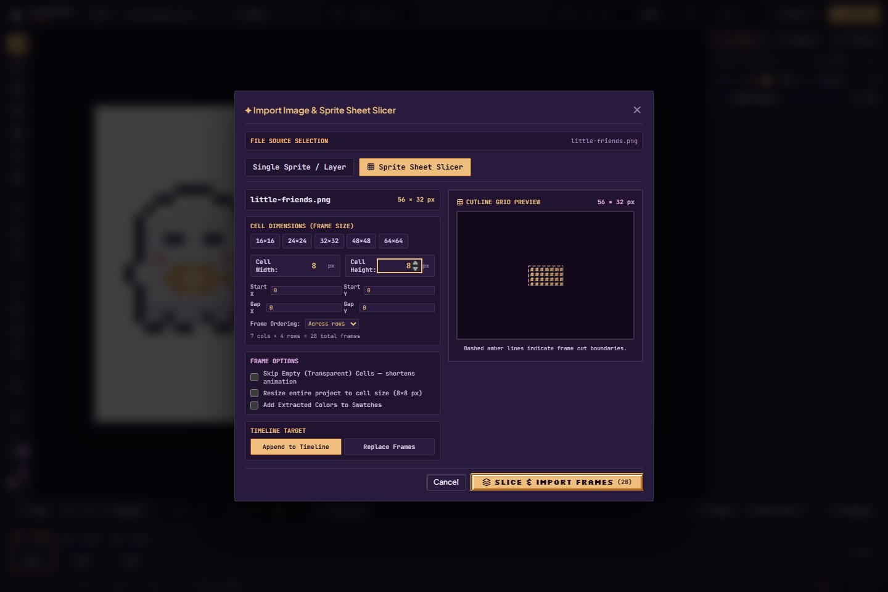

1. Import the sheet and switch to **Sprite Sheet Slicer**.
2. Set cell width and height; use the size presets or your own values. Set spacing and margins when the sheet has gutters or borders. Check the cutline preview rather than assuming the whole sheet divides evenly.
3. Choose **Across rows** or **Down columns**, set frame options and choose the timeline destination. **Skip Empty Cells** shortens the animation; leave it off when a blank pose is intentional.
4. Review the extracted frame count, color-swatches option and target before **Slice & Import Frames**. Existing-frame and resource limits still apply.

Some images open the slicer automatically with a suggested grid. The notice distinguishes a canvas-size guess from cutlines detected through image-pixel analysis. Both still need review: a suggestion is not proof that sprites, empty holds or gutters were interpreted correctly.

Empty-cell filtering checks original image pixels in tiles of at most 256×64 pixels. Up to 4,194,304 source pixels can be checked while displaying the preview; larger sheets display all cell badges and say that the non-empty count will be checked during import. Cancel releases the import's own surfaces and preserves active artwork and history.

## Resize the canvas

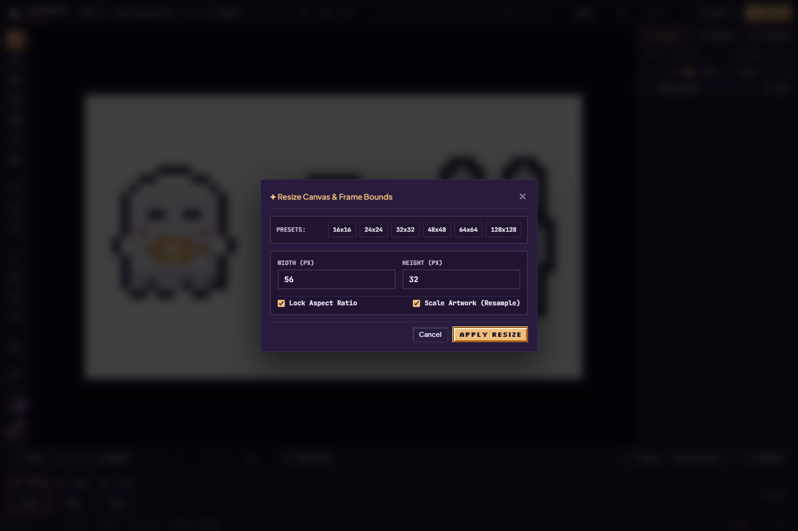

Open **File → Canvas size…**. Choose a preset or enter width and height. **Lock Aspect Ratio** couples the dimensions. With **Scale Artwork (Resample)** off, the anchor chooses where the existing pixels sit within the new bounds; shrinking can crop them. With resampling on, artwork is resized rather than just given new bounds. Review both settings, apply the resize, and inspect every important frame. Undo can restore an admitted resize while it remains in history.

## Layers

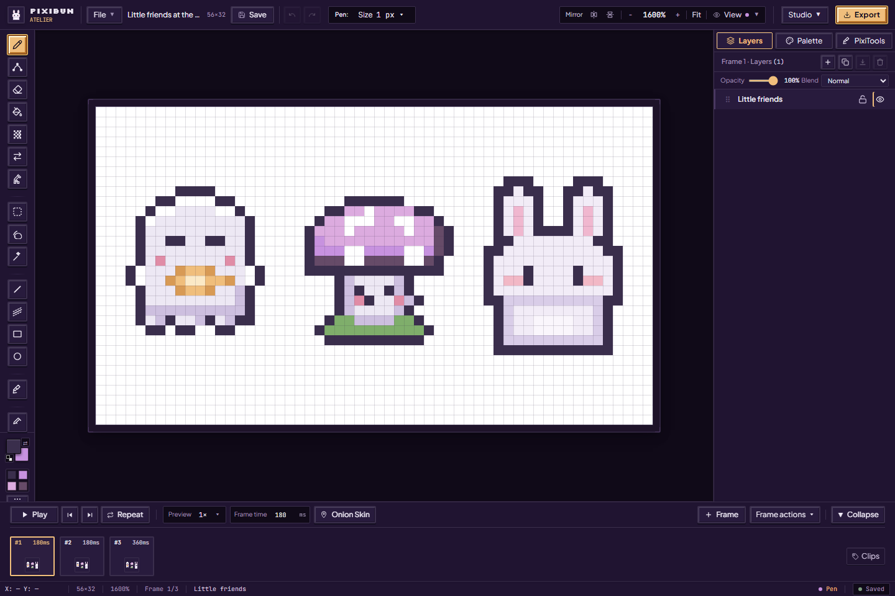

Choose **Layers**, then select the layer you want to edit. Each animation frame has its **own pixels**. A blank added frame keeps layer names and settings but does not copy the artwork; **Duplicate frame** copies a pose.

| Control | How to use it | What to check |
| --- | --- | --- |
| Add New Layer | Add a transparent layer in the current frame | Paint on the newly selected layer |
| Duplicate Layer | Copy the selected layer in this frame | A variation can now be edited separately |
| Rename | Use the rename button or double-click its name | Names are labels, not shared pixel identities |
| Visibility | Use the eye control | Hidden art is omitted from the ordinary visible composite |
| Lock | Use the lock control | It prevents supported edits to that layer; unlock it to draw |
| Reorder | Drag the grip, or use arrow keys while the grip is focused | Higher layers cover lower ones in the stack |
| Opacity | Adjust the slider | It changes the layer contribution, not every stored pixel's alpha |
| Blend | Choose Normal, Multiply, Screen, Overlay, Color Dodge or On artwork only | Check the visible result; a target engine may not reproduce these as independent layers |
| Merge Down | Combine with the layer below when both are editable | Their separate editability is lost; undo if you need it back |
| Delete Layer | Remove the selected layer when allowed | Keep at least one layer; protect important work with a backup |
| Saved effect | Select a generated lighting/glint layer and reopen its effect | [Lighting recipes](lighting-and-surfaces.md#saved-lighting-and-glint-effects) retain settings and source information |

Frame/layer capacity and locked destinations can disable actions. Co-Draw guests cannot change project structure. See [animation](animation-and-review.md) and [collaboration](collaboration-and-privacy.md).

## Colors close to hand

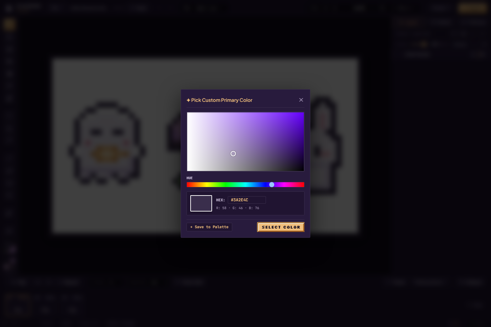

Click a color well at the lower left for quick swatches; double-click for the picker. Set a color with the hue ring and triangle (or square), HSV sliders or hex field, then confirm. **Workspace → Color** pins the same picker in the inspector for immediate drawing-color changes. The quick flyout includes palette and recent colors. **X** swaps primary and secondary; the reset control restores black and white. [Browse palette previews](artist-workspace.md#compare-palettes-before-choosing), or follow the [palette authoring guide](palettes-and-cycling.md) for ramps, roles and cycling.

## Selections and transforms

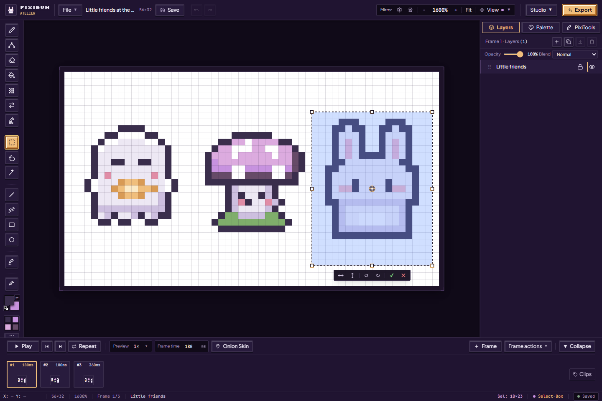

1. Use **Marquee Box (M)**, **Lasso (Q)** or **Magic Wand (W)** to select pixels. Shift adds; Alt subtracts. On selection tools, Alt's subtract gesture takes priority over viewport panning.
2. Drag inside to move, or use arrow keys to nudge. Shift can lock a drag axis. Use the resize handles to scale; the outer rotation zones rotate, with Shift snapping to 15° steps. The pivot sets the rotation center.
3. The action bar flips horizontally/vertically or rotates 90° in either direction. **H / V** act on a selection; without a selection they change drawing mirrors. **Ctrl+C / X / V** copy, cut and paste canvas selections through the editor clipboard.
4. Use the action bar's **Commit** or **Cancel** deliberately. **Enter** commits the transform. Escape's behavior depends on the active transform/floating state: the transform cancel control cancels, while ordinary floating-selection exit can commit pixels before clearing the selection. If a commit changed art unexpectedly, use Undo.

Selection masks matter: a lasso or wand selection does not fill its entire bounding rectangle. Ordinary drawing remains constrained by the active mask. Copy/paste is a pixel workflow, not a transfer of the whole frame's layer metadata.

## View and symmetry

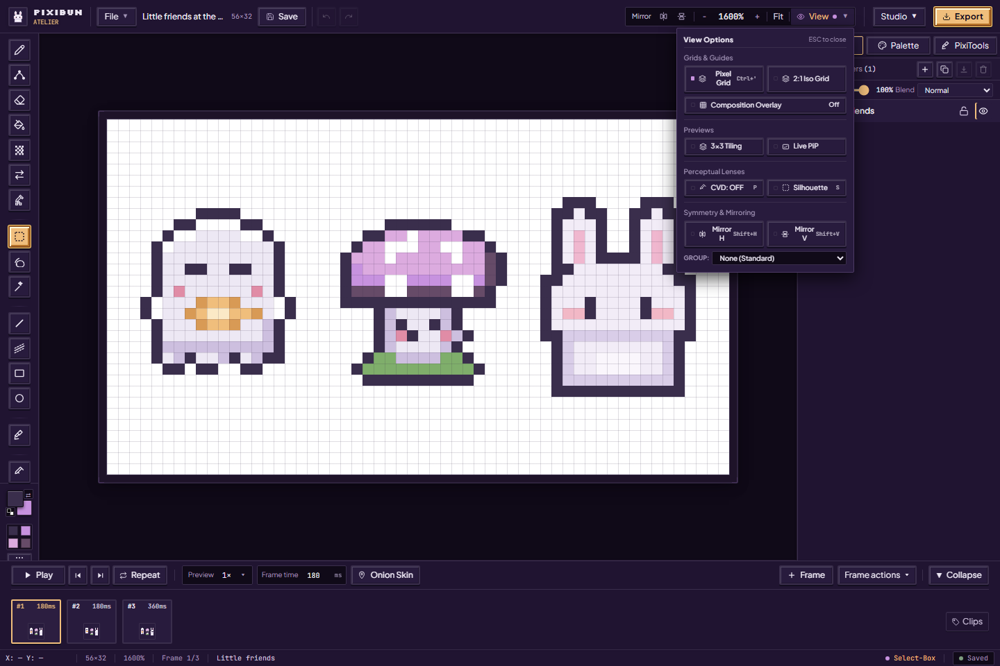

| Feature | A gentle first use | Artwork effect |
| --- | --- | --- |
| Zoom / Fit / 100% | Wheel or +/− to inspect pixels; Ctrl+0 to fit; Ctrl+1 for native scale | View only |
| Pan | Middle-drag, or Alt-drag when not subtracting a selection; arrows when no selection | View only |
| Pixel Grid | Turn on View → Pixel Grid for precise placement | Not exported |
| 2:1 Iso Grid | Use alongside isometric shapes | Not exported |
| Composition Overlay | Choose Off / Thirds / Golden / Center / Diagonals / Safe area (10%) | Not exported |
| 3×3 Tiling | Repeat the canvas to inspect its outer seams | Does not enlarge the saved canvas |
| Live PiP | Open a floating preview, then move/resize/minimize it; choose a backdrop or play | Does not create another project |
| CVD lens | Cycle the color-vision simulation with P or the menu | View filter, not a recoloring operation or accessibility certification |
| Silhouette | Press S to inspect the shape apart from its colors | View filter |
| Mirror H / V | Turn on a mirror before drawing a balanced sprite | New supported drawing gestures paint mirrored pixels |
| Wallpaper group | Choose p2, pm, p4, p4m or p6m for repeated rotational/reflection gestures | A drawing symmetry mode; inspect results on the rectangular canvas |

For an exact selected tile's repeating preview and download, use [Patterns & Tilesets](pixitools-cleanup-and-tiles.md#repeat-a-selected-tile). The View preview repeats the canvas instead.

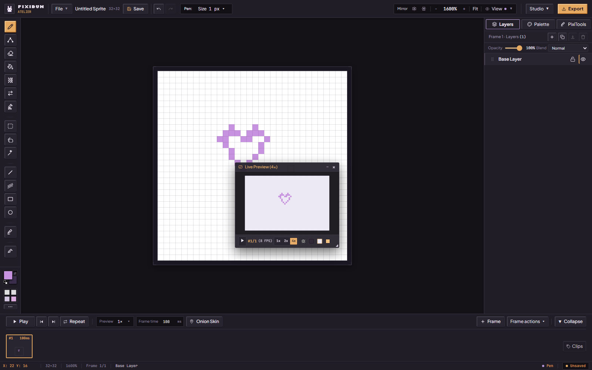

Choose **View → Live PiP** to open one floating **Live Preview** window. You can also search for Picture-in-Picture in **Ctrl/Cmd+K**.

1. Drag the title bar to place it where it helps you. Drag the small bottom-right handle to resize its viewing area.
2. Choose **1x / 2x / 4x** and a backdrop to check the artwork at another size or against another surface. These controls leave your drawing unchanged.
3. Use **Minimize**, then **Expand** when you need it again; the current artwork is redrawn after expansion. Play/Pause shares the Studio timeline.
4. Close it with **×**, or toggle Live PiP off in View. Reopening gives you the same single preview. It follows artwork changes and Undo/Redo; it does not create a second project.

The [new capture record](../assets/screenshots/2026-10-02-feature-repairs-phase3/run.json) shows the corrected single-window controls. The earlier duplicate-window screenshot remains historical evidence.

## Right-click quick tools

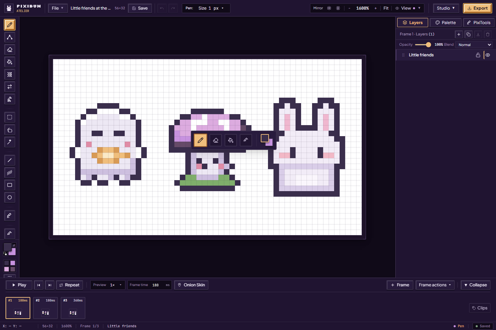

Right-click the drawing surface for quick access to Pen, Eraser, Fill, Eyedropper and color swap. Choose an action, or dismiss with Escape or an outside click. The full left shelf remains available for the other tools. Right-click on a palette swatch has a different job: it selects the secondary color.

The bottom status area helps you check cursor coordinates, canvas size, zoom, current frame, layer/tool and selection size. The top save badge tells you about persistence; the cursor readout is not evidence that a project has saved.

## Appearance, help and command search

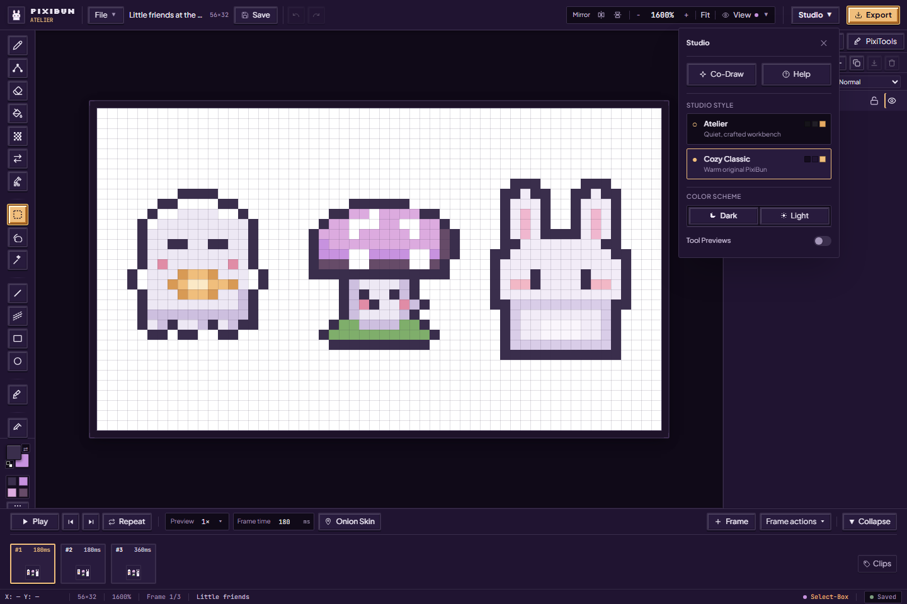

Open **Studio** to choose **Atelier** or **Cozy Classic**, independently of **Dark / Light**. The same menu opens **Co-Draw**, **Help**, and the tool-preview preference. Animated tool previews explain gestures on hover/focus; turn them off if you prefer a quieter desk. Reduced-motion behavior is supported where implemented; this is not a claim of completed assistive-technology studies.

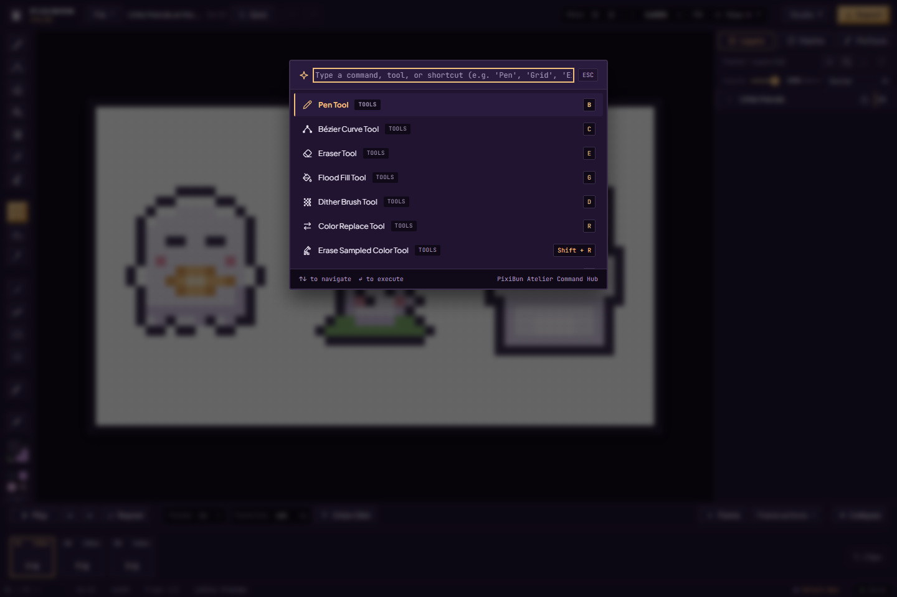

Press **Ctrl+K** to search drawing tools, view controls, playback or project actions by name. Use arrows to choose a result and Enter to run it. **Studio → Help** opens the shortcut guide and its **Privacy & Diagnostics** link. Shortcuts are context-sensitive and normally yield to text fields and dialogs; use the [shortcut contract](../contracts/shortcuts.md) for the exact exceptions.

Sources: [project rail](../../src/components/layout/AtelierRail.tsx), [gallery](../../src/components/modals/ProjectsGalleryModal.tsx), [importer](../../src/components/modals/ImportModal.tsx), [resize](../../src/components/modals/CanvasResizeModal.tsx), [layers](../../src/components/layout/inspector/LayersPanel.tsx), [selection gizmo](../../src/components/studio/SelectionTransformGizmo.tsx), [PiP](../../src/components/studio/FloatingPreviewWindow.tsx), [commands](../../src/components/modals/CommandPaletteModal.tsx), [appearance](../../src/components/ui/AppearancePopover.tsx).
