# Settle into your studio

For the tested revision and remaining accessibility, device and host checks, see the [current status](../current-status.md).

[Handbook](README.md) · [Drawing tools](drawing-tools.md) · [All features](../features.md)

The studio has a small shelf of tools on the left, your canvas in the middle, **Tools / Layers / Palette / Effects** in the inspector, and animation frames below. The **Workspace** row provides Drawing, Animation and Lighting layouts, a left/right inspector, saved arrangements, optional color and navigator panels, and canvas-only mode. Follow [Arrange a desk](artist-workspace.md) for these controls. Start with a little canvas and a few colors; there is no need to learn every panel at once.

Compare the [current Studio screenshots of every theme in Day and Night](themes.md).

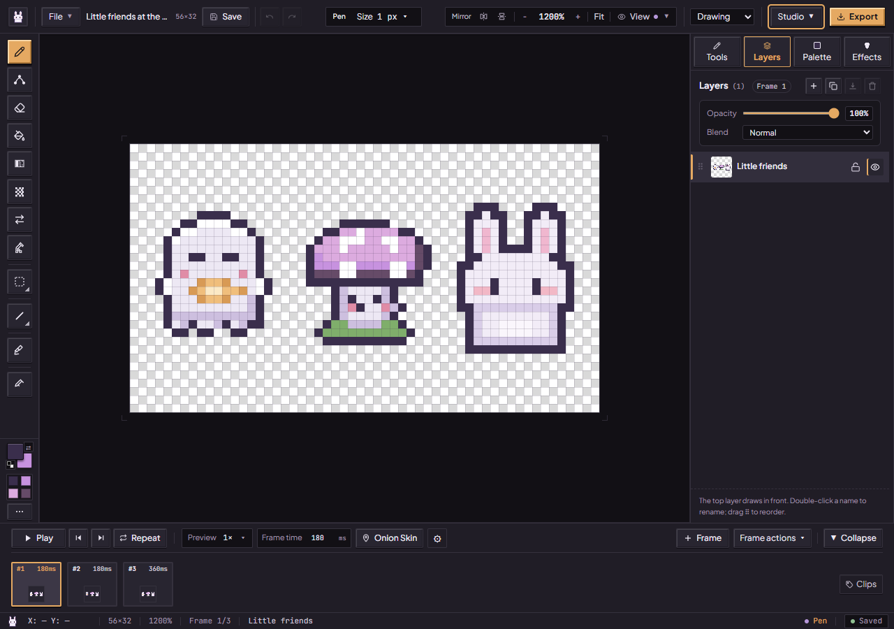

The right inspector tabs are **Tools**, **Layers**, **Palette** and **Effects**. In the classic interface, full 12 px labels sit below their icons so they fit the admitted 260 px minimum width; the Layers icon row shows a count capped visually at 99+, with the full count in the tab's title. Effects contains PixiTools tasks such as lighting, cleanup, tiles and animation review; its accessible name is Effects (PixiTools). In Tools, expand **Animate artwork** to capture a whole layer or merge visible color layers for motion; an active selection opens this group for capturing a detail.

## Studio Labs

On Moonlit, Sakura, Tidepool, Ember, Moss and Arcade, open **Studio → Labs** to try **Dynamic island**, **Liquid tabs**, **Liquid controls**, **Paint pot palette** and **Quick magic**. Each has its own switch; **Classic studio** turns them all off, and **Turn all on** restores them. Your choices stay in this browser. Graphite and Plum always keep classic controls regardless of saved switches.

The island shows the active tool’s name. When the tool has settings, a ▾ beside the name grows a settings panel, with Pen and Eraser sizes inside it. Escape closes it. Changing tools briefly blurs out the previous controls, then reveals the new ones with a small bounce. The top row keeps its position during menu expansion. Status bubbles report saves, history, frames, layers and mirror changes. Reduced motion removes the island’s spring/blur travel.

Liquid tabs keep the same Tools, Layers, Palette and Effects destinations. Tap normally, or press and hold/slide the lens and release over the desired tab. Keyboard activation still uses the tab buttons. **Liquid controls** turns slider handles into glass while you drag them, and they glide to a clicked spot. On the tool rail, the highlight works like the tab lens: it springs to each new tool. Press and hold a tool, or press and slide, to lift it into glass, run it along the rail and release over the tool you want. On slots with a corner triangle, a still hold still opens their tool list. The [paint-pot palette](palettes-and-cycling.md#paint-pot-palette) and [Quick magic](pixitools-cleanup-and-tiles.md#quick-magic) change how existing actions are presented. The theme screenshots were captured with Labs off and do not illustrate these motion states.

## Projects and names

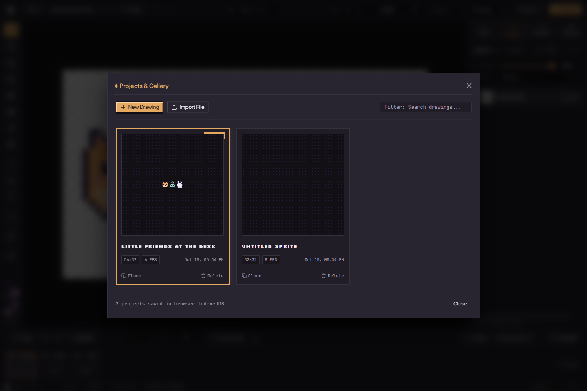

1. Open **File → New drawing** for a blank project. Wait for the current save to finish before switching. A failed save should be resolved or backed up first.
2. Click the project title along the top to rename it. Confirm the edit; the name travels with a project backup.
3. Open **File → Projects** to browse drawings saved in this browser. Search by name, open a thumbnail, **Clone** a drawing for a variation, or rename it in the gallery. Delete uses a confirmation in the project card; keep a portable backup before removing a drawing you might want later.
4. **Save** or **Ctrl+S** asks for an immediate local save. Background autosave waits briefly after edits. The status badge tells you whether a save completed, is pending or needs attention.

This gallery belongs to the current browser storage and site origin. It is not an account or a cloud library. Opening the site in another browser does not bring the gallery with you. See [artwork safety](artwork-safety.md) for portable backups, storage failures, recovery and competing tabs.

## Bring in an image

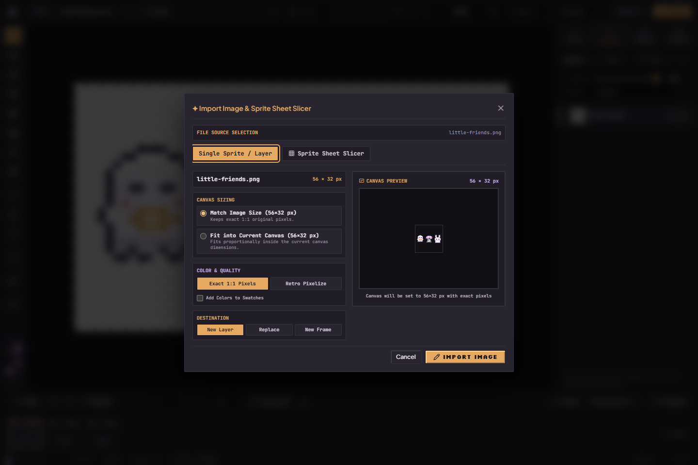

Open **File → Import…** and choose a PNG, JPEG, WebP or `.pixibun` project. Drag-and-drop import is also available in the workspace. For an ordinary image, choose **Single Sprite / Layer** and follow these steps:

The project path also accepts `.json` files containing valid PixiBun project data; arbitrary JSON is not artwork. The image admission path recognizes GIF/BMP headers too when supplied through a supported drop/paste path, although the picker lists PNG/JPEG/WebP. An animated source through this ordinary image path does not automatically become a complete extracted animation timeline.

1. Choose **Match Image Size** to keep admitted native dimensions, or **Fit into Current Canvas** to fit proportionally. Oversized sources must be reduced to the canvas limit; a size adjustment can change pixels even when the color mode says **Exact 1:1 Pixels**.
2. Keep **Exact 1:1 Pixels** for pixel art you want to preserve. **Retro Pixelize** exposes reduction to 16 colors or the active palette, Flat / Atkinson treatment and optional background-color removal. It is a stylization workflow, not a guaranteed reconstruction of hand-drawn pixel art.
3. Choose **New Layer**, **Replace**, or **New Frame**. Replace changes the destination layer's artwork. Review the preview, decide whether to add extracted colors to swatches, then choose **Import Image**.

A `.pixibun` file instead opens a project summary. Review it and **Confirm Import** to restore its admitted layers, frames, palettes and timing. A normal image is not a layered project backup. Import validation can reject malformed or oversized files; [storage limits](../contracts/storage.md) are the detailed reference.

The file is header-checked before decoding. Display previews have a longest dimension of at most 1,024 pixels; that display reduction does not define sprite-sheet cut pixels. Retro Pixelize samples an intermediate source of at most 2,048 pixels per axis before processing. Source decode, sampling, output and display surfaces use memory estimates before allocation; a large source may still be refused even when the desired output is small. These estimates do not measure the browser decoder's actual heap or graphics memory. Invalid JSON and overly complex project files show readable advice while technical errors remain available in diagnostics.

When the browser supplies an image file in a **Paste** event outside a text/editable control and with no dialog open, the Studio opens the same image importer. Clipboard contents, browser behavior and the editor's internal selection clipboard affect whether that event is available. If a copied selection pastes instead, or the browser supplies no image file, use File → Import or drop the saved image. Review the destination before confirming either workflow.

## Slice a sprite sheet

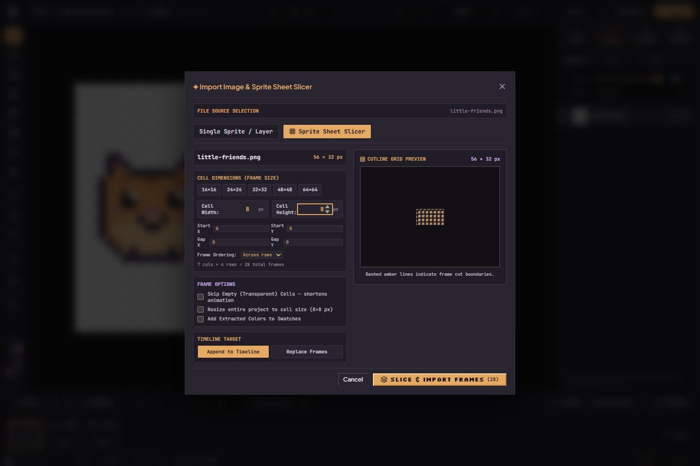

1. Import the sheet and switch to **Sprite Sheet Slicer**.
2. Set cell width and height; use the size presets or your own values. Set spacing and margins when the sheet has gutters or borders. Check the cutline preview rather than assuming the whole sheet divides evenly.
3. Choose **Across rows** or **Down columns**, set frame options and choose the timeline destination. **Skip Empty Cells** shortens the animation; leave it off when a blank pose is intentional.
4. Review the extracted frame count, color-swatches option and target before **Slice & Import Frames**. Existing-frame and resource limits still apply.

Some images open the slicer automatically with a suggested grid. The notice distinguishes a canvas-size guess from cutlines detected through image-pixel analysis. Both still need review: a suggestion is not proof that sprites, empty holds or gutters were interpreted correctly.

Empty-cell filtering checks original image pixels in tiles of at most 256×64 pixels. Up to 4,194,304 source pixels can be checked while displaying the preview; larger sheets display all cell badges and say that the non-empty count will be checked during import. Cancel releases the import's own surfaces and preserves active artwork and history.

## Resize the canvas

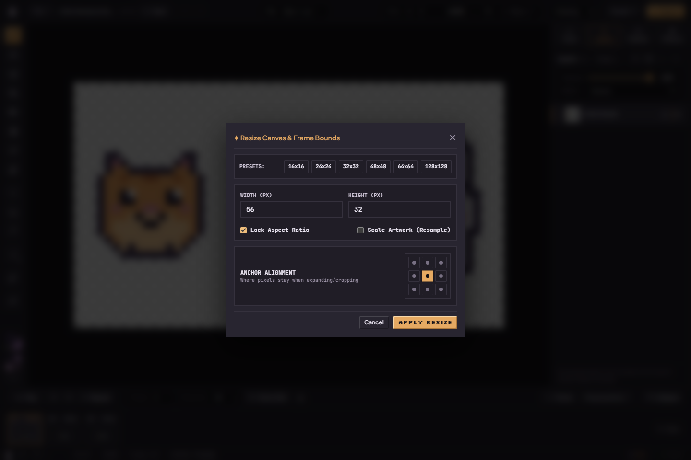

Open **File → Canvas size…**. Choose a preset or enter width and height. **Lock Aspect Ratio** couples the dimensions. With **Scale Artwork (Resample)** off, the anchor chooses where the existing pixels sit within the new bounds; shrinking can crop them. With resampling on, artwork is resized rather than just given new bounds. Review both settings, apply the resize, and inspect every important frame. Undo can restore an admitted resize while it remains in history.

## Layers

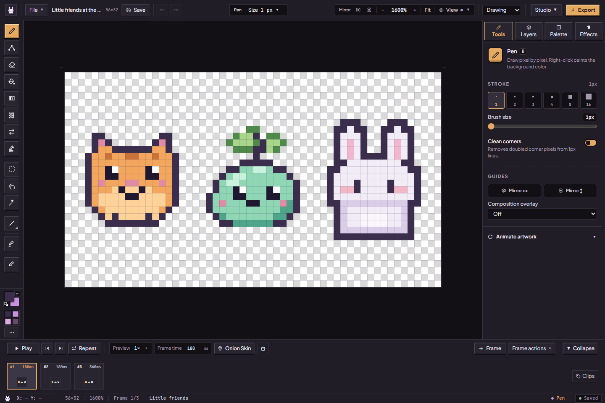

Choose **Layers**, then select the layer you want to edit. Each animation frame has its **own pixels**. A blank added frame keeps layer names and settings but does not copy the artwork; **Duplicate frame** copies a pose.

| Control | How to use it | What to check |
| --- | --- | --- |
| Add New Layer | Add a transparent layer in the current frame | Paint on the newly selected layer |
| Duplicate Layer | Copy the selected layer in this frame | A variation can now be edited separately |
| Rename | Use the rename button or double-click its name | Names are labels, not shared pixel identities |
| Visibility | Use the eye control | Hidden art is omitted from the ordinary visible composite |
| Lock | Use the lock control | It prevents supported edits to that layer; unlock it to draw |
| Reorder | Drag the grip, or use arrow keys while the grip is focused | Higher layers cover lower ones in the stack |
| Opacity | Adjust the slider | It changes the layer contribution, not every stored pixel's alpha |
| Blend | Choose Normal, Multiply, Screen, Overlay, Color Dodge or On artwork only | Check the visible result; a target engine may not reproduce these as independent layers. On artwork only (used by photometric mattes) shows the layer only over artwork below it: paint beside that artwork stays in the layer and its thumbnail but not on the stage. The status bar marks such a layer, and the first stroke it hides offers to switch layer or blend |
| Merge Down | Combine with the layer below when both are editable | Their separate editability is lost; undo if you need it back |
| Delete Layer | Remove the selected layer when allowed | Keep at least one layer; protect important work with a backup |
| Saved effect | Select a generated lighting/glint layer and reopen its effect | [Lighting recipes](lighting-and-surfaces.md#saved-lighting-and-glint-effects) retain settings and source information |

Frame/layer capacity and locked destinations can disable actions. Co-Draw guests cannot change project structure. See [animation](animation-and-review.md) and [collaboration](collaboration-and-privacy.md).

Merge Down accepts visible Normal-blend contributions with their opacity and refuses visible non-Normal blending. The result is baked raster artwork; it clears the merged generated-effect identity. Undo restores the admitted original structure and pixels.

## Colors close to hand

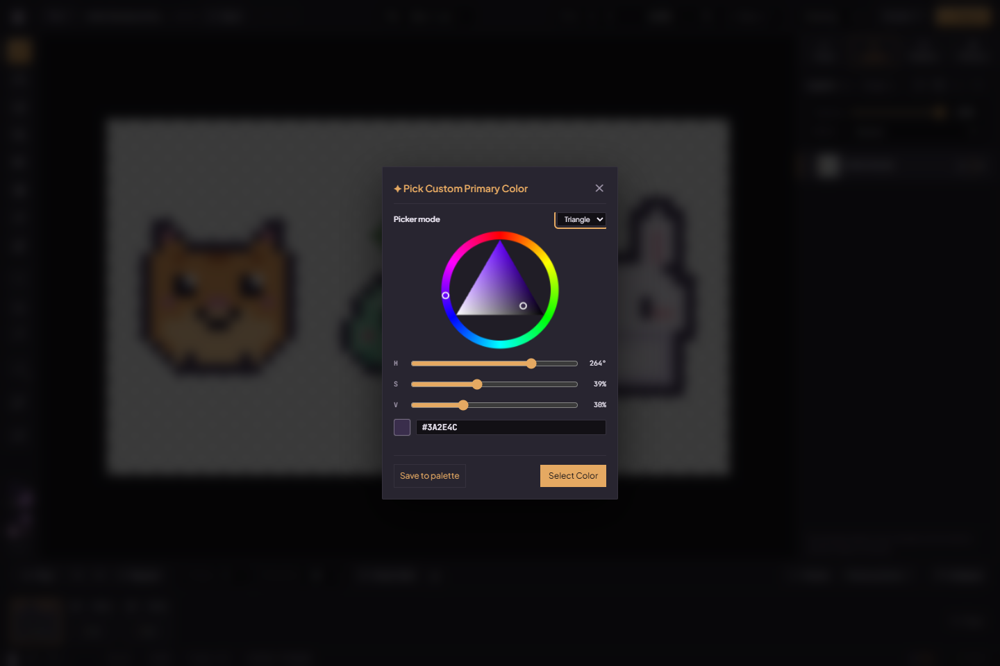

Click a color well at the lower left for quick swatches; double-click for the picker. Set a color with the hue ring and triangle (or square), HSV sliders or hex field, then confirm. **View → Arrange... → Color picker** pins the picker in the inspector for immediate drawing-color changes. The Palette tab also offers **Pin color panel** and **Unpin color panel**. The quick flyout includes palette and recent colors. **X** swaps primary and secondary; the reset control restores black and white. [Browse palette previews](artist-workspace.md#compare-palettes-before-choosing), or follow the [palette authoring guide](palettes-and-cycling.md) for ramps, roles and cycling.

## Selections and transforms

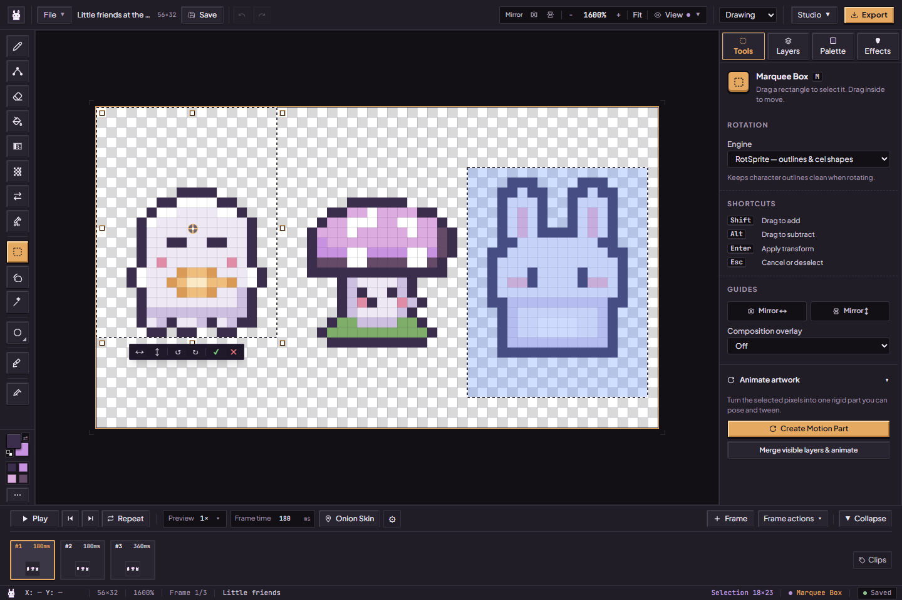

1. Use **Marquee Box (M)**, **Lasso (Q)** or **Magic Wand (W)** to select pixels. Shift adds; Alt subtracts. On selection tools, Alt's subtract gesture takes priority over viewport panning.
2. Drag inside to move, or use arrow keys to nudge. Shift can lock a drag axis. Use the resize handles to scale; the outer rotation zones rotate, with Shift snapping to 15° steps. The pivot sets the rotation center.
3. The action bar flips horizontally/vertically or rotates 90° in either direction. **H / V** flip an active selection; **Shift+H / Shift+V** changes drawing mirrors, with or without a selection. **Ctrl+C / X / V** copy, cut and paste canvas selections through the editor clipboard.
4. Use the action bar's **Commit** or **Cancel** deliberately. **Enter** commits the transform; **Escape** is owned by the viewport transform handler and cancels the float without first committing it. These keys yield to dialogs and focused controls. If a committed edit changed art unexpectedly, use Undo.

Selection masks matter: a lasso or wand selection does not fill its entire bounding rectangle. Ordinary drawing remains constrained by the active mask. Copy/paste is a pixel workflow, not a transfer of the whole frame's layer metadata.

**Tools** also exposes RotSprite/Paeth rotation and one rigid-part motion. [Motion and saved rigs](artist-workspace.md#rotate-a-detail-or-try-rigid-part-motion) explains source requirements, preview, bake and the limits of this first slice. Commit or cancel a floating selection before capturing/opening a motion part.

## View and symmetry

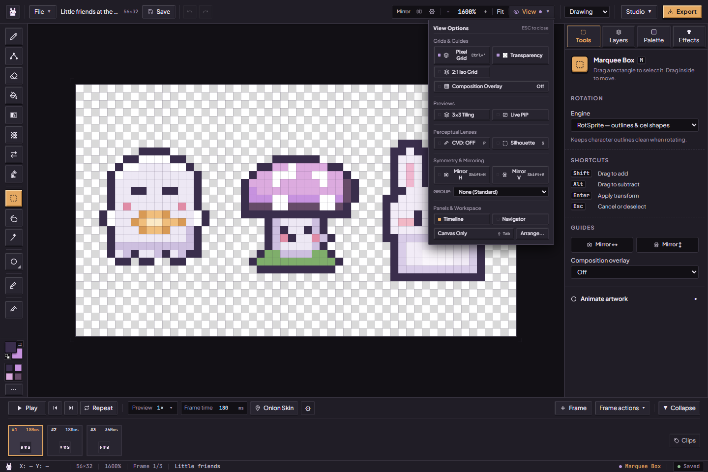

| Feature | A gentle first use | Artwork effect |
| --- | --- | --- |
| Zoom / Fit / 100% | Wheel or +/− to inspect pixels; Ctrl+0 to fit; Ctrl+1 for native scale. A drawing opens fitted to the window, at most 1600% | View only |
| Pan | Hold Space and drag, or middle-drag (PixiBun classic: Alt-drag when not subtracting a selection); arrows when no selection | View only |
| Pixel Grid | Turn on View → Pixel Grid for precise placement | Not exported |
| 2:1 Iso Grid | Use alongside isometric shapes | Not exported |
| Composition Overlay | Choose Off / Thirds / Golden / Center / Diagonals / Safe area (10%) | Not exported |
| 3×3 Tiling | Repeat the canvas to inspect its outer seams | Does not enlarge the saved canvas |
| Live PiP | Open a floating preview, then move/resize/minimize it; choose a backdrop or play | Does not create another project |
| CVD lens | Cycle the color-vision simulation with P or the menu | View filter, not a recoloring operation or accessibility certification |
| Silhouette | Press S to inspect the shape apart from its colors | View filter |
| Mirror H / V | Turn on a mirror before drawing a balanced sprite | New supported drawing gestures paint mirrored pixels |
| Wallpaper group | Choose p2, pm, p4, p4m or p6m for repeated rotational/reflection gestures | A drawing symmetry mode; inspect results on the rectangular canvas |

For an exact selected tile's repeating preview and download, use [Patterns & Tilesets](pixitools-cleanup-and-tiles.md#repeat-a-selected-tile). The View preview repeats the canvas instead.

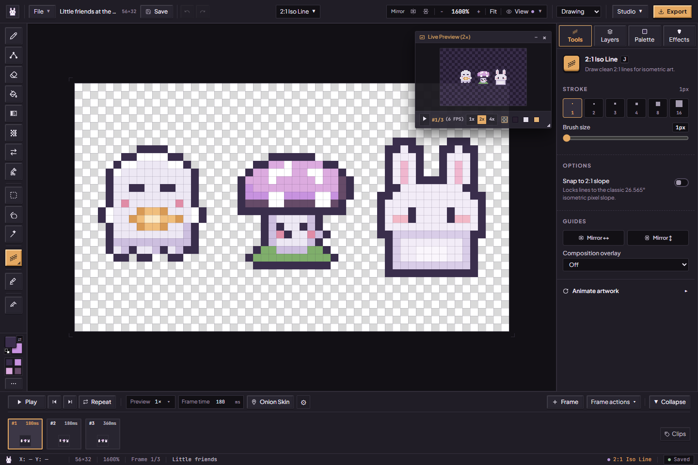

Choose **View → Live PiP** to open one floating **Live Preview** window. You can also search for Picture-in-Picture in **Ctrl/Cmd+K**.

1. Drag the title bar to place it where it helps you. Drag the small bottom-right handle to resize its viewing area.
2. Choose **1x / 2x / 4x** and a backdrop to check the artwork at another size or against another surface. These controls leave your drawing unchanged.
3. Use **Minimize**, then **Expand** when you need it again; the current artwork is redrawn after expansion. Play/Pause shares the Studio timeline.
4. Close it with **×**, or toggle Live PiP off in View. Reopening gives you the same single preview. It follows artwork changes and Undo/Redo; it does not create a second project.

The [new capture record](../assets/screenshots/2026-10-15-current-ui/run.json) shows the corrected single-window controls. The earlier duplicate-window screenshot remains historical evidence.

Hover the Dynamic island, or reach it with the keyboard, to pull a glass-like quick-action droplet from its right edge. The droplet pinches off and wobbles into place; when you leave, it is pulled back in. The name stays fixed and pressing the shortcut does not move its hit target. Each of the 17 tools has a direct setting shortcut. For Pen, Eraser and Line it steps the size 1 → 2 → 3 → 4 px. Clean corners is available only inside expanded Pen/Bézier brush controls in the top rail.

## Right-click quick tools

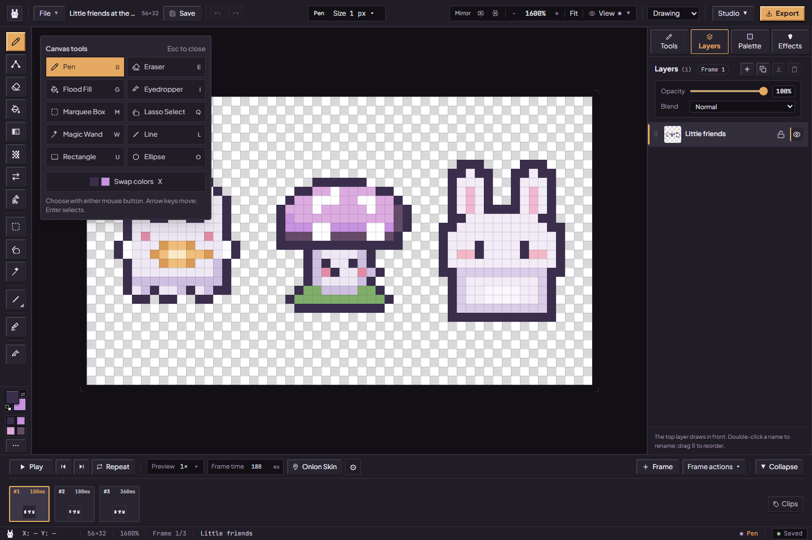

Right-click beside the artwork for **Canvas tools** (in the PixiBun classic keymap, anywhere on the drawing surface; the standard keymap paints with the secondary color on the artwork itself): Pen, Eraser, Flood Fill, Eyedropper, Marquee Box, Lasso, Magic Wand, Line, Rectangle, Ellipse and color swap. Either mouse button chooses an action. With the canvas focused, **Shift+F10** or the **Context Menu** key also opens it. Arrow keys move between buttons; Enter selects; Tab stays inside the popup. Escape or an outside click closes it and restores the opener when still visible. The popup stays inside the window and closes if Studio switches to its small-screen notice. Its clicks do not paint underneath. The full left shelf remains available for the other tools. Right-click on a palette swatch selects the secondary color.

The picture shows the 15 October production build. Replaced pictures retain their original bytes and dates in the local screenshot archive.

The bottom status area helps you check cursor coordinates, canvas size, zoom, current frame, layer/tool and selection size. The top save badge tells you about persistence; the cursor readout is not evidence that a project has saved.

## Appearance, help and command search

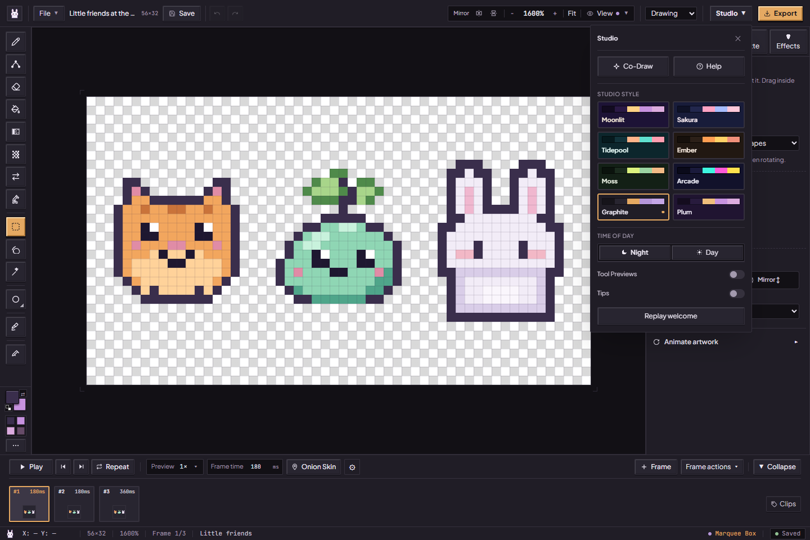

Open **Studio** to choose a style and **Night / Day**. Moonlit, Sakura, Tidepool, Ember, Moss and Arcade float the panels over an animated pixel scene with Bun perched on the canvas frame; Graphite and Plum keep a flat, quiet desk. Every style has a Day and a Night palette, and a unit test checks each palette's text colors against its panel colors at WCAG AA contrast (palette pairs, not a full conformance audit). The same menu opens **Co-Draw**, **Help**, the tool-preview and **Tips** preferences, and **Replay welcome**.

On your first visit, a short welcome asks how much pixel art you have made, lets you pick a style while the studio changes behind it, shows where to change it later, and opens a first drawing. Your answer only tunes help: newcomers get one-time tips beside the canvas, the Lamp, the timeline and Export; people with some experience get tips for PixiBun's own features; pros get none, and tool previews start off. The first-edit tip follows the saved Standard/classic pan gesture, including changes while the tip is open. The layer tip counts newly added ordinary drawing layers in the same frame; tagged/effect/research layers and navigation to existing layers do not trigger it. Project changes clear queued tips. Automated browsers skip the welcome unless the address includes `?welcome=1`. Animated tool previews illustrate tools with procedural mini-canvases, pro tips, and a three-step storyboard (before / action / result); turn them off if you prefer a quieter desk. Reduced-motion behavior is supported where implemented; this is not a claim of completed assistive-technology studies.

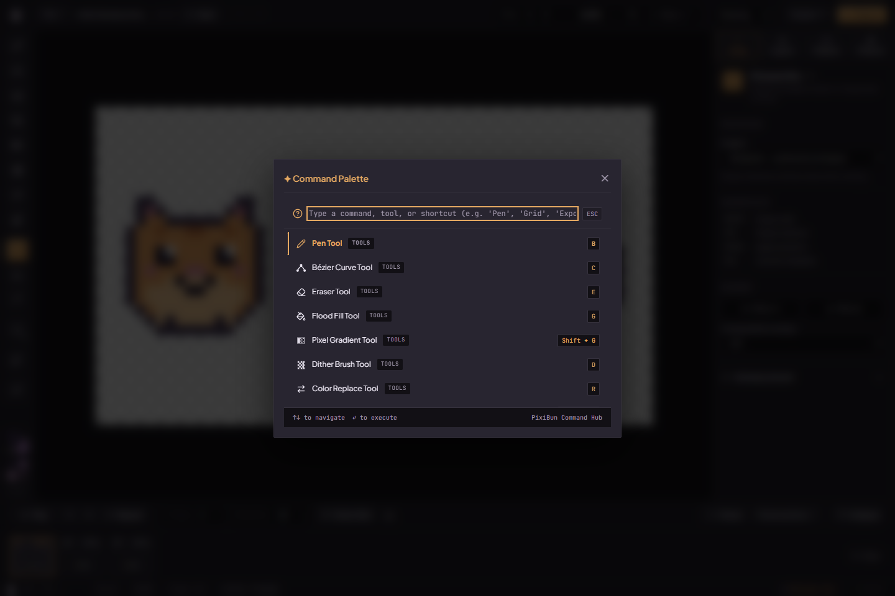

Press **Ctrl+K** to search drawing tools, view controls, playback or project actions by name. Use arrows to choose a result and Enter to run it. **Studio → Help** opens the shortcut guide and its **Privacy & Diagnostics** link. Shortcuts are context-sensitive and normally yield to text fields and dialogs; use the [shortcut contract](../contracts/shortcuts.md) for the exact exceptions.

Sources: [project rail](../../src/components/layout/AtelierRail.tsx), [gallery](../../src/components/modals/ProjectsGalleryModal.tsx), [importer](../../src/components/modals/ImportModal.tsx), [resize](../../src/components/modals/CanvasResizeModal.tsx), [layers](../../src/components/layout/inspector/LayersPanel.tsx), [selection gizmo](../../src/components/studio/SelectionTransformGizmo.tsx), [PiP](../../src/components/studio/FloatingPreviewWindow.tsx), [commands](../../src/components/modals/CommandPaletteModal.tsx), [appearance](../../src/components/ui/AppearancePopover.tsx), [tool previews](../../src/components/ui/ToolMotionPreview.tsx).
