# Choose your desk

[Handbook](README.md) · [Studio workspace](studio-workspace.md) · [Current capture details](../assets/screenshots/2026-10-15-current-ui/run.json)

All eight Studio themes have a **Night** and a **Day** appearance. Open the **Studio** menu to choose one; the setting is saved in this browser. Graphite and Plum use a flat desk, while the other six place panels over their own pixel scenes. The Daylight switch changes Day/Night without changing the selected theme.

The six scene styles also offer [Studio Labs](studio-workspace.md#studio-labs). The Dynamic island, Liquid tabs, Paint pot palette and Quick magic are separately switchable. Graphite and Plum stay classic. The automated captures below used Labs off; they do not show the latest experimental controls or establish animation smoothness.

These are actual local production-build screenshots from **15 October 2026**, at 1280 × 900 and device scale 1. Every picture uses the same original 56 × 32 three-frame PixiBun sample, assembled from the current Mochi, Sprout and Bun artwork and imported through the normal project dialog. Reduced motion keeps the scenes still for the pictures. These illustrate appearance; browser/device qualification and contrast checks have their own scope in [current status](../current-status.md).

| Theme | Night | Day |
| --- | --- | --- |
| Moonlit | 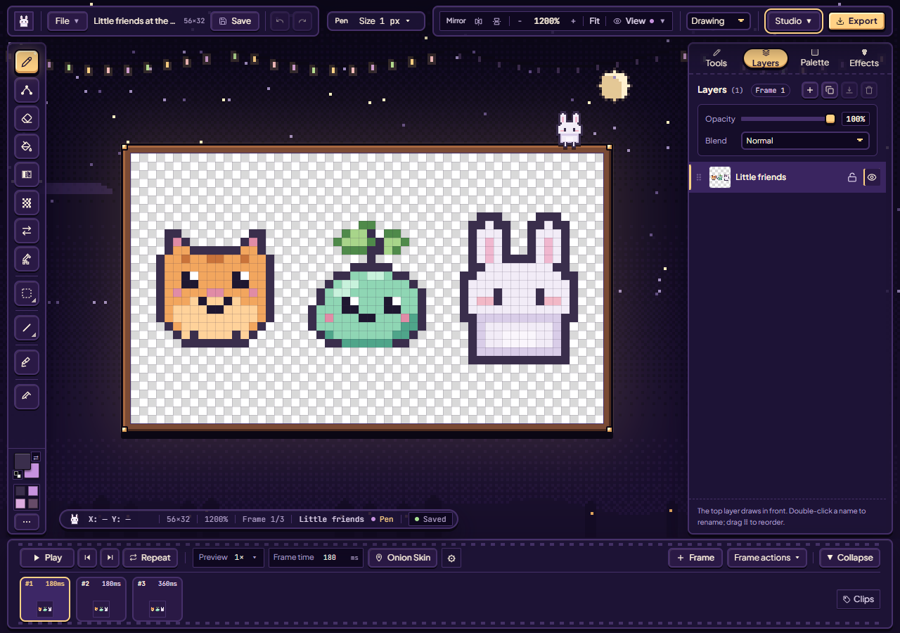 | 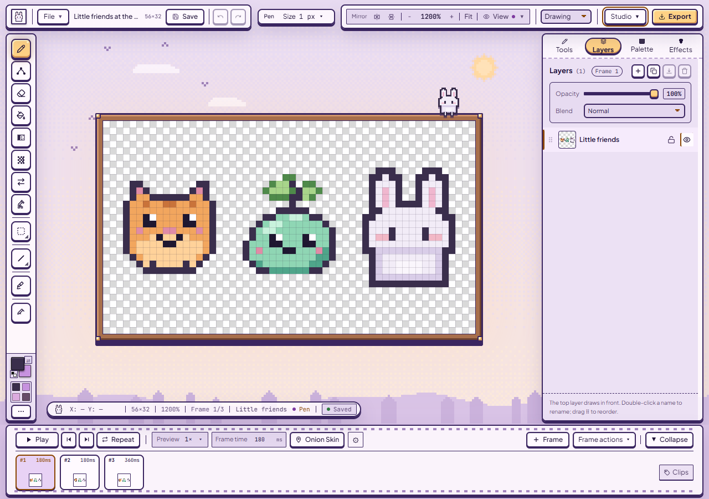 |
| Sakura | 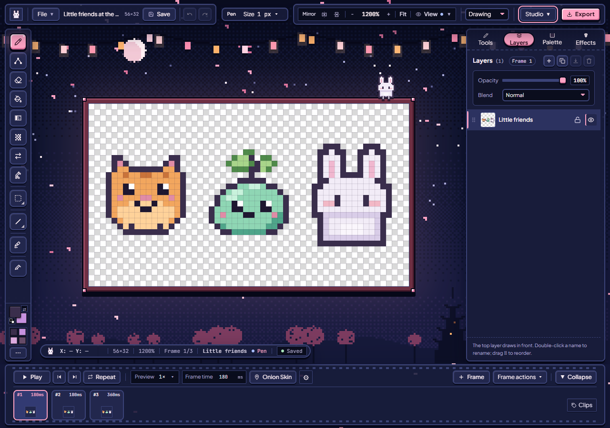 | 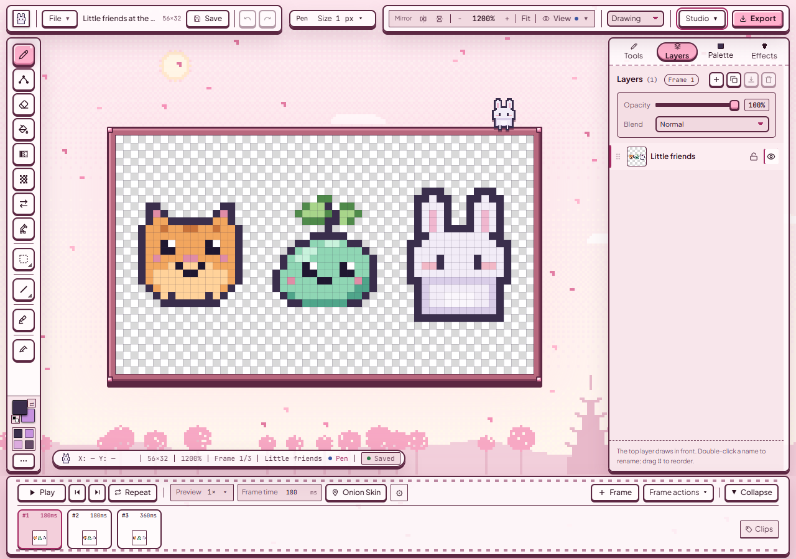 |
| Tidepool | 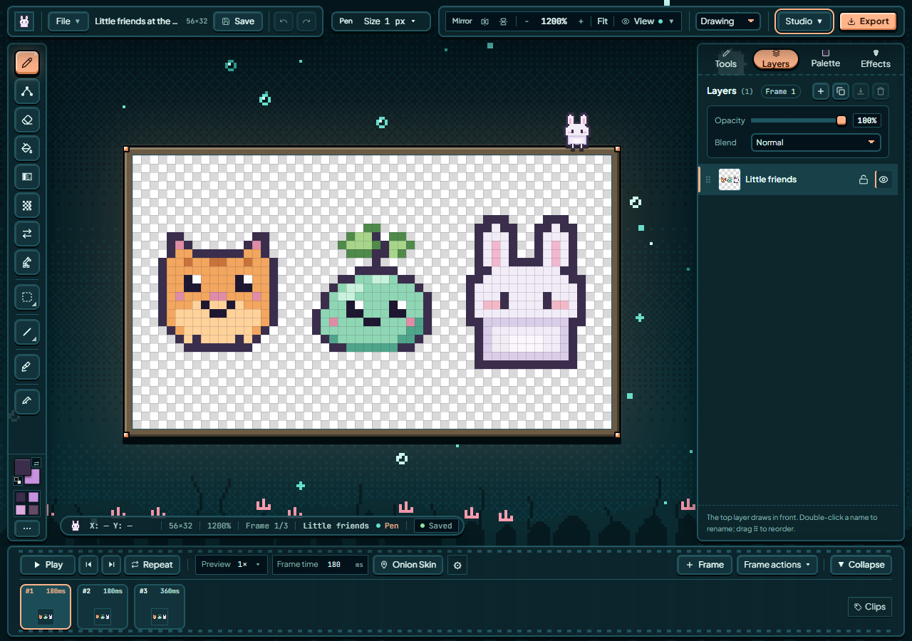 | 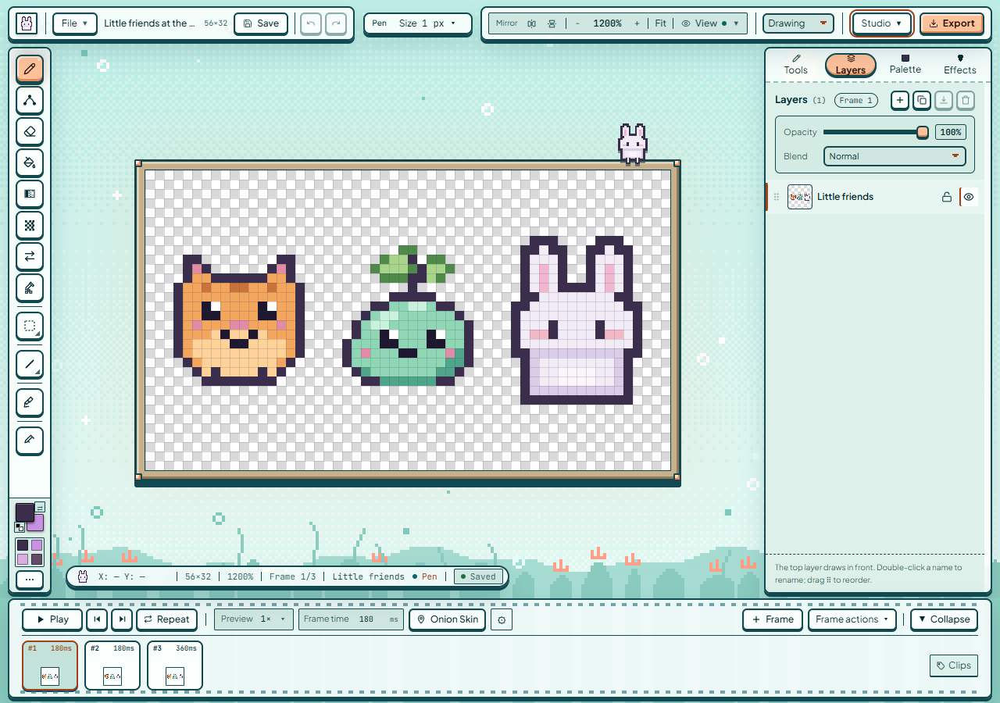 |
| Ember | 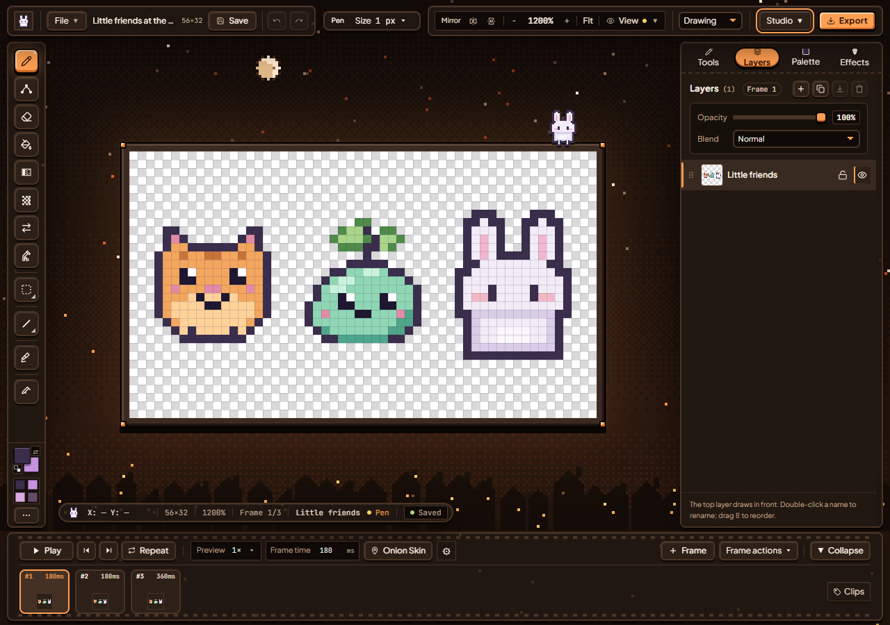 | 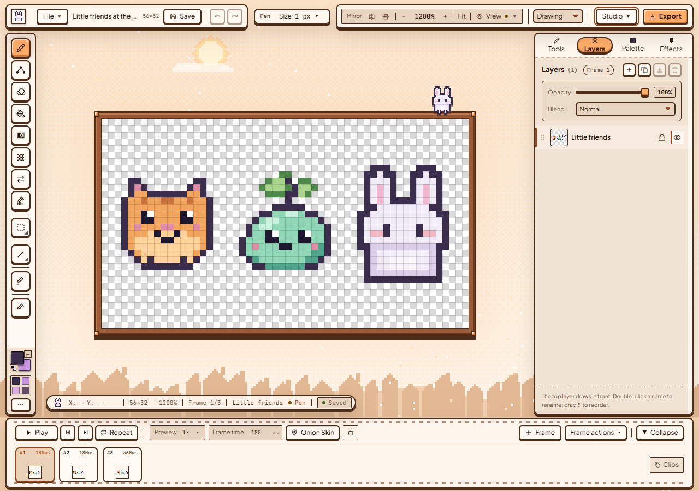 |
| Moss | 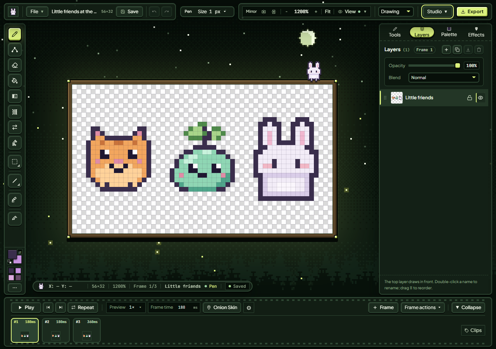 | 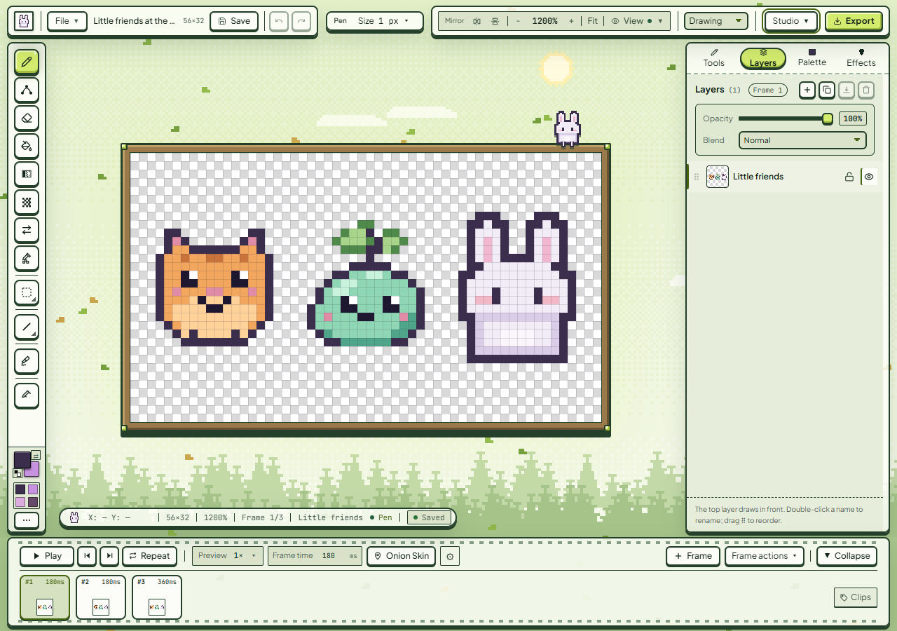 |
| Arcade | 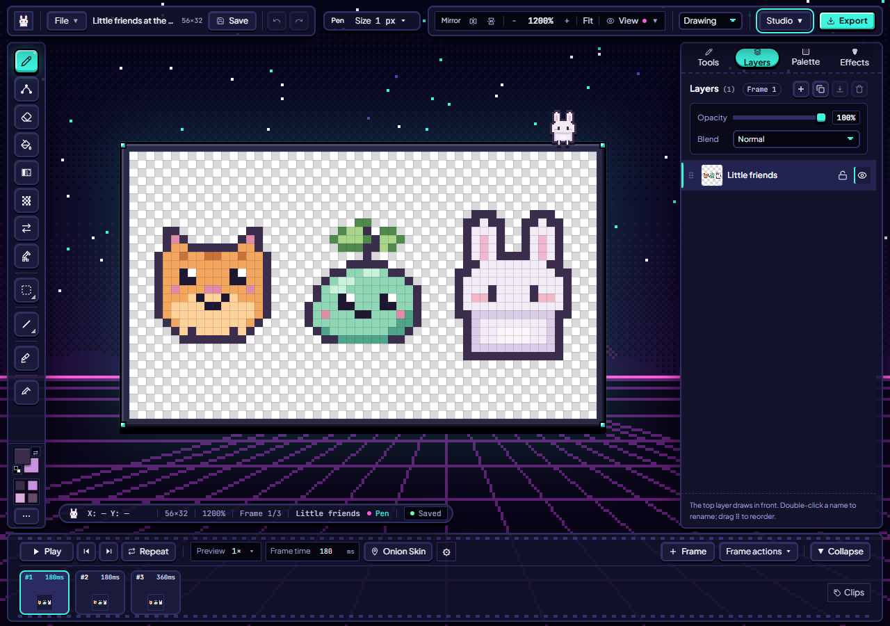 | 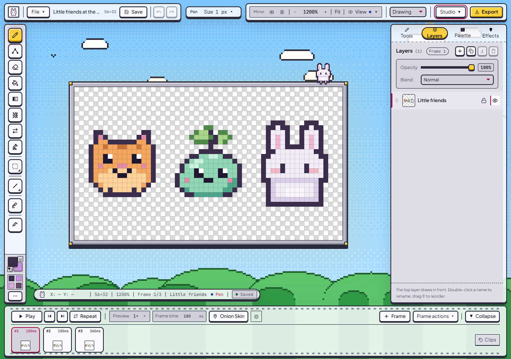 |
| Graphite |  | 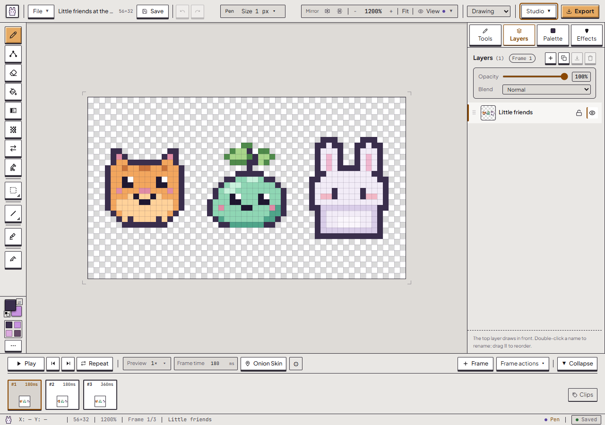 |
| Plum |  |  |
