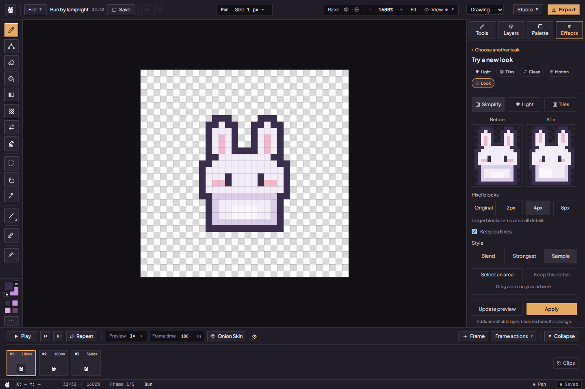
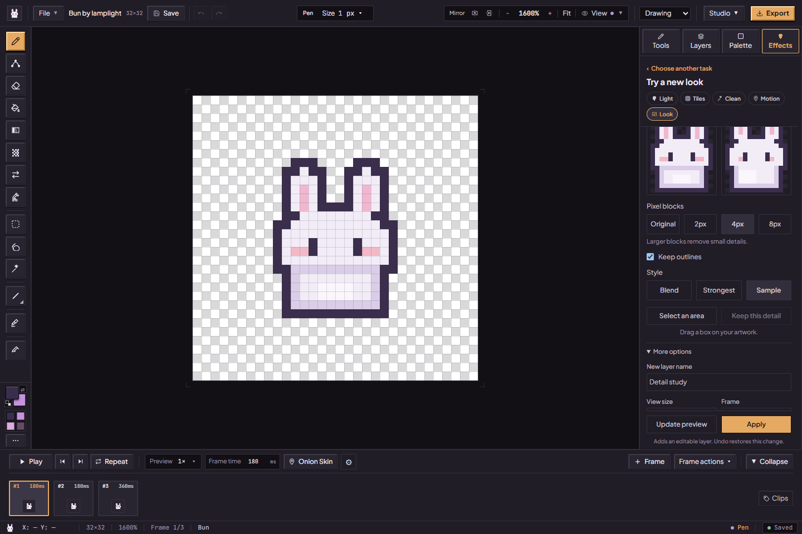
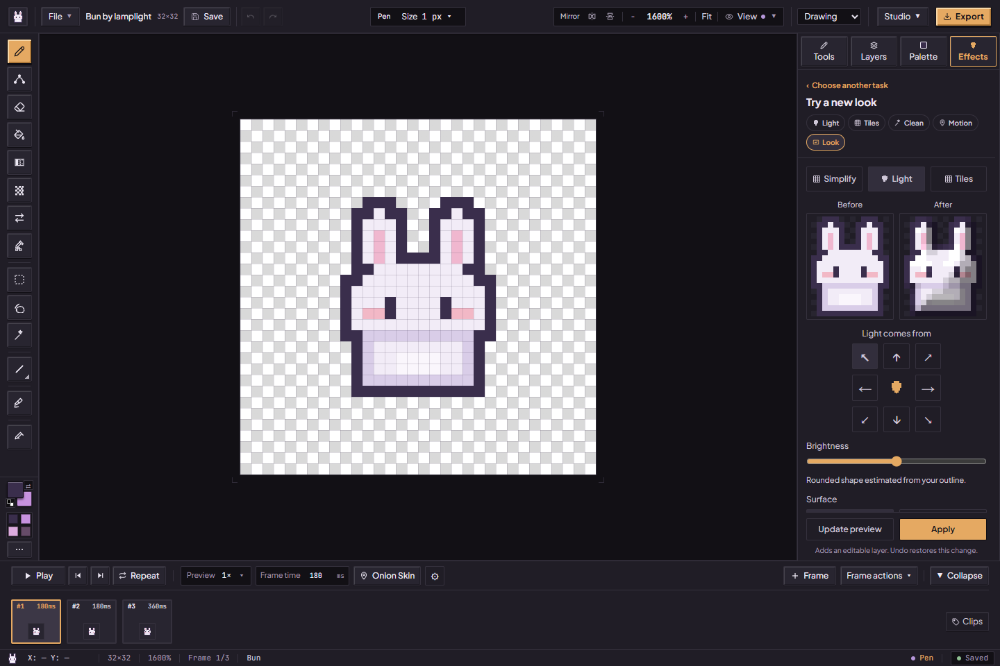
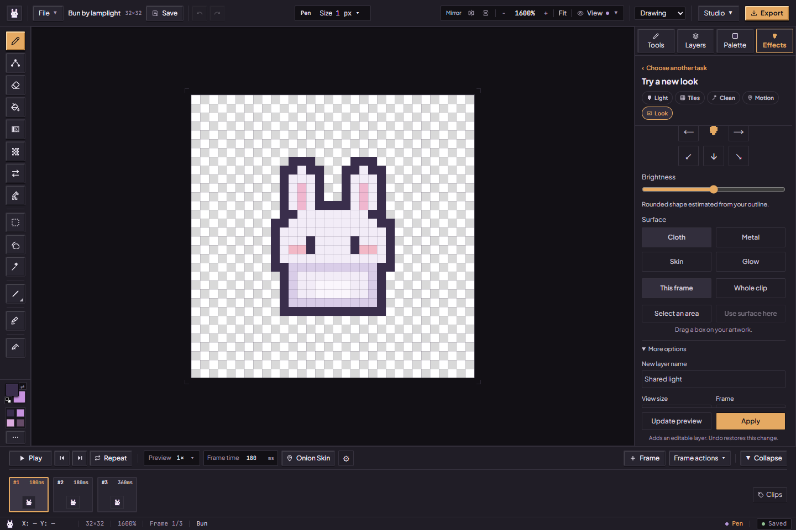
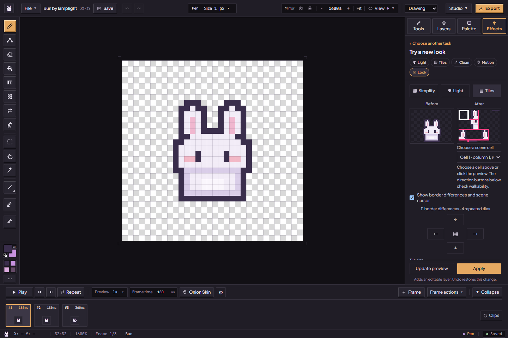
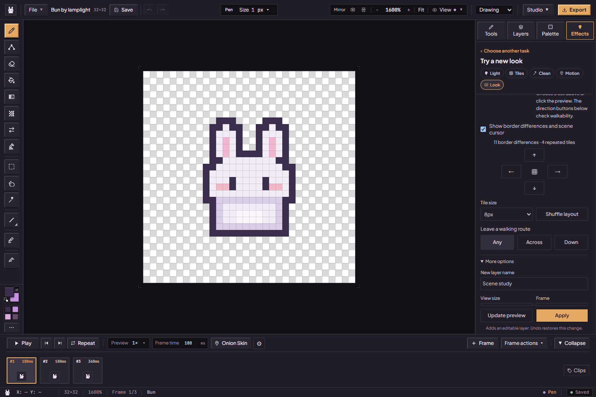

# Try a new look, keep your original

For the tested revision and remaining accessibility, device and host checks, see the [current status](../current-status.md).

[Handbook](README.md) · [Lighting](lighting-and-surfaces.md) · [Patterns](pixitools-cleanup-and-tiles.md) · [All features](../features.md)

Open **Effects → Try a new look**. Three tabs—**Simplify**, **Light**, and **Tiles**—offer bounded studies of your own artwork. The source/result panes compare actual pixels. Previews can update after a brief pause when settings change; **Preview my artwork / Update preview** asks for a fresh result. A preview alone does not apply it.

When you choose **Apply**, the workflow adds editable output layers and retains the original source layers, adjusting visibility so you can see the new look. Undo restores an admitted application. **No change** means the preview has the same pixel result and there is nothing to apply. Changes to art, palette or settings can invalidate a preview; refresh it first.

## Simplify

1. Choose **Original**, **2px**, **4px** or **8px** blocks. Larger blocks remove small details. Original is the conservative starting point.
2. Keep **Keep outlines** checked if edges matter. Choose **Blend**, **Strongest** or **Sample** for the block color candidate. Inspect the eyes and silhouette in the result pane.
3. Under **More options**, choose an exact size from 1–16 px if the presets do not suit you. **Color changes** can keep artwork colors, remap to the active palette, or restrict to a named palette role. Remapping is an explicit recoloring choice.
4. To preserve an important detail, make a canvas selection, give it an **Area name**, then **Protect selected rectangle**. These are recipe-specific regions; they are separate from animation review protection.
5. Update the preview and Apply only after the comparison looks right.

This is a local block/color study. It is not a trained pixel-art model or a general depixelization/reconstruction system. Keep outlines can make a coarse change less noticeable; a no-change preview is a valid result.

## Shared light across poses

1. Choose **Light**, a compass direction and **Brightness**. Pick **Cloth**, **Metal**, **Skin** or **Glow**.
2. Choose **This frame** or **Whole clip**. Whole clip uses the selected clip, or all frames when no clip is selected. It creates a coordinated study across poses rather than changing only the previewed frame. Preview admission allows up to 16 frames and 262,144 source pixels.
3. In **More options**, set exact direction/elevation, fill light, intensity and shadow distance. Without a Normal layer, choose an estimated rounded shape or a flat surface.
4. A selected named rectangle can receive a material assignment. Up to 16 named regions are supported for the recipe's relevant region list.
5. Preview the poses; **Show** offers Full result, Shine only and Shadow only. Apply the full result when you are ready.

This shared-light workflow differs from the movable bulb in **Add light and depth**. Neither is general 3D recovery. Select an original, unlocked color layer at full opacity with Normal blending. Across poses, exactly one original layer with the same name must exist in each target frame. Nested effect/recipe sources are unsupported. The optional surface input here is a baked **Normal Map** layer; the manually sculpted **Normal Facets** layer is a different tag. Check every pose when light, contact or shape changes through the animation.

## Small tile scenes

Use an atlas whose width and height divide evenly by the chosen tile size, with **at most 16 tiles**. Tile-size choices are bounded to 1–64 px and only fitting sizes appear. A 32×32 source split into 8 px tiles gives 16 atlas tiles; an arbitrary sprite size may have no fitting choice. Resize or prepare a suitable atlas before asking for a scene.

1. Choose **Tiles** and a fitting **Tile size**. **Shuffle layout** changes the seed to request another arrangement.
2. Choose **Any**, **Across** or **Down** under walking route. Any does not require a connected walkable path. Across / Down requests the corresponding bounded route.
3. In **More options**, pick an atlas tile and label its **North / East / South / West** edges. Matching edge labels constrain neighbors. Mark whether the tile is walkable.
4. Choose a cell and **Pin chosen tile to cell** when an authored location must stay fixed. Conflicting pins/rules can produce a clear failure; there is no promise every constraint set has a solution.
5. Preview the result. Select a scene cell with its menu or click the preview; direction buttons check movement into walkable cells. Inspect seam markers and **About this result** notes before applying.

The seed helps reproduce an arrangement with the same inputs. This is a small image/constraint scene study, not an unbounded world builder, a playable game engine, or the retired general WFC action described by some old records.

## Save and revisit a recipe

**More options** includes a new-layer name, preview size and pose selection. **Fit artwork** fits the occupied source/result bounds; 1× and 4× are exact canvas magnifications with scrollable panes. Keyboard arrows/Home/End navigate workflow tabs; scene cell menus provide an alternative to clicking pixels.

Applied output layers retain their recipe and source fingerprints in the project. Select one and use **Use saved settings** to load it, then create a fresh preview. Source status distinguishes current, changed and missing source pixels. Recompute after changes; missing source data cannot be recreated just from the saved settings. A portable `.pixibun` backup preserves the project data, while reloading does not preserve an uncommitted preview or the complete Undo session.

Sources: [workbench controls](../../src/components/layout/inspector/ResearchWorkbenchSection.tsx), [preview/application](../../src/lib/research/workbench.ts), [recipes](../../src/lib/research/recipes.ts), [algorithms](../../src/lib/research/algorithms.ts). Validation evidence and artist studies have separate scope in [current status](../current-status.md).
