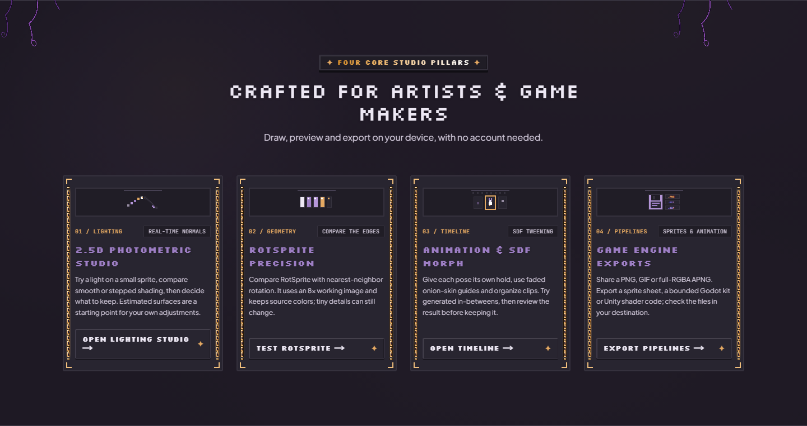
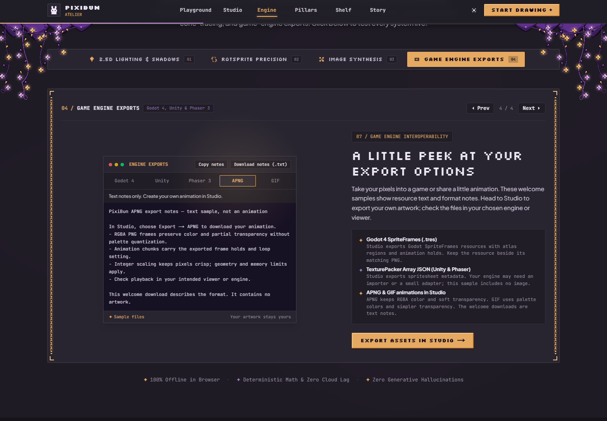
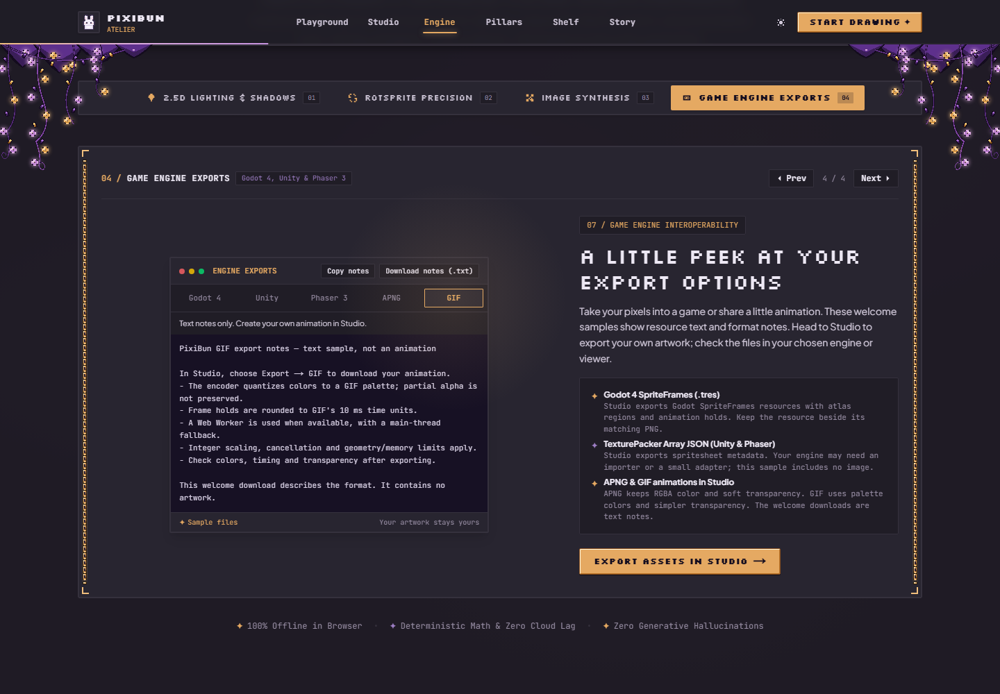

# Meet the little studio

For the tested revision and remaining accessibility, device and host checks, see the [current status](../current-status.md).

[Handbook](README.md) · [Studio workspace](studio-workspace.md) · [All features](../features.md)

The welcome page gives you a few gentle ways to begin: a blank canvas, a little starter friend, or a guided lesson. Its interactive demonstrations are a place to explore before opening your own drawing.

## A small moment at the desk

Try the desk lamp, pet the sleeping friend, or draw on the tiny sketchpad. Choose a sketchpad color and use **Clear** to start again. These details belong to the welcome scene; the sketchpad is temporary and **Open studio** does not carry its pixels into an editable project. Use the full Studio, or [Pocket Doodle Pad](learning-and-playground.md#pocket-doodle-pad), for a drawing you can export.

Use the welcome-page theme control to change the scheme. Its navigation leads to Studio, Playground, the engine demonstrations, starter shelf and project story. Blank-canvas size choices create separate 16, 24, 32 and 48 px drawings after the current workspace can be checkpointed. The requested size is consumed from the URL so reload retains your saved edits. Studio's canvas-size dialog offers more sizes.

If your device prefers reduced motion, the welcome panels reveal without timed movement and the lighting sample starts with **Auto-Orbit** stopped. You can still start or stop it yourself. This preference is read at startup; reload after changing your device setting.

## Choose a starter friend

Choose **Give it a try** beneath **Hearth Ghost**, **Little Shroom**, **Bun** or **Little Lantern**. Each opens its 16×16 raster artwork in a separate drawing after Studio restores and checkpoints the current project. Failed saving or unfinished recovery, motion, floating artwork or Co-Draw prevents replacement. The starter parameter is removed after opening, so saving and reloading retains your edits. Existing saved projects remain available in Gallery. Save and back up important work before changing projects or routes. A starter is not a layered production game kit or a finished lesson.

## Four demonstrations to explore

Select a tab in the engine showcase, or use its previous/next controls. These examples have their own sample state. Changing a demonstration does not relight, rotate or export your current Studio project.

### 2.5D Lighting & Shadows

1. Choose a sample sprite and material, then drag the light control or try auto-orbit.
2. Compare **OKLCH Cel Shaded** and **Normal Field (RGB)**, and **Tone: Smooth / Stepped Cel**.
3. Try **Cast Ray**, **Drop AO** or **None** for the ground shadow. Observe how a small sprite reads under a different light.

The surface is estimated from bounded sprite data. This is a 2.5D example, not an imported 3D mesh or proof that every image has physically correct depth. To work on your own art, follow [lighting and surface sculpting](lighting-and-surfaces.md).

### RotSprite Precision

Choose the sword, ghost or Bun, change the angle, try a preset or turn on Spin. Compare the RotSprite result with nearest-neighbor rotation. This makes edge differences visible; it is not a measured guarantee that every shape improves. The Studio's [rotation cleanup controls](pixitools-cleanup-and-tiles.md#clean-rotation-and-lines) operate on your selected layer.

### Image Synthesis

Choose the mountain or hearth scene, then a 16, 24 or 32 px target. Compare **Preserve edges** (salient-box sampling) with **Nearest neighbor**, eight/sixteen colors with true color, and None / Atkinson / Bayer dithering. The palette below shows extracted colors from the example. Edge weighting uses a local forward-difference estimate; it can give outlines more influence, but it does not guarantee that small details survive downsampling.

The sample controls run on your device, with linear-light color averaging and bounded OKLab color grouping. These are locally generated sample scenes processed by image algorithms. This panel does not upload your photograph or call an image-generation model. Use [image import](studio-workspace.md#bring-in-an-image) for your own file, or [Simplify](variations-and-scenes.md#simplify) for an existing Studio layer.

### Game Engine Exports

Choose **Godot 4**, **Unity**, **Phaser 3**, **APNG** or **GIF** to read a sample. Engine tabs offer **Copy sample / Download sample** for example resource text; those examples contain no image. APNG/GIF offer **Copy notes / Download notes (.txt)** and a visible text-only explanation. These downloads describe the formats. To make a playable animation from your drawing, use Studio.

For your actual drawing, open **Studio → Export**. The [export guide](exporting.md) walks through every current output, including playable GIF/APNG and the bounded Godot kit. A welcome-page example does not qualify a current engine integration or prove that a user's exported project opens correctly.

## Ready to draw

For a first small drawing, open Studio, select Pen, choose a color and place a few pixels. For pose-by-pose practice, visit the [Playground lessons](learning-and-playground.md). Keep an [editable project backup](artwork-safety.md) when the drawing starts to matter to you.

Sources: [moonlit atelier](../../src/components/landing/night/NightHero.tsx), [starter artwork](../../src/lib/art/starterTemplates.ts), [showcase navigation](../../src/components/landing/AtelierEngineShowcase.tsx), [lighting demo](../../src/components/landing/showcase/PhotometricShowcase.tsx), [rotation demo](../../src/components/landing/showcase/RotSpriteShowcase.tsx), [image demo](../../src/components/landing/showcase/PixelizeShowcase.tsx), [download behavior](../../src/components/landing/showcase/EngineExportShowcase.tsx).
