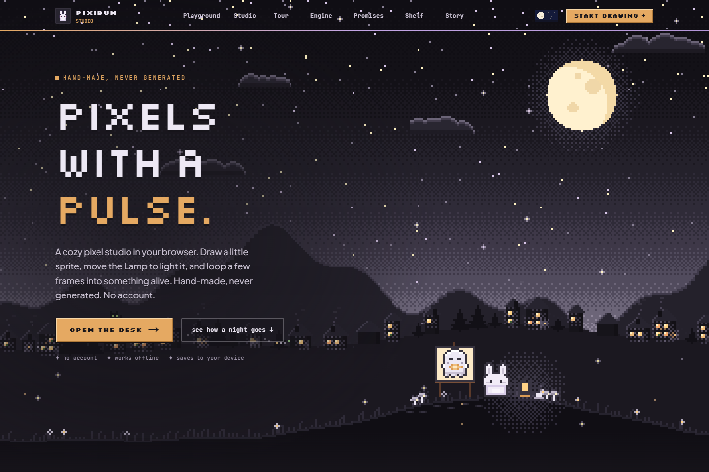
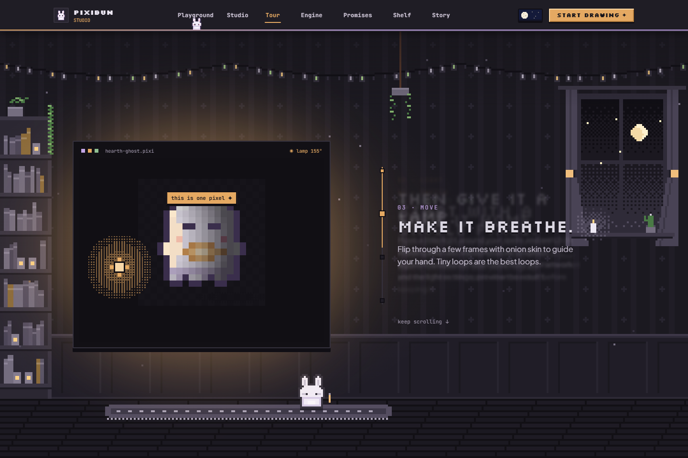
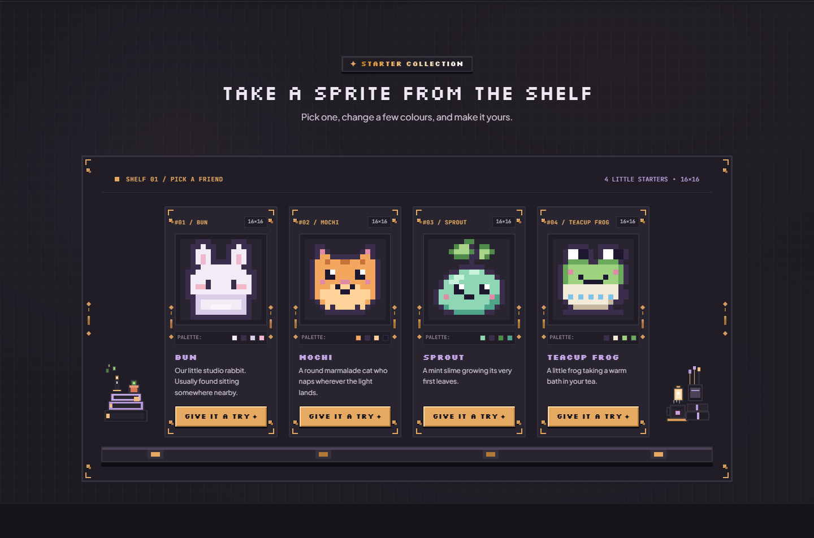

# Meet the little studio

For the tested revision and remaining accessibility, device and host checks, see the [current status](../current-status.md).

[Handbook](README.md) · [Studio workspace](studio-workspace.md) · [All features](../features.md)

The welcome page opens on a pixel town, then follows a drawing through sketching, lighting, movement and export. Its demos use their own sample state; they do not edit your Studio project. The pictures below show the current local production build on **15 October 2026**. [Capture details](../assets/screenshots/2026-10-15-current-ui/run.json) record the exact build, image hashes and scope.

## A small moment at the desk

Tap Bun in the opening scene for a reaction, or drag in its sky to make temporary constellations. Names stay unique among the retained constellations. Their measured labels fit around the introduction and each other, adjust on resize/scroll, and hide when no slot fits. A tap during the opening fast-forwards it; the logo can replay the intro. Those sky marks are page-local scene state, with no project save/export path. The earlier lamp/pet/mini-sketchpad desk is no longer this homepage's interface. Use Studio or [Pocket Doodle Pad](learning-and-playground.md#pocket-doodle-pad) for editable/exportable artwork.

The Daylight switch changes Night/Day for the saved studio style. Where supported, a circular reveal and pixel sun/moon accompany the change; reduced motion and unsupported browsers switch immediately. The scenes and canvas demos read the selected palette. Navigation leads to Playground, Studio, Tour, Engine, Promises, Shelf and Story. The creation story tracks scrolling; its chapter controls can jump through sketch, lamp, frames and sheet. Reduced motion stops timed scene motion while scrolling still moves through the story.

The final drawing invitation has 16, 24, 32 and 48 px blank-canvas choices. Studio checkpoints an existing workspace before creating that separate drawing and consumes the URL request, so reload keeps saved edits. Studio's Canvas size dialog provides additional choices.

## Choose a starter friend

Choose **Give it a try** beneath **Bun**, **Mochi**, **Sprout** or **Teacup Frog**. Bun is the PixiBun mascot herself (`src/lib/art/bunSprite.ts`), one ear row and one body row shorter to fit 16×16; she is also the model in the homepage tour, the hero's easel and the lighting demo. Each opens its 16×16 raster in a separate drawing after restore/checkpoint. Failed saving or unfinished recovery, motion, floating artwork or Co-Draw prevents replacement. The starter parameter is removed after opening. Old links still work: `?template=hearth-ghost` opens Mochi, `mushroom` opens Sprout and `lantern` opens Teacup Frog. Your prior projects remain in Projects; keep a portable backup of important artwork.

## The bench

The **Engine** section is one 16×16 sprite and four tools that all work on the same pixels. Pick **Bun**, **Mochi**, **Sprout** or **Teacup Frog** above the stage; edits are kept per friend until the page is closed, and the undo button restores the starter.

| Tool | What you do | Studio code it runs |
| --- | --- | --- |
| **Draw** | Paint with the sprite's own colours (plus blush and amber) or erase; **mirror** copies strokes across the middle | Pixel-perfect Bresenham lines and mirror symmetry (`rasterMath`) |
| **Light** | Drag anywhere to move the lamp; choose Matte, Gold, Glass or Fabric | Photometric pipeline and bounded raymarched cast shadow, at 7.5°/5° lamp steps |
| **Turn** | Drag sideways (or 22°/45°/90°) to compare RotSprite with a plain nearest-neighbour turn of the same pixels | `rotSprite` and `rotateNearest` on a 24×24 padded copy |
| **Hop** | Watch a four-frame 20×24 loop (holds 160, 100, 200, 100 ms) of the lit sprite; **Save GIF** downloads it transparent at 4× | Animated GIF encoder |

The rack beside the stage previews each tool's result for the current edit. Keyboard: focus the stage, use **1–4** for tools, arrows to move the cursor, lamp or angle, and Space/Delete to paint or erase. Reduced motion shows the hop as its sprite sheet and skips the tool dissolve and the lamp's opening sweep. **Open … in the Studio** opens the unedited starter; bench edits do not transfer.

The stage redraws only after input; the hop loop is the only timed animation and runs only while the stage is on screen. Earlier screenshots of the four-tab workbench (Light & shadow, Smooth rotation, Photo to pixels, Into your game) describe the interface before 15 October 2026.

## Ready to draw

Open Studio, select Pen, choose a color and place a few pixels. For coached practice, visit [Playground](learning-and-playground.md). Keep an [editable project backup](artwork-safety.md) when the drawing matters to you.

Sources: [homepage](../../src/app/page.tsx), [opening scene](../../src/components/landing/night/NightHero.tsx), [creation story](../../src/components/landing/night/NightStory.tsx), [navigation](../../src/components/landing/LandingNav.tsx), [starters](../../src/lib/art/starterTemplates.ts), [bench](../../src/components/landing/AtelierEngineShowcase.tsx), [bench stage](../../src/components/landing/bench/benchStage.ts), [bench art](../../src/components/landing/bench/benchArt.ts).
