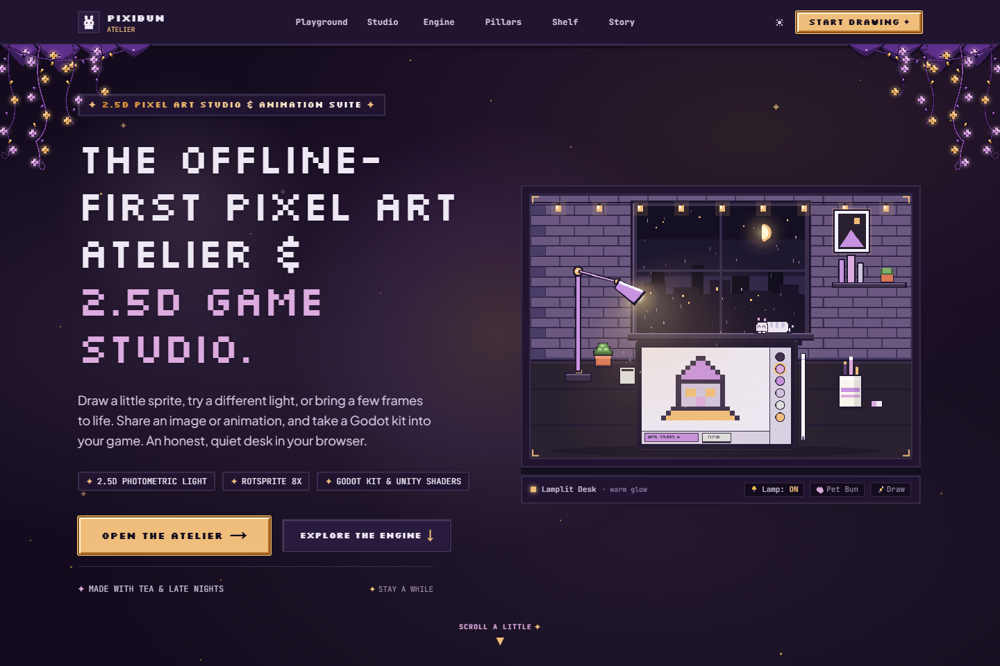
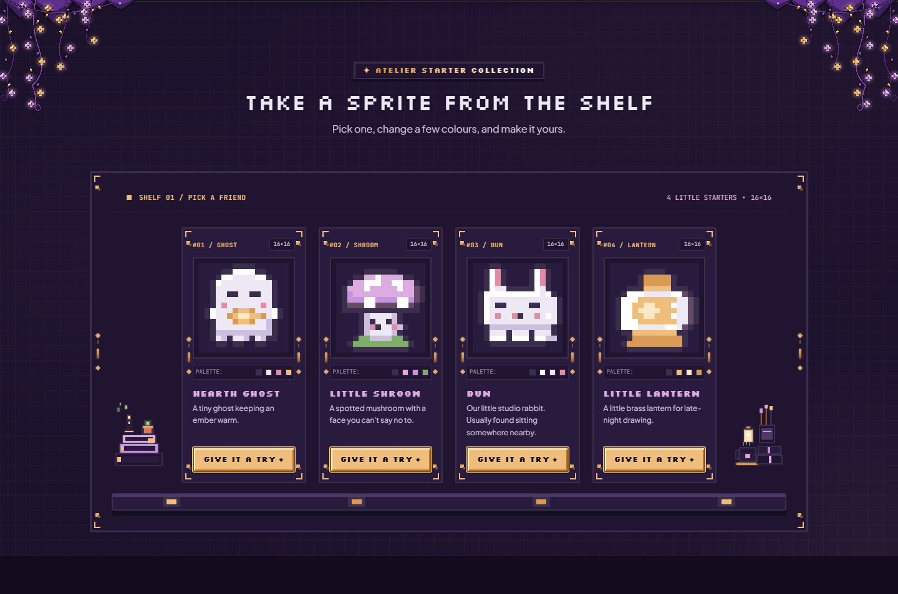
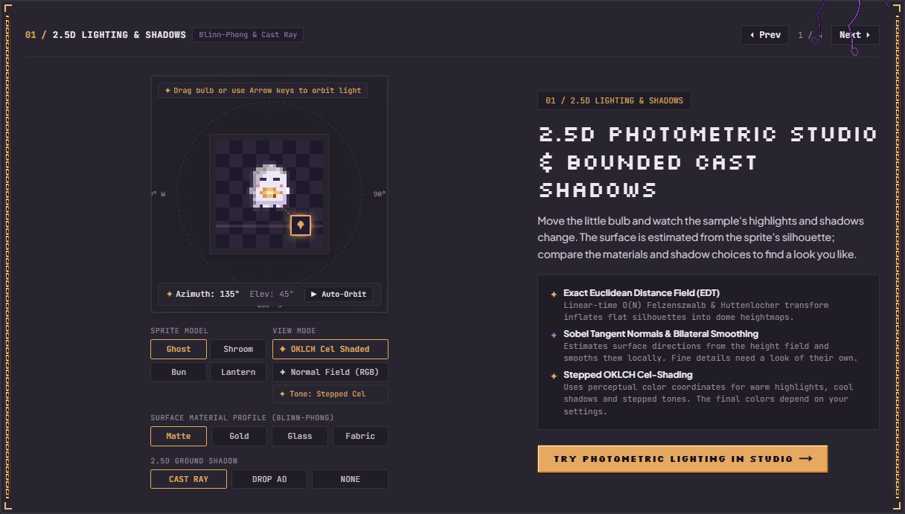
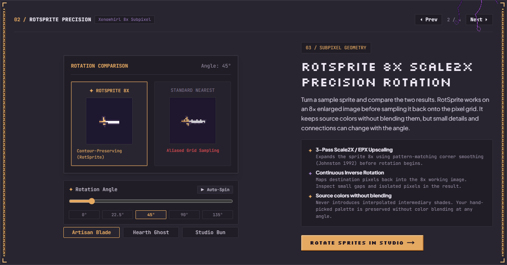
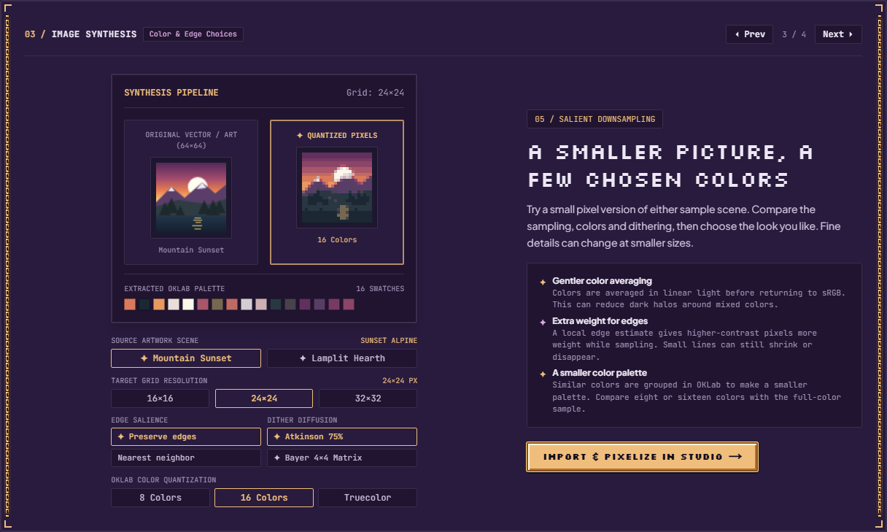

# Meet the little studio

For the tested revision and remaining accessibility, device and host checks, see the [current status](../current-status.md).

[Handbook](README.md) · [Studio workspace](studio-workspace.md) · [All features](../features.md)

The welcome page opens on a pixel town, then follows a drawing through sketching, lighting, movement and export. Its demos use their own sample state; they do not edit your Studio project. The screenshots below were captured on **2 October 2026** and show earlier layouts and download behavior. The [15 October review](../releases/2026-10-15-codebase-and-documentation.md) records the newer source.

## A small moment at the desk

Tap Bun in the opening scene for a reaction, or drag in its sky to make temporary constellations. A tap during the opening fast-forwards it; the logo can replay the intro. Those sky marks are page-local scene state, with no project save/export path. The earlier lamp/pet/mini-sketchpad desk is no longer this homepage's interface. Use Studio or [Pocket Doodle Pad](learning-and-playground.md#pocket-doodle-pad) for editable/exportable artwork.

The Daylight switch changes Night/Day for the saved studio style. Where supported, a circular reveal and pixel sun/moon accompany the change; reduced motion and unsupported browsers switch immediately. The scenes and canvas demos read the selected palette. Navigation leads to Playground, Studio, Tour, Engine, Promises, Shelf and Story. The creation story tracks scrolling; its chapter controls can jump through sketch, lamp, frames and sheet. Reduced motion stops timed scene motion while scrolling still moves through the story.

The final drawing invitation has 16, 24, 32 and 48 px blank-canvas choices. Studio checkpoints an existing workspace before creating that separate drawing and consumes the URL request, so reload keeps saved edits. Studio's Canvas size dialog provides additional choices.

## Choose a starter friend

Choose **Give it a try** beneath **Hearth Ghost**, **Little Shroom**, **Bun** or **Little Lantern**. Each opens its 16×16 raster in a separate drawing after restore/checkpoint. Failed saving or unfinished recovery, motion, floating artwork or Co-Draw prevents replacement. The starter parameter is removed after opening. Your prior projects remain in Projects; keep a portable backup of important artwork.

## Four demonstrations to explore

The workbench tabs are **Light & shadow**, **Smooth rotation**, **Photo to pixels** and **Into your game**. Previous/next controls switch them. Each offers three **Try this** tasks whose ticks track controls tried during this page session, plus an expandable **How it works** explanation. Ticks are navigation feedback, not saved learning progress or participant evidence.

### 2.5D Lighting & Shadows

The current tab is named **Light & shadow**.

Choose a sample/material, drag the lamp or try auto-orbit. Compare color shading with the RGB normal field, smooth/stepped tones and Cast Ray/Drop AO/None shadows. Reduced motion starts auto-orbit stopped. The surface is estimated from bounded sprite data; it is a stylized 2.5D demonstration rather than imported 3D geometry or physically measured depth. Use [lighting and surface sculpting](lighting-and-surfaces.md) on your own art.

### RotSprite Precision

The current tab is named **Smooth rotation**.

Choose the sword, ghost or Bun, adjust the angle, try presets or Spin, and compare RotSprite with nearest-neighbor. Current free-angle rotation uses the contour-aware v3 engine. These examples expose edge differences rather than proving that all shapes improve. [Studio rotation and cleanup](pixitools-cleanup-and-tiles.md#clean-rotation-and-lines) works on your selected layer.

### Photo to pixels

Choose the mountain or hearth scene and a 16, 24 or 32 px target. Compare Preserve edges sampling with Nearest neighbor, eight/sixteen colors with true color, and None/Atkinson/Bayer dithering. The extracted palette comes from that generated sample scene. Linear-light averaging and bounded OKLab grouping run on-device; no photo upload or generative model is involved. Edge weighting cannot guarantee retention of every detail. Use [image import](studio-workspace.md#bring-in-an-image) for your file or [Simplify](variations-and-scenes.md#simplify) for a Studio layer.

### Game Engine Exports

The current tab is named **Into your game**. It shows an independent four-frame **20×22** Bun loop, with holds **125, 125, 250 and 125 ms** and an **80×22** sprite sheet.

| Choice | Current download | Import boundary |
| --- | --- | --- |
| Godot 4 | ZIP with bun_hop.png, bun_spriteframes.tres and README.txt | Place the files together and assign SpriteFrames to AnimatedSprite2D; actual consumer/version qualification is separate |
| Unity | ZIP with bun_hop.png, bun_atlas.json and README.txt | Configure Point filtering/no compression and slice 20×22 cells; the JSON is atlas metadata, not a Unity project or controller |
| Phaser 3 | ZIP with the same sheet, multiatlas metadata/animation description and instructions | Load the atlas and create the hop animation from its metadata |
| APNG | bun_hop.apng | Actual encoded looping RGBA animation |
| GIF | bun_hop.gif | Actual palette animation, with centisecond-quantized holds |

**Copy metadata** appears for game formats; **Download game kit**, **Download APNG** or **Download GIF** creates the listed file. The older APNG/GIF text-note screenshots describe an earlier interface and are superseded. Downloading a sample is separate from exporting your drawing and does not qualify every engine importer. Open **Studio → Export** for your project; the [export guide](exporting.md) covers its outputs.

## Ready to draw

Open Studio, select Pen, choose a color and place a few pixels. For coached practice, visit [Playground](learning-and-playground.md). Keep an [editable project backup](artwork-safety.md) when the drawing matters to you.

Sources: [homepage](../../src/app/page.tsx), [opening scene](../../src/components/landing/night/NightHero.tsx), [creation story](../../src/components/landing/night/NightStory.tsx), [navigation](../../src/components/landing/LandingNav.tsx), [starters](../../src/lib/art/starterTemplates.ts), [workbench](../../src/components/landing/AtelierEngineShowcase.tsx), [lighting](../../src/components/landing/showcase/PhotometricShowcase.tsx), [rotation](../../src/components/landing/showcase/RotSpriteShowcase.tsx), [image conversion](../../src/components/landing/showcase/PixelizeShowcase.tsx), [download creation](../../src/components/landing/showcase/showcaseExport.ts).
