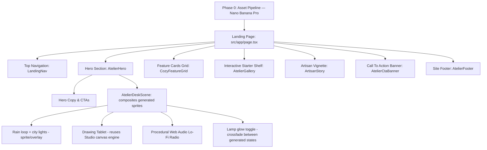

# Redesign PixiBun Home Page into a Cozy Interactive Pixel Atelier (v2)

> Historical implementation plan. The live website no longer includes the proposed music or radio feature; see the current [architecture](../../ARCHITECTURE.md) and [changelog](../../CHANGELOG.md).

Transform PixiBun's home page into the "Pixel Atelier" concept, using AI-generated pixel art assets (Nano Banana Pro, via Antigravity) for the illustrated scene, and reserving hand-written code for the parts that are genuinely interactive.

## What changed from v1

- Added a **Phase 0 asset-generation pipeline** — the desk scene, cat mascot, and decorative sprites are generated as image assets (Nano Banana Pro in Antigravity), not drawn from scratch with canvas primitives. Procedurally hand-coding this level of shading/texture was not realistic; generation gets you much closer to the reference.
- Added a **locked palette**, sampled directly from the reference image, so every generated prompt and every hand-coded UI element (buttons, cards, text) pulls from the same source of truth instead of drifting.
- The hero's drawing tablet now **reuses the Studio's real canvas/brush engine** in a constrained preview mode, instead of a second hand-rolled pen/swatch/eraser implementation.
- Feature cards now match the reference's actual **alternating card backgrounds** (white, pink, lavender, gray), not a single uniform lilac.
- Verification plan now includes visual QA against the reference, a perf budget, and reduced-motion / accessibility passes — not just typecheck/lint/test.

## Architecture & Layout Overview



## Locked Visual Language (sampled from the reference image)

| Token | Hex (sampled) | Role |
|---|---|---|
| `--bg-room-deep` | `#3e2f5f` | Night window / deepest background purple |
| `--bg-room-mid` | `#664b68` | Hero wall / CTA banner purple |
| `--accent-lavender` | `#a48bba` | Primary CTA button, headings accent |
| `--accent-pink` | `#b684a4` | Headline highlight ("create & share"), card 2 accent |
| `--surface-card-white` | `#cfc2da` | Feature card 1 |
| `--surface-card-pink` | `#ddc3d7` | Feature card 2 (highlighted) |
| `--surface-card-lavender` | `#d1c0e1` | Feature card 3 |
| `--surface-card-gray` | `#cecbcc` | Feature card 4 |
| `--surface-nav` | `#cdcbcb` | Top nav / footer background |
| `--glow-amber` | `#fbe9c6` | Lamp light, warm highlights |

These were sampled directly from the uploaded reference, not estimated — treat them as the locked source of truth in `tailwind.config`/`globals.css`, and confirm any additional colors (mug, plant greens, string lights) by sampling the same file rather than eyeballing.

**Pixel font**: the reference uses a clean monospace pixel typeface, not the default system font. Shortlist 2–3 free candidates (e.g. Silkscreen, Press Start 2P, Pixelify Sans) rendered against actual page copy at real sizes, and lock one before building components — this is load-bearing for the whole aesthetic and isn't in v1 at all.

---

## Phase 0 (NEW): Pixel Asset Generation Pipeline

#### Goal
Produce the illustrated, non-interactive parts of the scene as real image assets, matching the reference's painted pixel-art quality — not as procedural canvas drawing.

#### Workflow (Antigravity + Nano Banana Pro)
- In Antigravity, let the agent invoke **Nano Banana Pro** for each asset below. Pass the uploaded reference image itself as a style/consistency input alongside the prompt (multi-image input is supported) so palette and pixel-density stay consistent across assets, rather than relying on text description alone.
- Generate iteratively, not one-shot: review each asset against the reference, then re-prompt using Nano Banana Pro's edit-to-edit consistency to refine (fix proportions, palette drift, extra detail) without regenerating from scratch.
- **If Nano Banana Pro isn't yet rolled out on your Antigravity account**, fall back to procedurally-defined pixel-grid sprites (fixed-size palette-indexed arrays blitted through one shared renderer) for the simple geometric objects only (books, plant pots, window frame), and treat the cat mascot as a simplified flat-shaded shape rather than attempting the reference's fur shading in code.

#### Assets needed
- Desk scene background panorama (window, wall, shelving, string lights) — static PNG layer
- Cat mascot, 2–3 frame breathing/blink loop, isolated on transparent background
- Desk objects as separate layers where they need independent animation state: lamp (off-state + lit-state for crossfade), radio body (equalizer bars rendered separately in code), mug + steam base art (steam animated in code via CSS)
- 4 feature-card icons (pencil, floppy disk, globe, star) matching the reference's flat pixel-icon style
- Artisan vignette assets (arched window, sleeping cat on cushion, bookshelf with candle)
- CTA banner assets (potted plants, easel with canvas)

#### New file
#### [NEW] `PixelSprite.tsx` (proposed component; never added to the current codebase)
- Shared component for rendering a generated PNG layer with `image-rendering: pixelated`, consistent integer scaling, and a fixed aspect-ratio box to prevent layout shift while assets load.

---

## Proposed Changes

### 1. Web Audio Ambience & Sound Engine
#### [NEW] [lofiRadio.ts](../../src/lib/audio/lofiRadio.ts)
- Unchanged from v1: Web Audio synthesizer for rain/tape-hiss noise and chiptune chord progressions, with play/pause, volume, and track switching (Lo-Fi Beats, Rainy Night, Cozy Hearth).
- Note for verification: this logic is not meaningfully unit-testable in jsdom — treat as manual-QA only, don't imply coverage from `npm run test`.

### 2. Interactive Atelier Hero & Pixel Desk Scene
#### [NEW] [AtelierDeskScene.tsx](../../src/components/landing/AtelierDeskScene.tsx)
- Composites the generated background/desk/cat sprites via `PixelSprite`.
- Rain: either a looping generated sprite or a lightweight procedural particle overlay (this one is fine procedurally — rain is just moving lines).
- Lamp: click toggles a crossfade between the two generated lamp states, plus a CSS radial-gradient glow overlay and dust-mote particles (procedural, cheap).
- Radio: generated static body art + procedurally animated equalizer bars synced to `lofiRadio.ts` output.
- Drawing tablet: renders the **existing Studio canvas/brush component** in a constrained preview size and palette, linking "transfer to studio" to the real editor — not a second hand-built pen engine.
- Lazy-load this whole component (dynamic import, mount on intersection) so the generated-image payload and audio engine don't block initial page load.

#### [NEW] [AtelierHero.tsx](../../src/components/landing/AtelierHero.tsx)
- Unchanged from v1: "WELCOME TO" pill, headline with pink-accented "create & share", value prop copy, "Enter the Studio →" / "Explore Gallery" CTAs, footnote.

### 3. Navigation Bar & Header
#### [NEW] [LandingNav.tsx](../../src/components/landing/LandingNav.tsx)
- Unchanged from v1.

### 4. Tactile Feature Cards ("* Everything you need to create *")
#### [NEW] [CozyFeatureGrid.tsx](../../src/components/landing/CozyFeatureGrid.tsx)
- 4 cards using the **actual sampled per-card backgrounds** (`--surface-card-white/pink/lavender/gray`), each with a generated pixel icon and an arrow link:
  1. **Pixel Canvas** — drawing tools, onion skinning, frame-by-frame animation.
  2. **Save & Organize** — IndexedDB local storage, project packaging (pink-highlighted card).
  3. **Share Your Art** — sprite sheet export, GIF generation, palette ramps.
  4. **Built for Lovers** — crafted for pixel art lovers, by pixel art creators.

### 5. Interactive Starter Shelf
#### [NEW] [AtelierGallery.tsx](../../src/components/landing/AtelierGallery.tsx)
- Unchanged from v1: pixel-bordered starter template cards (Potion, Campfire, Sword, Cozy Bun) linking to the Studio editor.

### 6. Artisan Story & Cozy Vignette
#### [NEW] [ArtisanStory.tsx](../../src/components/landing/ArtisanStory.tsx)
- Composites generated vignette assets (arched window, sleeping cat, bookshelf/candle) with the artisan statement copy.

### 7. Call To Action Banner & Site Footer
#### [NEW] [AtelierCtaBanner.tsx](../../src/components/landing/AtelierCtaBanner.tsx)
#### [NEW] [AtelierFooter.tsx](../../src/components/landing/AtelierFooter.tsx)
- Unchanged from v1.

### 8. Page Assembly & Styling
#### [MODIFY] [page.tsx](../../src/app/page.tsx)
- Assemble: `LandingNav`, `AtelierHero`, `CozyFeatureGrid`, `AtelierGallery`, `ArtisanStory`, `AtelierCtaBanner`, `AtelierFooter`.

#### [MODIFY] [globals.css](../../src/app/globals.css)
- Define the locked palette as CSS variables, import the chosen pixel font, add tactile button/card utilities and dust-mote/steam animations.

---

## Sequencing

1. Lock palette + font; stand up `PixelSprite`.
2. Run the Nano Banana Pro asset pipeline; review every asset against the reference before it enters a component.
3. Build static scene composition (no interactivity yet) — catches bad assets early.
4. Add interactive layer: lamp toggle, radio equalizer, rain, tablet (reusing Studio canvas).
5. Wire up `lofiRadio.ts`.
6. Build remaining sections (feature grid, gallery, story, CTA, footer).
7. Verification pass.

## Verification Plan

### Automated
```powershell
npm run typecheck
npm run lint
npm run test
```
(Web Audio synthesis logic is excluded from meaningful unit coverage — verify manually.)

### Visual QA
- Side-by-side diff of each generated asset and each assembled section against the reference image.
- Palette check: no colors outside the locked token set without a documented reason.

### Performance
- Lighthouse mobile pass; hero scene bundle is lazy-loaded/code-split.
- Total generated-image payload measured and compressed (WebP/AVIF variants) — painted pixel art assets can get heavy fast.

### Accessibility
- `prefers-reduced-motion`: freeze rain/steam/equalizer/dust motes, keep static art.
- Decorative sprite layers marked `aria-hidden`; meaningful copy stays real DOM text (not baked into images) for screen readers and SEO.
- Radio and lamp controls keyboard-reachable and properly labeled.

### Manual
- Responsive layout, desktop and mobile.
- Tablet drawing fidelity matches the real Studio canvas (since it's the same engine).
- Radio playback + equalizer animation; lamp on/off toggle.
- Smooth scroll fade-ins and hover micro-interactions across feature cards.
