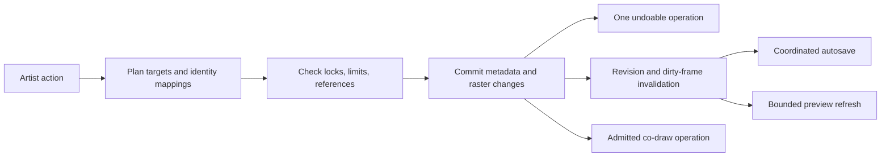

# PixiBun: code, product, and creative direction audit

**Date:** 5 October 2026. **Audited revision:** `f18f4e47d299685d7fdf23de158ae082a883483d` (package 1.14.1). This is a dated assessment, not a replacement for [current status](../current-status.md), [the documentation map](../README.md), or subsystem contracts. Findings refer to this revision; proposals are not shipped features.

## 1. Assessment

PixiBun already contains the ingredients for an unusually appealing product: a welcoming little desk, a serious raster editor, protected practice sessions, animation, deliberate palette work, stylized lighting, and portable game assets. Its strongest direction is **a cozy workshop for making small living worlds**. A person should be able to make a little lantern, animate its flame, see it illuminate a room, and bring that exact work into a game.

The immediate engineering priority is preserving the meaning of the artist's work across operations. Pixels, frame identities, clip ranges, palette bindings, generated recipes, and storage versions each have protections, but several operations fail to update the relationships between them. That explains why a large passing test suite can coexist with real defects.

My recommended order is: **repair identity and editing correctness; make saving and performance predictable; complete the everyday artist workflow; prototype one distinctive finished-art experience.** Additional sophisticated effects will have less value until those foundations behave consistently.

### What this audit actually covered

- Catalogued all **310 TS, TSX, and CSS source files**, totaling **80,097 newline-counted lines**, with hashes, sizes, approximate import edges, and subsystem counts. See [source inventory](evidence/2026-10-05-deep-audit/source-inventory.json).
- Reviewed architecture, feature guides, current and historical repair records, package/build configuration, CI/deployment, and representative implementations across every major subsystem. Deep review concentrated on editing, structural mutations, persistence, safety, collaboration, import/export, learning, workspace controls, and research tools.
- Ran the full local quality gate: documentation integrity, TypeScript, lint, **173 test files / 1,766 passing tests**, and the production build.
- Added and ran seven isolated diagnostic probes. These deliberately assert the problematic current behavior so the evidence is repeatable; they are not desired-behavior regression tests or part of the normal test inventory.
- Exercised the compiled application in Chromium with isolated browser storage. Captured command-palette focus and shortcut behavior, gallery rename, workspace/navigator dimensions, and screenshots.
- Queried npm's advisory registry: **zero reported vulnerabilities for the installed dependency graph** on this date. This result is not an application security certification.
- Researched current primary documentation for competing editors, browser storage/accessibility, Godot, and pixel-art lighting/animation. Research links appear beside the conclusions they support.

This is a repository-wide subsystem audit with targeted code review and runtime evidence, not formal verification of every line or every numerical algorithm. The local machine ran Node **26.5.1**, while the project declares Node **22.x** and pins 22.14 in `.nvmrc`. The passing gate therefore needs reproduction on the supported runtime before release qualification. No remote CI, deployed production, physical tablet, multi-machine network, artist participant study, or complete three-browser suite was verified in this audit. No application source was changed.

The [evidence README](evidence/2026-10-05-deep-audit/README.md) explains commands, artifacts, and limits. Existing repaired findings were checked against current implementation rather than automatically repeated as open defects.

## 2. What is already here, and where each area should go

| Area | Current capability | Assessment and next useful improvement |
| --- | --- | --- |
| Welcome and first creation | Interactive desk/lamp, temporary sketch, four editable starter friends, technical demonstrations | Strong character. Shorten the route to a completed personal artifact; connect demonstrations to an editable lesson or project rather than leaving them as separate sample states. |
| Drawing | 17 canonical tools; pen, eraser, curves, fills, exact palette gradients, dither, replacement, selections, geometry, normal chisel, eyedropper | Substantial toolset. Stroke consistency, alpha protection, references, and reusable brushes have more immediate artist value than another mathematical effect. |
| Selection and geometry | Masked selection, floating clipboard content, nudge/resize/pivot/rotate/flip, RotSprite, symmetry, wallpaper/tile controls | Preserve these foundations. Add clear transform commit/cancel ownership and preview the exact affected frames/layers for batch operations. |
| Layers and history | Per-frame independent stacks; visibility, lock, opacity, blend, merge; bounded hybrid pixel/structural history | Safety work is good. Introduce persistent layer tracks/cels before ambitious batch animation editing; stack position is not a semantic identity. |
| Artist workspace | Drawing/Animation/Lighting presets, saved layouts, pinned triangle/square picker, navigator, composition guides, focus mode | These already shipped. Complete the preset-to-tool connection, correct navigator coordinates, and reduce small targets and competing controls. |
| Palette and color | Curated credited library, favorites/preview, ramps, perceptual color math, extraction, semantic entries/bindings, cycling, CVD lens | A promising differentiator. Move toward explicit color-register intent across frames and asset families; distinguish preview, palette selection, and recoloring at every entry point. |
| Animation | Frame holds, duplicate/reorder, loops, clips, configurable onion skin, preview, review regions and stability analysis | Useful foundation. Repair clip membership and frame/layer relationships, then add contact-point, directional, and timing comparison. Heuristic review is guidance rather than a quality score. |
| Lighting and normal work | Normal generation/chisel, photometric controls, shadows/specular, generated-layer recipes, bounded light workbench with material regions | A genuine product strength, although normal-map tooling is established elsewhere. Make artistic control and game-preview consistency the differentiator. |
| Procedural/research workbench | Pixelization alternatives/protected regions, bounded seeded tile/scene proposals, source hashes and recipe metadata, worker-backed math | Carefully bounded experiments. Promote useful artist choices, not implementation names; show source/proposal/difference/commit and retain manual authorship. |
| Import/export | `.pixibun`/compatible JSON, probed images, sprite-sheet slicer; PNG, GIF, APNG, video, sheets, SVG approximation, shaders, Godot kit, tileset bundles | Breadth is strong. Verify actual consumer behavior and add an honest migration path from `.aseprite`; a shader text download is a different promise from an engine-ready project. |
| Saving/recovery | Revision-aware dirty blobs, browser autosave, explicit portable files, multi-tab conflict protections, admitted recovery plans/backups, desktop-file support | Unusually serious preservation work. Fix competing rename writers and include all preparation allocations in memory policy. Make the independent editable backup easy to understand. |
| Co-draw | Manual typed WebRTC signaling; LAN-first policy; host-owned structure and bounded pixel synchronization | Distinctive for teaching/jams, but deliberately small and not a general shared-document service. Qualify real peer traffic and connection failure recovery before expanding it. |
| Learning/mobile | 12 practice lessons, teaching animation board, isolated practice custody and Return/Keep; temporary 32px Pocket sketch below desktop size | Preserve work separation. Measure transfer to independent drawing, then make a small durable pocket-to-desktop flow. The mobile gate is an explicit scope choice, not proof of a responsive defect. |
| Operations/docs | CSP, schema/resource admission, local diagnostics, PWA shell/update handling, broad tests, detailed evidence/handbooks | Keep these investments. Add deployment ordering, supported-runtime evidence, and a compact open-issue view so historical audits do not become the daily operating manual. |

## 3. Prioritized defects and risks

**Priority convention:** P1 means address in the next correctness/stability cycle because it can change artwork meaning, block a promised core action, or threatens admitted project usability. P2 means a meaningful workflow defect to repair soon. P3 is polish or a smaller integrity issue. These are engineering priorities, not CVSS scores. No P0 emergency vulnerability was demonstrated.

**Evidence convention:** reproduced = actual store/hook/database or compiled-browser result; source-traced = implementation path inspected; risk = a concrete mechanism requiring profiling/qualification rather than an observed crash.

| ID | Priority | Finding | Evidence |
| --- | --- | --- | --- |
| A01 | P1 | Duplicating/reordering frames silently changes clip membership | Actual store probes |
| A02 | P1 | All-frame edits can target an unrelated layer by stack position | Source trace + minimal selector reproduction |
| A03 | P2 | Frame duplication omits semantic palette-binding remapping | Actual store + semantic indexing probe |
| A04 | P2 | Pixel-perfect filtering does not clean corners across pointer events | Actual hook probe |
| A05 | P2 | Fast dither movement leaves gaps between pointer events | Actual hook probe |
| A06 | P1 | Gallery rename closes without saving; its database path also bypasses autosave version ownership | Compiled-browser failure; separate DB contract probe |
| A07 | P2 | Command palette leaks focus and shows incorrect shortcuts | Compiled browser + source |
| A08 | P2 | Navigator stretches the artwork and mixes display/overlay coordinates | Compiled DOM measurements + source |
| A09 | P2 | Lighting layout can leave an empty Tools inspector instead of opening the relevant controls | Compiled screenshot + source |
| A10 | P1 risk | Timeline retains full-resolution thumbnails and invalidates every frame for one stroke | Source + allocation calculation; no OOM benchmark |
| A11 | P1 risk | Save/export preparation has parallel allocations outside the intended memory admission boundary | Source trace; peak memory not measured |
| A12 | P3 | Portable project creation timestamps reset on serialization | Source |
| A13 | P2 | Co-draw token copy reports success before clipboard write resolves | Source |
| A14 | P2 risk | Successful CI deployments can arrive out of chronological order | Workflow inspection; no remote incident observed |

### A01. Clips need a deliberate membership policy

In [animation mutations](../../src/stores/slices/createAnimationSlice.ts), `duplicateFrame` inserts at `frameIndex + 1`, and `reorderFrames` moves entries without updating clips. Deletion already has a clip-remapping helper, making the missing insertion/reorder policy especially visible.

**Reproduction:** frames `[A, B, C]`; Attack clip spans positions 1–2, meaning `[B, C]`. Duplicate A: `[A, A′, B, C]`; the clip now selects `[A′, B]`. Separately, move A from 0 to 2: `[B, C, A]`; the same range now selects `[C, A]`. Both were reproduced against the actual store.

**Fix:** remap interval bounds on insertion and define whether duplication inside a clip extends it. For reordering, choose explicit frame membership or an explicit position-based policy with clear UI feedback. Stable IDs help, but IDs alone do not resolve a contiguous-range model when members become noncontiguous. Make that decision before changing the format. Update related metadata in one structural history transaction.

**Acceptance:** insertion before/inside/after a clip; overlapping clips; moving a member or unrelated frame; undo/redo; reload; clip-scoped APNG/sheet/Godot export. Export must use the intended identities or visibly disclose the chosen range policy.

### A02. A layer's index is not its identity across frames

[Viewport all-frame color removal](../../src/hooks/viewport/useViewportPointerEvents.ts) chooses `frame.layers[layerIndex]` before trying a name match. [Cleanup event targeting](../../src/hooks/viewport/events/useSpriteCleanupEvents.ts) uses the index directly. The model allows independently arranged frame stacks.

Example: frame 0 is `[Body, Background]`; frame 1 is `[Lighting, Body]`. An all-frame action on Body can modify Lighting in frame 1. The selector behavior was reproduced with that fixture. The full cleanup/erase UI path was source-traced, not executed end to end in the browser.

**Fix now:** preview the exact target list and require an unambiguous correspondence; refuse or ask the artist to choose when a counterpart is missing/ambiguous. Names are an interim convenience, not a durable primary key.

**Fix structurally:** add a persistent `trackId` linking cels in different frames, while keeping raster/cel IDs unique. This supports safe batch edits, linked cels, groups, palette roles, generated output pairing, and export. Migrate old documents with explicit conservative mappings rather than assuming matching order means matching content.

**Acceptance:** reordered layers, missing layers, repeated names, hidden/locked layers, generated normal/light layers, undo/redo, and collaboration admission. An artist should see which layers will change before committing.

### A03. Palette intent is not cloned with a frame

The duplicate operation gives frames/layers new identities, but does not clone/remap [semantic palette bindings](../../src/lib/color/paletteSemantics.ts). A probe with two identical red registers—cloth and fire—indexed the original correctly through a frame-bound region. Indexing the duplicate failed because the binding still referred to the original frame.

The semantic subsystem safely refuses ambiguous duplicate registers; this is a workflow failure rather than silently choosing the wrong color. Preserve that refusal.

**Fix:** prepare old-to-new identity mappings and clone affected bindings atomically. Include palette metadata in structural undo/redo. Define whether copied research recipes keep original provenance or become a fork referencing copied sources: the current spread copies old source IDs, which deserves an explicit policy rather than accidental dependency behavior.

**Acceptance:** identical RGB values with different roles, multiple palettes, bound regions, duplicate then delete original, and save/reload/export. Changing a palette role on the duplicate should affect the documented target and nothing else.

### A04–A05. Drawing must be independent of pointer-event batching

[The brush handler](../../src/hooks/viewport/useBrushPointerHandler.ts) filters each individual Bresenham segment for pixel-perfect pen strokes. A three-point corner split over two moves retains the doubled corner; [the pure raster helper](../../src/lib/canvas/rasterMath.ts) removes it when given the complete path. The hook probe reproduced the discrepancy.

The same handler stamps dither only at the received coordinate. Moving from x=0 to x=20 produced only the endpoint stamp in the probe, leaving the intervening pattern absent.

**Fix:** retain stroke-level state. For clean corners, keep enough trailing points and original pixel values to remove a provisional corner without erasing underlying artwork. For dither, rasterize the traversed path and evaluate a canvas-anchored pattern, with deterministic brush spacing. Preserve masks, symmetry, underpainting, lock checks, history, and co-draw semantics.

**Acceptance:** feed the same geometric path as fine, coarse, and coalesced events and compare the final raster; include pointer-up/cancel, touch/pen input, transparency, and pre-existing pixels. A brush correctness test should verify pixels, not merely that a drawing callback was invoked.

### A06. Gallery rename has two distinct problems

In [ProjectsGalleryModal](../../src/components/modals/ProjectsGalleryModal.tsx), a clickable/keyboard-activated card contains the rename form. The rename opener stops propagation, but child input/submit interactions do not consistently isolate themselves from the card's open action.

**Compiled-browser reproduction:** save an Untitled Sprite, open the gallery, start renaming, enter a title, click Save title. The gallery closes, the header remains Untitled Sprite, and isolated IndexedDB still contains `Untitled Sprite`. This is a direct failure of the promised action.

There is also a separate persistence boundary: [database rename](../../src/lib/storage/db.ts) creates a new `storageVersion`, while [autosave](../../src/hooks/studio/useStudioAutosave.ts) keeps its expected version in a private map. The gallery's rename handler changes the active project name without acknowledging the database's new version through that coordinator. A direct database probe reproduced a conflict when subsequently saving with the original expected version. The visible UI run did **not** reproduce that second symptom, because the first bug prevented the pointer rename from completing.

**Fix:** use an explicit open button/link instead of a button-like ancestor around other controls, or rigorously guard child events and keyboard ownership. Route active-project naming through the same persistence coordinator that owns expected versions. Do not solve this by blindly refreshing the version before every write; that would undermine genuine multi-tab conflict protection.

**Acceptance:** mouse, Enter, Space inside the title input, keyboard submission, active/inactive project rename, subsequent autosave/reload, and a real conflicting second tab. A successful local rename must not manufacture an external-conflict warning.

### A07. Modal and command behavior drifted from their contracts

[CommandPaletteModal](../../src/components/modals/CommandPaletteModal.tsx) uses a hand-built ARIA modal rather than the [native dialog wrapper](../../src/components/ui/ModalWrapper.tsx). With the search field explicitly focused, repeated Tab eventually escaped the palette while it remained open (63 presses in the tested state). `aria-modal` alone does not contain focus or make the background inert. The [WAI modal pattern](https://www.w3.org/WAI/ARIA/apg/patterns/dialog-modal/) requires the actual focus behavior as well as semantics.

The palette displays O for onion skin, while [the real keyboard handler](../../src/hooks/studio/useStudioKeyboard.ts) uses F3 and O selects Ellipse. It and the header advertise Ctrl+' for grid, but the inspected keyboard handler has no corresponding implementation. The command palette's Fit uses hard-coded window deductions and a 100% minimum, unlike [canonical fit](../../src/config/zoom.ts), which supports overview zoom below 100% and measures the actual stage.

**Fix:** consolidate modal behavior and derive menu hints, command palette, help, and keyboard dispatch from one command registry. Include action, contextual availability, disabled reason, shortcut, and focus rules; the tool metadata list alone does not cover all editor commands.

**Acceptance:** forward/backward focus wrapping, Escape and focus restoration, editable-field boundaries, correct onion/grid gestures, and identical Fit across menus/keyboard/navigator at different inspector widths.

### A08–A09. Workspace improvements need one coordinate/task model

[NavigatorPanel](../../src/components/layout/inspector/NavigatorPanel.tsx) renders a 224×112 intrinsic canvas into a measured 316×118 CSS rectangle in the Lighting layout. The image is stretched with full width/height CSS; the overlaid view rectangle uses intrinsic-coordinate values as CSS pixels. These are different coordinate spaces. The zoom slider also stops at 3200 although the canonical maximum is 6400.

**Fix:** give image and overlay a shared aspect-correct stage, or measure the displayed size and apply its transforms consistently. Use the same fit/zoom policy everywhere. Negative view-bound positions can be legitimate when the viewport extends beyond the artwork; the mismatch in spaces, rather than negativity alone, is the defect.

[Workspace presets](../../src/stores/workspaceStore.ts) update layout visibility/width, but not the active inspector task. Selecting Lighting from Tools can leave a large empty Tools area because its settings are hidden. The compiled [Lighting screenshot](evidence/2026-10-05-deep-audit/lighting-workspace.png) captures this state.

**5 October Phase 3 correction:** the preceding A09 interpretation overstates the header defect. Header selection already routed to PixiTools/Lighting at the audited base revision, and the screenshot probe did not wait for the dynamically loaded task. The supported gap is store/hydration and saved-layout task ownership. See the [Phase 3 erratum and verified repair](2026-10-05-audit-phase3.md#a09-correction-to-the-original-audit). Original evidence remains unchanged.

**Fix:** a built-in task preset should open the appropriate inspector controls and a helpful empty state if required source/normal content is missing. Keep artist-saved custom layouts independent unless they explicitly save the task too.

**Acceptance:** landscape/square/portrait art, left/right inspectors, all saved widths, focus-mode transitions, canvas resize, high zoom, and switching from every inspector tab to each built-in preset.

### A10. Tiny timeline thumbnails have full-size costs

[Every frame thumbnail](../../src/components/layout/BottomTimeline.tsx) has the full artwork's backing dimensions, although it is shown in a 24×24 box. It subscribes to global `bufferVersion` and the full frames collection, so a change to one frame invalidates every thumbnail. Every visible frame recomposites the full-sized raster.

An admitted 2048×2048 project with 16 one-layer frames has **256 MiB of base RGBA**, and its thumbnail canvases alone can represent another **256 MiB** of RGBA backing storage, before temporary composites/history/browser overhead. Actual browser allocation may vary; no OOM was measured. This demonstrates why the 256 MiB project envelope is not a usable-memory guarantee.

**Fix:** cache composites by frame and layer content revisions, use genuinely small thumbnail backing stores, invalidate only affected frames, and virtualize long timelines. Composite with bounded reusable scratch buffers rather than retaining a full canvas per tiny thumbnail. Register retained preview resources in memory accounting where practicable.

**Acceptance:** one stroke should update the affected frame preview and a bounded set of dependent views; profile 64-frame/128px real workloads and admitted boundary fixtures. Measure input latency, paint/composite count, retained canvases, and process memory, not just React renders.

### A11. Admit the entire operation before allocating it

[Project serialization](../../src/lib/project/serialize.ts) starts nested `Promise.all` encoding across frames/layers. A legal document can have up to 2,000 layers. Async `toBlob` avoids some synchronous work but does not make thousands of simultaneous snapshots/readers free. The synchronous portable path still performs `toDataURL` base64 encoding.

[Autosave storage](../../src/lib/storage/db.ts) reserves encoded bytes after raster preparation, converts blobs in parallel, and loads all existing layer records—including their stored payloads—inside its incremental transaction. Several [animated export UI paths](../../src/components/modals/ExportModal.tsx) composite all source frames before entering encoder memory wrappers. APNG already reserves preparation frames before compositing; retain that improvement and apply the principle consistently.

The [512 MiB memory ledger](../../src/lib/safety/memoryBudget.ts) explicitly estimates application-owned memory and excludes browser/GPU/codec internals. The issue is incomplete operation coverage, not that an estimate promises to control all process memory.

**Fix:** bounded encoding queues, reservation before retained snapshots/composites, explicit lifetime/release ownership, and cancellation of obsolete preparation jobs. Separate layer-record identity metadata from heavy payload reads so incremental saves need not materialize unchanged blobs. Maintain snapshot revision coherence and atomic compare/write behavior while doing this.

**Acceptance:** edits during save, cancellation, quota failure, encoding failure, stale jobs, multi-tab conflicts, and low-memory profile runs. Peak memory and input responsiveness must be measured at the whole Save/Export flow, including preparation.

### A12–A14. Smaller integrity and operations repairs

**Creation date:** all portable project builders write `createdAt: now` in [serialize](../../src/lib/project/serialize.ts). The database row preserves an existing creation date, but serialized document metadata does not. Carry the original creation timestamp through studio hydration/state; define Save a Copy separately. Verify reopen/export preserves it.

**Copy feedback:** [CoDrawModal](../../src/components/modals/CoDrawModal.tsx) calls `navigator.clipboard.writeText` without awaiting/catching it and immediately sets copied feedback. A denied clipboard write can be presented as success. Await completion, show a useful failure, and retain a selectable token fallback. This was source-confirmed; a browser permission-denial fixture was not run.

**Deployment ordering:** [deploy workflow](../../.github/workflows/deploy.yml) correctly gates trusted successful main push CI and checks out the triggering SHA, but has no production concurrency/order guard. An older slow CI run could deploy after a newer one. Serialize production deployment and recheck whether the candidate is obsolete before promotion. Audit the configured Vercel Git integration as well: the documented automatic-push fallback may follow a different gate. No remote configuration or out-of-order incident was observed here.

## 4. Architecture: preserve the good boundaries, repair the missing ones

### What is working well

The separation between Zustand metadata and raster buffer ownership is sound. Pixel-heavy work does not need to live in React state. Hybrid history admits bounded pixel/structural payloads, and the combined memory ledger is a useful foundation. Incremental dirty-layer persistence records the encoded revision rather than falsely marking subsequent edits saved. IndexedDB compare-and-write occurs in an overlapping read/write transaction, protecting genuine cross-tab conflicts.

Schema/metadata admission, image-header probing, safe JSON parsing, aggregate project limits, and worker bounds are more careful than a typical early browser editor. Recovery has explicit classification/plans, protected original custody, limits, and backup transport. The recent practice/co-draw custody and APNG cancellation repairs should be preserved. A passing new UI screenshot must not replace those earlier evidence records.

Production CSP uses per-request nonces without production `unsafe-eval`; local fonts avoid an unnecessary external dependency. The diagnostics relay has a small bounded payload, upstream HTTPS configuration, timeout/redirect restrictions, and request limits. There is no basis in this audit to describe intentionally public local editor functionality as an authentication vulnerability. Distributed deployments still need operator-level decisions about trusted client addressing, rate limits, and diagnostic retention.

### The central missing abstraction is an artwork operation

Today, one user action can mutate metadata, pixels, clips, palettes, recipes, history, save revisions, and collaboration through separately maintained paths. Introduce a small operation layer with explicit invariants and affected identities. This should be incremental, not a full editor rewrite or a mandatory event-sourcing conversion.

Start with duplicate/reorder/rename and batch layer actions. Each operation should declare which identities are created/deleted/remapped, whether palette/clip metadata changes, what undo retains, and how dependent recipes become stale. That directly addresses A01–A03 and A06; it is more valuable than reorganizing files solely to reduce their length.

**Model invariants worth stating and testing:**

- Every layer/cel has one owner frame and unique raster identity; persistent layer tracks are separate identities.
- Clip behavior after structural edits follows a published membership/range policy.
- Bindings and generated references either resolve to admitted objects or expose an explicit missing/stale state.
- Save acknowledgement covers exactly the captured revisions and version base; unrelated UI writers cannot silently change that base.
- A cancelled or refused operation leaves pixels, metadata, history, and memory reservations coherent.
- Render invalidation follows affected frame/layer revisions, rather than a global redraw habit.

### Large modules are a maintenance signal, not proof of bad code

The inventory contains roughly 31,058 component lines, 7,313 hook lines, 7,296 AI/math lines, and 6,203 recovery lines. Large files include `photometricLighting.ts` (~1,632 lines), `AtelierDeskScene.tsx` (~1,446), `recoveryOrchestrator.ts` (~1,281), `AtelierRail.tsx` (~1,243), `ExportModal.tsx` (~1,030), and `useStudioAutosave.ts` (~975). Some contain data or carefully coordinated behavior; blanket splitting would add risk without guaranteed value.

Useful seams are pure operation planners, export preparation/encoding/delivery stages, workspace command definitions, recovery state transitions, and algorithm analysis versus application. Preserve existing safety invariants and behavior tests at each extraction. Several older compatibility surfaces/stubs and duplicated algorithm entry points merit a usage inventory before removal; textual import search alone is not proof something is dead.

### Workers, rendering, and responsiveness

The heavy dispatcher bounds pending requests and synchronous fallback work, but cancelling/timing out a shared worker rejects other queued requests too. This is a deliberate termination tradeoff visible in code, not a demonstrated race bug. If several workbench features are expected to coexist, expose jobs and their status clearly, or isolate incompatible long-running jobs by worker. Choose that after measuring actual workloads.

First optimize dirty-frame preview caching, bounded queues, and reusable scratch buffers. Only then evaluate worker compositing/OffscreenCanvas or GPU acceleration. [OffscreenCanvas guidance](https://web.dev/articles/offscreen-canvas) supports moving appropriate rendering work off the main thread; it does not imply that moving everything to a worker eliminates memory costs or guarantees faster small sprites.

### Color and export fidelity need explicit promises

PixiBun's RGBA raster model plus semantic bindings is not the same as a native indexed document model. Decide where exact register identity is authoritative and where nearest-color matching is an optional approximation. Duplicate colors are meaningful when they represent different materials. Transparency, alpha, blending, normal maps, and palette cycling should each have a documented fidelity contract.

Add reproducible consumer fixtures: decode exported animations, compare pixels and frame delays, and actually import/run the Godot kit. Check nearest filtering, lossless assets, normal-map orientation, clip ordering, and resource paths in the destination. Godot's [image import documentation](https://docs.godotengine.org/en/stable/tutorials/assets_pipeline/importing_images.html) distinguishes lossless 2D assets, filtering controls, and normal-map handling. A file that parses or contains expected strings is not yet proof that the artist sees the intended result in-engine. PNG/APNG expectations should track [the PNG specification](https://www.w3.org/TR/png-3/).

### Security and release work that is proportionate

The fresh advisory query found zero registry-reported vulnerabilities; keep automated monitoring and reproducible supported-runtime installs. This audit did not perform an adversarial security assessment, inspect secrets, or access production accounts.

Pin critical CI actions to reviewed commits as defense in depth, keep current least-privilege deploy admission, and fix ordering before expanding release automation. Add explicit promotion evidence: source SHA, supported Node/browser versions, exported-artifact checks, service-worker identity, and rollback compatibility with stored documents. A rollback of JavaScript is not sufficient if its storage format cannot safely open newer work.

Current coverage runs are separate from the normal gate. Favor boundary coverage and property-based/metamorphic tests for identities, event batching, raster equivalence, and cancellation. Increasing a global coverage percentage without testing those relationships would miss the demonstrated failures again.

## 5. Everyday artist improvements before another major subsystem

### Reduce the distance between intention and tool

The workspace has quick header controls, an inspector, a view flyout, command search, feature panels, and multiple export destinations. The volume of capability is already high. Make the active task coherent:

- Drawing: brush, two colors, palette, layers, reference, 1× preview.
- Animation: clips/holds, relevant layer track, onion controls, playback, contact/direction comparison.
- Lighting: albedo/normal pair, light/material controls, 1× preview, baked/runtime comparison.

A built-in preset should select this task state, not merely rearrange furniture. Empty panels should state the next meaningful action. Use progressive disclosure for effect parameters while keeping their exact values available.

### Add the missing high-frequency foundations

Prioritize alpha lock, clipping/group organization, a reference board, selection save/recall, and artist-authored custom stamps/brushes. The current `Layer` model provides visibility/lock/opacity/blend plus generated metadata; these proposals require clear pixel-versus-structural behavior and are not already supplied by those properties.

Add multi-frame/cel selection only after persistent tracks and clip policy are correct. Add pivots/sockets and named export regions when a real game workflow needs them. Defer a general node graph until these actions are comfortable.

### Accessibility and input deserve product attention

The measured studio includes 14×14 and 20×20 controls. That is a concrete usability concern; it is not sufficient by itself to declare every target a WCAG failure because spacing/equivalent-control exceptions matter. Audit the actual surrounding hit areas and keyboard alternatives against [WCAG 2.2 target-size guidance](https://www.w3.org/WAI/WCAG22/Understanding/target-size-minimum).

Expand invisible hit regions where appropriate, consolidate tiny adjacent icons, provide focus-visible styling and named icon controls, and test high zoom/text scaling. The navigator and drawing canvas need documented keyboard-equivalent navigation. Perform screen-reader and physical stylus qualification, including pressure-disabled consistency, palm rejection expectations, pointer cancellation, and multiple displays. Browser emulation is useful evidence but cannot substitute for hardware.

### Saving should communicate custody

The existing label that work is saved in browser storage is valuable. Keep “browser save”, “editable file”, and “exported picture” distinguishable in ordinary language. A PNG is not an editable backup. An automatic toast after triggering a download does not prove the user retained the file.

Offer a small backup shelf showing the last requested editable export and last confirmed file write, with clear wording about what can actually be known. Encourage a copy outside the origin/device without interrupting every drawing session. Same-origin snapshots improve undo/recovery but share browser-clearing/eviction risk with the original; [MDN's storage guidance](https://developer.mozilla.org/en-US/docs/Web/API/Storage_API/Storage_quotas_and_eviction_criteria) explains why persistence permission and independent backups have different purposes. OPFS can improve local I/O, but it is not by itself an independent backup.

## 6. Market research: where PixiBun has room

These comparisons describe public documentation/site capabilities checked on 5 October 2026. They are not hands-on performance benchmarks or an assertion that PixiBun uniquely invented any individual feature.

| Reference | Established strength | Implication for PixiBun |
| --- | --- | --- |
| [Aseprite sprite model](https://aseprite.com/docs/sprite/), [linked cels](https://www.aseprite.org/docs/linked-cels/), [slices](https://www.aseprite.org/docs/slices/) | Coherent sprite/layer/cel organization, linked changes, region/pivot metadata | Experienced artists expect semantic structure. Resolve frame tracks and provide honest migration/export metadata rather than competing only on tool count. |
| [Pixelorama](https://pixelorama.org/introduction/) and [import support](https://pixelorama.org/user_manual/Import/) | Broad open-source pixel workflow with documented Aseprite import capabilities and explicit unsupported features | “Free editor” alone is weak differentiation. A supported-subset importer with clear limitations is useful and credible. |
| [Piskel](https://www.piskelapp.com/) | Simple browser sprite creation and immediate animation preview | Preserve fast first success. The cozy desk should accelerate an approachable animation rather than become a long pre-editor presentation. |
| [Pixilart drawing tool](https://www.pixilart.com/draw) | Browser drawing, many familiar editing controls, and a community-oriented ecosystem | A generic gallery/social feed is expensive to operate and not the clearest early advantage. Personal finished artifacts and small creative groups are a better starting hypothesis. |
| [PixiEditor](https://pixieditor.net/) | A broad 2D editor with procedural node workflows, painting/vector/animation, and a brush/extension ecosystem | Avoid matching universal-editor breadth. PixiBun should win on an integrated small-art journey and understandable decisions. |
| [SpriteIlluminator](https://www.codeandweb.com/spriteilluminator) | Established normal-map generation, painting, and dynamic-light preview | Lighting is a strong fit, not an exclusive novelty. Pair artist-authored materials, palette discipline, and dependable browser-to-game delivery. |
| [SLYNYRD's animation teaching](https://www.slynyrd.com/blog/2025/3/24/pixelblog-55-top-down-character-animation), [Lospec tutorials](https://lospec.com/pixel-art-tutorials) | Authored craft instruction and technique-specific learning resources | Build lessons around pose, timing, readability, and artist intention. Credit/link inspiration; do not copy example sprites or teaching assets without permission. |

The white space I infer is **guided authorship with an immediately living result**: learn a manageable technique, apply it to your own little asset, preview it in context, and export something that behaves correctly. This is a product hypothesis to test with artists, not a market-size claim or proven competitive moat.

### Audience and migration

Start with people making their first game-jam sprites, illustrators trying short loops, and hobbyists who enjoy tiny scenes. Secondary users are experienced artists who want a lightweight browser companion or a focused lighting/palette task.

For the secondary group, `.aseprite` read support is more useful than another proprietary import promise. Use the [published format specification](https://github.com/aseprite/aseprite/blob/main/docs/ase-file-specs.md), begin with a tested subset, disclose unsupported groups/tilemaps/profiles/linked-cel semantics, and never silently flatten while implying round-trip fidelity. Preserve the original file and offer an explicit conversion report. Do not promise bidirectional parity before the model supports it.

Define a small supported workflow contract first—draw, animate, backup, export—then make interoperability serve it. Native indexed editing and tilemap layers are distinct investments; current palettes and tileset export do not automatically implement them. [Aseprite's tilemap documentation](https://www.aseprite.org/docs/tilemap/) illustrates that tile references and raster painting are separate editing modes.

## 7. Distinctive ideas that fit the actual codebase

The names below are working concepts. Each has a narrow first experiment, an existing foothold, and an explicit dependency. Choose one major experiment at a time after the correctness work.

### 1. Hearth Room — let a finished sprite live somewhere

After creating a lantern or little creature, put it in a tiny authored room. Move the light, play its clip, switch day/night, and see the composition at 1×. The creative reward is a small inhabited place, not a panel full of sliders.

**Existing foothold:** starters, clips, palette cycling, lighting, normal maps, and scene proposals already exist. This proposal adds a deliberate authored stage and asset arrangement; it is not a claim that PixiBun lacks a scene workbench.

**Small version:** one 64×64 room, at most three placed assets, one light, explicit asset references, local save, APNG plus editable project. No physics, multiplayer world, or full game editor. Keep stage state distinct from original sprite pixels; expose whether lighting is baked or runtime.

**Validate:** can a new user finish and replay a personal scene in a short session? Does it increase return-to-own-project behavior without making the plain editor slower? Dependency: A01, A02, A08–A11 and a defined scene/document relationship. Effort: large product feature after a small prototype.

### 2. Motion Postcards — a small ending worth keeping

Offer a five-minute creative prompt: a blinking bun, a lantern exhaling a spark, a mushroom opening after rain. Give two or three editable poses and explain one principle, such as anticipation or a held frame. The person chooses the palette and changes a meaningful detail, then exports a loop and editable backup.

**Existing foothold:** starter art, isolated practice custody, teaching board, variable frame durations, APNG. The learning target should be “make this motion read”, not “copy every template pixel”.

**Small version:** one three-to-six-frame task with a trace → modify → draw-your-own progression. Avoid streak pressure and completion claims based solely on playing a timer. The stencil evaluator currently measures occupied target coverage; it does not validate intended colors, motion quality, or independent skill.

**Validate:** ask artists to make a second related sprite without a stencil and observe whether the skill transfers. Record time to export and whether their file reopens. Dependency: clip and brush repairs. Effort: medium, high near-term fit.

### 3. Palette Seasons — recolor a world by meaning

Let the artist label ink, cloth, wood, foliage, and fire once, then create morning, autumn, and moonlit variants across a small asset set. Preserve ink and protected accents. Show an exact preview, affected-register list, and one reversible commit.

**Existing foothold:** semantic entries/bindings, exact ramp gradients, artist palette previews, cycling. The new value is shared role intent across assets and durable variant management; the library already exists.

**Small version:** three assets, one role map, two variant palettes, explicit duplicate-color disambiguation, no silent nearest-color reinterpretation. Compare at 1× and under the existing CVD lens.

**Validate:** does an artist keep coherence across their own sprites faster than individually replacing colors? Can identical RGB cloth/fire remain independent after duplicate/reorder/save? Dependency: A03 and track/reference policy. Effort: medium; potentially a signature feature.

### 4. Cluster Clinic — an assistant that discusses pixels

Select one region and inspect a small list of optional issues: an isolated pixel, a doubled corner, a shaky outline, or a stray color outside the intended ramp. Each card explains the specific change, shows before/after/difference at 1× and zoom, and offers Keep or Apply. An artist can mark an intentional detail so it is not repeatedly criticized.

**Existing foothold:** cleanup analysis, previews, protect/ignore regions, selection, history. This is a focused explanation/decision layer over existing machinery, not a new universal “make good art” model.

**Small version:** two deterministic checks with explicit target masks and one-change commits. Avoid scoring the artwork or assuming every single pixel is accidental. Add broader analysis only after artists find the suggestions useful.

**Validate:** suggestion acceptance plus the reasons artists decline; check actual pixel preservation. Dependency: A02 and brush/state consistency. Effort: small-to-medium.

### 5. Flipbook Table — compare motion like an animator

Pin a foot/contact point and play two clips side by side at true size. Compare holds, loop boundaries, silhouette, and directional consistency. A faint ground line and an optional displacement trace can reveal sliding without pretending to understand anatomy.

**Existing foothold:** clips, holds, onion settings, animation review metadata. Existing centroid/shift heuristics are helpful but should not be presented as a semantic detector of body parts.

**Small version:** two clips, one artist-defined anchor, exact frame-time display, jump-to-frame from a warning. Direction comparison follows after track structure works.

**Validate:** can artists identify and intentionally fix a timing/contact issue while rejecting intentional exaggeration? Dependency: A01/A02/A10. Effort: medium.

### 6. Stamp Garden — grow a style from your own parts

Turn selected original artwork into reusable motifs: a window, leaf, bunny ear, roof edge, or cloth fold. Add an artist-defined pivot/socket and a few constrained palette roles. Assemble variations while retaining the source relationship and offering an explicit detach.

**Existing foothold:** selections, clipboard, tile stamp, palettes, recipes, starter motifs. This extends authored reuse; it should not infer anatomy from connected components or quietly reuse someone else's assets.

**Small version:** local stamp shelf with five authored pieces, rotations/flips, named pivots, and ordinary raster placement. Linked reusable instances can follow once dependency/history behavior is designed.

**Validate:** does reuse create coherent variation without a flood of repetitive output? Dependency: metadata identity, backup and scope contracts. Effort: medium initially, large for linked instances.

### 7. Delivery Passport — prove an asset is ready for its destination

Before export, show an understandable preview: the actual loop, holds, palette/register warnings, texture dimensions, normal orientation, and destination limitations. Save a small manifest of the chosen settings and artwork hashes beside the result.

**Existing foothold:** Godot kit resources/manifests/hashes, animation model, geometry admission, normal pairing, palette shaders. The manifest exists; the proposed addition is an artist-facing preflight tied to real consumer qualification.

**Small version:** Godot-first preview with two fixture projects that the target engine actually imports and runs. Explain exactly what the kit includes and which settings remain the developer's responsibility. Extend to other engines only when each adapter has comparable evidence.

**Validate:** an exported fixture looks and plays the same in PixiBun and the engine. Dependency: clip/identity correctness and bounded export preparation. Effort: medium; high practical value.

### 8. Lantern Lab — keep lighting faithful to the drawing

Show albedo, authored normals, material regions, and the lit result simultaneously at 1×. Let the artist compare a baked palette-limited result with a runtime-lit result, explicitly controlling the differences. Offer a few intentionally hand-painted shape templates rather than implying an inferred surface is ground truth.

**Existing foothold:** normal chisel, photometric work, light/material-region recipes, shadows, exported normals. This extends the comparison/feedback loop; material regions and normal maps are already implemented.

**Research basis:** the [2022 analysis of pixel-art normal generation](https://arxiv.org/abs/2212.09692) discusses why general methods do not automatically suit the style. That supports offering controlled alternatives and artist edits; it does not validate PixiBun's particular algorithm.

**Small version:** one albedo/normal pair, three lighting setups, locked camera, literal difference view, and source staleness warning. Dependency: A09 and recipe reference policy. Effort: medium.

### 9. Pocket-to-desk — keep the little idea alive

The current Pocket pad is explicitly temporary. Let someone keep a tiny named sketch as a compatible editable project, then open it later at the full desk. Start with a downloaded file/local import; QR or peer transfer can follow with explicit scope and privacy.

**Small version:** 32×32, one layer/frame, two colors and a palette, durable local save plus editable file. Avoid compressing the entire desktop workstation into a phone UI.

**Validate:** close/reopen the small sketch and move it to desktop without losing its pixels or confusing it with the current studio project. Dependency: custody/save coordination. Effort: medium.

### 10. Bun's Field Guide — learning from the artist's own project

Offer contextual, optional micro-lessons: “This loop jumps at the seam”, “These two reds have different jobs”, or “Try a held anticipation frame”. Each lesson starts from the person's project, explains one choice, and saves an experiment as a branch/copy. Link credited external craft instruction where useful.

**Small version:** three hand-authored lessons triggered only by the artist opening the guide, with an explicit preview and reversible experiment. No unsolicited conversational agent over every stroke. Dependency: trustworthy analysis, snapshots and performance. Effort: small-to-medium.

### Which concepts to build first

| Concept | Fit with current strengths | Dependency/risk | Recommendation |
| --- | --- | --- | --- |
| Motion Postcards | Very high | Moderate; depends on editing/clip correctness | First experience prototype |
| Delivery Passport | Very high | Moderate; needs actual consumer verification | First professional workflow investment |
| Palette Seasons | Very high | Moderate; semantic identity work | Next signature workflow |
| Cluster Clinic | High | Low-to-moderate when narrowly scoped | Small opt-in experiment |
| Flipbook Table | High | Moderate; tracks/preview performance | Animation-focused follow-up |
| Hearth Room | Very high | High; scene model and integration | Flagship direction; prototype before committing |
| Lantern Lab | High | Moderate; artistic evaluation | Validate with a few lighting-focused artists |
| Stamp Garden | High | Moderate-to-high for linked reuse | Start with ordinary raster stamps |
| Pocket-to-desk | High | Moderate; separate UX/custody | After desktop reliability |
| Field Guide | High | Moderate; avoid misleading teaching metrics | Attach to proven workflows |

## 8. A practical sequence for the next product cycle

The following 30/60/90-day framing is an ordering proposal, not a delivery estimate without knowing team capacity. Carry fewer items forward if artist studies or qualification expose more foundational work.

### First 30 days: the dependable desk

1. Repair A01–A06, defining clip and layer correspondence policies before patching callers. Convert the diagnostic failures into desired-behavior regression tests in the normal suite.
2. Repair command/modal behavior and workspace/navigator consistency (A07–A09). Implement one command registry and test its actual gestures.
3. Profile and fix timeline preview retention and save/export preparation (A10–A11). Start with measured workloads, not a generic performance rewrite.
4. Fix clipboard feedback and metadata/deployment details (A12–A14); reproduce the quality gate on Node 22.
5. Observe a handful of new and practiced artists completing one sprite, one short loop, one backup, and one engine export. Record tasks, interruptions, wrong-target errors, and retained files. These are proposed studies; no participants were recruited or evaluated in this audit.

**Exit criteria:** meaningful frame/layer identity survives edit/undo/reload/export; coarse/fine pointer paths agree; gallery rename and subsequent save work; modal keyboard behavior is contained; one stroke causes bounded preview work; failures preserve the current work and explain recovery.

### Days 31–60: complete the everyday workflow

- Add safe layer-track foundations, alpha lock, and a lightweight reference board in a coherent Drawing workspace.
- Add a supported-subset `.aseprite` import spike and a preservation/conversion report, with no round-trip promise yet.
- Qualify actual Godot output and ship the first Delivery Passport view.
- Prototype one Motion Postcard and test the second unaided task rather than relying on stencil scores.
- Make the backup shelf understandable and bring the open-issue view/documentation hub into a compact operational shape.

**Exit criteria:** artists can move existing work into PixiBun with visible limitations, perform common edits without accidental scope, preserve editable work, and use one exported asset in the named target engine.

### Days 61–90: establish a signature

Choose **Palette Seasons** if artists most value coherent asset sets, or **Hearth Room** if finishing an inhabited little scene produces the strongest repeat use. Build a narrow prototype of the other rather than committing to both large paths. Add Flipbook Table or Lantern Lab only if the same users need it to complete their projects.

**Exit criteria:** a finished outcome is substantially more compelling and easier to achieve than the current disconnected feature tour. Retention should come from returning to one's own work and reusable creative skills, rather than forced streaks or a growing list of effects.

### Product measures that would make decisions clearer

| Question | Proposed measure | Why it matters |
| --- | --- | --- |
| Can a new artist begin? | Time to first intentional mark and first useful edit of a starter | Distinguishes welcome charm from onboarding friction |
| Can they finish? | Time to an exported loop plus a reopenable editable project | Measures a complete outcome |
| Is work safe? | Reopen success, conflict recovery success, confirmed file write where available | A toast or attempted download is insufficient |
| Is animation comfortable? | Wrong-target edits, clip repair frequency, timing/contact task completion | Exposes structural problems behind tool count |
| Does teaching transfer? | Success on a related task without the stencil | Coverage/completion scores are not skill measures |
| Are suggestions helpful? | Apply/decline reasons and artist confidence | Avoids optimizing for maximum automatic changes |
| Is the editor responsive? | Input-to-visible latency, frame composites per stroke, peak operation memory on named devices | Tests the whole operation, not only a microbenchmark |
| Is the output usable? | Pixel/timing equivalence after decoding and in-engine rendering | Tests the promise made at export |

Use small consented studies and local/de-identified measurements where practical. The [local-first design principles](https://www.inkandswitch.com/local-first-software/) are a useful ownership lens; privacy, offline access, collaboration, and durable custody still require separate implementation and verification.

## 9. What I would defer

- **A large generative-art service:** introduces network, cost, provenance, and trust concerns without repairing the artist's current workflow. Existing deterministic assistance can be valuable when the person controls the result.
- **A general node graph:** PixiEditor already pursues that broad space. A few understandable recipes and an exact preview are more aligned with the small-art promise.
- **A public social feed or asset marketplace:** moderation, rights, spam, payments, and discoverability are major operational products. First prove that people want to finish and retain work here. Credit imported palettes and any published examples.
- **Mandatory accounts/cloud sync:** optional shared workflows can follow ownership and conflict design; requiring them would weaken the low-friction local entry. A same-origin history must not be sold as an off-device backup.
- **More engine buttons without consumer fixtures:** support one destination deeply before multiplying nominal compatibility claims.
- **Automatic anatomical segmentation/animation from connected pixels:** topology alone cannot reliably assign limbs or artistic intent. Prefer explicit artist-marked parts, pivots, and contact anchors.
- **A full phone workstation:** the current gate makes a scope tradeoff explicit. Durable tiny sketching and a tablet-oriented task layout deserve tests before every desktop panel is squeezed down.
- **Blanket file splitting, coverage inflation, or premature GPU conversion:** the demonstrated risks are operation boundaries, identity, and retained resources. Refactoring should target those causes.

If a sustainable business layer is needed later, authored learning packs, polished export workflows, or optional collaboration services fit better than restricting the basic ability to save one's artwork. This is a strategic hypothesis, not a price or revenue forecast. Validate willingness to use and pay only after reliable creation and custody are established.

## 10. Verification plan for a repair cycle

| Boundary | Required scenario | Evidence to keep |
| --- | --- | --- |
| Structural identity | Duplicate/reorder/delete across overlapping clips, duplicate-register palettes, generated recipes, independent layer stacks | IDs/metadata before and after, pixel comparisons, undo/redo/reload/export results |
| Pointer consistency | Identical pen/dither paths under different event batches, locks/masks/symmetry, cancel and touch | Final raster assertions and physical-device qualification separately |
| Persistence | Active/inactive rename, save during edit, independent conflicting tab, encoding/quota failure | Actual save versions, reopened project pixels/metadata, clear failure state |
| Modal/commands | Tab/Shift+Tab wrap, Escape, focus return, shortcuts in/editing/outside controls, all Fit entry points | Compiled-browser checks across supported engines; screen-reader/manual evidence |
| Resources | Normal project plus admitted large fixtures, long timeline, cancel/export/save overlap | Input latency, allocation/retained-preview counts, peak memory, reservation release |
| Export consumers | APNG/GIF decode, custom holds and loop policy, Godot sprite/normal/clip kit | Decoded pixels/delays and in-engine screenshots/runtime observations |
| Collaboration | Two actual devices, LAN/internet policy, rejected/oversize state, reconnect and original-project return | Both peers' identities/pixels/custody and network environment |
| Updates/release | Supported Node runtime, compiled 3-browser checks, stale deployment, offline reopen, storage-compatible rollback | Source/build/cache identities and actual deployed revision separately |

This should supplement the current regression suite rather than duplicate every pure helper with an implementation-shaped assertion. The earlier TestSprite records remain evidence of their own service/environment limitations; this audit did not perform or claim a new cloud TestSprite execution. The seven local probes and compiled Chromium checks do not replace that external qualification.

## 11. Research and evidence reading order

For implementation, begin with A01/A02/A06 and their source links, then the [diagnostic results](evidence/2026-10-05-deep-audit/probe-run.log) and [compiled browser results](evidence/2026-10-05-deep-audit/browser-results.json). For product planning, begin with the feature map, market comparison, and ranked concept table. For release decisions, use the [current release-readiness guide](../guides/release-readiness.md) alongside this dated evidence.

The selected external references are primary product documentation, standards/browser documentation, authored craft instruction, and original research. They support the comparisons and design principles; proposed demand, differentiation, and effort remain the author's judgments. No paid-market-size data or user-demand survey was collected.

**Decision:** give PixiBun a dependable, coherent artist workflow first, then make its distinctive reward a small piece of the artist's own world coming alive. The codebase has enough capability for that direction. The highest-value work is connecting and preserving it.
